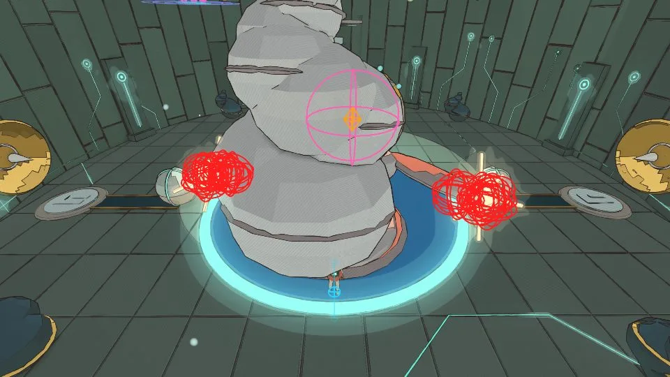

# Camera, v1.90

<!-- audit-scores
overall: none
headline: All 21 browser camera runs pass; tight lock-on remains near the visibility limit, with one guardian turn requiring follow-up
date: 2026-10-20
-->

Frozen source `c5449ab6c`. `node scripts/camera-qc/sim-guardians.mjs` completed 24.30 s, exit 0, no stderr. This checks rig logic with temple collision, not browser cadence or a real controller. Generated Keeper/Elder bodies now load from disk (`sim-guardians.mjs:37–40`); the stale procedural-body limitation from v1.87 no longer applies to this run.

## Fresh guardian framing

Every arena’s sampled positions frame traveller, feet and floor. Tall guardians still have a cropped top at some positions; “framed” is the harness’s combat visibility criterion, not a claim of whole-body visibility everywhere. The generated Keeper is wholly framed 5/5 and Elder 10/10, with worst top 100%. Preserve the separate whole-body counts below.

```text
desert       the Keeper of the cistern  box 3.3×7.3×7.8  framed 5/5 (whole 5, both seen 5)  worst: him 100% feet 100% floor 100% it 100% (top 100%)  arm 4.8–6.3 m
incal        the warden                 box 9.2×11.2×9.1  framed 10/10 (whole 6, both seen 10)  worst: him 100% feet 100% floor 100% it 100% (top 0%)  arm 4.8–9.8 m
arzach       the Elder                  box 6.3×6.6×4.9  framed 10/10 (whole 10, both seen 10)  worst: him 100% feet 100% floor 100% it 100% (top 100%)  arm 4.8–7.4 m
arzach2      the Cloud-Mother           box 14.9×6.5×15.7  framed 10/10 (whole 8, both seen 10)  worst: him 100% feet 100% floor 100% it 100% (top 0%)  arm 4.8–9.2 m
perdide      the Mother Snapper         box 13.2×11.9×13.3  framed 12/12 (whole 12, both seen 12)  worst: him 100% feet 100% floor 100% it 100% (top 100%)  arm 7.1–9.8 m
perdide2     the Lampless               box 13.6×5.4×7.2  framed 11/11 (whole 10, both seen 11)  worst: him 100% feet 100% floor 100% it 100% (top 50%)  arm 4.8–13.0 m
edena        the Gardener               box 11.3×6.8×8.4  framed 12/12 (whole 12, both seen 12)  worst: him 100% feet 100% floor 100% it 100% (top 100%)  arm 4.6–5.8 m
underwater   the Listener               box 11.5×12.1×14.4  framed 8/8 (whole 5, both seen 8)  worst: him 100% feet 100% floor 100% it 100% (top 0%)  arm 4.9–9.8 m
garage       the Clockwork Foreman      box 8.0×8.7×8.0  framed 12/12 (whole 12, both seen 12)  worst: him 100% feet 100% floor 100% it 100% (top 100%)  arm 4.4–7.3 m
buried       the Tooth-Warden           box 7.8×10.7×9.0  framed 12/12 (whole 10, both seen 12)  worst: him 100% feet 100% floor 100% it 100% (top 50%)  arm 4.8–9.3 m
moonfoundry  the Last Founder           box 8.2×8.7×7.6  framed 12/12 (whole 12, both seen 12)  worst: him 100% feet 100% floor 100% it 100% (top 100%)  arm 4.4–7.3 m
spheres      the Echo                   box 8.7×11.0×10.9  framed 12/12 (whole 10, both seen 12)  worst: him 100% feet 100% floor 100% it 100% (top 0%)  arm 4.9–14.2 m
spacecity    the Anchor-Warden          box 13.2×8.3×13.2  framed 11/11 (whole 11, both seen 11)  worst: him 100% feet 100% floor 100% it 100% (top 100%)  arm 3.7–6.8 m
bazaar       the First Sign             box 8.6×16.0×7.3  framed 12/12 (whole 8, both seen 12)  worst: him 100% feet 100% floor 100% it 100% (top 0%)  arm 4.8–13.5 m
```

## Additional fresh Node walks

Ante-lock three seeded runs green: foe hidden 4.9/4.7/4.8%, roughness 0.79/0.97/0.80 cm. Desert shop green, roughness 0.82 cm. Five of six train paths green; train-run is RED on roughness 1.62 cm against 1.5 cm (pops 1, jumps 2, spins 2, clipping 0.2%). The train script exits 0 even for a red row, so process success is not a passing verdict. These simpler Node paths differ from the browser’s actual player/crowd and do not replace browser checks. Raw logs camera-{lock, shop, train}.log; elapsed 1.29/1.59/1.13 s.

## Complete browser suite

Frozen c5449ab6c, Medium, seed 1, 1280×720, fixed 60 Hz simulation with the prescribed jittered repeats. All 17 scenarios / 21 runs completed green, exit 0, in about ten minutes (initial guarded boot 02:33:22 UTC, report 02:43:22). Startup and audible-preference reload both verified muted Sound, zero master gain, and a blocked hardware destination before navigation. Raw proof: `camera/mute-proof.jsonl`.

The simpler Node train-run roughness failure did not reproduce in the full game (0.84 cm versus 1.62 cm Node). Ante-lock is still borderline: foe hidden 10.0%, 9.5%, 9.8% in three runs. All ten generated worst-frame sheets were inspected. They show the traveller masking the small blot when backed toward the passage; open arena lock is clearer (2.0–2.3% hidden). This is a retained visibility limitation, not a new all-green claim about combat readability.

Guardian-lock includes one abrupt 1527°/s orientation event at t 109.49, with a wall-filled worst image despite smooth recorded rig positions/yaw. It stays under the events-per-minute limit, but deserves a bounded replay tracing camera orientation writers before a specific production fix is recommended. The recorded forward vector jumps from (-0.0214, -0.2383, 0.9710) to (0.4099, -0.1836, 0.8935) while the target remains 19.42 m away. Instrument the framing branch/reset at `src/player.js:4082–4093` and the adjacent two-subject branch; this localizes the investigation without claiming a confirmed cause. Do not infer a persistent camera failure from a single sampled image. Rising-pillar's one path jump retains a readable overhead scene. Ship wall-pushing enters the documented close camera/body-hide mode; the frozen old ship is tested, not the newly landed caravan.

Train-deck reports two skipped path waypoints after the runner's two-second no-progress timeout (`adapted/camera-run.mjs:121–123`). Stable camera samples do not prove that entire prescribed route was traversed. Inspect that path separately if navigation acceptance is required.

Recommendations: prioritize the small-foe/body overlap in confined lock-on (`src/player.js`, CameraRig lock framing), then trace the isolated guardian orientation event. Preserve intentional short-arm ship behavior. Physical controller comfort, Unity pacing and device performance remain unmeasured in this assignment. This skill reports metrics rather than a fabricated overall numeric score.

| scenario | verdict | s | fps | pops | jumps | look | spins | pop max (m) | jump max (m) | spin p95 (°/s) | clip | in body | hidden | out | rev/s | rough (cm) | arm (m) | foe hidden | framing |
|---|---|---|---|---|---|---|---|---|---|---|---|---|---|---|---|---|---|---|---|
| train-walk | green | 42 | 60 | 0 | 0 | 0 | 0 | 0.09 | 0.1 | 0 | 0.0 % | 0.0 % | 0.0 % | 0.0 % | 0 | 0.53 | 1.73–4.8 | - | 32 % |
| train-run | green | 22.5 | 60 | 0 | 0 | 0 | 0 | 0.09 | 0.1 | 0 | 0.0 % | 0.0 % | 0.0 % | 0.0 % | 0.22 | 0.84 | 0.99–4.8 | - | 30 % |
| train-turns | green | 14.9 | 60 | 0 | 0 | 0 | 0 | 0.07 | 0.07 | 0 | 0.0 % | 0.0 % | 0.0 % | 0.0 % | 0 | 0.58 | 1.43–1.9 | - | - |
| train-sleeper | green | 14.7 | 60 | 0 | 0 | 0 | 0 | 0.1 | 0.1 | 27 | 0.0 % | 0.0 % | 0.0 % | 0.0 % | 0.27 | 0.77 | 0.55–1.9 | - | - |
| train-jumps | green | 7.8 | 60 | 0 | 0 | 0 | 1 | 0.08 | 0.08 | 0 | 0.0 % | 0.0 % | 0.0 % | 0.0 % | 0.38 | 1.31 | 1.27–1.9 | - | - |
| train-roof | green | 24 | 60 | 0 | 0 | 0 | 0 | 0.05 | 0.02 | 0 | 0.0 % | 0.0 % | 0.0 % | 0.0 % | 0 | 0.26 | 2.64–4.8 | - | 32 % |
| train-deck | green | 24.8 | 60 | 0 | 0 | 0 | 0 | 0.1 | 0.1 | 0 | 0.0 % | 0.0 % | 0.0 % | 0.0 % | 0.12 | 0.75 | 1.91–4.8 | - | 34 % |
| desert-open | green | 28.1 | 60 | 0 | 0 | 0 | 0 | 0 | 0.04 | 0 | 0.0 % | 0.0 % | 0.0 % | 0.0 % | 0 | 0.56 | 4.8–4.8 | - | 31 % |
| desert-shop | green | 7.8 | 60 | 0 | 0 | 0 | 0 | 0.08 | 0.05 | 4 | 0.0 % | 0.0 % | 0.0 % | 0.0 % | 0.13 | 0.69 | 0.69–1.9 | - | - |
| ship-walk | green | 84.6 | 60 | 0 | 0 | 0 | 0 | 0.09 | 0.09 | 48 | 0.0 % | 0.1 % | 0.0 % | 0.5 % | 0.14 | 0.59 | 0.04–1.91 | - | - |
| bazaar-streets | green | 30.2 | 60 | 0 | 0 | 0 | 0 | 0 | 0.01 | 0 | 0.0 % | 0.0 % | 0.0 % | 0.0 % | 0 | 0.04 | 4.8–4.8 | - | 33 % |
| ante-lock | green | 17.2 | 60 | 0 | 0 | 0 | 0 | 0.12 | 0.11 | 148 | 0.0 % | 0.0 % | 0.0 % | 0.0 % | 0.58 | 1.10 | 0.59–4.43 | 10.0 % | - |
| ante-lock #2 | green | 17.4 | 60 | 0 | 0 | 0 | 0 | 0.1 | 0.1 | 154 | 0.0 % | 0.0 % | 0.0 % | 0.0 % | 0.75 | 1.27 | 0.6–4.43 | 9.5 % | - |
| ante-lock #3 | green | 17.2 | 60 | 0 | 0 | 0 | 0 | 0.14 | 0.1 | 155 | 0.0 % | 0.0 % | 0.0 % | 0.0 % | 0.58 | 1.15 | 0.58–4.43 | 9.8 % | - |
| guardian-lock | green | 21.3 | 60 | 0 | 0 | 0 | 1 | 0.08 | 0.09 | 34 | 0.0 % | 0.0 % | 0.0 % | 0.0 % | 0.28 | 0.51 | 1.5–11.52 | 0.0 % | - |
| snapper-lock | green | 21.3 | 60 | 0 | 0 | 0 | 0 | 0.11 | 0.04 | 40 | 0.0 % | 0.0 % | 0.0 % | 0.0 % | 0.09 | 0.51 | 2.6–9.51 | 0.0 % | - |
| incal-pillar | green | 25.1 | 60 | 0 | 1 | 0 | 0 | 0.02 | 0.2 | 20 | 0.0 % | 0.0 % | 0.0 % | 0.0 % | 0 | 0.73 | 12.69–13.4 | - | 13 % |
| arena-lock | green | 21.3 | 60 | 0 | 0 | 0 | 0 | 0 | 0.02 | 181 | 0.0 % | 0.0 % | 0.0 % | 0.0 % | 0 | 0.84 | 4.8–4.8 | 2.0 % | 32 % |
| arena-lock #2 | green | 21.2 | 60 | 0 | 0 | 0 | 0 | 0 | 0.05 | 177 | 0.0 % | 0.0 % | 0.0 % | 0.0 % | 0 | 1.23 | 4.8–4.8 | 2.1 % | 32 % |
| arena-lock #3 | green | 21.2 | 60 | 0 | 0 | 0 | 0 | 0 | 0.04 | 173 | 0.0 % | 0.0 % | 0.0 % | 0.0 % | 0 | 1.17 | 4.8–4.8 | 2.3 % | 32 % |
| arena-lock-lizard | green | 17.7 | 60 | 0 | 0 | 0 | 0 | 0 | 0.02 | 110 | 0.0 % | 0.0 % | 0.0 % | 0.0 % | 0 | 0.36 | 4.8–4.8 | 1.1 % | 32 % |


## Additional fresh own-hall framing

Fourteen actual halls were inspected, distinct from the automated scenario suite. Early 900 ms lock captures were invalid for whole-body grading: Keeper fitK had only reached 0.80 and its mouth lay above the viewport. The 6 s diagnostic and remaining 13 settled recaptures have real locked rigs and fitK≈1, with mouth/traveller anchors in frame. Underwater's upper shell, Moon Foundry's chimney and Bazaar's top ring still crop the upper edge in their staged close encounters; Underwater partly overlaps the traveller at its base. These are bounded whole-body margin limitations, not lost lock or evidence that the automated 21 green scenarios failed. Recommend reviewing declared guardian framing bounds against full rendered bodies at close range. Evidence and per-view classification: cua-qa/visual-review.md; hall-refined-*-settle-6000 exports.

Browser provenance: the earlier 21-run automated camera suite used Chrome. The later original-hall and settled-lock diagnostics used the internal Codex browser operated through CUA. Their evidence and limitations are kept separate above.

## Settled framing evidence



The Listener’s upper shell extends beyond the frame, while the traveller remains at its base. The coloured spheres and rings are audit overlays showing combat anchors; they are not shipped effects. This is the accepted six-second settled capture, not the excluded 900 ms attempt. It supports a bounded whole-body framing limitation rather than a lost camera lock.
