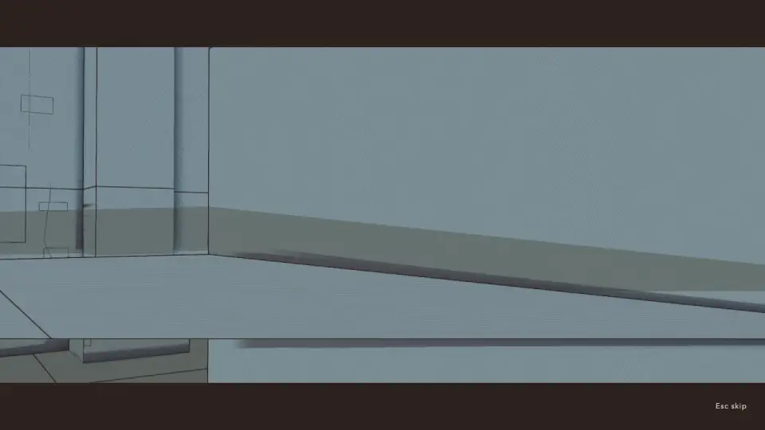
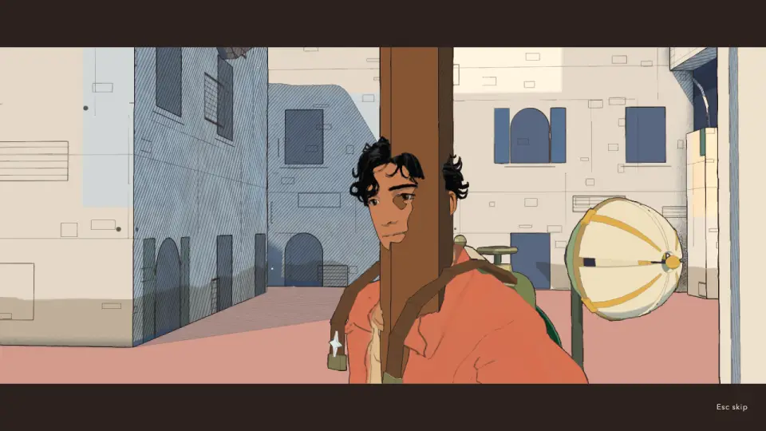
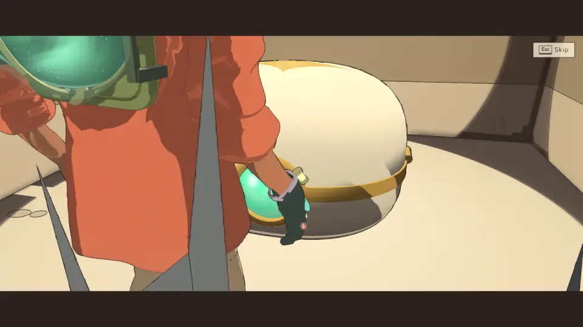
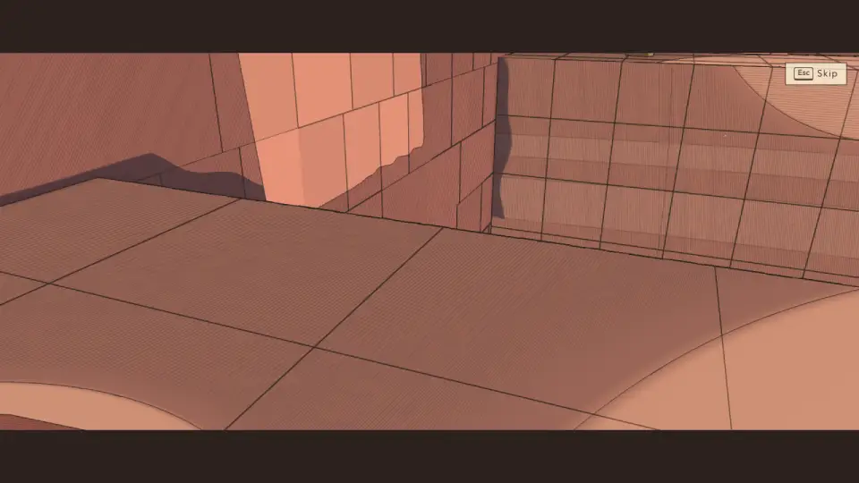
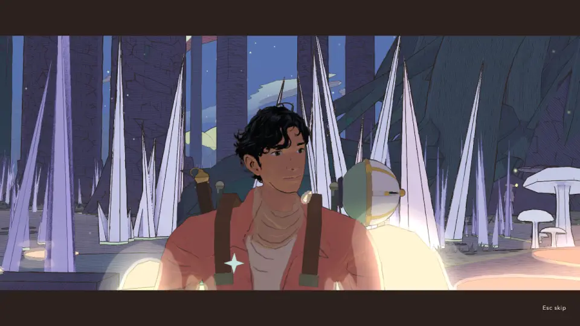
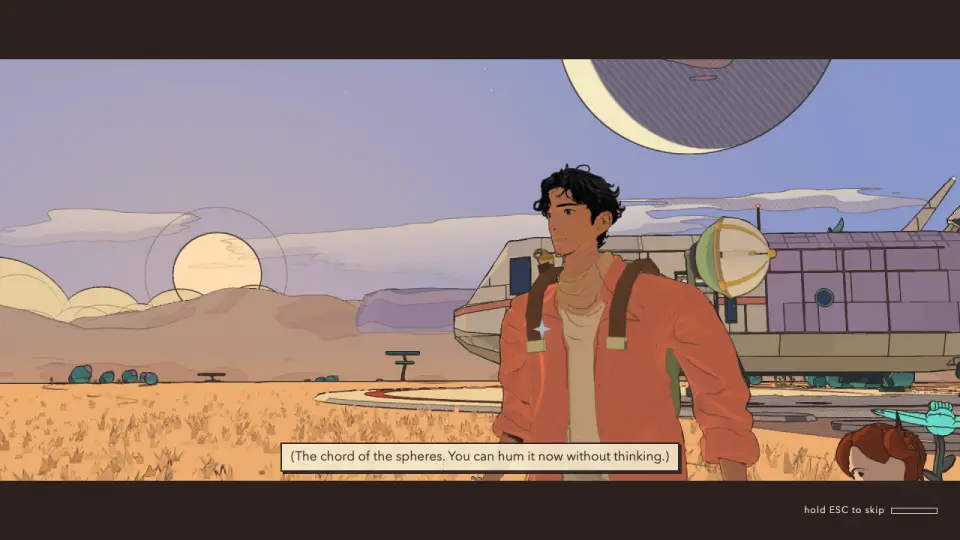
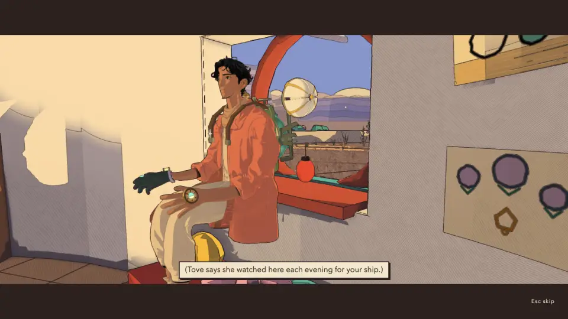
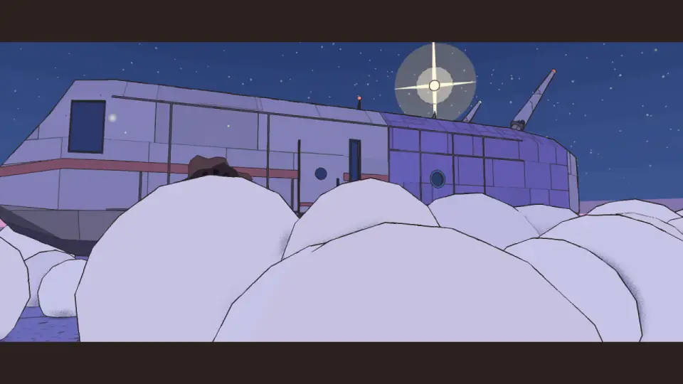

# Cinematics QC, v1.66 (2026-10-13): every moment, story scene, arrival and recording again, 18 boxes, five fixes

<!-- audit-scores
overall: 4.51 / 5
label: the mean of tech (4.79) and interest (4.24) over the 107 cinematics, after the fixes (80 run, 27 boxes carried over from v1.6)
version: 1.66
date: 2026-10-13
-->

The second full cinematics pass (issue #226), after the [v1.6 baseline](../systems/cinematics-qc.md) of 2026-10-09
(91 cinematics then, 4.64: tech 4.96, interest 4.33). The review page lists 107 now: World moments 17 (the tree's
lighting, #239, is new since the skill's count of 106), Story 5, Recordings 17, Travel 22, Items 45, Trailer 1. Much
landed since: the HUD rework, the desert batch, the Givers' watcher, the minigames' hosts, the Tripo Keeper, the
fragments re-placed, Anselm's shop, the lore page (v1.62–v1.66).

## Setup

- `scripts/cinematics-qc.mjs` on this checkout, one Vite (port 5991/5992) and one muted headless Chrome
  (`--mute-audio`, its profile from `scripts/temp-dirs.mjs`), 1280 × 720, High, Apple M-series on Metal, one capture
  at a time on a machine at load 20–65 (`--rest 4`). Frames every 1 s, 8 kept per cinematic plus the hand-back.
- **Run: 80.** All 17 world moments, the 5 story scenes, the 17 recordings, the 22 departures and arrivals, the
  trailer (frames only), and 18 of the 45 boxes: every box new since v1.6 (the lift valve, the gun, the Givers'
  blade and guard, the light-down glass, the three yards' boxes, the founders', moorers' and divers' boxes) and four
  of the old (the backpack, the star, the hook, the lens). **Carried over: 27 boxes**, their v1.6 scores kept (the
  box scene's code is shared; the 18 run found the faults that matter, below).
- The fixed ids re-run after each fix (`--only`), and a skip pass (`--skip`): the water 1.6 s, the tree's lighting
  2.0 s, Vael II's bell 1.7 s, the clock 1.6 s, recording 12 1.6 s, the desert's arrival 2.2 s (he is set at the
  ramp's foot), the gun's box 3.0 s; no menu opened.
- Every sheet looked at by eye; the scores are by eye, the script's only where it agreed.

### What changed in the skill since the last pass

`git diff be75fda2 HEAD -- .claude/skills/cinematics-qc`: the v1.6 pass is named as the baseline (91 then); the
verdicts go into the committed `docs/systems/cinematics-qc-notes.json` (read by the audits page and imported by the
review page) instead of only the browser's notes; creative rework goes into GitHub issues, not `TODO.md`; a
`--quality` preset flag; the counts (106, the recordings 15–20 minutes). The rubric itself is unchanged.

### The last pass's findings, rechecked

- Notices over scenes: held. No toast, card or quest notice over any scene; they come after the hand-back.
- The pale star by his face: held (on his lapel in every close-up).
- The lens in the ground: held (no `embedded` frame anywhere).
- The Lantern's arrival and the City-Shaft's LOOK UP billboard: held. The Spheres temple's box: on its dais.
- The recordings' single push-in: gone. Every recording now cuts between three to eight angles and runs 20–77 s
  (7 to 11 were ~77 s, now 38–46 s); recordings' interest 3.71 → 4.00.
- The home scenes: the stone's two angles and skip tag held; the window seat's head is cut by the bar again as he
  stands (below).
- Loudness: the moments of Vael, Vael II and Lorn now peak at −7 dBFS (the recorded scores since v1.62; v1.6
  measured −27 to −12), just under the −6 flag; everything else −27 to −10.

## Headline findings

1. **The review page staged five world moments wrongly; two never played.** After the merges (Vael carries Vael
   II, Lorn carries Lorn II) the staging branched on the level, so `arzach2.bell` played Vael's bird and
   `perdide2.pools` the crystal's film: two climaxes nobody had looked at since. `desert.flow` and the new
   `desert.lit` failed outright ("postAt of undefined": the lever went with #158), and every desert film was staged
   with the tree already burning (the old-save step read the seeded `ship.powered` as a save past the tree). The
   broadcast was staged on the square below the tower, so its face shot was a wall. The world debug menu plays its
   cinematics through the same staging. All fixed, with a test.
2. **A lens at NaN.** The Space City's arrival drew 3.7 s of black in its descent: over the void the terrain
   answers NaN, and `heightAt?.() ?? site.ground` lets a NaN through, so the lens's height was NaN. Fixed in
   `Ship.groundAt` / `floorAt`; the script now flags a non-finite lens (it had read the black as a still shot).
3. **The yards' boxes are filmed through their bars and from inside their walls.** The founders', moorers' and
   divers' boxes (behind the yards' gates) open on his tank filling half the frame through the bars, and have a
   flat blank frame at ~8 s: the scene pulls the lens in to `max(0.9, hit − 0.25)` m, so a wall nearer than 1.15 m
   leaves it behind the wall. Tech 3 each.
4. **Box closing shots lose him in small rooms.** The Givers' guard ends on an empty corner of the room, the lift
   valve on the lid against the wall, the Givers' blade on his face low in the bottom corner, the gun on him at the
   frame's edge: the four desert interiors, all new since v1.6.
5. **The docked drone crowds every face shot.** The scout drone docked on his tank sits by his left shoulder; the
   moments' `closeUp` (three-quarter, 1.4 m) puts it beside his face, a quarter of the frame, in every world
   moment's last panel and every recording's close. Not a fault of any one film; a framing rule to decide.
6. **The four worlds of v1.40 film their climax in three panels, 7.2–7.6 s.** Under the moments' 8–10 s and four
   panels. The Glass Dunes' clock now has its cogs' panel (9.2 s); the whales, the moon and the cables are left as
   an issue (each needs its beat shown, not invented).
7. **The homecomings hold one shot through the cargo lines.** The first holds one two-shot ~70 s with Lou's head cut
   by the corner; the final's slab shots have his arm filling a third of the frame. Tech 4 → 3.5.

*The Signal Market's last panel, staged on the square: the lens against a wall (fixed: staged at the console).*

*Vael II's bell, once staged by its own part: on the rope's foot, the rope ran through his face (fixed).*

*The founders' yard box: the opening shot through the gate's bars, his tank filling the frame (issue).*

*The Givers' guard's closing shot: floor and wall, no traveller (issue).*

*The docked drone beside his face (Lorn II's close; the same in every world's last panel), and the lit pools
blowing out its lower third.*

*The first homecoming at 86 s: one shot held through the cargo lines, Lou's head in the corner (issue).*

*The window seat's reverse angle: the white, unshaded patch on the wall at the left (issue).*

*Every arrival's touchdown: the dust puffs fill the lower half of the frame for a second (minor).*

## Fixes

| Fix | Files | Test | Re-run |
|---|---|---|---|
| The review page stages a merged world's climax from its own part (`W.parts[part]`, branching on the id's part, not the level) | `src/cinematics-page/runtime.js` | `tests/cinematics-page.test.js` (the staging on a stand-in world) | `arzach2.bell`, `perdide2.pools` play their own films |
| The desert's films: beside the drain's debris (the lever went with #158); the tree's lighting as in play (the water up and seen, the stone in the pack, at the roots' front: `W.setStone()`); the desert's seed carries its quest's version so the tree isn't lit before the stone | `src/cinematics-page/runtime.js` | the same | `desert.flow`, `desert.fill`, `desert.lit` |
| The broadcast staged at the console up the tower, where you play it | `src/cinematics-page/runtime.js` | the same | `bazaar.broadcast` 4.5 → 5 |
| Vael II's face shot from the side the rope is not on (`clearSide`); staged an arm's length from the rope | `src/story/arzach2-moments.js`, `runtime.js` | `tests/moments-arzach2.test.js` (the rope out of D's sightline; `clearSide`) | `arzach2.bell` |
| The Glass Dunes' clock: a fourth panel, low by a great cog turning in the sand (`cogShot`); 7.2 → 9.2 s | `src/story/glassdunes-moments.js` | `tests/moments-glassdunes.test.js` (8–10 s; the cog's panel outside the house, over the sand, the cog in frame) | `glassdunes.clock`, interest 4 → 5 |
| The ship's ground under a lens is never NaN over a void | `src/ship/ship.js` | `tests/ship.test.js` | `arrival.spacecity`: no black frames |
| The QC script flags a lens that is not a number (`badCam`, −1.5) | `scripts/cinematics-qc.mjs` | `tests/cinematics-qc.test.js` | — |

## Proposed issues

Not filed from here (the coordinator files them, label `todo`).

1. **Boxes in the yards: the lens behind the bars and inside the wall.** The founders', moorers' and divers' yard
   boxes open through the gate's bars with his tank filling half the frame, and show a flat blank frame at ~8 s
   (`src/boxes/scene.js` pulls the lens to `max(0.9, hit − 0.25)`, behind a wall nearer than 1.15 m). *Done when:*
   the three play with no blank frame and the opening not through the bars (`--only box.*.court`), and a test fails
   a box lens left behind a surface.
2. **Box closing shots lose him in small rooms.** The Givers' guard ends on an empty corner, the lift valve on the
   lid against the wall, the Givers' blade with his face in the bottom corner, the gun with him at the edge. *Done
   when:* in those four (and with every `--query boxPlan=`), his head is inside the frame's middle 80 % in the
   closing shot; a test on the closing shot in a walled room.
3. **The docked drone beside his face in every close-up.** `closeUp` (src/story/film.js) frames him three-quarter
   from 1.4 m, and the drone docked on the tank sits by his left shoulder, a quarter of the frame. *Done when:* the
   author picks the rule (the close from the other side, a higher lens, or the drone off the shoulder while filmed),
   and every world moment's face panel keeps the drone out of the face's half of the frame (a test on closeUp).
4. **Three-panel climaxes: the whales, the moon, the cables.** `underwater.whales` 7.6 s, `moonfoundry.moon` 7.4 s
   ("every hung moon turns to it" not shown), `spacecity.cables` 7.4 s, all three panels. *Done when:* each has a
   fourth panel showing its beat (as the clock's cogs now), 8–10 s, the face last, a test per world.
5. **The homecomings' cargo lines over one held shot.** The first holds one two-shot ~70 s with Lou's head in the
   corner; the final's slab shots have his arm filling a third of the frame. *Done when:* the cargo lines cut
   between at least three angles, no one cut by the frame's edge, judged from the script's frames.
6. **The recordings' closing punch-in reads as a jump cut.** In 7 of 17 the close comes from the same spot, the fov
   jumping 49 → 36 (call.1, 6, 8, 9, 11, ilen, part.perdide2). *Done when:* the close moves the lens to a new angle
   or pushes in over ~0.5 s, and the script reports no pop there.
7. **The window seat: a white patch in the reverse angle, his head under the bar.** *Done when:* no unshaded face
   in the reverse angle and his head clear of the top bar as he sits and stands.
8. **Arrivals: the touchdown dust reads as beige boulders** (minor). *Done when:* the ship's feet read within a
   second of touchdown (thinner, paler puffs or a higher lens), in every arrival.

## The scores by collection

| Collection | Cinematics | Run | Tech /5 (v1.6 → v1.66) | Interest /5 (v1.6 → v1.66) |
|---|---|---|---|---|
| Story | 5 | 5 | 4.40 → 4.00 | 4.20 → 4.00 |
| World moments | 17 | 17 | 4.97 → 4.91 | 4.31 → 4.41 |
| Recordings | 17 | 17 | 5.00 → 4.79 | 3.71 → 4.00 |
| Travel | 22 | 22 | 4.95 → 4.95 | 3.95 → 3.95 |
| Items | 45 | 18 | 5.00 → 4.73 | 4.55 → 4.42 |
| Trailer | 1 | 1 | 5.00 → 5.00 | 5.00 → 5.00 |

## The table

Tech and interest: v1.6 → v1.66, by eye after the fixes (a new cinematic: its score alone). The first-run
faults the fixes cleared are in Problems. "Carried over": not re-run, the v1.6 score kept.

| Cinematic | Group | Length | Cuts+1 | Tech /5 | Interest /5 | Problems found | Fixed | Run |
|---|---|---|---|---|---|---|---|---|
| `prologue` · The landing · prologue | Story | 150 s (times out at the walk) | 4 | 4 → 4 | 5 → 5 | As before: the script waits at the walk (it can't press the voicemail), so the frames stop at the cockpit; the docked drone sits on his tank in every shot from behind | — | run |
| `desert.flow` · the water runs for the first time | World moments | 11.4 s | 6 | 5 → 5 | 4 → 4 | First run: did not play on the review page (its staging stood him by the lever that went with issue #158: "reading postAt of undefined"); every desert film was also staged with the tree already lit (the old-save step read the seeded ship.powered as a save past the tree) | Staged beside the drain's debris; the desert's films on a save with its quest's version | run |
| `desert.fill` · the empty tank fills | World moments | 11.1 s | 3 | 5 → 5 | 4 → 4 | The script's pop at 5.9 s is the cut from close on the glass to over his shoulder (a size change, accepted); the docked drone beside his face in D | — | run |
| `desert.lit` · the great tree catches, seen from the roots out to the whole of it over the city | World moments | 10.1 s | 3 | 4.5 | 5 | New (#239). First runs: refused on the review page (fell to the generic branch, then the tree already lit by the old-save step). By eye: A is his back against the trunk, the stone going into the roots unseen; then the spark up the bark and the long crane to the whole tree, strong; no face shot (by design); villagers' speech bubbles over C | Staged as in play: the water up and seen, the stone in his pack, at the roots' front; the desert seed fixed | run |
| `arzach.bird` · the bird comes down out of the haze and bows | World moments | 10.4 s | 4 | 5 → 5 | 5 → 5 | The drone on his shoulder beside his face in C | — | run |
| `arzach2.bell` · the bell rings after thirty years and the cloud settles | World moments | 9.7 s | 4 | 5 → 5 | 5 → 5 | First run: the review page played Vael's bird instead (merged world: staged by the level, not the part). Then: staged on the rope's foot, the rope ran down through his face in D | Staged by the part (W.parts.arzach2), an arm's length from the rope; D filmed from the side the rope is not on (clearSide) | run |
| `perdide.crystal` · the cave sings the light’s phrase back to the splinter | World moments | 9.8 s | 4 | 5 → 5 | 4 → 4 | The drone beside his face in D | — | run |
| `perdide2.pools` · the last dark pool is lit and the saucer blinks back across the water | World moments | 10.0 s | 4 | 5 → 4.5 | 4 → 4 | First run: the review page played the crystal's film (merged world). Then: the lit pools' glow blows out the lower third of his face shot | Staged by the part (W.parts.perdide2) | run |
| `edena.terraces` · the cistern gate gives way and the flood takes the terraces | World moments | 8.8 s | 4 | 5 → 5 | 5 → 5 | — (a villager's "Get off the slope!" bubble in C, diegetic) | — | run |
| `incal.lodestar` · the Lodestar lights again over the shaft | World moments | 9.0 s | 4 | 5 → 5 | 4 → 4 | — | — | run |
| `glassdunes.clock` · the clock over the Clock-House comes round and keeps time, and the great cogs turn in the sand | World moments | 9.2 s | 4 | 5 → 5 | 4 → 5 | Three panels in 7.2 s (under the moments' 8–10 s), the cogs of its beat only small in A | A fourth panel: low by a great cog turning in the sand, the house past it (cogShot); 9.2 s | run |
| `buried.wheel` · the great wheel turns, and goes on turning | World moments | 9.4 s | 4 | 5 → 5 | 5 → 5 | — | — | run |
| `spheres.chord` · the pole rings with the three spheres’ chord | World moments | 8.6 s | 4 | 5 → 5 | 4 → 4 | — | — | run |
| `bazaar.broadcast` · the silent tower broadcasts again | World moments | 9.6 s | 4 | 5 → 5 | 4 → 4 | First run: his face shot was a flat wall (48 frames grazing): the review staged him on the square, not at the console up the tower where you play it | Staged at the console | run |
| `underwater.whales` · the whales come back to the glass and sing, the light’s note first | World moments | 7.6 s | 3 | 4.5 → 4.5 | 4 → 4 | Three panels in 7.6 s; B the whale in the dark sea, three frames nearly empty (by design, but hard to read) | — | run |
| `moonfoundry.moon` · the last moon is lifted out of its mould onto a hook, and every hung moon turns to it | World moments | 7.4 s | 3 | 5 → 5 | 4 → 4 | Three panels in 7.4 s; "every hung moon turns to it" not shown (one moon in B) | — | run |
| `spacecity.cables` · the cables draw taut and the islands come home together, lamps running along them | World moments | 7.4 s | 3 | 5 → 5 | 4 → 4 | Three panels in 7.4 s | — | run |
| `lantern.arrive` · The light returns to the Lantern | World moments | 10.0 s | 3 | 5 → 5 | 5 → 5 | The last line's subtitle fades over his chest in the face shot | — | run |
| `homecoming.first` · First homecoming | Story | 120 s (times out) | 19 | 4 → 3.5 | 4 → 3 | After the landing, ~70 s of cargo lines over one held two-shot (him and the ship), Lou's head cut by the frame's corner | — | run |
| `homecoming.final` · Final homecoming | Story | 120 s (times out) | 15 | 4 → 3.5 | 4 → 4 | At the slab, his arm and back fill a third of the frame for ~35 s; Lou's close cut at the chest | — | run |
| `home.homage` · At the stone | Story | 14.6 s | 3 | 5 → 5 | 4 → 4 | — | — | run |
| `home.windowSeat` · The window seat | Story | 9.5 s | 3 | 5 → 4 | 4 → 4 | The reverse angle has a white, unlit patch on the wall at the left (a see-through or unshaded face); his head touches the top bar as he stands | — | run |
| `call.1` · Recording 1 · Home | Recordings | 27.6 s | 3 | 5 → 4.5 | 4 → 4 | Multi-angle now; the closing punch-in from the same spot (fov 49 → 36) reads as a jump cut | — | run |
| `call.2` · Recording 2 · ·· WORN ·· | Recordings | 37.0 s | 3 | 5 → 5 | 4 → 4 | — | — | run |
| `call.3` · Recording 3 · LOGGED 19 YEARS AGO | Recordings | 39.3 s | 4 | 5 → 5 | 4 → 4 | — | — | run |
| `call.4` · Recording 4 · LOGGED 16 YEARS AGO | Recordings | 59.5 s | 7 | 5 → 5 | 4 → 4 | — | — | run |
| `call.5` · Recording 5 · LOGGED 4 YEARS AGO | Recordings | 55.7 s | 5 | 5 → 5 | 4 → 4 | — (a 10.7 s hold, on the busts) | — | run |
| `call.6` · Recording 6 · THE LAST RECORDING | Recordings | 77.0 s | 8 | 5 → 4.5 | 4 → 4 | The closing punch-in reads as a jump cut; the drone beside his face in the close | — | run |
| `call.7` · Recording 7 · THE LAST RECORDING | Recordings | 45.0 s | 6 | 5 → 5 | 4 → 4 | — (45 s, was 77) | — | run |
| `call.8` · Recording 8 · THE LAST RECORDING | Recordings | 40.9 s | 4 | 5 → 4.5 | 4 → 4 | The closing punch-in (36.1 s) reads as a jump cut | — | run |
| `call.9` · Recording 9 · THE LAST RECORDING | Recordings | 45.8 s | 4 | 5 → 4.5 | 4 → 4 | The closing punch-in reads as a jump cut | — | run |
| `call.10` · Recording 10 · THE LAST RECORDING | Recordings | 38.5 s | 4 | 5 → 5 | 3 → 4 | — (four angles now, was one push-in) | — | run |
| `call.11` · Recording 11 · THE LAST RECORDING | Recordings | 41.2 s | 4 | 5 → 4.5 | 3 → 4 | The closing punch-in reads as a jump cut | — | run |
| `call.12` · Recording 12 · THE LAST RECORDING | Recordings | 42.3 s | 5 | 5 → 5 | 3 → 4 | —; skip ends it in 1.6 s | — | run |
| `call.ilen` · Recording ilen · FOR WHEN HE ASKS | Recordings | 58.6 s | 5 | 5 → 4.5 | 4 → 4 | Two punch-ins (24.6, 52.1 s) from the same spot | — | run |
| `call.ilen.after` · Recording ilen.after · LOGGED 5 YEARS AGO | Recordings | 32.1 s | 3 | 5 → 5 | 4 → 4 | — | — | run |
| `call.trace` · Recording trace · LOGGED 3 YEARS AGO | Recordings | 41.3 s | 3 | 5 → 5 | 4 → 4 | — | — | run |
| `call.part.arzach2` · Recording · Vael II: The Sky Stones · LOGGED 20 YEARS AGO | Recordings | 20.2 s | 4 | 5 → 5 | 3 → 4 | — (short, to the point, four angles) | — | run |
| `call.part.perdide2` · Recording · Lorn II: The Deep Wood · LOGGED 8 YEARS AGO | Recordings | 42.9 s | 4 | 5 → 4.5 | 3 → 4 | The closing punch-in reads as a jump cut | — | run |
| `arrival.desert` · Arrival · The Desert | Travel | 18.7 s | 6 | 5 → 5 | 4 → 4 | — (the touchdown's dust fills the lower frame a second, as in every arrival); skip ends it in 2.2 s and sets him at the ramp's foot | — | run |
| `arrival.arzach` · Arrival · Vael | Travel | 17.4 s | 6 | 5 → 5 | 4 → 4 | — | — | run |
| `arrival.perdide` · Arrival · Lorn | Travel | 16.5 s | 6 | 5 → 5 | 4 → 4 | — | — | run |
| `arrival.edena` · Arrival · Viridel | Travel | 16.2 s | 6 | 5 → 5 | 4 → 4 | — | — | run |
| `arrival.underwater` · Arrival · The Underwater City | Travel | 16.6 s | 6 | 5 → 5 | 4 → 4 | — (dark water reads as near-empty frames, by design) | — | run |
| `arrival.incal` · Arrival · The City-Shaft | Travel | 16.2 s | 6 | 5 → 5 | 4 → 4 | — (the dust puffs hide the ship's lower half in the touchdown shot) | — | run |
| `arrival.glassdunes` · Arrival · The Glass Dunes | Travel | 16.1 s | 6 | 5 → 5 | 4 → 4 | — | — | run |
| `arrival.buried` · Arrival · The Buried Machine | Travel | 17.0 s | 6 | 5 → 5 | 4 → 4 | — | — | run |
| `arrival.moonfoundry` · Arrival · The Moon Foundry | Travel | 16.2 s | 6 | 5 → 5 | 4 → 4 | — | — | run |
| `arrival.spheres` · Arrival · The Garden of Spheres | Travel | 16.3 s | 6 | 5 → 5 | 4 → 4 | — | — | run |
| `arrival.spacecity` · Arrival · The City Floating in Space | Travel | 16.2 s | 6 | 5 → 5 | 4 → 4 | First run: 3.7 s of black frames in the descent (7–10 s): the lens's height came back NaN over the void (the terrain answers NaN there, and `??` let it through) | Ship.groundAt / floorAt fall back on a finite ground | run |
| `arrival.bazaar` · Arrival · The Signal Market | Travel | 16.3 s | 6 | 5 → 5 | 4 → 4 | — | — | run |
| `arrival.mangrove` · Arrival · The White Mangrove | Travel | 16.2 s | 6 | 5 → 5 | 4 → 4 | — (night: near-empty frames by design) | — | run |
| `arrival.waterfall` · Arrival · The City Behind the Waterfall | Travel | 16.2 s | 6 | 5 → 5 | 4 → 4 | — | — | run |
| `arrival.saltharbour` · Arrival · The Salt Harbour | Travel | 16.2 s | 6 | 5 → 5 | 4 → 4 | — | — | run |
| `arrival.antennas` · Arrival · The Forest of Antennas | Travel | 16.5 s | 6 | 5 → 5 | 4 → 4 | — | — | run |
| `arrival.eclipse` · Arrival · The City During the Eclipse | Travel | 16.2 s | 6 | 5 → 5 | 4 → 4 | — (the dust puffs fill the lower half of the touchdown shot) | — | run |
| `arrival.fallenring` · Arrival · The Fallen Ring | Travel | 16.2 s | 6 | 5 → 5 | 4 → 4 | — | — | run |
| `arrival.underside` · Arrival · The Underside | Travel | 16.1 s | 6 | 5 → 5 | 4 → 4 | — | — | run |
| `arrival.home` · Arrival · Home | Travel | 45.2 s (waits at the cargo check) | 1 | 4 → 4 | 3 → 3 | As before: waits on the cargo check, one held look out of the windshield | — | run |
| `arrival.lantern` · Arrival · The Lantern | Travel | 16.1 s | 6 | 5 → 5 | 4 → 4 | — | — | run |
| `takeoff` · Departure · takeoff | Travel | 7.4 s | 2 | 5 → 5 | 4 → 4 | — | — | run |
| `box.desert.backpack` · Makers’ box · backpack | Items | 9.2 s | 1 | 5 → 5 | 5 → 5 | — | — | run |
| `box.desert.lift` · Makers’ box · doublejump | Items | 9.9 s | 1 | 4 | 4 | First look (new in v1.38): in the small round room the first frame is his back at arm's length, and the closing frame is the open lid against the wall, him out of it | — | run |
| `box.desert.gun` · Makers’ box · gun | Items | 9.9 s | 2 | 4.5 | 4 | First look: the closing shot has him at the frame's edge behind the lid; skip ends it in 3.0 s | — | run |
| `box.desert.star` · Makers’ box · star | Items | 10.5 s | 4 | 5 → 5 | 5 → 5 | — | — | run |
| `box.desert.temple.sword` · Makers’ box · sword | Items | 9.8 s | 1 | 4 | 4 | First look: the closing close-up puts his face low in the bottom-right corner, half under the bar | — | run |
| `box.desert.temple.shield` · Makers’ box · shield | Items | 9.8 s | 3 | 3.5 | 4 | First look: the closing frame is an empty corner of the room (floor and wall, no traveller, no chest) | — | run |
| `box.incal.soles` · Makers’ box · soles | Items | 8.6 s | 2 | 5 → 5 | 4 → 4 | Carried over | — | carried over |
| `box.incal.temple.jetpack` · Makers’ box · wardenbellows | Items | 8.7 s | 1 | 5 → 5 | 5 → 5 | Carried over | — | carried over |
| `box.incal.sunglass` · Makers’ box · sunglass | Items | 9.7 s | 4 | 4.5 | 4 | First look (new in v1.52): the opening shots frame his legs and the chest; his head cut by the top bar in the close | — | run |
| `box.incal.bridge` · Makers’ box · bridge | Items | 8.7 s | 1 | 5 → 5 | 5 → 5 | Carried over | — | carried over |
| `box.arzach.hush` · Makers’ box · hush | Items | 8.7 s | 2 | 5 → 5 | 4 → 4 | Carried over | — | carried over |
| `box.arzach.temple.glider` · Makers’ box · glider | Items | 8.7 s | 2 | 5 → 5 | 5 → 5 | Carried over | — | carried over |
| `box.arzach.hook` · Makers’ box · hook | Items | 9.9 s | 3 | 5 → 5 | 5 → 5 | — | — | run |
| `box.arzach2.scarf` · Makers’ box · scarf | Items | 8.7 s | 1 | 5 → 5 | 4 → 4 | Carried over | — | carried over |
| `box.arzach2.temple.bell` · Makers’ box · bell | Items | 10.1 s | 3 | 5 → 5 | 5 → 5 | Carried over | — | carried over |
| `box.arzach2.springs` · Makers’ box · springs | Items | 8.7 s | 2 | 5 → 5 | 5 → 5 | Carried over | — | carried over |
| `box.garage.level` · Makers’ box · level | Items | 9.5 s | 3 | 5 → 5 | 4 → 4 | Carried over | — | carried over |
| `box.garage.temple.coil` · Makers’ box · coil | Items | 9.6 s | 2 | 5 → 5 | 5 → 5 | Carried over | — | carried over |
| `box.garage.magnet` · Makers’ box · magnet | Items | 8.6 s | 1 | 5 → 5 | 5 → 5 | Carried over | — | carried over |
| `box.buried.resin` · Makers’ box · resin | Items | 8.6 s | 1 | 5 → 5 | 4 → 4 | Carried over | — | carried over |
| `box.buried.temple.cell` · Makers’ box · cell | Items | 8.7 s | 1 | 5 → 5 | 5 → 5 | Carried over | — | carried over |
| `box.buried.monocle` · Makers’ box · monocle | Items | 8.6 s | 1 | 5 → 5 | 5 → 5 | Carried over | — | carried over |
| `box.edena.pouch` · Makers’ box · pouch | Items | 8.7 s | 1 | 5 → 5 | 4 → 4 | Carried over | — | carried over |
| `box.edena.temple.bloom` · Makers’ box · bloom | Items | 8.7 s | 1 | 5 → 5 | 5 → 5 | Carried over | — | carried over |
| `box.edena.bubble` · Makers’ box · bubble | Items | 8.7 s | 2 | 5 → 5 | 5 → 5 | Carried over | — | carried over |
| `box.spheres.shell` · Makers’ box · shell | Items | 10.2 s | 3 | 5 → 5 | 5 → 5 | Carried over | — | carried over |
| `box.spheres.temple.lens` · Makers’ box · lens | Items | 10.3 s | 3 | 5 → 5 | 5 → 5 | — (on its dais, as fixed in v1.6) | — | run |
| `box.spheres.bomb` · Makers’ box · bomb | Items | 8.7 s | 1 | 5 → 5 | 5 → 5 | Carried over | — | carried over |
| `box.perdide.reed` · Makers’ box · reed | Items | 8.7 s | 2 | 5 → 5 | 4 → 4 | Carried over | — | carried over |
| `box.perdide.temple.stun` · Makers’ box · stun | Items | 8.6 s | 1 | 5 → 5 | 5 → 5 | Carried over | — | carried over |
| `box.perdide.fan` · Makers’ box · fan | Items | 8.6 s | 1 | 5 → 5 | 5 → 5 | Carried over | — | carried over |
| `box.perdide2.moss` · Makers’ box · moss | Items | 8.7 s | 2 | 5 → 5 | 4 → 4 | Carried over | — | carried over |
| `box.perdide2.temple.lantern` · Makers’ box · lantern | Items | 8.7 s | 1 | 5 → 5 | 4 → 4 | Carried over | — | carried over |
| `box.perdide2.boomerang` · Makers’ box · boomerang | Items | 8.6 s | 1 | 5 → 5 | 5 → 5 | Carried over | — | carried over |
| `box.bazaar.temple.echo` · Makers’ box · echo | Items | 8.7 s | 1 | 5 → 5 | 5 → 5 | Carried over | — | carried over |
| `box.bazaar.recall` · Makers’ box · recall | Items | 8.7 s | 1 | 5 → 5 | 5 → 5 | Carried over | — | carried over |
| `box.moonfoundry.court` · Makers’ box · keeper | Items | 9.6 s | 4 | 5 → 3 | 4 → 3 | The opening shots through the yard's bars with his tank filling half the frame; 7 s a top-down cut across by a bar; ~8 s a blank frame (the lens behind the yard's wall); the close behind bars | — | run |
| `box.moonfoundry.bellows` · Makers’ box · bellows | Items | 9.4 s | 3 | 5 → 5 | 4 → 4 | — | — | run |
| `box.moonfoundry.temple.tongs` · Makers’ box · tongs | Items | 9.7 s | 1 | 5 → 5 | 4 → 4 | — | — | run |
| `box.spacecity.court` · Makers’ box · splice | Items | 9.3 s | 4 | 5 → 3 | 4 → 3 | As the founders' court: through the bars, his tank filling the frame, ~8 s a flat blank frame (the lens inside the wall) | — | run |
| `box.spacecity.starthread` · Makers’ box · starthread | Items | 9.4 s | 3 | 5 → 4.5 | 4 → 4 | Through the opening (0–6 s) the roof's parapet hides him to the chest and most of the chest | — | run |
| `box.spacecity.temple.tether` · Makers’ box · tether | Items | 9.8 s | 3 | 5 → 5 | 4 → 4 | — | — | run |
| `box.underwater.court` · Makers’ box · floatbead | Items | 9.3 s | 5 | 5 → 3 | 4 → 3 | As the founders' court: the whole opening through the bars, then his tank filling the frame, ~8 s a blank frame | — | run |
| `box.underwater.pearl` · Makers’ box · pearl | Items | 9.4 s | 4 | 5 → 4 | 4 → 4 | A dark green rail cuts across the frame through the opening (1–5 s); the close is the back of his head | — | run |
| `box.underwater.temple.horn` · Makers’ box · horn | Items | 9.4 s | 4 | 5 → 5 | 4 → 4 | — | — | run |
| `trailer` · Hiraeth · in-engine trailer | Trailer | 48.0 s | — | 5 → 5 | 5 → 5 | Frames only (scrubbed at 0, 6, 15, 21 s): at 15 s the rider sits cut by the frame's right edge; at 21 s a spire stands through the bird's wing | — | run |
