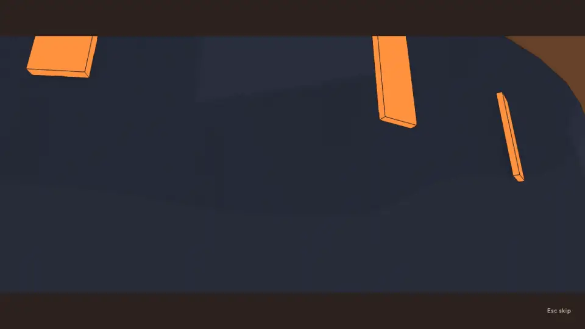
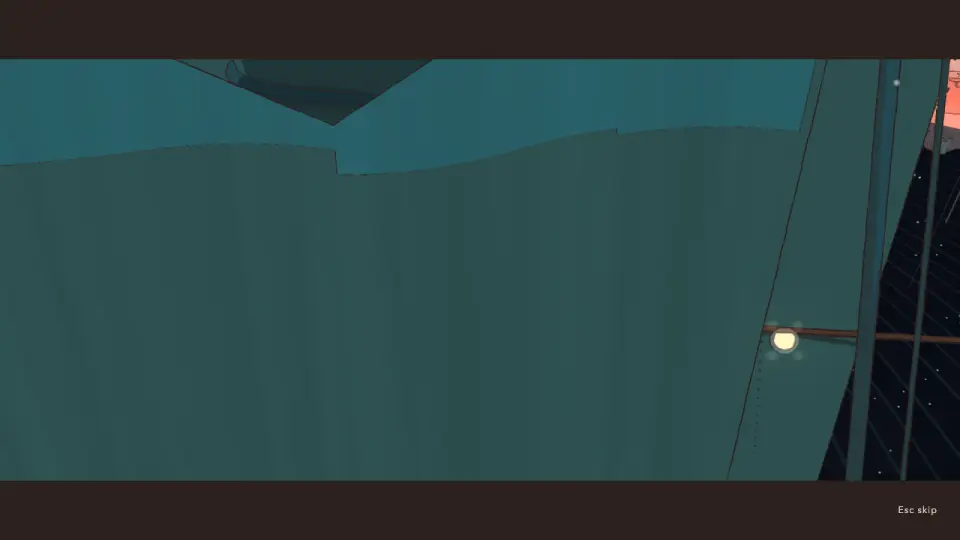

# Cinematics QC, v1.85 (2026-10-18): 104 cinematics, two climaxes that film walls, fourteen temple endings off the page

<!-- audit-scores
overall: 4.57 / 5
label: the mean of tech (4.89) and interest (4.25) over the 104 cinematics on the review page, all run (no fixes in this pass)
version: 1.85
date: 2026-10-18
-->

The third full cinematics pass (issue #467), after [v1.66](cinematics-v1.66.md) (4.51: tech 4.79, interest 4.24, 80 run
and 27 boxes carried) and the [v1.6 baseline](../systems/cinematics-qc.md). This pass finds and files; it fixes nothing (the
audit's brief). The review page lists 104 now: World moments 17, Story 5, Recordings 17, Travel 22, Items 42 (three boxes
fewer than at v1.66), Trailer 1. **All 104 were run**; none is carried over.

Since v1.66: the v1.66 issues all closed (#292 the yards' boxes, #294 the docked drone, #295 the three-panel climaxes, #296
the homecomings' held shot, #297 the recordings' punch-in, #298 the window seat, #299 the touchdown dust); a wide first
landing on each world (#327); Plumb in the prologue (#434); the temples rebuilt as great halls (#336); a film at every
temple's end (#366, v1.79); a port at every landing (#441, v1.84).

## Setup

- `scripts/cinematics-qc.mjs` on `8f01feae`, one Vite (port 5470) and one muted headless Chrome (`--mute-audio`), 1280 ×
  720, High, Apple M-series on Metal, `--rest 4`, frames every 1 s, 8 kept per cinematic plus the hand-back.
- **Two runs.** A network outage stopped the first after 25 cinematics (the prologue to `call.3`); its Chrome was stopped
  and the other 79 were run again in a second pass (`--only`), at load 20–35. The two reports were merged.
- **By eye:** every world moment, story scene and homecoming, four recordings, three arrivals and six of the 42 boxes
  (the lift valve, the bridge, the pouch, the Moon Foundry's court, the Givers' guard, the seeing lens). The other boxes,
  recordings and arrivals are the script's scores; their interest is v1.66's, since none of them changed in design.
- **Not run:** the `--skip` pass and the phone-landscape pass (`--size 844x390 --mobile`); the sound was not heard. No
  console error and no peak over −6 dBFS in any of the 104.

## Headline findings

1. **The fourteen temple endings are not on the review page** (#490). Every makers' house ends on an 11 s film since
   v1.79 (`src/temples/finale.js`), and `src/cinematics-page/catalog.js` lists none of them. The review page, the dev
   menu's Films and this script never play them. `tests/temple-finale.test.js` checks their framing from data, but
   nobody has looked at their frames since the houses were rebuilt (#336). The skill's first rule: "If it isn't on the
   page it isn't reviewed."
2. **Two climaxes film walls** (#491).
   - `moonfoundry.moon`: the wide from the floor (A) is inside a solid for 52 frames, the first 2.6 s of the film a flat
     navy face with orange bars; the face shot (D) is half a dark wall. Tech 5 → 3.
   - `spacecity.cables`: the cables' panel (B) is filled by a teal wall, so the beat is not seen, and a third of A is
     the same wall. The script scores it 5 (the lens is neither inside nor grazing): by eye 3.5.
   - Both worlds changed round their films since v1.66: the Casting-House rebuilt (#416), the ports added (#441). Their
     tests built the moment's shots in a world without them.
3. **The City-Shaft's bridge box shows the health HUD** (#501): the only one of 42.
4. **The v1.66 issues held.** The yards' boxes open from inside their alcoves with no bars and no blank frame; the drone
   is off his face in every close-up; the whales, the moon and the cables have four panels; the homecomings' cargo lines
   cut between angles; the window seat's white patch is gone; the recordings' closes move instead of jumping.

*`moonfoundry.moon` at 1.1 s: the wide from the floor, inside something solid (#491).*

*`spacecity.cables` at 4 s: the panel meant for the cables drawing taut (#491).*

## Smaller notes (not filed)

- The hull's scar sits right behind his head in both homecomings' face shots: a dark blot by his ear.
- The City-Shaft's arrival hands back with a grey slab across him (the follow camera behind a post at the ramp's foot).
- The Moon Foundry's touchdown still shows the dust as a row of beige boulders for a frame.
- The Glass Dunes' clock spends two seconds on one hand against the dark face.

## The scores by collection

| Collection | Cinematics | Tech /5 (v1.66 → v1.85) | Interest /5 (v1.66 → v1.85) |
|---|---|---|---|
| Story | 5 | 4.00 → 4.30 | 4.00 → 4.20 |
| World moments | 17 | 4.91 → 4.74 | 4.41 → 4.38 |
| Recordings | 17 | 4.79 → 5.00 | 4.00 → 4.00 |
| Travel | 22 | 4.95 → 4.93 | 3.95 → 3.95 |
| Items | 42 | 4.71 → 4.96 | 4.38 → 4.45 |
| Trailer | 1 | 5.00 → 5.00 | 5.00 → 5.00 |

**Overall 4.57** (tech 4.89, interest 4.25), against 4.51 at v1.66. Everything the v1.66 issues named rose; the world
moments fell, by the two films that now face walls.

## The table

v1.66 → v1.85. "Problems" is what the frames show; "—" is nothing found. Rows the v1.66 table had not: their score alone.

| Cinematic | Group | Length | Cuts+1 | Tech /5 | Interest /5 | Problems |
|---|---|---|---|---|---|---|
| `prologue` · The landing · prologue | Story | 150.2 s | 4 | 4 → 4 | 5 → 5 | As before: the script waits at the walk (it can't press the voicemail), so the frames hold the cabin from 21 s on; Plumb's new beat (#434) and the walk down the ramp not reached. Not a fault |
| `desert.flow` · the water runs for the first time | World moments | 11.5 s | 6 | 5 → 5 | 4 → 4 | — |
| `desert.fill` · the empty tank fills | World moments | 11.1 s | 3 | 5 → 5 | 4 → 4 | The script's pop at 5.9 s is the cut from close on the glass to over his shoulder (a size change, accepted, as v1.66) |
| `desert.lit` · the great tree catches, seen from the roots out to the whole of it over the city | World moments | 10.1 s | 1 | 4.5 → 4.5 | 5 → 5 | As v1.66: A his back against the trunk; villagers' speech bubbles over C (diegetic) |
| `arzach.bird` · the bird comes down out of the haze and bows | World moments | 10.3 s | 4 | 5 → 5 | 5 → 5 | The traveller's head cut by the bottom of B as the bird comes over (minor); the docked drone no longer by his face (#294) |
| `arzach2.bell` · the bell rings after thirty years and the cloud settles | World moments | 9.8 s | 4 | 5 → 5 | 5 → 5 | — |
| `perdide.crystal` · the cave sings the light’s phrase back to the splinter | World moments | 9.8 s | 4 | 5 → 5 | 4 → 4 | — |
| `perdide2.pools` · the last dark pool is lit and the saucer blinks back across the water | World moments | 10.0 s | 4 | 4.5 → 5 | 4 → 4 | — |
| `edena.terraces` · the cistern gate gives way and the flood takes the terraces | World moments | 8.8 s | 4 | 5 → 5 | 5 → 5 | — |
| `incal.lodestar` · the Lodestar lights again over the shaft | World moments | 9.0 s | 4 | 5 → 5 | 4 → 4 | — |
| `glassdunes.clock` · the clock over the Clock-House comes round and keeps time, and the great cogs turn in the sand | World moments | 9.2 s | 4 | 5 → 5 | 5 → 5 | Two seconds (B) on one clock hand against the dark face read as a near-empty frame (minor) |
| `buried.wheel` · the great wheel turns, and goes on turning | World moments | 9.4 s | 4 | 5 → 5 | 5 → 5 | — |
| `spheres.chord` · the pole rings with the three spheres’ chord | World moments | 8.6 s | 4 | 5 → 5 | 4 → 4 | — |
| `bazaar.broadcast` · the silent tower broadcasts again | World moments | 9.5 s | 4 | 5 → 5 | 4 → 4 | — |
| `underwater.whales` · the whales come back to the glass and sing, the light’s note first | World moments | 9.6 s | 4 | 4.5 → 4.5 | 4 → 4 | Four panels now (#295), 9.6 s; the whale's panels in the dark sea read as half-empty frames (5 of 10), by design but hard to read |
| `moonfoundry.moon` · the last moon is lifted out of its mould onto a hook, and every hung moon turns to it | World moments | 9.6 s | 4 | 5 → 3 | 4 → 4 | New: A, the wide from the floor (MOON.BACK 32 m from the door), is inside a solid: 52 frames, the first 2.6 s a flat navy face with orange bars. Something solid stands where the lens is set now: since v1.66 the Casting-House was rebuilt (#416, #383) and a port added at the landing (#441). D's face shot half a dark wall. Four panels now (#295) |
| `spacecity.cables` · the cables draw taut and the islands come home together, lamps running along them | World moments | 9.6 s | 4 | 5 → 3.5 | 4 → 3.5 | New: B (3-5 s), the cables drawing taut, is filled by a teal wall: the beat is not seen. A third of A is the same wall. The script scores it 5 (not inside, not grazing): by eye. Four panels now (#295) |
| `lantern.arrive` · The light returns to the Lantern | World moments | 10.0 s | 3 | 5 → 5 | 5 → 5 | — |
| `homecoming.first` · First homecoming | Story | 120.3 s | 19 | 3.5 → 4 | 3 → 4 | Times out at 120 s, as before. The cargo lines now cut between angles (#296 fixed: interest 3 → 4). The face shot at 51 s and 120 s puts the hull's scar right behind his head, a dark blot (minor); the warp reads as a blank cream frame at 17 s (by design) |
| `homecoming.final` · Final homecoming | Story | 120.3 s | 18 | 3.5 → 4 | 4 → 4 | Times out at 120 s, as before. The slab's angles now frame everyone (#296 fixed); Lou's close at 86 s has the top of her head under the bar, and the hull's scar sits behind his head in the face shots (minor) |
| `home.homage` · At the stone | Story | 14.6 s | 3 | 5 → 5 | 4 → 4 | — |
| `home.windowSeat` · The window seat | Story | 9.5 s | 3 | 4 → 4.5 | 4 → 4 | The white patch is gone (#298); in the first angle he stands in the window's ring, his head close under the bar at 9 s (minor) |
| `call.1` · Recording 1 · Home | Recordings | 27.7 s | 3 | 4.5 → 5 | 4 → 4 | — |
| `call.2` · Recording 2 · ·· WORN ·· | Recordings | 37.1 s | 3 | 5 → 5 | 4 → 4 | — |
| `call.3` · Recording 3 · LOGGED 19 YEARS AGO | Recordings | 39.3 s | 4 | 5 → 5 | 4 → 4 | — |
| `call.4` · Recording 4 · LOGGED 16 YEARS AGO | Recordings | 61.1 s | 7 | 5 → 5 | 4 → 4 | — |
| `call.5` · Recording 5 · LOGGED 4 YEARS AGO | Recordings | 55.7 s | 5 | 5 → 5 | 4 → 4 | — |
| `call.6` · Recording 6 · THE LAST RECORDING | Recordings | 77.1 s | 8 | 4.5 → 5 | 4 → 4 | — |
| `call.7` · Recording 7 · THE LAST RECORDING | Recordings | 45.0 s | 6 | 5 → 5 | 4 → 4 | — |
| `call.8` · Recording 8 · THE LAST RECORDING | Recordings | 41.0 s | 4 | 4.5 → 5 | 4 → 4 | — |
| `call.9` · Recording 9 · THE LAST RECORDING | Recordings | 45.9 s | 4 | 4.5 → 5 | 4 → 4 | — |
| `call.10` · Recording 10 · THE LAST RECORDING | Recordings | 38.5 s | 4 | 5 → 5 | 4 → 4 | — |
| `call.11` · Recording 11 · THE LAST RECORDING | Recordings | 41.2 s | 4 | 4.5 → 5 | 4 → 4 | — |
| `call.12` · Recording 12 · THE LAST RECORDING | Recordings | 42.3 s | 5 | 5 → 5 | 4 → 4 | — |
| `call.ilen` · Recording ilen · FOR WHEN HE ASKS | Recordings | 58.6 s | 5 | 4.5 → 5 | 4 → 4 | — |
| `call.ilen.after` · Recording ilen.after · LOGGED 5 YEARS AGO | Recordings | 32.2 s | 3 | 5 → 5 | 4 → 4 | — |
| `call.trace` · Recording trace · LOGGED 3 YEARS AGO | Recordings | 41.4 s | 3 | 5 → 5 | 4 → 4 | — |
| `call.part.arzach2` · Recording · Vael II: The Sky Stones · LOGGED 20 YEARS AGO | Recordings | 20.2 s | 1 | 5 → 5 | 4 → 4 | The script counts one shot: its cuts are eased moves now (#297), four angles by eye |
| `call.part.perdide2` · Recording · Lorn II: The Deep Wood · LOGGED 8 YEARS AGO | Recordings | 42.9 s | 4 | 4.5 → 5 | 4 → 4 | — |
| `arrival.desert` · Arrival · The Desert | Travel | 24.1 s | 6 | 5 → 5 | 4 → 4 | — |
| `arrival.arzach` · Arrival · Vael | Travel | 22.4 s | 6 | 5 → 5 | 4 → 4 | — |
| `arrival.perdide` · Arrival · Lorn | Travel | 20.8 s | 6 | 5 → 5 | 4 → 4 | — |
| `arrival.edena` · Arrival · Viridel | Travel | 20.7 s | 6 | 5 → 5 | 4 → 4 | — |
| `arrival.underwater` · Arrival · The Underwater City | Travel | 26.7 s | 7 | 5 → 5 | 4 → 4 | — |
| `arrival.incal` · Arrival · The City-Shaft | Travel | 24.5 s | 7 | 5 → 4.5 | 4 → 4 | The first landing now comes down wide over the port (#327, #441), 24.5 s; the hand-back frame has a grey slab across him, the follow camera behind a post at the ramp's foot (minor) |
| `arrival.glassdunes` · Arrival · The Glass Dunes | Travel | 20.4 s | 6 | 5 → 5 | 4 → 4 | — |
| `arrival.buried` · Arrival · The Buried Machine | Travel | 21.5 s | 6 | 5 → 5 | 4 → 4 | — |
| `arrival.moonfoundry` · Arrival · The Moon Foundry | Travel | 20.4 s | 6 | 5 → 5 | 4 → 4 | The first landing comes down wide under the foundry's roof (#327); at touchdown (14 s) the dust still reads as a row of beige boulders for a frame (#299's settle, minor) |
| `arrival.spheres` · Arrival · The Garden of Spheres | Travel | 20.5 s | 6 | 5 → 5 | 4 → 4 | — |
| `arrival.spacecity` · Arrival · The City Floating in Space | Travel | 20.5 s | 6 | 5 → 5 | 4 → 4 | — |
| `arrival.bazaar` · Arrival · The Signal Market | Travel | 20.5 s | 6 | 5 → 5 | 4 → 4 | — |
| `arrival.mangrove` · Arrival · The White Mangrove | Travel | 17.4 s | 7 | 5 → 5 | 4 → 4 | — |
| `arrival.waterfall` · Arrival · The City Behind the Waterfall | Travel | 17.4 s | 7 | 5 → 5 | 4 → 4 | — |
| `arrival.saltharbour` · Arrival · The Salt Harbour | Travel | 17.7 s | 7 | 5 → 5 | 4 → 4 | — |
| `arrival.antennas` · Arrival · The Forest of Antennas | Travel | 18.0 s | 7 | 5 → 5 | 4 → 4 | — |
| `arrival.eclipse` · Arrival · The City During the Eclipse | Travel | 17.4 s | 7 | 5 → 5 | 4 → 4 | — |
| `arrival.fallenring` · Arrival · The Fallen Ring | Travel | 17.4 s | 7 | 5 → 5 | 4 → 4 | — |
| `arrival.underside` · Arrival · The Underside | Travel | 17.4 s | 7 | 5 → 5 | 4 → 4 | — |
| `arrival.home` · Arrival · Home | Travel | 45.1 s | 1 | 4 → 4 | 3 → 3 | As before: waits on the cargo check, one held look out of the windshield |
| `arrival.lantern` · Arrival · The Lantern | Travel | 17.3 s | 7 | 5 → 5 | 4 → 4 | — |
| `takeoff` · Departure · takeoff | Travel | 8.8 s | 2 | 5 → 5 | 4 → 4 | — |
| `box.desert.backpack` · Makers’ box · backpack | Items | 9.3 s | 1 | 5 → 5 | 5 → 5 | — |
| `box.desert.lift` · Makers’ box · doublejump | Items | 9.2 s | 2 | 4 → 4.5 | 4 → 4 | As v1.66: in the small round room his back and tank fill the left half of every frame; the closing frame has him at the edge |
| `box.desert.gun` · Makers’ box · gun | Items | 9.9 s | 3 | 4.5 → 5 | 4 → 4 | — |
| `box.desert.star` · Makers’ box · star | Items | 10.2 s | 4 | 5 → 5 | 5 → 5 | — |
| `box.desert.temple.sword` · Makers’ box · sword | Items | 10.3 s | 1 | 4 → 5 | 4 → 4 | — |
| `box.desert.temple.shield` · Makers’ box · shield | Items | 9.9 s | 3 | 3.5 → 5 | 4 → 4 | — |
| `box.incal.soles` · Makers’ box · soles | Items | 9.6 s | 4 | 5 → 5 | 4 → 4 | — |
| `box.incal.temple.jetpack` · Makers’ box · fan | Items | 9.9 s | 3 | 5 → 5 | 5 → 5 | — |
| `box.incal.sunglass` · Makers’ box · sunglass | Items | 9.8 s | 4 | 4.5 → 5 | 4 → 4 | — |
| `box.incal.bridge` · Makers’ box · bridge | Items | 9.9 s | 3 | 5 → 4 | 5 → 5 | New: the health HUD shows through the scene (the script's hudLeaks: health); his head under the top bar at 8 s |
| `box.arzach.hush` · Makers’ box · hush | Items | 9.5 s | 4 | 5 → 5 | 4 → 4 | — |
| `box.arzach.temple.glider` · Makers’ box · glider | Items | 9.9 s | 3 | 5 → 5 | 5 → 5 | — |
| `box.arzach.hook` · Makers’ box · bell | Items | 10.2 s | 3 | 5 → 5 | 5 → 5 | — |
| `box.arzach2.scarf` · Makers’ box · scarf | Items | 10.0 s | 3 | 5 → 5 | 4 → 4 | — |
| `box.arzach2.temple.bell` · Makers’ box · hook | Items | 9.9 s | 3 | 5 → 5 | 5 → 5 | — |
| `box.garage.level` · Makers’ box · level | Items | 9.5 s | 3 | 5 → 5 | 4 → 4 | — |
| `box.garage.temple.coil` · Makers’ box · boomerang | Items | 9.9 s | 3 | 5 → 5 | 5 → 5 | — |
| `box.buried.resin` · Makers’ box · resin | Items | 9.5 s | 3 | 5 → 5 | 4 → 4 | — |
| `box.buried.temple.cell` · Makers’ box · bomb | Items | 9.9 s | 3 | 5 → 5 | 5 → 5 | — |
| `box.buried.monocle` · Makers’ box · lens | Items | 10.2 s | 2 | 5 → 5 | 5 → 5 | — |
| `box.edena.pouch` · Makers’ box · pouch | Items | 9.3 s | 3 | 5 → 5 | 4 → 4 | The script's near-empty frames are the meadow's flat pink ground from above (accepted) |
| `box.edena.temple.bloom` · Makers’ box · bloom | Items | 9.9 s | 3 | 5 → 5 | 5 → 5 | — |
| `box.edena.bubble` · Makers’ box · lantern | Items | 9.5 s | 4 | 5 → 5 | 5 → 5 | — |
| `box.spheres.shell` · Makers’ box · shell | Items | 10.1 s | 3 | 5 → 5 | 5 → 5 | — |
| `box.spheres.temple.lens` · Makers’ box · monocle | Items | 10.1 s | 4 | 5 → 5 | 5 → 5 | — |
| `box.spheres.bomb` · Makers’ box · cell | Items | 9.7 s | 1 | 5 → 5 | 5 → 5 | — |
| `box.perdide.reed` · Makers’ box · reed | Items | 9.6 s | 4 | 5 → 5 | 4 → 4 | — |
| `box.perdide.temple.stun` · Makers’ box · stun | Items | 9.9 s | 3 | 5 → 5 | 5 → 5 | — |
| `box.perdide.fan` · Makers’ box · wardenbellows | Items | 9.8 s | 1 | 5 → 5 | 5 → 5 | — |
| `box.perdide2.moss` · Makers’ box · moss | Items | 10.4 s | 4 | 5 → 5 | 4 → 4 | — |
| `box.perdide2.temple.lantern` · Makers’ box · bubble | Items | 11.0 s | 3 | 5 → 5 | 4 → 4 | — |
| `box.perdide2.boomerang` · Makers’ box · coil | Items | 10.3 s | 1 | 5 → 5 | 5 → 5 | — |
| `box.bazaar.temple.echo` · Makers’ box · recall | Items | 9.8 s | 3 | 5 → 5 | 5 → 5 | — |
| `box.moonfoundry.court` · Makers’ box · keeper | Items | 9.4 s | 3 | 3 → 5 | 3 → 4 | The yards' boxes open from inside their alcove now (#292 fixed): no bars, no blank frame |
| `box.moonfoundry.bellows` · Makers’ box · bellows | Items | 9.5 s | 3 | 5 → 5 | 4 → 4 | — |
| `box.moonfoundry.temple.tongs` · Makers’ box · magnet | Items | 9.8 s | 3 | 5 → 5 | 4 → 4 | — |
| `box.spacecity.court` · Makers’ box · splice | Items | 9.6 s | 3 | 3 → 5 | 3 → 4 | #292 fixed: no bars, no blank frame (by the script; the Moon Foundry's court seen by eye) |
| `box.spacecity.starthread` · Makers’ box · starthread | Items | 9.6 s | 3 | 4.5 → 5 | 4 → 4 | — |
| `box.spacecity.temple.tether` · Makers’ box · tether | Items | 9.8 s | 3 | 5 → 5 | 4 → 4 | — |
| `box.underwater.court` · Makers’ box · floatbead | Items | 9.3 s | 3 | 3 → 5 | 3 → 4 | #292 fixed: no bars, no blank frame (by the script; the Moon Foundry's court seen by eye) |
| `box.underwater.pearl` · Makers’ box · pearl | Items | 9.4 s | 4 | 4 → 5 | 4 → 4 | — |
| `box.underwater.temple.horn` · Makers’ box · springs | Items | 10.0 s | 4 | 5 → 5 | 4 → 4 | — |
| `trailer` · Hiraeth · in-engine trailer | Trailer | 48.0 s | 0 | 5 → 5 | 5 → 5 | — |
