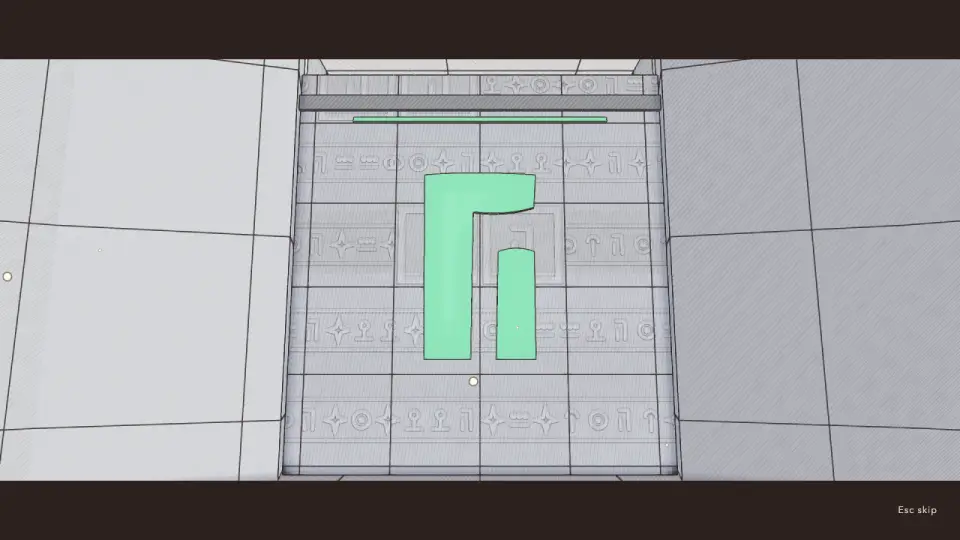
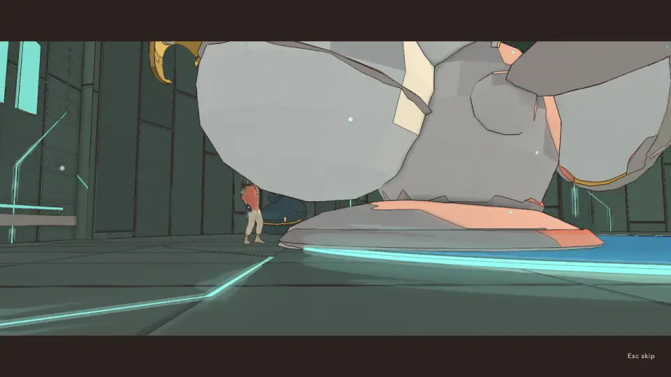

# Cinematics QC, v1.87 (2026-10-20): 112 cinematics, the temple endings played in the full pass, every v1.85 issue held

<!-- audit-scores
overall: 4.53 / 5
label: the mean of tech (4.90) and interest (4.17) over the 112 cinematics on the review page, all run (no fixes in this pass); without the fourteen temple endings, new to the table, 4.62
version: 1.87
date: 2026-10-20
-->

The fourth full pass (issue #556), after [v1.85](cinematics-v1.85.md) (4.57: tech 4.89, interest 4.25 over 104) and the
[v1.6 baseline](../systems/cinematics-qc.md). This pass finds and files; it fixes nothing (the audit's brief). The review
page lists 112 for the main game: World moments 17, **Temple endings 14** (new to the table: #490 put them on the page the
day after v1.85), Story 5, Recordings 17, Travel 15, Items 43, Trailer 1. The seven discarded side worlds' arrivals are
left out (the script leaves `DISCARDED` out unless asked; v1.85 counted them in its 22 Travel), and one box is new (the
Signal Market's court, #518). **All 112 were run**; none is carried over.

Since v1.85: #490 (the temple endings on the review page, staged and QC'd), #491 (the Moon Foundry's and the Floating
City's climaxes), #501 (the bridge box's HUD), #528 and #529 (the temple endings' lenses out of the keepers' bodies,
reverted once for a slow test and relanded), the opening's walk out at any frame rate (v1.86).

## Setup

- `scripts/cinematics-qc.mjs` on `f12bba095`, one Vite (port 5594) and one muted headless Chrome (`--mute-audio`),
  1280 × 720, High, Apple M-series on Metal, `--rest 4`, a frame every 1 s, 8 kept per cinematic plus the hand-back. One
  run, at load 22–46 (the technical half of #556 running beside it).
- **By eye:** the two climaxes fixed by #491, three temple endings (the Greenhouse, the Casting-House, the Whale-House),
  the new court box, and every cinematic the script flagged. The other temple endings keep the scores the #528/#529
  follow-up gave them by eye the day before (`docs/systems/cinematics-qc-notes.json`); the rest keep v1.85's interest,
  since none of them changed in design.
- **Not run:** the `--skip` pass and the phone-landscape pass; the sound was not heard. No console error in any of the
  112.

## Headline findings

1. **Every v1.85 issue held.** `moonfoundry.moon` opens wide on the house and its tower (tech 3 → 5), `spacecity.cables`
   films the capstan between the tripod's legs with the cables' beat seen (tech 3.5 → 5, interest 3.5 → 4), and the
   bridge box has no HUD (tech 4 → 5). The world moments' tech mean is back to 4.97.
2. **The temple endings are one film fourteen times** (interest 3.4, the weakest collection). Every house ends on the
   same four panels: the keeper at rest, the chimes on the floor with the keeper beyond, **the makers' mark lit over a door**,
   and the corridor out. Panels C and D are interchangeable between houses (the Greenhouse's C below; the Casting-House's
   and the Whale-House's are the same shot in another stone). They play cleanly (tech 4.54) but tell nothing of the house:
   not its gadget, not its state (the Clock-House's hand, the Whale-House's tide), not what the guardian was guarding. A
   creative rework, #562.
3. **The Whale-House's reward panel** still has the Listener's shell over the top half of the frame, him small at the left
   (below): the weakest B, as the #528/#529 follow-up left it. In #562.
4. **The Casting-House's ending peaks at −5.8 dBFS**, just over the −6 flag, the loudest of the 112 (the world's
   moments run −30…−11). Noted; for the sound QC.

*`finale.edena` at 9 s: panel C, the same in every house.*

*`finale.underwater` at 5 s: the reward panel, the Listener's shell filling the top, him small at the left.*

## Smaller notes (not filed)

- As at v1.85: the hull's scar behind his head in both homecomings' face shots; the Glass Dunes' clock spends two seconds
  on one hand; the whales' dark sea reads as half-empty frames.
- The new court box opens on him mid-step (its first frame), then plays clean.

## The scores by collection

| Collection | Cinematics | Tech /5 (v1.85 → v1.87) | Interest /5 (v1.85 → v1.87) |
|---|---|---|---|
| Story | 5 | 4.30 → 4.40 | 4.20 → 4.20 |
| World moments | 17 | 4.74 → 4.97 | 4.38 → 4.41 |
| Temple endings (new) | 14 | 4.54 | 3.39 |
| Recordings | 17 | 5.00 → 5.00 | 4.00 → 4.00 |
| Travel (22 → 15: the side worlds' arrivals left out) | 15 | 4.93 → 4.93 | 3.95 → 3.93 |
| Items | 43 | 4.96 → 5.00 | 4.45 → 4.44 |
| Trailer | 1 | 5.00 → 5.00 | 5.00 → 5.00 |

**Overall 4.53** (tech 4.90, interest 4.17), against 4.57 at v1.85. The fall is the fourteen temple endings joining the
table at interest 3.4; the 98 others are **4.62** (tech 4.95, interest 4.28), up from 4.57.

## The table

v1.85 → v1.87 (the temple endings: the #528/#529 follow-up's scores by eye → this pass). "Problems" is what the frames
show; "—" is nothing found.

| Cinematic | Group | Length | Cuts+1 | Tech /5 | Interest /5 | Problems |
|---|---|---|---|---|---|---|
| `prologue` · The landing · prologue | Story | 150.2 s | 4 | 4 → 4 | 5 → 5 | As before: the script waits at the walk (it cannot press the voicemail), so the frames hold the cabin; not a fault |
| `desert.flow` · the water runs for the first time | World moments | 11.4 s | 6 | 5 → 5 | 4 → 4 | — |
| `desert.fill` · the empty tank fills | World moments | 11.1 s | 3 | 5 → 5 | 4 → 4 | The script's pop at 5.9 s is the cut from the glass to over his shoulder (accepted, as v1.66 and v1.85) |
| `desert.lit` · the great tree catches, seen from the roots out to the whole of it over the city | World moments | 10.2 s | 1 | 4.5 → 5 | 5 → 5 | — |
| `arzach.bird` · the bird comes down out of the haze and bows | World moments | 10.1 s | 4 | 5 → 5 | 5 → 5 | — |
| `arzach2.bell` · the bell rings after thirty years and the cloud settles | World moments | 9.7 s | 4 | 5 → 5 | 5 → 5 | — |
| `perdide.crystal` · the cave sings the light’s phrase back to the splinter | World moments | 9.8 s | 4 | 5 → 5 | 4 → 4 | — |
| `perdide2.pools` · the last dark pool is lit and the saucer blinks back across the water | World moments | 10.0 s | 4 | 5 → 5 | 4 → 4 | — |
| `edena.terraces` · the cistern gate gives way and the flood takes the terraces | World moments | 8.8 s | 4 | 5 → 5 | 5 → 5 | — |
| `incal.lodestar` · the Lodestar lights again over the shaft | World moments | 9.0 s | 4 | 5 → 5 | 4 → 4 | — |
| `glassdunes.clock` · the clock over the Clock-House comes round and keeps time, and the great cogs turn in the sand | World moments | 9.2 s | 4 | 5 → 5 | 5 → 5 | — |
| `buried.wheel` · the great wheel turns, and goes on turning | World moments | 9.4 s | 4 | 5 → 5 | 5 → 5 | — |
| `spheres.chord` · the pole rings with the three spheres’ chord | World moments | 8.6 s | 4 | 5 → 5 | 4 → 4 | — |
| `bazaar.broadcast` · the silent tower broadcasts again | World moments | 9.5 s | 4 | 5 → 5 | 4 → 4 | — |
| `underwater.whales` · the whales come back to the glass and sing, the light’s note first | World moments | 9.6 s | 4 | 4.5 → 4.5 | 4 → 4 | As before: the whale's panels in the dark sea read as half-empty frames, by design |
| `moonfoundry.moon` · the last moon is lifted out of its mould onto a hook, and every hung moon turns to it | World moments | 9.6 s | 4 | 3 → 5 | 4 → 4 | #491 fixed: opens wide on the house and its tower; no frame inside a solid |
| `spacecity.cables` · the cables draw taut and the islands come home together, lamps running along them | World moments | 9.6 s | 4 | 3.5 → 5 | 3.5 → 4 | #491 fixed: the capstan filmed between the tripod's legs, the cables' beat seen (interest 3.5 → 4) |
| `finale.desert` · the Keeper breathes out over the dry spout; the Rose House’s way up sinks open | Temple endings | 10.9 s | 4 | 4.5 → 4.5 | 3.5 → 3.5 | — |
| `finale.incal` · the warden sags, its eye dark; the Warden’s Well’s way out opens over the shaft | Temple endings | 10.9 s | 4 | 4 → 4 | 3 → 3 | As the follow-up left it: a pillar in A |
| `finale.arzach2` · the Cloud-Mother sighs her cloud away; the Founders’ Belfry’s high door opens | Temple endings | 10.9 s | 4 | 5 → 5 | 4 → 4 | — |
| `finale.spheres` · the Echo takes his hand and is still; the Footprint’s way out opens | Temple endings | 10.9 s | 4 | 4.5 → 4.5 | 3 → 3 | — |
| `finale.buried` · the Tooth-Warden locks up and the engine runs; the Engine-House’s way out opens | Temple endings | 10.9 s | 4 | 4.5 → 4.5 | 3 → 3 | — |
| `finale.perdide2` · the Lampless folds its wings; the Lamp-House’s way out opens under the lamp | Temple endings | 10.9 s | 4 | 4.5 → 4.5 | 3.5 → 3.5 | — |
| `finale.perdide` · the Mother Snapper sleeps; the Hush-House’s crystals hum and its way out opens | Temple endings | 10.9 s | 4 | 4.5 → 4.5 | 4 → 4 | — |
| `finale.arzach` · the Elder rides the wind up out of the roost; the Aerie’s way out opens | Temple endings | 10.9 s | 4 | 5 → 5 | 4 → 4 | — |
| `finale.garage` · the Foreman’s hands come round to the right time; the Clock-House’s way out opens | Temple endings | 10.9 s | 4 | 5 → 5 | 3.5 → 3.5 | — |
| `finale.edena` · the Gardener closes its eyes among the beds; the Greenhouse’s way out opens | Temple endings | 10.9 s | 4 | 4.5 → 5 | 3.5 → 3.5 | Clean by eye: the Gardener whole, the sunbeam hushed for C (#529) |
| `finale.bazaar` · the First Sign says its line once and listens; the Undertower’s way out opens | Temple endings | 10.9 s | 4 | 4 → 4 | 3 → 3 | — |
| `finale.spacecity` · the Anchor-Warden is still; the Mooring-House’s way out opens | Temple endings | 10.9 s | 4 | 4.5 → 4.5 | 3 → 3 | — |
| `finale.moonfoundry` · the Last Founder stops with one moon cast; the Casting-House’s way out opens | Temple endings | 11.0 s | 4 | 4.5 → 4.5 | 3.5 → 3.5 | Peaks at −5.8 dBFS (the flag is −6), the loudest of the 112 |
| `finale.underwater` · the Listener settles on its shell; the Whale-House’s way out opens | Temple endings | 10.9 s | 4 | 4 → 4 | 3 → 3 | B still has the shell's underside over the top half, him small at the left (as the #528/#529 follow-up left it) |
| `lantern.arrive` · The light returns to the Lantern | World moments | 10.0 s | 3 | 5 → 5 | 5 → 5 | — |
| `homecoming.first` · First homecoming | Story | 120.1 s | 19 | 4 → 4 | 4 → 4 | Times out at 120 s, as before; the hull's scar behind his head in the face shots, as before |
| `homecoming.final` · Final homecoming | Story | 120.3 s | 18 | 4 → 4 | 4 → 4 | Times out at 120 s, as before; the hull's scar behind his head, as before |
| `home.homage` · At the stone | Story | 14.6 s | 3 | 5 → 5 | 4 → 4 | — |
| `home.windowSeat` · The window seat | Story | 9.5 s | 3 | 4.5 → 5 | 4 → 4 | — |
| `call.1` · Recording 1 · Home | Recordings | 27.6 s | 3 | 5 → 5 | 4 → 4 | — |
| `call.2` · Recording 2 · ·· WORN ·· | Recordings | 37.0 s | 3 | 5 → 5 | 4 → 4 | — |
| `call.3` · Recording 3 · LOGGED 19 YEARS AGO | Recordings | 39.3 s | 4 | 5 → 5 | 4 → 4 | — |
| `call.4` · Recording 4 · LOGGED 16 YEARS AGO | Recordings | 59.5 s | 7 | 5 → 5 | 4 → 4 | — |
| `call.5` · Recording 5 · LOGGED 4 YEARS AGO | Recordings | 55.7 s | 5 | 5 → 5 | 4 → 4 | — |
| `call.6` · Recording 6 · THE LAST RECORDING | Recordings | 76.9 s | 8 | 5 → 5 | 4 → 4 | — |
| `call.7` · Recording 7 · THE LAST RECORDING | Recordings | 45.1 s | 6 | 5 → 5 | 4 → 4 | — |
| `call.8` · Recording 8 · THE LAST RECORDING | Recordings | 41.1 s | 4 | 5 → 5 | 4 → 4 | — |
| `call.9` · Recording 9 · THE LAST RECORDING | Recordings | 47.6 s | 4 | 5 → 5 | 4 → 4 | — |
| `call.10` · Recording 10 · THE LAST RECORDING | Recordings | 39.5 s | 4 | 5 → 5 | 4 → 4 | — |
| `call.11` · Recording 11 · THE LAST RECORDING | Recordings | 41.3 s | 4 | 5 → 5 | 4 → 4 | — |
| `call.12` · Recording 12 · THE LAST RECORDING | Recordings | 43.1 s | 5 | 5 → 5 | 4 → 4 | — |
| `call.ilen` · Recording ilen · FOR WHEN HE ASKS | Recordings | 59.4 s | 5 | 5 → 5 | 4 → 4 | — |
| `call.ilen.after` · Recording ilen.after · LOGGED 5 YEARS AGO | Recordings | 34.1 s | 3 | 5 → 5 | 4 → 4 | — |
| `call.trace` · Recording trace · LOGGED 3 YEARS AGO | Recordings | 42.6 s | 3 | 5 → 5 | 4 → 4 | — |
| `call.part.arzach2` · Recording · Vael II: The Sky Stones · LOGGED 20 YEARS AGO | Recordings | 20.7 s | 1 | 5 → 5 | 4 → 4 | — |
| `call.part.perdide2` · Recording · Lorn II: The Deep Wood · LOGGED 8 YEARS AGO | Recordings | 44.4 s | 4 | 5 → 5 | 4 → 4 | — |
| `arrival.desert` · Arrival · The Desert | Travel | 24.1 s | 6 | 5 → 5 | 4 → 4 | — |
| `arrival.arzach` · Arrival · Vael | Travel | 22.3 s | 6 | 5 → 5 | 4 → 4 | — |
| `arrival.perdide` · Arrival · Lorn | Travel | 20.7 s | 6 | 5 → 5 | 4 → 4 | — |
| `arrival.edena` · Arrival · Viridel | Travel | 20.7 s | 6 | 5 → 5 | 4 → 4 | — |
| `arrival.underwater` · Arrival · The Underwater City | Travel | 26.7 s | 7 | 5 → 5 | 4 → 4 | — |
| `arrival.incal` · Arrival · The City-Shaft | Travel | 24.5 s | 7 | 4.5 → 5 | 4 → 4 | — |
| `arrival.glassdunes` · Arrival · The Glass Dunes | Travel | 20.4 s | 6 | 5 → 5 | 4 → 4 | — |
| `arrival.buried` · Arrival · The Buried Machine | Travel | 21.5 s | 6 | 5 → 5 | 4 → 4 | — |
| `arrival.moonfoundry` · Arrival · The Moon Foundry | Travel | 20.4 s | 6 | 5 → 5 | 4 → 4 | — |
| `arrival.spheres` · Arrival · The Garden of Spheres | Travel | 20.5 s | 6 | 5 → 5 | 4 → 4 | — |
| `arrival.spacecity` · Arrival · The City Floating in Space | Travel | 20.3 s | 6 | 5 → 5 | 4 → 4 | — |
| `arrival.bazaar` · Arrival · The Signal Market | Travel | 20.5 s | 6 | 5 → 5 | 4 → 4 | — |
| `arrival.home` · Arrival · Home | Travel | 45.3 s | 1 | 4 → 4 | 3 → 3 | As before: waits on the cargo check, one held look out of the windshield |
| `arrival.lantern` · Arrival · The Lantern | Travel | 17.4 s | 7 | 5 → 5 | 4 → 4 | — |
| `takeoff` · Departure · takeoff | Travel | 8.8 s | 2 | 5 → 5 | 4 → 4 | — |
| `box.desert.backpack` · Makers’ box · backpack | Items | 9.2 s | 1 | 5 → 5 | 5 → 5 | — |
| `box.desert.lift` · Makers’ box · doublejump | Items | 9.5 s | 2 | 4.5 → 5 | 4 → 4 | — |
| `box.desert.gun` · Makers’ box · gun | Items | 9.8 s | 3 | 5 → 5 | 4 → 4 | — |
| `box.desert.star` · Makers’ box · star | Items | 10.5 s | 4 | 5 → 5 | 5 → 5 | — |
| `box.desert.temple.sword` · Makers’ box · sword | Items | 10.0 s | 1 | 5 → 5 | 4 → 4 | — |
| `box.desert.temple.shield` · Makers’ box · shield | Items | 10.0 s | 3 | 5 → 5 | 4 → 4 | — |
| `box.incal.soles` · Makers’ box · soles | Items | 9.6 s | 2 | 5 → 5 | 4 → 4 | — |
| `box.incal.temple.jetpack` · Makers’ box · fan | Items | 9.9 s | 3 | 5 → 5 | 5 → 5 | — |
| `box.incal.sunglass` · Makers’ box · sunglass | Items | 9.7 s | 4 | 5 → 5 | 4 → 4 | — |
| `box.incal.bridge` · Makers’ box · bridge | Items | 9.9 s | 3 | 4 → 5 | 5 → 5 | #501 fixed: no HUD in the scene |
| `box.arzach.hush` · Makers’ box · hush | Items | 9.5 s | 4 | 5 → 5 | 4 → 4 | — |
| `box.arzach.temple.glider` · Makers’ box · glider | Items | 10.0 s | 3 | 5 → 5 | 5 → 5 | — |
| `box.arzach.hook` · Makers’ box · bell | Items | 10.1 s | 3 | 5 → 5 | 5 → 5 | — |
| `box.arzach2.scarf` · Makers’ box · scarf | Items | 10.0 s | 3 | 5 → 5 | 4 → 4 | — |
| `box.arzach2.temple.bell` · Makers’ box · hook | Items | 10.2 s | 3 | 5 → 5 | 5 → 5 | — |
| `box.garage.level` · Makers’ box · level | Items | 9.4 s | 3 | 5 → 5 | 4 → 4 | — |
| `box.garage.temple.coil` · Makers’ box · boomerang | Items | 9.8 s | 3 | 5 → 5 | 5 → 5 | — |
| `box.buried.resin` · Makers’ box · resin | Items | 9.3 s | 3 | 5 → 5 | 4 → 4 | — |
| `box.buried.temple.cell` · Makers’ box · bomb | Items | 10.2 s | 3 | 5 → 5 | 5 → 5 | — |
| `box.buried.monocle` · Makers’ box · lens | Items | 10.1 s | 3 | 5 → 5 | 5 → 5 | — |
| `box.edena.pouch` · Makers’ box · pouch | Items | 9.5 s | 3 | 5 → 5 | 4 → 4 | — |
| `box.edena.temple.bloom` · Makers’ box · bloom | Items | 9.9 s | 3 | 5 → 5 | 5 → 5 | — |
| `box.edena.bubble` · Makers’ box · lantern | Items | 9.5 s | 3 | 5 → 5 | 5 → 5 | — |
| `box.spheres.shell` · Makers’ box · shell | Items | 10.2 s | 3 | 5 → 5 | 5 → 5 | — |
| `box.spheres.temple.lens` · Makers’ box · monocle | Items | 10.0 s | 4 | 5 → 5 | 5 → 5 | — |
| `box.spheres.bomb` · Makers’ box · cell | Items | 9.8 s | 1 | 5 → 5 | 5 → 5 | — |
| `box.perdide.reed` · Makers’ box · reed | Items | 9.4 s | 4 | 5 → 5 | 4 → 4 | — |
| `box.perdide.temple.stun` · Makers’ box · stun | Items | 10.0 s | 3 | 5 → 5 | 5 → 5 | — |
| `box.perdide.fan` · Makers’ box · wardenbellows | Items | 9.7 s | 1 | 5 → 5 | 5 → 5 | — |
| `box.perdide2.moss` · Makers’ box · moss | Items | 9.5 s | 4 | 5 → 5 | 4 → 4 | — |
| `box.perdide2.temple.lantern` · Makers’ box · bubble | Items | 9.9 s | 3 | 5 → 5 | 4 → 4 | — |
| `box.perdide2.boomerang` · Makers’ box · coil | Items | 9.8 s | 1 | 5 → 5 | 5 → 5 | — |
| `box.bazaar.temple.echo` · Makers’ box · recall | Items | 9.9 s | 3 | 5 → 5 | 5 → 5 | — |
| `box.bazaar.court` · Makers’ box · sandglass | Items | 9.3 s | 3 | 5 | 4 | New (#518): the Signal Market's court chest; plays clean, his first frame mid-step |
| `box.moonfoundry.court` · Makers’ box · keeper | Items | 9.4 s | 3 | 5 → 5 | 4 → 4 | — |
| `box.moonfoundry.bellows` · Makers’ box · bellows | Items | 9.3 s | 3 | 5 → 5 | 4 → 4 | — |
| `box.moonfoundry.temple.tongs` · Makers’ box · magnet | Items | 9.9 s | 3 | 5 → 5 | 4 → 4 | — |
| `box.spacecity.court` · Makers’ box · splice | Items | 9.4 s | 3 | 5 → 5 | 4 → 4 | — |
| `box.spacecity.starthread` · Makers’ box · starthread | Items | 9.3 s | 3 | 5 → 5 | 4 → 4 | — |
| `box.spacecity.temple.tether` · Makers’ box · tether | Items | 9.9 s | 3 | 5 → 5 | 4 → 4 | — |
| `box.underwater.court` · Makers’ box · floatbead | Items | 9.4 s | 3 | 5 → 5 | 4 → 4 | — |
| `box.underwater.pearl` · Makers’ box · pearl | Items | 9.5 s | 4 | 5 → 5 | 4 → 4 | — |
| `box.underwater.temple.horn` · Makers’ box · springs | Items | 10.1 s | 4 | 5 → 5 | 4 → 4 | — |
| `trailer` · Hiraeth · in-engine trailer | Trailer | 48.0 s | 0 | 5 → 5 | 5 → 5 | — |
