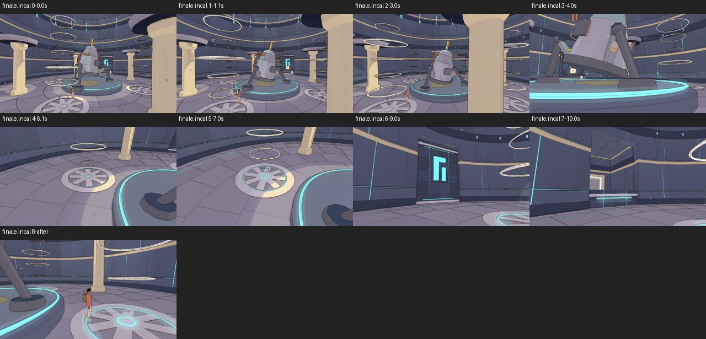
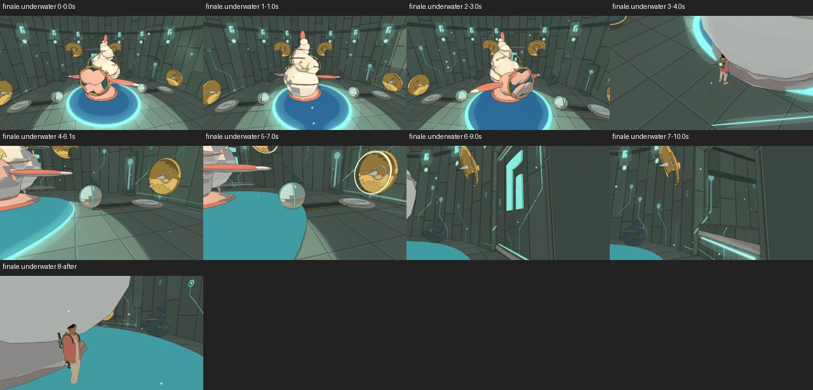
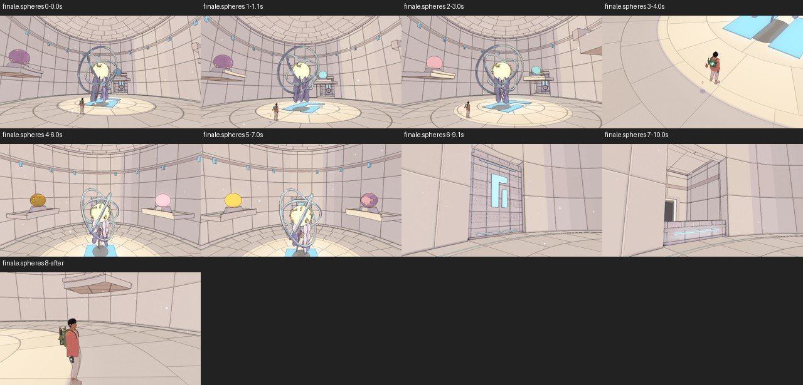
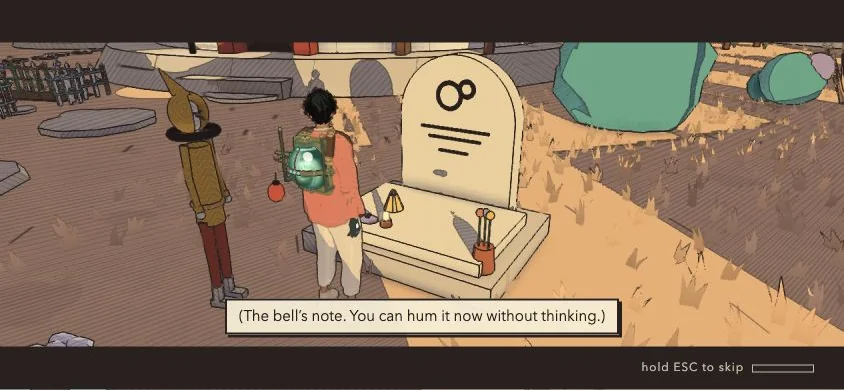
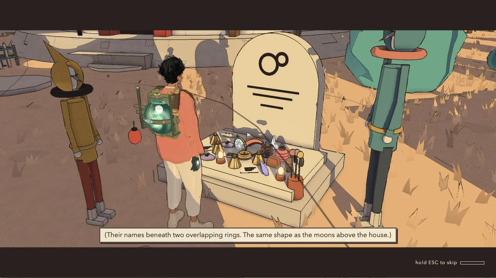

# Cinematics QC, v1.90

<!-- audit-scores
overall: none
headline: Live technical 4.95/5 and interest 4.58/5; 111 live scenes, trailer separate; silent review
label: separate technical and interest criteria
version: 1.90
date: 2026-10-21
-->

**Cinematic evidence review complete.** Frozen source `c5449ab6c` (v1.90); later ship changes are excluded. All 111 live entries now have accepted desktop, phone and skip evidence, using corrected interactive/ending/locked-box fixtures where needed. Continuous trailer playback is a separate 112th entry. Original failed attempts remain retained and excluded. No audible mix evaluation was performed.

The live-entry technical mean is **4.95/5**, and the five-criterion interest mean is **4.58/5**. Trailer scores are separately **5/5 technical, 4.5/5 interest** and do not enter those 111-entry means.

## Setup and limitations

Visible CUA-started console on owned port 5484, one renderer at a time, sandbox progress and pre-import audio-output suppression. Deliberately audible saved preferences must be overridden at audio construction. Initial/final actual mute and gain, loaded settings and errors are recorded per task. The Desert smoke passed, and every completed game reload recorded constructor mute, zero target/master gain and isolated progress. This validates silent capture, not audible dialogue balance. The frozen source’s dialogue-tone test also passes; its exact output is retained in `cua-results/tone-test.log`.

## Findings, lowest criteria first

Framing findings are retained in the desktop checkpoint below. Desktop, skip and phone contacts and all correction evidence have been inspected. The final table names each criterion, scene, prior result and recommendation. Fixture failures are excluded from gameplay scoring.

## Required coverage

The current review-page catalogue has 119 entries. This frozen audit supplies 112 notes: 111 live scenes plus the separately judged trailer. Seven side-world arrivals remain unreviewed here: `arrival.mangrove`, `arrival.waterfall`, `arrival.saltharbour`, `arrival.antennas`, `arrival.eclipse`, `arrival.fallenring` and `arrival.underside`. The exported notes record that scope explicitly; their absence is not a pass. The trailer retains **Pass with creative recommendation**, including its creative and silent-review qualifications, on import and in the status selector.

111 entries accepted in each of desktop, skip and phone-viewport modes (333 accepted mode/entry combinations, with additional failed or superseded attempts retained), plus eight static trailer frames and a separate continuous trailer playback. Representative full-page desktop and phone HUD supplements are accepted. Corrected prologue, both Home variants, Home arrival, solved-lock boxes and continuous trailer are accepted. Two later Home-arrival attempts failed timing/setup and were retained; fresh visibility-instrumented desktop/phone retries completed with normal status, zero errors and no long RAF gaps.

Technical scores and by-eye interest are separate. Audio unassessed while muted. Phone viewport is responsive layout, not touch-device validation. Canvas captures omit DOM bars/subtitles; representative/flagged full-page CUA screenshots required.

## Comparison

Latest baseline: `docs/audits/cinematics-v1.87.md`. Previous per-entry scores appear beside fresh scores below; criterion evidence is recorded in the notes. Changes in grading discipline or fixture conditions are not proof of a release regression.

## Completed evidence and scope

All prescribed web phases and all 87 matched native pairs have been inspected. Failed or superseded attempts remain excluded and preserved in the ignored evidence bundle. Frozen v1.90 scores are not updated using later v1.91/v1.92 repairs.

## Temple ending framing — desktop and phone inspected

The lowest repeated interest results are Incal, the Undertower, the Whale-House and the Footprint, 3/5 in the final criterion table. Their establishing views and final door opening communicate purpose, but pillars, underside views or mostly empty top-down floor weaken the middle reveal and traveller reaction. Incal's foreground pillar and the Whale-House shell are also documented in v1.87; these are retained weaknesses, not new release regressions. Root independently inspected both contact sheets and agreed with that interpretation.

The Clock House and Casting House provide clearer keeper → meaningful object detail → opening-door progression. Belfry’s low underside/ceiling view is less useful than its readable floating-keeper wide shot. Proposed creative work is to frame keeper and traveller together, replace obstructed middle panels with deliberate details, and retain an intelligible reaction before the exit reveal. All such recommendations await user review.

## Representative complete-screen HUD

These display crops preserve the entire game viewport from CUA full-page screenshots, including DOM subtitles, letterbox and hold-to-skip UI. The desktop Home final frame (38 s) and phone Home first frame (54 s) have legible single-line panels and unobstructed skip controls, without gameplay HUD. They establish representative layout, **not completion of either original Home playback attempt**. Those original endpoints remain excluded; the accepted extended retries are recorded separately below. A true multiline phone subtitle is not yet evidenced. Original full-page PNGs and crop/source hashes are retained in `cinema-hud` and `cinematics-v1.90/hud-provenance.json`.

## Per-entry scores

The live-scene denominator is 111; each scored live row has fresh desktop, phone and skip contact inspection. The separately labelled continuous trailer makes 112 report entries and is excluded from live playback/skip means. All five previously excluded live fixtures now have accepted correction evidence; original failures remain retained. Trailer continuous playback and its earlier static supplement are both inspected. Technical scores cover visible playback/state; sound is unassessed. P/L/V/M/B means purpose, length, useful shot variety, intentional motion and a narrative/visual beat, each worth one point; 0.5 means partial support. Detailed criterion evidence is retained per ID in `cinematic-inspection.json`. No point is awarded merely because the scene runs without errors.

Recordings have story purpose and narrative turns confirmed by sampled subtitle transcripts. Their durations carry text, so the audit does not recommend indiscriminate dialogue cuts. Repeated console framing and small reframes often earn only partial variety or motion credit. The one-angle Vael II bell recording loses variety entirely. Items generally keep full marks for a short anticipation → opening → reward → release structure; foreground-obstructed variants lose variety credit. Repeating that formula across 43 rewards is a collection-level creative limitation, separate from whether an individual reveal communicates its item. Routine arrivals lose partial pacing and beat credit for generic orbit lead-ins and weak traveller reaction.

These fresh judgments replace the earlier draft’s overly broad five-point grades. Differences from v1.87 include a stricter fresh interest review where that pass carried grades forward; they do not prove a release regression. No recommendations were implemented.

| Cinematic | Group | Previous tech / interest | Tech /5 | Interest /5 | P/L/V/M/B | Problems / criterion rationale | Fixed |
|---|---|---|---|---|---|---|---|
| `finale.bazaar` | Temple endings | 4 / 3 | 4 | 3.0 | 1/1/0.5/0.5/0 | Visible foreground geometry significantly obscures intended subject in a middle/establishing panel despite automatic geometry metric passing. Playback/skip remain clean; framing is the deduction. Foreground column and platform underside compete with subject; door payoff is clear, but repeated wide mechanical reveal lacks a readable reaction. Camera direction is judged from the inspected keeper/object/exit progression; obstructed or floor-dominated middle panels receive partial credit. Mechanical exit opening is present, but the sampled middle/ending panels lose the useful keeper or traveller reaction. | None; held |
| `finale.incal` | Temple endings | 4 / 3 | 4 | 3.0 | 1/1/0.5/0.5/0 | Visible foreground geometry significantly obscures intended subject in a middle/establishing panel despite automatic geometry metric passing. Playback/skip remain clean; framing is the deduction. Foreground pillar and under-body panel obscure the keeper; wide/detail variety exists but the emotional reaction and directed reveal are weak. Camera direction is judged from the inspected keeper/object/exit progression; obstructed or floor-dominated middle panels receive partial credit. Mechanical exit opening is present, but the sampled middle/ending panels lose the useful keeper or traveller reaction. | None; held |
| `finale.spheres` | Temple endings | 4.5 / 3 | 5 | 3.0 | 1/1/0.5/0.5/0 | Middle top-down panel is largely blank floor with a tiny traveller; door payoff is clear but medium/reaction beat is weak. Camera direction is judged from the inspected keeper/object/exit progression; obstructed or floor-dominated middle panels receive partial credit. Mechanical exit opening is present, but the sampled middle/ending panels lose the useful keeper or traveller reaction. | None; held |
| `finale.underwater` | Temple endings | 4 / 3 | 4 | 3.0 | 1/1/0.5/0.5/0 | Visible foreground geometry significantly obscures intended subject in a middle/establishing panel despite automatic geometry metric passing. Playback/skip remain clean; framing is the deduction. Keeper shell underside dominates middle shot; traveller is a tiny edge figure. Door payoff is clear but reaction and useful medium framing are weak. Camera direction is judged from the inspected keeper/object/exit progression; obstructed or floor-dominated middle panels receive partial credit. Mechanical exit opening is present, but the sampled middle/ending panels lose the useful keeper or traveller reaction. | None; held |
| `arrival.spacecity` | Travel | 5 / 4 | 5 | 3.5 | 1/0.5/1/0.5/0.5 | 19.4 s; two generic orbit panels delay the destination-specific landing reveal, so the pacing earns partial credit. The early Space City approach follows exhaust without a visible hull, weakening the intended ship movement. Landing/lift and return to walking are intelligible, but most have little traveller reaction or surprising turn beyond completing transport. | None; held |
| `call.part.arzach2` | Recordings | 5 / 4 | 5 | 3.5 | 1/1/0/0.5/1 | One largely unchanged over-shoulder console composition through the bell recording. Gentle reframing keeps attention near the receiver, but much movement changes scale without revealing new information. | None; held |
| `finale.arzach2` | Temple endings | 5 / 4 | 5 | 3.5 | 1/1/0.5/0.5/0.5 | Wide floating guardian reads; middle low underside and ceiling crop lose the subject before door payoff. Camera direction is judged from the inspected keeper/object/exit progression; obstructed or floor-dominated middle panels receive partial credit. Exit opening is readable, but the keeper/traveller reaction contributes only a partial emotional beat. | None; held |
| `finale.buried` | Temple endings | 4.5 / 3 | 5 | 3.5 | 1/1/0.5/0.5/0.5 | Tight under-body and floor views weaken subject continuity; room and door payoff remain legible. Camera direction is judged from the inspected keeper/object/exit progression; obstructed or floor-dominated middle panels receive partial credit. Exit opening is readable, but the keeper/traveller reaction contributes only a partial emotional beat. | None; held |
| `arrival.arzach` | Travel | 5 / 4 | 5 | 4.0 | 1/0.5/1/1/0.5 | 21.3 s; two generic orbit panels delay the destination-specific landing reveal, so the pacing earns partial credit. Landing/lift and return to walking are intelligible, but most have little traveller reaction or surprising turn beyond completing transport. | None; held |
| `arrival.bazaar` | Travel | 5 / 4 | 5 | 4.0 | 1/0.5/1/1/0.5 | 19.6 s; two generic orbit panels delay the destination-specific landing reveal, so the pacing earns partial credit. Landing/lift and return to walking are intelligible, but most have little traveller reaction or surprising turn beyond completing transport. | None; held |
| `arrival.buried` | Travel | 5 / 4 | 5 | 4.0 | 1/0.5/1/1/0.5 | 20.5 s; two generic orbit panels delay the destination-specific landing reveal, so the pacing earns partial credit. Landing/lift and return to walking are intelligible, but most have little traveller reaction or surprising turn beyond completing transport. | None; held |
| `arrival.desert` | Travel | 5 / 4 | 5 | 4.0 | 1/0.5/1/1/0.5 | 23.1 s; two generic orbit panels delay the destination-specific landing reveal, so the pacing earns partial credit. Landing/lift and return to walking are intelligible, but most have little traveller reaction or surprising turn beyond completing transport. | None; held |
| `arrival.edena` | Travel | 5 / 4 | 5 | 4.0 | 1/0.5/1/1/0.5 | 19.7 s; two generic orbit panels delay the destination-specific landing reveal, so the pacing earns partial credit. Landing/lift and return to walking are intelligible, but most have little traveller reaction or surprising turn beyond completing transport. | None; held |
| `arrival.glassdunes` | Travel | 5 / 4 | 5 | 4.0 | 1/0.5/1/1/0.5 | 19.4 s; two generic orbit panels delay the destination-specific landing reveal, so the pacing earns partial credit. Landing/lift and return to walking are intelligible, but most have little traveller reaction or surprising turn beyond completing transport. | None; held |
| `arrival.incal` | Travel | 5 / 4 | 4 | 4.0 | 1/0.5/1/1/0.5 | Full-playback hand-back camera obstructed by legacy ship geometry in both desktop and phone. Frozen c544 only; skip settles clear and current caravan differs. 23.5 s; two generic orbit panels delay the destination-specific landing reveal, so the pacing earns partial credit. Landing/lift and return to walking are intelligible, but most have little traveller reaction or surprising turn beyond completing transport. | None; held |
| `arrival.lantern` | Travel | 5 / 4 | 5 | 4.0 | 1/0.5/1/1/0.5 | 16.5 s; two generic orbit panels delay the destination-specific landing reveal, so the pacing earns partial credit. Landing/lift and return to walking are intelligible, but most have little traveller reaction or surprising turn beyond completing transport. | None; held |
| `arrival.moonfoundry` | Travel | 5 / 4 | 5 | 4.0 | 1/0.5/1/1/0.5 | 19.4 s; two generic orbit panels delay the destination-specific landing reveal, so the pacing earns partial credit. Landing/lift and return to walking are intelligible, but most have little traveller reaction or surprising turn beyond completing transport. | None; held |
| `arrival.perdide` | Travel | 5 / 4 | 5 | 4.0 | 1/0.5/1/1/0.5 | 19.9 s; two generic orbit panels delay the destination-specific landing reveal, so the pacing earns partial credit. Landing/lift and return to walking are intelligible, but most have little traveller reaction or surprising turn beyond completing transport. | None; held |
| `arrival.spheres` | Travel | 5 / 4 | 5 | 4.0 | 1/0.5/1/1/0.5 | 19.5 s; two generic orbit panels delay the destination-specific landing reveal, so the pacing earns partial credit. Landing/lift and return to walking are intelligible, but most have little traveller reaction or surprising turn beyond completing transport. | None; held |
| `arrival.underwater` | Travel | 5 / 4 | 5 | 4.0 | 1/0.5/1/1/0.5 | 23.3 s; two generic orbit panels delay the destination-specific landing reveal, so the pacing earns partial credit. Landing/lift and return to walking are intelligible, but most have little traveller reaction or surprising turn beyond completing transport. | None; held |
| `box.perdide.fan` | Items | 5 / 5 | 4 | 4.5 | 1/1/0.5/1/1 | Permanent court teeth substantially cover initial reveal on desktop and phone; later reward and release readable. These teeth are separate from the solved gate, so fixture lock state does not explain the obstruction. Opening view is partly blocked by foreground structure; later item detail and hand-back are readable. | None; held |
| `call.1` | Recordings | 5 / 4 | 5 | 4.0 | 1/1/0.5/0.5/1 | Console wide and display insert dominate, with little distinct reaction framing. Gentle reframing keeps attention near the receiver, but much movement changes scale without revealing new information. | None; held |
| `call.9` | Recordings | 5 / 4 | 5 | 4.0 | 1/1/0.5/0.5/1 | Console wide and display insert dominate, with little distinct reaction framing. Gentle reframing keeps attention near the receiver, but much movement changes scale without revealing new information. | None; held |
| `call.ilen` | Recordings | 5 / 4 | 5 | 4.0 | 1/1/0.5/0.5/1 | Console wide and display insert dominate, with little distinct reaction framing. Gentle reframing keeps attention near the receiver, but much movement changes scale without revealing new information. | None; held |
| `call.ilen.after` | Recordings | 5 / 4 | 5 | 4.0 | 1/1/0.5/0.5/1 | Console wide and display insert dominate, with little distinct reaction framing. Gentle reframing keeps attention near the receiver, but much movement changes scale without revealing new information. | None; held |
| `call.trace` | Recordings | 5 / 4 | 5 | 4.0 | 1/1/0.5/0.5/1 | Console wide and display insert dominate, with little distinct reaction framing. Gentle reframing keeps attention near the receiver, but much movement changes scale without revealing new information. | None; held |
| `finale.arzach` | Temple endings | 5 / 4 | 5 | 4.0 | 1/1/1/0.5/0.5 | Camera direction is judged from the inspected keeper/object/exit progression; obstructed or floor-dominated middle panels receive partial credit. Exit opening is readable, but the keeper/traveller reaction contributes only a partial emotional beat. | None; held |
| `finale.desert` | Temple endings | 4.5 / 3.5 | 5 | 4.0 | 1/1/1/0.5/0.5 | Camera direction is judged from the inspected keeper/object/exit progression; obstructed or floor-dominated middle panels receive partial credit. Exit opening is readable, but the keeper/traveller reaction contributes only a partial emotional beat. | None; held |
| `finale.spacecity` | Temple endings | 4.5 / 3 | 5 | 4.0 | 1/1/1/0.5/0.5 | Camera direction is judged from the inspected keeper/object/exit progression; obstructed or floor-dominated middle panels receive partial credit. Exit opening is readable, but the keeper/traveller reaction contributes only a partial emotional beat. | None; held |
| `arrival.home` | Travel | 4 / 3 | 5 | 4.5 | 1/0.5/1/1/1 | Maximum-keepsake fixture spends roughly three to four minutes on repeated placements; meaningful reflection but a long unvaried middle. | None; held |
| `box.arzach.hush` | Items | 5 / 4 | 5 | 4.5 | 1/1/0.5/1/1 | Opening view is partly blocked by foreground structure; later item detail and hand-back are readable. | None; held |
| `box.buried.resin` | Items | 5 / 4 | 5 | 4.5 | 1/1/1/1/0.5 | Visible reward/reaction payoff, but the same repeated item-box formula offers little scene-specific surprise. | None; held |
| `box.desert.star` | Items | 5 / 5 | 5 | 4.5 | 1/1/0.5/1/1 | Opening view is partly blocked by foreground structure; later item detail and hand-back are readable. | None; held |
| `box.spacecity.starthread` | Items | 5 / 4 | 5 | 4.5 | 1/1/0.5/1/1 | Opening view is partly blocked by foreground structure; later item detail and hand-back are readable. | None; held |
| `box.spheres.shell` | Items | 5 / 5 | 5 | 4.5 | 1/1/1/1/0.5 | Visible reward/reaction payoff, but the same repeated item-box formula offers little scene-specific surprise. | None; held |
| `box.underwater.pearl` | Items | 5 / 4 | 5 | 4.5 | 1/1/0.5/1/1 | Opening view is partly blocked by foreground structure; later item detail and hand-back are readable. | None; held |
| `call.10` | Recordings | 5 / 4 | 5 | 4.5 | 1/1/1/0.5/1 | Gentle reframing keeps attention near the receiver, but much movement changes scale without revealing new information. | None; held |
| `call.11` | Recordings | 5 / 4 | 5 | 4.5 | 1/1/1/0.5/1 | Gentle reframing keeps attention near the receiver, but much movement changes scale without revealing new information. | None; held |
| `call.12` | Recordings | 5 / 4 | 5 | 4.5 | 1/1/1/0.5/1 | Gentle reframing keeps attention near the receiver, but much movement changes scale without revealing new information. | None; held |
| `call.2` | Recordings | 5 / 4 | 5 | 4.5 | 1/1/1/0.5/1 | Gentle reframing keeps attention near the receiver, but much movement changes scale without revealing new information. | None; held |
| `call.3` | Recordings | 5 / 4 | 5 | 4.5 | 1/1/1/0.5/1 | Gentle reframing keeps attention near the receiver, but much movement changes scale without revealing new information. | None; held |
| `call.4` | Recordings | 5 / 4 | 5 | 4.5 | 1/1/1/0.5/1 | Gentle reframing keeps attention near the receiver, but much movement changes scale without revealing new information. | None; held |
| `call.5` | Recordings | 5 / 4 | 5 | 4.5 | 1/1/1/0.5/1 | Gentle reframing keeps attention near the receiver, but much movement changes scale without revealing new information. | None; held |
| `call.6` | Recordings | 5 / 4 | 5 | 4.5 | 1/1/1/0.5/1 | Gentle reframing keeps attention near the receiver, but much movement changes scale without revealing new information. | None; held |
| `call.7` | Recordings | 5 / 4 | 5 | 4.5 | 1/1/1/0.5/1 | Gentle reframing keeps attention near the receiver, but much movement changes scale without revealing new information. | None; held |
| `call.8` | Recordings | 5 / 4 | 5 | 4.5 | 1/1/1/0.5/1 | Gentle reframing keeps attention near the receiver, but much movement changes scale without revealing new information. | None; held |
| `call.part.perdide2` | Recordings | 5 / 4 | 5 | 4.5 | 1/1/1/0.5/1 | Gentle reframing keeps attention near the receiver, but much movement changes scale without revealing new information. | None; held |
| `finale.edena` | Temple endings | 5 / 3.5 | 5 | 4.5 | 1/1/1/1/0.5 | Exit opening is readable, but the keeper/traveller reaction contributes only a partial emotional beat. | None; held |
| `finale.perdide` | Temple endings | 4.5 / 4 | 5 | 4.5 | 1/1/1/1/0.5 | Exit opening is readable, but the keeper/traveller reaction contributes only a partial emotional beat. | None; held |
| `finale.perdide2` | Temple endings | 4.5 / 3.5 | 5 | 4.5 | 1/1/1/1/0.5 | Exit opening is readable, but the keeper/traveller reaction contributes only a partial emotional beat. | None; held |
| `homecoming.final` | Story | 4 / 4 | 5 | 4.5 | 1/0.5/1/1/1 | Maximum-keepsake fixture spends roughly three to four minutes on repeated placements; meaningful reflection but a long unvaried middle. | None; held |
| `homecoming.first` | Story | 4 / 4 | 5 | 4.5 | 1/0.5/1/1/1 | Maximum-keepsake fixture spends roughly three to four minutes on repeated placements; meaningful reflection but a long unvaried middle. | None; held |
| `takeoff` | Travel | 5 / 4 | 5 | 4.5 | 1/1/1/1/0.5 | Landing/lift and return to walking are intelligible, but most have little traveller reaction or surprising turn beyond completing transport. | None; held |
| `trailer` | Trailer (continuous + static) | 5 / 5 | 5 | 4.5 | 1/1/1/1/0.5 | 48.12 s continuous production playback,13 sampled frames, clean stop and zero errors; varied landscape/travel/character montage with directed movement. Partial beat credit: visual world promise is clear, but the sampled montage offers little specific protagonist response. Silent output guard; audible mix unassessed. Separate from live-scene means. | None; held |
| `arzach.bird` | World moments | 5 / 5 | 5 | 5 | 1/1/1/1/1 | Five interest criteria supported; no confirmed visible playback fault. | None; held |
| `arzach2.bell` | World moments | 5 / 5 | 5 | 5 | 1/1/1/1/1 | Five interest criteria supported; no confirmed visible playback fault. | None; held |
| `bazaar.broadcast` | World moments | 5 / 4 | 5 | 5 | 1/1/1/1/1 | Five interest criteria supported; no confirmed visible playback fault. | None; held |
| `box.arzach.hook` | Items | 5 / 5 | 5 | 5 | 1/1/1/1/1 | Five interest criteria supported; no confirmed visible playback fault. | None; held |
| `box.arzach.temple.glider` | Items | 5 / 5 | 5 | 5 | 1/1/1/1/1 | Five interest criteria supported; no confirmed visible playback fault. | None; held |
| `box.arzach2.scarf` | Items | 5 / 4 | 5 | 5 | 1/1/1/1/1 | Five interest criteria supported; no confirmed visible playback fault. | None; held |
| `box.arzach2.temple.bell` | Items | 5 / 5 | 5 | 5 | 1/1/1/1/1 | Five interest criteria supported; no confirmed visible playback fault. | None; held |
| `box.bazaar.court` | Items | 5 / 4 | 5 | 5 | 1/1/1/1/1 | Five interest criteria supported; no confirmed visible playback fault. | None; held |
| `box.bazaar.temple.echo` | Items | 5 / 5 | 5 | 5 | 1/1/1/1/1 | Five interest criteria supported; no confirmed visible playback fault. | None; held |
| `box.buried.monocle` | Items | 5 / 5 | 5 | 5 | 1/1/1/1/1 | Five interest criteria supported; no confirmed visible playback fault. | None; held |
| `box.buried.temple.cell` | Items | 5 / 5 | 5 | 5 | 1/1/1/1/1 | Five interest criteria supported; no confirmed visible playback fault. | None; held |
| `box.desert.backpack` | Items | 5 / 5 | 5 | 5 | 1/1/1/1/1 | Five interest criteria supported; no confirmed visible playback fault. | None; held |
| `box.desert.gun` | Items | 5 / 4 | 5 | 5 | 1/1/1/1/1 | Five interest criteria supported; no confirmed visible playback fault. | None; held |
| `box.desert.lift` | Items | 5 / 4 | 5 | 5 | 1/1/1/1/1 | Five interest criteria supported; no confirmed visible playback fault. | None; held |
| `box.desert.temple.shield` | Items | 5 / 4 | 5 | 5 | 1/1/1/1/1 | Five interest criteria supported; no confirmed visible playback fault. | None; held |
| `box.desert.temple.sword` | Items | 5 / 4 | 5 | 5 | 1/1/1/1/1 | Five interest criteria supported; no confirmed visible playback fault. | None; held |
| `box.edena.bubble` | Items | 5 / 5 | 5 | 5 | 1/1/1/1/1 | Five interest criteria supported; no confirmed visible playback fault. | None; held |
| `box.edena.pouch` | Items | 5 / 4 | 5 | 5 | 1/1/1/1/1 | Five interest criteria supported; no confirmed visible playback fault. | None; held |
| `box.edena.temple.bloom` | Items | 5 / 5 | 5 | 5 | 1/1/1/1/1 | Five interest criteria supported; no confirmed visible playback fault. | None; held |
| `box.garage.level` | Items | 5 / 4 | 5 | 5 | 1/1/1/1/1 | Five interest criteria supported; no confirmed visible playback fault. | None; held |
| `box.garage.temple.coil` | Items | 5 / 5 | 5 | 5 | 1/1/1/1/1 | Five interest criteria supported; no confirmed visible playback fault. | None; held |
| `box.incal.bridge` | Items | 5 / 5 | 5 | 5 | 1/1/1/1/1 | Five interest criteria supported; no confirmed visible playback fault. | None; held |
| `box.incal.soles` | Items | 5 / 4 | 5 | 5 | 1/1/1/1/1 | Five interest criteria supported; no confirmed visible playback fault. | None; held |
| `box.incal.sunglass` | Items | 5 / 4 | 5 | 5 | 1/1/1/1/1 | Five interest criteria supported; no confirmed visible playback fault. | None; held |
| `box.incal.temple.jetpack` | Items | 5 / 5 | 5 | 5 | 1/1/1/1/1 | Five interest criteria supported; no confirmed visible playback fault. | None; held |
| `box.moonfoundry.bellows` | Items | 5 / 4 | 5 | 5 | 1/1/1/1/1 | Five interest criteria supported; no confirmed visible playback fault. | None; held |
| `box.moonfoundry.court` | Items | 5 / 4 | 5 | 5 | 1/1/1/1/1 | Five interest criteria supported; no confirmed visible playback fault. | None; held |
| `box.moonfoundry.temple.tongs` | Items | 5 / 4 | 5 | 5 | 1/1/1/1/1 | Five interest criteria supported; no confirmed visible playback fault. | None; held |
| `box.perdide.reed` | Items | 5 / 4 | 5 | 5 | 1/1/1/1/1 | Five interest criteria supported; no confirmed visible playback fault. | None; held |
| `box.perdide.temple.stun` | Items | 5 / 5 | 5 | 5 | 1/1/1/1/1 | Five interest criteria supported; no confirmed visible playback fault. | None; held |
| `box.perdide2.boomerang` | Items | 5 / 5 | 5 | 5 | 1/1/1/1/1 | Five interest criteria supported; no confirmed visible playback fault. | None; held |
| `box.perdide2.moss` | Items | 5 / 4 | 5 | 5 | 1/1/1/1/1 | Five interest criteria supported; no confirmed visible playback fault. | None; held |
| `box.perdide2.temple.lantern` | Items | 5 / 4 | 5 | 5 | 1/1/1/1/1 | Five interest criteria supported; no confirmed visible playback fault. | None; held |
| `box.spacecity.court` | Items | 5 / 4 | 5 | 5 | 1/1/1/1/1 | Five interest criteria supported; no confirmed visible playback fault. | None; held |
| `box.spacecity.temple.tether` | Items | 5 / 4 | 5 | 5 | 1/1/1/1/1 | Five interest criteria supported; no confirmed visible playback fault. | None; held |
| `box.spheres.bomb` | Items | 5 / 5 | 5 | 5 | 1/1/1/1/1 | Five interest criteria supported; no confirmed visible playback fault. | None; held |
| `box.spheres.temple.lens` | Items | 5 / 5 | 5 | 5 | 1/1/1/1/1 | Five interest criteria supported; no confirmed visible playback fault. | None; held |
| `box.underwater.court` | Items | 5 / 4 | 5 | 5 | 1/1/1/1/1 | Five interest criteria supported; no confirmed visible playback fault. | None; held |
| `box.underwater.temple.horn` | Items | 5 / 4 | 5 | 5 | 1/1/1/1/1 | Five interest criteria supported; no confirmed visible playback fault. | None; held |
| `buried.wheel` | World moments | 5 / 5 | 5 | 5 | 1/1/1/1/1 | Five interest criteria supported; no confirmed visible playback fault. | None; held |
| `desert.fill` | World moments | 5 / 4 | 5 | 5 | 1/1/1/1/1 | Five interest criteria supported; no confirmed visible playback fault. | None; held |
| `desert.flow` | World moments | 5 / 4 | 5 | 5 | 1/1/1/1/1 | Five interest criteria supported; no confirmed visible playback fault. | None; held |
| `desert.lit` | World moments | 5 / 5 | 5 | 5 | 1/1/1/1/1 | Five interest criteria supported; no confirmed visible playback fault. | None; held |
| `edena.terraces` | World moments | 5 / 5 | 5 | 5 | 1/1/1/1/1 | Five interest criteria supported; no confirmed visible playback fault. | None; held |
| `finale.garage` | Temple endings | 5 / 3.5 | 5 | 5 | 1/1/1/1/1 | Five interest criteria supported; no confirmed visible playback fault. | None; held |
| `finale.moonfoundry` | Temple endings | 4.5 / 3.5 | 5 | 5 | 1/1/1/1/1 | Five interest criteria supported; no confirmed visible playback fault. | None; held |
| `glassdunes.clock` | World moments | 5 / 5 | 5 | 5 | 1/1/1/1/1 | Five interest criteria supported; no confirmed visible playback fault. | None; held |
| `home.homage` | Story | 5 / 4 | 5 | 5 | 1/1/1/1/1 | Five interest criteria supported; no confirmed visible playback fault. | None; held |
| `home.windowSeat` | Story | 5 / 4 | 5 | 5 | 1/1/1/1/1 | Five interest criteria supported; no confirmed visible playback fault. | None; held |
| `incal.lodestar` | World moments | 5 / 4 | 5 | 5 | 1/1/1/1/1 | Five interest criteria supported; no confirmed visible playback fault. | None; held |
| `lantern.arrive` | World moments | 5 / 5 | 5 | 5 | 1/1/1/1/1 | Five interest criteria supported; no confirmed visible playback fault. | None; held |
| `moonfoundry.moon` | World moments | 5 / 4 | 5 | 5 | 1/1/1/1/1 | Five interest criteria supported; no confirmed visible playback fault. | None; held |
| `perdide.crystal` | World moments | 5 / 4 | 5 | 5 | 1/1/1/1/1 | Five interest criteria supported; no confirmed visible playback fault. | None; held |
| `perdide2.pools` | World moments | 5 / 4 | 5 | 5 | 1/1/1/1/1 | Five interest criteria supported; no confirmed visible playback fault. | None; held |
| `prologue` | Story | 4 / 5 | 5 | 5 | 1/1/1/1/1 | Corrected desktop and phone endpoints inspected. Measured pop at ~11 s is the explicit player-use walk-to-recording camera handoff; unletterboxed controls/prompt are intentional during walking. No accidental pop established. Prior stalled fixture holds excluded. | None; held |
| `spacecity.cables` | World moments | 5 / 4 | 5 | 5 | 1/1/1/1/1 | Five interest criteria supported; no confirmed visible playback fault. | None; held |
| `spheres.chord` | World moments | 5 / 4 | 5 | 5 | 1/1/1/1/1 | Five interest criteria supported; no confirmed visible playback fault. | None; held |
| `underwater.whales` | World moments | 4.5 / 4 | 5 | 5 | 1/1/1/1/1 | Five interest criteria supported; no confirmed visible playback fault. | None; held |
