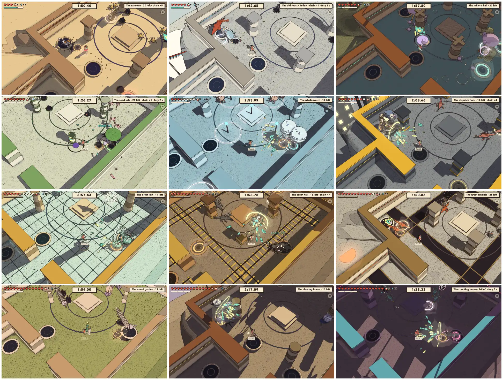
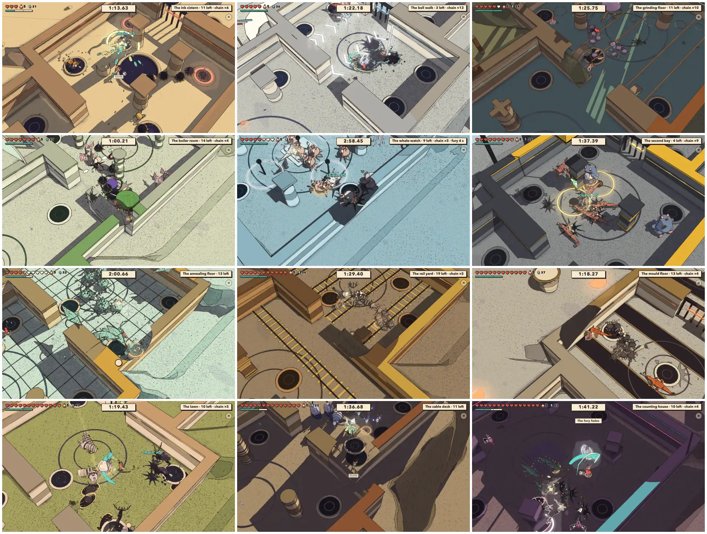
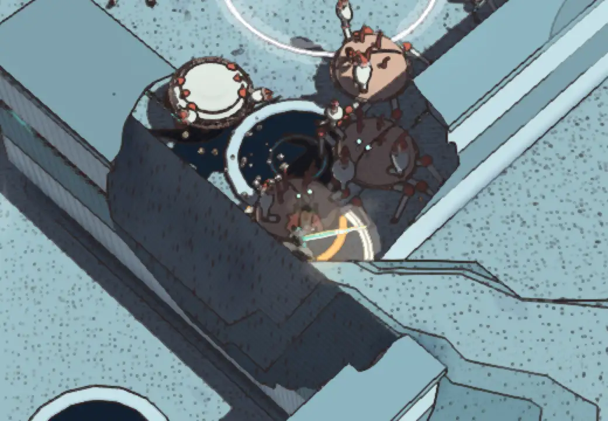
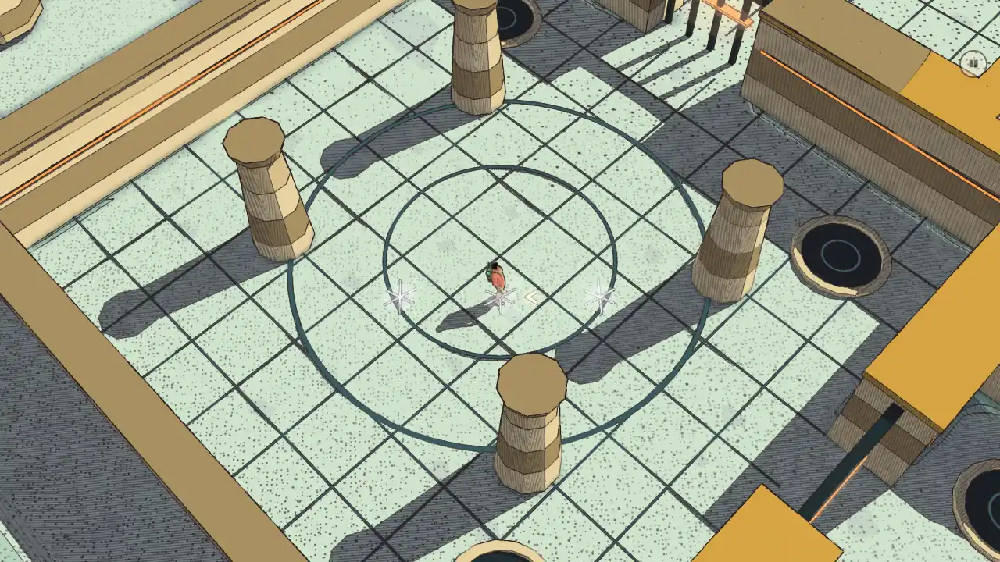
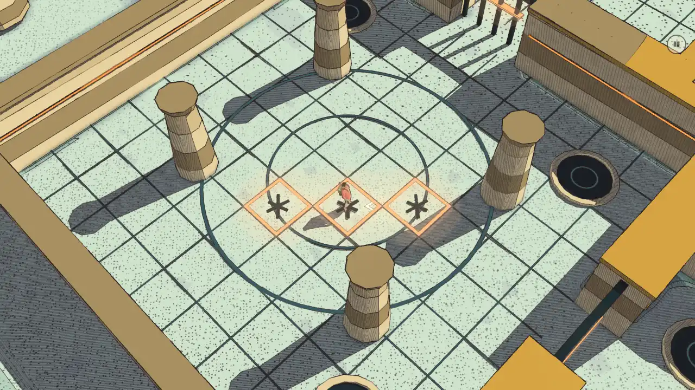

# Combat review of the fight temples, v1.85 (2026-10-19): the twelve played through, the curve upside down

<!-- audit-scores
overall: 3.74 / 5
label: the mean of the twelve fight temples' totals (each temple's waves, foes and hazard as one fight, by eye over three bots' runs)
date: 2026-10-19
-->

The first review of the fight temples' combat (issue #482, from the [v1.85 game audit](game-v1.85.md), themes 9 and 10).
The twelve landed in #427, #435 and #442 (v1.76–v1.84); the last combat review, [v1.61](combat-v1.61.md), predates all
of them. They are a combat of their own, so this report is a kind of its own beside the combat reviews: the same
rubric, one row a temple.

## Setup

- **Build:** this branch on main a90acbcb9, 19 October. Headless Chrome, muted, ANGLE Metal, Medium, 1280 × 720, on this
  worktree's own Vite (port 5482). No devices, no pad in a hand.
- **Played, not read:** `.claude/skills/combat-review/fight-temples.mjs` (new): each temple's page
  (`?game=fight-<world>&seed=4821`, the same drawn run every time) played through to the reliquary by a scripted
  traveller on the game's own keys, with the hearts he has on arriving in that world (3 in the desert … 15 in the
  Signal Market: `lib.mjs heartsOnArrival`, the save's `res.hearts.extra`). A knock-out is counted and refilled so the
  run goes on to be measured. The bots and runs:
  - **skilled**: walks to the nearest foe, cuts in reach (the right stick on it), shoots what is out of reach, rolls out
    of any blow due in under 0.22 s (`src/flurry.js foeThreat`) and steps out of the hazard's lane, spot, band or the
    dark (into a lamp's light) as it warns; all twelve, Normal;
  - **masher**: walks in and cuts, never rolls (a new player's floor); five temples, Normal;
  - **masher on Gentle**: the same five, before and after the Gentle fix below;
  - and the masher once more on four (the Sunken Hall, the Flooded Gallery, the Oil Exchange, the Back Rooms) counting
    the foes out of the frame (their middle projected through the game's camera) and the blows begun there.
- **Measured per run:** the clear time against par and the rank the card gives; the hearts lost by cause (each kind,
  each hazard); knock-outs; every wind-up seen that ended in a strike (state `wind` → `strike`); blows a minute; the
  crowd standing; each room's time and harm; frame times; the page's errors with the lock (Tab) pressed every 9 s.
- **Read:** `src/fight-temples/` (`rules.js`, `session.js`, `hazards.js`, the twelve tables), `fluid-blade.js` (`ROLL`,
  `QUICK_CUT`, `WIDE_CUT`, `EVADE`), `foes.js` (`HARM_BY_STAGE`, `TURNS`, `GENTLE`), `resources.js` (`quarters`,
  `strikeDamage`), docs/design/fight-temples.md.
- **Looked at:** each room at its fullest crowd and each hazard's first warning (below), the results cards, and close
  views where something read badly.
- **Caveats:** a bot is not a player. The skilled bot rolls on a perfect clock (so the foes' harm under-reads) but has
  no path-finding round pillars and chases the nearest foe back over broken ground (so the lingering hazards over-read:
  it lost more in the Kiln Yard than the masher did). Treat each number as a direction, and the bots' agreement as
  the finding.

*The last room of each, at its fullest (left to right, top to bottom: the route's order, the Sunken Hall to the Back Rooms).*

*Each hazard half a second into its warning (the Sunken Hall: a geyser filling under him). Gusts, loads, pours and
lamps read at once; the Kiln Yard's tiles did not (fixed below); the oil, the toll's sign and the shade's edge often
start at or past the screen's edge.*

## The rules against the main game's

| | in the world | in a fight temple |
|---|---|---|
| camera | the follow camera, turned by the player; the lock-on turns it onto the foe | fixed iso: yaw π/4, 57° down, 28 m, a 31° lens, about 15.5 m of floor tall on the screen |
| aim | the lock (R3 / Tab) or the cut's soft lock | the right stick's cone, ±0.7 rad, 6.5 m for the blade, 18 m for a shot, anything within 1.6 m; the lock is off (pressed: nothing; no error in about 200 presses over the runs, the lock-on crash of #509 being the world's) |
| dodge | the evade: a 0.28 s backstep, i-frames 0.03–0.24 s; back or side + jump: the hops and the perfect dodge's flurry | the roll: 0.42 s, 9.5 m/s (3.3 m), i-frames 0.02–0.34 s (Gentle 0.4), every 0.75 s; it cuts off a swing's wind-up or follow-through; **no jump, so no hop, no flurry, no air cut** |
| the cut | the combo 0.47 / 0.51 / 0.75 s, the sword's own reach | the quick combo 0.32 / 0.35 / 0.50 s (`QUICK_CUT`), a drawn crescent 2.6 m out (2.9 m on the third), every foe under it cut (`WIDE_CUT`) |
| foes | a pack of 1–6, their whole kit, strikers 2 (3 from stage 3), the world's harm (`HARM_BY_STAGE`) | waves of 14–24 heads out of springs; a light foe has 1–2 cuts of health (`LIGHT_HP`), strikes only with its **first** attack at half harm (`LIGHT_HARM`), sees the whole room; gorged ones (+2 health, full harm, a heart and a fury shard); tough ones last (full health and harm) |
| harm | the blow's damage × stage, in quarters | the same, but half of a light blow is under a quarter heart for nearly every kind, so it is **a quarter heart everywhere** (`quarters`), from the desert to the Signal Market |
| score | none | the clear time against par and a rank by hearts lost: S ≤ 1, A ≤ 3, B ≤ 6, else C, the same counts in every temple |

## The scores

One row a temple, its waves and hazard as one fight on the foes' rubric (1–5 each): **read** (the tells of what it
fields, most of all the kinds that throw most of the blows, and its hazard's warning), **counter** (the answers it
asks for: the roll, the cut, luring the crowd into its hazard, a ward or a shell), **space** (the room and the hazard
moving him), **fair** (the hearts it takes against the hearts he has on arrival; a fight that takes nothing is not
fair either: 3), **identity** (its look, foes and hazard as its own), **combines** (how its kinds and hazard change how
the others are fought). By eye over the runs and the pictures; the measures are in the next table.

| temple | world | read | counter | space | fair | identity | combines | total |
|---|---|---|---|---|---|---|---|---|
| The Sunken Hall | the Desert | 3 | 3 | 3 | 2 | 4 | 3 | 3.0 |
| The Wind Cloister | Vael | 4 | 4 | 4 | 5 | 5 | 3 | 4.17 |
| The Drowned Mill | Lorn | 3 | 4 | 4 | 3 | 4 | 4 | 3.67 |
| The Seed Vault | Viridel | 4 | 4 | 3 | 3 | 4 | 4 | 3.67 |
| The Flooded Gallery | the Underwater City | 4 | 4 | 4 | 2 | 5 | 4 | 3.83 |
| The Lift Depot | the City-Shaft | 4 | 4 | 4 | 3 | 4 | 4 | 3.83 |
| The Kiln Yard | the Glass Dunes | 2 → 4 | 3 | 4 | 2 | 4 | 3 | 3.0 → 3.33 |
| The Tooth Gallery | the Buried Machine | 3 | 4 | 4 | 4 | 5 | 3 | 3.83 |
| The Pour Floor | the Moon Foundry | 3 | 4 | 4 | 4 | 5 | 3 | 3.83 |
| The Quiet Orchard | the Garden of Spheres | 3 | 4 | 4 | 4 | 4 | 4 | 3.83 |
| The Oil Exchange | the City Floating in Space | 3 | 4 | 4 | 3 | 4 | 4 | 3.67 |
| The Back Rooms | the Signal Market | 4 | 5 | 4 | 3 | 5 | 4 | 4.17 |

The Kiln Yard's read went from 2 to 4 with the fix to its breaking tiles (below); its total is the after.

### What was measured

Hearts lost by the skilled bot and the masher, against the hearts he has on arriving; the clear time and the rank on
the card (the skilled bot's).

| temple | hearts on arrival | skilled: lost | of it, hazard | lost ÷ hearts | clear (s), par | rank | masher: lost | lost ÷ hearts | blows/min | crowd |
|---|---|---|---|---|---|---|---|---|---|---|
| The Sunken Hall | 3 | 7.75 | 2 (geysers) | **2.58** | 171, 240 | C | 10 | **3.33** | 49 | 25 |
| The Wind Cloister | 5 | 2.75 | 0.75 (gusts) | 0.55 | 167, 250 | A | | | 38 | 23 |
| The Drowned Mill | 6 | 8.25 | 3 (millstones) | 1.38 | 191, 260 | C | 14.5, a knock-out | 2.42 | 45 | 22 |
| The Seed Vault | 7 | 1.75 | 0.5 (bloom) | 0.25 | 141, 250 | A | | | 41 | 20 |
| The Flooded Gallery | 8 | 16, a knock-out | 9 (the dark) | **2.0** | 310, 250 | C | 22.25 | **2.78** | 37 | 21 |
| The Lift Depot | 9 | 9.75 | 3.5 (loads) | 1.08 | 207, 250 | C | | | 32 | 21 |
| The Kiln Yard | 10 | 20, a knock-out | 11.25 (tiles) | **2.0** | not cleared in 420 | | 11 | 1.1 | 38 | 22 |
| The Tooth Gallery | 11 | 5.25 | 0 (carts) | 0.48 | 177, 250 | B | | | 61 | 23 |
| The Pour Floor | 12 | 5.5 | 2 (slag) | 0.46 | 164, 260 | B | | | 44 | 23 |
| The Quiet Orchard | 13 | 7.5 | 2 (shade) | 0.58 | 193, 250 | C | | | 57 | 24 |
| The Oil Exchange | 14 | 12.75 | 8.5 (oil) | 0.91 | 260, 250 | C | | | 50 | 24 |
| The Back Rooms | 15 | 5.5 | 3 (toll) | **0.37** | 143, 250 | B | 9.25 | 0.62 | 39 | 23 |

Frame times held (95th percentile 17.6–18.1 ms at a 60 Hz refresh with 20–25 standing, Medium, this Mac). No page
errors in any run. The masher never rolled and cleared every temple it played (heart drops, 16 % a kill when at half
or less, and `strikeDamage` never taking the last quarter carried it), faster than the skilled bot, and always C.

The wind-ups as seen (median s, the kinds that threw most blows): skitters 0.62–0.72 (the Sunken Hall, the Drowned
Mill, the Tooth Gallery, the Pour Floor: half to two thirds of their blows), blots 0.77–0.82, moths 0.62–0.8, horn lizards
0.90–1.0, root knots 1.0–1.1, crabs 1.17–1.21, rays 1.25–1.32, ring drones 1.12, rollers 1.1, hounds 1.55–1.6 (seen; their
first attack, the pounce, is tuned 1.0), lamp tripods 1.42; the tough ones 1.1–1.8. On Gentle each is
about a third longer (skitters 0.92–0.98, crabs 1.67).

## The temples, in the route's order

- **The Sunken Hall** (the Desert, the first): the teacher costs the most. 3 hearts against waves where skitters
  (0.6–0.7 s, the shortest tell in the twelve) and blots (0.77 s) throw most blows, three geysers every 3.75 s in its
  last wave, and a tough lamp tripod whose stamp is a whole heart. Both bots lost 2.6–3.3 times their hearts; the
  sanctum alone took 5 of the skilled bot's 7.75; an earlier run was knocked out there. Its first room teaches the
  crowd well (no hazard, 20 blots and skitters in two waves, 18 s).
- **The Wind Cloister** (Vael): the best balanced. Rays and herons tell 1.0–1.3 s, the gusts' chevrons show the lane
  and its way 1.1 s ahead, and a gust slams the crowd into the wall at its end: the hazard is a tool. 0.55 of his
  hearts, rank A.
- **The Drowned Mill** (Lorn): a hundred skitters (0.62 s) under toads lobbing from afar; the millstones crush the
  swarm. The toads' bellows swell into pink spheres that hide what stands behind them (the crowd picture). 1.4–2.4
  times his hearts.
- **The Seed Vault** (Viridel): eighty moths, a cut each, drawn into the beds' flash: its idea works, and it is the
  easiest of the twelve (0.25 of his hearts, A).
- **The Flooded Gallery** (the Underwater City): the dark takes the most of any hazard after the Kiln Yard's tiles
  (9–11.75 hearts). In the last wave it is dark 3.6 s of every 5.25, a quarter heart a second outside a lamp's 2.4 m
  disc, while 20 crabs, rays and jellies come at him: holding a disc against a crowd that big is not an answer. Its
  jellies ward the crabs and the crabs' shells glance a cut from the front: the most to read of the twelve, and the
  best looking.
- **The Lift Depot** (the City-Shaft): the loads' yellow rings (1.3 s) are the clearest warning of the twelve; toads
  lob over the lizards. About his hearts lost; C.
- **The Kiln Yard** (the Glass Dunes): its breaking tiles warned with a white star 5 cm wide on pale glass, all but
  unseen from 28 m, and took 11.25 hearts of the skilled bot's 20: **fixed** (below). Mostly crabs (74 of 110).
- **The Tooth Gallery** (the Buried Machine): rails drawn from the start, carts that blink 1.3 s ahead; no cart hit
  the skilled bot. Skitters again (107 of 150). B.
- **The Pour Floor** (the Moon Foundry): the channels are cut into the floor before the fight, so the room reads
  first; skitters again (110 of 150). B.
- **The Quiet Orchard** (the Garden of Spheres): hounds whose pounce tells 1.6 s, rollers, centipedes; in the shade's
  band they can't be aimed at, by design. 0.58 of his hearts.
- **The Oil Exchange** (the City Floating in Space): flyers over burning oil, rollers to burn in it. The oil takes the
  most of its hearts (8.5 of 12.75); its pools open under and near him and often start past the screen's edge.
- **The Back Rooms** (the Signal Market, the last): the best ideas (a ring of sound to roll through that stuns and cuts
  the crowd, marionettes stringing the lizards, the bell walker at the end), and nearly the easiest: 0.37–0.62 of his
  15 hearts. The route's peak is not its peak.

## The combat as a whole, in here

| | score | why |
|---|---|---|
| Responsiveness | 4 | The quick combo (0.32 / 0.35 / 0.50 s), a 0.2 s buffer, the roll taking back a wind-up or a follow-through: the bots chained 11–25 kills. The roll is committed through its 0.42 s and 0.75 s apart, as it should be. |
| Feedback | 4 | A kill reads from 28 m (thrown, a ring, a splat that dries, one thump in a crowd), the chain counter, gorged rings, fury. But the traveller himself is lost in his own crowd: he has no outline through foes and walls' holes, and a crab over him hides him whole (picture below). |
| Move variety | 2 | The quick combo and the roll are the fight. With no jump there is no air cut, no hop and no flurry; the perfect roll (a blow swallowed by the i-frames) earns nothing; the charged cut, the riposte and the gun (the quick shot empties the flask: "FLUID") are never the best answer to one-cut foes. The main game's best tools are switched off and nothing takes their place. |
| Difficulty curve | 2 | Upside down: hearts grow 3 → 15 along the route while a light blow is a quarter heart everywhere, so the first temple costs 2.6–3.3 times his hearts and the last 0.4–0.6. The rises in between are the lingering hazards (the dark, the tiles, the oil), not the foes. The tables' `lightHarm: 0.4` (three temples) changes nothing: 0.4 or 0.5 of a light blow both round to a quarter. |
| Camera and aim | 3 | The fixed view reads a room and its hazard (the walls cut away round him work), and the cone takes the right foe. 15.5 m of floor is less than the bigger rooms (24 × 24 m) and the waves come up from the springs farthest from him, so 12–17 % of the standing foes are out of the frame at any moment (the masher, Normal, four temples); but only 1–5 % of the blows begin there (1 of 109 in the Sunken Hall, 5 of 106 in the Flooded Gallery): the crowd comes into view before it strikes. The oil's pools and the toll's signs do start at the edge. The lock button does nothing, silently. Each room's floor sigil is two ink rings round its middle, the same shape the foes' ring attacks draw. |
| Gentle | 3 → 4 | Gentle lowers the crowd's cap to 14, brings seven tenths of each wave, lets one strike at a time and slows every tell by a third: the masher's losses fell from 1.1–3.3 to 0.23–0.81 of his hearts. But its hazards' "half the harm" was nothing for a quarter heart (half of it rounds back up), so on Gentle the hazards took more than half of what was lost (10.75 of 20 hearts over the five); now every other one is spared (below). |

*The long gallery: he is in the wall's cut-away hole, under a crab; only his cut's arc says where.*

## Fixed in this review

- **The Kiln Yard's breaking tiles now show** (`hazards.js` `CRACK_WARN`): the tile's edge lit in the temple's glyph
  tone (steady, then flickering faster in the last half of the warning) and a dark star of cracks 11 cm wide across it,
  where a white star 5 cm wide sat on the pale glass. Test: `tests/fight-temples-worlds.test.js` ("a breaking tile
  warns…").

  

  

- **Gentle spares every other quarter-heart hurt from a hazard** (`hazards.js` `GENTLE_HURT`, `hurtHim`): half of a
  quarter heart came back a whole quarter, so the gust, the flash, the toll and every tick of the dark, the shade, a
  pit and the oil hurt on Gentle as on Normal. Hazards of half a heart or more are halved as before. Test: "Gentle: a
  quarter-heart hazard is spared every other time…". The masher on Gentle, before → after, in hazard hearts: see
  "Gentle, before and after".

### Gentle, before and after

The masher on Gentle (never rolling), the same seed, before → after the fix. The quarter-heart hazards (the dark, the
tiles, the toll) took about half as much; the millstone (a whole heart, halved to a half) is untouched by it, and its
2 hearts after are the run's luck (four stones on him, not one). Each run is one run: the foes' own hurts move a
heart either way between runs.

| temple | its hazard | hazard hearts | all hearts lost | rank |
|---|---|---|---|---|
| The Sunken Hall | geysers (half a heart: halved as before) | 0.25 → 0.25 | 2.25 → 0.75 | A → S |
| The Drowned Mill | millstones (a heart: halved as before) | 0.5 → 2 | 1.75 → 3.75 | A → B |
| The Flooded Gallery | the dark (a quarter a second) | 4.25 → 2 | 6.5 → 4.75 | C → B |
| The Kiln Yard | breaking tiles (a quarter a tick) | 3.5 → 1.75 | 6 → 3.5 | B → B |
| The Back Rooms | the toll (a quarter) | 2.25 → 1 | 3.5 → 2.25 | A → A |

## Recommendations (filed as issues)

Most valuable first:

1. **Turn the curve the right way up** (#532; Difficulty curve 2). A light blow is a quarter heart from the desert
   to the Signal Market while hearts grow 3 → 15: the Sunken Hall costs 2.6–3.3 times his hearts, the Back Rooms
   0.4–0.6. Make harm rise along the route in here (more strikers late, gorged ones with their whole kit, a second
   attack for light foes late on), soften the Sunken Hall's sanctum (three geysers every 3.75 s and a tripod whose
   stamp is a heart, against 3 hearts), and drop or mean `lightHarm`.
2. **Retune the lingering hazards** (#533; fair 2 in the Flooded Gallery and the Kiln Yard). The dark, the oil and
   the tiles took 8.5–11.75 hearts a run against 0–3.5 for the one-shot hazards; the last wave's dark is up 69 % of
   the time while twenty foes come at him. Measure the Kiln Yard again with this review's fix first.
3. **Give the roll a reward and the kit a reason** (#535; Move variety 2). No jump means no hop, no flurry and no air
   cut; a blow swallowed by the roll's i-frames earns nothing; the charged cut, the riposte and the gun are never the
   answer. A masher that never rolled cleared every temple it played, only ever C.
4. **Help the eye in a crowd** (#534; Camera and aim 3, Feedback 4). An outline for the traveller through foes; the
   oil's and the toll's starts kept on the screen; a floor sigil that isn't two rings; an answer when the lock is
   pressed.

Done with this review: the Kiln Yard's breaking tiles warn so they can be seen, and Gentle spares every other
quarter-heart hazard (above).

## Against the last report

There is none for the fight temples: this is the first. The world's combat review ([v1.61](combat-v1.61.md), 4.51)
scored the foes one at a time in the Arena; here the same kinds score lower as crowds (3.74), and for reasons of the
temples' own: the curve, the lingering hazards and the moves switched off. The kinds themselves read as they did at
v1.61 (the same wind-ups within 0.1 s where both measured them: the blot 0.71 → 0.77, the skitter 0.60 → 0.62, the
tripod 1.42 → 1.42).
