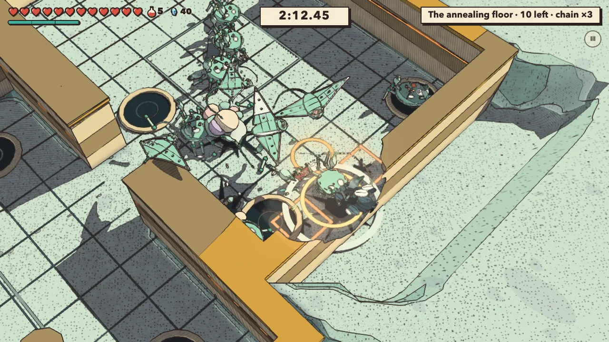
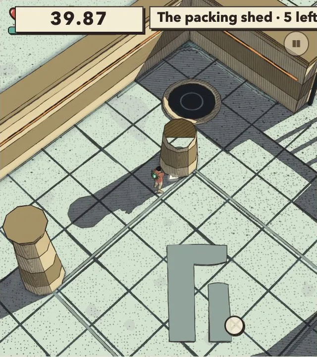

# Fight temples, v1.90 — audit

<!-- audit-scores
overall: 3.90 / 5
label: mean of six criteria across twelve fight temples; assisted-path limits stated
date: 2026-10-21
-->

Frozen `c5449ab6c`; Medium, seed 4821. Earlier Skilled/Normal runs used guarded muted Chrome; corrected Gentle and targeted follow-ups used the internal Codex browser operated through CUA. All twelve skilled runs and five Normal masher comparisons are complete. Five corrected Gentle comparisons, paired riposte, and reduced-motion checks are complete; narrow larger-text HUD fails. The twelve-temple score table below is now assessed from completed outcomes and images; whole-combat synthesis remains separate.

## Fresh skilled curve

| World | Arrival hearts | Bot elapsed s | Hearts lost | Share lost | KO | Assists | Rolls | Frame p95 ms | Rank |
|---|---|---|---|---|---|---|---|---|---|
| desert | 3 | 148.5 | 1.5 | 0.50 | 0 | 0 | 59 | 17.7 | B |
| arzach | 5 | 154.1 | 1 | 0.20 | 0 | 0 | 53 | 17.6 | A |
| perdide | 7 | 206.2 | 3.25 | 0.46 | 0 | 0 | 86 | 23.2 | B |
| edena | 9 | 145.1 | 2.75 | 0.31 | 0 | 0 | 44 | 17.7 | B |
| underwater | 10 | 228.8 | 6 | 0.60 | 0 | 0 | 107 | 17.6 | B |
| incal | 11 | 236.9 | 7.25 | 0.66 | 0 | 1 | 56 | 17.6 | C |
| glassdunes | 12 | 348.9 | 13.25 | 1.10 | 0 | 0 | 245 | 17.7 | C |
| buried | 13 | 146.4 | 5 | 0.38 | 0 | 0 | 75 | 17.9 | B |
| moonfoundry | 14 | 160.6 | 5.5 | 0.39 | 0 | 0 | 64 | 18.2 | B |
| spheres | 15 | 185.5 | 7.75 | 0.52 | 0 | 0 | 88 | 18.1 | B |
| spacecity | 16 | 288.8 | 2 | 0.12 | 0 | 3 | 83 | 18 | A |
| bazaar | 17 | 137.1 | 9 | 0.53 | 0 | 0 | 45 | 18.2 | B |

Ten runs cleared without intervention; Lift Depot and Oil Exchange were assisted. All twelve had zero knockouts, browser errors and NaN reports. Cumulative damage can exceed arrival hearts because pickups heal. Bot elapsed time includes observation/setup and differs from the game's results clock. Detailed loss by foe/hazard, warnings, rooms, ranks and result cards remain in `temples-combined.json` and the original run folders.

Lift Depot: at 83.9 s, one remaining toad triggered the runner's 40-second no-kill recovery. Oil Exchange: at 216.9 s, two drones were force-killed; at 273.8 s, 21 mixed foes were force-killed, followed by an altar-navigation teleport. These are not unqualified clears, and the Oil Exchange's low damage/A rank cannot establish balance. Reproduce the paths with direct player control before calling either a gameplay softlock.

The original two-world run was stopped at the parent's requested world boundary (exit 143), then the remaining ten completed separately. No completed world was discarded. `temples-skilled/`, `temples-skilled-rest/`, their raw logs and `completed-before-ship-handoff.json` preserve provenance.

## Normal masher comparison

| World | Skilled seconds / loss | Masher seconds / loss | Interpretation |
|---|---|---|---|
| Desert | 148.5 / 1.5 | 136.1 / 1.75 | Quick attacks viable; small health trade-off |
| Perdide | 206.2 / 3.25 | 182.6 / 5.25 | Evasion saves health at a time cost |
| Underwater | 228.8 / 6 | 205.8 / 6.75 | Modest health saving from evasive policy |
| Kiln Yard | 348.9 / 13.25 | 238.9 / 9 | More evasive bot is slower and takes more damage |
| Bazaar | 137.1 / 9 | 121.4 / 9.25 | Similar harm, faster quick-only policy |

All five masher runs had zero rolls, knockouts, assistance and browser errors. The skilled bot quick-cuts, shoots and rolls but does not deliberately charge or parry. These policies are not an isolated experiment on the new rewards. In particular, Kiln's 245 skilled rolls reduce attack uptime and prolong exposure; higher skilled harm is not proof of unanswerable difficulty. One seed also cannot prove quick attacks dominate human play.

## Visual findings, ranked

All twelve skilled contact sheets were inspected, including every captured crowd/first-warning frame; selected concerns were viewed at full resolution. Stills do not establish every hazard's complete active duty cycle.

1. **Kiln crowd readability:** the room-two crack frame nearly hides the traveller and floor beneath pale-green bodies/gliders beside the right wall. Orange bracket warnings differ from gold circular tells, but their coverage is the problem. The final wave combines 12 light crabs, tough/gorged bodies, four pillars and two cracking tiles every 4.5 s (`src/fight-temples/glassdunes.js:40–43`). Existing harm mitigation is already at lines 26–27. Test body spacing/count and warning visibility before blanket damage reduction. An existing overlay self-marker (`self-mark.js:38–55`) should be assessed, not duplicated.
2. **Oil Exchange feedback overlap:** a large chain ×5 popup crosses the self-marker and effects/foe/pillar cluster. `session.js:491` places it at the defeated foe while line 624 already provides a HUD chain display. Test offset/suppression during heavy occlusion. Dark spill against dark shadow is a contrast risk in this frame, not proof of an invisible hazard throughout its animation.
3. **Perdide and Underwater crowd cover:** large purple rootknots/mill columns mask small foes in Perdide; stacked crabs and a pillar obscure the right-side crowd underwater. Mill warnings contrast clearly with slate floor; underwater lit circles and lit/unlit pole tops provide useful shape cues. Player visibility improves in open floor.
4. **Lower-priority cue contrast:** Vael's white gust chevrons show direction but have modest contrast on pale ground. Lift Depot's gold drop rings overlap gold enemy rings, making source identification slower. Edena's purple bloom circles, Foundry's dark orange-edged channels, and Buried's permanent rails are comparatively distinct. Spheres' column/altar partly hides combatants, though open floor remains ample.

Desert's small silhouettes remain readable. Bazaar explicitly explains clean-roll reward in cyan text and shows bright duration in the HUD; white creature effects still compete locally with tell rings.

## Evidence pictures

The Kiln’s room-two wave supports the 2/5 readability grade: large bodies and the pillar compete with the traveller and floor warning. It does not prove that enemy damage should be reduced.

At 640 × 720 and 145% text size, the timer overlaps resources and the room label clips at the right. This is an actual temple session, cropped here to its game frame. The [full review page](combat-fight-temples-v1.90/large-text-hud.webp) preserves the surrounding controls and measured settings. It is separate from the passing reduced-motion check.

## New move checks

Fresh staged real-input full charges reached the actual hit path: 5 damage against a gorged opponent versus 3 against the ordinary version, without a stun multiplier. Other opponents were frozen and target placement held for repeatability; this is wiring evidence, not a whole-run strategy result. Actual Alt roll also triggered the reward callback and bright state; a reserve at 2.6 rose to cap 3. Paired riposte follow-up is recorded below. Evidence: `targeted-variety-isolated/`, `targeted-variety-final/`, and the earlier input-corrected clean-roll run. Initial incomplete fixtures are retained, not reported as game failures.

## Measurement and safety limits

The audit hooks each hurt. The result card samples net health per update (`session.js:607–609`) while pickups heal at line 654, so same-interval healing can offset damage in that counter. Preserve both definitions; this is not evidence that the player escaped actual damage. Perdide's p95 23.2/p99 34.6 ms occurred during another authorized Node hook; these fight samples are not the quiet performance sweep.

Both browser surfaces used pre-navigation hardware-audio destination blocking, suppressed media/speech playback, and constructor review mute. Earlier Chrome launches additionally used the browser mute flag; the later internal Codex browser runs were operated through CUA with the same pre-main output guard. Initial boot and reload with audible saved preferences verified Sound.muted and master gain zero; raw `mute-proof.jsonl` files remain. One initial masher readiness race was caught before gameplay and repaired by waiting for a new document time origin; its failed setup is archived separately.

Ordinary combat phases and final scores are recorded in combat-v1.90.md, including bounded defence and contact coverage limits. Gentle and targeted accessibility/riposte results are recorded below. No physical pad, device audio, Unity or human first-time playtest is claimed.

## Fresh CUA staged riposte trace

The internal Codex browser review page on 5489 was operated through CUA, after pre-main audio-output blocking and real Sound constructor/reload assertions passed. The staged blot wind uses the live guard input, followed by a live blade press only after the runtime returned `perfect`. One parry occurred at guardAge 0.1355 s (guardK 0.8811), within GUARD.perfect 0.18 s. One actual target hit carried `damage:5, riposte:true`; HP 100→90 is the expected stun multiplier, not two hits: perfect parry stuns for 2 s (`src/foes.js:109`) and blade damage doubles while stunned (`foes.js:1469`). Other foes were isolated, the target was staged and given 100 HP, and reserve/health were reset for repeatability. This validates the actual reward/contact wiring, not general combat diversity or player success rate. Evidence: `cua-qa/riposte.json`.

The first attempt produced six ordinary blocks at guardAge 0.200–0.217 s; these were outside the perfect window. The fixture was corrected to delay guard 70 ms after its staged wind. Those results are a fixture-timing diagnosis, not a gameplay failure. The full-charge comparison remains separately verified at 5 versus 3 damage without a stun multiplier.

### Gentle fixture integrity

The first visible CUA Gentle batch is excluded from balance comparisons. An existing active save slot ignored the raw legacy health fixture: Bazaar measured 3 maximum hearts against the intended 17; the prior four did not record actual maximum hearts. Its outcomes remain in `cua-qa/wrong-slot-fixture/`. This is an audit setup error, not a game defect. The corrected runner unloads the old game, clears only its owned origin, and asserts both player/resource maximum hearts and live foe difficulty before starting; it preserves settings and resource snapshots. The original Normal/Skilled runner already unloaded to the manifest and cleared origin per world (adapted/fight-temples.mjs:208–212), so it does not share this stale-slot setup. Its configured budgets are source-supported, not newly measured live snapshots.

### Targeted CUA follow-up, verified

Ordinary opponent comparison (`cua-qa/riposte-ordinary.json`): live perfect guard at 0.1333 s, one blade contact with `riposte:true`, incoming damage 3 and HP 100→94 after the same stunned ×2 multiplier. The earlier gorged contact was incoming 5 and HP 100→90. Both were staged attacks followed by real input fields, not direct parry/hit calls; this proves runtime wiring and breakpoint difference, not human ease of execution. Normal difficulty and 3 actual maximum hearts asserted before the ordinary check. Mute destination block active, master 0, no runtime errors.

Reduced-motion follow-up (`cua-qa/accessibility.json`): a real GlassDunes warning was held active and the player staged at a legitimate room point, without assigning camera values. Actual framing displaced by (1.077, 0.576) m, zoom 1.0444 before the final pre-toggle wait; the first recorded reduced sample was (4.658, 2.490) m, zoom 1.1922. All 80 samples report reduction active, declining to (0.0151, 0.0081) m, zoom 1.000625 at 4.142 s while the tell remains. This validates settling from an actual displacement. It is not a recorded instantaneous toggle-jump measurement. Larger-text scale 1.45 and 640×720 viewport confirmed; The later full-page screenshot confirms overlap/clipping as described below. Earlier no-offset runs remain explicitly invalid for this test.

### Narrow larger-text HUD — confirmed finding

Full-page CUA image `cua-qa/accessibility-large-text-full-page.png` was independently inspected: at 640×720 and scale 1.45, the timer covers the top-left hearts/reserve and the room label clips beyond the right edge. This layout fails while the reduced-motion camera check passes. Source anchors: `src/minigames/kit/minigames.css:7–16` keeps a three-column single-row grid, nowrap boxes and a 6.2 em timer minimum. Recommend responsive reflow/reserved resource space; no implementation change made. Repeated access capture retains real tell and settles to (.0142, .0076) m, zoom 1.000588 at 4.185 s; no need further rerun.

### Corrected Gentle comparison — complete

| World | Hearts | Skilled s / loss | Normal masher s / loss | Gentle masher s / loss | Gentle KO / assists |
|---|---:|---:|---:|---:|---:|
| desert | 3 | 148.5 / 1.50 | 136.1 / 1.75 | 145.9 / 0.50 | 0 / 0 |
| perdide | 7 | 206.2 / 3.25 | 182.6 / 5.25 | 158.8 / 1.00 | 0 / 0 |
| underwater | 10 | 228.8 / 6.00 | 205.8 / 6.75 | 210.4 / 2.50 | 0 / 0 |
| glassdunes | 12 | 348.9 / 13.25 | 238.9 / 9.00 | 249.8 / 2.75 | 0 / 0 |
| bazaar | 17 | 137.1 / 9.00 | 121.4 / 9.25 | 156.2 / 2.00 | 0 / 0 |

All five live arrival budgets and Gentle difficulty were asserted before play and preserved. No knockouts, assistance, NaNs or runtime/bot errors. Compared with the same Normal masher policy, Gentle lowers lost hearts in every sampled world; clear time is not uniformly faster. Cross-policy Skilled comparisons retain the bot-policy confound and the two assisted worlds elsewhere. Distinct storage and control methods are explicit in `temples-combined.json`; the rejected first Gentle fixture is excluded. These are scripted outcomes, not human difficulty ratings.

## Fresh temple judgements (1–5)

The column names and temple names retain the earlier report’s comparison keys: read is readability, counter is counterplay, space is the room and kit, and fair is fairness. These are fresh judgements with the methodological limits below; the score differences alone do not prove a release regression.

| temple | world | read | counter | space | fair | identity | combines | total |
|---|---|---:|---:|---:|---:|---:|---:|---:|
| The Sunken Hall | desert | 4 | 3 | 3 | 4 | 4 | 3 | 3.50 |
| The Wind Cloister | arzach | 3 | 4 | 4 | 4 | 4 | 4 | 3.83 |
| The Drowned Mill | perdide | 3 | 4 | 4 | 4 | 4 | 4 | 3.83 |
| The Seed Vault | edena | 4 | 4 | 4 | 4 | 4 | 4 | 4.00 |
| The Flooded Gallery | underwater | 3 | 4 | 4 | 4 | 4 | 4 | 3.83 |
| The Lift Depot | incal | 3 | 4 | 4 | 3 | 4 | 4 | 3.67 |
| The Kiln Yard | glassdunes | 2 | 4 | 4 | 3 | 4 | 5 | 3.67 |
| The Tooth Gallery | buried | 4 | 4 | 4 | 4 | 4 | 4 | 4.00 |
| The Pour Floor | moonfoundry | 4 | 4 | 4 | 4 | 4 | 4 | 4.00 |
| The Quiet Orchard | spheres | 3 | 4 | 5 | 4 | 4 | 5 | 4.17 |
| The Oil Exchange | spacecity | 3 | 4 | 5 | 3 | 4 | 5 | 4.00 |
| The Back Rooms | bazaar | 4 | 4 | 5 | 4 | 4 | 5 | 4.33 |

Scores are reviewer judgments of each temple's waves as one encounter, supported by fresh images and outcomes above. They are not a player-success prediction. Glassdunes readability 2 reflects actual crowd occlusion; its fairness 3 reflects the severe exposure/clarity combination, without claiming the higher-loss rolling policy proves a damage spike. Incal/Spacecity fairness 3 retain the assisted-path uncertainty and must not be read as confirmed softlocks. First-temple variety is deliberately simpler; late mixed supports/hazards raise combines/space. Identity is capped 4 because sound was not listened to. Gentle's consistent harm reduction and repaired arrival budgets are credited without erasing the separate larger-text HUD failure. No prior numeric temple scores were copied into this table.
