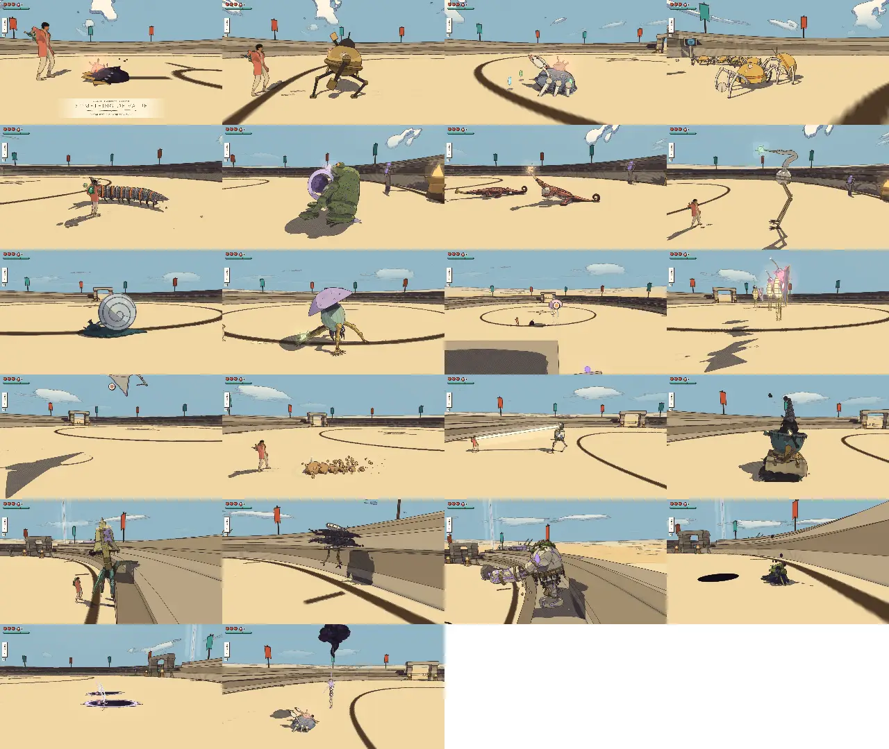
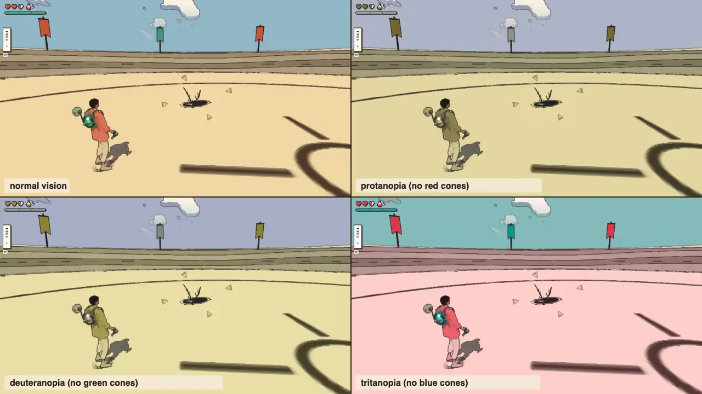
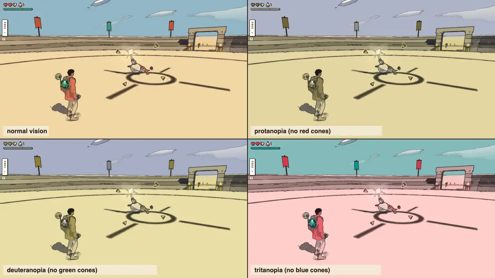
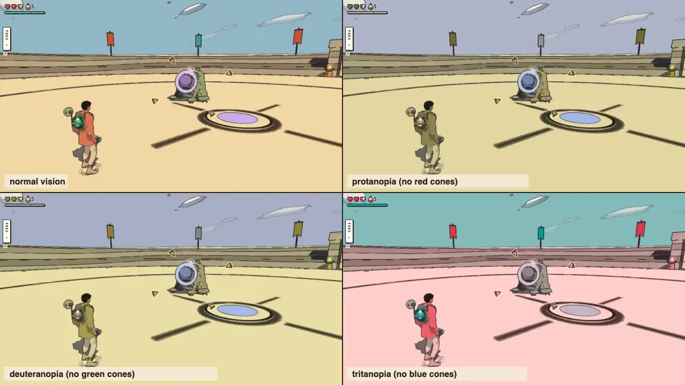
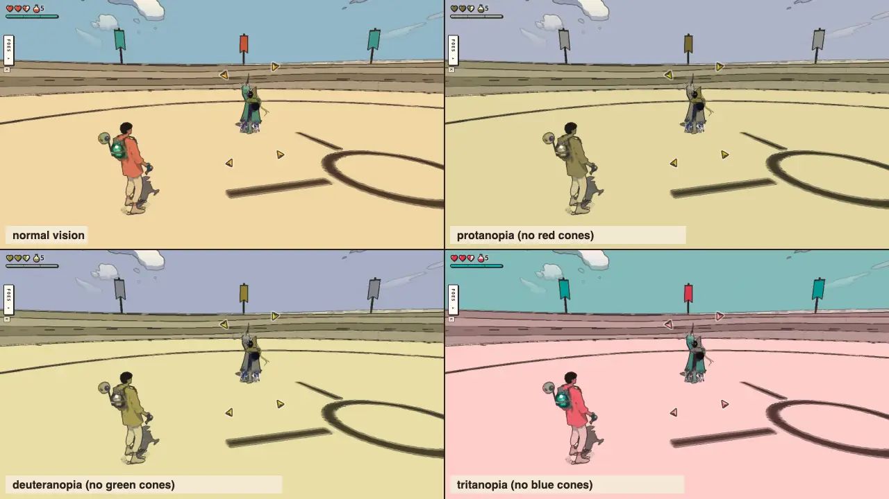
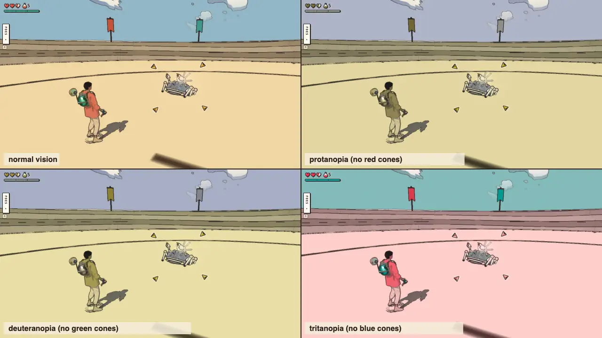
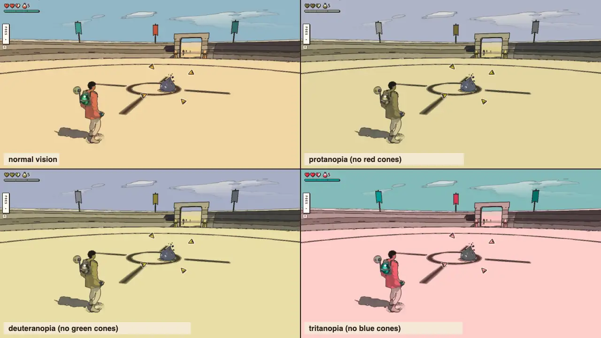
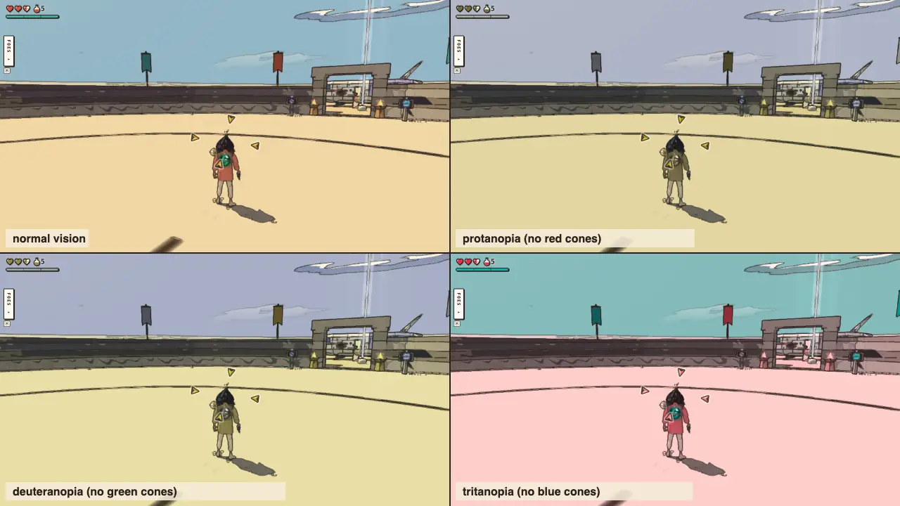
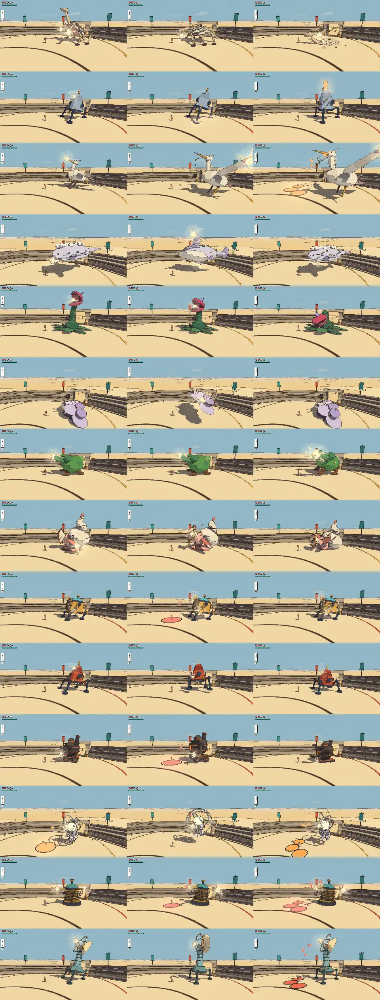

# Combat review, v1.47 (2026-10-11): the flurry, the hops and the lock-on, with a colour-vision pass

<!-- audit-scores
overall: 4.52 / 5
label: the mean of the 22 kinds' totals (by eye) and the 14 guardians' (from their tuning)
date: 2026-10-11
-->

This is the first combat review since [v1.22](combat-v1.22.md). It comes after the moves of v1.39–v1.43 (issue #103,
from the [v1.46 game audit](game-v1.46.md), theme 10):

- **The hops:** locked on, a back flip or a side hop, each with dodge frames.
- **The perfect dodge:** a hop begun just before a blow lands opens the flurry: 3.5 s of slow time, untouchable, the
  cut pulling you in from 6 m.
- **The lock-on:** Ocarina-style, four gold arrows; no health pips, no red.
- **The gun:** it aims at the locked foe.

The red warning on wind-ups went in v1.43 ("its body shows you that"), so reading a blow now rests on the body's
telegraph and the gold arrows. This review checks both for players who see colour differently, at a handheld's size.
It also measures this branch's dash cut change (issue #35: double through a foe's back, its cooldown 1.5 → 1.1 s) and
carries the art passes of issues #29, #31 and #33 (v1.46–v1.47), which changed no attack.

## Setup

- **Build:** this branch (on main 46c55a99, with the four commits for #29, #31, #33 and #35). Headless Chrome, muted,
  ANGLE Metal, the Arena at 1280 × 720, Enemies "normal".
- **Kinds:** `arena.mjs --watch 24 --version 1.47`. Each of the 22 kinds was watched for 24 s against a still traveller
  in its home skin, then every move's blows went through `Foes.hurt`. There are 22 kinds now: the makers' machine is
  new since v1.22. The 14 guardians were scored from their tuning (three are new since v1.22: the Last Founder, the
  Anchor-Warden, the Listener).
- **The curve:** `--packs route --ttk <the kinds run> --pack-count 4 --pack-watch 20`, as in v1.22.
- **The dash cut through the back:** the Arena script strikes from in front (only a shell or a shadow sends it round
  the back), so these times were counted in node with the game's own `Foe.hit`, one blow after another from behind,
  at the move model's cycle (`max(cooldown, length + 0.3 s)`).
- **The flurry:** worked out from its tuning (src/flurry.js `FLURRY`, `DODGE`; src/fluid-blade.js `SWINGS`) against the
  packs' numbers. The perfect dodge's per-foe check (`dodge.mjs`, run as it stands): 31 of 35 foes and guardians
  dodged into a flurry with the back flip. The mound worm, the crucible cart, the bell walker and the ring drone never
  struck inside its 9 s wait: timeouts, not failures (they burrow, trundle, toll or hide first; the tool's own timing
  is issues #32 and #36's).
- **The colour-vision pass:** these were captured in the Arena on the **Handheld preset at 1280 × 720 with Reduce
  motion on**:
  - the lock-on calm, veiled, and flying in;
  - a hit flash;
  - four telegraphs: the lizard's blare, the toad's lob, the shade's cut, the crab's spin.

  The camera was pinned beside the traveller for the shots that show the foe; the game's own camera is also shown,
  for the reason below. Each capture was then shown with normal vision and as simulated for protanopia, deuteranopia
  and tritanopia (Machado, Oliveira & Fernandes 2009, severity 1, in linear RGB). Each colour pair was measured as a
  contrast ratio and an Oklab distance.
- **Not played by hand:** there is no pad here and no sound. A pad is needed to judge the flurry's chaining, the hops'
  feel and the dash cut's back double (recommendations 1 and 6).

## The new moves

| move | score | why |
|---|---|---|
| **Back flip** (locked on, stick back + jump) | 4 | 7.5 m out and 9 m/s up. Dodge frames last 0.02–0.32 s (0.30 s: more than the evade's 0.21 s). It goes straight away from the foe, so the flurry's 6 m pull is what brings you back in. |
| **Side hop** (locked on, stick aside + jump) | 4 | 8 m aside, dodge frames 0.02–0.26 s (0.24 s). It now sets up the dash cut through the back (below): hop past a lizard's bite and cut as you land. |
| **The perfect dodge** (a hop 0.2–0.42 s before a blow lands, in its way) | 5 | The window is a third of the wind-up, so it is generous next to the parry's 0.18 s and still has to read the blow's way. Every archetype and guardian can open it. It is the clearest reward for reading the body's tell, now that there is no red. |
| **The flurry** (3.5 s of your time, the world at 0.12, untouchable, a 6 m pull, the combo without its rest) | 4 ✎3 | In one flurry the combo lands 5 swings (1 + 1 + 3 + 1 + 1 = 7 harm) in 2.8 s of your time while the world moves 0.42 s. That is enough for a four-hearted foe and half of the next. It is strong for its skill. Scored 3 for balance: against the late packs it can be chained (below). |
| **Lock-on** (four gold arrows, no pips, no red) | 4 | It reads on any ground and in every simulated colour vision (below), because it is drawn by its ink edge (11:1 on sand) and two tones, not by its gold. The only state it shows, veiled, is a change of opacity. Two flaws: the game's lock camera sets a small foe straight behind the traveller (below), and the arrows keep turning and flying in with Reduce motion on. |
| **The gun at the lock** (aiming locked on) | 4 | From its tuning (`lockAim`, `LOCK_AIM.snap`): the camera turns to the locked foe's chest, and a shot within the snap lands on it unless a wall is in the way. Not played. |
| **The dash cut** (v1.47: double through the back, 1.1 s) | 4 | It is now the fastest answer through a foe's back for 7 kinds (crab, toad, lizard, heron, roller, brute, cart), and it ties the air cut on the four hoverers. From the front it is still second to the combo. |

### Is the flurry too strong against the late worlds' packs?

**Yes, in a skilled hand, against a crowd.** A flurry gives 3.5 s of your time and lets the world run 0.42 s. The next
may start 1.2 s after it ends (main.js `flurryAgainAt`). A late pack attacks often enough that a blow is nearly always
coming as that gap ends: 47–59 attacks a minute in the last three worlds, about one every 1.0–1.3 s. So a
traveller who dodges every chance spends three quarters of their own time untouchable. They deal 7 harm in every
1.6 s of the world's time, about 4.3 a second, against the combo's 2.35 standing still. Against this run's packs:

| world | pack size | pack health | attacks/min | ttk best, standing (s) | cleared by flurries (s) | hearts lost, standing | hearts lost, chaining |
|---|---|---|---|---|---|---|---|
| desert | 1.2 | 3.5 | 22 | 1.3 | 1.6 | 0.22 | 0.23 |
| arzach | 1.2 | 4.2 | 17 | 1.7 | 2.5 | 0.24 | 0.32 |
| perdide | 3.0 | 10.0 | 51 | 4.3 | 2.3 | 1.49 | 0.59 |
| edena | 2.5 | 6.5 | 35 | 3.1 | 2.0 | 0.56 | 0.29 |
| underwater | 2.8 | 8.8 | 27 | 3.6 | 3.3 | 0.63 | 0.49 |
| incal | 3.2 | 9.0 | 53 | 4.0 | 2.1 | 1.37 | 0.53 |
| glassdunes | 3.5 | 11.0 | 23 | 5.2 | 4.7 | 0.56 | 0.44 |
| buried | 3.8 | 13.8 | 35 | 4.7 | 4.2 | 1.22 | 0.89 |
| moonfoundry | 5.0 | 10.5 | 78 | 4.9 | 2.4 | 1.91 | 0.69 |
| spheres | 5.5 | 20.2 | 47 | 8.6 | 4.9 | 1.50 | 0.65 |
| spacecity | 5.0 | 13.0 | 59 | 5.4 | 3.0 | 0.83 | 0.34 |
| bazaar | 4.8 | 13.8 | 52 | 10.4 | 3.2 | 3.47 | 0.78 |

How these were counted:

- **"ttk best, standing"** is the sum of the members' fastest moves from the kinds run: a traveller trading blows.
- **"Cleared by flurries"** is the pack's health over 7 a flurry, at a flurry every max(1.2 s, the wait for the next
  blow) plus its 0.42 s.
- **The hearts lost** are the still traveller's hearts a minute over the time each spends out of a flurry.
- **The Market's crabs flatter the flurry:** its light swings glance off a crab's shell from the front, as they do
  outside it. There it is a floor.

The chained flurry clears the late packs in about half the time, and they land almost nothing back. The game audit
asked exactly this. It is a ceiling, not an average: it needs a perfect hop each time, inside a 0.2–0.42 s window, in
the blow's way. That is the skill the move is meant to reward. Two light ways to keep it a reward and not a state are
recommendation 2: make the gap between flurries count the foes it hit, or shorten the next flurry when one follows
another within a few seconds.

## Colour vision, at the Handheld size

Every capture was taken on the Handheld preset at 1280 × 720 with Reduce motion on, then shown as seen with protanopia,
deuteranopia and tritanopia (top left: normal vision).

| element | colours | contrast on sand: normal / protan / deutan / tritan | reads by | verdict |
|---|---|---|---|---|
| lock-on arrows (gold) | `#f2c54b` on sand `#f0d6a2` | 1.15 / 1.20 / 1.13 / 1.18 : 1 | its ink edge (11.1 / 10.8 / 11.3 / 11.0 : 1) and its shaded half (2.0 / 2.1 / 1.9 / 2.0 : 1) | reads in all four; the gold itself adds little on sand in any vision (on dark rock 4.8 / 4.5 / 5.0 / 4.7 : 1) |
| veiled lock (a shadow, a buried ray) | the same at half opacity | — | opacity only | reads in all four, but faintly; on tritanopia's pinkish sand it is the faintest |
| the backstab's ring (new) | `#ffd27a`, an inked torus | 1.01 / 1.04 / 1.01 / 1.06 : 1 | its ink outline | reads by its outline only; its gold is invisible on sand for everyone |
| the toad's lob mark | lilac `#c4b1d9` with a dark rim | 1.40 / 1.35 / 1.42 / 1.37 : 1 | its dark rim and its ring shape | reads in all four (tritanopia turns it grey) |
| eyes winding up (orange) | `#f3a361` against the eyes at rest (`#f8e8bb`, a blot's) | 1.69 / 1.86 / 1.59 / 1.74 : 1 | lightness, as well as hue | a second cue, readable in all four; the body's pose is the first |
| eyes stunned (pale blue) | `#bfe9ff` against the eyes at rest | 1.06 / 1.01 / 1.10 / 1.04 : 1 | hue only | **unreadable by lightness for anyone**, and with tritanopia not even by hue. The body shows the stun too (it stops, its wind-up drops); the eyes add little (recommendation 5) |
| hearts (full against empty) | red against cream | 3.4 / 4.6 / 2.9 / 3.4 : 1 | lightness | reads in all four |
| a hit flash, the telegraphs' poses and glows | the body itself | — | shape, pose, white glow | reads in all four: no telegraph depends on a hue |

**What the pass found:**

- **Nothing in a fight is told by colour alone.** That is what v1.43 bet on when it took the red away, and it holds for
  all three simulated colour visions.
- **The gold does little work.** The arrows read by their ink and their two tones, so they read in every vision. On
  pale sand they would read as well in any colour.
- **The two hue-only cues are minor and doubled.** They are the stunned eyes and the veiled lock's opacity on pale
  ground (recommendation 5).
- **The handheld size holds.** At 1280 × 720 the arrows are 18 px long with a 2.6 px edge (`reticleScale` 1; a
  quarter larger under 560 px). They are clear in every capture.
- **Reduce motion leaves the arrows turning** (1.4 rad/s) and flying in with their whirl (recommendation 4). The
  flurry stays on by design (feel.js: "a move, not a flourish"); its vignette is the part Reduce motion owns.
- **The lock camera hides a small foe behind the traveller.** This came from the game's own camera, unpinned. Locked
  on a blot, a lizard or a toad 6–9 m away (2–3 m to the side when locked), the camera lines the traveller up between
  itself and the foe. The foe's tell is then mostly behind his back: only the arrows and the foe's top show. The
  lizard's blare and the blot's flash were hidden this way (recommendation 3).

## The difficulty curve, world by world

The route has changed since v1.22. Underwater, the Glass Dunes, the Moon Foundry and Space City are on it now;
Vael II, Lorn II and the Hangar are not.

The first curve run lost its last five worlds: from the Buried Machine on, the still traveller saw no attacks at all.
The machine was shared with another agent's runs at the time. Those five worlds were run again by themselves.

| world | stage | budget | strikers | lead | pack size | hearts/min (still) | attacks/min | ttk best (s) | ttk combo (s) | hearts on arrival | bars/min | cost (hearts) | cost share | packs watched |
| --- | --- | --- | --- | --- | --- | --- | --- | --- | --- | --- | --- | --- | --- | --- |
| desert | 0 | 1–2 | 2 | blot | 1.3 | 10.14 | 21.8 | 1.3 | 1.6 | 3 | 3.38 | 0.23 | 8 % | worm + blot; blot; worm; blot |
| arzach | 0 | 1–2 | 2 | ray | 1.3 | 8.64 | 16.5 | 1.7 | 2.1 | 5 | 1.73 | 0.27 | 5 % | heron + ray; ray; heron; ray |
| perdide | 1 | 2–3 | 2 | toad | 3 | 20.49 | 51.1 | 4.3 | 4.6 | 6 | 3.42 | 1.47 | 25 % | rootknot + toad + heron; toad + 2 heron; rootknot + blot + toad; toad + 2 blot |
| edena | 2 | 3–4 | 2 | moth | 2.5 | 10.89 | 35.3 | 3.1 | 3.1 | 7 | 1.56 | 0.83 | 12 % | brute + blot; 3 moth; brute + blot; 3 moth |
| underwater | 2 | 3–4 | 2 | crab | 2.8 | 10.51 | 27 | 3.6 | 5.3 | 8 | 1.31 | 0.61 | 8 % | tripod + ray; ray + crab + jelly; 3 jelly; ray + 2 jelly |
| incal | 2 | 3–5 | 2 | tripod | 3.3 | 20.46 | 52.6 | 4 | 4.7 | 9 | 2.27 | 1.35 | 15 % | 2 toad + blot; drone + toad + blot; shade + 2 blot; 2 lizard + drone + blot |
| glassdunes | 2 | 4–5 | 2 | brute | 3.5 | 6.58 | 23.3 | 5.2 | 7.6 | 10 | 0.66 | 0.58 | 6 % | 3 drone + worm; 2 crab + drone; 3 drone + worm; crab + 2 drone |
| buried | 3 | 4–5 | 3 | worm | 3.8 | 15.58 | 34.5 | 4.7 | 6.1 | 11 | 1.42 | 1.22 | 11 % | cart + 2 worm + blot; 3 worm + blot; 2 lizard + blot + worm; tripod + 2 worm |
| moonfoundry | 3 | 4–5 | 3 | cart | 5 | 23.1 | 78.1 | 4.9 | 5.1 | 12 | 1.92 | 1.92 | 16 % | 2 lizard + 2 blot; cart + 2 blot; 8 skitter + 2 blot; cart + 2 blot |
| spheres | 3 | 4–6 | 3 | roller | 5.5 | 10.52 | 46.6 | 8.6 | 9.4 | 13 | 0.81 | 1.51 | 12 % | centipede + 2 roller + jelly + drone; 3 roller + jelly + blot + drone; centipede + blot + 3 roller; 4 roller + blot + jelly |
| spacecity | 3 | 4–6 | 3 | drone | 5 | 9.21 | 58.6 | 5.4 | 6.4 | 14 | 0.66 | 0.83 | 6 % | 2 drone + 3 roller; 3 moth + drone + roller; 3 drone + blot + roller; 3 moth + blot + roller |
| bazaar | 4 | 5–6 | 3 | lizard | 4.8 | 19.9 | 51.9 | 10.4 | 13.5 | 15 | 1.33 | 3.37 | 22 % | 4 crab + blot; 2 lizard + 2 crab + blot; marionette + blot + 2 crab; 2 lizard + 3 crab |

The cost share along the route:

| world | share |
|---|---|
| the Desert | 8 % |
| Vael | 5 % |
| Lorn | **25 %** |
| Viridel | 12 % |
| Underwater | 8 % |
| the City-Shaft | 15 % |
| the Glass Dunes | 6 % |
| the Buried Machine | 11 % |
| the Moon Foundry | 16 % |
| the Garden | 12 % |
| Space City | 6 % |
| the Signal Market | **22 %** |

What it shows:

- **The end still rises to the Market** (22 %, the route's hardest after Lorn), and the time to clear a pack still
  grows: 1.3–1.7 s early, 3–5 s in the middle, 8.6–10.4 s in the Garden and the Market.
- **Lorn is still the spike** (25 %): lobs and spears on a traveller who never moves.
- **Two new late worlds dip:**
  - Space City (6 %): its packs of moths, drones and rollers press little on a still traveller (3.8–15 hearts a
    minute; the pearl roller alone none).
  - The Glass Dunes (6 %): drones and a worm.
- **The Moon Foundry's skitter flock** attacks 111 times a minute, the most of any pack, for about the harm of the
  Foundry's other packs (26 hearts a minute against 20–26).

The dash cut's change barely moves this measure: it strikes from the front.

## The scores

| guardian | world | read | counter | space | fair | phases | total |
|---|---|---|---|---|---|---|---|
| the Elder | arzach | 3 | 5 | 4 | 4 | 5 | 4.2 |
| the Cloud-Mother | arzach2 | 3 | 5 | 4 | 4 | 5 | 4.2 |
| the First Sign | bazaar | 3 | 4 | 5 | 4 | 5 | 4.2 |
| the Tooth-Warden | buried | 3 | 5 | 4 | 4 | 5 | 4.2 |
| the Keeper of the cistern | desert | 4 | 5 | 4 | 5 | 5 | 4.6 |
| the Gardener | edena | 4 | 5 | 5 | 5 | 5 | 4.8 |
| the Clockwork Foreman | garage | 3 | 5 | 4 | 4 | 5 | 4.2 |
| the warden | incal | 3 | 5 | 5 | 4 | 5 | 4.4 |
| the Last Founder (new) | moonfoundry | 4 | 5 | 5 | 5 | 5 | 4.8 |
| the Mother Snapper | perdide | 3 | 5 | 4 | 4 | 5 | 4.2 |
| the Lampless | perdide2 | 3 | 5 | 4 | 4 | 5 | 4.2 |
| the Anchor-Warden (new) | spacecity | 4 | 5 | 4 | 5 | 5 | 4.6 |
| the Echo | spheres | 3 | 5 | 4 | 4 | 5 | 4.2 |
| the Listener (new) | underwater | 4 | 5 | 5 | 5 | 5 | 4.8 |

The guardians, each in its ring, phase by phase:

The foes, the whole roster. The scores by eye are carried from [v1.22](combat-v1.22.md); the makers' machine is new
and keeps the script's scores. The numbers are from this run, and the "dash (back)" column is from `Foe.hit` (see
Setup):

| kind | read | counter | space | fair | identity | combines | total | wind seen (s) | attacks/min | health/min | ttk combo | ttk charge | ttk air | ttk riposte | ttk dash | ttk dash (back) | ttk shoot | ttk fire |
|---|---|---|---|---|---|---|---|---|---|---|---|---|---|---|---|---|---|---|
| ink blot | 4 | 5 | 3 | 4 | 4 | 3 | 3.8 | 0.73 | 20 | 3.34 | 0.98 | 1.45 | 1.08 | 3.54 | 1.1 | 1.1 | 1.23 | 2.56 |
| makers’ machine | 5 | 3 | 3 | 5 | 4 | 3 | 3.8 | 1.07 | 12.5 | 3.33 | 1.73 | 2.9 | 2.16 | 5.34 | 2.2 | — | ∞ | ∞ |
| shellback crab | 5 | 5 | 5 | 5 | 5 | 3 | 4.7 | 1.11 | 12.5 | 3.13 | 3.86 | 2.9 | 3.24 | 5.34 | 3.3 | 1.1 | ∞ | 3.84 |
| skitter swarm (as its flock) | 4 | 5 | 4 | 5 | 5 | 4 | 4.5 | 0.60 | 65.1 | 0.42 | 0.47 | 1.45 | 1.08 | 1.46 | 1.1 | 1.1 | 0.61 | 1.28 |
| ring centipede | 5 | 5 | 5 | 5 | 5 | 4 | 4.8 | 2.31 | 12.5 | 2.5 | 2.6 | 2.9 | 3.24 | 5.33 | 3.3 | 3.3 | ∞ | 7.68 |
| bellows toad | 5 | 5 | 5 | 5 | 5 | 5 | 5 | 1.23 | 15 | 2.09 | 1.73 | 1.45 | 2.16 | 4.54 | 2.2 | 1.1 | 1.84 | 3.84 |
| horn lizard | 5 | 4 | 4 | 5 | 5 | 4 | 4.5 | 1.00 | 15 | 1.25 | 1.73 | 1.45 | 2.16 | 4.53 | 2.2 | 1.1 | 1.84 | 3.84 |
| stilt heron | 4 | 5 | 4 | 5 | 5 | 4 | 4.5 | 0.91 | 15 | 2.5 | 1.73 | 2.9 | 2.16 | 4.54 | 2.2 | 1.1 | 2.45 | 5.12 |
| pearl roller | 5 | 5 | 4 | 4 | 5 | 4 | 4.5 | 1.00 | 2.5 | 0 | 1.73 | 2.9 | 2.16 | 24.5 | 2.2 | 1.1 | 2.45 | 5.12 |
| root knot | 4 | 5 | 4 | 5 | 5 | 5 | 4.7 | 0.77 | 17.5 | 2.5 | 1.73 | 2.9 | 3.24 | 3.97 | 3.3 | 2.2 | 3.07 | 3.84 |
| lantern jelly (with its blot) | 4 | 5 | 4 | 5 | 5 | 5 | 4.7 | 1.03 | 10 | 4.17 | 1.73 | 1.45 | 1.08 | 6.53 | 2.2 | 1.1 | 3.68 | 3.84 |
| signal moth | 5 | 5 | 4 | 5 | 5 | 3 | 4.5 | 1.03 | 37.5 | 2.92 | 0.47 | 1.45 | 1.08 | 2.14 | 1.1 | 1.1 | 0.61 | 1.28 |
| sky ray | 5 | 5 | 4 | 5 | 5 | 4 | 4.7 | 1.11 | 12.5 | 1.46 | 1.73 | 1.45 | 1.08 | 5.33 | 2.2 | 1.1 | 1.84 | 3.84 |
| mound worm | 5 | 5 | 5 | 5 | 5 | 4 | 4.8 | 1.30 | 12.5 | 2.29 | 1.73 | 2.9 | 1.08 | 10.67 | 2.2 | 2.2 | ∞ | ∞ |
| lamp tripod | 5 | 5 | 4 | 5 | 5 | 3 | 4.5 | 1.41 | 12.5 | 3.13 | 1.73 | 2.9 | 3.24 | 5.33 | 3.3 | 2.2 | ∞ | ∞ |
| crucible cart | 5 | 5 | 5 | 5 | 5 | 5 | 5 | 1.20 | 12.5 | 3.13 | 2.6 | 2.9 | 3.24 | 5.33 | 3.3 | 2.2 | 3.68 | ∞ |
| bell walker | 5 | 5 | 5 | 4 | 5 | 5 | 4.8 | 1.23 | 7.5 | 2.92 | 18.59 | 18.89 | 19.23 | 16.52 | 19.29 | — (its openings) | ∞ | ∞ |
| ring drone | 4 | 5 | 5 | 5 | 5 | 4 | 4.7 | 1.11 | 10 | 2.09 | 1.73 | 1.45 | 1.08 | 6.53 | 2.2 | 1.1 | ∞ | ∞ |
| furnace brute | 5 | 5 | 4 | 5 | 5 | 5 | 4.8 | 1.50 | 12.5 | 3.13 | 3.86 | 4.35 | 4.32 | 10.67 | 4.4 | 2.2 | ∞ | ∞ |
| shade | 5 | 5 | 4 | 4 | 5 | 4 | 4.5 | 1.33 | 15 | 3.54 | 1.73 | 2.9 | 3.24 | 4.54 | 3.3 | 2.2 | 3.07 | 3.84 |
| antler hound | 5 | 4 | 4 | 5 | 5 | 4 | 4.5 | 1.45 | 30 | 3.75 | 0.47 (behind) | 1.45 (behind) | 2.16 (behind) | 2.54 | 2.2 (behind) | — | ∞ | 2.56 |
| marionette (with a crab) | 5 | 5 | 5 | 4 | 5 | 5 | 4.8 | 1.04 | 12.5 | 2.5 | 1.73 | 2.9 | 1.08 | 5.34 | 2.2 | 1.1 | 2.45 | 2.56 |

Changed by eye: none since v1.22. The art passes (#29, #31, #33) bring the skitter's legs, the heron's flight, the
toad's see-through sac, the brute's lighter cracks, the bell's spirit and plated legs, the drone's wisps, the shade's
flame smoke, the roller's runners and trail, and the glass puppet. Identity was already 5 for all of these. The
heron's new flight is an idle behaviour, not a fight.

**Which move kills each kind fastest:**

- **From the front:** the light combo 13 (it is faster than at v1.22: 1.73 s for a four-hearted foe against 2.2 s,
  with the third swing landing 3), the air cut 5 (the four hoverers and the worm), the charged cut 3 (the crab, the
  toad, the lizard), the riposte 1 (the bell, only in its openings).
- **From behind:** the dash cut is now the fastest for 7 kinds (the crab 1.1 s against 2.9, the toad and the lizard
  1.1 against 1.45, the heron and the roller 1.1 against 1.73, the cart 2.2 against 2.6, the brute 2.2 against 3.86).
  It ties the air cut on the hoverers. v1.22's recommendation 5 is done: every move now leads somewhere.

## The combat as a whole

| | score | why |
|---|---|---|
| **Responsiveness** | 4 | Unchanged: the swings' timing was not touched. The hops come out on the jump press while locked on. |
| **Feedback** | 5 | Unchanged. New: a gold ring when the dash cut lands through the back, as the riposte's. |
| **Move variety** | 4 → 5 | Every move is now some kind's fastest answer: the dash cut through the back (7 kinds), the air cut on what flies, the combo and the charged cut on the ground, the riposte on the bell. The hops and the flurry add a defence that pays. |
| **Difficulty curve** | 4 | Unchanged. The end rises to the Market (22 %), and the time to clear a pack grows along the route. Lorn's spike (25 %) and the two dips in the late half (Space City and the Glass Dunes, 6 %) keep it from 5. A traveller who chains flurries flattens the late half (above). |
| **Camera and lock-on** | 3 | The arrows are clearer than v1.39's pips and read in every colour vision. Against that, the lock camera puts a small foe behind the traveller, and the reticle ignores Reduce motion. |

## The best and the weakest

- **Best:** unchanged from v1.22: the bellows toad and the crucible cart (5.0), then the centipede, the worm, the
  brute, the bell walker and the marionette (4.8).
- **Weakest:** the ink blot and the makers' machine (3.8). The blot is the teacher; the machine has two attacks and the
  fewest answers (counterplay 3). Then the band at 4.5.
- **The new moves:**
  - best: the perfect dodge (5): it pays for reading the body;
  - weakest: the lock-on's camera.
- **Guardians:** the Gardener, the Last Founder and the Listener (4.8) are best; the Elder, the Mother Snapper, the
  Lampless, the Foreman, the Tooth-Warden, the Echo and the First Sign are at 4.2.

## Recommendations (most valuable first)

1. **Play the flurry against a late pack with a pad.** Chain it in the Market and the Garden: is it a reward or a
   state? The numbers above say a perfect player clears a late pack in about half the time and takes almost nothing.
2. **If it is a state, ration the chain, not the flurry.** Make `FLURRY.again` grow with each flurry that follows
   another within a few seconds (1.2 → 2.5 → 4 s), or shorten a chained flurry's `time`. One flurry stays the same;
   a third in a row comes later or shorter.
3. **The lock camera: keep a small locked foe in view.** Offset the camera to the traveller's shoulder, or raise it,
   when the foe's screen box falls behind his body (the box `bodySpan` already gives the reticle). Check it on the
   blot, the lizard and the skitters, and on the Handheld preset.
4. **Reduce motion: hold the arrows still.** No spin (`RETICLE.spin`) and no fly-in whirl with Reduce motion on: the
   arrows simply appear at their ring.
5. **Don't tell a state by hue alone.** The stunned eyes' pale blue is 1.0–1.1 : 1 against the eyes at rest in every
   vision. Make them dim or close, as the toad's lids do, and give the veiled lock a dashed or hollow arrow as well as
   its opacity.
6. **The dash cut through the back:** play it on the lizard pairs and the crab. If it makes the side hop and the dash
   the only way to fight them, lower `BACKSTAB.k` to 1.5 before touching the cooldown.

## Against the last report

v1.22 scored the whole roster 3.8–5.0 by eye (mean 4.63) and 4.51 with its 11 guardians. Now the 22 kinds score
3.8–5.0 (mean 4.60, with the makers' machine at 3.8) and the 14 guardians 4.2–4.8 (mean 4.40):
4.52 in all. The combat as a whole: move variety 4 → 5 (the dash cut has its niche), the curve 4 (the route itself
changed: four worlds in, three out); responsiveness, feedback and the camera are unchanged. v1.22's recommendation 5 (the dash cut) is done; 1–4 still want a pad and
speakers.
