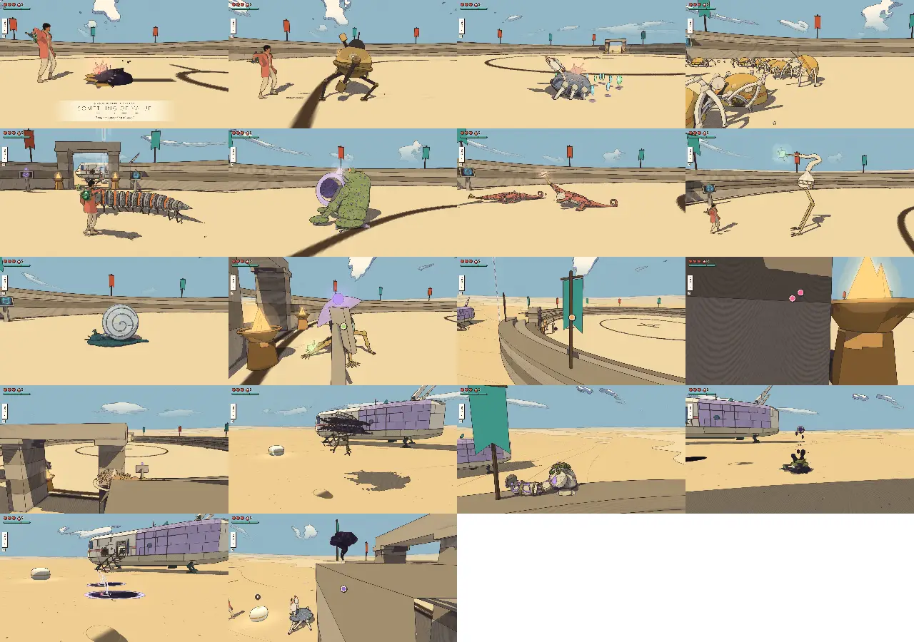
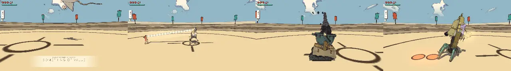
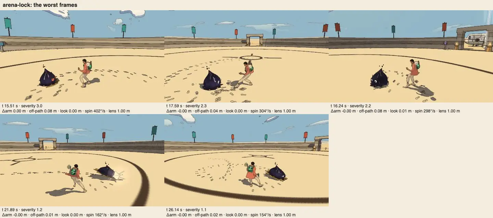
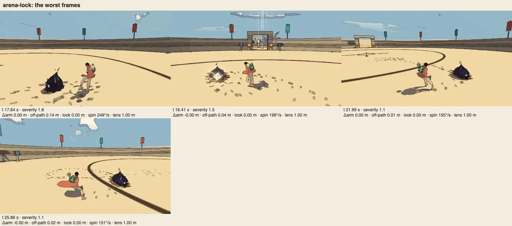
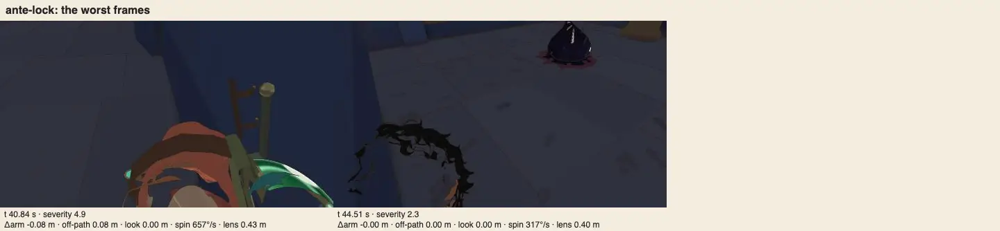
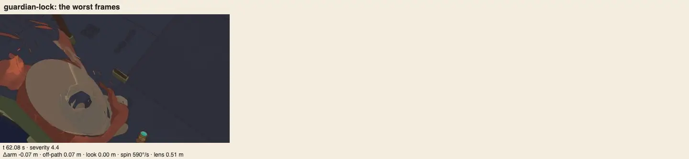
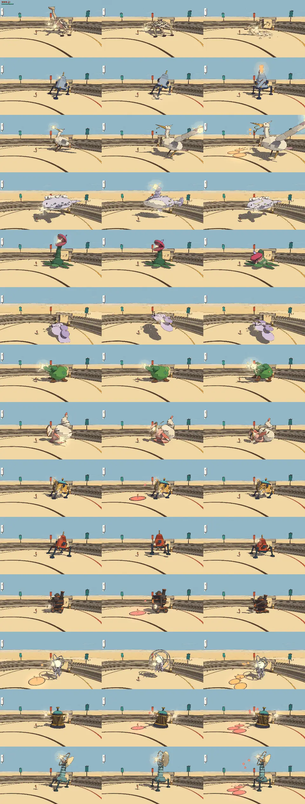

# Combat review, v1.61 (2026-10-12): the lock camera re-scored, defend and dodge foe by foe, the temples' lock

<!-- audit-scores
overall: 4.51 / 5
label: the mean of the 22 kinds' totals (by eye) and the 14 guardians' (from their tuning)
date: 2026-10-12
-->

The first combat review since [v1.47](combat-v1.47.md), asked for by the [v1.59 game audit](game-v1.59.md) (theme 10,
issue #236): the camera QC had found the lock camera red again (arena-lock, roughness 1.79 cm, the locked blot hidden
7.5 % against 3.6 % recorded), and v1.47's lowest part, the camera and lock-on at 3, had not been looked at since. In
between: the knock-down on slopes and the ledge climb (v1.58), the close camera fitted to small rooms (#195, `ROOM_FIT`)
and its climb aboard (#234, `CLIMB`), roomier antechambers before every guardian (#195), an arena room in every temple
(v1.53), the foes heard from where they stand (v1.54), the Cistern-Keeper's new legs.

## Setup

- **Build:** this branch on main e7c21f7d (rebased since onto 428be9f2), with the two fixes below (15ac91a8 the lock camera, 5435cdcd the hop).
  Headless Chrome, muted, ANGLE Metal, the Arena at 1280 × 720, Enemies "normal".
- **Kinds:** `arena.mjs --watch 24 --version 1.61`: each of the 22 kinds watched 24 s against a still traveller, then
  every move's blows through `Foes.hurt`. Four kinds (the sky ray, the lamp tripod, the crucible cart, the bell walker)
  never attacked in the full run, one after another, standing 8 m off; watched again alone they attacked at once
  (12.5, 12.6, 12.5 and 10 a minute), and those rows are from that run. The crab's and the brute's time to kill were
  re-timed too (below, "The measures").
- **Defend:** `defend.mjs` (new since v1.47): guard, parry and evade at set leads, attack by attack.
- **Dodge:** `dodge.mjs`, the back flip inside each foe's and guardian's dodge window.
- **The curve:** `--packs route --ttk <the kinds run> --pack-count 4 --pack-watch 20`, as in v1.47; the four worlds
  with crabs or the brute run again with the re-timed kinds.
- **The lock camera:** the camera QC in full (Medium, seed 1) before and after, with two new lock scenarios in a
  temple: `ante-lock` (an ink blot held still in the Undertower's antechamber, 8.8 × 7.4 m) and `guardian-lock` (the
  First Sign awake in its hall, its blows held).
- **The guardians' exam:** `scripts/temple-design/audit.mjs` (the temple audit's guardian exam).
- **Not played by hand:** no pad, no sound. The flurry's chain, the hops' feel and the lock camera in a temple want a
  pad (recommendation 7).

## The lock camera, re-scored

**Why arena-lock was red** (none of it #195's or #234's: the Arena is open, the arm 4.8 m throughout, `ROOM_FIT` and
`CLIMB` never engage):

- **Roughness:** walking into the blot and past it, the line to it flips behind the traveller in a third of a second.
  The camera eased straight at the line (6/s), so its turn started and stopped at once: kinks of up to 17 cm a frame at
  the 4.8 m arm, 3.6 cm root mean square over that walk. Now its speed is eased (`LOCK_TURN`, `lockTurn`: at most
  9 rad/s more a second, 3.2 rad/s at most, braking onto the line).
- **The foe hidden:** a blot chasing him 2.5–3 m off as he backs away stood behind his body. The swing off the line
  (`LOCK_VIEW`) was capped at 0.5 rad and faded out from 3 m, where clearing it takes about 0.65. Now `max` 0.7 and
  `near` 1.2–2.6 m.

The camera QC, every scenario, before (e7c21f7d) → after:

| scenario | verdict | pops | jumps | look | spins | clip | hidden | out | rev/s | rough (cm) | foe hidden |
|---|---|---|---|---|---|---|---|---|---|---|---|
| train-walk | green → green | 0 → 0 | 0 → 0 | 0 → 0 | 0 → 0 | 0 → 0 % | 0 → 0 % | 0 → 0 % | 0 → 0 | 0.53 → 0.54 | |
| train-run | green → green | 0 → 0 | 0 → 0 | 0 → 0 | 0 → 0 | 0 → 0 % | 0 → 0 % | 0 → 0 % | 0.22 → 0.22 | 0.81 → 0.81 | |
| train-turns | green → green | 0 → 0 | 0 → 0 | 0 → 0 | 0 → 0 | 0 → 0 % | 0 → 0 % | 0 → 0 % | 0.13 → 0.13 | 0.58 → 0.60 | |
| train-sleeper | green → green | 0 → 0 | 0 → 0 | 0 → 0 | 0 → 0 | 0 → 0 % | 0 → 0 % | 0 → 0 % | 0.27 → 0.27 | 0.78 → 0.73 | |
| train-jumps | green → green | 0 → 0 | 0 → 0 | 0 → 0 | 1 → 1 | 0 → 0 % | 0 → 0 % | 0 → 0 % | 0.25 → 0.24 | 1.43 → 1.33 | |
| train-roof | green → green | 0 → 0 | 0 → 0 | 0 → 0 | 0 → 0 | 0 → 0 % | 0 → 0 % | 0 → 0 % | 0 → 0 | 0.25 → 0.26 | |
| train-deck | green → green | 0 → 0 | 0 → 0 | 0 → 0 | 0 → 0 | 0 → 0 % | 0 → 0 % | 0 → 0 % | 0.1 → 0.1 | 0.62 → 0.63 | |
| desert-open | red → red | 3 → 3 | 5 → 4 | 4 → 2 | 3 → 3 | 0.1 → 0.1 % | 1.7 → 1.7 % | 36.0 → 36.1 % | 0.11 → 0.11 | 3.25 → 3.20 | |
| desert-shop | red → red | 0 → 0 | 3 → 2 | 3 → 3 | 0 → 0 | 0 → 0 % | 0 → 0 % | 0 → 0 % | 0.13 → 0.13 | 1.85 → 1.83 | |
| bazaar-streets | green → green | 0 → 0 | 0 → 0 | 0 → 0 | 0 → 0 | 0 → 0 % | 0 → 0 % | 0 → 0 % | 0 → 0 | 0.07 → 0.09 | |
| ante-lock (new) | red → red | 0 → 0 | 2 → 1 | 0 → 0 | 0 → 1 | 0 → 0.5 % | 0 → 0 % | 47.2 → 45.5 % | 0.58 → 0.58 | 1.54 → 1.29 | 9.9 → 3.4 % |
| guardian-lock (new) | red → red | 0 → 0 | 0 → 0 | 0 → 0 | 0 → 0 | 0.3 → 0.3 % | 0 → 0 % | 45.2 → 22.7 % | 0.04 → 0.05 | 0.48 → 0.35 | 1.0 → 0 % |
| incal-pillar | green → green | 0 → 0 | 1 → 1 | 0 → 0 | 0 → 0 | 0 → 0 % | 0 → 0 % | 0 → 0 % | 0 → 0 | 0.90 → 0.74 | |
| **arena-lock** | **red → green** | 0 → 0 | 0 → 1 | 0 → 0 | 1 → 0 | 0 → 0 % | 0 → 0 % | 0 → 0 % | 0 → 0 | **1.62 → 1.24** | **6.0 → 1.4 %** |
| arena-lock-lizard | green → green | 0 → 0 | 1 → 0 | 0 → 0 | 0 → 0 | 0 → 0 % | 0 → 0 % | 0 → 0 % | 0 → 0 | 0.53 → 0.30 | 0 → 0 % |

Runs of arena-lock alone after the fix gave roughness 0.72–0.98 cm and the blot hidden 1.6–2.3 %. desert-open and
desert-shop are red as before; desert-open's 36 % out is new since the movement doc's record (issue #259).

**In a temple** the lock camera still fails: locked on with his back to a wall the lock holds the yaw (the stick's
sideways push switches the lock), the arm is crushed to 0.1–0.4 m and the traveller leaves the frame: 45 % of the
antechamber run, 23 % of the guardian hall's once he backs to its wall (issue #256). The fix here halved the hall's
(45 → 23 %) by smoothing the turn; letting the ship's climb (`CLIMB`) run while locked was tried and dropped (39 %).

**The hop with a foe at his feet** (fixed, 5435cdcd): `dodge.mjs` found the ring centipede's ring never opened a
flurry. Its head curls round him 1.2 m off, where the lock camera stops turning after it (`LOCK_NEAR`, v1.49), so
"back" on the stick was back on the screen and, against the line to the head, not away: a plain jump. Hops now read
the stick against the camera's look there (`hopAxis`).

## Defend and dodge

**Dodge** (`dodge.mjs`, the back flip): **35 of 35** foes and guardians dodged into a flurry (v1.47: 31 of 35, four
timeouts). The first run of this review gave 33, then 29: the centipede (fixed above), and a run of timeouts from
the lamp tripod on that were the script's, not the game's: hop after hop backed the traveller 7.5 m at a time to the
Arena's wall, where later foes stood idle. Each kind now starts from the spawn.

**Defend** (`defend.mjs`): the guard holds from 0.5 s on every blow tried but two, the parry lands at 0.12 s on all
and from 0.06–0.2 s on the crab's snap, the toad's lob and the worm's erupt, and the evade takes in the last
0.08–0.25 s. The findings:

| foe, attack | what | verdict |
|---|---|---|
| makers' machine, quake | gets through the guard at 0.5, 0.3 and 0.2 s | by design (a ring to jump), but untold: the machine's counterplay stays 3 (issue #261) |
| skitter, rush | the guard holds only from 0.2 s | the flock leaps from all round; a block at 0.5 s is the wrong skitter's |
| crucible cart, ram | the guard from 0.3 s, not 0.5 | its run-up: a block too early meets nothing |
| antler hound, pounce | 0.8 s tell, the evade only at 0.08–0.15 s | its most frequent blow (issue #260) |
| bell walker, toll | nothing touched him at any lead | its toll strikes the ring round it, not him |
| lamp tripod, ring drone, centipede, hound | an evade at 0.25–0.35 s is hit | the evade's 0.21 s of dodge frames ends before the blow: as tuned |

## The difficulty curve, world by world

| world | pack size | hearts/min (still) | attacks/min | ttk best (s) | cost share (v1.47) |
|---|---|---|---|---|---|
| the Desert | 1.3 | 9.39 | 21.8 | 1.3 | 7 % (8 %) |
| Vael | 1.3 | 8.65 | 16.5 | 1.7 | 5 % (5 %) |
| Lorn | 3.0 | 21.05 | 50.4 | 4.3 | **25 %** (25 %) |
| Viridel | 2.5 | 11.28 | 35.3 | 3.1 | 12 % (12 %) |
| Underwater | 2.8 | 9.95 | 22.5 | 3.6 | 8 % (8 %) |
| the City-Shaft | 3.3 | 18.96 | 50.3 | 4.0 | 14 % (15 %) |
| the Glass Dunes | 3.5 | 8.27 | 26.3 | 5.2 | 7 % (6 %) |
| the Buried Machine | 3.8 | 15.21 | 35.3 | 4.7 | 11 % (11 %) |
| the Moon Foundry | 5.0 | 20.67 | 78.2 | 4.9 | 14 % (16 %) |
| the Garden | 5.5 | 13.53 | 51.1 | 8.6 | 15 % (12 %) |
| Space City | 5.0 | 12.21 | 59.3 | 5.4 | 8 % (6 %) |
| the Signal Market | 4.8 | 17.66 | 52.6 | 10.4 | **20 %** (22 %) |

The curve is v1.47's within a run's noise: it rises to the Market, Lorn is still the spike, the Glass Dunes and Space
City the dips. Nothing on the route's rosters changed since.

## The scores

The guardians, from their tuning (unchanged since v1.47; the Cistern-Keeper's new legs are its walk, not its fight):

| guardian | world | read | counter | space | fair | phases | total |
|---|---|---|---|---|---|---|---|
| the Elder | arzach | 3 | 5 | 4 | 4 | 5 | 4.2 |
| the Cloud-Mother | arzach2 | 3 | 5 | 4 | 4 | 5 | 4.2 |
| the First Sign | bazaar | 3 | 4 | 5 | 4 | 5 | 4.2 |
| the Tooth-Warden | buried | 3 | 5 | 4 | 4 | 5 | 4.2 |
| the Keeper of the cistern | desert | 4 | 5 | 4 | 5 | 5 | 4.6 |
| the Gardener | edena | 4 | 5 | 5 | 5 | 5 | 4.8 |
| the Clockwork Foreman | garage | 3 | 5 | 4 | 4 | 5 | 4.2 |
| the warden | incal | 3 | 5 | 5 | 4 | 5 | 4.4 |
| the Last Founder | moonfoundry | 4 | 5 | 5 | 5 | 5 | 4.8 |
| the Mother Snapper | perdide | 3 | 5 | 4 | 4 | 5 | 4.2 |
| the Lampless | perdide2 | 3 | 5 | 4 | 4 | 5 | 4.2 |
| the Anchor-Warden | spacecity | 4 | 5 | 4 | 5 | 5 | 4.6 |
| the Echo | spheres | 3 | 5 | 4 | 4 | 5 | 4.2 |
| the Listener | underwater | 4 | 5 | 5 | 5 | 5 | 4.8 |

Their read is 3 for the nine whose quickest move tells for 1.0–1.1 s (issue #258). The temple audit's **guardian exam**
(as the Combat telegraphs batch was asked to judge, temple-design-v1.60 rec. 4) is 3 in six houses because their
fights ask for the gadget and nothing else: the Cloud-Mother (the bell), the Mother Snapper (the stun), the Lampless
(the lantern), the Gardener (the bloom), the Foreman (the coil), the First Sign (the echo). The other eight add the
push, the shot or a timing (issue #257).

The foes. The scores by eye are carried from v1.47 (and v1.22 before it), changed only where this run's numbers
moved; the numbers are this run's (the four re-watched kinds and the re-timed crab and brute as said in Setup):

| kind | read | counter | space | fair | identity | combines | total | wind seen (s) | attacks/min | health/min | ttk combo | ttk charge | ttk air | ttk riposte | ttk dash | ttk shoot | ttk fire |
|---|---|---|---|---|---|---|---|---|---|---|---|---|---|---|---|---|---|
| ink blot | 4 | 5 | 3 | 4 | 4 | 3 | 3.8 | 0.71 | 22.5 | 3.76 | 0.98 | 1.45 | 1.08 | 3.2 | 1.1 | 1.23 | 2.56 |
| makers’ machine | 5 | 3 | 3 | 5 | 4 | 3 | 3.8 | 1.08 | 12.5 | 2.92 | 1.73 | 2.9 | 2.16 | 5.33 | 2.2 | ∞ | ∞ |
| shellback crab | 5 | 5 | 5 | 5 | 5 | 3 | 4.7 | 1.12 | 12.5 | 3.13 | 3.86 | 2.9 | 3.24 | 6.53 | 3.3 | ∞ | 5.12 |
| skitter swarm (as its flock) | 4 | 5 | 4 | 5 | 5 | 4 | 4.5 | 0.60 | 62.6 | 0.42 | 0.47 | 1.45 | 1.08 | 1.5 | 1.1 | 0.61 | 1.28 |
| ring centipede | 5 | 5 | 5 | 5 | 5 | 4 | 4.8 | 2.33 | 10 | 2.5 | 2.6 | 2.9 | 3.24 | 6.53 | 3.3 | ∞ | 7.68 |
| bellows toad | 5 | 5 | 5 | 5 | 5 | 5 | 5 | 1.19 | 15 | 2.08 | 1.73 | 1.45 | 2.16 | 4.52 | 2.2 | 1.84 | 3.84 |
| horn lizard | 5 | 4 | 4 | 5 | 5 | 4 | 4.5 | 1.03 | 15 | 1.25 | 1.73 | 1.45 | 2.16 | 4.54 | 2.2 | 1.84 | 3.84 |
| stilt heron | 4 | 5 | 4 | 5 | 5 | 4 | 4.5 | 0.94 | 15 | 2.5 | 1.73 | 2.9 | 2.16 | 4.54 | 2.2 | 2.45 | 5.12 |
| pearl roller | 5 | 5 | 4 | 4 | 5 | 4 | 4.5 | 1.03 | 2.5 | 0 | 1.73 | 2.9 | 2.16 | 24.5 | 2.2 | 2.45 | 5.12 |
| root knot | 4 | 5 | 4 | 5 | 5 | 5 | 4.7 | 0.77 | 17.5 | 2.5 | 1.73 | 2.9 | 3.24 | 3.97 | 3.3 | 3.07 | 3.84 |
| lantern jelly (with its blot) | 4 | 5 | 4 | 5 | 5 | 5 | 4.7 | 0.97 | 10 | 4.18 | 1.73 | 1.45 | 1.08 | 6.52 | 2.2 | 3.68 | 3.84 |
| signal moth | 5 | 5 | 4 | 5 | 5 | 3 | 4.5 | 1.04 | 20 | 0.83 | 0.47 | 1.45 | 1.08 | 3.54 | 1.1 | 0.61 | 1.28 |
| sky ray | 5 | 5 | 4 | 5 | 5 | 4 | 4.7 | 1.09 | 12.5 | 1.46 | 1.73 | 1.45 | 1.08 | 5.34 | 2.2 | 1.84 | 3.84 |
| mound worm | 5 | 5 | 5 | 5 | 5 | 4 | 4.8 | 1.25 | 15 | 2.3 | 1.73 | 2.9 | 1.08 | 9.06 | 2.2 | ∞ | ∞ |
| lamp tripod | 5 | 5 | 4 | 5 | 5 | 3 | 4.5 | 1.42 | 12.6 | 3.15 | 1.73 | 2.9 | 3.24 | 5.3 | 3.3 | ∞ | ∞ |
| crucible cart | 5 | 5 | 5 | 5 | 5 | 5 | 5 | 1.25 | 12.5 | 3.13 | 2.6 | 2.9 | 3.24 | 5.34 | 3.3 | 3.68 | ∞ |
| bell walker | 5 | 5 | 5 | 4 | 5 | 5 | 4.8 | 1.62 | 10 | 4.17 | 14.59 | 14.89 | 15.23 | 12.52 | 15.29 | ∞ | ∞ |
| ring drone | 4 | 5 | 5 | 5 | 5 | 4 | 4.7 | 1.09 | 12.5 | 1.88 | 1.73 | 1.45 | 1.08 | 5.34 | 2.2 | ∞ | ∞ |
| furnace brute | 5 | 5 | 4 | 5 | 5 | 5 | 4.8 | 1.51 | 12.5 | 3.13 | 3.86 | 4.35 | 4.32 | 9.05 | 4.4 | ∞ | ∞ |
| shade | 5 | 5 | 4 | 4 | 5 | 4 | 4.5 | 1.29 | 15 | 3.55 | 1.73 | 2.9 | 3.24 | 4.53 | 3.3 | 3.07 | 3.84 |
| antler hound | 5 ✎4 | 4 | 4 | 5 | 5 | 4 | 4.3 | 0.85 | 32.5 | 4.59 | 0.47 (behind) | 1.45 (behind) | 2.16 (behind) | 2.54 | 2.2 (behind) | ∞ | 2.56 |
| marionette (with a crab) | 5 | 5 | 5 | 4 | 5 | 5 | 4.8 | 1.02 | 12.5 | 2.08 | 1.73 | 2.9 | 1.08 | 5.34 | 2.2 | 2.45 | 2.56 |

Changed by eye: **the antler hound's read 5 → 4.** Its pounce (0.8 s, a 3.2 m lunge at 5.6 m/s) was 8 of its 13
blows in the watch, a median 0.85 s seen; v1.47's 1.45 s was mostly its step behind. It costs a still traveller the most
of any kind, 4.59 hearts a minute (issue #260). The script's own scores (identity 4 and combines 3 for every kind in a
one-kind-at-a-time run) are not taken over the eye's.

## The combat as a whole

| | score | why |
|---|---|---|
| **Responsiveness** | 4 | Unchanged: the swings' timing was not touched. |
| **Feedback** | 5 | Unchanged, and the foes' wind-ups and hurts now come from where they stand (v1.54). |
| **Move variety** | 5 | Unchanged: every move is some kind's fastest answer (the time-to-kill table). |
| **Difficulty curve** | 4 | Unchanged: it rises to the Market (20 %); Lorn's spike (25 %) and the late dips keep it from 5. |
| **Camera and lock-on** | 3 | The Arena's lock is green again (roughness 1.62 → 1.24 cm, the blot hidden 6.0 → 1.4 %) and a hop at a foe's feet reads the stick right. But in a temple's antechamber and guardian hall, backed to a wall, the traveller is off the screen 23–45 % of the time (#256): that is where the guardians are fought. 4 once it is green. |

## The best and the weakest

- **Best:** the bellows toad and the crucible cart (5.0), then the centipede, the worm, the bell walker, the brute and
  the marionette (4.8), as in v1.47.
- **Weakest:** the ink blot and the makers' machine (3.8): the blot is the teacher; the machine has two attacks and the
  fewest answers, its quake not guarded at any lead (#261). Then the antler hound (4.3), down from 4.5.
- **Guardians:** the Gardener, the Last Founder and the Listener (4.8) best; the nine at read 3 are 4.2–4.4.

## Recommendations (most valuable first)

1. **The lock camera against a wall (#256).** Let the lock's line give way when the arm on it is crushed: swing off it
   toward the side with room, as `swingClear` does unlocked, keeping the foe on the screen. Green on out in ante-lock
   and guardian-lock with the two Arena locks still green.
2. **A second verb for six guardians (#257):** the Cloud-Mother, the Mother Snapper, the Lampless, the Gardener, the
   Foreman, the First Sign: one phase each that also asks for the push, the shot, a timed dodge or the parry.
3. **Nine guardians' quickest tell to 1.2 s (#258),** or a second body cue on it: read 3 → 4.
4. **The hound's pounce to 0.95 s (#260),** or a crouch held before it.
5. **A second answer for the makers' machine (#261):** its quake's ring told and rewarded as a jump, or a weak point.
6. **desert-open's 36 % out (#259)**, from the camera QC: the run meets something near the landing now.
7. **Play it with a pad:** the flurry against a late pack, the hops, and a guardian fight once #256 is in.

## Against the last report

v1.47: 4.52 (the 22 kinds 4.60, the 14 guardians 4.40). Now 4.51 (the kinds 4.59, the guardians 4.40): the hound's
read 5 → 4 is the only score that moved. The combat as a whole is unchanged, the camera and lock-on still 3: v1.47's
complaint (a small foe behind his back) is fixed and measured green, and the temple rooms, measured for the first
time, are the new reason. v1.47's recommendations 2–5 were done in v1.48–v1.49 (`CHAIN`, `LOCK_VIEW`, Reduce motion's
still arrows, the stunned stars); 1 and 6 still want a pad.

## The measures

Three faults in the review's own scripts, fixed (176309b8), so the next review's numbers are comparable:

- `dodge.mjs`, `defend.mjs`, `arena.mjs` start each kind from the Arena's spawn (the hops had walked the traveller to the
  wall: 29 of 35 → 35 of 35).
- `arena.mjs` strikes "from the front" into the foe's face, not along the line from the player: a crab just called in
  and not yet turned took the light combo on its flank (its combo 3.86 → 1.73 s, the Market's cost share 22 → 15 %,
  the brute's push from behind 1.28 s instead of ∞). Re-timed: 3.86 s, 20 %, ∞ again.
- `arena.mjs` watches a kind again once if it never wound up and stood off past 6 m (the four silent kinds).
