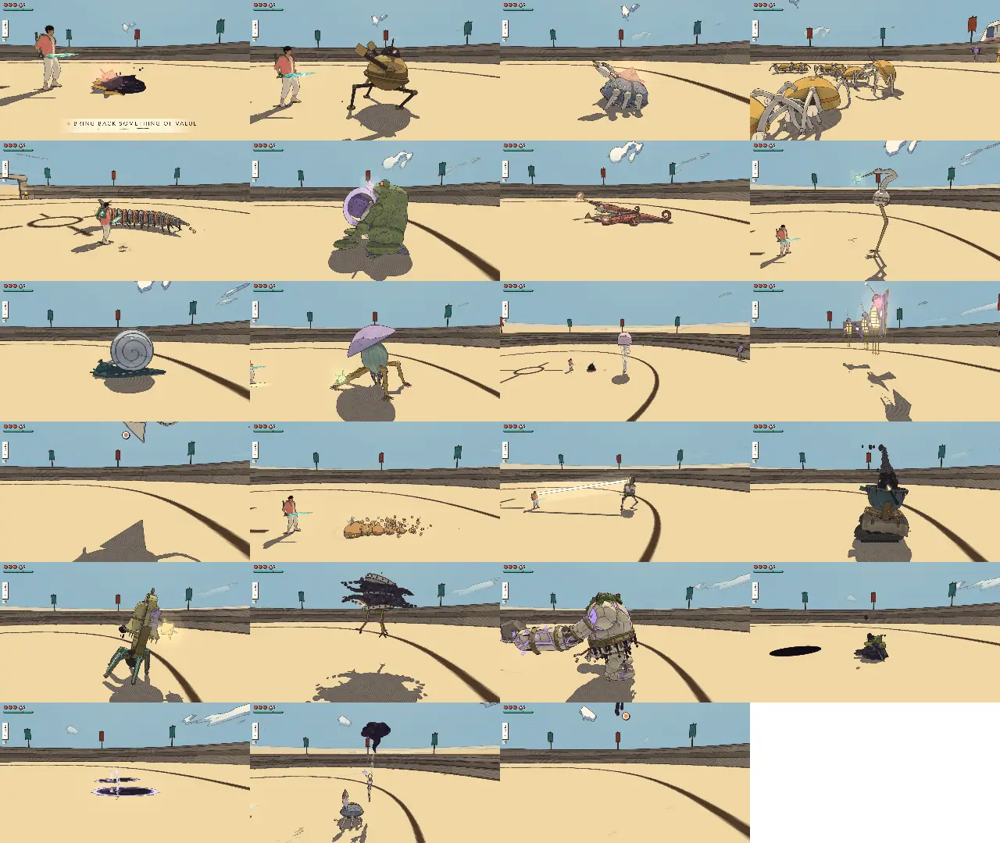

# Combat review, v1.87 (2026-10-20): the roster and the guardians again, five guardians' blows past their bodies

<!-- audit-scores
overall: 4.51 / 5
label: the mean of the 23 kinds' totals (by eye) and the 14 guardians' (their tuning, capped by the fights played in node)
date: 2026-10-20
-->

The first review of the whole combat since [v1.61](combat-v1.61.md) (4.51, then 4.63 after its v1.63 follow-up), for
issue #556, the design half of the full audit. The fight temples had a review of their own at v1.85
([combat-fight-temples-v1.85.md](combat-fight-temples-v1.85.md), 3.74), whose fixes this one rechecks. Between them: the
ember wisp joined the roster (#398, #440), every guardian made fair with its blows put on its body (#319, v1.71), the
Keeper made a teacher (#314–#316), the lock-on camera given way against walls (#256), no lock through a wall (#313), the
grapple at a locked foe (#399), the Mother Snapper's fight replaced by a puzzle of sound (#409), foes that look at you
(#508), a controller layout whose gadget wheel pauses the game (#511, #512, #524), and the fight temples' curve, hazards
and crowd fixed (#532–#534). **Move variety in the fight temples (#535) was set aside by the author:** noted below, not
filed again.

## Setup

- **Build:** main at v1.87 (`f12bba095`). Headless Chrome, muted, ANGLE Metal, the Arena at 1280 × 720, Enemies "normal",
  its own Vite (port 5596); load 22–35 during the run (the technical half of #556 beside it).
- **Kinds:** `arena.mjs --watch 24 --guardians no --version 1.87`: each of the 23 kinds watched 24 s against a still
  traveller, then every move's blows through `Foes.hurt`.
- **Guardians played:** `guardian.mjs --ids all` (node, each in its own temple with its real def and posed mesh, every
  phase 90 s still, dodging and guarding), and scored from their tuning by `arena.mjs`.
- **Fight temples:** `fight-temples.mjs --bot skilled`, seed 4821 (port 5598), on the four that were furthest off at
  v1.85: the Sunken Hall, the Flooded Gallery, the Kiln Yard, the Back Rooms.
- **Read:** a read-only survey of every combat commit since v1.61 (61 commits) against v1.61's recommendations and the
  fight temples' issues.
- **Not run:** `dodge.mjs`, `defend.mjs` and `--packs`: the moves, the guard and the rosters are unchanged since v1.63
  (`BLADE`, `SWINGS`, `GUARD`, `EVADE`, `GENTLE`, `TURNS`, `HARM_BY_STAGE` as they were). The camera QC's lock scenarios
  are the technical half's (all green at v1.85). **Not played by hand:** no pad, no sound, for the third review running.

*The contact sheet. The sky ray (fourth row, first) and the ember wisp (last) wind up above the frame: their shadow and
the wisp's coal are what shows.*

## The scores

The foes. The scores by eye are carried from v1.61 and its v1.63 follow-up (the makers' machine 4.3, the antler hound 4.5)
and the ember wisp's from its v1.84 follow-up (4.5): no kind's tuning changed since (the survey found only the hook class
for the grapple and the gaze added to every kind). The numbers are this run's.

| kind | read | counter | space | fair | identity | combines | total | wind seen (s) | attacks/min | health/min | ttk combo | ttk charge | ttk shoot |
|---|---|---|---|---|---|---|---|---|---|---|---|---|---|
| ink blot | 4 | 5 | 3 | 4 | 4 | 3 | 3.8 | 0.71 | 22.6 | 3.76 | 0.98 | 1.45 | 1.23 |
| makers’ machine | 5 | 5 | 4 | 5 | 4 | 3 | 4.3 | 1.35 | 10 | 2.5 | 1.73 | 2.9 | ∞ |
| shellback crab | 5 | 5 | 5 | 5 | 5 | 3 | 4.7 | 0.77 | 15 | 2.71 | 3.86 | 2.9 | ∞ |
| skitter swarm (as its flock) | 4 | 5 | 4 | 5 | 5 | 4 | 4.5 | 0.60 | 65.1 | 0.42 | 0.47 | 1.45 | 0.61 |
| ring centipede | 5 | 5 | 5 | 5 | 5 | 4 | 4.8 | 0.97 | 15 | 3.13 | 2.6 | 2.9 | ∞ |
| bellows toad | 5 | 5 | 5 | 5 | 5 | 5 | 5 | 1.22 | 15 | 2.5 | 1.73 | 1.45 | 1.84 |
| horn lizard | 5 | 4 | 4 | 5 | 5 | 4 | 4.5 | 0.82 | 25.1 | 1.88 | 1.73 | 1.45 | 1.84 |
| stilt heron | 4 | 5 | 4 | 5 | 5 | 4 | 4.5 | 0.93 | 15 | 2.5 | 1.73 | 2.9 | 2.45 |
| pearl roller | 5 | 5 | 4 | 4 | 5 | 4 | 4.5 | 1.00 | 2.5 | 0 | 1.73 | 2.9 | 2.45 |
| root knot | 4 | 5 | 4 | 5 | 5 | 5 | 4.7 | 0.78 | 20 | 2.71 | 1.73 | 2.9 | 3.07 |
| lantern jelly (with its blot) | 4 | 5 | 4 | 5 | 5 | 5 | 4.7 | 1.02 | 10 | 4.17 | 1.73 | 1.45 | 3.68 |
| signal moth | 5 | 5 | 4 | 5 | 5 | 3 | 4.5 | 1.01 | 37.6 | 2.71 | 0.47 | 1.45 | 0.61 |
| sky ray | 5 | 5 | 4 | 5 | 5 | 4 | 4.7 | 1.12 | 12.5 | 1.46 | 1.73 | 1.45 | 1.84 |
| mound worm | 5 | 5 | 5 | 5 | 5 | 4 | 4.8 | 1.27 | 12.5 | 2.3 | 1.73 | 2.9 | ∞ |
| lamp tripod | 5 | 5 | 4 | 5 | 5 | 3 | 4.5 | 1.42 | 12.5 | 3.13 | 1.73 | 2.9 | ∞ |
| crucible cart | 5 | 5 | 5 | 5 | 5 | 5 | 5 | 1.25 | 12.5 | 2.92 | 2.6 | 2.9 | 3.68 |
| bell walker | 5 | 5 | 5 | 4 | 5 | 5 | 4.8 | 1.60 | 12.5 | 4.17 | 12.2 | 12.5 | ∞ |
| ring drone | 4 | 5 | 5 | 5 | 5 | 4 | 4.7 | 1.09 | 10 | 2.09 | 1.73 | 1.45 | ∞ |
| furnace brute | 5 | 5 | 4 | 5 | 5 | 5 | 4.8 | 1.51 | 12.5 | 3.13 | 3.86 | 4.35 | ∞ |
| shade | 5 | 5 | 4 | 4 | 5 | 4 | 4.5 | 1.32 | 15 | 3.55 | 1.73 | 2.9 | 3.07 |
| antler hound | 5 | 4 | 4 | 5 | 5 | 4 | 4.5 | 1.45 | 30 | 4.17 | 0.98 (behind) | 1.45 (behind) | ∞ |
| marionette (with a crab) | 5 | 5 | 5 | 4 | 5 | 5 | 4.8 | 1.18 | 10 | 1.88 | 1.73 | 2.9 | 2.45 |
| ember wisp | 5 | 4 | 4 | 5 | 5 | 4 | 4.5 | 1.06 | 12.5 | 2.08 | 1.73 | 2.9 | ∞ |

**Two numbers moved without a tuning change,** and are left for a quiet machine to re-watch rather than scored: the crab's
wind seen 1.12 → 0.77 s (its quickest attack drawn more often in 24 s) and the signal moth's 20 → 37.6 attacks and 0.83 →
2.71 hearts a minute. A 24 s watch is short and the run was at load 22–35; the moth's darts are 0.6 s tuned, as before.

The guardians, from their tuning (`arena.mjs`), with the caps the skill puts on fairness from the fights played
(`guardian.mjs`: "fairness at most 2 with a blow landing over 1.5 m from its body"):

| guardian | world | read | counter | space | fair | phases | total |
|---|---|---|---|---|---|---|---|
| the Elder | arzach | 4 | 5 | 4 | 5 | 5 | 4.6 |
| the Cloud-Mother | arzach2 | 4 | 5 | 4 | 5 | 5 | 4.6 |
| the First Sign | bazaar | 4 | 4 | 5 | 5 | 4 | 4.4 |
| the Tooth-Warden | buried | 4 | 5 | 4 | 5 ✎2 | 5 | 4 |
| the Keeper of the cistern | desert | 4 | 5 | 4 | 5 | 5 | 4.6 |
| the Gardener | edena | 4 | 5 | 5 | 5 ✎2 | 5 | 4.2 |
| the Clockwork Foreman | garage | 4 | 5 | 4 | 5 ✎2 | 5 | 4 |
| the warden | incal | 4 | 5 | 5 | 5 | 5 | 4.8 |
| the Last Founder | moonfoundry | 4 | 5 | 5 | 5 ✎2 | 5 | 4.2 |
| the Mother Snapper | perdide | 5 | 2 | 2 | 5 | 3 | 3.4 |
| the Lampless | perdide2 | 4 | 5 | 4 | 5 | 5 | 4.6 |
| the Anchor-Warden | spacecity | 4 | 5 | 4 | 5 | 5 | 4.6 |
| the Echo | spheres | 4 | 5 | 4 | 5 | 5 | 4.6 |
| the Listener | underwater | 4 | 5 | 5 | 5 ✎2 | 5 | 4.2 |

- **Five guardians' blows land past their bodies** (#558). `guardian.mjs` fails every move below on the skill's rule (over
  15 % of the hit's floor more than 1 m from the body, or any of it more than 1.5 m): the Gardener's sweeps and crush
  (19–23 %, up to 2.7 m), the Listener's sweeps and slam (6–17 %, up to 1.9 m), the Foreman's hammer, jab and spin (4–14 %,
  up to 1.9 m), the Tooth-Warden's charge (13 %, 1.8 m), the Last Founder's ladles and slam (9–11 %, up to 1.9 m). #319
  made this green for all fourteen at v1.71; the houses round them have been rebuilt since (#336, #411, #412, #414) and
  nothing in the suite measures it (`tests/guardian-fairness.test.js` is green). A player standing clear of the arm is
  hit. Fairness capped at 2: their totals 4.6–4.8 → 4.0–4.2.
- **The Mother Snapper has no fight in her house** since #409 (blind, one lunge aimed by sound, outwitted by the
  pendulums); the script scores what is there (one move, two phases), 4.6 → 3.4. Its "no opening" FAIL lines are that.
- **The First Sign's** second phase is its puzzle (no attacks: the FAIL line is expected); its phases score 4 from the
  tuning now ("new moves 0/3"), 4.6 → 4.4.
- Every other guardian passes: no phase without an opening, every own move 1.2 s or more (links 0.65–0.9 s), combos'
  blows at least 1.42 s apart, the lock 0 m from its weak point; the traveller's sidestep locked on holds within 0.04 m.

**Overall 4.51** (the 23 kinds 4.61, the 14 guardians 4.34), against 4.63 after v1.63's follow-up. The kinds held; the
guardians fell 4.66 → 4.34, by the five reach failures and the two houses whose fights changed by design.

## The fight temples, rechecked

The four that were furthest off at v1.85, the skilled bot with the hearts he has on arriving (`lib.mjs
heartsOnArrival`), the same seed:

| temple | hearts on arrival | lost (v1.85 → v1.87) | lost ÷ hearts (v1.85 → v1.87) | of it, the hazard | clear (s), par | rank |
|---|---|---|---|---|---|---|
| The Sunken Hall | 3 | 7.75 → 1.25 | 2.58 → 0.42 | 0.75 (geysers) | 167, 240 | C → B |
| The Flooded Gallery | 8 | 16, a knock-out → 4.75 | 2.0 → 0.59 | 2.75 (the dark) | 307, 250 | C → B |
| The Kiln Yard | 10 | 20, a knock-out, not cleared → 9.75 | 2.0 → 0.98 | 4.25 (tiles) | 392, 250 | — → C |
| The Back Rooms | 15 | 5.5 → 9 | 0.37 → 0.60 | 2.25 (the toll) | 130, 250 | B → B |

- **#532, the curve: fixed.** The first temple no longer takes more than all his hearts; the last now costs more of them
  than the first. Fair by eye, temple by temple: the Sunken Hall 2 → 4, the Flooded Gallery 2 → 4, the Back Rooms 3 → 4.
- **#533, the lingering hazards: fixed,** the Kiln Yard least: its breaking tiles are still 44 % of what it takes and it
  is the one temple of the four over par and at C (fair 2 → 3).
- **#534, reading the crowd: fixed** in the code (the ring over the traveller, the view drawn to a hazard, the edge
  markers, the mark in a square, the lock's answer); no page error in any run, frame times 16.7 ms median, 18–23 ms at
  the 95th percentile.
- **#535, the quick combo and the roll are the whole fight:** unchanged, by the author's choice (set aside for later). The
  perfect roll still earns a 0.05 s hit-stop, a ring and a hum (`src/fluid-blade.js:619-632`); with no jump in there, no
  flurry. Not filed again.
- **The hearts on arrival leave out two shops** (#560): `arrivalTable` and `heartsOnArrival` walk `ORDER` by each shop's
  `world`, and the Almonry (`arzach2`) and the Welcome-Shelf (`perdide2`) belong to merged parts, so a careful player has
  7 hearts in Lorn (the table says 6) and 17 at the Signal Market (15). The harm scale is about 13 % low from Lorn on.
- **On Gentle** the first temple is now close to harmless (a light skitter's nip 1/64 of a heart): fine for Gentle.

## The combat as a whole

| | v1.61 | v1.87 | why |
|---|---|---|---|
| **Responsiveness** | 4 | 4 | Unchanged: the swings' timing was not touched. The wheel now pauses the game to choose (#524): a free stop in a fight, kinder than it is quick |
| **Feedback** | 5 | 5 | Foes now look at you once they have noticed you (#508): the crab's stalks, the toad's eyes, the brute's brass eye |
| **Move variety** | 5 | 5 | In the world, unchanged: every move is some kind's fastest answer. The fight temples' own (#535) set aside |
| **Difficulty curve** | 4 | 4 | The world's unchanged; the fight temples' turned the right way up (#532), the Kiln Yard still its spike, the shops' count (#560) |
| **Camera and lock-on** | 3 | 4 | #256 landed: the lock's line gives way against a wall; the camera QC's ante-lock and guardian-lock green at v1.85 (0 % out). Not 5: the ante-lock's blot hidden 9.5–10 % against a 10 % limit, and still never played with a pad |

## The best and the weakest

- **Best:** the bellows toad and the crucible cart (5.0), the centipede, the worm, the bell walker, the brute, the
  marionette (4.8), as at v1.61. Guardians: the warden (4.8), then eight at 4.6.
- **Weakest:** the ink blot (3.8, the teacher); among the guardians the Mother Snapper (3.4, a puzzle by design), the
  Foreman and the Tooth-Warden (4.0, their reach).

## Recommendations (most valuable first)

1. **Put the five guardians' blows back on their bodies, and test it** (#558). Fairness 2 → 5 for five; the guardians' mean
   4.34 → about 4.73.
2. **Count every heart container in the fight temples' harm** (#560): map a shop's part through `MERGED`.
3. **Play it with a pad**, for the third review running: the hops and the flurry against a late pack, a guardian fight in
   its hall, a fight temple with the roll.
4. **Re-watch the moth and the crab on a quiet machine** before reading anything into their numbers.
5. **The fight temples' moves** (#535): when the author takes it up again.

## Against the last report

[v1.61](combat-v1.61.md) ended at 4.63 after its follow-up (the kinds 4.62, the guardians 4.66). Its recommendations 1–6
are all done (#256–#261), and its seventh (a pad) is not. The kinds hold at 4.61 with the ember wisp added at 4.5. The
guardians fall to 4.34: five by a measure that was green at v1.71 and is red again, two by design (the Mother Snapper's
puzzle, the First Sign's phases). The camera and lock-on rise 3 → 4. The fight temples' review of v1.85: three of its
four issues fixed and measured here (#532–#534), the fourth set aside (#535).
