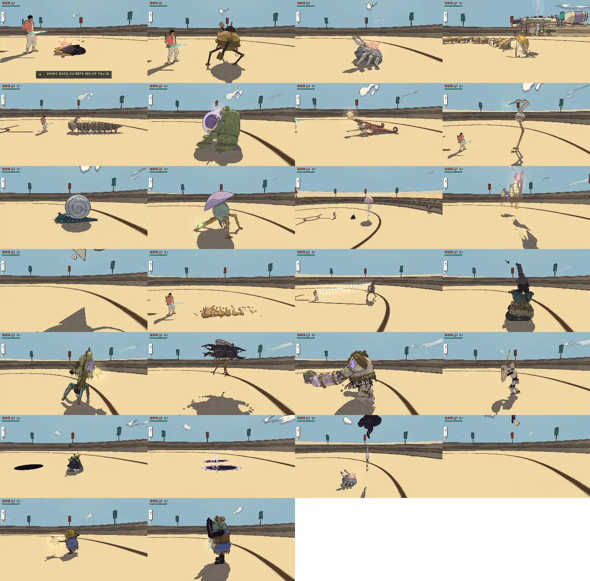
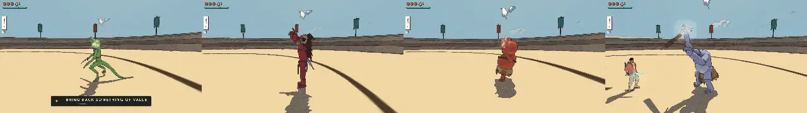

# Combat review, v2.34 (2026-10-28): did #722 make the fights fun?

<!-- audit-scores
overall: 4.19 / 5
label: the mean of the 26 kinds' totals and the 14 guardians' (the six-criteria rubric, as v1.90); the fight as lived, the #722 diagnosis re-measured, 1.29 → 3.29
comparison: v1.90 4.16 on the same rubric; the rubric scores foes in isolation, so the #722 work shows in the second table, not in this number
date: 2026-10-28
-->

Issue #722, "Enemies feel boring". Since [v1.90](combat-v1.90.md) the fight core (poise, toughness by world, tempo,
guards and parries that stagger, low-HP states, the alert beat and pack calls, launches and knock-downs), the encounter
sites with fewer, whole wandering packs, armour that comes off, weak points and tiers, and the humanoid foes on clips
(the mummers and their king in the Desert camp; the shade and the fencer) have landed. This review asks the question
the [#722 diagnosis](../design/enemy-fun.md) asked, with the same measures: does a foe live long enough to show
anything, does mashing still win, how much of a fight is walking and waiting, and are encounters places.

**Short answer.** Yes, from the fourth world on. A foe there now survives the light combo (one combo kills 4 of 25
kinds at stages 3–4, against 16 of 22 at every stage before), starts twice as many attacks before it dies, and a
masher pays for it in hearts. Encounters are places now: 50 sites with sitters, sleepers, lookouts, patrols and
ambushes, an alert beat and a coffer. Three things did not move: **the first three worlds still play the old fight**
(89–100 % of their foes die to one combo, a masher loses 0–0.7 hearts a pack), **the fight is still two thirds walking,
waiting and recovering**, and **mashing still clears every pack as fast as defending does**; it only costs more hearts.

## The setup

- Source: `5872f4a80` (main, 2026-10-28), branch `claude/combat-review-234`. The "before" of the diagnosis's measures is
  the diagnosis's own source, `cb97e3eae` (v1.90 plus a week of unrelated work, before any #722 commit), run through the
  same node bench; the rubric's "before" is [combat-v1.90.md](combat-v1.90.md).
- **The Arena** (`arena.mjs`, muted headless Chrome, port 5485): all 26 kinds, 24 s each against a still traveller,
  times to kill per move, the contact sheet (below), the guardians drawn.
- **The packs** (`arena.mjs --packs route --pack-count 3 --pack-clear --clear-dodge`): 36 packs, 12 route worlds.
- **The dodge** (`dodge.mjs`): 25 kinds and 14 guardians, 39 rows. **The defence matrix** (`defend.mjs`): every kind,
  45 s each, guard at five leads and the evade at five.
- **The guardians played** (`guardian.mjs --ids all`, node): 14 guardians, every phase 90 s, still, dodging, guarding.
- **The #722 bench** (node, no browser; the fight core's own bench from the issue's scratch folder, extended):
  real `Foes` on flat ground, every route world's packs 0–5 from `packOf`, three seeds each (216 packs), and every
  encounter site's foes (50 sites), each fought by three scripted travellers with the hearts he has on arriving there
  (`heartsOnArrival`): **still** (20 s), **mash** (walks in and cuts the light combo, 1/1/3, at the blade's own cadence;
  never guards or dodges) and **guard** (blocks every blow, every other one a perfect parry and its riposte; rolls
  under rings and bashes). Per foe: blade hits taken and seconds from its first hit to its death, attacks started,
  distinct moves seen, whether it went low; per frame, each fighting foe's state (approaching, waiting out its cool,
  waiting its turn, recovering, stunned, winding up, striking, fleeing). The same script on `cb97e3eae` gives the before.
- **One combo, in isolation** (node): each kind alone at stages 0–4, base and tier, takes the 1/1/3 combo into its face.
- **Live sites** (muted headless Chrome, a fresh save with 3 hearts): the Desert's mummer camp and skitter nest, the
  Moon Foundry's fencer patrol, the Signal Market's lizard camp; walked up to from 22 m, watched 6 s still, then mashed.
- Not done: no pad, nothing heard (identity stays capped at 4), no Unity run (this report changes no game code), no
  fight temples (unchanged since [their v1.90 review](combat-fight-temples-v1.90.md): their foes skip toughness).

## The fight as lived: the #722 diagnosis re-measured

The rubric below scores each foe alone against a still traveller for 24 s; the diagnosis's point was that this misses
how long a foe lives and what it gets to do. So this table comes first. Scores are mine, from the numbers beside them.

| Measure (diagnosis cause) | Before (`cb97e3eae`) | Now (`5872f4a80`) | Score |
| --- | --- | --- | --- |
| They live long enough to show anything (1) | one combo kills 16 of 22 kinds at every stage; in packs 74 % of the foes the masher kills die inside one combo (≤ 3 hits, ≤ 2.2 s); 0.85 distinct moves seen per foe | 16 of 25 at stages 0–1, 10 at stage 2, **4 at stages 3–4** (blot, skitter, moth, mummer); in packs **48 %**, by world Desert 100, Arzach 100, Perdide 89, Edena 79, Glass Dunes 30, Buried 34, Spheres 0, Market 15; 1.33 moves seen (Market 1.74) | 1 → 3 |
| Attacking doesn't shut them off (2) | 11 % of wind-ups cut off by a light cut; the masher lost ≤ 0.33 hearts a pack in 7 of 12 worlds, about what the guard lost | **2 %** cut off; from the Underwater City on the masher loses 1.3–2.9× what the guard loses (Glass Dunes 4.1 v 2.2, Spheres 5.8 v 2.0, Market 8.2 v 6.3 hearts a pack) — but he still clears every pack the guard clears, as fast (Market 16.8 v 16.1 s) | 1 → 3 |
| Little dead time (8) | approaching 11 %, waiting its cool 21 %, waiting its turn 6 %, recovering 24 %, stunned 3 %: **65 %**; winding up and striking 32 % | approaching 11 %, cool 16 %, turn 15 %, recovering 22 %, stunned 3 %, fleeing 2 %: **67 %**; winding up and striking 29 %. The waiting is now circling, feints and taunts (turn 6 → 15 %), not standing | 2 → 2 |
| Encounters are places (3, 4, 9) | packs on a ring 18–26 m round you every 35–55 s; 3 foes placed by hand; the Market placed 28 of 185 pack members; noticing took 0.05 s | **50 sites** in 12 worlds (camps, nests, hoards, ambushes, patrols) with idles and a coffer; packs every 60–95 s and whole (Market 159 of 159, the sites batch's measure); the alert beat 0.55 s and a lookout's call (live: the mummer camp's lookout called at 21.6 m, the horn at once) | 1 → 4 |
| Things change mid-fight (7, 6) | 3 low-HP moves, 2 skipped by the combo; nothing reacted to a packmate | a low state for 23 of 26 kinds; **49 %** of the foes the masher killed went low first (rage), 0 before; the roller's last roll now fired 52 times, the hound's rake 47; packmates mourn, the last flees or rages; plates come off five heavies | 1 → 4 |
| Each foe varies (5, 10) | 1.19 attacks started before death; 11 kinds repeated one move | **2.04** attacks (Market 3.08); 14 % of late-world foes in their banded tier with one more move; 4 kinds guard, 4 hop back; but 7 moves never fired in 216 packs and 50 sites (the mummer's volley and rock, the fencer's shove, the lizard's whip, the ray's lash, the blot's spit, two skin moves) | 2 → 3 |
| They grow with the traveller (5) | foe health the same in every world | health × 1.4 / 1.8 / 2.2 at stages 2–4; a still traveller loses 4.2 hearts in 20 s in the Desert, 12.3 in the Market (of 19) | 1 → 4 |

Mean 1.29 → 3.29.

*Muted headless Chrome at `5872f4a80`, a fresh save (3 hearts); rows: Desert camp, Desert nest, Moon Foundry patrol,
Market camp; columns: idle, the alert, 2.5 s into the fight. The Market row's last frame shows the traveller standing
in a downed crab, the close-quarters crowding camera-qc has met before.*

Live, mashing (the bench's masher with the real world round him): the Desert camp cleared in 9.0 s for 1.75 hearts (of
3), its nest in 3.8 s for none (asleep: the sneak strike), the fencer patrol in 11.5 s for 3.25, the Market camp in
18.6 s for 11.5 (topped up when under 1.5). Six seconds standing still: 0.5, 0, 2.25 and 4.5 hearts.

### What the numbers say, world by world

The masher in the #722 bench, mean of 18 packs a world (6 pack sizes × 3 seeds), before → now:

| World (stage) | One-combo kills | Attacks before death | Mash: s, hearts lost | Guard: s, hearts lost | Still, 20 s |
| --- | --- | --- | --- | --- | --- |
| Desert (0) | 98 → 100 % | 0.24 → 0.33 | 4.7, 0.11 → 4.9, 0 | 4.8, 0 → 5.0, 0 | 4.0 → 4.2 |
| Arzach (0) | 94 → 100 % | 0.70 → 0.88 | 5.4, 0.29 → 5.5, 0.69 | 6.4, 0.11 → 3.9, 0.07 | 3.7 → 4.3 |
| Perdide (1) | 89 → 89 % | 0.62 → 0.98 | 13.1, 0.14 → 8.9, 0.63 | 13.2, 0.08 → 8.5, 0.19 | 4.4 → 3.9 |
| Edena (2) | 98 → 79 % | 0.81 → 1.38 | 5.1, 0.31 → 7.6, 0.65 | 5.3, 0.03 → 8.1, 0.21 | 4.5 → 3.0 |
| Underwater (2) | 44 → 50 % | 2.08 → 1.72 | 32.9, 2.57 → 24.7, 3.28 | 29.5, 1.32 → 24.7, 2.29 | 2.6 → 2.8 |
| Incal (2) | 71 → 57 % | 1.34 → 1.77 | 10.1, 1.67 → 13.3, 1.94 | 11.0, 0.46 → 13.2, 1.42 | 6.6 → 5.3 |
| Glass Dunes (2) | 75 → 30 % | 1.34 → 2.30 | 14.6, 1.58 → 15.8, 4.14 | 14.4, 0.38 → 16.1, 2.22 | 4.5 → 7.0 |
| Buried (3) | 92 → 34 % | 0.68 → 2.23 | 10.0, 0.33 → 15.1, 3.96 | 10.0, 0.08 → 16.2, 2.33 | 7.1 → 7.3 |
| Moon Foundry (3) | 69 → 38 % | 1.59 → 2.40 | 21.3, 3.36 → 19.7, 5.08 | 21.1, 2.44 → 19.0, 2.93 | 8.6 → 6.4 |
| Spheres (3) | 41 → 0 % | 1.83 → 3.30 | 25.2, 1.19 → 21.4, 5.79 | 24.5, 0.42 → 24.0, 2.03 | 3.1 → 5.7 |
| Space City (3) | 64 → 39 % | 1.51 → 2.41 | 12.5, 1.44 → 15.3, 3.68 | 11.7, 0.36 → 15.2, 1.51 | 5.5 → 5.9 |
| Signal Market (4) | 64 → 15 % | 1.21 → 3.08 | 15.0, 2.57 → 16.8, 8.18 | 13.4, 0.63 → 16.1, 6.25 | 10.7 → 12.3 |

Hearts on arrival (and after that world's shop): Desert 3 (5) … Market 17 (19). Hearts lost can pass the hearts held:
the bench tops the traveller up under 1.5. The bots never miss and never take a potion; the masher is a floor on a
careless player, the guard a ceiling on a careful one. The encounter sites' foes (50 sites, once each) read the same:
46 % one-combo kills, 1.71 attacks before death, Market mash 7.3 v guard 4.8 hearts.

Three readings:

1. **The curve now rises, and steeply at the end.** A careless player's cost per pack goes 0 → 0.7 → 2–4 → 4–6 → 8
   hearts along the route; the careful one's 0 → 0.2 → 1.5–2.3 → 2–3 → 6.3. The Market's 6.3 hearts (a third of 19)
   for a player who blocks every blow is a lot for one wandering pack; the masher's 8.2 nearly half. The losses spread
   over many moves (bell drop, lizard blare and bite, hound rake and bites, fencer leap: none above 0.75 a pack), so it
   is the pack size (4.4 in the late worlds) and the tier share, not one unfair move.
2. **The first three worlds did not change** and are where every player spends their first hours. `TIER.hp` is 1 at
   stages 0 and 1 by design ("the first worlds stay the teachers"), so the Desert, Arzach and Perdide still play the
   fight the diagnosis called boring. The Desert's own new foe, the mummer (2 hp), dies to one combo every time and
   started 0.5 attacks before dying at its camp: its weapon pick, the volley, the rock, the mask and the blind run back
   were never seen in the bench (the camp's whack and jab, live, yes).
3. **Mashing is taxed, not answered.** Light cuts no longer cancel wind-ups (11 % → 2 %), so the masher eats blows
   (mash/guard hearts 1.3–2.9× from the fifth world on). But no foe makes him *stop*: he clears every pack the guard
   clears, in the same time. Only the four guarding kinds (brute, crab, shade, fencer) and the bell's bronze turn a
   light cut, and with the bell they are 9 % of the pack members in the last three worlds.

## The scores

### Foes (26 kinds, the Arena, a still player, 24 s each)

"a ✎b": the script's a, b by eye. Carried from v1.90 with the same reasons: the lizard's and root knot's quiet bodies
(readability), the drone's cloud over its core, the jelly's curtain and support, the marionette's host, the wisp's
reflected ball. New this time: the mummer and the mummer king combine 4, not the script's 2 and 1 (a world count):
the king throws mummers at you and his horn wakes everything within 25 m, so the camp is fought as a group. The crab's
fairness falls to 4 (the script's rule: threat 5 on a 0.77 s snap), the skitter's and the roller's rise (they now hurt a
still player: 1.04 and 1.88 hearts a minute, 0 at v1.90).

| Foe | Readability | Counterplay | Space | Fairness | Identity | Combines | Mean (v1.90 → v2.34) |
| --- | --- | --- | --- | --- | --- | --- | --- |
| ink blot | 4 | 5 | 3 | 4 | 3 | 3 | 3.67 → 3.67 |
| makers’ machine | 5 | 5 | 3 | 5 | 4 | 3 | 4.17 → 4.17 |
| shellback crab | 4 | 5 | 5 | 4 | 4 | 3 | 4.33 → 4.17 |
| skitter | 3 | 5 | 3 | 5 | 4 | 3 | 3.50 → 3.83 |
| ring centipede | 5 | 5 | 3 | 5 | 4 | 3 | 4.17 → 4.17 |
| bellows toad | 5 | 5 | 5 | 5 | 4 | 3 | 4.50 → 4.50 |
| horn lizard | 5 ✎3 | 3 | 3 | 5 | 4 | 3 | 3.50 → 3.50 |
| stilt heron | 4 | 5 | 3 | 5 | 4 | 3 | 4.00 → 4.00 |
| pearl roller | 5 | 5 | 3 | 5 | 4 | 3 | 4.00 → 4.17 |
| root knot | 4 ✎3 | 5 | 3 | 5 | 4 | 3 | 3.83 → 3.83 |
| lantern jelly | 5 | 4 ✎5 | 2 ✎4 | 5 | 4 | 3 ✎5 | 4.67 → 4.67 |
| signal moth | 5 | 5 | 4 | 5 | 4 | 3 | 4.33 → 4.33 |
| sky ray | 5 | 4 | 4 | 5 | 4 | 3 | 4.17 → 4.17 |
| mound worm | 5 | 4 | 3 | 5 | 4 | 3 | 4.00 → 4.00 |
| lamp tripod | 5 | 5 | 3 | 5 | 4 | 3 | 4.17 → 4.17 |
| crucible cart | 5 | 5 | 5 | 5 | 4 | 3 | 4.50 → 4.50 |
| bell walker | 5 | 5 | 3 | 5 | 4 | 3 | 4.17 → 4.17 |
| ring drone | 5 ✎4 | 3 | 5 | 5 | 4 | 3 | 4.00 → 4.00 |
| furnace brute | 5 | 5 | 3 | 5 | 4 | 3 | 4.17 → 4.17 |
| makers’ fencer | 5 | 5 | 4 | 5 | 4 | 3 | 4.33 |
| shade | 5 | 4 | 4 | 5 | 4 | 3 | 4.17 → 4.17 |
| antler hound | 5 | 4 | 4 | 5 | 4 | 3 | 4.17 → 4.17 |
| marionette | 5 | 4 | 4 | 5 | 4 | 3 ✎5 | 4.50 → 4.50 |
| ember wisp | 5 | 2 ✎4 | 3 | 5 | 4 | 3 ✎4 | 4.17 → 4.17 |
| mummer | 5 | 5 | 4 | 5 | 4 | 2 ✎4 | 4.50 |
| mummer king | 5 | 5 | 4 | 5 | 4 | 1 ✎4 | 4.50 |

Foes' mean 4.12 (23 kinds) → 4.17 (26). The rubric barely moves, as expected: v1.90 already found the roster readable
and fair, and #722 was about what happens over a whole fight, which the table above measures.

*The Arena at `5872f4a80`, muted headless Chrome. The two new humanoids read well: the mummer's bow drawn sideways at
its pot, the king's door beam over his crown. Some frames still miss their foe (the ray off the top, the wisp, the
skitters small and far, the hound a shadow): the sheet's camera, not the game's, which v1.90 noted too.*

Times to kill in the Arena are at its own stage (no toughness), so they move little; what changed is per move:

- **The heavies need their breakers now.** The brute's combo 3.9 → 5.6 s (8 blows) but the charged cut 2.9 s; the
  tripod 1.7 → 3.3 s combo, 2.9 s charged; the cart 2.6 → 3.3 / 2.9; the crab 3.9 → 3.3 (the plates chip). The fencer
  (new): combo 3.3 s, charged 2.9, an ember 20.5. The mummer king: combo 3.3, charged 2.9.
- **The bell** 12.2 → 14.8 s whatever the move (4 hits landed; the rest is waiting for it to open after its drop): its
  plates come off but the time is its rhythm.
- **The hound can't be cut in the Arena's watch** (combo, charge, air and dash: 40 blows, none landed; v1.90: 12 blows).
  It backs off to its step's 2.5 m and beyond 3.2 m (`PHASE.near`) it is a shadow the blade passes through; the ember
  (2.6 s) and the riposte (2.7 s) still kill it, and in the bench's packs it dies to the masher in 3 attacks on
  average. A reading of the new tempo (`REACH`'s back-off) meeting the phase rule; see recommendation 7.

### Guardians (14)

Their code is as v1.90 left it, and the fresh `guardian.mjs` run says the same: every blow within 1.2 m of its body,
every lock on its weak point, the sidestep 0.03–0.04 m off, and the same three no-opening phases (the Mother Snapper's
two and the First Sign's second: puzzle phases the generic bot doesn't solve, as v1.90 classified them). The v1.90
scores stand.

| Guardian | Readability | Counterplay | Space | Fairness | Phases | Mean |
| --- | --- | --- | --- | --- | --- | --- |
| the Keeper of the cistern | 4 | 5 | 4 | 3 | 5 | 4.2 |
| the warden | 4 | 5 | 5 | 3 | 5 | 4.4 |
| the Elder | 4 | 5 | 4 | 3 | 5 | 4.2 |
| the Cloud-Mother | 4 | 5 | 4 | 3 | 5 | 4.2 |
| the Mother Snapper | 4 | 5 | 4 | 2 | 5 | 4 |
| the Lampless | 4 | 5 | 4 | 3 | 5 | 4.2 |
| the Gardener | 4 | 5 | 5 | 3 | 5 | 4.4 |
| the Listener | 4 | 5 | 5 | 3 | 5 | 4.4 |
| the Clockwork Foreman | 4 | 5 | 4 | 3 | 5 | 4.2 |
| the Tooth-Warden | 4 | 5 | 4 | 3 | 5 | 4.2 |
| the Last Founder | 4 | 5 | 5 | 3 | 5 | 4.4 |
| the Echo | 4 | 5 | 4 | 3 | 5 | 4.2 |
| the Anchor-Warden | 4 | 5 | 4 | 3 | 5 | 4.2 |
| the First Sign | 4 | 4 | 5 | 2 | 5 | 4 |

Overall: 26 foes and 14 guardians, **4.19** (v1.90 4.16).

### The combat as a whole

| Criterion | v1.90 | v2.34 | Why |
| --- | --- | --- | --- |
| Responsiveness | 4 | 4 | The blade unchanged; 36 of 39 rows dodge into a flurry (the three: the wisp never strikes within reach, as at v1.90; the fencer's leap and the mummer's jab ask for the side hop, `dodge: 'side'`, and the script hops back: by design). |
| Feedback | 4 | 4 | Launches, knock-downs, the broken guard's gold ring, plates that clatter off, rage steam, the "z"s over sleepers, the mourn and the alert rear-up all read in the pictures; still unheard. |
| Move variety | 4 | 4 | Every breaker owns a job now (the charged cut through guards and plates, the air cut onto the crab, the riposte off a parried fencer, the dash cut round its shield, a headshot for the mummer's mask), but a combo-only masher still clears everything as fast as the careful player. |
| Difficulty curve | 4 | 4 | It rises now (still-player hearts in 20 s 4 → 12; one-combo kills 100 → 15 %), but flat for the first three worlds and steep at the end (a careful player loses a third of 19 hearts to a Market pack); the Underwater City's jelly packs are a bump (5 of 18 not cleared by blade-only bots in 60 s). |
| Camera and lock-on | 3 | 3 | Lock-on now switches to a weak point (R3 / Tab again); not re-played with a pad. The Market camp's close fight put the traveller inside a downed crab (the sheet above). |

### Defence and dodge

The defence matrix (25 kinds, every attack that came in 45 s) has every new blow guardable from 0.5 s with a parry
window: the mummer's volley (parry 0.06–0.12 s), the king's smash and swing (0.06–0.12 / 0.12), the fencer's overhead
(0.06–0.12) and leap and sweep (blocked; no parry sampled). Hits through the guard: the machine's quake (2, a ground
wave: jump it), the lizard's blare (2, the shove) and the hound's pounce (2), all at evade leads, as v1.90. Rows never
sampled in 45 s: the mummer's whack, jab and rock (its weapon is drawn at random; the Arena's one had a bow), the
king's throw, the fencer's bash and shove, the bell's drop.

### Packs in the Arena

`curve.md` (36 packs): the scripted clearer's share of hearts on arrival peaks in the Garden of Spheres (39 %; 2
centipedes and 2 rollers, 19.5 s) and is 3 % in the Market (he deals each member's best move and never misses). Four
packs in the Buried Machine and the Moon Foundry hit the 90 s cap, three of them with 0 attacks a minute: their
foes never engaged.
The bench fights the same compositions normally and the live sites engaged, so this is taken as the Arena's pack
placement after a capped pack (v1.90 met the same contamination), not a game fault; it is listed for the script.

## The best and the weakest

- **Best:** the lantern jelly (4.67: a support that changes the fight), the bellows toad, the crucible cart, the
  marionette, the mummer and the mummer king (4.5 each). The king is the clearest win of #722: a horn that wakes the
  camp, a thrown mummer as a lob, two beam blows with side and back answers, guardable with parry windows.
- **Weakest:** the horn lizard (3.5: a quiet body, one answer, and the Market's lead: 77 of the 754 foes the bench's masher met),
  the ink blot (3.67, the teacher), the skitter and the root knot (3.83). The lizard matters most: it leads the last
  world, sits at its camp and nest, and dies to a combo 23 % of the time even there.

## Recommendations, most valuable first

1. **Give the first three worlds one idea of the new fight each.** Desert, Arzach and Perdide still play the old fight:
   89–100 % one-combo kills, the masher loses 0–0.7 hearts a pack. Not toughness (the teachers should stay quick), but
   one foe a world that cannot be mashed: let the mummer, the Desert's new rank and file (100 % one-combo kills, 0.5
   attacks before death at its camp), keep its distance with spear and bow (its `REACH` back-off) and shrug its first
   light cut while armed, so its volley, rock, mask and blind run are seen; the heron's parry-to-topple in Arzach; the
   toad's air-cut flip in Perdide. Evidence: the table above, rows 1–3; `mummer` 2 hp, poise 2, `FIGHT.mummer`.
2. **Answer mashing, not only tax it.** From the fifth world the masher pays 1.3–2.9× the guard's hearts but clears
   every pack in the same time; only 9 % of late pack members turn a light cut. Spread `guard` or `evade` to the late
   leads (the lizard, the hound, the drone) or let a foe whose poise light cuts break twice answer at once
   (`tendGuard`'s counter, for poise), so the combo alone stalls the way it does against the fencer.
3. **Cut the dead time.** 67 % of a fighting foe's time is still approaching, waiting or recovering (65 % before);
   wind-up plus strike 29 %. The waiting now looks alive (circling, feints, taunts) but the rate of blows is the same.
   Candidates: a feint that sometimes becomes the blow, shorter `recover` after a whiffed blow for duelists, the third
   strike token from stage 2. Measure with this bench's state shares.
4. **Fire the moves nobody sees.** In 216 packs and 50 sites, 7 moves never started: the mummer's volley and rock, the
   fencer's shove, the lizard's whip, the ray's lash, the blot's spit, the heron's buffet and the root knot's puff in
   other skins. A foe shows 1.33 of its moves before it dies (2.04 attacks). Raise their weight or tie them to a state
   (the lizard's whip when it goes low, the fencer's shove after a block).
5. **The thief and the props.** Two #722 items were not built: the non-damage penalty foe (the plan's D14, the
   Gullet: takes your shield or ink) and a prop beyond the camp fire (a barrel, a boulder on a slope; B9). Every site
   pays the same coffer; one site a world with something other than chimes would give the places a reason.
6. **Soften the Market a little, or give it potions.** A careful player loses 6.3 hearts a wandering pack there (a
   third of 19), the careless one 8.2; packs are 4–6 strong with 45 % in tier. A `TIER_SHARE[4]` of 0.35 or a pack
   size cap of 5 would keep it the peak without making every pack a guardian.
7. **Check the hound against the new tempo.** In the Arena watch no blade blow landed in 40 tries: backing off to its
   step's 2.5 m it passes `PHASE.near` (3.2 m) and goes to shadow. Play it: if it reads as unhittable, keep it solid
   while it backs off facing you.
8. **The Underwater City's jelly packs.** 5 of the world's 18 packs (all with a jelly) were not cleared in 60 s by blade-only bots
   (a warded tripod, a crab and a jelly hovering out of reach); the gun is the answer, which the world before never
   asked for. A one-line hint or the jelly coming lower while it wards.
9. **Script fixes (no game change):** `arena.mjs --packs` should reset each pack's place after a capped one (three
   packs with 0 attacks); the contact sheet's camera misses fliers; `defend.mjs` should force each mummer weapon in turn.

## Against the last report

- v1.90 4.16 → 4.19 on the rubric; the diagnosis's measures 1.29 → 3.29.
- New kinds: the makers' fencer (4.33), the mummer and the mummer king (4.5 each).
- Moved: the skitter 3.5 → 3.83 and the roller 4.0 → 4.17 (they now hurt a still player), the crab 4.33 → 4.17 (its
  threat outgrew its 0.77 s snap on the script's rule).
- Fixed since: the roller's last roll (never reached by the combo before, now 52 times in the bench), the Market's
  lone foes (whole packs), the instant notice (the alert beat).
- Unchanged: the guardians (and their three puzzle phases without an opening for a generic bot), the lizard's and root
  knot's quiet tells, identity unheard.

No game code changed in this review: nothing found was a small, clear tuning bug. The closest, the mummer's 2 hp, is a
design choice for the teaching worlds (recommendation 1), not a slip.

## Addendum: roster v4's prowler and warlord (issue #726, 2026-10-28)

Built after this review, to its findings; `arena.mjs --kinds prowler,warlord,grunt,hulk` (24 s each, a still player,
muted headless Chrome) and the node fights in `tests/prowler-warlord.test.js`. Not on any world's roster yet, so the
script's "combines" (from the worlds that field a kind) reads 1-2 for both; by eye 4 for each, as for the mummer king:
the warlord's roar wakes its band and its hold is fought as a group, the prowler spits from behind a melee and flips out
of the combo that kills its packmates.

- **The prowler**: readability 4 (wind-ups seen 0.86 s, the dart's crouch and the tail's side-on coil held from 75 %),
  counterplay 5, space 3, fairness 4 (2.92 hearts a minute to a still player, 20 attacks a minute), identity 4, combines
  1 ✎4: mean 3.5 ✎4.0. Rec. 2 (answer mashing): the second light cut in a row and it flips 3 m back and darts in; against
  the masher it flipped 8 times in four fights. Rec. 1: no one combo kills it at any stage. The times to kill above
  (combo 1.91 s) strike it without its mind running, so they miss the flip: a script note, as for the hound.
- **The warlord**: readability 5 (1.13 s), counterplay 5 (plates, the stall, the open after its last stand), space 4,
  fairness 5 (1.88 hearts a minute), identity 4, combines 2 ✎4: mean 4.2 ✎4.5. Its plates make the charged cut the
  breaker (combo 6.5 s against charged 4.4 s); its last stand began twice in four masher fights, its charge four times
  (stepping back from a swing to make it, rec. 3's dead time spent on a move).
- Weakest of the two: the prowler's slash and tail sweep fire rarely against a masher (1 and 2 in four fights; the dart
  and its follow-up take the turns). Worth a look when the rosters field it.

