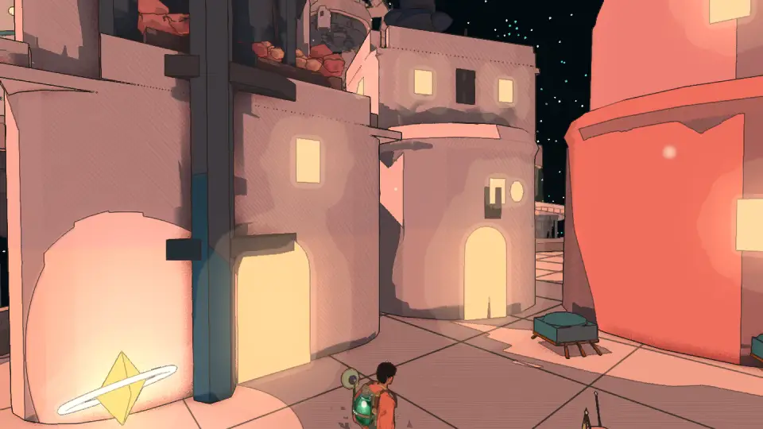
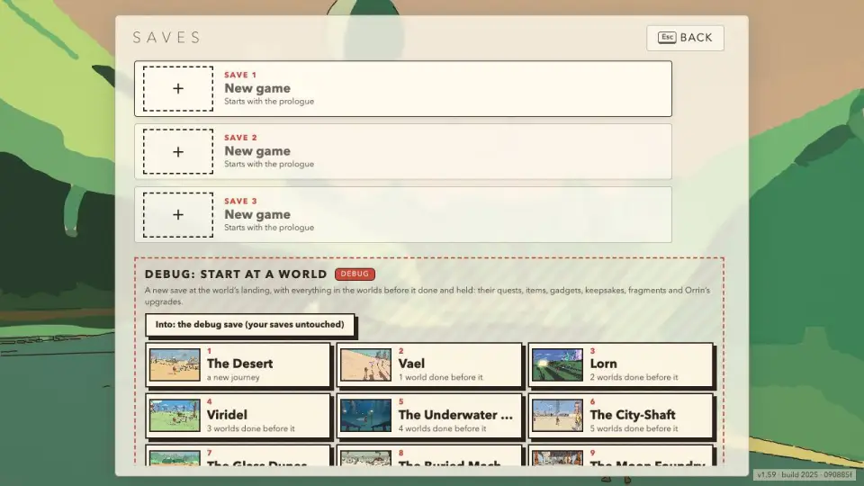
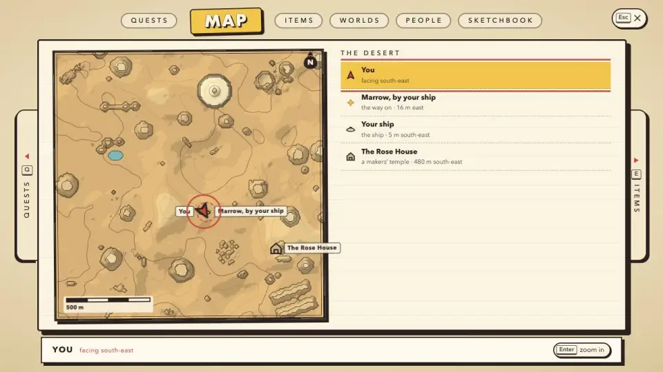
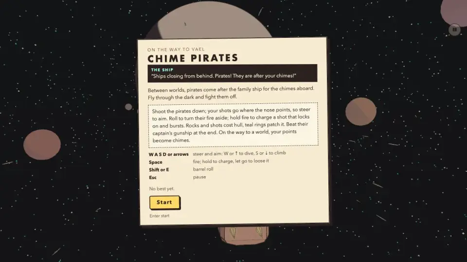
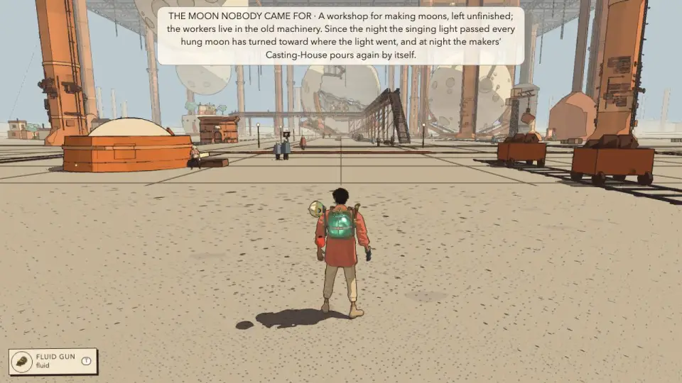
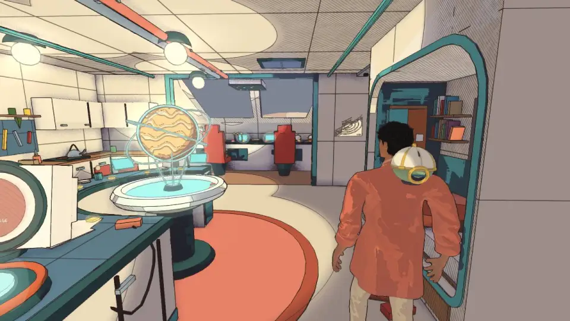

# Hiraeth against what makes a great game (October 2026, v1.59)

<!-- audit-scores
overall: 4.1 / 5
label: the twelve themes, weighted (themes 3-8 count double)
date: 2026-10-12
-->

The sixth audit against the twelve themes of
[what-makes-a-great-game.md](../what-makes-a-great-game.md), run with the `game-audit` skill
(`.claude/skills/game-audit/`). It follows [the v1.53 audit](game-v1.53.md) by six releases, over the same day.
What landed:
- **The v1.53 list:** the ten "Tell X" steps and the four word slips (#172, #173, #183), the four new explorations
  measured (#174), the foes placed by ear (#176), and the level design audit's five fixes (#178–#182), all closed.
- **Eight worlds rebuilt** (v1.55–v1.57, #187–#194): Vael's riders' road and sundial, Viridel's grown pyramids and
  water stair, Lorn's crystal roots, drowned forest and lamp-keepers' village, the Signal Market's galleries, old
  market and screen lanes, the Garden's causeway, furrows and pillar forest, the Underwater City's sea floor and
  canyon, the Moon Foundry's stair street, cranes and runnels, the City Floating in Space's under-deck and stack.
- **The fragments of the singing light** (v1.55, #196): eight hidden in each route world, Orrin Thrum in the hold,
  upgrades at 5 to 96, a finder that beeps.
- **New screens** (v1.58): the game menu on the Quests with large tiles and a full view, a world map, a Start menu
  that a pad can walk, the Worlds page world by world, debug saves on the Saves screen.
- **The pirates reworked** (v1.59, #206), **roomier antechambers and ship** with a camera that settles (#195), the
  ledge climb in two and the knockdown on slopes (v1.58), the desert's leave gate (#217), the distant shimmer on
  handhelds (#225).

**Evidence:**
- two read-only surveys of the code against every v1.53 finding, theme by theme;
- one muted headless Chrome pass of my own plan (22 views: a new player's title, the prologue, settings, Saves,
  the twelve route worlds from their debug saves, the game menu and the world map in two worlds, the pirates' card,
  Home, the Lantern, the Arena), port 5701;
- `node scripts/level-design/audit.mjs` and `node scripts/temple-design/audit.mjs` on all twelve worlds and fourteen
  temples, and the design QC's 66 views (`scripts/design-qc/capture.mjs`, port 5702);
- the motion QC in node (`scripts/motion-qc/run.mjs`), the camera QC in the browser for four scenarios (port 5705);
- the perf audit's frame run at the Handheld preset on this Mac (`.claude/skills/perf-audit/fps.mjs`, port 5703) and
  its size count;
- the last 30 test runs on `main`, and the open issues.

**What is not verified:**
- **No outside playtest,** for the sixth audit running. Nobody but the author has played v1.1–v1.59, and the eight
  rebuilt worlds have not been played through by anyone, the author included as far as the tracker shows.
- **Never heard.** Every run is muted. Audio is judged by its code.
- **No A/B for the frame times.** The v1.53 build would not boot under this checkout's frame script (its saves are
  `moebius.*`, renamed in v1.54), so the numbers below stand alone; the Retroid, the Deck and the Xbox were not
  touched (other agents hold them).
- **The pirates' fight itself:** the capture's click didn't start it; the card was seen, the fight read in the code.
- **The audit ran at `090885f7`.** Landed on `main` while it ran, not seen: the Garden's lake reflection
  (d1a35b23), Viridel's water stair (d993b218), Lorn's roots under the water (d769cdff) and the Xbox's rim
  (18fe8fa6: 57.4 fps).

**What is verified:**
- every capture booted without a page error or a console error;
- boot times on the Mac (load 40–66 during the pass): the Desert 4.5 s, Vael 5.7, Lorn 6.2, Viridel 4.2, the
  Underwater City 3.6, the City-Shaft 5.6, the Glass Dunes 3.5, the Buried Machine 4.7, the Moon Foundry 3.5, the
  Garden 4.3, the City Floating in Space 4.0, the Signal Market 3.8, Home 2.3, the Lantern 2.0;
- **the title's Settings opens** (capture `03-title-settings-0`: the plan's text match was v1.53's miss; the plan now
  clicks `[data-a=settings]`);
- **the world map reads:** the ground in ink from above, you and your heading, the ship, the way on, the temple,
  with distances (`world-map.webp`);
- `main` is green but once: 28 of the last 29 finished runs passed (one red at 16:27 UTC, be75fda2, fixed by the
  next push).

**In progress, not counted:** the temples' third round (#23, another agent); the Xbox's Unity rim (#113).

## The scores

| # | Theme | v1.53 | v1.59 | In one line |
|---|---|---|---|---|
| 1 | Core experience and coherence | 3 | 3 | The v1.53 slips are gone; 11,650 lines in a day again, and the fragments sit beside the story |
| 2 | The first five minutes | 4 | 4 | A roomier ship, menus a pad can walk; the debug world list on a newcomer's Saves screen, the fill still 6th of 17 |
| 3 | Exploration and wayfinding | 4 | 5 | Measured over all twelve worlds at 4.73 (4.51), every v1.53 fix in, a world map; two blind legs left |
| 4 | Rewarding exploration | 4 | 4 | 96 fragments and a finder pay for looking; none in six worlds' new country, nine near the route |
| 5 | Narrative and harmony | 4 | 4 | No "Tell X", no slips, dialogue at 4.32; two taken names and a pirate line that says the opposite |
| 6 | Arc and pacing | 4 | 4 | The Desert's quest can end before the ship lets you go; the Lantern never answers the fragments |
| 7 | Art direction | 5 | 5 | Eight worlds rebuilt in the style and close to their sheets; the far shimmer gone on handhelds |
| 8 | Audio | 4 | 4 | Foes placed by ear at last; placed sounds follow the Music slider, the light's theme still synthesised |
| 9 | Game feel | 4 | 4 | The ledge in two, the body down the slope, a camera that settles; legs still 11 of 15 red |
| 10 | Combat | 4 | 4 | Untouched in design; the lock camera red again in the camera QC, unreviewed since v1.47 |
| 11 | Accessibility and UX | 4 | 4 | The new menus are good on a pad; the pirates shake through Reduce motion, four arrivals run to four lines |
| 12 | Quality, performance, discovery | 3 | 3 | 519 test files, 28 of 29 green; the Mac's Handheld frames ample; what players run on the Deck and Xbox unchanged |

Weighted (themes 3–8 count double): **4.1 / 5, up from 4.0.**

Theme 3 is the one that moved: its v1.53 weakness was "the newest country is unmeasured", and measured now (all
twelve worlds, the eight rebuilt ones included) it averages 4.73, with the Garden's empty Footprint walk, Lorn's
blind door legs, the Desert's flat ground and the Foundry's walk home fixed. Nothing fell. What holds the rest back
has the same shape as at v1.53: breadth came in faster than anyone could play it (eight worlds rebuilt, a
collectible system, four new screens in one day), and the new systems were built beside what was there rather than
woven into it (the fragments placed before the worlds they hide in were rebuilt; a scientist named like the
father's neighbours; the pirates' lines left from the old rules).

## What happened to the v1.53 investments

| # | Investment | Status |
|---|---|---|
| 1 | Watch three people play | **Not done**, sixth audit in a row. Not filed: the author keeps playtests off the tracker |
| 2 | The last words against the rules (#172, #173) | **Done.** No "Tell X" step after the goal: the remaining ends on a person are the six kept, each with its reason (`tests/quest-steps.test.js:120-128`). "Ask Wen" is "beyond the canyon's two oval doors" (`src/levels/buried.js:160`; capture `17-buried`), the window line "low over the great tree" (`src/story/calls.js:193`), the clod one line (`src/story/terraces.js:337`), the doorway's stair "goes down a little way and stops in packed sand" (`src/story/desert-data.js:930`). #183 too: the City-Shaft ends at the Lodestar |
| 3 | Measure the new country (#174) | **Done,** in `docs/audits/level-design-v1.53.md` (4.51), and again here over the eight rebuilt worlds (4.73, below) |
| 4 | Keep `TODO.md` true (#175) | **Done, mostly.** The eight closed items are gone; two new ones crept in (#181, #182 closed, `TODO.md:34, 36`; #235) |
| 5 | Place the foes by ear (#176) | **Done** (v1.54): `foeEar` and `foeSpot`, left or right, softer far off, duller behind (`src/audio.js:2009-2060`) |
| 6 | The shipped build's frame on the Deck and the Xbox (#111, #113) | **Under way.** The Xbox's Unity build at the City-Shaft's rim 44.5 → 57.4 fps (18fe8fa6, after this audit's commit). The web build players run is unchanged and was not measured again |
| 7 | The Desert's length | **Not done,** by choice (17 stages, the first fill the 6th, `src/story/desert-data.js:83-122`). Not filed, as before |
| 8 | The lock camera | **Not done, and worse in the QC:** arena-lock red on roughness, the foe hidden 7.5 % (3.6 % recorded) (#236) |

## The level design, world by world

`node scripts/level-design/audit.mjs` at `090885f7`, the same rows as `docs/audits/level-design-v1.53.md`.
No score moved by eye.

| World | v1.53 | v1.59 | Why |
|---|---|---|---|
| The Desert | 4.11 | 4.22 | Verticality 3 → 4: the lookout on the sandfall mesa, 42 m (#181). Onboarding 3 and a run of seven "do" stops remain, by choice |
| Vael | 4.78 | 4.78 | The riders' road and the plain's edge added places; the scores were already high |
| Lorn | 4.44 | 4.78 | Wayfinding 4 → 5 (the stakes round the Hush-House, #179), verticality 3 → 5 (the lamp-keepers' village, 72 m). The cave's heart → the door (61 m) is still blind (#233) |
| Viridel | 4.56 | 5 | Density, pull and height all 5: the water stair, the round ship's hill, the pyramids' rows |
| The Underwater City | 4.67 | 4.78 | Verticality 4 → 5 (the canyon terraces); pacing 5 → 4, four "do" stops in a row through the sea floor |
| The City-Shaft | 4.56 | 4.67 | Landmarks 4 → 5: Lio's mast (#201) |
| The Glass Dunes | 4.78 | 4.78 | Unchanged |
| The Buried Machine | 4.44 | 4.44 | Unchanged: landmarks from 77 % of the path, a 185 m empty stretch |
| The Moon Foundry | 4.56 | 4.89 | Loops 4 → 5 (the casting rails home, #180), wayfinding and height 5 |
| The Garden of Spheres | 4 | 4.89 | Density 2 → 5 and loops 3 → 5 (the pale path to the Footprint and the way out by the white hill, #178); pull 5 → 4: 5 of 32 optional places pull |
| The City Floating in Space | 4.56 | 4.78 | Verticality 3 → 5 (the stack, 46 m). Sel → the cables under the Towers (117 m) is blind; 3 of 19 optional places pull (#233) |
| The Signal Market | 4.67 | 4.78 | Verticality 4 → 5 (the galleries) |

**Average: 4.51 → 4.73.**

**The temples** (`scripts/temple-design/audit.mjs`): every one of the fourteen scores as at v1.53, the average 4.28.
The v1.59 antechambers are bigger rooms, not new steps, so no score moves; the round (#23) is still under way.

## 1. Core experience and coherence: 3

**Better**
- **The v1.53 slips are gone,** and the arrivals tell what is wrong in each world without sending you to ask
  (capture `17-buried`), Viridel's apart (#235).
- **The eight rebuilt worlds belong to their stories:** the Underwater City is built to sing to the whales and is out of
  tune, the Floating City's bridges have drifted, the Garden's spheres lie at the ends of their furrows.

**Weak**
- **Breadth, again:** `src` is 233,450 lines (about 221,500 at v1.53), 38 new files since v1.54, in one day.
- **The fragments sit beside the story** (#229): no entry in the story bible; the scientist named after the father's
  neighbours, "the Orrins" (`src/story/calls.js:131`); the Floating City's anchor-minder named Odile, as Viridel's lost
  traveller is; and the Lantern, which is what the singing light answers, never mentions them.

## 2. The first five minutes: 4

**Better**
- **The ship is roomier** (#195): wider rooms, a 2.9 m ceiling, a longer cockpit (capture `02-new-game-2`).
- **The Start menu and the game menu walk on a pad:** left and right between the sidebar and the page, up and down
  round it, A / × to look closer (#210, #212, #213).

**Weak**
- **The debug world list is on a newcomer's Saves screen** (#227): under three empty saves, the whole route by name and
  picture, which the pad walks into (`src/title.js:255`, `src/dev-gate.js:14`).

- **Still cramped by the bunk:** the traveller fills a third of the frame (#234).
- **Seven to nine cards and notices in the first three minutes,** three of them objectives (#222, the author's; the
  measures added to #221).
- **The first fill is the 6th of 17 stages,** as before, by choice.

## 3. Exploration and wayfinding: 5

**Better**
- **Measured, all twelve:** 4.73, every world 4.22 or more, Viridel 5 (table above). The v1.53 fixes are in the numbers:
  the Garden's density 2 → 5, Lorn's wayfinding 4 → 5, the Foundry's loops 4 → 5, the Desert's height 3 → 4.
- **A map of the world you are in** (v1.58): you, your heading, the ship, the way on and the temples, with distances
  (`src/world-map.js`). It shows no fragments, by design.

- **The galactic map no longer picks a planet for you** (#204).

**Weak**
- **Two blind legs:** the Floating City's way under the deck, Lorn's cave → door (#233).
- **The Desert's landing:** the first goal 212 m off, onboarding 3, as before.

## 4. Rewarding exploration: 4

**Better**
- **The fragments are a real answer to "most of the new country pays in sights":** 96, eight a world, small and singing,
  counted on the Worlds page and in the Start menu, a finder at ten (`src/fragments.js`). The Worlds page now says what
  is still to find, relic by relic (capture `41-menus-spheres-2`).

**Weak**
- **They miss the new country** (#228): placed before six worlds were rebuilt, so none in Lorn's canopy village, the
  Market's galleries, the Foundry's stair street, the Floating City's stack, the sea floor or Viridel's water stair.
  And 9 of the 96 lie within 20 m of the route's legs, against "never on the way anyone sends you".
- **The rewards are still numbers:** Orrin's upgrades are a heart, a blade half as hard again, magic, glide, stamina
  (`src/story/scientist-data.js:23-31`); only the finder changes what you do.

## 5. Narrative and harmony: 4

**Better**
- **No quest ends on a report** but the six kept with their reasons (`tests/quest-steps.test.js:120-128`).
- **The dialogue review rose to 4.32** (v1.57, from 3.68). Spot-checked here: the v1.58–v1.59 lines (the glyph stone's,
  the leave gate's, the debug screen's) are one line each with tones; the exceptions below.

**Weak**
- **The pirates say the opposite of what the fight does** (#230): "They are after your chimes!", "Your chimes are
  safe", when a win now pays about 80 chimes (`src/ambush.js:69, 74`; `src/minigames/pirates-rules.js:41-48`).

- **Orrin opens on his name and trade** ("I study light: Orrin Thrum, at your service…", `scientist-data.js:84`),
  what the v1.57 rewrite took from everyone else (#229).
- **A chasm still makes a foe "gone",** and foes still burn (`src/foes.js:1159, 1173, 2732-2754`), as before.

## 6. Arc and pacing: 4

**Weak**
- **The Desert can end before it lets you go** (#232): "The Tree That Drinks" completes at the ship, then the ship
  refuses ("Not yet. The Givers' blade and the Givers' guard are still in the Rose House.",
  `src/story/leave-gate.js:50-57`). The gate is right (#217); the quest should say it.
- **The peak is unchanged:** three lamps and a whistle at the Lantern (`src/story/lantern-data.js:47-55`), and now it
  also ignores the game's newest thread, the singing light's fragments (#229).

## 7. Art direction: 5

The captures hold the style in every rebuilt world, and against their sheets
(`references/levels/The City Floating in Space/environment/reference-1.jpeg`, `references/levels/The Moon Foundry/environment/reference-1.jpeg`):
the Floating City's heaped pink houses, bridges and the moon at the frame's edge; the Foundry's orange pillars and hung
moons. The sheets are denser (roof trees and washing in the Floating City, machinery underfoot in the Foundry), the
game's floors emptier.

- **Better:** the hanging pipes steady on small screens (#171, v1.54); far lines on detail under a pixel inked lighter
  and SMAA on the Handheld preset (#225, v1.59).
- **Open:** the Retroid's far shimmer under the Unity build (#218, the author's).

## 8. Audio: 4

- **Better:** **foes placed in space** (#176): the warning from where the foe is, softer far off, duller behind.
- **Weak:** **placed sounds follow the Music slider** (#231): `spot()` scales by `musicVol` and feeds the world bus
  (`src/audio.js:1045`), so the placed makers' hum and the fragments' song play with Effects at 0, and a fragment goes
  silent with Music at 0, against #112's own rule (`docs/systems/audio.md:16-22`).
- **The singing light's theme** is still synthesised (#27); the desert's music still "too on the nose" (#207); the music
  106 MB in 26 tracks.
- **Never heard,** as before.

## 9. Game feel: 4

**Better**
- **The ledge in two** (hands, a knee, up: `MANTLE`, `src/player.js:179`), **the body follows the slope** (v1.58).
- **A camera that settles in small rooms** (`roomFit`): in a 4.2 × 5 m cabin the arm's in and out 3.7 → 0.7 m
  (`docs/systems/movement-and-camera.md`, "Small rooms"); 30 cramped spots of 137 → 18.

**Weak**
- **The motion QC is still 11 of 15 red** (run today: slides of 6–14 cm, pops up to 21 a minute at a sprint's pivot;
  #47).
- **Three spots aboard the ship still cramp the camera,** the first room of the game (#234).

## 10. Combat: 4

- **Unchanged in design** since v1.53 but for the Cistern-Keeper's legs (a pilot).
- **The lock camera is red again** in the camera QC (#236): arena-lock's roughness 1.79 cm (limit 1.5) and the locked
  blot hidden 7.5 % of the time (3.6 % after #107); arena-lock-lizard and bazaar-streets green, desert-shop red as
  recorded. No combat review since v1.47, whose lowest part was this camera.

## 11. Accessibility and UX: 4

**Better**
- **The menus:** tiles with a full view where the words never cover the picture, B / ○ backing out of every level
  (`src/game-menu.js:706-720`), Reduce motion respected in the game menu (`src/game-menu.css:80-84`).
- **The first answer is picked** when someone stops talking, for every input (#211).

**Weak**
- **The pirates' hit shakes the view through Reduce motion and the shake slider** (#230; `src/minigames/pirates.js:512,
  596`).
- **Long words at the top:** four arrivals run to four lines at 1280 × 720 (the Underwater City 249 letters, the Glass
  Dunes 268, the Moon Foundry 270, the Floating City 269); the Desert's first fill notice 176–182 letters for everyone
  (added to #221, the author's).
- **No colour-blind option and no subtitles switch** (speech is always text), as before.

## 12. Quality, performance, discovery: 3

**Better**
- **Tests:** 519 files (493); 28 of the last 29 runs on `main` green.
- **The Mac at the Handheld preset** (1280 × 720, uncapped, `fps.mjs`; load 4–6): every world's worst view under
  10.4 ms at the 95th percentile.

| World | load (s) | worst view | p95 (ms) | fps | main thread (ms) | GPU (ms) | draws (max) | heap (MB, max) |
|---|---|---|---|---|---|---|---|---|
| The Desert | 3.9 | qanat-tree | 7.9 | 141 | 6.9 | 3.3 | 415 | 502 |
| Vael | 4.2 | start | 6.8 | 172 | 5.5 | 5.9 | 373 | 767 |
| Lorn | 4.3 | start | 6.3 | 179 | 5.4 | 5.0 | 411 | 630 |
| Viridel | 3.1 | start | 6.5 | 222 | 4.2 | 4.6 | 313 | 346 |
| The Underwater City | 2.7 | boot | 5.4 | 213 | 4.5 | 3.6 | 345 | 395 |
| The City-Shaft | 4.5 | crowd | 10.4 | 108 | 9.1 | 6.4 | 564 | 775 |
| The Glass Dunes | 2.3 | start | 5.1 | 222 | 4.2 | 3.5 | 558 | 353 |
| The Buried Machine | 3.1 | start | 5.0 | 233 | 4.1 | 3.0 | 282 | 498 |
| The Moon Foundry | 2.6 | boot | 5.0 | 227 | 4.1 | 3.5 | 369 | 439 |
| The Garden of Spheres | 3.5 | start | 4.4 | 263 | 3.5 | 3.1 | 315 | 546 |
| The City Floating in Space | 2.9 | boot | 5.6 | 204 | 4.6 | 4.6 | 413 | 451 |
| The Signal Market | 3.0 | start | 6.0 | 192 | 4.9 | 3.5 | 448 | 433 |
| The Arena (the full pack) | 2.0 | pack | 7.7 | 192 | 4.8 | 3.4 | 985 | 158 |

**Weak**
- **What players run on the consoles is unchanged:** the web build on the Deck about 36–57 fps (#111), the Xbox's web
  build about 20 (#113). The Unity builds are the way (the Xbox rim at 57.4 since this audit's commit), with no menus or
  conversations yet.
- **The heap is larger:** up to 767 MB in Vael and 775 MB in the City-Shaft on the Mac (250–460 MB a world at v1.40,
  `docs/audits/perf-v1.40.md:76`). Not filed: one run, no A/B; worth a look on the Retroid, whose memory is smaller.
- **The size count overstates the devices:** `size.mjs` gives 186 MB "on the devices", but the references level's sheets
  (40 MB, `assets/IMG_*`) and the audits' pictures stay out of the update zip (`scripts/web-update.mjs:133-145`). The
  APK is 118 MB, as at v1.53.
- **Still no outside playtest or telemetry.**

## Where I would invest

Ranked by improvement per hour of work.

1. **Watch three people play.**
   - *Cost: a day.*
   - *Why:* first for the sixth time; eight worlds were rebuilt today and nobody has walked them. (Not filed.)
2. **Keep the newcomer's screens clean** (#227, and the author's #221, #222).
   - *Cost: an hour for #227.* The route spoiled before the prologue is the cheapest thing on this list to put right.
3. **Weave the fragments in** (#228, #229).
   - Re-pick the six worlds' spots over their new country and off the route (#228).
   - A story bible entry, two names that don't collide, Orrin's first line, one line at the Lantern (#229).
   - *Cost: an afternoon.* The fragments are the best answer yet to theme 4; placed where the new country is, they would
     pay for it.
4. **Make the words match the rules** (#230, #232).
   - The pirates' chimes lines, their pitch setting and Reduce motion (#230).
   - The Desert's and Vael's leave gates named in a quest step (#232).
   - *Cost: a few hours.*
5. **The placed sounds' slider** (#231). *Cost: an hour or two,* and a test.
6. **The lock camera and a combat review** (#236). *Cost: medium.* The QC says it slipped; the review is twelve versions
   old.
7. **The last level design legs and the ship's three spots** (#233, #234). *Cost: a few hours each.*
8. **The loose ends** (#235). *Cost: an hour.*

What I would not invest in now:
- **more worlds, explorations or systems:** eight worlds were rebuilt and a collectible added in a day; what's missing
  is a player, and the threads between what's there;
- **the reward numbers:** a design round of its own, as before;
- **the temples,** until round 3 (#23) lands;
- **the storefront** (left out by the author's choice).
