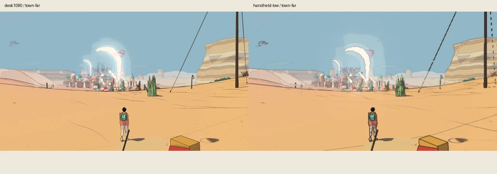
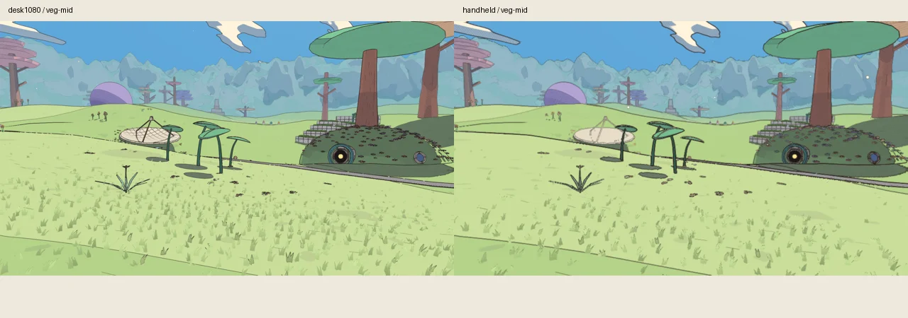
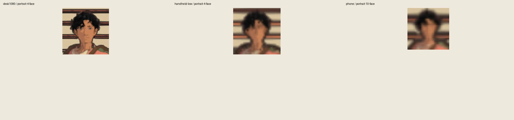

# Ink lines at every distance and resolution, v1.90

<!-- audit-scores
overall: 4.69 / 5
label: mean of 112 pictures; matched temporal supplement inspected
version: 1.90
date: 2026-10-21
-->

**Measured and visual review complete.** Frozen source `c5449ab6c` (v1.90). Later v1.91 ship evidence is excluded. Recommendations only; no findings implemented.

## Setup and coverage

The visible CUA-started console on owned port 5484 completed 56 boots and 112 graded scene/resolution rows, without runtime errors. All final frames and face crops were inspected through 14 contact sheets; the worst portrait crops, town and foliage frames were also inspected individually. Initial/final actual mute, master target and master gain remained true/0/0 with deliberately audible saved preferences, sandbox progress, and pre-import output suppression. This is a controlled fixture, not a settings-menu interaction test.

Actual phone rendering was 1266×585 at pixel ratio 1.5, despite the inherited configuration note saying 1899×877. The report uses recorded dimensions. Other resolutions match their declared targets. Fixed shader time and half-pixel sampling reduce animation contamination; CPU idle poses can still differ from historical captures.

## Findings, lowest criteria first

1. **Distant-town ink stability: 3.33/5.** Desert `town-far`, handheld floor (640×360 internal render, 1280×720 canvas) has steady-depth half-pixel ink change 0.585, failing the 0.55 threshold. Its individual shimmer criterion is 0/1; pops 6.8% and frame ink 2.6% pass. The inspected final image is valid and readable. This two-frame contrast measurement alone is not proof of objectionable temporal shimmer. The completed matched 640×360/1280×720 temporal supplement below confirms coarser, broken thin contours at low raster, without broad changing masks; it qualifies rather than erases the failed metric. Evidence: `retained-local-archive:cua-results/ink/handheld-low/town-far.png`.
2. **Mid-distance plant outlines: 3.75/5.** Edena `veg-mid`, Handheld 960×540, has 40.2% plant ink share (individual criterion 0/1); near-black share 6.1% passes. The inspected leaves and stems have visibly heavy contour strokes while their colored interiors remain readable. Recommend a narrowly scoped material/distance review, preserving approved desktop appearance. Evidence: `retained-local-archive:cua-results/ink/handheld/veg-mid.png`.
3. **Eye-growth metric requires caution: 3.75/5 in two rows.** Desert `portrait-4` handheld floor measures 2.774× eye growth on a 21.9 px face; `portrait-10` phone measures 4.598× on a 14.2 px face, just above the 14 px exclusion boundary. Both individual eye-growth checks fail, but inspected enlarged crops show softened facial detail rather than conspicuous black-dot eyes. Do not present these numbers alone as a confirmed visual regression. Evidence: corresponding `*-face.png` crops; desktop `portrait-4` provides the comparison.

## Comparison and scope

Previous published ink audit v1.72 reports 4.67/5; this run measures 4.69/5. This small aggregate difference is descriptive, not a controlled before/after improvement claim: character geometry and scene content changed. No ink fix or GPU cost experiment was performed. The historical v1.72 before/after face crops were inspected: the older grey-blue eye dots are absent in this run’s inspected tiny-face crops, consistent with the prior fade. The v1.72 prose also explains that its table retained an earlier incorrect eye-box fit; its later corrected near-portrait result was 5/5, matching this run. Thus the aggregate 4.67→4.69 is not a clean renderer improvement measure. Compact publication figures are prepared and inspected. The matched temporal supplement is inspected; final publication remains pending. All full-audit recommendations remain unimplemented.

<!-- ink-lines:measured -->
Captured 2026-10-21 at c5449ab6c; 112 pictures, see the retained per-task checkpoints.

**Mean score** (of 5, every scene at every resolution): **4.69**

### Scores (of 5) by scene and resolution

| scene | desk1080 | desk1080x2 | p720 | handheld | handheld-low | deck | phone |
|---|---|---|---|---|---|---|---|
| portrait-1 | 5.00 | 5.00 | 4.50 | 4.50 | 5.00 | 5.00 | 5.00 |
| portrait-4 | 5.00 | 4.50 | 4.38 | 4.38 | 3.75 | 4.38 | 5.00 |
| portrait-10 | 5.00 | 4.38 | 5.00 | 5.00 | 5.00 | 5.00 | 3.75 |
| portrait-25 | 5.00 | 5.00 | 5.00 | 5.00 | 5.00 | 5.00 | 5.00 |
| town-far | 4.17 | 5.00 | 4.17 | 4.17 | 3.33 | 4.17 | 4.17 |
| veg-near | 4.38 | 4.38 | 4.38 | 3.75 | 4.38 | 4.38 | 4.38 |
| veg-mid | 4.38 | 3.75 | 4.38 | 3.75 | 4.38 | 3.75 | 4.38 |
| veg-far | 4.38 | 4.38 | 4.38 | 4.38 | 5.00 | 4.38 | 4.38 |
| veg-farthest | 4.38 | 4.38 | 4.38 | 4.38 | 5.00 | 4.38 | 4.38 |
| canopy-mid | 5.00 | 5.00 | 5.00 | 5.00 | 5.00 | 5.00 | 5.00 |
| canopy-far | 5.00 | 5.00 | 5.00 | 5.00 | 5.00 | 5.00 | 5.00 |
| pack | 5.00 | 5.00 | 5.00 | 5.00 | 5.00 | 5.00 | 5.00 |
| temple-hall | 5.00 | 5.00 | 5.00 | 5.00 | 5.00 | 5.00 | 5.00 |
| uw-avenue | 5.00 | 5.00 | 5.00 | 5.00 | 5.00 | 5.00 | 5.00 |
| mf-floor | 5.00 | 5.00 | 5.00 | 5.00 | 5.00 | 5.00 | 5.00 |
| sc-bridges | 5.00 | 5.00 | 4.17 | 4.17 | 4.17 | 4.17 | 5.00 |

### Plants: ink share / near-black share / line width (median, p90 px) / height on screen

| scene | res | ink | dark | width | height px |
|---|---|---|---|---|---|
| veg-near | desk1080 | 23.2 % | 8.8 % | 3/7 | 594 |
| veg-near | desk1080x2 | 23.2 % | 12.2 % | 4/11 | 1188 |
| veg-near | p720 | 27.3 % | 10.4 % | 3/8 | 396 |
| veg-near | handheld | 34.5 % | 10.5 % | 3/7 | 396 |
| veg-near | handheld-low | 29.1 % | 0.0 % | 3/6 | 396 |
| veg-near | deck | 27.4 % | 10.9 % | 3/9 | 440 |
| veg-near | phone | 28.9 % | 7.5 % | 5/13 | 644 |
| veg-mid | desk1080 | 30.8 % | 10.1 % | 3/6 | 415 |
| veg-mid | desk1080x2 | 32.3 % | 16.1 % | 4/9 | 829 |
| veg-mid | p720 | 31.7 % | 10.1 % | 2/6 | 276 |
| veg-mid | handheld | 40.2 % | 6.1 % | 3/6 | 277 |
| veg-mid | handheld-low | 30.1 % | 0.0 % | 3/6 | 278 |
| veg-mid | deck | 34.2 % | 11.4 % | 3/5 | 306 |
| veg-mid | phone | 29.0 % | 3.6 % | 5/10 | 451 |
| veg-far | desk1080 | 25.2 % | 5.1 % | 3/7 | 539 |
| veg-far | desk1080x2 | 27.8 % | 9.4 % | 4/10 | 1078 |
| veg-far | p720 | 22.5 % | 2.9 % | 3/7 | 359 |
| veg-far | handheld | 24.2 % | 1.3 % | 3/7 | 360 |
| veg-far | handheld-low | 13.6 % | 0.0 % | 4/6 | 360 |
| veg-far | deck | 25.2 % | 3.8 % | 3/7 | 260 |
| veg-far | phone | 22.2 % | 1.1 % | 5/12 | 621 |
| veg-farthest | desk1080 | 28.6 % | 6.2 % | 3/6 | 465 |
| veg-farthest | desk1080x2 | 29.9 % | 10.5 % | 4/10 | 932 |
| veg-farthest | p720 | 27.6 % | 5.6 % | 3/7 | 310 |
| veg-farthest | handheld | 29.7 % | 2.2 % | 3/8 | 278 |
| veg-farthest | handheld-low | 17.3 % | 0.0 % | 4/9 | 279 |
| veg-farthest | deck | 29.3 % | 6.5 % | 3/7 | 345 |
| veg-farthest | phone | 23.7 % | 1.9 % | 6/14 | 584 |
| canopy-mid | desk1080 | 6.0 % | 0.9 % | 2/3 | 909 |
| canopy-mid | desk1080x2 | 6.8 % | 4.0 % | 3/6 | 1810 |
| canopy-mid | p720 | 7.1 % | 1.1 % | 2/4 | 613 |
| canopy-mid | handheld | 8.8 % | 1.0 % | 2/4 | 618 |
| canopy-mid | handheld-low | 8.3 % | 0.0 % | 3/4 | 622 |
| canopy-mid | deck | 7.8 % | 1.0 % | 2/4 | 676 |
| canopy-mid | phone | 7.6 % | 3.5 % | 4/7 | 1001 |
| canopy-far | desk1080 | 6.7 % | 0.7 % | 2/3 | 434 |
| canopy-far | desk1080x2 | 7.8 % | 3.6 % | 3/6 | 869 |
| canopy-far | p720 | 8.3 % | 0.7 % | 2/4 | 290 |
| canopy-far | handheld | 10.2 % | 0.4 % | 2/4 | 291 |
| canopy-far | handheld-low | 9.1 % | 0.0 % | 3/5 | 292 |
| canopy-far | deck | 8.8 % | 1.0 % | 2/4 | 322 |
| canopy-far | phone | 11.2 % | 1.1 % | 4/7 | 478 |

### The traveller: face height on screen (brow to chin), the eyes' dark as a share of the face against the 1 m portrait at desk1080 (× ref: 1 keeps its proportion), their density (dark over the opening), the darkest eye pixel against the cheek (0 black), his near-black share

| scene | res | face px | eyes × ref | eye density | darkest | dark share |
|---|---|---|---|---|---|---|
| portrait-1 | desk1080 | 190 | 1.0 | 0.86 | 0.00 | 11.1 % |
| portrait-1 | desk1080x2 | 380 | 1.0 | 0.90 | 0.00 | 11.4 % |
| portrait-1 | p720 | 127 | 1.1 | 0.93 | 0.01 | 11.1 % |
| portrait-1 | handheld | 127 | 1.1 | 0.93 | 0.04 | 11.4 % |
| portrait-1 | handheld-low | 127 | 1.0 | 0.87 | 0.10 | 11.4 % |
| portrait-1 | deck | 141 | 1.0 | 0.90 | 0.01 | 11.1 % |
| portrait-1 | phone | 206 | 1.0 | 0.88 | 0.04 | 10.9 % |
| portrait-4 | desk1080 | 33 | 1.4 | 1.19 | 0.16 | 3.6 % |
| portrait-4 | desk1080x2 | 66 | 1.1 | 0.95 | 0.13 | 4.4 % |
| portrait-4 | p720 | 22 | 1.9 | 1.63 | 0.13 | 4.7 % |
| portrait-4 | handheld | 22 | 2.1 | 1.81 | 0.24 | 4.6 % |
| portrait-4 | handheld-low | 22 | 2.8 | 2.35 | 0.22 | 3.6 % |
| portrait-4 | deck | 24 | 1.8 | 1.53 | 0.46 | 4.4 % |
| portrait-4 | phone | 36 | 1.4 | 1.18 | 0.30 | 4.7 % |
| portrait-10 | desk1080 | 13 | 4.3 | 3.63 | 0.14 | 6.4 % |
| portrait-10 | desk1080x2 | 26 | 2.0 | 1.68 | 0.20 | 7.5 % |
| portrait-10 | p720 | 9 | 9.7 | 6.38 | 0.13 | 5.9 % |
| portrait-10 | handheld | 9 | 9.8 | 6.44 | 0.17 | 4.4 % |
| portrait-10 | handheld-low | 9 | 7.5 | 4.94 | 0.24 | 2.8 % |
| portrait-10 | deck | 10 | 7.0 | 5.71 | 0.14 | 6.1 % |
| portrait-10 | phone | 14 | 4.6 | 3.89 | 0.23 | 4.3 % |
| portrait-25 | desk1080 | 5 | 9.9 | 2.33 | 0.30 | 6.1 % |
| portrait-25 | desk1080x2 | 11 | 6.0 | 5.08 | 0.14 | 9.5 % |
| portrait-25 | p720 | 4 | 26.0 | 2.72 | 0.34 | 2.8 % |
| portrait-25 | handheld | 4 | 23.6 | 2.47 | 0.53 | 3.6 % |
| portrait-25 | handheld-low | 4 | 26.0 | 2.73 | 0.59 | 1.5 % |
| portrait-25 | deck | 4 | 16.1 | 2.08 | 0.25 | 4.1 % |
| portrait-25 | phone | 6 | 10.6 | 2.92 | 0.49 | 1.9 % |

### The whole frame: ink share, line width (median px), shimmer (change / pops a half pixel over)

| scene | res | frame ink | width | shimmer |
|---|---|---|---|---|
| portrait-1 | desk1080 | 5.1 % | 2 | 0.05 / 0.00 |
| portrait-1 | desk1080x2 | 4.6 % | 4 | 0.03 / 0.00 |
| portrait-1 | p720 | 7.5 % | 2 | 0.05 / 0.00 |
| portrait-1 | handheld | 9.6 % | 3 | 0.04 / 0.00 |
| portrait-1 | handheld-low | 9.8 % | 5 | 0.05 / 0.00 |
| portrait-1 | deck | 6.3 % | 2 | 0.06 / 0.00 |
| portrait-1 | phone | 9.0 % | 5 | 0.04 / 0.00 |
| portrait-4 | desk1080 | 4.9 % | 2 | 0.09 / 0.00 |
| portrait-4 | desk1080x2 | 4.6 % | 4 | 0.05 / 0.00 |
| portrait-4 | p720 | 6.7 % | 2 | 0.09 / 0.00 |
| portrait-4 | handheld | 8.2 % | 3 | 0.08 / 0.00 |
| portrait-4 | handheld-low | 7.8 % | 4 | 0.10 / 0.00 |
| portrait-4 | deck | 6.6 % | 2 | 0.09 / 0.00 |
| portrait-4 | phone | 7.2 % | 5 | 0.08 / 0.00 |
| portrait-10 | desk1080 | 3.6 % | 2 | 0.10 / 0.01 |
| portrait-10 | desk1080x2 | 3.4 % | 4 | 0.06 / 0.01 |
| portrait-10 | p720 | 4.9 % | 2 | 0.11 / 0.01 |
| portrait-10 | handheld | 6.0 % | 3 | 0.09 / 0.00 |
| portrait-10 | handheld-low | 5.5 % | 4 | 0.12 / 0.00 |
| portrait-10 | deck | 4.9 % | 2 | 0.10 / 0.01 |
| portrait-10 | phone | 5.2 % | 5 | 0.09 / 0.00 |
| portrait-25 | desk1080 | 2.9 % | 2 | 0.12 / 0.02 |
| portrait-25 | desk1080x2 | 2.8 % | 4 | 0.07 / 0.01 |
| portrait-25 | p720 | 3.8 % | 3 | 0.11 / 0.01 |
| portrait-25 | handheld | 4.6 % | 3 | 0.14 / 0.00 |
| portrait-25 | handheld-low | 3.6 % | 3 | 0.17 / 0.00 |
| portrait-25 | deck | 3.8 % | 2 | 0.13 / 0.02 |
| portrait-25 | phone | 4.2 % | 5 | 0.12 / 0.00 |
| town-far | desk1080 | 1.8 % | 2 | 0.45 / 0.08 |
| town-far | desk1080x2 | 2.0 % | 4 | 0.17 / 0.01 |
| town-far | p720 | 2.3 % | 2 | 0.46 / 0.05 |
| town-far | handheld | 2.8 % | 3 | 0.48 / 0.06 |
| town-far | handheld-low | 2.6 % | 4 | 0.58 / 0.07 |
| town-far | deck | 2.0 % | 2 | 0.42 / 0.05 |
| town-far | phone | 2.7 % | 5 | 0.40 / 0.04 |
| veg-near | desk1080 | 3.6 % | 2 | 0.10 / 0.00 |
| veg-near | desk1080x2 | 3.9 % | 4 | 0.07 / 0.00 |
| veg-near | p720 | 4.6 % | 2 | 0.11 / 0.00 |
| veg-near | handheld | 5.7 % | 3 | 0.08 / 0.00 |
| veg-near | handheld-low | 5.2 % | 3 | 0.09 / 0.00 |
| veg-near | deck | 4.2 % | 2 | 0.09 / 0.00 |
| veg-near | phone | 5.3 % | 5 | 0.07 / 0.00 |
| veg-mid | desk1080 | 3.2 % | 2 | 0.11 / 0.00 |
| veg-mid | desk1080x2 | 3.5 % | 4 | 0.08 / 0.00 |
| veg-mid | p720 | 4.1 % | 2 | 0.12 / 0.00 |
| veg-mid | handheld | 4.8 % | 3 | 0.10 / 0.00 |
| veg-mid | handheld-low | 4.0 % | 3 | 0.10 / 0.00 |
| veg-mid | deck | 3.7 % | 2 | 0.11 / 0.00 |
| veg-mid | phone | 4.4 % | 5 | 0.08 / 0.00 |
| veg-far | desk1080 | 2.6 % | 2 | 0.16 / 0.01 |
| veg-far | desk1080x2 | 3.0 % | 4 | 0.09 / 0.01 |
| veg-far | p720 | 3.1 % | 2 | 0.15 / 0.01 |
| veg-far | handheld | 3.5 % | 2 | 0.15 / 0.00 |
| veg-far | handheld-low | 2.9 % | 3 | 0.13 / 0.00 |
| veg-far | deck | 2.9 % | 2 | 0.15 / 0.01 |
| veg-far | phone | 3.5 % | 4 | 0.13 / 0.00 |
| veg-farthest | desk1080 | 3.3 % | 2 | 0.15 / 0.01 |
| veg-farthest | desk1080x2 | 3.7 % | 4 | 0.11 / 0.01 |
| veg-farthest | p720 | 3.7 % | 3 | 0.15 / 0.00 |
| veg-farthest | handheld | 4.2 % | 3 | 0.12 / 0.00 |
| veg-farthest | handheld-low | 3.4 % | 3 | 0.12 / 0.00 |
| veg-farthest | deck | 3.7 % | 3 | 0.15 / 0.00 |
| veg-farthest | phone | 4.1 % | 6 | 0.11 / 0.00 |
| canopy-mid | desk1080 | 2.6 % | 2 | 0.13 / 0.00 |
| canopy-mid | desk1080x2 | 2.8 % | 4 | 0.08 / 0.00 |
| canopy-mid | p720 | 3.3 % | 2 | 0.14 / 0.00 |
| canopy-mid | handheld | 4.1 % | 3 | 0.14 / 0.00 |
| canopy-mid | handheld-low | 4.0 % | 3 | 0.14 / 0.00 |
| canopy-mid | deck | 3.2 % | 2 | 0.14 / 0.00 |
| canopy-mid | phone | 3.9 % | 4 | 0.12 / 0.00 |
| canopy-far | desk1080 | 3.2 % | 2 | 0.18 / 0.01 |
| canopy-far | desk1080x2 | 3.9 % | 4 | 0.10 / 0.01 |
| canopy-far | p720 | 4.1 % | 2 | 0.17 / 0.02 |
| canopy-far | handheld | 4.9 % | 3 | 0.17 / 0.02 |
| canopy-far | handheld-low | 4.6 % | 4 | 0.19 / 0.02 |
| canopy-far | deck | 3.7 % | 2 | 0.17 / 0.02 |
| canopy-far | phone | 5.2 % | 4 | 0.14 / 0.01 |
| pack | desk1080 | 1.9 % | 2 | 0.07 / 0.01 |
| pack | desk1080x2 | 1.9 % | 4 | 0.04 / 0.01 |
| pack | p720 | 2.8 % | 2 | 0.07 / 0.01 |
| pack | handheld | 3.7 % | 3 | 0.07 / 0.00 |
| pack | handheld-low | 3.1 % | 3 | 0.08 / 0.00 |
| pack | deck | 2.6 % | 2 | 0.07 / 0.00 |
| pack | phone | 3.4 % | 4 | 0.06 / 0.00 |
| temple-hall | desk1080 | 4.5 % | 2 | 0.21 / 0.01 |
| temple-hall | desk1080x2 | 4.5 % | 3 | 0.14 / 0.01 |
| temple-hall | p720 | 5.5 % | 2 | 0.27 / 0.03 |
| temple-hall | handheld | 4.9 % | 3 | 0.26 / 0.02 |
| temple-hall | handheld-low | 4.6 % | 3 | 0.28 / 0.00 |
| temple-hall | deck | 3.9 % | 2 | 0.21 / 0.01 |
| temple-hall | phone | 4.4 % | 4 | 0.24 / 0.01 |
| uw-avenue | desk1080 | 4.9 % | 2 | 0.09 / 0.00 |
| uw-avenue | desk1080x2 | 4.8 % | 3 | 0.06 / 0.00 |
| uw-avenue | p720 | 5.4 % | 2 | 0.11 / 0.00 |
| uw-avenue | handheld | 5.9 % | 2 | 0.11 / 0.00 |
| uw-avenue | handheld-low | 5.4 % | 3 | 0.13 / 0.00 |
| uw-avenue | deck | 5.2 % | 2 | 0.10 / 0.00 |
| uw-avenue | phone | 6.4 % | 4 | 0.06 / 0.00 |
| mf-floor | desk1080 | 5.3 % | 3 | 0.29 / 0.00 |
| mf-floor | desk1080x2 | 6.2 % | 4 | 0.20 / 0.00 |
| mf-floor | p720 | 5.6 % | 3 | 0.31 / 0.00 |
| mf-floor | handheld | 6.2 % | 3 | 0.25 / 0.00 |
| mf-floor | handheld-low | 4.8 % | 2 | 0.31 / 0.00 |
| mf-floor | deck | 5.8 % | 3 | 0.30 / 0.00 |
| mf-floor | phone | 6.3 % | 6 | 0.23 / 0.00 |
| sc-bridges | desk1080 | 4.8 % | 2 | 0.35 / 0.02 |
| sc-bridges | desk1080x2 | 5.3 % | 4 | 0.25 / 0.03 |
| sc-bridges | p720 | 5.9 % | 2 | 0.35 / 0.02 |
| sc-bridges | handheld | 6.9 % | 3 | 0.38 / 0.03 |
| sc-bridges | handheld-low | 6.1 % | 4 | 0.47 / 0.03 |
| sc-bridges | deck | 5.8 % | 2 | 0.42 / 0.02 |
| sc-bridges | phone | 6.6 % | 4 | 0.33 / 0.02 |

### The worst pictures (failing and borderline checks)

- town-far @ handheld-low: 3.33 — shimmer 0.585 ✗
- portrait-4 @ handheld-low: 3.75 — eyeGrowth 2.774 ✗
- portrait-10 @ phone: 3.75 — eyeGrowth 4.598 ✗
- veg-mid @ desk1080x2: 3.75 — inkShare 0.323 ~, darkShare 0.161 ~
- veg-near @ handheld: 3.75 — inkShare 0.345 ✗
- veg-mid @ handheld: 3.75 — inkShare 0.402 ✗
- veg-mid @ deck: 3.75 — inkShare 0.342 ✗
- town-far @ desk1080: 4.17 — shimmer 0.454 ~
- town-far @ p720: 4.17 — shimmer 0.46 ~
- town-far @ handheld: 4.17 — shimmer 0.485 ~
- town-far @ deck: 4.17 — shimmer 0.418 ~
- town-far @ phone: 4.17 — shimmer 0.404 ~
<!-- /ink-lines:measured -->

## Inspected comparison figures

These compact stills compare framing and line readability. They do not establish temporal distraction. Original full-resolution images and measurements are preserved separately.

## Matched temporal qualification

Four additional tasks captured town-far and a supplemental closer Qanat view at 640×360 Handheld and same-camera 1280×720 High: 264 valid PNG frames, zero runtime/mute failures. Eight strips (72 spread frames) and the full-size town center were inspected. The exact graded town camera retains readable architecture; thin cables and distant contour sampling are visibly coarser and more broken at the lower raster. The sampled short pans/nudges show no broad changing masks or popping masses. This qualifies the concern as thin-detail instability visible when looking closely; it does not erase the measured 3.33 score or its failed 0/1 shimmer criterion.

The world and shader time were frozen to isolate camera sampling. Both presets used identical world-space paths, 10.5 h clear light, and recorded exact raster metadata. Qanat uses the historical probe camera and is supplemental, not a substitute for another graded ink row. These samples do not establish ordinary animated gameplay or device behavior. Raw evidence and strips: `retained-local-archive:cua-results/ink-temporal/` and `retained-local-archive:cua-results/contacts/ink-temporal/`.

Archive identifiers beginning `retained-local-archive:` name preserved raw evidence in the coordinator’s local validation archive. They are provenance identifiers, not repository-relative paths or public download links. Compact accepted figures are included above.
