# Level design audit, v1.49 (2026-10-11)

<!-- audit-scores
overall: 4.35 / 5
label: the average of the twelve route worlds' means
date: 2026-10-11
-->

The first level design run since `docs/audits/level-design-v1.23.md` (#124). The route has changed a lot since then:
- **The merges.** Vael carries the sky stones and Lorn the Deep Wood. The Sealed Hangar left the route, and the Glass Dunes took its slot and its temple.
- **Three new worlds.** The Underwater City, the Moon Foundry and the City Floating in Space each have a quest of their own (v1.40, v1.48).
- **The temples.** Since v1.49 the route goes on into most worlds' temples, to their guardians (#23).

This round rechecks v1.23's findings. It also measures what the v1.49 game audit called unmeasured: the desert's poles and road, the Buried Machine's oil pipe, and the four high places.

**Setup.**
- The worktree on `dee90207` (main at v1.49), rebased onto `06fa0719` (Unity-only changes since).
- `node scripts/level-design/audit.mjs` on the twelve route worlds (`ORDER`).
- One muted headless Chrome (`scripts/design-qc/capture.mjs`, 960 × 540, High, its own Vite cache on port 5361). It took the planned views and nine of my own: the four high places, the oil main, the pilgrims' road, and three walks home from a temple.
- **The audit's one fix this round.** It read a merged world as its first part only:
  - It measured Vael's Founders' Belfry at the Aerie's door, 1.1 km off, and Lorn's Lamp-House at the Hush-House's.
  - It left out the parts' own quest places, trials and courts, and put Vael's trial unshifted, 1 km from where it stands.
  - It now reads the parts (`partsOf`), and a route step `{ temple, id }` goes in at that part's temple (`templeFor`, `tests/level-design.test.js`).
  - The effect: Vael 4.11 → 4.44 (loops 2 → 5, its "remote" trial gone), Lorn 4.33 → 4.44. The other ten are unchanged.
- **What the numbers can't see:**
  - Whether players look up at the high places.
  - Whether the riders' red strips read at bike speed. They read well standing.
  - Every world's "raised" share reads 0–13 %, because the audit takes the ground under a place as the top of whatever it stands on. A place on a tower is "0 m up" (#138).

## Scores

1-5 per criterion; the mean is the world's score. Vael and Lorn are scored with their parts. The Glass Dunes stand in the Hangar's slot.

| World | Travel | Landmarks | Wayfinding | Density | Spacing | Loops | Optional pull | Verticality | Pacing | Onboarding | **Mean** |
|---|---|---|---|---|---|---|---|---|---|---|---|
| The Desert | bike | 4 | 4 | 5 | 4 | 5 | 4 | 3 | 4 | 3 | **4** |
| Vael | foot, wings, bird | 5 | 4 | 3 | 5 | 5 | 5 | 4 | 4 | 5 | **4.44** |
| Lorn | skiff | 5 | 4 | 5 | 5 | 5 | 4 | 3 | 4 | 5 | **4.44** |
| Viridel | foot | 4 | 3 | 4 | 5 | 3 | 4 | 3 | 5 | 5 | **4** |
| The Underwater City | foot | 5 | 5 | 5 | 5 | 3 | 4 | 4 | 5 | 4 | **4.44** |
| The City-Shaft | foot, jets, cab | 4 | 5 | 4 | 5 | 4 | 4 | 4 | 5 | 4 | **4.33** |
| The Glass Dunes | foot | 5 | 5 | 5 | 5 | 5 | 3 | 3 | 5 | 5 | **4.56** |
| The Buried Machine | foot, jets | 3 | 4 | 4 | 5 | 4 | 4 | 4 | 4 | 4 | **4** |
| The Moon Foundry | foot | 5 | 4 | 5 | 5 | 5 | 4 | 3 ✎4 | 4 | 5 | **4.56** |
| The Garden of Spheres | foot | 4 | 5 | 5 | 5 | 5 | 4 | 3 | 4 | 5 | **4.44** |
| The City Floating in Space | foot | 5 | 5 | 5 | 5 | 4 | 4 | 3 | 5 | 4 | **4.44** |
| The Signal Market | foot | 4 | 5 | 5 | 5 | 5 | 4 | 3 | 5 | 5 | **4.56** |

✎ **The Moon Foundry's verticality.** 7 of its 22 places stand 13–81 m over the foundry floor:
- Wen, Emrys and the courtyard in the broken moon (13 m);
- the hoist's first deck (27 m);
- the lookout on the pillar (31 m);
- the bellows box (43 m);
- the hoist's gallery (81 m).

The audit reads every one of them as "0 % raised" (#138). 32 % raised is the 15 % criterion met, so verticality goes from 3 to 4. No other world moves: the City Floating in Space has 2 of 18 places standing high (the crow's nest and the starthread box), the Garden 3 of 23, both under 15 %.

### v1.52 recount: "raised" over the ground a place rises from (#138)

The audit now measures a place's height over the terrain under it, or over the lowest ground within 10 m (a ring of probes at 5 and 10 m), whichever is lower (`floorAt` in `scripts/level-design/lib.mjs`; `tests/level-design.test.js` has a tower top and a hilltop). Before, it measured over the top of whatever the place stood on, so a place on a tower stood 0 m up. Both counts are from the same v1.52 build (`4056d2ee`), the twelve route worlds. The worlds have changed since the table above, so the means here are not that table's.

| World | Places | Height range | Raised, before → after | Climb on the path | Verticality | Mean |
|---|---|---|---|---|---|---|
| The Desert | 53 | 58 m | 0 → 1 (0 → 2 %) | 266 m | 3 → 3 | 4 → 4 |
| Vael | 49 | 277 m | 6 → 29 (12 → 59 %) | 468 m | 4 → 5 | 4.67 → 4.78 |
| Lorn | 45 | 42 m | 0 → 3 (0 → 7 %) | 100 m | 3 → 3 | 4.56 → 4.56 |
| Viridel | 30 | 125 m | 0 → 2 (0 → 7 %) | 44 m | 3 → 3 | 4.56 → 4.56 |
| The Underwater City | 20 | 80 m | 0 → 3 (0 → 15 %) | 19 m | 3 → 4 | 4.56 → 4.67 |
| The City-Shaft | 38 | 645 m | 0 → 15 (0 → 39 %) | 874 m | 4 → 5 | 4.44 → 4.56 |
| The Glass Dunes | 30 | 96 m | 0 → 5 (0 → 17 %) | 4 m | 3 → 4 | 4.67 → 4.78 |
| The Buried Machine | 31 | 81 m | 1 → 5 (3 → 16 %) | 65 m | 4 → 5 | 4.33 → 4.44 |
| The Moon Foundry | 23 | 81 m | 0 → 7 (0 → 30 %) | 32 m | 3 → 4 | 4.44 → 4.56 |
| The Garden of Spheres | 24 | 83 m | 0 → 3 (0 → 13 %) | 13 m | 3 → 3 | 4.44 → 4.44 |
| The City Floating in Space | 19 | 48 m | 0 → 2 (0 → 11 %) | 65 m | 3 → 3 | 4.56 → 4.56 |
| The Signal Market | 23 | 61 m | 1 → 4 (4 → 17 %) | 63 m | 3 → 4 | 4.56 → 4.67 |

- **Average of the twelve means: 4.48 → 4.55.** Seven worlds' verticality goes up a point; nothing goes down.
- **The four high places now count:**
  - the breaker's cairn, 93 m;
  - the hoist's gallery, 81 m;
  - the belvedere, 80 m;
  - the crow's nest, 44 m.
- **The Moon Foundry reads 4 by measure.** Its 7 places are the ones counted by eye above (13–81 m), 30 %, so the ✎ is no longer needed.
- **Vael and the City-Shaft count the most.** Vael's monastery, rope-way knots and cairns stand 150–250 m over the floor under the stones. The City-Shaft's terraces and pads stand 250–700 m over the shaft's bottom. Both are high places by design.
- **Under 15 % and still 3:** the Garden (3 of 24: the belvedere, Emrys, the box), the City Floating in Space (2 of 19), Lorn, Viridel and the Desert. Each has its height in one or two places, not along the path.
- The audit's report lists the raised places of each world with their height (`vertical.high` in `report.json`).

**Average across the twelve worlds: 4.35 / 5** (v1.23: 4.38 across eleven).

Against v1.23, by world:

| World | v1.23 | v1.49 | Why |
|---|---|---|---|
| The Desert | 4 | 4 | Wayfinding 64 → 73 % (the poles); its first goal 391 → 212 m, still onboarding 3 |
| Vael | 4.56 (the sky stones 4.44) | 4.44 | One world now. The plain from the Aerie to the tower is its longest empty stretch (density 3) |
| Lorn | 4.44 (the Deep Wood 4.33) | 4.44 | One world. The Great Crystal visited once (#118); verticality 3 with the Deep Wood's stalks |
| Viridel | 4.56 | 4 | The route now goes into the Greenhouse: its two legs are blind and the walk home is empty (#131) |
| The City-Shaft | 4.56 | 4.33 | The route is now Lio, then Tobin: the walk back from Tobin is empty, and the shrine → crown climb is a 200 m gap (density 4) |
| The Buried Machine | 4.33 | 4 | The oil main guides the oculus → the wheel; the Engine-House on the route adds a blind leg and an empty walk home |
| The Garden of Spheres | 4.33 | 4.44 | The belvedere: 30 → 83 m of height (verticality 3); it is a loner (#134) |
| The Signal Market | 4.22 | 4.56 | Its first goal 319 → 25 m (onboarding 3 → 5); the Undertower's way home along the listeners' lane |
| The Glass Dunes | – (the Hangar 4.44) | 4.56 | New on the route since v1.23: the cairn and the float-posts (landmarks 5); Oren 26 m from the landing (onboarding 5) |
| The Underwater City | – | 4.44 | New: every leg guided by its tubes; the walk home is the way out (loops 3) |
| The Moon Foundry | – | 4.56 | New: 13 landmarks from the landing; four talks in a row (#137) |
| The City Floating in Space | – | 4.44 | New: the crow's nest; the walk home over the same bridges (loops 4) |

Most of the drop in Viridel, the City-Shaft and the Buried Machine is the route walking more than in v1.23, not the worlds getting worse. v1.23's route went into a temple only for its gadget; nine of the twelve worlds now go into one, and the walk from its door back to the ship is new to the measure.

**Two criteria judged by eye:**
- **Environmental storytelling.**
  - The new worlds tell what happened from what stands: the Moon Foundry's hung moons and the moon in the claws, the Underwater City's lamps in the Crown for the whales, the City Floating in Space's mast lamp "the last light before the dark".
  - The desert's red-strip poles are the riders' marks to the Hearth, and the pilgrims' road home has a brazier every few metres.
  - The oil main from the valve to the great wheel says what drives the wheel before you open it.
- **The reveal.**
  - From the City Floating in Space's Market Bridge the crow's nest stands against the planet's disc, the best framed weenie in the game (`sc-nest`).
  - From the meadow path the Garden's belvedere shows its silhouette over the white hill, framed between the pyramid's flank and the great trees (`sp-belvedere`).
  - Vael's tower is seen whole across 480 m of bare plain from the Aerie: a missed reveal (`va-plain`).
  - The Glass Dunes' breaker's cairn hardly shows from the landing (`gd-cairn`).

## What v1.23 left, rechecked

| v1.23's edit | Now |
|---|---|
| 1. The desert's blind legs (the well → Marrow, the hollow → the Hearth) and its first goal 391 m off | **Done but onboarding.** The camps' banners carry the well → the tarp in the hollow. The riders' red strips (1.16 km of poles) carry the hollow → the Hearth (`de-poles`). Wayfinding 64 → 73 %. The first goal is Qanat now, 212 m off but in plain sight down the ramp; onboarding stays 3. One leg is blind: the ledge on the tree → the giant's mouth (175 m), where the eye stands against the tree's trunk |
| 2. Verticality in Lorn, the Hangar and the Garden (2 each) | **Partly.** Lorn 3 (with the Deep Wood, 42 m of height), the Garden 3 (the belvedere, 83 m). The Hangar left the route. Nothing on either path stands raised |
| 3. The Hangar's far zones | **Moot**: the Hangar left the route |
| 4. The Buried Machine's oculus → the wheel (351 m, blind) | **Done.** The oil main (567 m) carries it as a leading line (`bm-oilmain`) |
| 5. Overhead goals (Vael's window, the City-Shaft's palace) | **Done** (v1.46): both read "goal overhead". The City-Shaft's crown → Nima on the high terrace (287 m) is still blind |
| 6. Lorn's Great Crystal ↔ Saba ping-pong | **Done** (#118): Saba's steps are gone; the crystal is visited once |
| 7. The Signal Market's onboarding (Sel 319 m) and the sky stones' (339 m) | **Done.** The Signal Market's first goal is 25 m off (onboarding 5). Vael's, with the sky stones, is Oïa at 18 m |

From earlier reports, still open: the Signal Market's tower seen down two more avenues (v1.5; #44 closed without it). The Market's landmarks stay 4 (65 % of the path sees one).

## What the v1.49 game audit called unmeasured

| What | Measured |
|---|---|
| **The desert's red-strip poles** (out of Marrow's hollow to the Hearth) | A leading line of 1155 m; the hollow → the Hearth leg is guided by it. The longest empty stretch on it is 406 m, 20 s on the bike: density 5 |
| **The pilgrims' road** (the well → the ship) | A leading line of 309 m; the walk home along it passes two new places (`de-road`). Loops 5 |
| **The oil pipe** (the oil main, the valve → the great wheel) | A leading line of 567 m; the leg is guided. It reads clearly at the valve |
| **The crow's nest**, the City Floating in Space, 44 m | On the route (Kip's lamp), in sight from Kip; framed against the planet. The world's places span 48 m (verticality 3) |
| **The old hoist**, the Moon Foundry, 27 m deck and 81 m gallery | The first deck is on the route, the gallery above it. From the apron the hoist is one column among many under the roof's grid (`mf-hoist`). Verticality 3 ✎4 |
| **The belvedere on the white hill**, the Garden of Spheres, 82 m | A sight 154 m off the path and 161 m from anything: the Garden's one loner and remote dead end (#134). It reads well from the meadow path |
| **The breaker's cairn**, the Glass Dunes, 93 m | A sight and a beacon 368 m off the 437-m path; hard to pick out from the landing. Optional pull 3 (#134) |

## Per world

### The Desert (4)

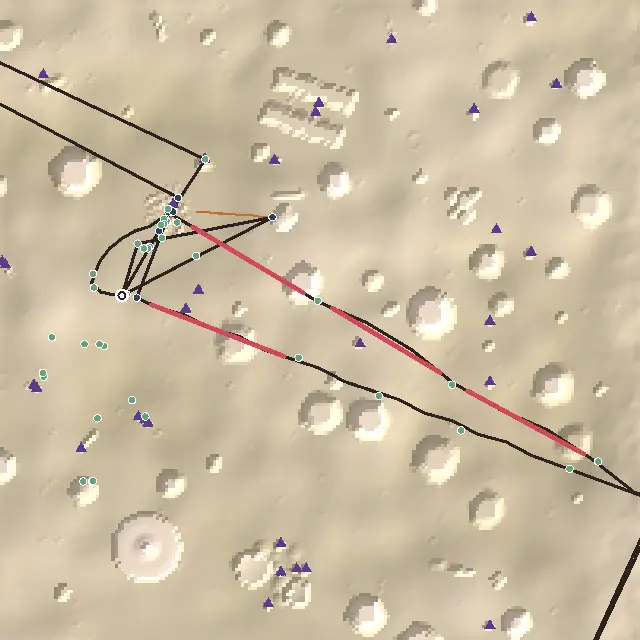

*From above, +z up. The dark line is the critical path, ochre the leading lines, red the longest empty stretches, blue places on the route, green optional places, purple triangles landmarks and beacons, the ring the landing.*

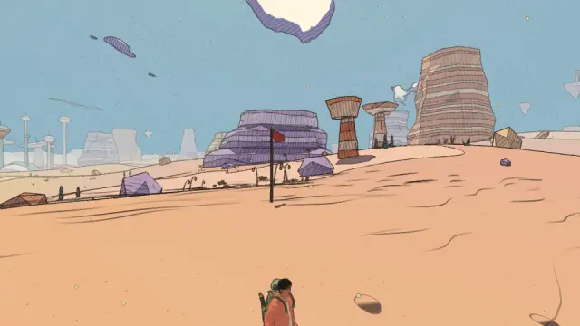

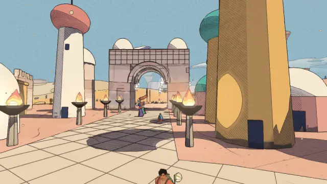

1. **Onboarding 3.** Qanat, the first goal, is 212 m from the landing, though in plain sight under the smoke column. Only 2 places are within 80 m, by the author's choice after #4: the camps were cleared.
2. **Optional pull: 1 of 37 optional places in the 30-150 m band.** 25 are on the path and 11 remote: the Mask in the Sand 537 m off, Teo's drum 308 m, the Wind hall run 283 m. The far ones are fine as far places; what's missing is the middle band.
3. **Pacing: seven "do" stops in a row** through the skull cave.

### Vael, with the sky stones (4.44)

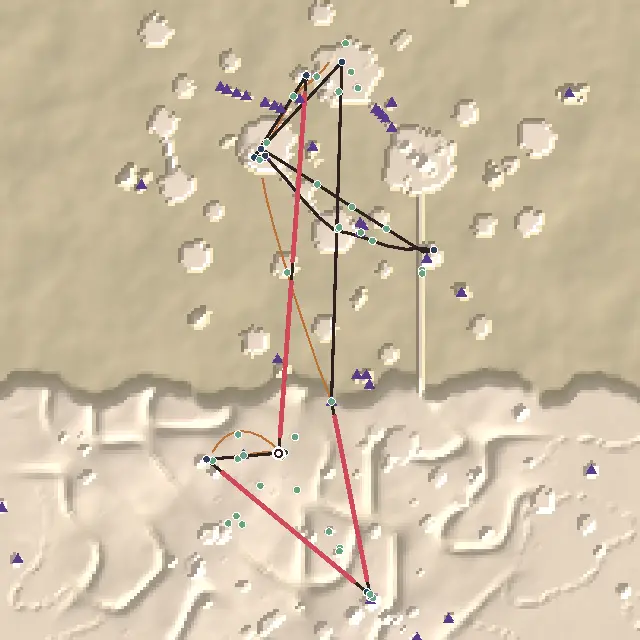

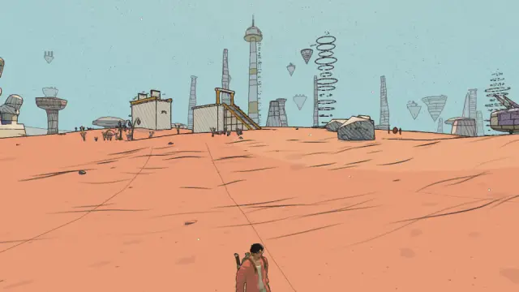

1. **Density 3.** The Aerie → the tower: 483 m with nothing within 40 m, 59 s running (#133).
2. **Two blind legs:** the riders' gate → Sister Aube (966 m on the bird) and Brother Calix → the Belfry (279 m). The Aerie → the tower (592 m) is blind by the numbers, but the tower is in view a few steps out of the porch.
3. **The riders' halfway stone is a loner** (189 m from anything).

### Lorn, with the Deep Wood (4.44)

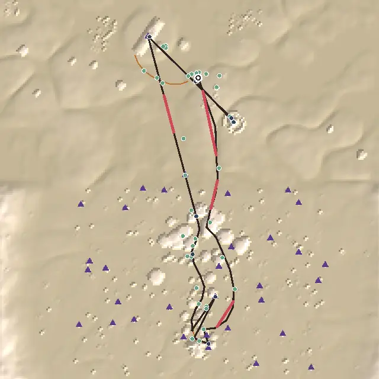

1. **Blind:** the heart of the crystal cave → Hollin, the lamp-keeper (631 m) and Wendel → the Great Crystal (188 m), where a pink ringed spire shows over the grove the ray misses (#135).
2. **Pacing:** seven "do" stops in a row from the splinter to the root cave.
3. **Verticality 3:** 42 m of height, nothing on the path raised (Wendel's lookout is 40 m off it).

### Viridel (4)

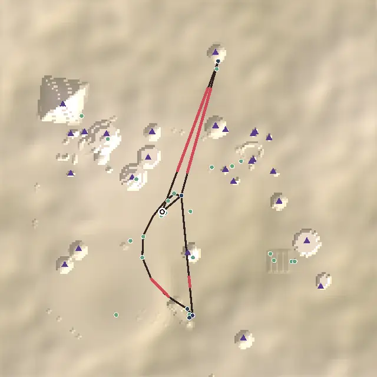

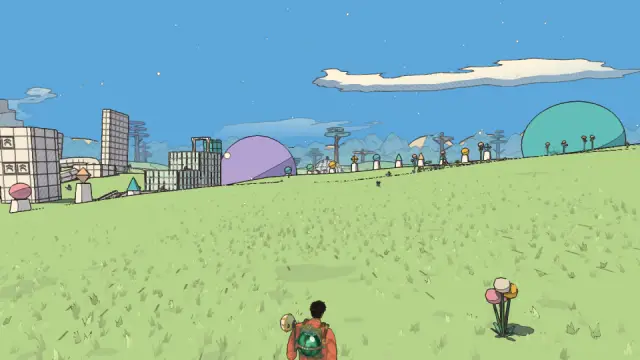

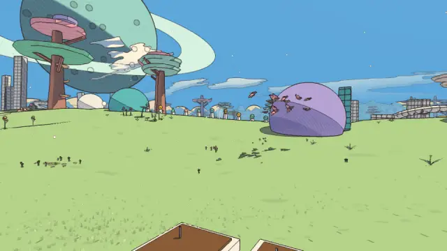

1. **Wayfinding 3:** Mira → the Greenhouse (281 m) and its door → the ship (324 m) are both blind (#131).
2. **Loops 3:** the walk home from the Greenhouse passes nothing new.
3. **Optional pull:** 6 of 23 optional places remote: the tea terraces and the builders' gate (168-215 m), Rue (220 m), the tallest tree's crown.

### The Underwater City (4.44)

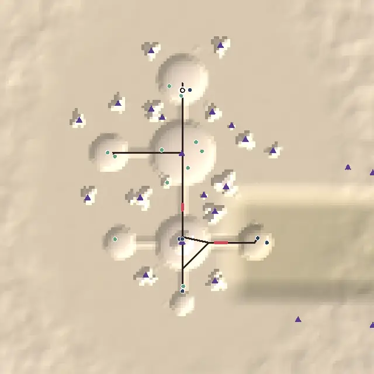

1. **Loops 3:** the Whale-House's door → the ship, 310 m back down the city's length, the way you came (#132).
2. **Onboarding 4:** Mireille, the first goal after Bastien at the lock, is 136 m off.
3. **Pacing:** fine (no run over 2), but two of its four stops are carries from one person to another: the cutting to Fabre, the word to Maelle (#137).

### The City-Shaft (4.33)

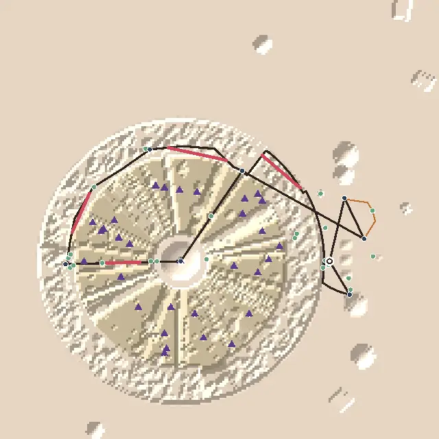

1. **Density 4:** the climb from the Upward Shrine to the crown, 200 m (24 s) with nothing near.
2. **Loops 4:** Tobin → the ship (119 m) passes nothing new; Tobin's telescopes are on the way out now (#132).
3. **Blind:** the crown → Nima on the high terrace (287 m).

### The Glass Dunes (4.56)

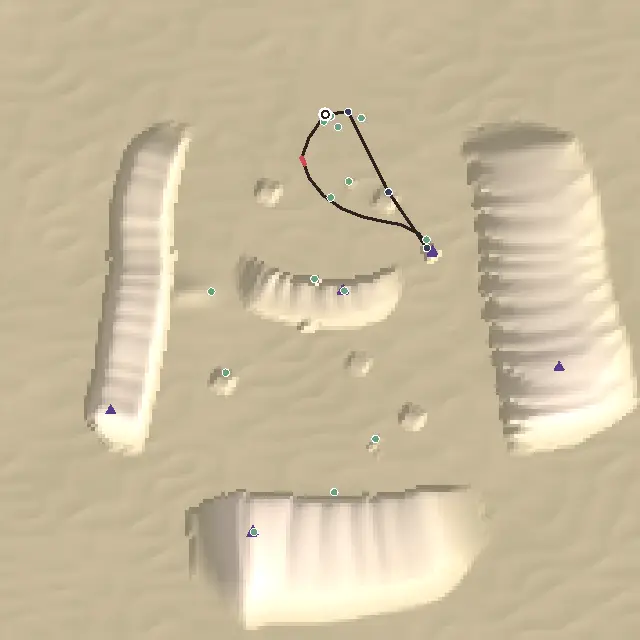

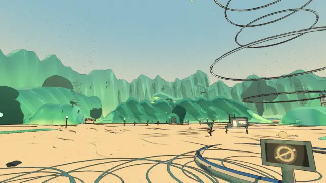

1. **Optional pull 3:** 5 of 14 optional places remote: the breaker's cairn (368 m), the north camp (289 m), two makers' boxes (219-222 m), the west camp (#134).
2. **Verticality 3:** the cairn makes 92 m of height, but the path climbs 4 m.
3. **A one-minute path** (437 m): dense, guided and well onboarded, but short.

### The Buried Machine (4)

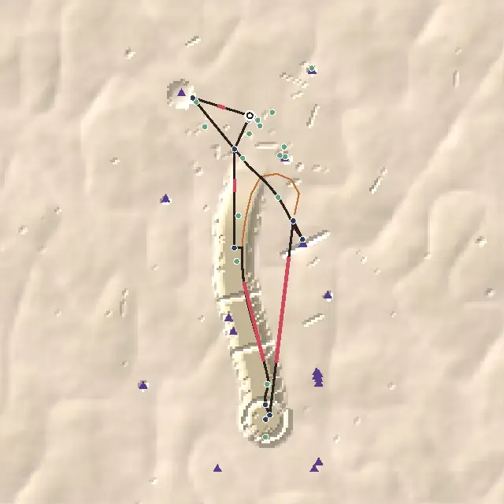

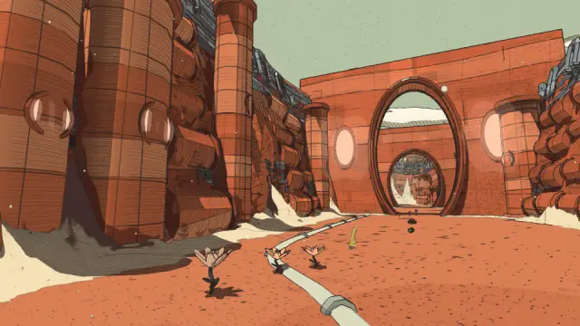

1. **Landmarks 3:** 57 % of the path sees one; the canyon floor is walled in (#136).
2. **Blind:** Wen → the rust canyon (181 m) and Wen → the Engine-House (117 m).
3. **Loops 4:** the Engine-House → the ship (106 m) passes nothing new (#132).

### The Moon Foundry (4.56)

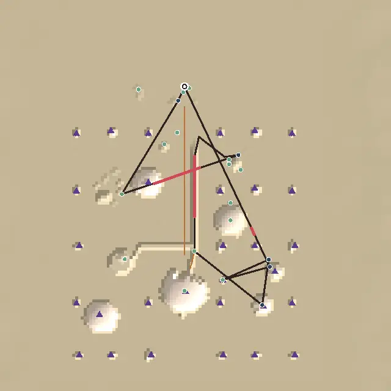

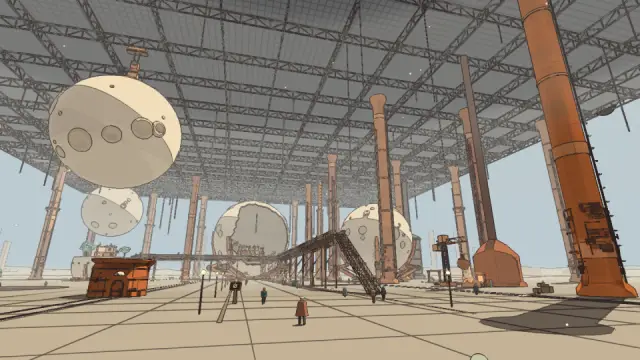

1. **Pacing 4:** four talks in a row (Hedda, Ottilie, Bertil, Wen). Two of the quests carry something from one person to another (the hook to Bertil; the count to Ilse, after the count is done at the lookout) (#137).
2. **Blind, short:** the lookout → Ilse (71 m) and the hoist's deck → the Casting-House's door (73 m).
3. **The hoist doesn't stand out** from the apron among the foundry's columns.

### The Garden of Spheres (4.44)

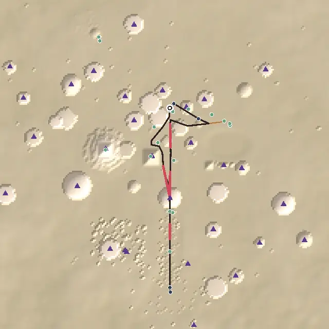

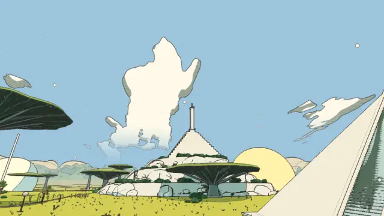

1. **The belvedere is a loner and a remote dead end** (154 m off the path, 161 m from anything) (#134).
2. **Verticality 3:** 83 m of height now, but the path climbs 13 m and nothing on it is raised.
3. **Tessa and the Footprint are remote** (319-331 m), as in v1.23 (the temple stays where it is).

### The City Floating in Space (4.44)

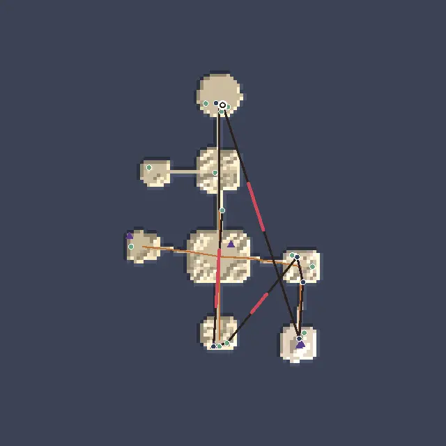

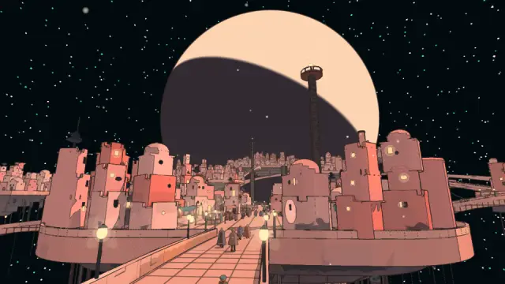

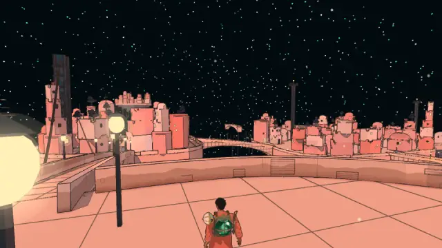

1. **Loops 4:** the Mooring-House → the ship (296 m) back over the same bridges (#132).
2. **Onboarding 4:** Kip, the first goal after Rosa, is 126 m off.
3. **Blind, short:** Madame Sel on the Balcony → Tamar on the Towers (134 m), a carry from one person to another (#137).

### The Signal Market (4.56)

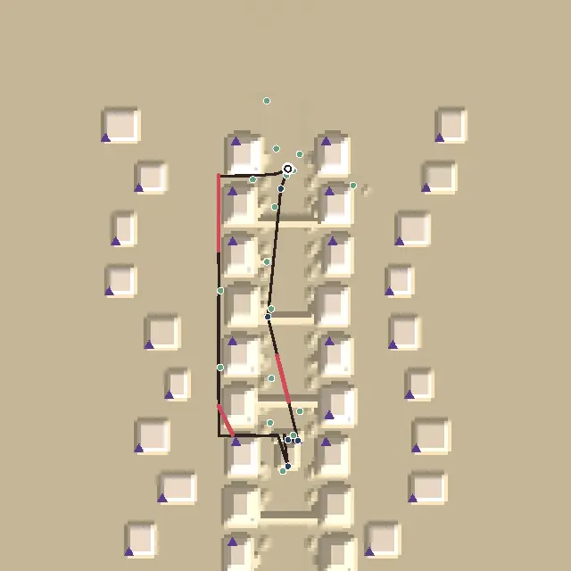

1. **Landmarks 4:** 65 % of the path sees one; only 2 from the landing. The tower down two more avenues (v1.5) is still not done.
2. **Verticality 3:** 61 m of height, 4 % raised.
3. Nothing else under 5.

## The ranked edits

Worst first by (score gain × players affected) / cost. Each is an issue (label `todo`) and a line in `TODO.md` "Level design (audit)".

1. **#137: the new worlds' quests hand you from one person to another.**
   - The Moon Foundry: Ottilie's hook to Bertil; Wen's count to Ilse.
   - The City Floating in Space: Sel's notes to Tamar.
   - The Underwater City: the cutting to Fabre; the word to Maelle.
   - The standing rules: each should complete at its goal. Moon Foundry pacing 4 → 5. Cheap: quest data and save moves.
2. **#131: Viridel's Greenhouse.** A landmark over it seen from Mira's, and a way home past the terraces or Oro's ruins. Wayfinding 3 → 4, loops 3 → 5: Viridel 4 → 4.33.
3. **#132: the walks home from the temple.** The Underwater City, the City Floating in Space, the Buried Machine, and the City-Shaft from Tobin: a way home past an optional place, a line the last stage names, or a temple that lets you out elsewhere. Loops → 5 in four worlds, about +0.1 each.
4. **#133: Vael's plain.** Bend the approach to the tower past a sight, carry the riders' lanterns on to the monastery, put a beacon over the Belfry. Density 3 → 4, wayfinding 4 → 5: Vael 4.44 → 4.67.
5. **#136: the Buried Machine's landmarks.** A beacon seen from the canyon floor, and one over the Engine-House. Landmarks 3 → 4, wayfinding 4 → 5: 4 → 4.22.
6. **#134: the belvedere and the cairn.** Each within 150 m of the path or with a second reason (a box on top, a line to its foot). The Garden's loner gone; the Glass Dunes' optional pull 3 → 4.
7. **#135: Lorn's blind legs.** A line from the cave island south toward the keepers' light. Wayfinding 4 → 5: Lorn 4.44 → 4.56.
8. **#138: the audit's "raised" measure.** Count height over the terrain, not over the top of the tower a place stands on. No score change in the worlds; the verticality scores become honest.

Not filed: the desert's onboarding (Qanat 212 m off but in sight; the camps were cleared on purpose, #4), and the Signal Market's tower down two more avenues (v1.5; closed once).

## Across worlds

- **The walk home from the temple is the new empty walk back.** Since the route goes on to the guardians, four worlds come home from their temple's door the way they came (Viridel, the Underwater City, the City Floating in Space, the Buried Machine), and the City-Shaft from Tobin. v1.23 had loops 5 in all eleven; now seven of twelve.
- **The new worlds are compact and well guided.** The Underwater City, the Moon Foundry and the City Floating in Space are 0.9–1.2 km paths of 2 minutes, every long leg guided (75–100 %), no empty stretch over 84 m. What they lack is height on the path and a different way home.
- **Leading lines carry most of the guidance now.** The twelve worlds have 35 of them: the poles, the pilgrims' road, the oil main, the tubes, the bridges, the float-posts. Most blind legs left are where no line runs: Vael's flights, Lorn's crossing south, the temple legs.
- **Height is there, but off the path.** The high places reach 44–93 m, but the path climbs little: 4 m in the Glass Dunes, 13 m in the Garden. Only the crow's nest and the hoist's deck are climbed on the way.

## Against the last report

- **The route:** eleven worlds → twelve, three new worlds, two merges, the Hangar out. Nine worlds now go into their temple.
- **Done from v1.23's list:** the desert's two blind legs, the oil pipe, the overhead goals, Lorn's ping-pong, the Signal Market's and the sky stones' onboarding.
- **The audit reads merged worlds by their parts** (Vael's Belfry was measured 1.1 km off).
- **The average:** 4.38 (eleven worlds) → 4.35 (twelve). Of the eight worlds in both reports, the Signal Market (+0.34) and the Garden (+0.11) rose. Viridel (−0.56), the Buried Machine (−0.33) and the City-Shaft (−0.23) fell, all from legs the route didn't walk at v1.23.
