# Level design audit, v1.53 (2026-10-12)

<!-- audit-scores
overall: 4.51 / 5
label: the average of the twelve route worlds' means
date: 2026-10-12
-->

This round measures the explorations built for four worlds since v1.49 (#174):
- **The Glass Dunes:** trapped-time (the stopped minutes in the glass) and sunken-city (#166).
- **The Desert:** giants-road, walking-dunes and water-memory (#167).
- **The Buried Machine:** machine-breathes, with the keepers' way up (#168).
- **The City-Shaft:** rim-quarters and light-down (#169).

It runs on the twelve route worlds, with the same rows as `docs/audits/level-design-v1.49.md` so the two compare. It also compares with that report's v1.52 recount, the first with "raised" measured over the ground a place rises from (#138).

**Setup.**
- The worktree on `00aab528` (main at v1.53).
- `node scripts/level-design/audit.mjs` on the twelve route worlds (`ORDER`).
- The same audit on `4056d2ee`, the v1.52 recount's build, for the per-world baseline.
- One muted headless Chrome (`scripts/design-qc/capture.mjs`, 960 × 540, High, its own Vite cache, port 5381) for ten views of my own. Six are in this report.

**Already counted at v1.52.** Most of the four worlds' new country was in the v1.52 recount's numbers without being named. Its build, `4056d2ee`, is the commit that landed the Glass Dunes' explorations, and those commits gave the audit their places as `sights`:
- the Glass Dunes' five stopped minutes, three windows and the sinkhole;
- the Buried Machine's keepers' crown, oil fall and gangway;
- the City-Shaft's four quarters and its great mirror.

The Desert's three explorations came after it.

**What the audit could not see, and what I extended** (`scripts/level-design/lib.mjs`, `tests/level-design.test.js`):
- **The mirror decks.** Only the great mirror on the rim was a place. The four decks down the bell quarter, where you stand to turn the cranks, weren't, except where the errand's first marker happened to stand. The City-Shaft's level now lists each deck as a sight (`src/levels/incal.js`; `tests/shaft-mirrors.test.js` checks all five). That adds three places: 38 → 41, 8 → 11 pulling. No score moves.
- **The city under the sand.** It is a room built off the map, 2.6 km up (`src/glass-dunes-city.js` `CITY`). The audit drops every place over 1200 m from a world with a temple, so it saw only the sinkhole, at the door. It now reports each room behind a doorway on the map (`offMapRooms`): where you land, the way back out, the walk across, and where the way out leaves you. The scores still come from the map: the room has no places of its own to count, and the sinkhole stands for it.
- **The sand rivers.** These are ridden lanes: the bike runs up to 40 % faster in them (`src/bike.js` `LANE`). The level now gives the audit its `lane` (`src/levels/desert.js`), and the stretches of the path in one are timed at that speed (`laneRuns`). The measured path rides 0 m in a river. The riders' red strips, which carry the hollow → the Hearth leg, run 30–50 m beside the river out of the hollow and then leave it (538 m apart at its end). The river down the wash is the giants' road's own ride, 47 m from the path at its nearest. The timing changes nothing today; it will when a leg follows a river.
- **The giant's arm** was a place already (its shrine at the elbow). It is not "raised": its crown is 8 m over the bed of the wash, the threshold itself, and the shrine stands on the south lip.

**What the numbers can't see:**
- The Glass Dunes' windows count as raised (13–16 m over the city floor under their glass), so the world's 17 % raised is 7 % without them. I keep the measure: you stand on glass over a 16 m drop. The world's one real climb, the 14-m ramp out of the city, is off the map, and the path still climbs 4 m.
- Whether the walking dunes' two ruins, a different two each visit, read as new.

## Scores

1-5 per criterion; the mean is the world's score. Vael and Lorn are scored with their parts.

| World | Travel | Landmarks | Wayfinding | Density | Spacing | Loops | Optional pull | Verticality | Pacing | Onboarding | **Mean** |
|---|---|---|---|---|---|---|---|---|---|---|---|
| The Desert | bike | 4 | 4 | 5 | 5 | 5 | 4 | 3 | 4 | 3 | **4.11** |
| Vael | foot, wings, bird | 5 | 5 | 4 | 5 | 5 | 5 | 5 | 4 | 5 | **4.78** |
| Lorn | skiff | 5 | 4 | 5 | 5 | 5 | 4 | 3 | 4 | 5 | **4.44** |
| Viridel | foot | 5 | 5 | 4 | 5 | 5 | 4 | 3 | 5 | 5 | **4.56** |
| The Underwater City | foot | 5 | 5 | 5 | 5 | 5 | 4 | 4 | 5 | 4 | **4.67** |
| The City-Shaft | foot, jets, cab | 4 | 5 | 4 | 5 | 5 | 4 | 5 | 5 | 4 | **4.56** |
| The Glass Dunes | foot | 5 | 5 | 5 | 5 | 5 | 4 | 4 | 5 | 5 | **4.78** |
| The Buried Machine | foot, jets | 4 | 5 | 4 | 5 | 5 | 4 | 5 | 4 | 4 | **4.44** |
| The Moon Foundry | foot | 5 | 4 | 5 | 5 | 4 | 4 | 4 | 5 | 5 | **4.56** |
| The Garden of Spheres | foot | 4 | 4 | 2 | 5 | 3 | 5 | 3 | 5 | 5 | **4** |
| The City Floating in Space | foot | 5 | 5 | 5 | 5 | 5 | 4 | 3 | 5 | 4 | **4.56** |
| The Signal Market | foot | 4 | 5 | 5 | 5 | 5 | 4 | 4 | 5 | 5 | **4.67** |

No moves by eye this round.

**Average across the twelve worlds: 4.51 / 5** (v1.49: 4.35; the v1.52 recount: 4.55).

Against v1.49 and the v1.52 recount, by world:

| World | v1.49 | v1.52 | v1.53 | Why |
|---|---|---|---|---|
| The Desert | 4 | 4 | 4.11 | The three explorations: 53 → 64 places. Spacing 4 → 5: the 90th percentile of each place's distance to its nearest neighbour, 133 → 97 m. Optional places 30–150 m off the path 1 → 10. Still flat (#181) |
| Vael | 4.44 | 4.78 | 4.78 | Unchanged since the recount |
| Lorn | 4.44 | 4.56 | 4.44 | The route now goes into the Hush-House. The legs to its door and on to Hollin are blind: wayfinding 5 → 4 (#179) |
| Viridel | 4 | 4.56 | 4.56 | Unchanged |
| The Underwater City | 4.44 | 4.67 | 4.67 | Unchanged |
| The City-Shaft | 4.33 | 4.56 | 4.56 | Three mirror decks counted (38 → 41 places, 8 → 11 pulling). The upper mirror is a loner (#182) |
| The Glass Dunes | 4.56 | 4.78 | 4.78 | Its explorations were in the recount's build. The city under the sand is now reported |
| The Buried Machine | 4 | 4.44 | 4.44 | The keepers' way was in the recount's build (its crown 49 m up, 52 m off the path) |
| The Moon Foundry | 4.56 | 4.56 | 4.56 | Unchanged. Loops 4, already on the v1.52 build: the walk home from the Casting-House (#180) |
| The Garden of Spheres | 4.44 | 4.44 | 4 | The route now goes into the Footprint: 680 m with nothing near and a blind, empty walk home (#178) |
| The City Floating in Space | 4.44 | 4.56 | 4.56 | Unchanged |
| The Signal Market | 4.56 | 4.67 | 4.67 | Unchanged |

**The two criteria judged by eye:**
- **Environmental storytelling.**
  - The giants' road tells the Desert's oldest story without a word: a hand, an arm, a spine, a jaw down a dry riverbed, read outward from Qanat, each with its pilgrims' brazier.
  - The tide lines and stranded boats say there was water in the wash.
  - The city under the Glass Dunes has its clock tower stopped at seven to, and your own footprints from the walk to the house.
  - The Buried Machine's keepers' log on the crown says who walked the gangway.
- **The reveal.**
  - The City-Shaft's sun beam, from the rim down the bell quarter, is the best reveal of the round: each turned crank shows the next mirror lit.
  - From the ride the giant's arm is seen whole across the wash, the striped mesa beside it (`de-arm`).
  - The Glass Dunes' windows look straight down into the streets you then walk (`gd-window`, `gd-city`).

## The new country, place by place

How far each new place stands off the critical path: under 30 m is on it, 30–150 m pulls, farther is remote.

| World | Place | Off the path | Raised |
|---|---|---|---|
| The Desert | the giant's hand (a beacon too) | 69 m | – |
| The Desert | the giant's arm over the dry wash | 69 m | – (its crown 8 m over the bed) |
| The Desert | the giant's spine | 49 m | – |
| The Desert | the giant's jaw | 44 m | – |
| The Desert | the two ruins the dunes let go of (this visit) | 32 m, 67 m | – |
| The Desert | the sandfalls off the two mesas (their feet) | 15 m, 27 m | – |
| The Desert | the salt pan, a stranded boat, the first qanat well | 71 m, 80 m, 58 m | – |
| The Glass Dunes | the glassworker in the glass | 9 m | – |
| The Glass Dunes | the birds in the wave, the carriers in the glass | 59 m, 59 m | – |
| The Glass Dunes | the dust in the cliff, the moment in the wave | 213 m, 352 m | – |
| The Glass Dunes | the three windows in the sand | 30–45 m | 13–16 m |
| The Glass Dunes | the sinkhole (the door to the city under the sand) | 17 m | – |
| The Buried Machine | the keepers' crown (the gangway's top) | 52 m | 49 m |
| The Buried Machine | the oil fall | 34 m | – |
| The City-Shaft | the gardens' falls, the great bells, the balcony market | 34 m, 64 m, 53 m | –, –, 530 m |
| The City-Shaft | the cab-wrights' crane | 155 m | 530 m |
| The City-Shaft | the great mirror on the rim | 51 m | 50 m |
| The City-Shaft | the middle, lower and deep mirror decks | 127 m, 105 m, 52 m | 294 m, 230 m, 162 m |
| The City-Shaft | the upper mirror (the errand's first stop) | 283 m, a loner | – |

**The room behind the sinkhole:**
- You land in the city's street with its tower ahead, 31 m from the way up.
- The ramp of fallen sand climbs 14 m to it, and lets you out 13 m from the sinkhole's lip.
- It is a short loop off the path's last stop, the Clock-House's door. A player who goes down adds about 60 m and one place. The audit counts it as the one place at its door.

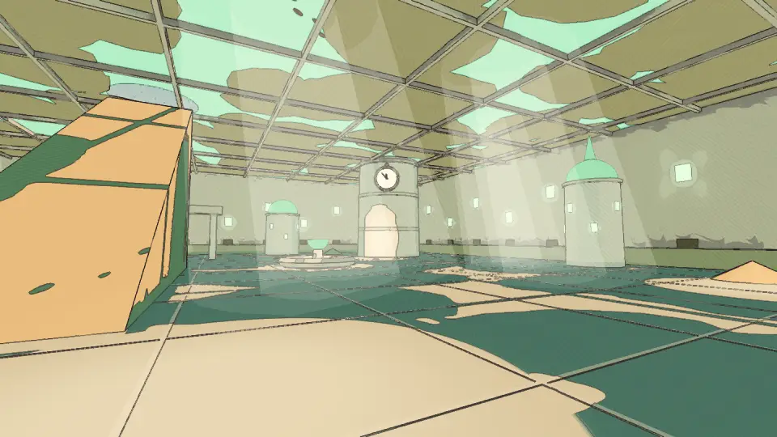

## Per world

### The Desert (4.11)

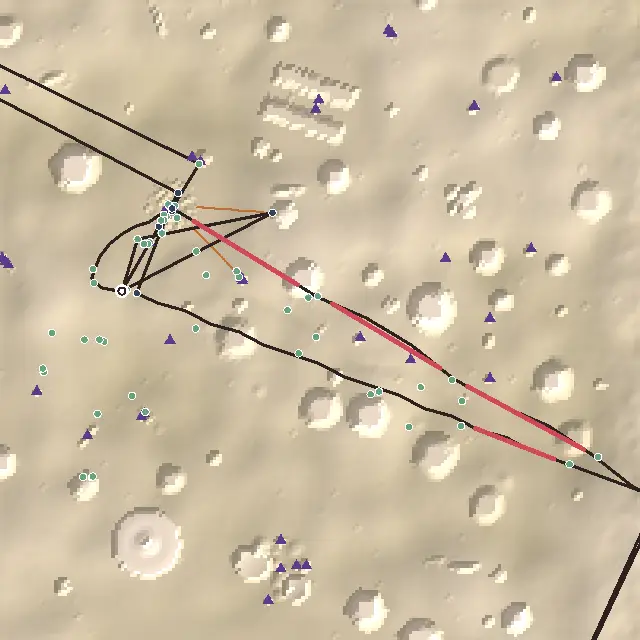

*From above, +z up. The dark line is the critical path, ochre the leading lines, red the longest empty stretches, blue places on the route, green optional places, purple triangles landmarks and beacons, the ring the landing.*

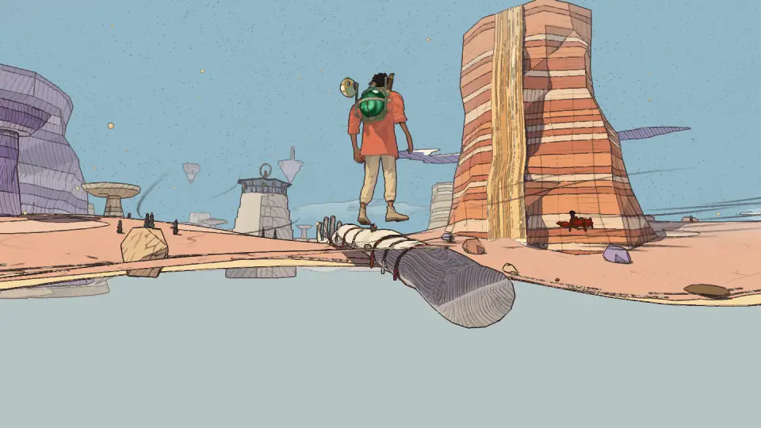

1. **Verticality 3 (#181).** 1 of 64 places stands raised (the mask's eyes, 25 m), and the places span 58 m. The arm's crown is 8 m over the wash and its shrine on the lip; the sandfalls are counted at their feet.
2. **Onboarding 3.** Qanat, the first goal, is 212 m from the landing, in plain sight. Not filed: the author cleared the camps (#4).
3. **Pacing 4:** seven "do" stops in a row through the skull cave, as in v1.49.

What the explorations did: optional pull still scores 4, but 10 places now pull from 30–150 m (v1.49: 1 of 37). The giants' road lies between the ride out and the stones home, 44–69 m off both.

### Lorn (4.44)

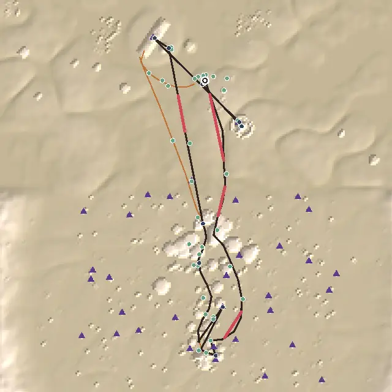

1. **Wayfinding 4 (#179).** The route goes into the Hush-House since v1.53, between the crystal cave and Hollin. The cave's heart → its door (61 m) and the door → Hollin (586 m) are blind: the keepers' stakes start some 60 m from the door.
2. **Verticality 3:** 42 m of height.
3. **Pacing 4:** five "do" stops in a row, from Hollin to the root cave.

### The City-Shaft (4.56)

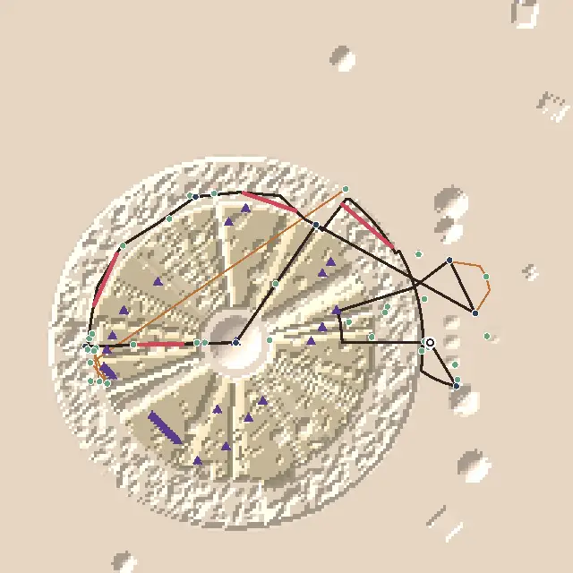

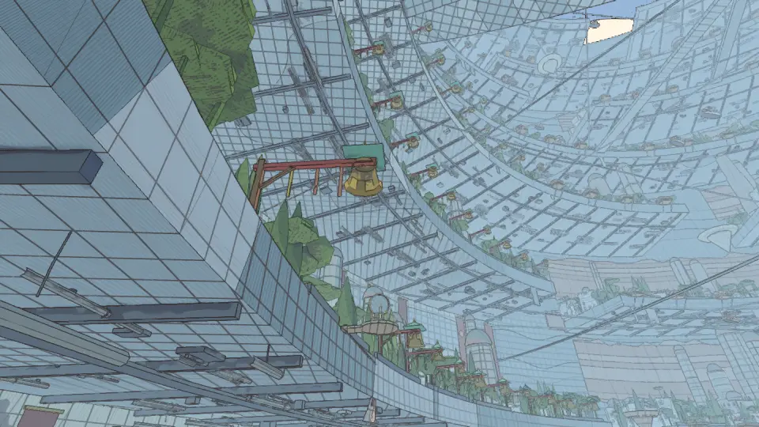

1. **The upper mirror is a loner (#182).** It is 164 m from any other place and 283 m off the path, and the light-down errand starts there.
2. **The crown → Nima on the high terrace (287 m) is still blind (#182),** as in v1.23 and v1.49.
3. **Optional pull 4:** 11 of 33 optional places pull (33 %). The cab-wrights' crane is 155 m off the path.

### The Glass Dunes (4.78)

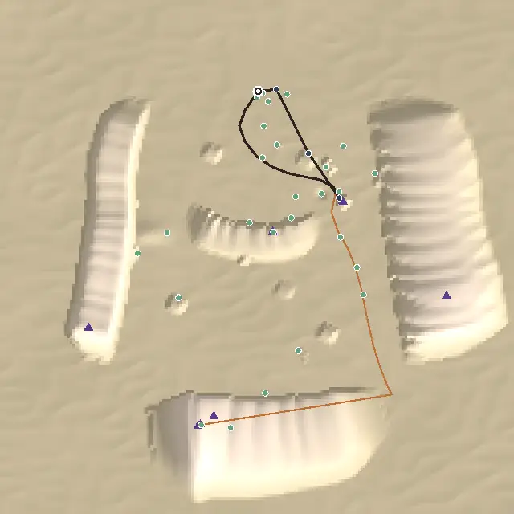

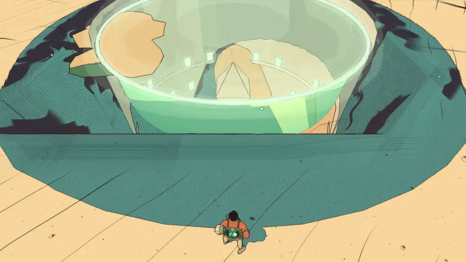

1. **A one-minute path** (437 m). The explorations stand round it: 10 places on it, 9 pulling.
2. **Two of the stopped minutes are remote:** the dust in the cliff (213 m) and the moment in the wave (352 m). Neither is a dead end: each is within 70 m of a camp. Far places are fine as far places, so not filed.
3. **The path climbs 4 m.** The world's height is the two cairns off it and the city's ramp off the map.

### The Buried Machine (4.44)

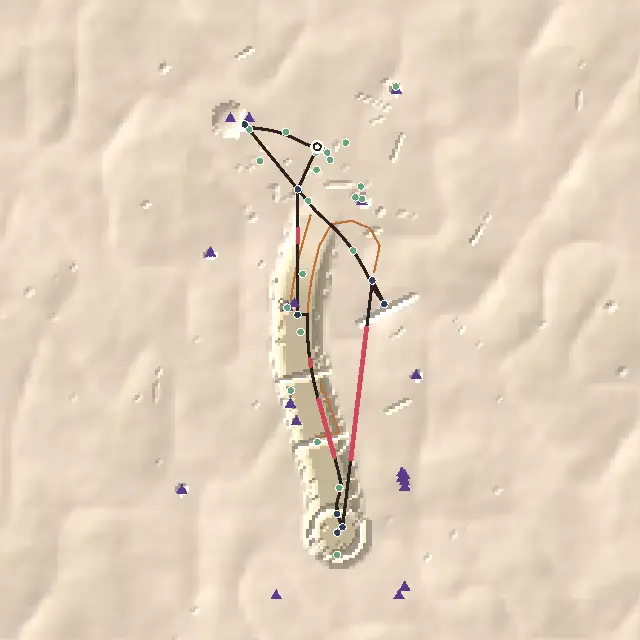

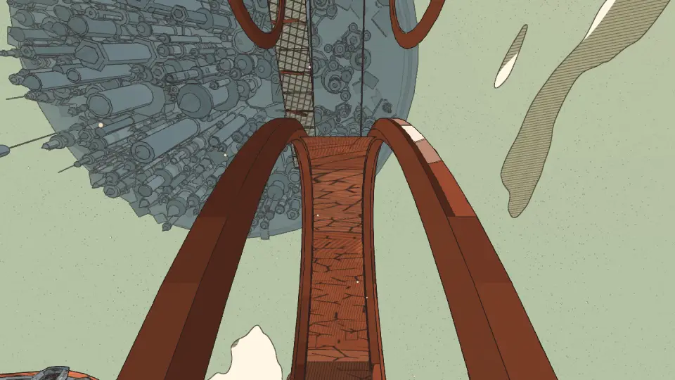

1. **Landmarks 4:** 77 % of the path sees one (v1.49: 57 %, #136).
2. **Density 4:** 185 m (23 s) from the oculus back toward the wheel with nothing near.
3. **Pacing 4:** five "do" stops in a row, from the rust canyon to the great wheel. The keepers' way is optional: its crown pulls (52 m off the path) and stands raised.

### The Garden of Spheres (4)

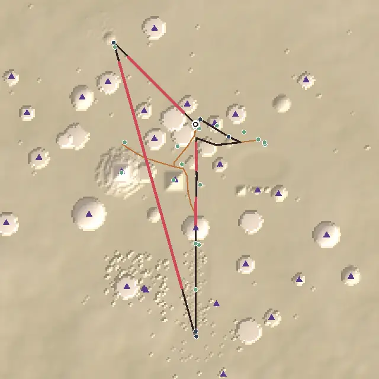

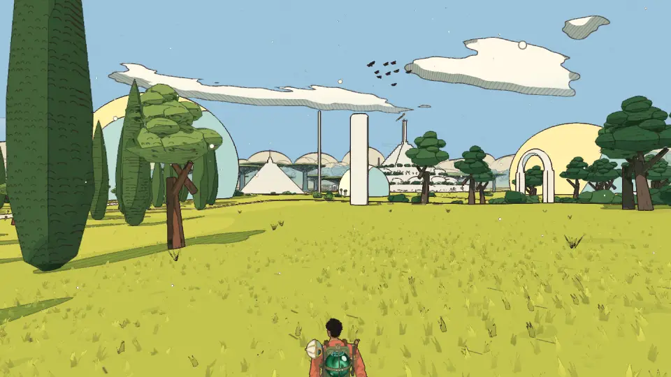

1. **Density 2 (#178):** the humming pole → the Footprint's door, a 680 m stretch with nothing within 40 m, 83 s running. The longest in any of the twelve worlds.
2. **Loops 3 (#178):** the walk home from the Footprint's door (336 m) passes nothing new.
3. **Wayfinding 4:** that walk home is blind.

### The other six

Vael (4.78), Viridel (4.56), the Underwater City (4.67), the Moon Foundry (4.56), the City Floating in Space (4.56) and the Signal Market (4.67) score as in the v1.52 recount. The one finding not filed before: the Moon Foundry's walk home from the Casting-House (277 m) passes nothing new, loops 4 (#180).

## The ranked edits

Worst first by (score gain × players affected) / cost. Each is an issue (label `todo`) and a line in `TODO.md` "Level design (audit)".

1. **#178: the Garden's Footprint.** A line from the round plaza toward it with a place or two on the way, a way out nearer the ship. Density 2 → 4, loops 3 → 5: the Garden 4 → 4.44 or more.
2. **#179: Lorn's Hush-House door.** A first keepers' stake by its steps. Wayfinding 4 → 5: 4.44 → 4.56. One line of data.
3. **#180: the Moon Foundry's walk home.** The Casting-House's way out elsewhere, or home past the quarter. Loops 4 → 5: 4.56 → 4.67.
4. **#181: the Desert's height.** A stop on the giant's arm over the wash, a lookout on a sandfall mesa. Verticality 3 → 4: 4.11 → 4.22.
5. **#182: the City-Shaft's upper mirror and the crown → Nima.** Something by the upper mirror's terrace, a line or a landmark for Nima. No score change by the numbers; the errand's start and the main quest's last leg.

Not filed: the Desert's onboarding (the author's choice, #4); the Glass Dunes' remote stopped minutes; the walking dunes' ruins, which change each visit and can't be judged from one.

## Across worlds

- **The temples on the route made the new empty walks.** In two worlds the route now goes on into the temple (#23): the Garden's Footprint, 890 m from the last stop, and Lorn's Hush-House, off the line that carried the leg. Each lost what v1.50 had fixed. The walk to a temple's door needs the same care as the walk home from it.
- **The explorations filled the middle band.** In the Desert 10 places now pull from 30–150 m (1 in v1.49). In the Glass Dunes and the City-Shaft the new places stand 30–130 m off the path, where pull works.
- **Height is still off the path.** The keepers' crown (49 m), the mirror decks (160–290 m over the shaft's floor) and the Glass Dunes' windows count as raised. The giant's arm, the sandfalls and the city under the sand don't. In the Desert and the Glass Dunes the path itself climbs little: 4 m in the Glass Dunes.

## Against the last report

- **The average:** 4.35 (v1.49) → 4.55 (the v1.52 recount) → 4.51. Two worlds fell since the recount, both from a temple newly on the route: the Garden −0.44 and Lorn −0.12. The Desert rose +0.11 with its new country.
- **Done from v1.49's list:** #131–#138 all closed. The Buried Machine's landmarks went 57 → 77 % (#136), the walks home from four temples got loops 5 (#132), and "raised" is measured honestly (#138).
- **The audit sees three more things:** the mirror decks as places, the rooms off the map behind a door (the city under the sand), and the ridden lanes (the sand rivers).
