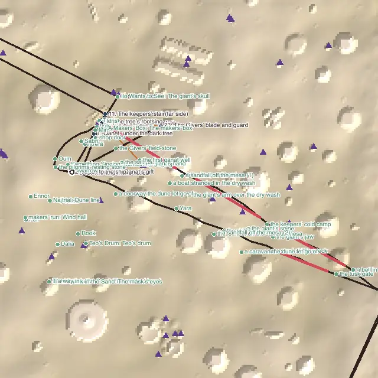

# Level design audit, v1.66 (2026-10-13)

<!-- audit-scores
overall: 4.71 / 5
label: the average of the twelve route worlds' means
date: 2026-10-13
-->

A re-run of the `level-design-qc` skill (`.claude/skills/level-design-qc/SKILL.md`) on main at v1.66, for issue #226
("run the new updated audit qc skills to see if we get new findings"). No world was reworked for this report. It
measures what landed since [v1.53](level-design-v1.53.md): the v1.54-v1.59 rounds (the desert's mesa lookout, the
heel path, the casting rails, the Floating City's one way under, Vael's and the Underwater City's explorations as ways
through, the two blind legs of #233), the fragments re-placed (v1.60), the hosts beside every game (v1.65), and the
ship that won't leave without its core gadgets (#232).

**What changed in the skill** since v1.53:
- a **Travel** column before the nine scores (how the critical path is crossed, `travel.by` and the mounts had partway);
- the hints a level can give the audit listed in one place, with two new ones:
  - `mouths`: a place left by its mouth, Lorn's crystal cave;
  - `overVoid`: a leg over the void follows its named line up to 2.5 times its length;
- the world outside only (temples are `temple-design-qc`'s);
- the label "the average of the twelve route worlds' means".

The rubric's anchors are v1.53's, so the rows compare.

## The setup

- `node scripts/level-design/audit.mjs` at `cfcb5f41` (main, v1.66), the twelve route worlds.
- **One fix to the audit's path** (`scripts/level-design/path.mjs`, tested in `tests/level-design-round3.test.js`):
  - **The problem.** The core gadgets' last step (`coreStage`, `src/story/leave-gate.js`) is a `pass: true` stage: it is
    passed over on reaching it when the gadget is had. Vael's main quest ends with "Take the fluid wings from the Aerie",
    and Vael's route goes into the Aerie for the wings first (`{ temple: 'gadget' }`). The audit still walked the
    648 m back to the Aerie's door, a step no player sees. It read as a blind leg and an empty walk back: Vael
    4.78 → 4.22.
  - **The fix.** A `pass` stage at a temple's door the route has already been in at is left out. Vael measures 4.78
    again.
  - **The desert keeps its step.** Its route never enters the Rose House before the main quest ends, so its blade and
    guard step is real (below).
- **Not done this round:** the in-game views (`scripts/design-qc/capture.mjs`). The machine was loaded (load average
  50-60) with the cinematics pass's headless Chrome running, and the skill allows one at a time. The desert's map is
  the picture; the other worlds' numbers are near the top of the scale and their v1.53-v1.59 pictures still hold.

## Scores

1-5 per criterion; the mean is the world's score. Vael and Lorn are scored with their parts.

| World | Travel | Landmarks | Wayfinding | Density | Spacing | Loops | Optional pull | Verticality | Pacing | Onboarding | **Mean** |
|---|---|---|---|---|---|---|---|---|---|---|---|
| The Desert | bike | 4 | 4 | 5 | 5 | 5 → 3 | 4 | 3 → 4 | 4 → 3 | 3 | **4.11 → 3.89** |
| Vael | foot, wings, bird | 5 | 5 | 4 | 5 | 5 | 5 | 5 | 4 | 5 | **4.78** |
| Lorn | skiff | 5 | 4 → 5 | 5 | 5 | 5 | 4 | 3 → 5 | 4 | 5 | **4.44 → 4.78** |
| Viridel | foot | 5 | 5 | 4 → 5 | 5 | 5 | 4 → 5 | 3 → 5 | 5 | 5 | **4.56 → 5** |
| The Underwater City | foot | 5 | 5 | 5 | 5 | 5 | 4 | 4 → 5 | 5 → 4 | 4 → 5 | **4.67 → 4.78** |
| The City-Shaft | foot, jets, cab | 4 → 5 | 5 | 4 | 5 | 5 | 4 | 5 | 5 | 4 | **4.56 → 4.67** |
| The Glass Dunes | foot | 5 | 5 | 5 | 5 | 5 | 4 | 4 | 5 | 5 | **4.78** |
| The Buried Machine | foot, jets | 4 | 5 | 4 | 5 | 5 | 4 | 5 | 4 | 4 | **4.44** |
| The Moon Foundry | foot | 5 | 4 → 5 | 5 | 5 | 4 → 5 | 4 | 4 → 5 | 5 | 5 | **4.56 → 4.89** |
| The Garden of Spheres | foot | 4 → 5 | 4 → 5 | 2 → 5 | 5 | 3 → 5 | 5 → 4 | 3 → 5 | 5 | 5 | **4 → 4.89** |
| The City Floating in Space | foot | 5 | 5 | 5 | 5 | 5 | 4 | 3 → 5 | 5 | 4 | **4.56 → 4.78** |
| The Signal Market | foot | 4 | 5 | 5 | 5 | 5 | 4 | 4 → 5 | 5 | 5 | **4.67 → 4.78** |

No moves by eye.

**Average across the twelve worlds: 4.71 / 5** (v1.53: 4.51). Ten worlds rose with the v1.54-v1.59 rounds, Vael held
(after the path fix), and the desert fell.

| World | v1.53 | v1.66 | Why |
|---|---|---|---|
| The Desert | 4.11 | 3.89 | **New: the Rose House's walk back.** Since #232 the main quest ends "Meet Qanat at your ship", then "Take the blade and guard from the Rose House" while they are missing, and the ship. The route, which has not been in the Rose House, now walks ship → the Rose House's door → ship: 483 m back (59 s on the bike) passing nothing new (loops 5 → 3), and the run of "do" stops grows to 8 (pacing 4 → 3). The mesa's lookout raised it (verticality 3 → 4, v1.54, #181) |
| Vael | 4.78 | 4.78 | The same, once the audit stops walking the wings' passed-over step (above) |
| Lorn | 4.44 | 4.78 | The cave left by its mouth and the keepers' stakes to the Hush-House (#233): every long leg guided; the lookout and the stalks 30 m up (v1.57) |
| Viridel | 4.56 | 5 | Its explorations as one way through (v1.57): no stretch over 30 m empty, 15 places pulling, raised |
| The Underwater City | 4.67 | 4.78 | Bell to bell over the seabed and down the canyon street (v1.56, #192): raised, the landing nearer its first goal; a run of four "do" stops on the way (pacing 5 → 4) |
| The City-Shaft | 4.56 | 4.67 | Lio's dispatch mast seen from the crown (v1.55, #201) |
| The Glass Dunes | 4.78 | 4.78 | Unchanged |
| The Buried Machine | 4.44 | 4.44 | Unchanged |
| The Moon Foundry | 4.56 | 4.89 | The casting rails home (v1.54, #180) and the inner-curve street to the crown (v1.57) |
| The Garden of Spheres | 4 | 4.89 | The heel path and the keepers' stone way out (v1.54, #178); four detours (#233). Pull 5 → 4: 9 of 36 optional places pulling |
| The City Floating in Space | 4.56 | 4.78 | One way under, across and up (v1.57); the stair-lamp down to the anchor (#233) |
| The Signal Market | 4.67 | 4.78 | Its explorations as one way (v1.57): raised |

**The two criteria judged by eye** (from the maps; no new views this round):
- **Environmental storytelling** holds where v1.53 left it. The desert's dry wash, the giant's arm and the pilgrims'
  road still tell the procession, and the new country of v1.55-v1.57 is built round what happened in each world: the
  Floating City's cable that let go, the Garden's names facing the plaza.
- **The reveal.** The desert's longest leg is the hollow to the Hearth, 1.6 km along the riders' red strips. Its goal
  is hidden behind the dunes until the last rise, which is right. The Rose House leg, though, starts at the ship with
  the house's door in no sightline.

## Per world

### The Desert

*The path dark, the four longest empty stretches red. The walk from the Rose House's door back to the ship (top centre
to the ring) has nothing on it that the route has not passed already.*

The three worst findings:
1. **The walk back from the Rose House** (loops 3): 483 m, 59 s on the bike, nothing new. Every other world's walk home
   since v1.20 passes something new. Before #232 the desert's route ended at the ship, fed by Qanat.
2. **The run of eight "do" stops** (pacing 3): the giant's skull, the drain, the pool, the makers' door, the roots, the
   tarp, the Hearth, the chest. Nobody to talk to between Qanat and the ship.
3. **Two blind legs** (wayfinding 4: 73 % guided): the roots drinking → the tarp in the hollow (263 m), and inside the
   Hearth's ground the chest → the spark-stone. The first goal is still 212 m from the landing (onboarding 3).

### Elsewhere

- **The Signal Market:** one landmark from the landing and 61 % of the path seeing one (landmarks 4), the lowest
  share of the twelve. Its tower is the weenie, but the landing's own street hides it.
- **The Buried Machine:** 77 % of the path sees a landmark; the longest empty stretch is 185 m (23 s).
- **The City-Shaft:** 200 m empty (24 s) on the way up the terraces; its first goal is 72 m off.
- **Vael:** the longest empty stretch is 479 m, mostly on the bird (27 s at its speed: density 4).
- Optional pull is 4 in eleven worlds: most optional places stand on the path (within 30 m) rather than pulling from
  30-150 m off it.

## The ranked edits

1. **The Desert: give the Rose House's leg a way home** (loops 3 → 5, pacing 3 → 4, mean 3.89 → 4.22). Issue #278.
   Either the gear step sends you home by a line that passes something new (a stage `home`, as the Glass
   Dunes' float-posts), or the ship's refusal comes before Qanat's gift, so the Rose House is a leg out and the gift the
   way back. The second changes the quest's order (save migration, `src/story/desert.js`); the first is a line on the
   ground.
2. **The Desert: a person between the roots and the tarp** (pacing, wayfinding): someone of Qanat's on the 263 m blind
   leg, who sees the hollow from where they stand. In #278.
3. **The Signal Market: its tower from the landing** (landmarks 4 → 5; in #278): open the landing street's sightline or put the
   tower's beacon over its roofs.
4. **Optional pull in general** (4 in eleven worlds): move a few of each world's on-path places 30-150 m off it.
   Cosmetic for the score; not filed.

## Against the last report

[v1.53](level-design-v1.53.md) ended at 4.51 over the twelve. Its five issues (#178-#182) are closed, and the worlds
they named rose: the Garden 4 → 4.89, the Moon Foundry 4.56 → 4.89, Lorn 4.44 → 4.78. The desert's flatness (#181)
moved verticality 3 → 4. The one regression is new and comes from #232 (the ship's gate): the desert's quest now ends
with a walk out to the Rose House and back.
