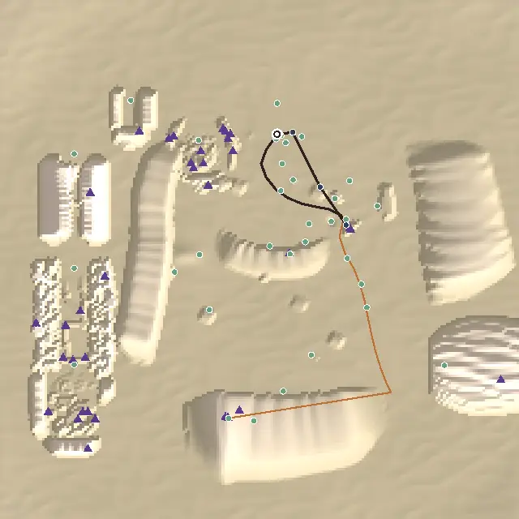
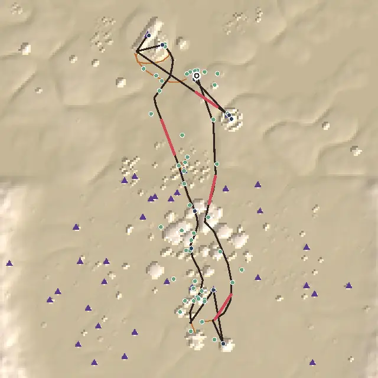
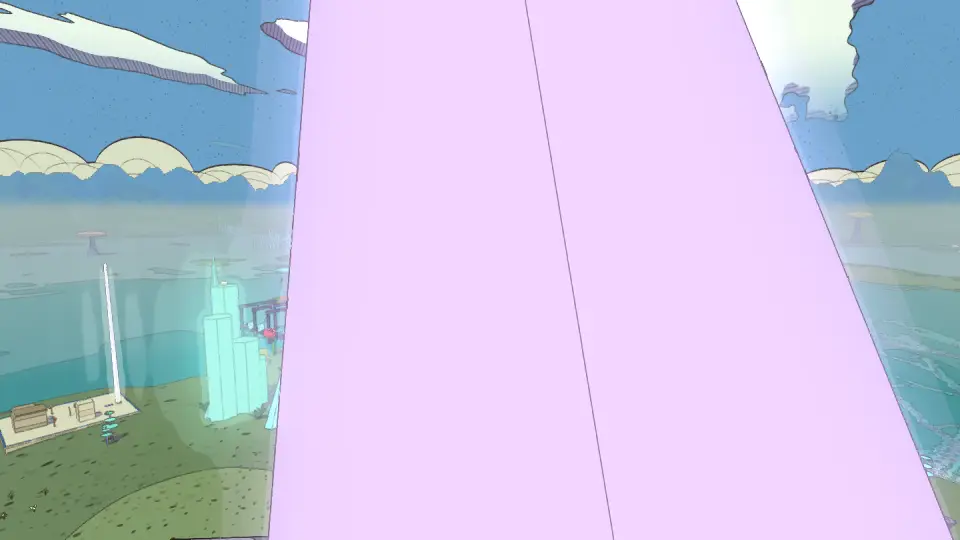
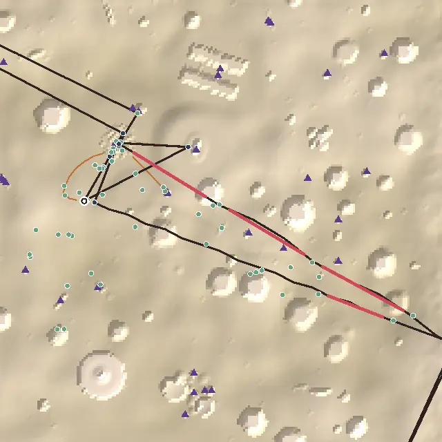

# Level design audit, v1.85 (2026-10-18)

<!-- audit-scores
overall: 4.68 / 5
label: the average of the twelve route worlds' means
date: 2026-10-18
-->

A re-run of the `level-design-qc` skill (`.claude/skills/level-design-qc/SKILL.md`) on main at v1.85, for issue #467 (the
full audit again, as #226 ran it at v1.66). No world was reworked for this report. It measures what landed since
[v1.66](level-design-v1.66.md): the Desert's Rose House before Qanat's gift (#278), the hints that say where (v1.79),
the benches at the views (v1.77), the Glass Dunes' new places built and relaid (#393, #426, v1.82), the makers' houses
rebuilt as great halls with their doors and steps moved (#336, v1.77–v1.83), the skiff afloat at Lorn's landing (#355)
and the space ports at every landing (#441, v1.84).

The skill and its rubric are as at v1.66, so the rows compare.

## The setup

- `node scripts/level-design/audit.mjs` at `8f01feae` (main, v1.85), the twelve route worlds, every one built as the
  play-through builds it.
- `node scripts/design-qc/capture.mjs` for the in-game views (one muted headless Chrome, port 5344): the Desert and Vael,
  then, after a network outage stopped the run, the worlds that moved (Lorn, the Glass Dunes) and three others (Viridel, the
  Garden, the Floating City). The other five worlds' views were not shot this round; their scores did not move.
- **Not checked:** climbs and glides off the path (the path is drawn straight between markers), how a leg reads in
  motion, and anything on a device. Nobody has walked the Glass Dunes' new west but the author.

## Scores

1-5 per criterion; the mean is the world's score. Vael and Lorn are scored with their parts. Before → after is v1.66 →
v1.85.

| World | Travel | Landmarks | Wayfinding | Density | Spacing | Loops | Optional pull | Verticality | Pacing | Onboarding | **Mean** |
|---|---|---|---|---|---|---|---|---|---|---|---|
| The Desert | bike | 4 | 4 | 5 | 5 | 3 → 5 | 4 | 4 | 3 → 4 | 3 | **3.89 → 4.22** |
| Vael | foot, wings, bird | 5 | 5 | 4 | 5 → 4 | 5 | 5 | 5 | 4 | 5 | **4.78 → 4.67** |
| Lorn | skiff | 5 | 5 → 4 | 5 | 5 | 5 | 4 | 5 | 4 | 5 | **4.78 → 4.67** |
| Viridel | foot | 5 | 5 | 5 | 5 | 5 | 5 | 5 | 5 | 5 | **5** |
| The Underwater City | foot | 5 | 5 | 5 | 5 | 5 | 4 | 5 | 4 | 5 | **4.78** |
| The City-Shaft | foot, jets, cab | 5 | 5 | 4 | 5 | 5 | 4 | 5 | 5 | 4 | **4.67** |
| The Glass Dunes | foot | 5 | 5 | 5 | 5 → 3 | 5 → 4 | 4 → 3 | 4 → 3 | 5 | 5 | **4.78 → 4.22** |
| The Buried Machine | foot, jets | 4 | 5 | 4 | 5 | 5 | 4 → 5 | 5 | 4 | 4 | **4.44 → 4.56** |
| The Moon Foundry | foot | 5 | 5 | 5 | 5 | 5 | 4 | 5 | 5 | 5 | **4.89** |
| The Garden of Spheres | foot | 5 | 5 | 5 | 5 | 5 | 4 | 5 | 5 | 5 | **4.89** |
| The City Floating in Space | foot | 5 | 5 | 5 | 5 | 5 | 4 | 5 | 5 | 4 | **4.78** |
| The Signal Market | foot | 4 | 5 | 5 | 5 | 5 | 4 | 5 | 5 | 5 | **4.78** |

No moves by eye.

**Average across the twelve worlds: 4.68 / 5** (v1.66: 4.71). The Desert rose with #278; the Glass Dunes fell with its
new places; Vael and Lorn lost a point each.

| World | v1.66 | v1.85 | Why |
|---|---|---|---|
| The Desert | 3.89 | 4.22 | **#278 landed:** the Rose House comes before Qanat's gift, so the walk from the house goes to the ship *and the gift* (483 m, one new place on it): loops 3 → 5. The run of "do" stops is six now, not eight (pacing 3 → 4). Onboarding 3 as before: the first goal is 212 m from the landing |
| Vael | 4.78 | 4.67 | Spacing 5 → 4: two loners, the makers' box 151 m from anything and the riders' halfway stone 189 m. The longest empty stretch is still 479 m on the bird (27 s) |
| Lorn | 4.78 | 4.67 | **Wayfinding 5 → 4 (73 % guided):** since the Hush-House was rebuilt and widened (d56726fdb, #336), the splinter → the cave's south mouth (389 m) and the light across the water → the temple (189 m) see neither their goal nor a landmark by it. The keepers' stake was moved with the door (a00612e5); the legs from the north were not |
| Viridel | 5 | 5 | Unchanged |
| The Underwater City | 4.78 | 4.78 | Unchanged |
| The City-Shaft | 4.67 | 4.67 | Unchanged |
| The Glass Dunes | 4.78 | 4.22 | **The new west is off every path.** The folded ravine, the prism crossings and the pearl city (#393, #426) are three loners 157 m apart and 280–435 m off the critical path (spacing 5 → 3, loops 5 → 4: three remote dead ends; pull 4 → 3: 12 of 33 optional places remote). The world's main quest is 437 m long, a minute's walk (ship, Halden, the glass mound, the Clock-House), and climbs 4 m (verticality 4 → 3). The west is one loop on the ground (`tests/glass-dunes-quarter.test.js`), but no quest, person or line sends you round it |
| The Buried Machine | 4.44 | 4.56 | Pull 4 → 5: ten places in the 30–150 m band, none remote |
| The Moon Foundry | 4.89 | 4.89 | Unchanged |
| The Garden of Spheres | 4.89 | 4.89 | Unchanged |
| The City Floating in Space | 4.78 | 4.78 | Unchanged |
| The Signal Market | 4.78 | 4.78 | Unchanged: three landmarks from the landing, 88 % of the path sees one (landmarks 4) |

**The two criteria judged by eye:**
- **Environmental storytelling** holds. The Glass Dunes' west is the strongest new piece of it: a pearl city in empty
  shells, a court dug into the sand, a ravine of folded glass, built from the hearted plates. It tells the trapped-time
  story better than anything on the world's main path, which is why its distance from that path matters.
- **The reveal.** The Desert's hollow → Hearth leg still hides its goal behind the dunes until the last rise. Lorn's
  rebuilt Hush-House is now hidden too long: from the splinter the leg is 389 m with the house behind the spires'
  island and the cave's mouth behind its own hill.

## Per world

### The Glass Dunes

*The critical path is the short dark loop by the landing ring; the orange line is the cairn's posts. The blocks at the
left are the new west: the village under the giants' cliff, the red cleft, the ravine, the prism crossings and the pearl
city. Nothing on the route goes there.*

The three worst findings:
1. **Three remote dead ends** (loops 4, pull 3): the half-buried court 279 m off the path, the prism crossings 345 m,
   the pearl city 435 m (`src/glass-dunes-west.js:189-201`, `sights`).
2. **The main quest is a minute long** (437 m, four stops), so the world's best country is optional and unsignposted.
3. **The west's loop is not a line the game knows:** the level gives the audit (and the player) only the float-posts and
   the cairn's posts (`lines`); the loop through the cleft, the ravine and the square has no posts, lamps or road named.

### Lorn

The three worst findings:
1. **The splinter → the crystal cave's south mouth, 389 m blind.** Neither the mouth nor a landmark by it is in sight
   from where the leg starts.
2. **The light across the water → the temple, 189 m blind,** and the cave's south mouth → the temple, 92 m blind, since the
   house was rebuilt (#336) and its island widened (`src/levels/perdide.js`, `hushVista`).
3. Pacing 4: a run of four "do" stops between the cave and the temple.

*The design QC's view down the 389 m leg from the splinter: the spires' crystal stands across it, and neither the cave's
mouth nor the Hush-House shows past it.*

### The Desert

The walk back is fixed (#278). What remains is by choice: the first goal 212 m from the landing (onboarding 3), two
blind legs (the giant's skull → the drain, 47 m; the roots → the tarp in the hollow, 263 m), and a run of six "do" stops.

### Elsewhere

- **Vael:** two loners, the makers' box (151 m from anything) and the riders' halfway stone (189 m).
- **The Signal Market:** three landmarks from the landing, and the landing's own street still hides the tower (as v1.66).
- **The Buried Machine:** 83 % of the path sees a landmark; the longest empty stretch is still 185 m (23 s).
- Optional pull is 4 in nine worlds: most optional places stand on the path rather than 30–150 m off it.

## The ranked edits

1. **The Glass Dunes: send someone round the west** (spacing 3 → 5, loops 4 → 5, pull 3 → 4; mean 4.22 → about 4.67).
   A reason to walk the loop the world already has: a person by the cleft's arch with an errand to the pearl city, or a
   step of the main quest moved into the square, and the loop given a line (`lines` in `src/levels/glass-dunes.js`:
   posts or lamps from the cleft to the pearl city's east stair). #475.
2. **Lorn: the Hush-House in sight again** (wayfinding 4 → 5; mean 4.67 → 4.78). A beacon over the rebuilt house
   (`beacons`: its crystal lit, tall enough to clear the spires' island) or the keepers' stakes carried on from the cave's
   south mouth. #476.
3. **Vael: the two loners** (spacing 4 → 5): move the makers' box nearer the riders' road, or put a person by the halfway
   stone. Small; in #476.
4. **The Desert's landing and the Signal Market's tower** (onboarding 3, landmarks 4): as at v1.66, by choice; not filed.

## Across worlds

- **New places land off the measured path.** Both falls are worlds where something was rebuilt or added beside the route
  (the Glass Dunes' west, Lorn's house) without its legs or lines being re-measured. A re-run of
  `scripts/level-design/audit.mjs --worlds <world>` after a world's rework would have shown both in a second.
- **No world has an empty walk back** (every return passes something new), for the first time since v1.20.

## Against the last report

[v1.66](level-design-v1.66.md) ended at 4.71. Its first ranked edit, the Desert's walk back (#278), landed and the Desert
rose 3.89 → 4.22, its best yet. Its second (a person on the 263 m blind leg) did not: the leg is still blind. The Signal
Market's tower is as it was. The two falls are new.
