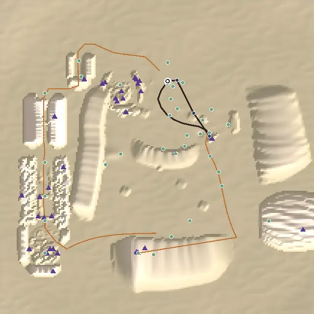
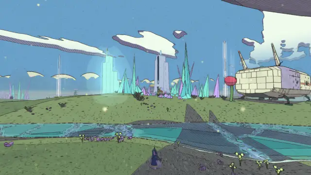
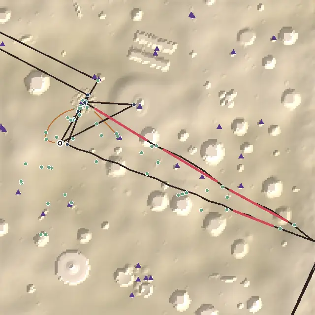

# Level design audit, v1.87 (2026-10-19)

<!-- audit-scores
overall: 4.73 / 5
label: the average of the twelve route worlds' means
date: 2026-10-19
-->

A re-run of the `level-design-qc` skill (`.claude/skills/level-design-qc/SKILL.md`) on main at v1.87 (`f12bba095`), for
issue #556, the design half of the full audit. It follows [v1.85](level-design-v1.85.md) by a day and two releases. What
landed for the worlds' layout since then: the Glass Dunes' west put on a path (#475: Fenna's errand and a row of
float-posts from the landing through the red cleft, the folded ravine and the pearl city, and home by the gap), Lorn's
rebuilt Hush-House given a lit crystal on its tower and the keepers' stakes along its shore (#476), Vael's scarf box
moved onto Tiv's stack in sight of the riders' halfway stone (#476), the courts' chests behind their puzzles' gates and
the little chests given locks (#518). No world was changed for this report.

The skill and its rubric are as at v1.85, so the rows compare.

## The setup

- `node scripts/level-design/audit.mjs` at `f12bba095`: the twelve route worlds, each built as the play-through builds it.
  The seven discarded side worlds are not measured.
- `node scripts/design-qc/capture.mjs` (one muted headless Chrome, port 5592) for the maps and three views of the worlds
  that moved: the Glass Dunes from above and from the landing looking west, Lorn from the fallen splinter toward the
  Hush-House.
- **Not checked:** climbs and glides off the path (the path is drawn straight between markers), how a leg reads in
  motion, anything on a device. Nobody but the author has walked the new west posts.

## Scores

1-5 per criterion; the mean is the world's score. Before → after is v1.85 → v1.87.

| World | Travel | Landmarks | Wayfinding | Density | Spacing | Loops | Optional pull | Verticality | Pacing | Onboarding | **Mean** |
|---|---|---|---|---|---|---|---|---|---|---|---|
| The Desert | bike | 4 | 4 | 5 | 5 | 5 | 4 | 4 | 4 | 3 | **4.22** |
| Vael | foot, wings, bird | 5 | 5 | 4 | 4 → 5 | 5 | 5 | 5 | 4 | 5 | **4.67 → 4.78** |
| Lorn | skiff | 5 | 4 → 5 | 5 | 5 | 5 | 4 | 5 | 4 | 5 | **4.67 → 4.78** |
| Viridel | foot | 5 | 5 | 5 | 5 | 5 | 5 | 5 | 5 | 5 | **5** |
| The Underwater City | foot | 5 | 5 | 5 | 5 | 5 | 4 | 5 | 4 | 5 | **4.78** |
| The City-Shaft | foot, jets, cab | 5 | 5 | 4 | 5 | 5 | 4 | 5 | 5 | 4 | **4.67** |
| The Glass Dunes | foot | 5 | 5 | 5 | 3 → 5 | 4 → 5 | 3 | 3 → 4 | 5 | 5 | **4.22 → 4.67** |
| The Buried Machine | foot, jets | 4 | 5 | 4 | 5 | 5 | 5 | 5 | 4 | 4 | **4.56** |
| The Moon Foundry | foot | 5 | 5 | 5 | 5 | 5 | 4 | 5 | 5 | 5 | **4.89** |
| The Garden of Spheres | foot | 5 | 5 | 5 | 5 | 5 | 4 | 5 | 5 | 5 | **4.89** |
| The City Floating in Space | foot | 5 | 5 | 5 | 5 | 5 | 4 | 5 | 5 | 4 | **4.78** |
| The Signal Market | foot | 4 | 5 | 5 | 5 | 5 | 4 | 5 | 5 | 5 | **4.78** |

No moves by eye.

**Average across the twelve worlds: 4.73 / 5** (v1.85: 4.68), the best since the audit began. All three worlds that fell at
v1.85 came back up; nothing fell.

| World | v1.85 | v1.87 | Why |
|---|---|---|---|
| The Desert | 4.22 | 4.22 | Unchanged. Onboarding 3 (the first goal 212 m from the landing, by choice); the roots → the tarp in the hollow still 263 m blind on the bike, the second ranked edit of v1.66 and v1.85 |
| Vael | 4.67 | 4.78 | **#476 landed:** the scarf box on Tiv's stack is no longer a loner. One loner left, the riders' halfway stone (189 m from anything), which the spacing anchor allows at 5 |
| Lorn | 4.67 | 4.78 | **#476 landed:** wayfinding 4 → 5 (100 % of the long legs guided). The splinter → the cave's south mouth (389 m) now sees "a landmark by it", the lit crystal on the Hush-House's tower; the mouth → the temple (92 m) and the temple → Hollin (586 m) ride the keepers' stakes |
| The Glass Dunes | 4.22 | 4.67 | **#475 landed:** spacing 3 → 5 (one loner, the half-buried court, 157 m), loops 4 → 5 (one remote dead end where there were three), verticality 3 → 4 (the pearl city's upper gallery and the prism crossings' high bridge are goals now: 96 m of height, 18 % raised). Optional pull stays 3: Fenna's errand is optional, so the west is still 220–490 m off the *main* path (14 of 35 optional places remote) |
| The rest | | | Unchanged to the hundredth |

**The two criteria judged by eye:**
- **Environmental storytelling** holds, and the Glass Dunes' west is now part of a walk: Fenna "who set the west posts"
  asks you to read the old city's clock from its high gallery (`src/story/glassdunes-people.js:24-45`), so the pearl city
  in empty shells, the folded ravine and the prism crossings are passed in order and their story is told by the way there.
- **The reveal.** Lorn's Hush-House is no longer hidden too long: from the fallen splinter the tower's lit crystal glows
  over the spires' island (picture below). The Desert's hollow → Hearth leg still hides its goal behind the dunes until
  the last rise, by design.

## Per world

### The Glass Dunes

*The float-posts' line (orange) now loops west from the landing (the ring, top right of the middle) through the red
cleft, down the folded ravine past the pearl city and home by the gap. The main quest is still the short dark loop by
the landing.*

What is left:
1. **The main quest is still a minute long** (437 m, four stops: the ship, Halden, the glass mound, the Clock-House's
   door). The world's best country is an errand, so optional pull stays 3. By the author's choice (#475 took the
   errand, not a main step in the west); not filed.
2. **The half-buried court** is the one remote dead end left: 279 m off the path, 157 m from anything, and not on Fenna's
   posts (`src/glass-dunes-west.js` `sights`). One post or a lamp toward it from the cleft would end it.

### Lorn

*The 389 m leg that was blind at v1.85: the tower's lit crystal (the pale glow left of the middle) is now in sight from
where it starts.*

Pacing 4 as before: a run of four "do" stops between the cave and the temple.

### The Desert

The weakest world, unchanged: the first goal 212 m from the landing (onboarding 3, by choice), four blind legs (the
roots → the tarp in the hollow 263 m, the giant's skull → the drain 47 m, and two short ones inside the Hearth), a run of
six "do" stops (pacing 4), 5 % of the places raised.

### Elsewhere

- **Vael:** the longest empty stretch is still 479 m on the bird (27 s); density 4.
- **The Signal Market:** three landmarks from the landing, the landing's own street hides the tower (landmarks 4), as
  at v1.66 and v1.85.
- **The Buried Machine:** 81 % of the path sees a landmark; the longest empty stretch 185 m (23 s).
- **Optional pull is 4 in eight worlds:** most optional places stand on the path rather than 30–150 m off it.

## The ranked edits

1. **The Desert: the roots → the tarp in the hollow, 263 m blind** (wayfinding 4 → 5; mean 4.22 → 4.33). Ranked second
   at v1.66 and v1.85 and never done; it is the first world, on the bike, on the main quest. A leading line (a row of
   salvagers' flags or tarp poles from the drinking roots to the hollow's lip) or a person on the rise who can see both.
   #561 (with 2).
2. **The Glass Dunes: the half-buried court on the posts** (the last remote dead end; loops stay 5, pull 3 → closer to
   4). A post or a lamp from the cleft toward the court. #561.
3. **The Desert's landing and the Signal Market's tower** (onboarding 3, landmarks 4): by choice; not filed.
4. **The Glass Dunes' main quest into the west** (pull 3 → 4): the author took the errand instead; not filed.

## Across worlds

- **The v1.85 lesson held:** both reworks re-ran the measure for their world (#475, #476) and closed what it showed.
- **No world has an empty walk back,** for the second audit running.
- **Optional places sit on the path** in eight worlds (pull 4): a pattern since v1.66, not a fault.

## Against the last report

[v1.85](level-design-v1.85.md) ended at 4.68 with three falls (the Glass Dunes, Lorn, Vael). Its edits 1–3 (#475, #476)
landed and each world's measure moved as predicted: the Glass Dunes 4.22 → 4.67 (the predicted "about 4.67"), Lorn and
Vael 4.67 → 4.78. Its fourth (the Desert's landing, the Market's tower) stays by choice. **4.73**, the best average yet.
