# Level design v1.90

<!-- audit-scores
overall: 4.73 / 5
label: the average of the twelve route worlds’ means
date: 2026-10-20
-->

Recommendations only for #598, frozen at **c5449ab6c**. All twelve worlds measured, their plans read and all prescribed views captured in the actual game ink renderer. Mean **4.73**, unchanged from v1.87. Lowest individual criteria remain Desert onboarding 3 and Glass Dunes optional pull 3. No subjective score uplift is applied.

The complete pass captured 64 prescribed level/temple views and 26 plans/maps, then 11 corrected views. All worlds confirmed construction mute and master gain 0; no page errors. Some generated cameras landed inside terrain or above interior roofs. Those frames are retained and explicitly invalidated in `VISUAL-REVIEW.md`; they are not gameplay defects. Source maps and corrected views support bounded conclusions, not a claim that every route was walked. Localisation, devices and changes after the frozen snapshot (including #599) are excluded.

| World | Travel | Landmarks | Wayfinding | Density | Spacing | Loops | Optional pull | Verticality | Pacing | Onboarding | **Mean** |
|---|---|---|---|---|---|---|---|---|---|---|---|
| The Desert | on the bike | 4 | 4 | 5 | 5 | 5 | 4 | 4 | 4 | 3 | **4.22** |
| Vael | running | 5 | 5 | 4 | 5 | 5 | 5 | 5 | 4 | 5 | **4.78** |
| Lorn | on the skiff | 5 | 5 | 5 | 5 | 5 | 4 | 5 | 4 | 5 | **4.78** |
| Viridel | running | 5 | 5 | 5 | 5 | 5 | 5 | 5 | 5 | 5 | **5.00** |
| The Underwater City | running | 5 | 5 | 5 | 5 | 5 | 4 | 5 | 4 | 5 | **4.78** |
| The City-Shaft | running | 5 | 5 | 4 | 5 | 5 | 4 | 5 | 5 | 4 | **4.67** |
| The Glass Dunes | running | 5 | 5 | 5 | 5 | 5 | 3 | 4 | 5 | 5 | **4.67** |
| The Buried Machine | running | 4 | 5 | 4 | 5 | 5 | 5 | 5 | 4 | 4 | **4.56** |
| The Moon Foundry | running | 5 | 5 | 5 | 5 | 5 | 4 | 5 | 5 | 5 | **4.89** |
| The Garden of Spheres | running | 5 | 5 | 5 | 5 | 5 | 4 | 5 | 5 | 5 | **4.89** |
| The City Floating in Space | running | 5 | 5 | 5 | 5 | 5 | 4 | 5 | 5 | 4 | **4.78** |
| The Signal Market | running | 4 | 5 | 5 | 5 | 5 | 4 | 5 | 5 | 5 | **4.78** |

## Previous findings and highest-value recommendations

1. **Desert return mast: partly fixed in experience, fixed as a missing-marker claim.** The 263 m roots→hollow leg now measures guided; source mast is present (`src/desert-sites.js:41–44`, `src/story/desert-bike.js:102–132`). Corrected roots/gate frames show the red rag. It is weakly salient from roots behind the arch, competing with smoke/flames, clearer at the gate. Preserve the return journey; improve silhouette separation only after a newcomer fails to recognise it. Expected score gain: no automatic change; onboarding 3 → 4 would require behavioural evidence.
2. **Glass Court invitation: partly fixed.** Existing jars/posts from [166,-127] to [231,-147] (`src/glass-dunes-ways.js:119–126,149–172`) now lead to a readable lamp-lined entrance. The overall optional distribution remains 15 remote of 36; optional 3 is unchanged. Retire the old claim that this approach has no invitation.
3. **First-contact directions before new geometry.** Ama’s mismatched question, Vey’s external scar, Vell’s fan and the Signal Market lamp are verified textual problems in otherwise navigable spaces. See dialogue report. These are cheaper and more definite than speculative landmark additions.
4. **Arrival usability qualification.** Dock framing is readable, but the surface deck/lift discovery and return were not physically played in this pass. Do not infer them from the 15 m Dock first-goal metric. Keep an explicit focused acceptance task.
5. **Outside-player observation remains the best next investment.** Agent screenshots identify possibilities; they do not measure first-time recognition. Start with the Desert roots and Glass fork rather than redesigning high-scoring worlds.

## Per world: measured weakness, visual judgement, bounded recommendation

Coordinates are game [x,y,z], straight audit segments rather than guaranteed walkable paths. Three findings per world follow; positive preservation decisions are intentional where the measures show no defect. Maps and evidence are named in the evidence index.

### The Desert — 4.22

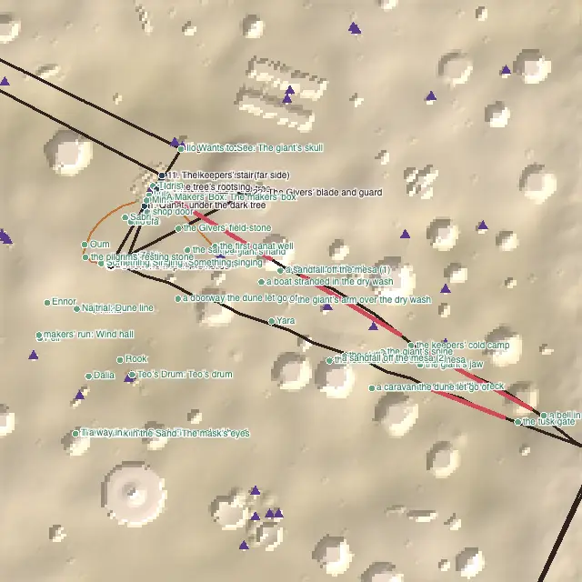

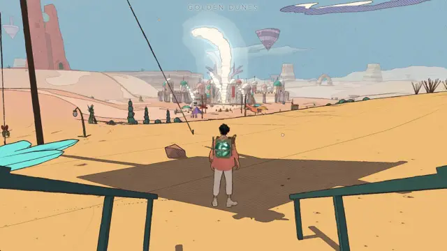

1. **Arrival and visual hierarchy:** The actual ramp arrival frames the city flame; the roots view contains the red rag but it is weakly salient against smoke. First goal 212 m; 4 places within 80 m.
2. **Worst measured stretch:** 377.2 m, 18.9 s under the audit’s travel assumptions, [1402, -18, -294]→[1072, -1, -115]. Keep the long journey. At the roots/gate sightline, separate the existing rag from the smoke silhouette rather than adding another marker. Test with a newcomer before raising onboarding 3.
3. **Pacing and optional exploration:** A six-action opening and first goal 212 m away remain the lowest onboarding result; the once-only Marrow call can compete with the already active city objective. 14 pulling / 52 optional; 2 returns, 0 empty returns.

Source: `src/levels/desert.js`; exact sites and path nodes are preserved in `level/report.json`. Pacing/onboarding judgement remains the measured score, qualified by the framing and interaction limits above.

### Vael — 4.78

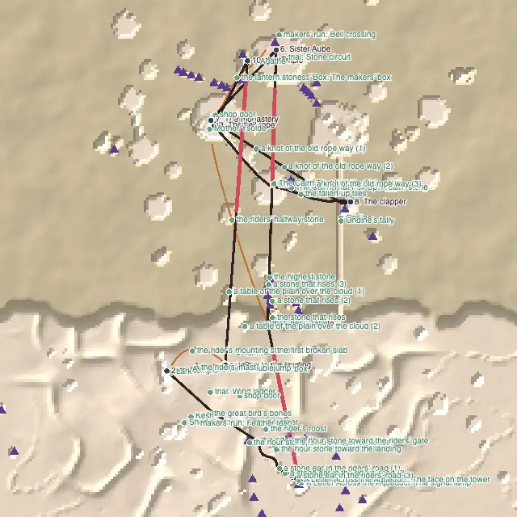

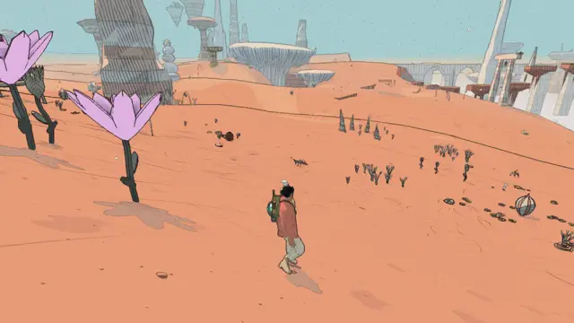

1. **Arrival and visual hierarchy:** Vertical cliffs and the distant tower give the route a clear destination; the generated column camera is too cramped to judge its landing. First goal 18 m; 3 places within 80 m.
2. **Worst measured stretch:** 478.6 m, 26.6 s under the audit’s travel assumptions, [-115, 40, -56]→[-150, 39, -533]. At the tower/bird convergence, check the early three-feather hand-in and show the call prerequisite if needed. Do not score that hypothesis as a softlock.
3. **Pacing and optional exploration:** Keep the long flight leg as contrast to tower interaction. Density 4 is compatible with aerial travel; avoid sprinkling arbitrary pickups through the sky. 20 pulling / 49 optional; 2 returns, 0 empty returns.

Source: `src/levels/arzach.js`; exact sites and path nodes are preserved in `level/report.json`. Pacing/onboarding judgement remains the measured score, qualified by the framing and interaction limits above.

### Lorn — 4.78

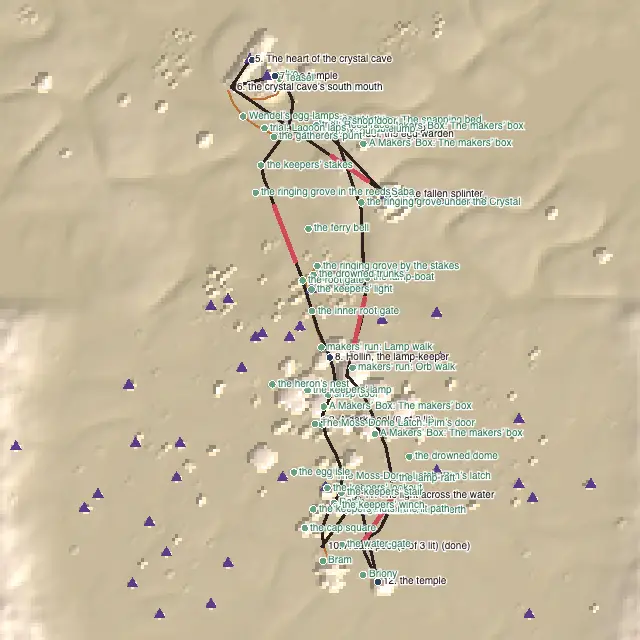

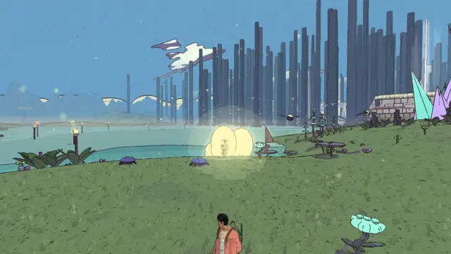

1. **Arrival and visual hierarchy:** The lake/settlement creates a coherent inhabited basin. The generated longest-gap camera was underwater, so it cannot prove a surface route is unreadable. First goal 16 m; 9 places within 80 m.
2. **Worst measured stretch:** 120.1 m, 14.6 s under the audit’s travel assumptions, [-120, -5, -160]→[-77, -2, -272]. Use the shore route between [-120,-5,-160] and [-77,-2,-272] for a newcomer check before adding signs.
3. **Pacing and optional exploration:** Optional pull 4 and pacing 4 are the relevant opportunities: keep short social encounters optional and place invitations at existing shore turns. 17 pulling / 50 optional; 1 returns, 0 empty returns.

Source: `src/levels/perdide.js`; exact sites and path nodes are preserved in `level/report.json`. Pacing/onboarding judgement remains the measured score, qualified by the framing and interaction limits above.

### Viridel — 5.00

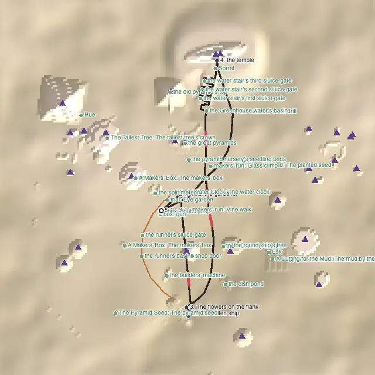

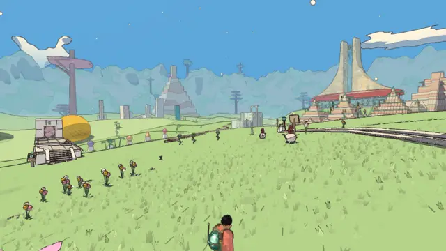

1. **Arrival and visual hierarchy:** Canals, crop rows and the greenhouse align the view and make the work of the place visible. First goal 51 m; 8 places within 80 m.
2. **Worst measured stretch:** 28.1 m, 3.4 s under the audit’s travel assumptions, [91, -1,131]→[90, -1,159]. Correct Vey’s post-opening directions to the external flank scar (story/edena.js: 61–109), preserving the greenhouse layout.
3. **Pacing and optional exploration:** All nine measured criteria remain 5. Do not invent a geometric defect to force a redesign; dialogue direction is the verified issue. 16 pulling / 36 optional; 1 returns, 0 empty returns.

Source: `src/levels/edena.js`; exact sites and path nodes are preserved in `level/report.json`. Pacing/onboarding judgement remains the measured score, qualified by the framing and interaction limits above.

### The Underwater City — 4.78

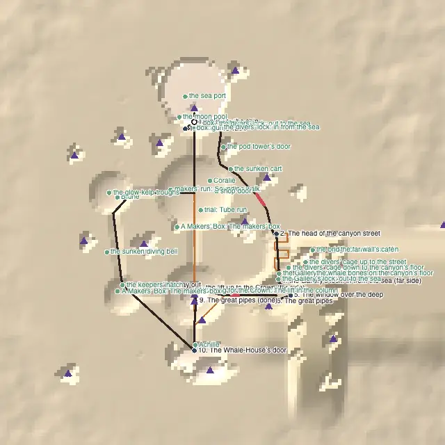

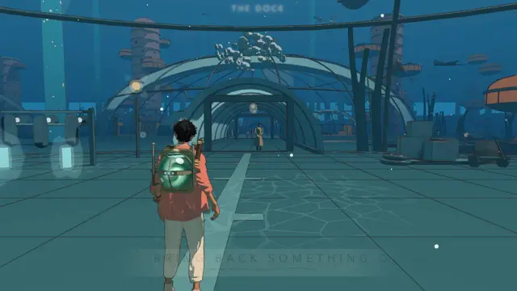

1. **Arrival and visual hierarchy:** The actual Dock arrival shows an inhabited tunnel route. It does not itself prove that a first visitor notices or understands the new surface-deck lift. First goal 15 m; 10 places within 80 m.
2. **Worst measured stretch:** 15.8 m, 1.9 s under the audit’s travel assumptions, [79, -1, 20]→[88, -1, 7]. Retain the Dock route; validate the surface lift entrance, moving state and return sign separately before claiming full arrival usability.
3. **Pacing and optional exploration:** Only 7 of 29 optional places pull from the route. Prefer one visible inhabited side passage over more objects on the already dense main street. 7 pulling / 29 optional; 1 returns, 0 empty returns.

Source: `src/levels/underwater.js`; exact sites and path nodes are preserved in `level/report.json`. Pacing/onboarding judgement remains the measured score, qualified by the framing and interaction limits above.

### The City-Shaft — 4.67

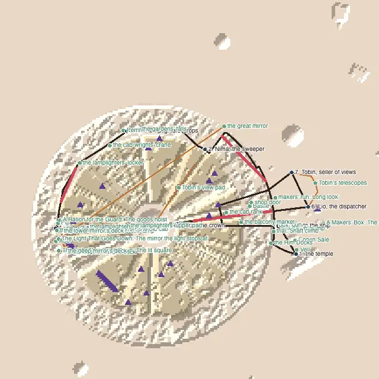

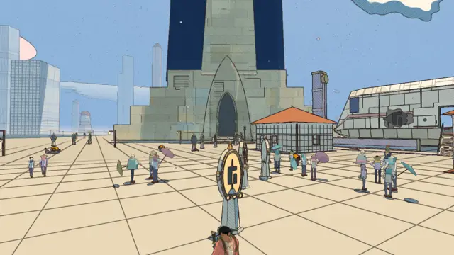

1. **Arrival and visual hierarchy:** The valid landing shows a paved plaza and temple threshold. The generated vertical gap camera falls under geometry and is not traversal evidence. First goal 72 m; 9 places within 80 m.
2. **Worst measured stretch:** 199.7 m, 24.4 s under the audit’s travel assumptions, [-137, -62, -3]→[-75,127, -2]. At the long rise [-137,-62,-3]→[-75,127,-2], judge lift/route continuity from walkable terraces, not a straight camera segment.
3. **Pacing and optional exploration:** Onboarding 4 and density 4 remain the weakest measures. Correct Vell’s obsolete jets instruction to the actual fan before adding further navigation systems. 12 pulling / 34 optional; 1 returns, 0 empty returns.

Source: `src/levels/incal.js`; exact sites and path nodes are preserved in `level/report.json`. Pacing/onboarding judgement remains the measured score, qualified by the framing and interaction limits above.

### The Glass Dunes — 4.67

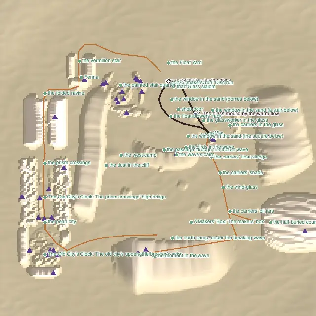

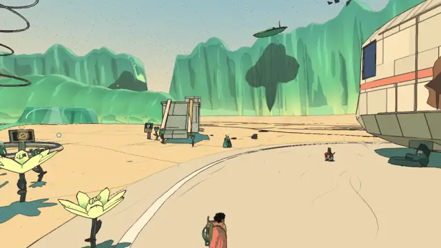

1. **Arrival and visual hierarchy:** Corrected fork and post views show the Court’s lamp trail and clear recessed entrance. This is a real improvement to the optional invitation. First goal 25 m; 8 places within 80 m.
2. **Worst measured stretch:** 0 m, 0 s under the audit’s travel assumptions, None→None. Preserve the Court’s deliberate separation. Make the existing jar/post fork the invitation; do not move the whole Court onto the four-stop main route.
3. **Pacing and optional exploration:** Optional pull stays 3: 15 of 36 optional places are beyond the pull band. A better single approach does not change that distribution or justify an automatic score uplift. 11 pulling / 36 optional; 1 returns, 0 empty returns.

Source: `src/levels/glassdunes.js`; exact sites and path nodes are preserved in `level/report.json`. Pacing/onboarding judgement remains the measured score, qualified by the framing and interaction limits above.

### The Buried Machine — 4.56

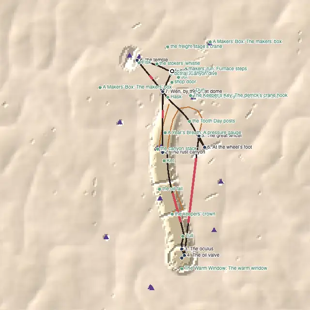

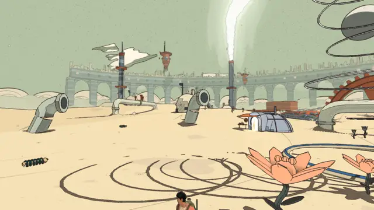

1. **Arrival and visual hierarchy:** The arrival’s machinery and aqueduct explain an industrial place. The longest-gap camera is inside a wall; its blank frame is invalid. First goal 65 m; 10 places within 80 m.
2. **Worst measured stretch:** 185.3 m, 22.6 s under the audit’s travel assumptions, [47, -20, -377]→[69, 4, -194]. Review the actual return along [47,-20,-377]→[69, 4,-194] before adding content. Use existing equipment as a focal point if the walk is indeed empty.
3. **Pacing and optional exploration:** Landmarks/density/pacing/onboarding 4 are modest weaknesses, not progression failure. Fix Fisk’s obsolete fixed-capacity instruction first. 10 pulling / 23 optional; 2 returns, 0 empty returns.

Source: `src/levels/buried.js`; exact sites and path nodes are preserved in `level/report.json`. Pacing/onboarding judgement remains the measured score, qualified by the framing and interaction limits above.

### The Moon Foundry — 4.89

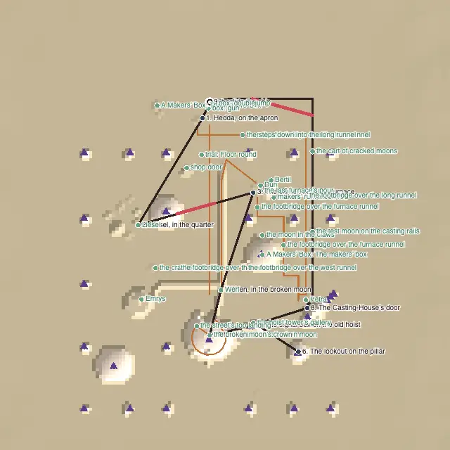

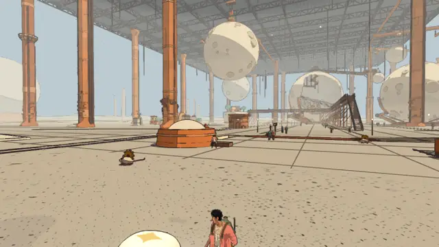

1. **Arrival and visual hierarchy:** Working hangar, cast forms and the return ship create a coherent destination. The overhead view crops the roof and should not support a wayfinding deduction. First goal 22 m; 7 places within 80 m.
2. **Worst measured stretch:** 93.2 m, 11.4 s under the audit’s travel assumptions, [125, 0, 78]→[52, 0, 98]. Preserve the short 93 m breathing space near [125, 0, 78]→[52, 0, 98]; clarify Petra’s “tongs” reply to match the magnet glove.
3. **Pacing and optional exploration:** Optional pull 4 is the only score below 5. Offer a distinctive side observation at an existing workbench rather than densifying the main aisle. 9 pulling / 29 optional; 1 returns, 0 empty returns.

Source: `src/levels/moonfoundry.js`; exact sites and path nodes are preserved in `level/report.json`. Pacing/onboarding judgement remains the measured score, qualified by the framing and interaction limits above.

### The Garden of Spheres — 4.89

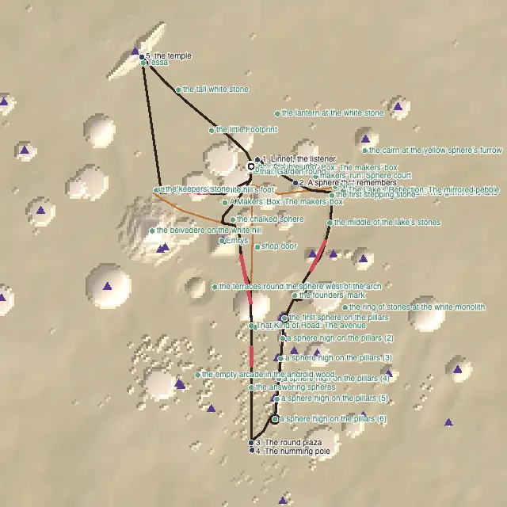

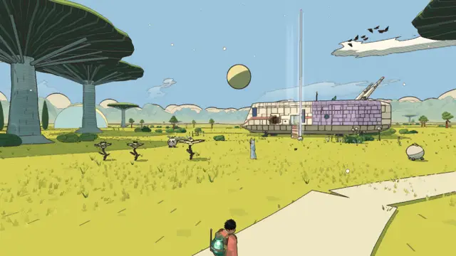

1. **Arrival and visual hierarchy:** Giant plants and curved furrows make distinctive landmarks; the Footprint descent gives vertical contrast to the meadow. First goal 20 m; 5 places within 80 m.
2. **Worst measured stretch:** 105 m, 12.8 s under the audit’s travel assumptions, [-1, 0, -296]→[-22, 0, -195]. Keep the north return near [-1, 0,-296]→[-22, 0,-195] open. Any added invitation should point toward an existing plant or hill, not an arbitrary collectible dot.
3. **Pacing and optional exploration:** Only 9 of 36 optional places pull off the route. The score 4 concerns invitation distribution, not a lack of places or a need for compulsory exploration. 9 pulling / 36 optional; 1 returns, 0 empty returns.

Source: `src/levels/spheres.js`; exact sites and path nodes are preserved in `level/report.json`. Pacing/onboarding judgement remains the measured score, qualified by the framing and interaction limits above.

### The City Floating in Space — 4.78

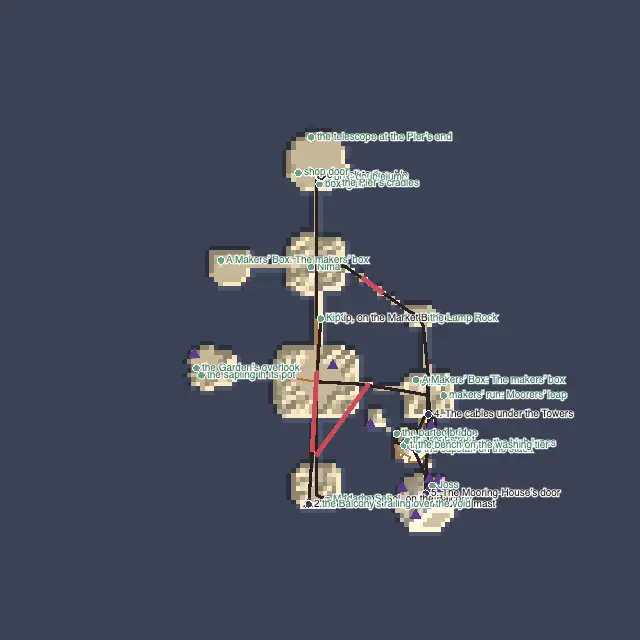

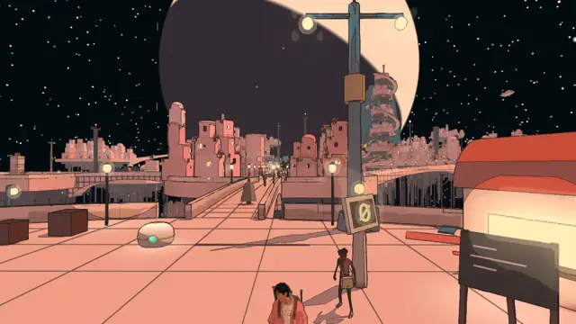

1. **Arrival and visual hierarchy:** Bridges, lamps and island silhouettes expose the route and its gaps. The first goal 126 m away remains a longer orientation demand. First goal 126 m; 6 places within 80 m.
2. **Worst measured stretch:** 109 m, 13.3 s under the audit’s travel assumptions, [0, 0, -136]→[45, 1, -75]. Correct local invitation wording at the Mooring-House gate, already fixed in Joss’s text, and retain the landmark sightline from the landing.
3. **Pacing and optional exploration:** Onboarding 4 and optional pull 4 are the useful tests: observe a newcomer choosing the first bridge before adding another pointer. 7 pulling / 24 optional; 1 returns, 0 empty returns.

Source: `src/levels/spacecity.js`; exact sites and path nodes are preserved in `level/report.json`. Pacing/onboarding judgement remains the measured score, qualified by the framing and interaction limits above.

### The Signal Market — 4.78

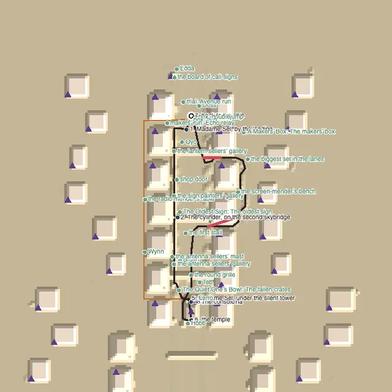

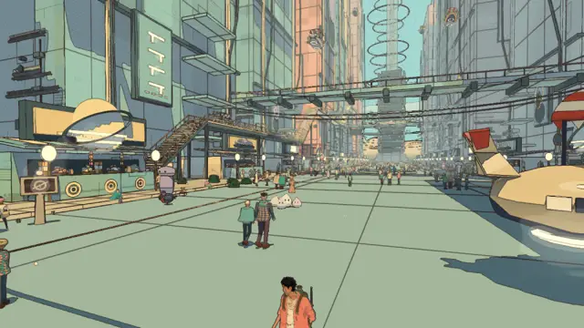

1. **Arrival and visual hierarchy:** The avenue and bridges read clearly as an inhabited market; upper views show routes through the haze. First goal 25 m; 9 places within 80 m.
2. **Worst measured stretch:** 64 m, 7.8 s under the audit’s travel assumptions, [30, -6, -105]→[83, 0, -88]. Correct the Signal Market lamp’s north/south wording in the merged arzach2 tower content, rather than adding another waypoint.
3. **Pacing and optional exploration:** Landmarks 4 and optional pull 4 reflect a dense corridor with only 6 of 26 optional places pulling off it. Preserve the night-mail diversion as a different activity, not another dialogue chain. 6 pulling / 26 optional; 1 returns, 0 empty returns.

Source: `src/levels/bazaar.js`; exact sites and path nodes are preserved in `level/report.json`. Pacing/onboarding judgement remains the measured score, qualified by the framing and interaction limits above.

## Across worlds and comparison

There is no common empty-return failure: the recorded returns lead past fresh content. Most optional opportunities sit on the main route; the recurring opportunity is a visible reason to take one existing side route, not increased object count. All nine per-world measured scores match v1.87. Repairs can be worthwhile without moving a coarse score: the Desert marker and Glass fork are examples. No confirmed regression is attributed to v1.90 merely because a new audit found an old issue.

## Corrected lowest-score views

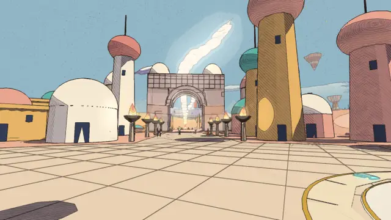

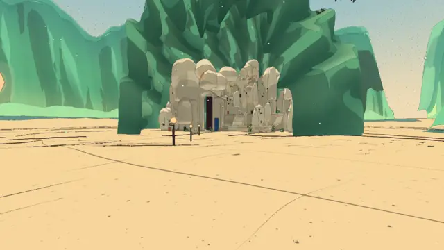

## Preserved audit evidence

Evidence was collected on 2026-10-20 at frozen commit `c5449ab6c`; this final report was consolidated on 2026-10-21 without rerunning the audit. [Evidence inventory and limitations](design-v1.90/README.md) preserve the raw measurements, classified flags, source reading and bounded live-path record. [Prioritized design recommendations](design-v1.90/recommendations.md) separate quality criteria from lock-level obviousness heuristics. Later ship changes and any separately collected device results are outside this report’s scores.
