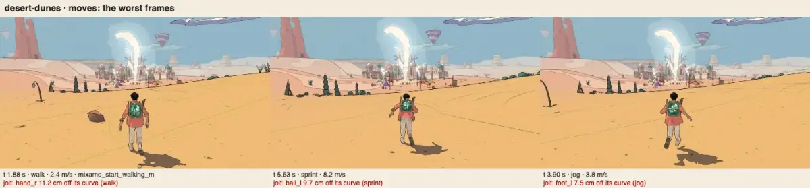

# The traveller's motion, v1.87 (2026-10-20)

<!-- audit-scores
overall: none
headline: 16 of 16 node scenarios green in the default way (v1.66: 4 of 15); in the game the Signal Market green, the Arena red by 0.7 cm on one boundary, the desert red in two runs whose frames came unevenly (the desert's first seconds, #553's water); matching 1 of 16, as before
date: 2026-10-20
-->

The motion QC (`.claude/skills/motion-qc/SKILL.md`) on main at v1.87, for issue #556: the traveller driven by scripted
hands in node on the gait harness's course (16 scenarios) and in three worlds in muted headless Chrome, in the default way
(`moves`: the loops with the captured starts, stops and turns) and with motion matching (`mm`, `?mm=1`). Against
[v1.66](motion-v1.66.md), the last full report (v1.85's audit did not run it); #47's motion rounds landed between (closed by
the author on 2026-10-16), and #288 fixed v1.66's two findings.

## Setup

- main `3da6e2539` (v1.87), node 24 on the M4 Pro; the browser on the GPU (ANGLE Metal), 1280 × 720, a fresh boot per
  world and way, the camera held 3.6 m behind; the Mac shared (load 12-35).
- `node scripts/motion-qc/run.mjs <dir>` (both ways, ~40 s) and `node .claude/skills/motion-qc/run.mjs <dir>` (the desert's
  dunes, the Signal Market's street, the Arena's floor), the browser run twice (the first was UNSTEADY in the desert).
- Changed since v1.85 near the motion: #551 (v1.87: a talk's gestures and the air's pose never left holding him, and the F8
  pose report), #541 (a ragdoll's momentum), #523 (the wings' glide).

## Node, the default way (moves), v1.66 → v1.87

| scenario · way | verdict | slide p95 (cm) | slide max (cm) | held (cm) | pops /min | jolts /min | boundary (cm) |
|---|---|---|---|---|---|---|---|
| walk → run → 180° turn → stop | red → green | 7.1 → 3.7 | 7.3 → 3.7 | 1.6 → 0.8 | 13 → 1 | 11 → 1 | 11.7 → 2.8 |
| walk, 90° turn, stop | green → green | 4.3 → 0.8 | 4.3 → 0.8 | 0.7 → 0.8 | 0 → 0 | 0 → 0 | 1.3 → 1.2 |
| turn round on the spot | red → green | 9.4 → 3.9 | 9.4 → 3.9 | 1.0 → 0.1 | 3 → 0 | 2 → 0 | 6.3 → 1.7 |
| up the ramp, stand | red → green | 4.3 → 0.8 | 4.3 → 0.8 | 1.4 → 1.5 | 9 → 2 | 9 → 0 | 9.1 → 2.1 |
| stairs up, stand, down | red → green | 6.9 → 1.0 | 6.9 → 1.0 | 0.7 → 1.1 | 12 → 3 | 19 → 2 | 9.6 → 2.5 |
| slow walk (half stick), stop | red → green | 6.1 → 1.5 | 6.1 → 1.5 | 1.3 → 1.0 | 0 → 0 | 0 → 0 | 1.7 → 1.9 |
| jog, 45° and back, stop | green → green | 4.3 → 0.8 | 4.3 → 0.8 | 0.7 → 0.8 | 0 → 0 | 0 → 0 | 1.8 → 2.0 |
| stand still 6 s | green → green | 0.0 → 0.1 | 0.0 → 0.1 | 0.0 → 0.1 | 0 → 0 | 0 → 0 | 0.0 → 0.0 |
| gaits: walk → jog → sprint → jog → walk → stop | red → green | 6.8 → 3.5 | 7.2 → 3.7 | 1.6 → 1.7 | 10 → 0 | 7 → 0 | 1.7 → 1.0 |
| starts and stops, walk and run | red → green | 9.7 → 4.3 | 15.3 → 4.8 | 1.7 → 1.3 | 15 → 2 | 5 → 0 | 8.4 → 2.2 |
| setting off the other way (new since v1.66) | – → green | – → 5.3 | – → 7.3 | – → 1.3 | – → 3 | – → 0 | – → 2.4 |
| pivots standing: 90° each way, 180° | red → green | 14.0 → 5.5 | 14.0 → 5.5 | 2.7 → 0.4 | 5 → 1 | 4 → 0 | 6.2 → 1.5 |
| pivot 180° at a jog, and at a sprint | red → green | 8.5 → 3.8 | 13.7 → 4.4 | 2.3 → 1.0 | 21 → 1 | 16 → 0 | 7.9 → 2.4 |
| curve: the stick round a circle at a jog | green → green | 4.3 → 0.8 | 4.3 → 0.8 | 0.7 → 0.8 | 0 → 0 | 0 → 0 | 1.6 → 0.9 |
| down the ramp, stop on it | red → green | 7.0 → 2.2 | 7.0 → 2.2 | 0.6 → 1.3 | 13 → 2 | 9 → 1 | 6.3 → 2.4 |
| stairs at a run | red → green | 6.9 → 3.6 | 6.9 → 3.6 | 1.4 → 0.5 | 19 → 1 | 14 → 2 | 3.6 → 2.8 |

Red runs 11 of 15 → 0 of 16; mean slide p95 6.6 → 2.6 cm; mean pops 8.0 → 1.0 a minute; mean jolts 6.4 → 0.4 a minute;
the worst boundary 11.7 → 2.8 cm (limit 3). Start 0.05-0.18 s, stop 0.23-0.95 s, turn 0.13-0.18 s: all in their limits.
Matching (`mm`): red 14 of 15 → 15 of 16 (only standing still green), slide p95 to 20.6 cm, pops 1-11 and jolts 1-17 a
minute; the matcher 9-41 µs a frame on average (v1.66: 95), p95 23-140.

## In the game (the second run)

| world · way | verdict | slide p95 / max (cm) | held (cm) | pops /min | jolts /min | boundary (cm) | stop (s) | Animator µs |
|---|---|---|---|---|---|---|---|---|
| desert-dunes · moves | red → red (UNSTEADY: 152-177 frames over 22 ms) | 8.8 / 9.6 → 4.5 / 6.4 | 2.4 → 0.7 | 38 → 10 | 23 → 24 | 12.5 → 11.2 | 0.97 → 0.97 | 65 → 78 |
| desert-dunes · mm | red → red (UNSTEADY) | 13.0 / 84.6 → 4.9 / 5.2 | 3.2 → 5.3 | 43 → 10 | 45 → 17 | 11.8 → 11.0 | never → never | 106 → 124 |
| bazaar-street · moves | red → **green** | 7.1 / 22.2 → 5.0 / 7.1 | **5.8 → 1.3** | 22 → 0 | 18 → 1 | 10.5 → 2.3 | never → 0.98 | 77 → 84 |
| bazaar-street · mm | red → red | 12.3 / 22.2 → 8.2 / 11.2 | 7.7 → 2.7 | 29 → 8 | 28 → 15 | 11.0 → 6.3 | never → never | 110 → 139 |
| arena-floor · moves | red → red (boundary only) | 9.5 / 19.6 → 4.2 / 7.0 | 1.5 → 1.0 | 26 → 1 | 15 → 1 | 9.4 → 3.7 | never → 0.95 | 86 → 101 |
| arena-floor · mm | red → red | 29.6 / 78.9 → 5.6 / 71.7 | 1.9 → 2.7 | 31 → 4 | 35 → 11 | 10.5 → 5.4 | never → never | 140 → 133 |

The first run read the same (the desert 6 pops and 8 jolts a minute, the Arena's boundary 3.8 cm): the Arena's one red is
a ball 3.7-3.8 cm off its curve in the 180° pivot at a sprint (`mixamo_running_turn_180`), in both runs.

**The desert's red is the frame times, not the walk.** Both runs there came unevenly (152-177 frames over 22 ms, the
skill's UNSTEADY: "its pops and jolts measure the machine"), and only there: the Market and the Arena ran steady at the
same load. The desert's first ~10 s after a boot run at 30-37 ms a frame since #553 (the water's bed maps baked by
raycasts: perf-v1.87, "The regression"), the time the scripted hands walk him. Its jolts (a hand 11.2 cm, a ball 9.7 cm off
its curve at 1.9 s and 5.6 s) are the long frames' steps; the Market's street, in the same session, is green.
Not proven by a run with the baking off (the QC's TUNE can't switch it off): rerun after the perf fix.

## The v1.66 findings, one by one

| v1.66 | now | evidence |
|---|---|---|
| 1. a held foot slips 5.8 cm in the Signal Market's street (#288) | **fixed** | held 1.3 cm, the street green |
| 2. the stop never settles in the Market and the Arena (#288) | **fixed** | stop 0.98 and 0.95 s |
| 3. sprint pops, crossed feet in pivots (the loops' own) | **fixed** (#47) | node: 0-3 pops a minute in every scenario, crossed 0-1 %; the Arena's pivot at a sprint 1 pop a minute, one 3.7 cm boundary |
| 4. matching red everywhere | not fixed (by design) | 15 of 16 red; the default way is the loops with captured moves |

## Findings

| # | severity | where | measure | cause | fix |
|---|---|---|---|---|---|
| 1 | noticeable | the desert, the first seconds after a load | frames 30-37 ms, jolts 24 a minute in the motion QC's desert run | the water's bed maps (#553): perf-v1.87's regression | #564 |
| 2 | look | the Arena, a 180° pivot at a sprint | a ball 3.7-3.8 cm off its curve at the boundary (limit 3) | the captured turn's blend in at a sprint's speed | none filed: 0.8 cm over, once a run; rerun after the next locomotion change |

## Not checked

The City-Shaft (left out since v1.0: the script runs into railings), `--cpu 4`, the Unity port's animator (the same
Animator in the engines' VM; its frame pacing is the device's), #551's pose (its guards landed; the scenarios don't talk or fly).
