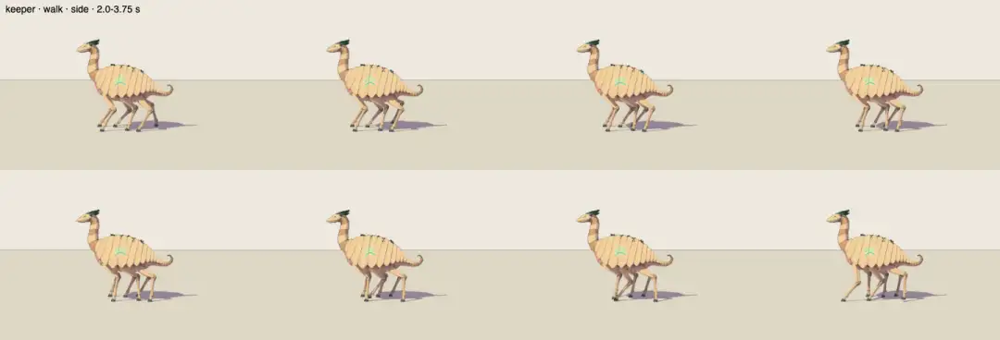
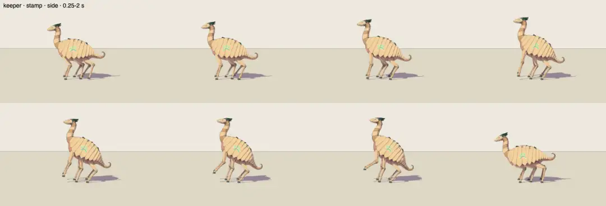
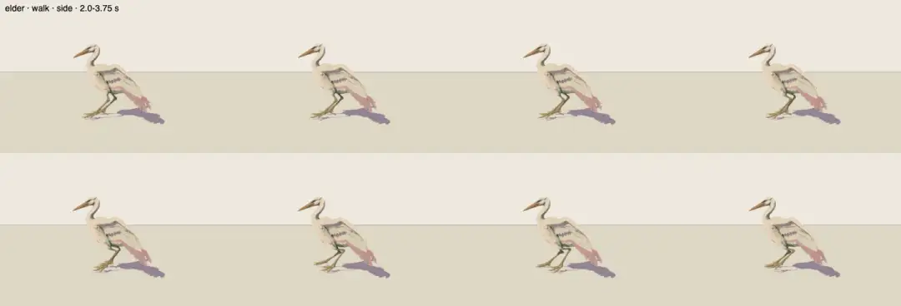
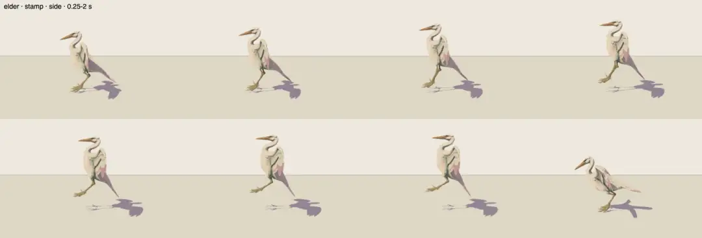
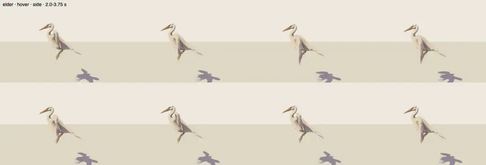

# Creature motion, v1.66 (2026-10-13)

<!-- audit-scores
overall: 4.06 / 5
label: the mean of 23 walkers on the rubric's eight 0-3 criteria, scaled to 5; two under 2 somewhere (the shade's cost, the Elder prototype's)
date: 2026-10-13
-->

The procedural-animation skill's review (`.claude/skills/procedural-animation/SKILL.md`) of every walker on the
locomotion kit, for issue #226, with the two generated guardians it was asked for: **the Cistern-Keeper on its Tripo skin**
(issue #267, the Rose House's guardian since v1.65) and **the Elder's Tripo prototype** (issue #237, still off the Aerie).
The first report of its kind; the numbers before are the kit's own tables in docs/systems/procedural-animation.md (§6,
phases 1-7, October 2026).

## Setup

- main `0949c08a` (v1.66), node 24 on the M4 Pro (load 7-50 over the session; every cost row is the least of five runs).
- `node scripts/motion-audit/run.mjs` (and `--pace=0.5`, `--pack`, `--cost`), `node scripts/motion-audit/cost.mjs`,
  the generated skins on their own bones (`'keeper (generated)'`, `'elder (generated)'`, joined to the audit by this
  report: below), and strips of each skin from its review page (`tools/keeper-review.html`, `tools/elder-review.html`:
  8 frames 1/4 s apart, muted headless Chrome). The roster's own strips are in `changelog-media/1.7` – `1.18`.
- Not done: the Arena's enemies viewer strips again (the roster's bodies are unchanged since they were made), the
  Retroid (no device).

## Scores (0-3 each; ship at 2 everywhere)

1 joints · 2 planting · 3 gait · 4 weight · 5 secondary · 6 anticipation and telegraph · 7 reads in ink · 8 cost.

| creature | 1 joints (0-3) | 2 planting (0-3) | 3 gait (0-3) | 4 weight (0-3) | 5 secondary (0-3) | 6 telegraph (0-3) | 7 ink (0-3) | 8 cost (0-3) | Mean (0-3) | Total, of 5 |
|---|---|---|---|---|---|---|---|---|---|---|
| salt crab (crab) | 3 | 3 | 3 | 2 | 2 | 3 | 2 | 2 | 2.50 | 4.17 |
| coin lizard (lizard) | 2 | 3 | 3 | 2 | 2 | 2 | 2 | 2 | 2.25 | 3.75 |
| shadow hound (hound) | 3 | 3 | 2 | 2 | 2 | 3 | 2 | 2 | 2.38 | 3.96 |
| inspection tripod (tripod) | 3 | 3 | 3 | 2 | 2 | 3 | 3 | 2 | 2.62 | 4.38 |
| centipede | 2 | 3 | 3 | 2 | 3 | 2 | 2 | 2 | 2.38 | 3.96 |
| bellows toad (toad) | 2 | 3 | 2 | 3 | 2 | 2 | 2 | 2 | 2.25 | 3.75 |
| heron | 3 | 3 | 2 | 2 | 2 | 2 | 2 | 2 | 2.25 | 3.75 |
| dune skitter (skitter) | 3 | 3 | 2 | 2 | 2 | 3 | 2 | 2 | 2.38 | 3.96 |
| rootknot | 2 | 3 | 2 | 2 | 2 | 2 | 2 | 2 | 2.12 | 3.54 |
| furnace brute (brute) | 2 | 3 | 2 | 3 | 2 | 3 | 3 | 2 | 2.50 | 4.17 |
| bell walker (bell) | 3 | 3 | 2 | 2 | 2 | 2 | 3 | 2 | 2.38 | 3.96 |
| shade | 2 | 3 | 2 | 2 | 3 | 2 | 2 | 1 | 2.12 | 3.54 |
| makers' machine (machine) | 2 | 3 | 2 | 2 | 2 | 3 | 3 | 2 | 2.38 | 3.96 |
| Cistern-Keeper (keeper) | 3 | 3 | 3 | 3 | 2 | 3 | 2 | 2 | 2.62 | 4.38 |
| Cistern-Keeper, Tripo skin (keeper-v1) | 3 | 3 | 3 | 3 | 2 | 3 | 2 | 2 | 2.62 | 4.38 |
| sentinel | 3 | 3 | 3 | 2 | 2 | 3 | 2 | 2 | 2.50 | 4.17 |
| Tooth-Warden (warden) | 3 | 3 | 3 | 2 | 2 | 3 | 2 | 2 | 2.50 | 4.17 |
| Clockwork Foreman (foreman) | 3 | 3 | 3 | 2 | 3 | 3 | 2 | 2 | 2.62 | 4.38 |
| Gardener | 3 | 3 | 3 | 3 | 3 | 3 | 2 | 2 | 2.75 | 4.58 |
| First Sign (sign) | 3 | 3 | 3 | 2 | 3 | 3 | 2 | 2 | 2.62 | 4.38 |
| Elder (elder) | 3 | 3 | 2 | 2 | 3 | 3 | 2 | 2 | 2.50 | 4.17 |
| Elder, Tripo prototype (elder-v1) | 3 | 3 | 3 | 2 | 3 | 2 | 2 | 1 | 2.38 | 3.96 |
| Moustache (moustache) | 3 | 3 | 3 | 2 | 2 | – | 2 | 2 | 2.43 | 4.05 |

Criteria means (0-3): joints 2.70, planting 3.00, gait 2.57, weight 2.22, secondary 2.30, telegraph 2.64, ink 2.17,
cost 1.91. How each was read: 1 from the reach span (a quarter of the leg or more and a knee bending over 40° at its
least: 3; 15-20 %: 2), 2 from slide a metre (every walker under 0.03 m/m: the kit's planting holds), 3 from the groups,
the cadence at half speed and the pack's unison, 4-6 from the plans and the strips, 7 from the stepped clock and the
silhouettes at 15 m, 8 from µs a leg near (≤ 1 on the Mac, with the tiers: 2).

## The measures (`run.mjs`, 4 s straight at each one's speed; guardians 10 s)

| subject | slide/m | worst (m) | reach % | lift % | steps/s full → half | knee (least) |
|---|---|---|---|---|---|---|
| Cistern-Keeper (procedural) | 0.00 | 0.00 | 23 % | 17 % | 0.50 → 0.30 | 84° (62°) |
| **Cistern-Keeper, Tripo skin** | 0.01 | 0.03 | 16 % | 8 % | 0.75 → 0.47 | 70° (46°) |
| Elder (procedural) | 0.00 | 0.00 | 22 % | 12 % | 0.45 → 0.25 | 58° (36°) |
| **Elder, Tripo prototype** | 0.02 | 0.05 | 27 % | 8 % | 0.80 → 0.45 | 74° (35°) |

The roster and the other guardians are where §6 left them (slide 0.00-0.02 m/m, the right groups, cadence halving at
half speed); full table: `node scripts/motion-audit/run.mjs`.

| the Keeper's Tripo skin walking | its stamp from the wind-up |
|---|---|
|  |  |

| the Elder prototype walking | its stamp | hovering |
|---|---|---|
|  |  |  |

## Findings, worst first

1. **The motion audit didn't see the generated skins** (the tool). `run.mjs` walked the old procedural Keeper and Elder
   only; the Tripo skins were measured in `tests/motion-guardians.test.js` alone. **Fixed**: `walk.mjs`
   `addGeneratedSkins()` (the GLBs parsed in node, joined to `GUARDIANS` as `keeper (generated)` and `elder (generated)`),
   `run.mjs` and the test share it.
2. **The Keeper's Tripo skin barely lifts its feet**: 8 % of the leg (the procedural body 17 %), and a reach span of
   16 % (23 %). Its plan steps one foot at a time at a walk (`independent`) with a step height of 0.08 of the leg: on a
   body 4.4 m tall the feet shuffle. In ink at 15 m the walk reads as a glide with the knees working. Suggested: the
   step height 0.12-0.14 and the reach 0.7 (src/characters/keeper-creature.js `plan.gait`), checked against the cistern's
   floor; issue #287.
3. **The Elder prototype has no cost or LOD accepted** (rubric 8 at 1): 48 176 triangles, a 2K texture (~21 MiB decoded),
   one draw; its animate() is 10 µs a frame in node (the procedural Elder 12.6), but nothing is measured on the Retroid
   and it has no lighter level. Already the open checklist of #237; nothing filed. Its walk passes every motion target
   (slide 0.02 m/m, knee 74°, one foot at a time, cadence halving), and the stamp's hop reads from the side.
4. **The shade's kit costs 1.3 µs a leg** near (10 of a kind; the roster's 0.4-1.07), over the rubric's 1 µs: its two
   legs ride a cloak chain solved each frame. The heron (1.07) and the lizard (1.03) sit on the line. The mixed scene
   (10 near, 30 far) is 92-95 µs a frame against Phase 7's 71 (the least of five both times; a busier machine now), the
   pack with the Keeper 41-46 against 35: within the 1 ms budget at ×4, but 30 % up; worth an A/B with v1.40 when the
   Mac is quiet. In issue #287.
5. **`run.mjs --cost` timed the JIT's warm-up**: the first kinds walked read 11-25 µs a leg (the crab, the lizard), 1.4
   after. **Fixed**: a throwaway walk of each kind first.
6. **A pack can fall in step by chance** (look): each foe's first stance comes from its seed (`GaitPlanner.init`), so two
   of a kind spawned one after the other can start at nearly the same phase; the heron walked as the fifth subject read
   0.96 unison, as the seventh 0.27. Suggested: spread the start by the golden ratio on the serial
   (`u = frac(seed × 0.618) + a little noise`) so neighbours are always out of step. In issue #287.
7. **Weight (4) and ink (7) are the roster's lowest criteria** (2.2): most bodies ride their feet on springs but only the
   toad, the brute, the Keeper and the Gardener dip and overshoot like their size; thin legs (the lizard's, the heron's,
   the skitter's) are a kernel or two at 30 m. Art direction rather than faults: no issue.

## What was fixed in this branch

- the generated skins in the audit (`scripts/motion-audit/walk.mjs`, `run.mjs`; `tests/motion-guardians.test.js` on it);
- the cost column's warm-up (`run.mjs`).

## Not checked

The fliers (Cloud-Mother, Lampless, Echo, Snapper: chains, measured in tests/motion-guardians.test.js, not walkers),
uneven ground (the audit walks flat), the Retroid, telegraph timing (combat-review's), the Elder prototype in its temple.
