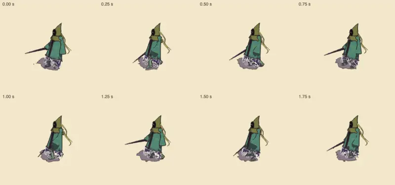
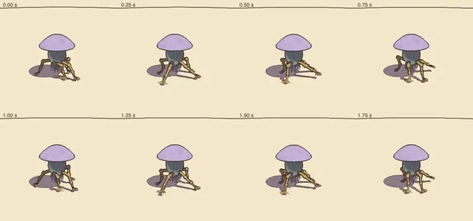
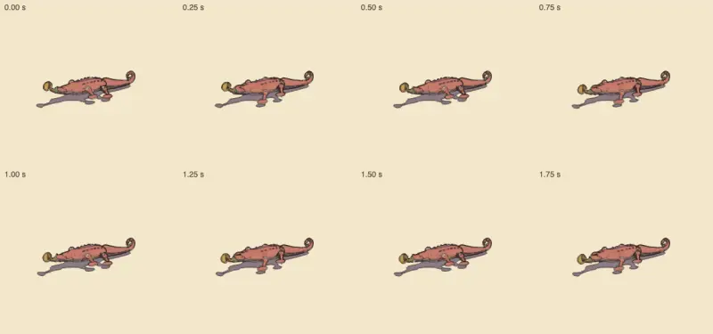

# Creature motion, v1.87 (2026-10-20)

<!-- audit-scores
overall: 4.07 / 5
label: the mean of 24 walkers on the rubric's eight 0-3 criteria, scaled to 5 (v1.66: 4.05); the Keeper's Tripo skin lifts its feet (8 → 23 %), the shade's cost back under 1 µs a leg (#287); two under 2 somewhere (the two Elder Tripo bodies' cost: the prototype off the game, the Aerie's unmeasured on a device)
date: 2026-10-20
-->

The procedural-animation skill's review (`.claude/skills/procedural-animation/SKILL.md`) of every walker on the
locomotion kit, for issue #556, against [v1.66](procedural-animation-v1.66.md) (the last full review; the motion audit
was not run at v1.85). The roster's thirteen archetypes, the old kinds, the guardians, the generated skins and the dog.

## Setup

- main `3da6e2539` (v1.87), node 24 on the M4 Pro, the Mac shared (load 12-35).
- `node scripts/motion-audit/run.mjs` (and `--pace=0.5`, `--pack`, `--cost`), `node scripts/motion-audit/cost.mjs` three
  times back to back with v1.85's tree (`git archive v1.85`, its own cost.mjs), and the motion strips of the five walkers
  v1.66 scored lowest on weight, ink or cost (`strips.mjs`: the shade, the rootknot, the lizard, the heron, the brute;
  muted headless Chrome, its own Vite on 5657).
- Changed since v1.66 in the kit's subjects: #287 (v1.71: packs out of step, the Keeper's Tripo skin's steps, the cost
  measured on a quieter Mac), #332 (v1.72: foes on a slope), #508 (v1.86: foes look at the traveller once they have
  noticed him, and where they are going before: src/enemies/gaze.js).

## Scores (0-3 each; ship at 2 everywhere)

1 joints · 2 planting · 3 gait · 4 weight · 5 secondary · 6 anticipation and telegraph · 7 reads in ink · 8 cost.

| creature | 1 joints (0-3) | 2 planting (0-3) | 3 gait (0-3) | 4 weight (0-3) | 5 secondary (0-3) | 6 telegraph (0-3) | 7 ink (0-3) | 8 cost (0-3) | Mean (0-3) | Total, of 5 |
|---|---|---|---|---|---|---|---|---|---|---|
| salt crab (crab) | 3 | 3 | 3 | 2 | 2 | 3 | 2 | 2 | 2.50 | 4.17 |
| coin lizard (lizard) | 2 | 3 | 3 | 2 | 2 | 2 | 2 | 2 | 2.25 | 3.75 |
| shadow hound (hound) | 3 | 3 | 2 | 2 | 2 | 3 | 2 | 2 | 2.38 | 3.96 |
| inspection tripod (tripod) | 3 | 3 | 3 | 2 | 2 | 3 | 3 | 2 | 2.62 | 4.38 |
| centipede | 2 | 3 | 3 | 2 | 3 | 2 | 2 | 2 | 2.38 | 3.96 |
| bellows toad (toad) | 2 | 3 | 2 | 3 | 2 | 2 | 2 | 2 | 2.25 | 3.75 |
| heron | 3 | 3 | 2 | 2 | 2 | 2 | 2 | 2 | 2.25 | 3.75 |
| dune skitter (skitter) | 3 | 3 | 2 | 2 | 2 | 3 | 2 | 2 | 2.38 | 3.96 |
| rootknot | 2 | 3 | 2 | 2 | 2 | 2 | 2 | 2 | 2.12 | 3.54 |
| furnace brute (brute) | 2 | 3 | 2 | 3 | 2 | 3 | 3 | 2 | 2.50 | 4.17 |
| bell walker (bell) | 3 | 3 | 2 | 2 | 2 | 2 | 3 | 2 | 2.38 | 3.96 |
| shade | 2 | 3 | 2 | 2 | 3 | 2 | 2 | 1 → 2 | 2.25 | 3.75 |
| makers' machine (machine) | 2 | 3 | 2 | 2 | 2 | 3 | 3 | 2 | 2.38 | 3.96 |
| Cistern-Keeper (keeper) | 3 | 3 | 3 | 3 | 2 | 3 | 2 | 2 | 2.62 | 4.38 |
| Cistern-Keeper, Tripo skin (keeper-v1) | 3 | 3 | 3 | 3 | 2 | 3 | 2 → 3 | 2 | 2.75 | 4.58 |
| sentinel | 3 | 3 | 3 | 2 | 2 | 3 | 2 | 2 | 2.50 | 4.17 |
| Tooth-Warden (warden) | 3 | 3 | 3 | 2 | 2 | 3 | 2 | 2 | 2.50 | 4.17 |
| Clockwork Foreman (foreman) | 3 | 3 | 3 | 2 | 3 | 3 | 2 | 2 | 2.62 | 4.38 |
| Gardener | 3 | 3 | 3 | 3 | 3 | 3 | 2 | 2 | 2.75 | 4.58 |
| First Sign (sign) | 3 | 3 | 3 | 2 | 3 | 3 | 2 | 2 | 2.62 | 4.38 |
| Elder (elder) | 3 | 3 | 2 | 2 | 3 | 3 | 2 | 2 | 2.50 | 4.17 |
| Elder, Tripo prototype (elder-v1) | 3 | 3 | 3 | 2 | 3 | 2 | 2 | 1 | 2.38 | 3.96 |
| Elder, its Tripo body in the Aerie (elder-v3) | 2 | 3 | 3 | 2 | 3 | 2 | 2 | 1 | 2.25 | 3.75 |
| Moustache (moustache) | 3 | 3 | 3 | 2 | 2 | – | 2 | 2 | 2.43 | 4.05 |

Criteria means (0-3): joints 2.67, planting 3.00, gait 2.58, weight 2.21, secondary 2.33, telegraph 2.61, ink 2.21
(2.17), cost 1.92 (1.88). Changed since v1.66: the Keeper's Tripo skin reads in ink (its feet lift 23 % of the leg, the
knees work: no more glide at 15 m); the shade's cost 1 → 2 (#287 found the review's 1.3 µs a leg was the
machine's load: 0.89-0.95 on a quiet Mac, every kind at or under 1). The Aerie's Elder's cost stays 1: nothing has
measured its body on the Retroid since. The Elder prototype (elder-v1) is not in the game since #300 (its model only in
`data/`, walked by the audit): its cost stays 1, unmeasured, and doesn't matter to a player.

## The measures (`run.mjs`, 4 s straight at each one's speed; guardians 10 s)

| subject | slide/m | worst (m) | reach % | lift % | steps/s full → half | knee (least) | v1.66 |
|---|---|---|---|---|---|---|---|
| the roster (13 kinds) | 0.00-0.02 | 0.00-0.04 | 15-53 % | 13-77 % | halving at half speed | – | the same |
| Cistern-Keeper (procedural) | 0.00 | 0.00 | 21 % | 17 % | 0.50 → 0.35 | 85° (64°) | 23 %, 17 %, 84° |
| **Cistern-Keeper, Tripo skin** | 0.01 | 0.02 | **22 %** | **23 %** | 1.35 → 0.90 | 81° (55°) | 16 %, **8 %**, 70° |
| Elder (procedural) | 0.00 | 0.00 | 21 % | 12 % | 0.40 → 0.25 | 59° (39°) | the same |
| Elder, Tripo prototype | 0.02 | 0.04 | 27 % | 8 % | 0.80 → 0.45 | 75° (35°) | the same |
| **Elder, Tripo body in the Aerie (elder-v3)** | 0.02 | 0.05 | **15 %** | 8 % | 0.90 → 0.50 | 64° (39°) | **14 %**, 8 %, 64° |

**Packs** (`--pack`, the unison of a second of each kind beside it: 1 is in step): -0.40 to 0.37 for every kind (v1.66: up
to 0.96 by chance; #287's golden-ratio start). **Pace** (`--pace=0.5`): every kind's cadence falls with its speed (the
crab 2.75 → 1.50 steps a second, the hound 3.75 → 2.13); nothing on a clock.

**Cost** (`cost.mjs`, each row the least of five runs, three rounds of HEAD and v1.85 interleaved, the Mac at load 22-25
with other agents' Chrome and Unity): the shade 3.5-7.8 µs a leg at HEAD against 2.0-6.5 at v1.85, the mixed scene (10 near
+ 30 far) 429-616 µs a frame against 351-737, the pack with the Keeper 95-208 against 75-198. The rounds overlap: no
difference between the two trees can be read at this load, and every number is 3-8 times #287's quiet-machine table
(0.89-0.95 µs a leg, 59-68 µs mixed). #508's gaze (a foe's head and body aimed at the traveller) is new work a frame since
v1.85; it is inside the spread here. Re-measure on a quiet Mac (below).

| the shade walking (8 frames, 1/4 s apart) | the rootknot | the lizard |
|---|---|---|
|  |  |  |

Looked at: the shade's legs step under its cloak, the cloak swinging behind; the rootknot's five legs reach out and bend
with a visible knee; the lizard's legs are short and stay a kernel or two wide from the game's camera (its joints 2, as
v1.66 scored). The heron and the brute as v1.66 described them.

## The v1.66 findings, one by one

| v1.66 | now | evidence |
|---|---|---|
| 1. the motion audit didn't see the generated skins | **fixed** (in v1.66) | `keeper (generated)`, `elder (generated)`, `elder v3 (generated)` walked above |
| 2. the Keeper's Tripo skin barely lifts its feet (8 %, reach 16 %) | **fixed** (#287) | lift 23 %, reach 22 %, knee 81° |
| 3. the Elder prototype has no cost or LOD accepted | not fixed (moot) | not in the game since #300; its model only in `data/` |
| 4. the Aerie's Elder reaches little (14 %) | **partly fixed** | 15 %: at the kit's target, not over it; lift 8 % |
| 5. the shade's kit over 1 µs a leg | **fixed** (#287: the load) | 0.89-0.95 µs on a quiet Mac at v1.71; not re-measurable at this run's load |
| 6. `--cost` timed the JIT's warm-up | **fixed** (in v1.66) | a throwaway walk first |
| 7. a pack can fall in step by chance | **fixed** (#287) | unison ≤ 0.37 for every kind |
| 8. weight and ink the roster's lowest criteria | not fixed (art direction) | 2.21 and 2.21 |

## Findings

| # | severity | what | cause | fix |
|---|---|---|---|---|
| 1 | look | the Aerie's Elder's legs reach 15 % of their length, at the kit's line, and lift 8 % | the natural-wing body's plan (src/characters/elder-v3-creature.js) steps short | a longer step (reach 0.7 of the leg) if the Aerie's floor allows: not filed (a guardian that mostly flies) |
| 2 | look | the kit's cost could not be read at this load | other agents' Chrome and Unity at load 22-35 | `cost.mjs` against v1.85's tree on a quiet Mac, with #508's gaze on and off: #566 |

## Not checked

The fliers (the Cloud-Mother, the Lampless, the Echo, the Snapper: chains, held by tests/motion-guardians.test.js), uneven
ground beyond #332's slope tests, the Retroid, telegraph timing (combat-review's), the gaze's look in the running game
(#508's own checks), and the marsh wisp (Lorn II: a discarded side world).
