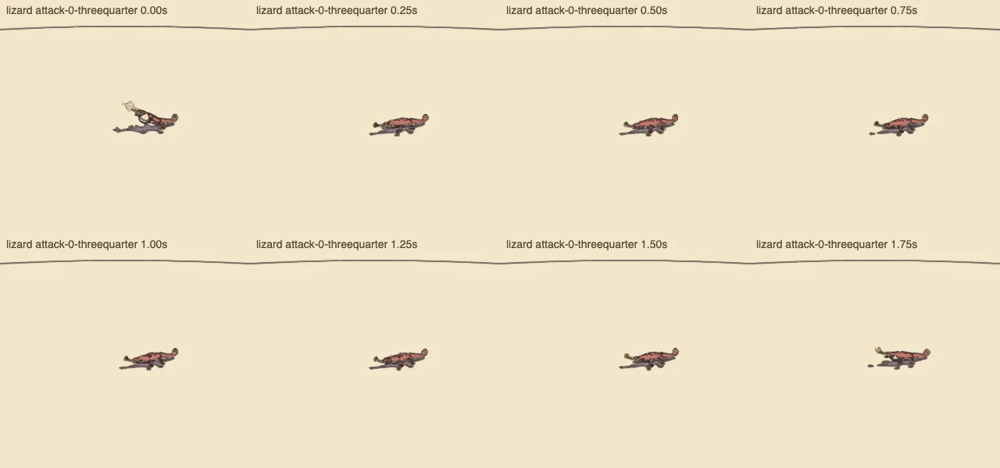
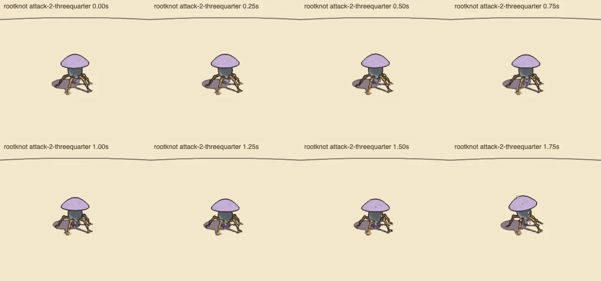

# Creature motion, v1.90 — audit

<!-- audit-scores
comparison: Separate 0–3 rubric; not comparable with earlier 1–5 scores
overall: none
headline: 2.00/3 across eight creature-motion criteria; separate 0–3 rubric, not comparable with the prior 1–5 mean
date: 2026-10-21
-->

Frozen source `c5449ab6c`. Fresh full/half/pack runs 25 subjects each; skins 73 subjects. All scripts exited 0, but this runner reports measures rather than a threshold verdict. Fresh actual ink review and eight-criterion judgments are recorded below. Three quiet cost repeats are complete below.

## Fresh straight-walk measures

| Subject | Slide/m | Worst slide m | Reach/leg | Lift/leg | Cadence full | Cadence half | Pack correlation |
|---|---|---|---|---|---|---|---|
| crab | 0.001 | 0.040 | 0.216 | 0.229 | 2.750 | 1.500 | -0.208 |
| lizard | 0.000 | 0.000 | 0.151 | 0.201 | 6.000 | 3.750 | 0.375 |
| hound | 0.007 | 0.017 | 0.273 | 0.202 | 3.750 | 2.125 | -0.239 |
| tripod | 0.001 | 0.013 | 0.222 | 0.170 | 1.917 | 0.917 | -0.275 |
| centipede | 0.000 | 0.000 | 0.371 | 0.419 | 8.750 | 4.375 | -0.397 |
| toad | 0.000 | 0.000 | 0.206 | 0.766 | 1.500 | 1.000 | -0.404 |
| heron | 0.006 | 0.026 | 0.306 | 0.128 | 0.625 | 0.375 | -0.245 |
| skitter | 0.000 | 0.000 | 0.532 | 0.198 | 6.000 | 3.250 | -0.250 |
| rootknot | 0.018 | 0.044 | 0.289 | 0.140 | 0.900 | 0.650 | -0.194 |
| brute | 0.002 | 0.022 | 0.212 | 0.139 | 1.375 | 0.750 | -0.228 |
| bell | 0.000 | 0.009 | 0.340 | 0.200 | 0.700 | 0.500 | -0.192 |
| shade | 0.008 | 0.017 | 0.185 | 0.128 | 2.500 | 1.500 | -0.315 |
| machine | 0.000 | 0.000 | 0.178 | 0.170 | 2.500 | 1.333 | -0.266 |
| keeper | 0.000 | 0.000 | 0.211 | 0.170 | 0.500 | 0.350 | — |
| sentinel | 0.000 | 0.000 | 0.321 | 0.150 | 0.600 | 0.333 | — |
| warden | 0.000 | 0.000 | 0.278 | 0.150 | 0.600 | 0.350 | — |
| foreman | 0.000 | 0.000 | 0.244 | 0.160 | 0.800 | 0.500 | — |
| gardener | 0.000 | 0.000 | 0.274 | 0.150 | 1.100 | 0.600 | — |
| sign | 0.000 | 0.000 | 0.312 | 0.150 | 0.633 | 0.367 | — |
| elder | 0.000 | 0.000 | 0.215 | 0.120 | 0.400 | 0.250 | — |
| keeper (generated) | 0.009 | 0.018 | 0.223 | 0.230 | 1.350 | 0.900 | — |
| elder (generated) | 0.016 | 0.040 | 0.270 | 0.080 | 0.800 | 0.450 | — |
| elder v3 (generated) | 0.022 | 0.048 | 0.146 | 0.080 | 0.900 | 0.500 | — |
| moustache | 0.010 | 0.026 | 0.289 | 0.170 | 2.625 | 1.438 | — |
| moustache-hurry | 0.002 | 0.021 | 0.277 | 0.167 | 5.938 | 3.500 | — |

The Aerie’s generated Elder still reaches 14.61% and lifts 7.99% of leg length. This confirms the old short-step observation numerically, without asserting it is a serious gameplay fault for a mostly flying guardian. Pack correlation is not measured for every generated guardian; dashes above are missing measures, not zero. Full raw datasets retained alongside this draft.

## Fresh visual assessment (0–3 skill rubric)

All five previously weaker subjects now have both side and three-quarter, eight-frame walk and every attack strips. All 42 strips were inspected, along with all 23 Arena silhouettes and 42 guardian phase views. The five optional guardian locomotion strips include the actual generated Elder. Raw evidence: `cua-qa/images/strip-*.png`, `guardian-*-phase-*.jpg`, `guardian-walk-*.png`; detailed notes in `cua-qa/visual-review.md`.

| Criterion | Grade (0–3) | Current evidence / limit |
|---|---:|---|
| Joint articulation | 2 | Multi-segment bends read on all five weak subjects; rootknot/brute overlap and low lizard proportions prevent a universal 3. No gross joint pop visible in sampled poses. |
| Foot planting | 2 | All measured straight-walk slide/m<.03 and worst contact<.05 m. Uneven ground and turning are source-supported but not fresh physical scene assertions, so no 3. |
| Gait | 3 | Full/half cadence responds to speed; pack offsets avoid unison (largest listed correlation 0.375); varied groups, planted stance and stop settling in gait.js:79–163. |
| Weight/body response | 2 | Visible tilt/recoil and feet-derived spring body in motion-kit/body.js:1–44; heavy brute reads, but a universal mass-dependent overshoot is not proven. |
| Secondary motion | 2 | Cap, sword arm, neck, cloak and tail follow-through visible; source spring/chain systems. Not claiming overlapping action equally strong on every body. |
| Anticipation/telegraph | 2 | Distinct raised arm, kick, lunge and sweep shapes plus held markers; rootknot's quieter third attack and lizard's low silhouette limit body-only separation. |
| Readability in ink | 2 | Fifteen-metre roster silhouettes and contact shadows clear; some small/dark parts and effects obscure feet at distance. 30 m detail not universally clear. |
| Cost | 1 | Aggregate Mac load small, but 7 per-leg medians exceed the rubric's strict 1 µs threshold. No Retroid creature-pack cost measurement. This is a rubric shortfall, not evidence of a game FPS regression. |

The eight current grades average 2.00/3. This is the skill’s 0–3 rubric, not the prior report’s 1–5 grading scale. The change in scale does not establish a numerical regression, so the audits page retains these as a plain table and headline rather than drawing a misleading historical score comparison. The numeric gait scope includes 25 bodies and 73 skins; the focused visual strips cover five weaker ordinary bodies, with the complete Arena roster and guardian phase coverage supplementing them. Generated guardian zero/null cost fields remain unmeasured. Highest-value refinement is more distinct low-body anticipation/contact readability, not a wholesale animation rewrite; timing threshold work is lower priority given the measured 0.347 ms whole-foe Mac scene cost.

## Fresh quiet cost

Three serial per-subject and mixed-scene repeats passed at load 3.55–4.04. Mixed 10 near + 30 far median kit cost 66.82 µs/frame (64.58–66.88), whole foe look 346.94 µs/frame. Directional culling: 58.14/327.32 µs. Full table and instrumentation limitations: creature-cost-summary.md. Generated guardian zero/null fields are unmeasured, not free. Retroid budget remains unchecked; no device score inferred from Mac numbers.

Browser provenance: the final ordinary-foe strips, Arena roster and guardian phase/hall images were captured in the internal Codex browser operated through CUA. Numeric gait and cost measurements were Node runs on the Mac, not browser or Retroid measurements.

## Inspected attack strips

The low lizard silhouette changes relatively little through this attack from the game camera. This supports a targeted readability refinement; the strip is not a human reaction-time test.

The root-knot’s third attack has quiet anticipation, with clearer cap movement late in the strip. These eight-frame samples supplement the complete roster and guardian review; they do not replace continuous play.
