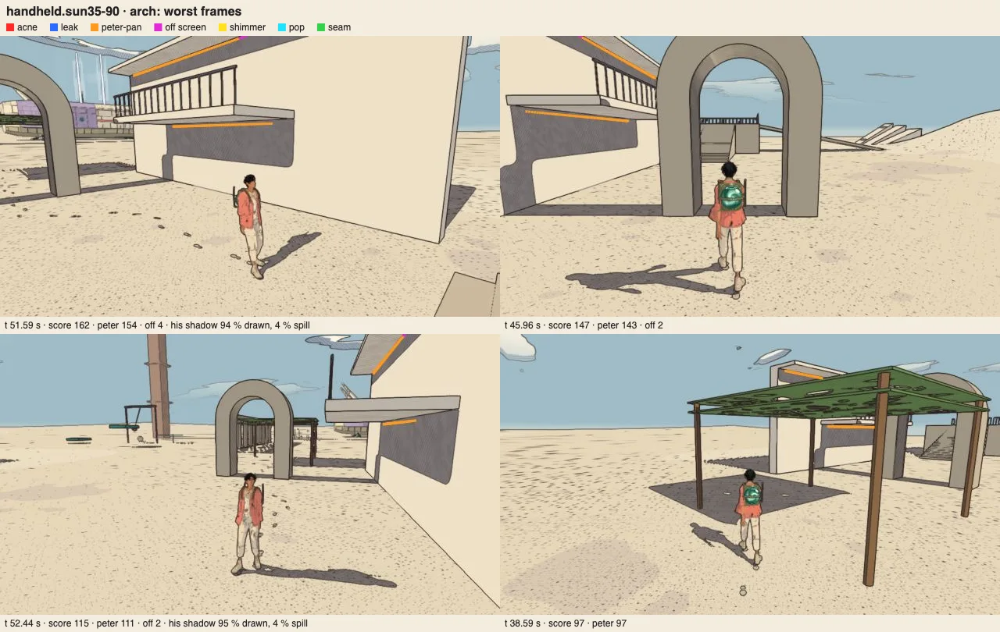
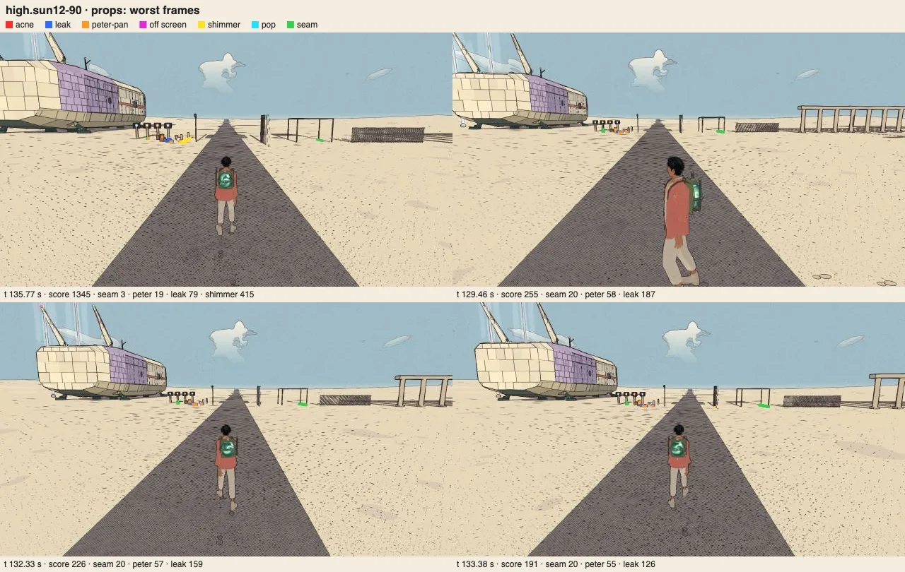
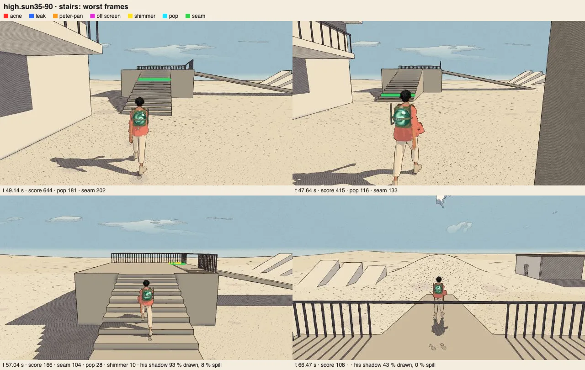

# Shadow quality audit, v1.90

<!-- audit-scores
overall: none
headline: Six Shadow Room runs and stationary checks inspected; walking threshold failures retained
label: completed diagnostic review; no numeric aggregate rubric
version: 1.90
date: 2026-10-21
-->

**Evidence review complete.** Frozen source `c5449ab6c` (v1.90); later v1.91 ship evidence is excluded. Recommendations only; no findings implemented. All six Shadow Room runs, both stationary contact diagnostics and the two-world noon/dusk supplement are captured and inspected. All 87 matched native pairs are also inspected, with coherent principal structural shadow directions and explicitly qualified moving-caster differences. Diagnostic counts are not converted into an overall numeric score.

## Setup and limitations

Visible CUA-started console on owned port 5484, one renderer at a time, sandbox progress and pre-import audio-output suppression. Deliberately audible saved preferences must be overridden at audio construction. Initial/final actual mute and gain, loaded settings and errors are recorded per task. Initial smoke and per-task initial/final mute verification passed; all six room runs completed without runtime errors.

## Findings, lowest criteria first

The lowest current criteria are low-sun enclosure leakage and stair-contact threshold failures. The Handheld 35° arch also retains visible pale lines under its balcony. The completed stationary diagnostic narrows stair severity: admitted samples reach 0 cm at 35° and 3 cm at 12°, without conspicuous detached feet; it does not erase walking threshold failures. Recommendations remain unimplemented by this audit.

## Required coverage

Six Shadow Room runs/60spots with ray truth and walking; gallery/Arena skitter idle/orbit final+debug5 comparison; studio/reference views; two actual-world checks.

No invented overall numeric aggregate. Room results cannot substitute for real-world or rigged-character shadow evidence.

## Comparison

Latest baseline: `docs/audits/shadow-v1.87.md`. The numerical and by-eye comparisons below retain gait and sampling limitations; no carried-forward score is presented as freshly measured.

## Completed evidence and scope

All prescribed web phases and all 87 matched native pairs have been inspected. Failed or superseded attempts remain excluded and preserved in the ignored evidence bundle. Frozen v1.90 scores are not updated using later v1.91/v1.92 repairs.

## Room results — complete, supplements inspected

The retained run-plan requested `--walk`; the adapter maps this to `run:false`. The original runner defaults to running unless `--walk` is supplied, and v1.87 reported running. Current failures are threshold failures, not established release regressions. Historical differences combine content and gait changes.

The room sweep has **48/60 green spots** (v1.87: 52/60, with the gait limitation below). All saved worst-frame sheets were inspected. No overall score is invented from these binary thresholds.

| Preset / sun | Green | Failed thresholds |
|---|---:|---|
| High / 35° | 8/10 | Poles seam 10.00%; stairs gap 12 cm |
| High / 12° | 7/10 | Props leak 13.06%, peter 17.93%, offset 3.34; arch leak 5.05%, peter 7.22%, seam 8.00%; stairs seam 8.88%, gap 33 cm |
| Deck / 35° | 9/10 | Stairs gap 9 cm |
| Deck / 12° | 8/10 | Props leak 3.57%, offset 2.36; stairs gap 48 cm |
| Handheld / 35° | 8/10 | Arch peter 23.46%, offset 5.33; stairs gap 7.5 cm |
| Handheld / 12° | 8/10 | Stairs offset 1.56, gap 24 cm; slopes leak 1.30% |

The Handheld 35° arch image retains the pale lines beneath the balcony seen in the v1.87 comparison. This is corroborated visually. The stair numbers are dynamic threshold candidates, not accepted evidence of a visibly floating stationary foot; the completed diagnostic below qualifies their interpretation. Root independently inspected the High stair sheet and agreed the pictured moving poses do not isolate that condition.

The contact metric only samples feet classified as planted (ball height minus midpoint floor<6cm), then compares drawn onset with ray-traced body-shadow onset. It does not require stationary contact; it permits negative signed heights and can sample a different tread under the midpoint than under the ball. The saved worst-frame ranking does not include gap magnitude, so those sheets are not max-gap proof. The separate High 35°/12° stationary diagnostic records both floor heights, signed heights, foot/player speed, original classification, true/drawn onset and max-gap images. Its completed results below qualify current severity without proving a version regression.

## Real-world by-eye supplement
Inspected original High frames from Desert camps and Edena crowd, each at noon 12 and dusk 18.5. The traveller’s shadow meets the feet in these views; nearby actor/plant shadows read coherently and dusk produces the expected elongated silhouettes. No conspicuous white seam or floating foot is evident at these four views. This satisfies the two-real-world by-eye supplement, not continuous-motion contact truth or full-world/device coverage. Evidence: `stills/desert/camps@12.png`, `camps@18.5.png`, `stills/edena/crowd@12.png`, `crowd@18.5.png`.

## Stationary contact diagnostic

Both High 35° and High 12° supplements completed without errors: eight stair/ramp positions, three stationary samples each (48 poses). Player speed was zero, and no signed-height sample was negative or cross-tread. The original planted-ball gate admits only the left foot at ramp top/middle: most settled idle balls are about 6.9–7.0 cm above their tread, exceeding its 6 cm gate. Among admitted samples the maximum gap is 0 cm at 35° and 3 cm at 12°; both saved max-gap pictures were inspected and show no conspicuous detached shadow.

This narrows severity but does not replace the original walking 12/33 cm threshold failures with a clean stair pass. The foot landmark/gait classification needs refinement before attributing every dynamic maximum to a visibly planted shoe. No renderer fix was made. Evidence: `retained-local-archive:cua-results/shadow-contact/`.

Archive identifiers beginning `retained-local-archive:` name preserved raw evidence in the coordinator’s local validation archive. They are provenance identifiers, not repository-relative paths or public download links. Compact accepted figures are included above.
