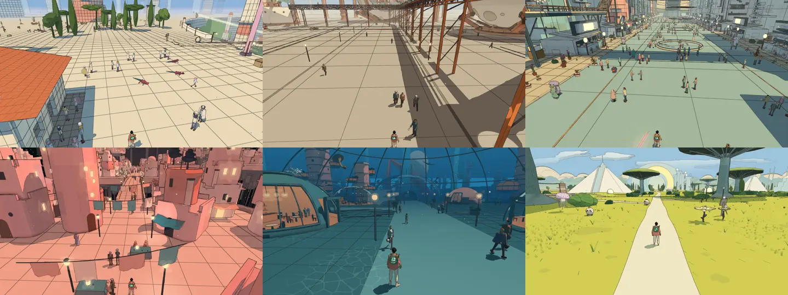
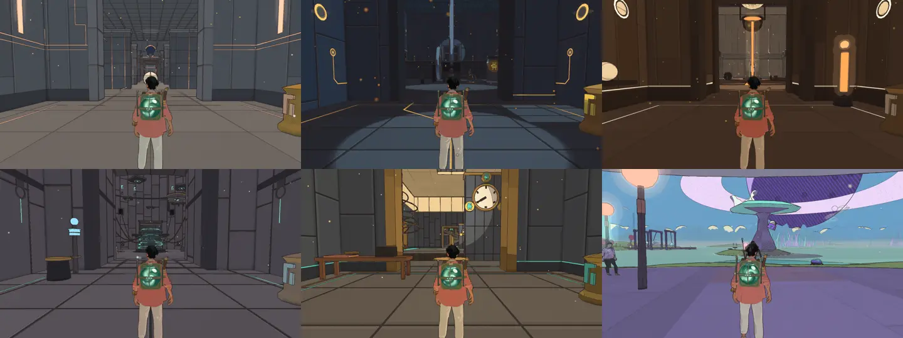
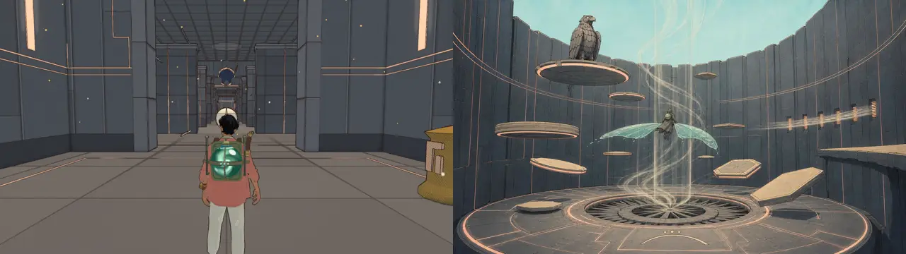
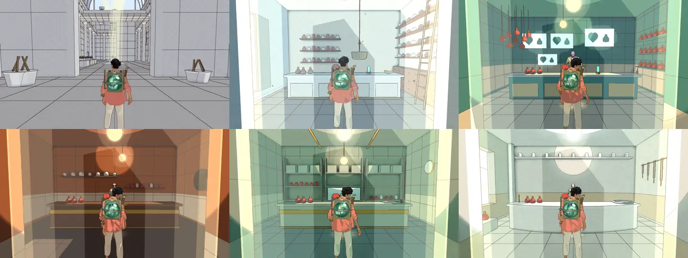
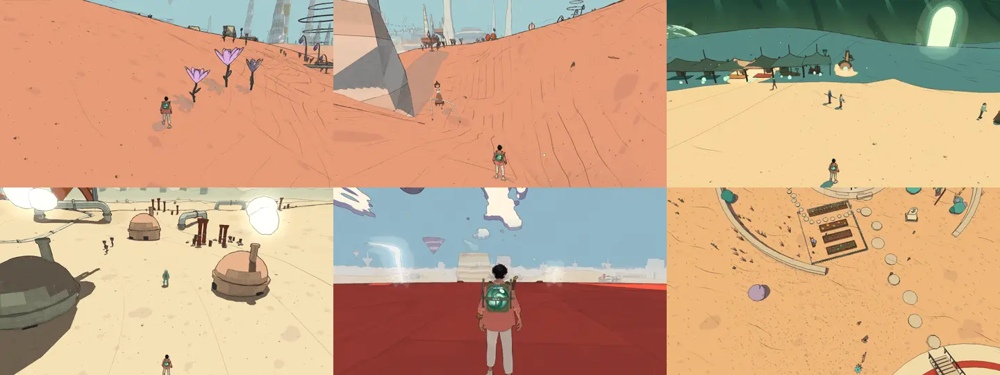
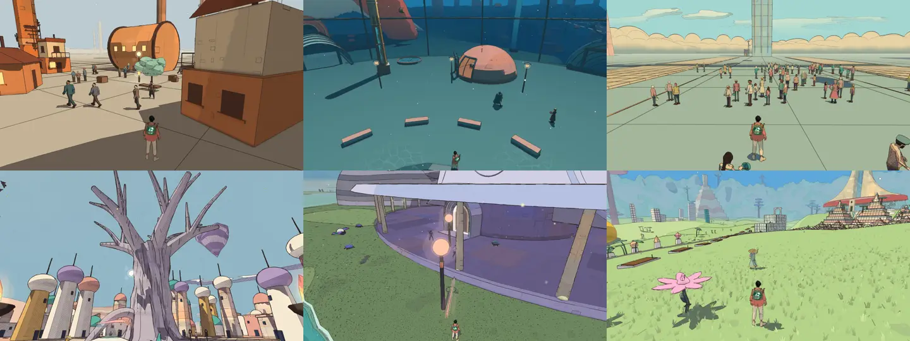

# Surfaces, v2.27 (2026-10-25)

<!-- audit-scores
overall: none
headline: the big flat surfaces underfoot and the makers' temple walls carry least: grid-only paving is 46–82 % of the measured surface in four cities; seven materials ranked for reference explorations
version: 2.27
date: 2026-10-25
-->

Issue #669: "Many surfaces need better procedural textures." This report is the first step: where the game's
surfaces are weak or untreated, measured and pictured, and the 5–8 representative materials to draw references for.
The references themselves are in the reference lab for the author's pick ([docs/design/surface-prompts.md](../design/surface-prompts.md)).
Nothing is implemented, and no direction is chosen here: that waits for the picks.

## How it was looked at

- **Pictures.** `.claude/skills/visual-audit/views.mjs` on revision `192353d4f` (v2.27): the 12 route worlds and
  home, the High preset, noon, 1280 × 720, muted headless Chrome on the real GPU, enemies off, the HUD hidden. Each
  world's three benchmark views plus the inside of its first four ways in (a temple, shops, rooms): 87 pictures, all
  looked at. The contact sheets below are 480 × 270 crops of them.
- **A census of the surface shader** (a scratch script, not committed): after each world boots, every visible mesh
  drawn with `makeMaterial`'s surface shader, its world area (sampled triangles × scale × instances), grouped by
  material, with the material's options (`userData.cacheKey`) and the `S_*` features it compiles (`surfaceDefines`).
  Each material is put in one class:
  - **treated**: at least one pattern feature: pen detail (`S_DETAIL`), weathering, colour patches, cracks, plates,
    the makers' glyphs, façades, tiles, leaves, form hatching, cloth folds, scrub, metal, the ground's ticks and sand ink;
  - **skin**: a temple's futuristic skin (`temple.skin.*`: its pattern is spliced in, `skins/skin-shader.js`);
  - **grid only**: a grid of lines (`S_GRID`, with or without strata colour bands) and nothing else;
  - **strata only**: colour bands (`MODE_STRATA`) and nothing else;
  - **plain**: one flat colour (or vertex colours) with the shader's shade and hatching only.

  Left out: the terrain (its own ground ink, `ground-ink.js`), water, glass, glow, fluids, grass, people, the makers'
  boxes, and the drawn-only far backdrops (the Buried Machine's city). Area is not screen share: a far plaza counts as
  much as the floor under the traveller. It says where untreated material is, not how much of a frame it fills.

## The census

Share of the measured surface area by class, per world (%, High, at boot):

| world | treated | skin | grid only | strata only | plain | the biggest untreated material |
|---|---|---|---|---|---|---|
| The Desert (`desert`) | 13.0 | 3.5 | 12.4 | 60.5 | 10.6 | the station domes' 6 m grid; the lavender and rose cliffs (strata + cracks, counted under strata) |
| Vael (`arzach`) | 77.7 | 4.9 | 0.3 | 13.6 | 3.6 | the plain's pale paving, strata bands only |
| Lorn (`perdide`) | 60.4 | 6.1 | 0.2 | 1.2 | 32.1 | black backs (×99), the Lamp-House and Hush-House walls |
| Viridel (`edena`) | 19.2 | 0 | 41.0 | 0 | 39.8 | the terraces' 14–16 m grid paving; the teal channels (×252) |
| The Underwater City (`underwater`) | 52.9 | 12.9 | 2.8 | 0.1 | 31.4 | the pink domes and street walls (`#f6c2b0`, plain) |
| The City-Shaft (`incal`) | 14.7 | 0.4 | **81.8** | 0.8 | 2.3 | the great plaza: one cream colour and a 3 m grid |
| The Glass Dunes (`glassdunes`) | 60.1 | 17.1 | 0.2 | 0 | 22.6 | the windows in the sand, the city under the sand (plain) |
| The Buried Machine (`buried`) | 58.6 | 26.3 | 0.6 | 0.5 | 13.9 | the Engine-House's walls |
| The Moon Foundry (`moonfoundry`) | 14.5 | 13.8 | 46.3 | 0.1 | 25.4 | the yard's 9 m concrete grid; the block houses (plain) |
| The Garden of Spheres (`spheres`) | 53.3 | 9.4 | 0.3 | 0.1 | 36.9 | the pale paths and plazas (`#f3efe2`, plain) |
| The City Floating in Space (`spacecity`) | 78.5 | 6.8 | 6.1 | 0 | 8.6 | the piers' 3 m and bridges' 1.6 m grids |
| The Signal Market (`bazaar`) | 25.1 | 1.4 | **71.1** | 0 | 2.5 | the old market's floor: one colour and a 10 m grid |
| Home (`home`) | 0.2 | 0 | 0.3 | 95.6 | 4.0 | the mesa ground, strata bands only |

What it says: the pen-detail and weathering work of October (`materials.md`, "Pen detail at every scale", "Weathered
walls", "Colour across a wall") reached the house fronts, Qanat, the Market's towers and the Buried Machine, but **the
floors of the cities never got any of it**: a plaza is a flat colour with a ruled grid. The temples' skins are the
next largest untreated family (13–26 % in four worlds): their pattern is panel lines and inlaid light, the panels
between are a flat tone.

## What the pictures show

### 1. Paving: a flat colour and a ruled grid

*The City-Shaft's plaza, the Moon Foundry's yard, the Signal Market's floor, the City Floating in Space's pier, the
Underwater City's street, the Garden of Spheres' path (noon, High).*

The largest surfaces in the game, and the ones under the camera most of the time (the follow camera looks down at
them). Every slab is the same tone, every joint the same ruled line, no wear, no breaks, no grit in the joints, no
slabs of another stone; the grid reads as graph paper, and its perspective shows its regularity. The reference sheets
of these cities draw flagstones in uneven courses, a few patched or a shade off, marks gathered where feet go.

### 2. The makers' temple walls: flat panels between the lines

*The Aerie (Vael), the Engine-House (Buried Machine), the Casting-House (Moon Foundry), the Mooring-House (City
Floating in Space), the Clock-House (Glass Dunes), the Lamp-House (Lorn).*

*Left: the Aerie's first hall in the game. Right: its picked sheet (`references/temples/future/aerie/sheet-1.jpg`), for comparison only.*

The skins have the sheets' layout (courses, inlaid lines, glyph bands), but each panel is one flat dark tone. The
sheet's walls are slabs at different depths, each its own tone, chamfered, with fine machining marks; its floor is cut
in rings and radial plates. In the game a hall's walls read as a flat backdrop, darkest where the room is largest.
They must stay futuristic ancient high tech (never organic: no moss, roots or rot).

### 3. The makers' temple floors

Same pictures. The floors are big square plates with one line between them and a lit pool; the sheets cut them in
rings round a centre, radial plates, inlaid borders and sockets. The camera sees more floor than wall in a temple.

### 4. Shop and room interiors: plaster and tile

*Viridel's grey hall, the City-Shaft's, Signal Market's, Moon Foundry's, Glass Dunes' and Garden of Spheres' shops.*

Every world has one, and they are the closest surfaces the player looks at square-on (the counter shot). Ruled tile
grids on walls and floors, one tone each, plaster as one flat colour. Viridel's grey hall is the plainest picture of
the audit.

### 5. Open ground in the middle distance

*Vael's slopes (two views), the Glass Dunes, the Buried Machine's sand, a desert deck (the red floor beyond one of the
desert's ways in), home from above.*

The terrain already has its own ink (ripple patches, wind lines, dots, fissures: `ground-ink.js`), and near the
traveller it holds up. Between about 20 m and the horizon, Vael's salmon and the dunes' sand turn into one flat field
with a few dashes; the picture measure flagged all three of Vael's views "mostly one colour". The desert deck is a flat
red plane with only hatching. Lower priority than 1–4: the ground ink is a real system to extend, not a gap.

### 6. Built walls without weathering: industrial blocks, domes, towers

*The Moon Foundry's block houses, the Underwater City's dome, the Signal Market's towers, Qanat (for comparison: it has
weathering, pen detail and patches), Lorn's terrace hall, Viridel's terraces.*

Where the October pen detail is on (Qanat), walls read drawn and lived in. The Moon Foundry's block houses, the
Underwater City's domes and street walls and Lorn's pale structures are plain: one colour per face, the outline and
the shade only. These are cheap to treat with what exists (`weathered`, `detail: 'built'`, `patches`), but an
industrial and an underwater material (rivets, rust, painted sheet, sea growth stains) have no reference yet.

### 7. Wood

Posts, planks, benches, stall frames (Lorn's posts and terrace columns, the Glass Dunes' stalls, the Underwater
City's benches, home's small house `#b07a48`, plain). Organic grain (`detail: 'organic'`) exists for trunks and
stalks, not for worked timber: no planks, knots, nail holes or flaking paint. Small surfaces, many of them, close to
the camera.

### What holds up

Qanat's weathered façades, the desert's strata cliffs with their cracks, the Garden's grass and umbrella trees with
form hatching, Lorn II's roots, the ship and the station hulls' plates, the City-Shaft's tower façades. These are the
benchmark the weak surfaces fall short of.

## The ranking: seven representative materials

Ranked by how much of the player's screen they fill and how far they are from their own reference sheets.

| rank | material (lab id) | where (examples) | today | why this rank |
|---|---|---|---|---|
| 1 | Paved plazas and streets (`paving`) | City-Shaft plaza, Signal Market floor, Moon Foundry yard, Viridel terraces, the piers in space, the Underwater street, the Garden's paths | one colour and a ruled grid (`S_GRID`); 46–82 % of the measured surface in four cities | the most screen time in the game, under the camera |
| 2 | Makers' temple walls (`temple-walls`) | all 13 temples | skin layout lines on a flat dark tone | far from their own sheets; the big rooms read empty |
| 3 | Makers' temple floors (`temple-floors`) | all 13 temples | square plates, one joint line | the camera looks down at them the whole visit |
| 4 | Shop and room interiors (`interiors`) | every world's shop, rooms, the Lantern's rooms | ruled tiles, flat plaster | close, square-on, in every world |
| 5 | Industrial and painted walls (`industrial-walls`) | Moon Foundry blocks, Underwater domes, the Market's grey towers, the Buried Machine's sheds | plain, one colour a face | existing pen detail fits; the material language is missing |
| 6 | Open ground at middle distance (`open-ground`) | Vael, the Glass Dunes, the Buried Machine, the desert decks, home | ground ink near, a flat field beyond ~20 m | a system exists; extend it rather than add one |
| 7 | Worked timber (`timber`) | posts, planks, stalls, benches, home | plain colour | small but many, close to the camera |

Not ranked: cloth (awnings, banners: `S_FOLDS` exists and they read), water edges (`water.md` already draws
foam and contact lines), foliage cards (the Garden and Lorn II were reworked in October). Glass and metal hulls hold up.

## Next

1. The author picks one reference per material (or turns a batch down with a reason) in the reference lab (see the
   prompts document: [docs/design/surface-prompts.md](../design/surface-prompts.md)).
2. Implementation, one material at a time, in the shared surface shader (one `S_*` define per new pattern, so a
   material without it pays nothing; `surfaceDefines`), mirrored in Unity's HLSL as the skins' patterns are
   (`skin-hlsl.mjs`), with before/after pictures from the running game and frame times on web (High, Handheld) and
   Unity (Steam Deck), as #669's acceptance asks.
3. Paving and the temple surfaces first: together they are most of what the camera sees in the cities and the temples.
