# Surfaces, v2.30 (2026-10-26)

<!-- audit-scores
overall: none
headline: where the player walks, 65–89 % of what he stands on and sees is now treated in four worlds; the City-Shaft's tier floors (34 % of its walk), Viridel's beds and kerbs, the Garden of Spheres' white stone and the Signal Market's cream decks are the big flat surfaces left; all but two need only code with a picked sheet
version: 2.30
date: 2026-10-26
-->

Issue #690. The author: "any level like Vael where we had flat colors as textures and we need to do a reference pass as
well?" The second census of the surface shader, after #669 (paving, the temples' machined finish, interiors, sheet
metal, timber, the ground's middle distance), #677 (sea walls, pale stone, the buried city, desert domes, water
channels, a stronger ground pass) and #685 (Vael's sky stones: rock tops, aqueducts). Lorn's crystals (#686) are on
another branch: counted as **pending**. Nothing is implemented here.

## How it was measured

`node scripts/surface-census/census.mjs <out-dir>` (new, committed; v2.27's census was a scratch script), on revision
`8fce9a980`, the High preset, noon, muted headless Chrome on the real GPU (`--mute-audio` and the game's own mute),
`?batch=0` so every still mesh keeps its own material.

- **Classes** (`scripts/surface-census/lib.mjs classify`, from each material's options, its cache key, and its compiled
  defines): **treated** (any pattern of its own, including every `S_*` since v2.27: `S_PAVING`, `S_INTERIOR`,
  `S_SHEET`, `S_TIMBER`, `S_GROUNDMID`, `S_SEAWALL`, `S_PALESTONE`, `S_BURIED`, `S_DOMES`, `S_CHANNEL`, `S_ROCKTOP`,
  `S_CRYSTAL`), **skin** (a temple skin with the machined finish), **skin-bare** (a skin without it: the Rose House,
  the Footprint's walls), **grid** (a ruled grid only, with or without colour bands), **bands** (strata colour bands
  only), **plain** (one colour or vertex colours), **pending** (Lorn's crystals). Left out of the shares, as v2.27 left
  them: the terrain (counted on its own in the walked table), water, glass, glow, people, grass; and now also Vael's sea
  of cloud, the makers' boxes, a temple door's black and the drawn-only far backdrops (the Buried Machine's city and
  ring, the Moon Foundry's far moons).
- **By area**: each material's world area at boot (v2.27's measure: where untreated material is).
- **Walked** (new): `scripts/surface-census/walk.mjs` builds each world in node as the play-through does, lays its
  critical path through the route's quests (the level design audit's `criticalPath`), samples it every 8 m, and adds
  every place stood at (the landing, the people, each quest stage's place, the doors, the inside of every way in, a
  temple's halls) with three times the weight and a ring of points round it. From each point the page casts a ray down
  (what he stands on) and a fan of 24 rays from his eye (8 headings × 3 pitches, to 80 m: what he sees). A surface's
  walked share is the mean of its share of the down rays and of the fan's. 23–1022 points a world (home 71).
- **Pictures**: per world, the four most walked untreated materials (then the largest), each from where its rays hit,
  the view on the left and the same view with that material painted magenta on the right (the view that shows the most
  of it, out of three). 13 contact sheets in [surfaces-v2.30/](surfaces-v2.30/), all looked at.

Limits: a path between two stops is a straight line (a leg over a gap is draped onto what lies under it, so Vael's
flight to the sky stones counts the cloud under it); a merged mesh counts under its merged material; area is not screen
share. Unity was not measured (the census reads the web game; the Unity port draws the same materials).

## The census

### By area (%, terrain and the left-out kinds excluded)

| world | treated | skin | skin-bare | grid | bands | plain | pending | v2.27 treated + skin |
|---|---|---|---|---|---|---|---|---|
| The Desert (`desert`) | 16.6 | 0 | 3.7 | 10.8 | 63.5 | 5.4 | 0 | 16.5 |
| Vael (`arzach`) | 78.9 | 6.0 | 0.5 | 0.2 | 12.6 | 1.7 | 0 | 82.6 |
| Lorn (`perdide`) | 70.0 | 12.8 | 0.2 | 0.1 | 1.4 | 4.1 | 11.4 | 66.5 |
| Viridel (`edena`) | 14.7 | 0 | 0 | 57.0 | 0 | 28.2 | 0 | 19.2 |
| The Underwater City (`underwater`) | 74.2 | 19.7 | 0 | 0 | 0 | 6.0 | 0 | 65.8 |
| The City-Shaft (`incal`) | 79.4 | 0.5 | 0 | 17.8 | 0.4 | 2.0 | 0 | 15.1 |
| The Glass Dunes (`glassdunes`) | 64.7 | 22.2 | 0.3 | 0 | 0 | 12.7 | 0 | 77.2 |
| The Buried Machine (`buried`) | 64.6 | 24.0 | 0 | 0.2 | 0.3 | 11.0 | 0 | 84.9 |
| The Moon Foundry (`moonfoundry`) | 34.8 | 21.8 | 2.2 | 18.1 | 0.1 | 23.0 | 0 | 28.3 |
| The Garden of Spheres (`spheres`) | 61.6 | 2.5 | 9.5 | 0.2 | 0.1 | 26.1 | 0 | 62.7 |
| The City Floating in Space (`spacecity`) | 80.0 | 9.8 | 0 | 0.5 | 0 | 9.6 | 0 | 85.3 |
| The Signal Market (`bazaar`) | 94.8 | 2.6 | 0 | 0 | 0 | 2.6 | 0 | 26.5 |
| Home (`home`) | 0.2 | 0 | 0 | 0 | 97.8 | 2.0 | 0 | 0.2 |

The big moves since v2.27 are the paved cities: the City-Shaft (15 → 80 %: its great plaza), the Signal Market
(27 → 97 %: its floor), the Underwater City (66 → 94 %: streets and sea walls), the Moon Foundry (28 → 57 %). The
desert's and home's area is their mesas and cliffs (bands with cracks, seen far off, not walked); Viridel's fell
(19 → 15 %) only because its far terrace pyramids (a 14–16 m grid, never walked) are most of its area; the Garden's
skin-bare is the Footprint's walls (its machined finish is on the floors only). Vael, the Glass Dunes, the Buried
Machine and the space city rose a few points (85–90 %). Area overstates what is far away: the walked table is the
one to read.

### Walked (%, every ray's hit, terrain and the rest included)

| world | treated + skin | skin-bare | grid | bands | plain | pending | terrain | water | other left out |
|---|---|---|---|---|---|---|---|---|---|
| The Desert | 9.3 | 5.0 | 1.6 | 1.0 | 11.1 | 0 | 71.0 | 0 | 1.2 |
| Vael | 44.6 | 0.2 | 0.8 | 9.7 | 7.6 | 0 | 29.7 | 0 | 9.0 (cloud 5.8) |
| Lorn | 16.4 | 0 | 0.7 | 0.9 | 5.6 | 4.4 | 24.6 | 44.2 | 4.0 |
| Viridel | 14.0 | 0 | 8.6 | 0.3 | **26.6** | 0 | 42.8 | 6.5 | 1.7 |
| The Underwater City | 64.7 | 0 | 0 | 0.6 | 12.7 | 0 | 15.8 | 1.9 | 5.1 |
| The City-Shaft | 45.9 | 0 | **42.8** | 0.4 | 9.8 | 0 | 0 | 0 | 1.4 |
| The Glass Dunes | 24.8 | 0.3 | 0 | 0.7 | 13.9 | 0 | 51.4 | 0 | 9.3 |
| The Buried Machine | 26.2 | 0 | 0 | 0.6 | 7.4 | 0 | 64.6 | 0 | 2.0 |
| The Moon Foundry | 72.0 | 0.3 | 7.3 | 0.6 | 7.5 | 0 | 10.1 | 0 | 2.3 |
| The Garden of Spheres | 35.5 | 0.5 | 1.1 | 0.2 | **22.7** | 0 | 37.0 | 1.9 | 1.8 |
| The City Floating in Space | 88.8 | 0.1 | 1.4 | 0.6 | 7.3 | 0 | 0 | 0 | 3.0 |
| The Signal Market | 76.9 | 0 | 0 | 0.4 | **18.2** | 0 | 0 | 0 | 4.8 |
| Home | 4.3 | 0 | 0 | 0 | **22.8** | 0 | 72.8 | 0 | 1.0 |

The terrain is treated everywhere it is walked (ground ink, and `S_GROUNDMID` in the worlds that have it). So where the
player actually goes, the flat share left is: **the City-Shaft 53 %** (one material: its tier floors), **Viridel 35 %**,
**the Garden 24 %**, **home 23 %**, **the Signal Market 18 %**, **the Glass Dunes 15 %**, the Underwater City 13 %,
the desert 19 % (the Rose House 5 % of it), Vael 18 % (half of it bands), the Moon Foundry 16 %, the Buried Machine 8 %, the
space city 9 %, Lorn 7 % (+ 4 % crystals pending).

## World by world: what is still flat

Each picture: the view, and the same with the material in magenta. Walked % is (under / seen) averaged.

### The Desert

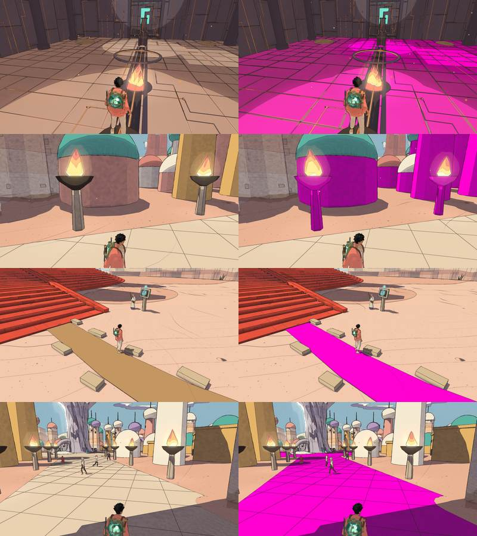

| material | class | walked % | what it is |
|---|---|---|---|
| `#b89e90` + `#5e5462` the Rose House's floors and walls | skin-bare | 5.0 | the first temple: its red stone has no machined finish (left out of #669 on purpose) |
| `#ffffff` Qanat's vertex-coloured houses and domes, the fallen giant | plain | 4.5 | the dome houses' painted bodies, the gold towers |
| `#c49a68` the Givers' dry channel | plain | 2.1 | a dry stone channel crossing the sand |
| `#e9d6bf` Qanat's square | grid | 1.5 | the avenue's 2.2 m grid paving |

### Vael

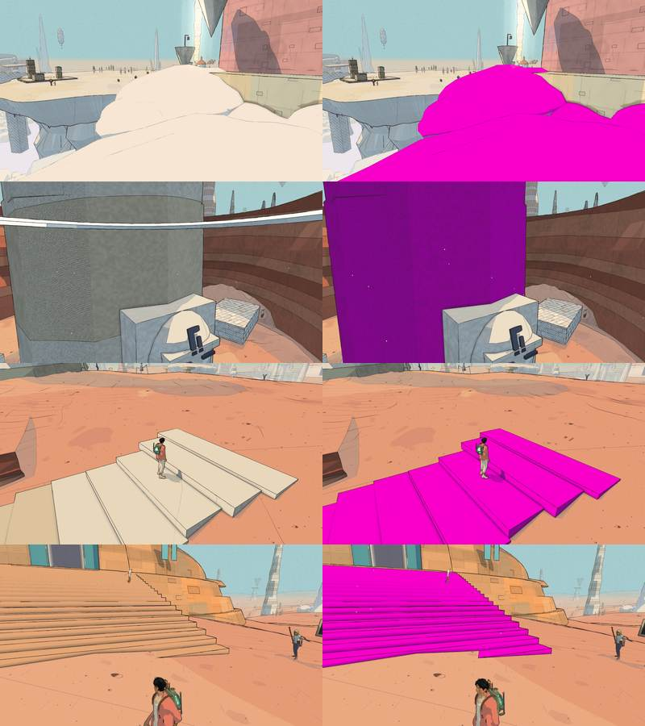

| material | class | walked % | what it is |
|---|---|---|---|
| `#fff4eb` cloud banks round the sky stones (Belfry kit, "painted") | plain | 1.8 | cloud, as the cloud sea: no texture wanted |
| `#f6f0e2` the plain's great column | bands | 1.7 | a tall pale pillar, bands only |
| `#efe4cf` the riders' road's worn steps | bands | 1.5 | pale stone steps down into the gorge |
| `#eda584` the slabs tipped out of the plain, the stones that fell up | bands | 1.4 | salmon rock slabs walked on |
| `#c7735a` the riders' road's walls | bands | 0.9 | the gorge's cut walls |
| `#ffffff` the Aerie's painted pieces | plain | 1.4 | temple furniture, vertex colours |

What made Vael look flat is mostly gone (the plain, sky stones and aqueducts are treated, 45 % of the walk); what is
left are band-only stone pieces, 9.7 % together.

### Lorn

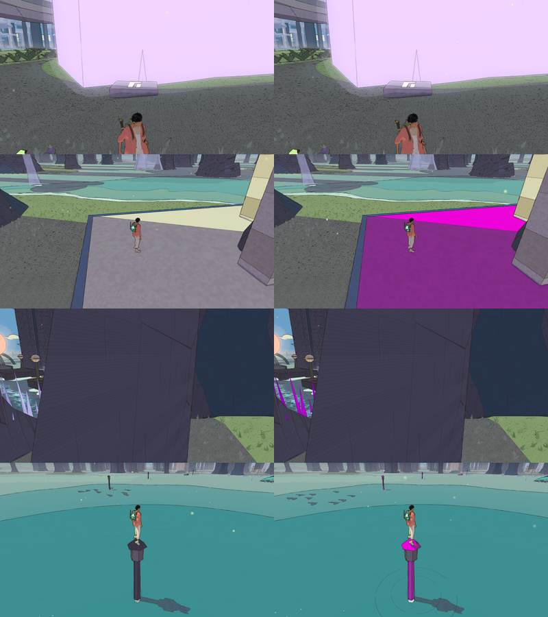

Water is 44 % of the walk (the flooded wood: its own system). Crystals 4.4 % (pending, #686). Left: the makers' court
pad (1.0), the keepers' stakes and light (0.8), the Lamp-House's painted pieces (0.6). Nothing large.

### Viridel

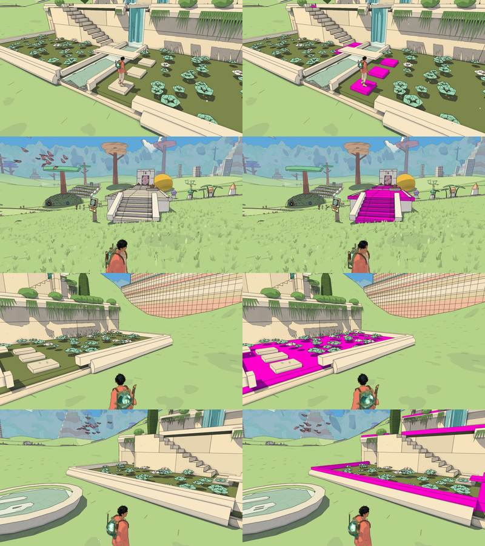

| material | class | walked % | what it is |
|---|---|---|---|
| `#ece2cd` the water stair's stepping stones | plain | 10.3 | white stepping stones across the beds, 18 % of what he stands on |
| `#ebe7dc` + `#f5f3ed` the Builders' Greenhouse's floors and walls | grid | 7.5 | a temple without a futuristic skin: a 2.4 m grid |
| `#7d8a52` the water stair's beds | plain | 3.7 | the planted beds, one olive colour |
| `#f7eedb` the water stair's kerbs | plain | 2.2 | the beds' white kerbs |
| `#8a5f3e` the long seed row's earth, `#9a7d52` the terraces' soil | plain | 3.8 | tilled earth, one brown each |

The flattest walked world now: the tea terraces' white stone and beds were not part of #669's terrace paving.

### The Underwater City

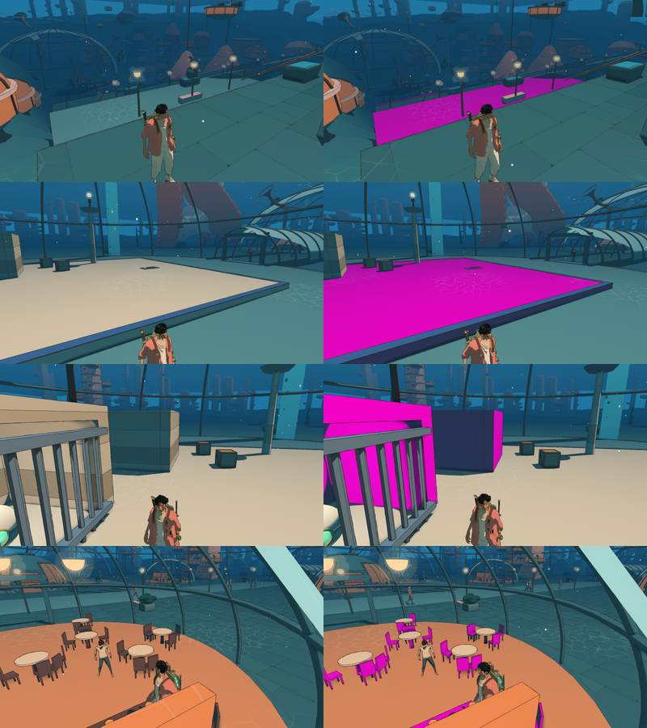

| material | class | walked % | what it is |
|---|---|---|---|
| `#64a2a4` the pale walkways (`streetPale`) | plain | 10.0 | the decks round the domes: the `street` material got paving, `streetPale` did not |
| `#e9dcc0` + `#c9b79a` the makers' court | plain, bands | 1.7 | the court's pad and the chest's plinth |

### The City-Shaft

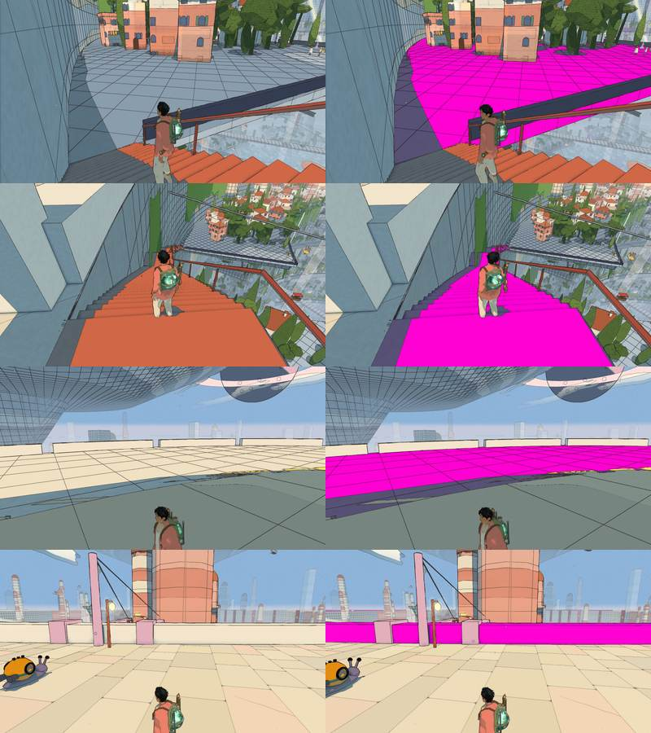

| material | class | walked % | what it is |
|---|---|---|---|
| `#9fb2c6` the shaft's tier floors | grid | **33.6** (+2.0 the crown's) | the blue-grey ring terraces down the shaft: one colour and a 3 m grid. The largest single flat surface the player walks in the game |
| `#d0694a` the lamplighters' stairs (`incal.stair`) | plain | 5.0 | the long orange stairs between tiers |
| `#f3ead8` the parapets and the temple's crown | plain | 1.9 | cream walls along the tiers |
| `#e4d9bf` the Warden's Well's floor, `#9fc8c4` the lamplighters' pads | grid | 3.1 | |

The great plaza and rim are paved (v2.27's 82 % grid is gone), but the tiers are what the route walks.

### The Glass Dunes

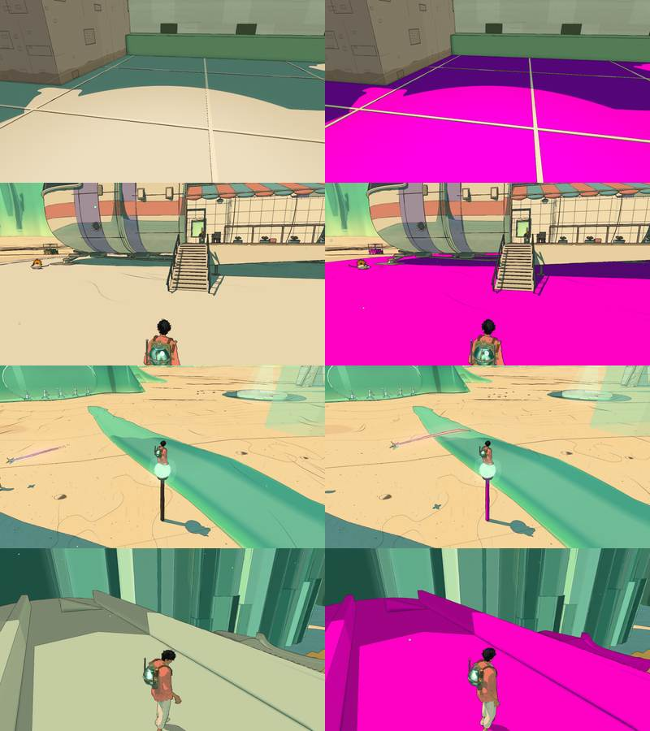

| material | class | walked % | what it is |
|---|---|---|---|
| `#ddd3bc` + `#e8c48f` the city under the sand's rooms (floors, walls) | plain | 5.2 | the rooms behind the windows in the sand |
| `#ffffff` the port's pad ("port matte") | plain | 2.8 | the landing port's deck, seen at every landing |
| `#4b3b30` the west posts, the way up to the cairn | plain | 2.3 | dark posts |
| `#c4d5b8` the prism crossings | plain | 2.0 | glassy green prisms bridging the dunes |

### The Buried Machine

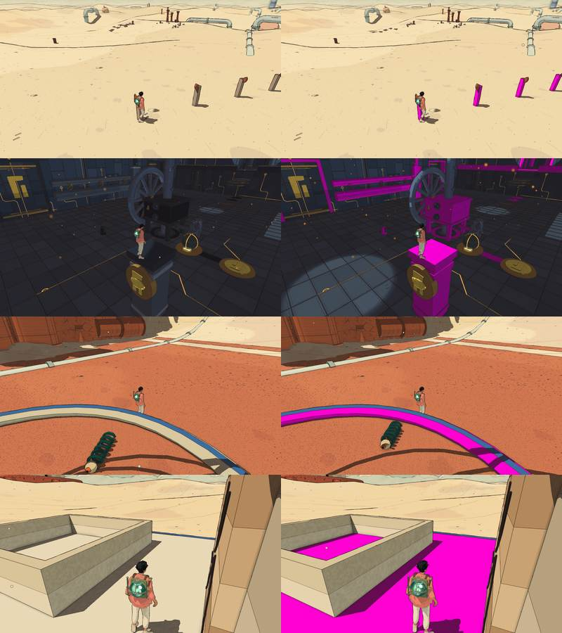

Little left: the Tooth Day posts (2.5), the Engine-House's painted machines (0.7), the wind column's base (0.8), the
makers' court (1.1). The sand is the ground pass.

### The Moon Foundry

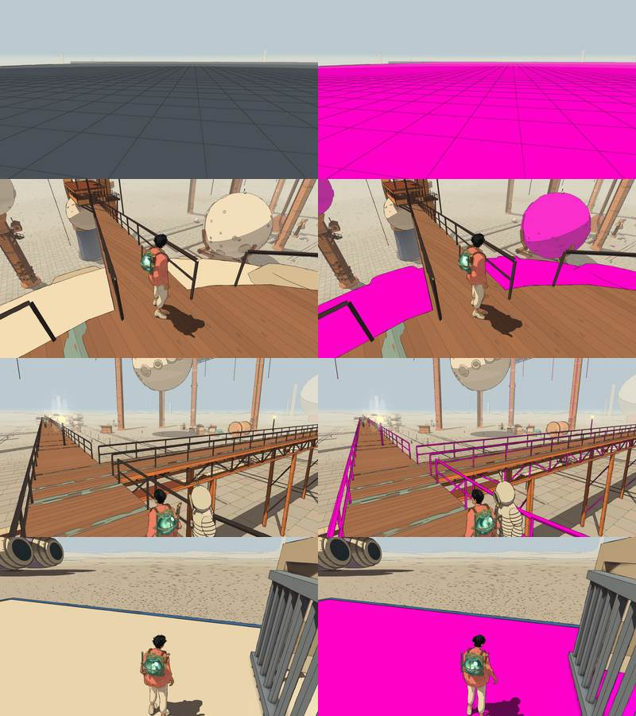

| material | class | walked % | what it is |
|---|---|---|---|
| `#4a5462` the shed roof's deck (cells) | grid | 7.3 | a dark slate deck under a 2.4 m grid, walked on top of the shed |
| `#f4e4c8` the cast moons and their slabs (merged) | plain | 2.9 | cream castings with crater dots |
| `#3e3634` the railings, `#5a3a2e` the sheds' dark faces | plain | 1.7 | thin bars, shade only |

### The Garden of Spheres

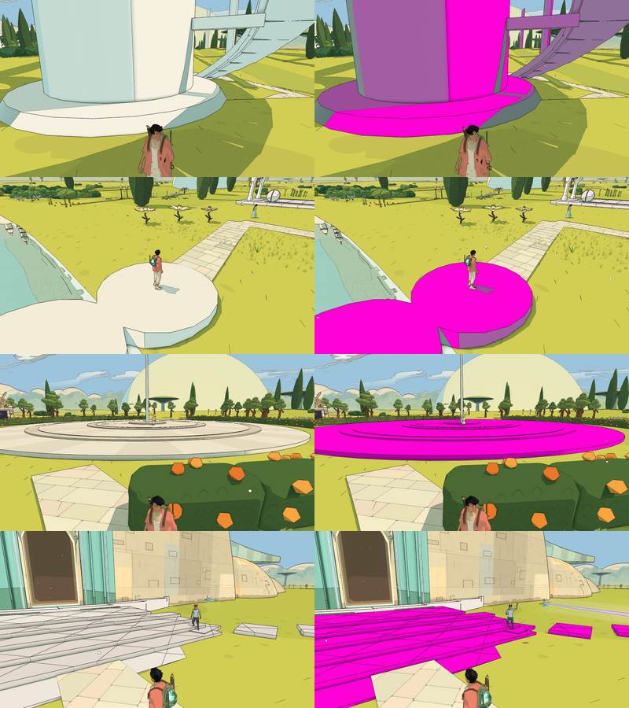

| material | class | walked % | what it is |
|---|---|---|---|
| `#f6f3ea` the towers' bases, plinths and the pole (`pole`) | plain | 9.3 | white stone, shade only |
| `#f3efe2` the pond's terraces and discs (`white`) | plain | 5.7 | white stone stepping discs |
| `#ffffff` the plaza's rings (vertex colours) | plain | 5.4 | the concentric rings round the pole |
| `#efe9e5` the Footprint's steps, `#faf4e2` its walls | grid, skin-bare | 1.6 | |

The paths are paved (#669); the white stone round them is not.

### The City Floating in Space

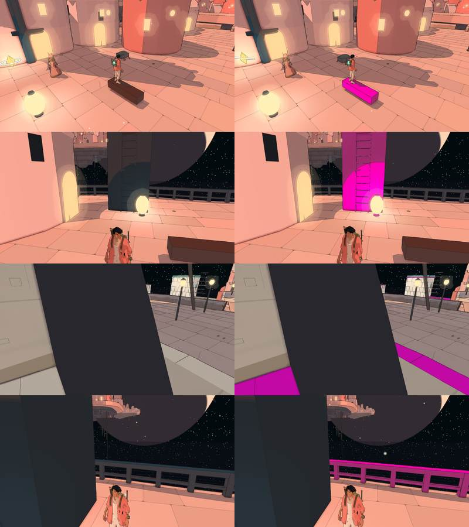

89 % treated. Left: benches and the anchor (2.0), the far islands' dark undersides (1.1), the Mooring-House's floor
grid (1.1), the balcony's rails (1.0). Small pieces.

### The Signal Market

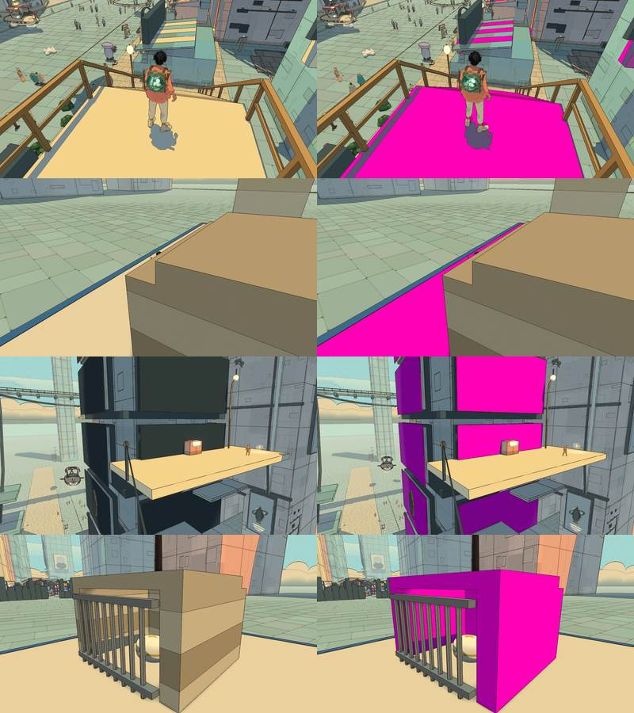

| material | class | walked % | what it is |
|---|---|---|---|
| `#f5dfab` the market in the air's decks and stairs | plain | **14.8** | the cream platforms and steps up the towers (19.5 % of what he stands on) |
| `#2f3d43` the covers (`bazaar.covers`) | plain | 0.6 | dark screens' backs |

### Home

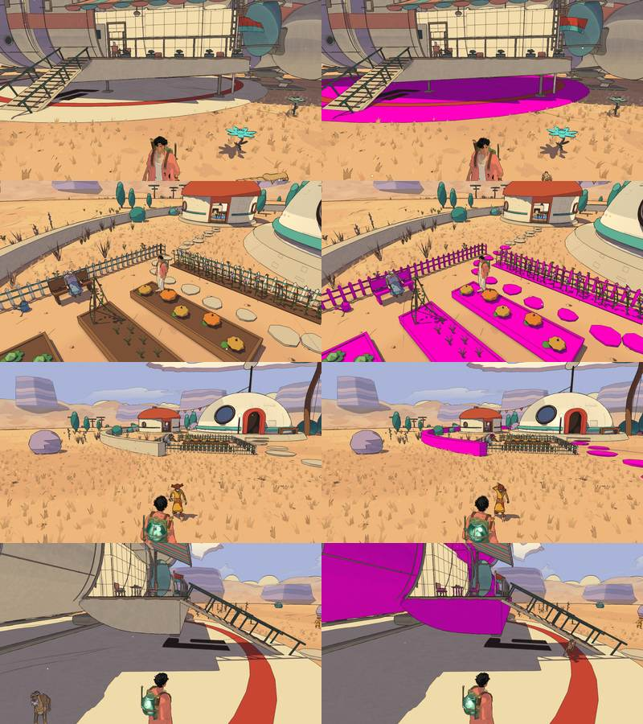

| material | class | walked % | what it is |
|---|---|---|---|
| `#efe2c4` the round house's pad and the landing ring | plain | 6.0 | |
| `#ffffff` the garden: fence and beds | plain | 5.5 | the vegetable beds and their fence (vertex colours) |
| `#dccab0` the tomb's terrace | plain | 3.3 | |
| `#e7d8b6`, `#958d78` the ship's hull | plain | 3.9 | the traveller's ship: a painted model, holds up (v2.27) |
| `#c8483a` the round house's red | plain | 1.3 | |

### In every world

- **The makers' court** (`#e9dcc0` pad, `#c9b79a` the chest's plinth bands): 1–1.7 % of the walk in every world.
- **The temples' painted pieces** (`(painted, n)`: furniture, machines, vertex colours): 0.4–1.4 % in every temple
  world. The halls themselves are machined (skin 3–10 %), apart from the Rose House and the Greenhouse.

## What it needs

### Code only: an existing pick covers it

| what | worlds (walked %) | reference | how |
|---|---|---|---|
| the City-Shaft's tier floors `#9fb2c6`, the crown's | City-Shaft (35.6) | `paving` | `paving` on the tier material (its grid stays on the sides) |
| the market in the air's cream decks `#f5dfab` | Signal Market (14.8) | `paving` (decks), `industrial-walls` (stair sides) | `paving` on the upward faces |
| the pale walkways `streetPale` `#64a2a4` | Underwater City (10.0) | `paving` | the `street` material's `paving: 1.4` on `streetPale` too |
| the water stair's stepping stones and kerbs `#ece2cd`, `#f7eedb`; the Garden's white stone `#f6f3ea`, `#f3efe2` and plaza rings; home's pads `#efe2c4`, `#dccab0`; the City-Shaft's parapets `#f3ead8` | Viridel (12.5), Garden (20.4), home (9.3), City-Shaft (1.9) | `pale-stone` (blocks, soft wear: drier and cleaner, sunlit) and `paving` for the flat tops | `S_PALESTONE` with a dry, clean setting; paving on stepping stones |
| Vael's band-only stone: the great column, the riders' road's steps and walls | Vael (4.1) | `pale-stone` | `S_PALESTONE` on the pale pieces; the walls keep their bands plus `weathered` |
| Vael's salmon slabs tipped out of the plain | Vael (1.4) | `open-ground` (as #685's rock tops) | `rockTop` |
| the Greenhouse's floors and walls (a temple with no futuristic skin) | Viridel (7.5) | `temple-floors`, `temple-walls` | the machined finish (`mkFinish`) on its floor and wall kit |
| the Footprint's walls (no finish on its walls) | Garden (0.5 walked, 9.5 area) | `temple-walls` | `mkFinish` on its wall body |
| the makers' court pad and plinth | every world (1–1.7) | `temple-floors` | the machined finish on the court kit |
| the temples' painted pieces | every temple world (0.4–1.4) | `temple-walls` | `mkFinish` or `sheet` on the props' kit |
| the Moon Foundry's shed deck `#4a5462` | Moon Foundry (7.3) | `industrial-walls` | `sheet` (riveted plates) on the deck |
| the lamplighters' stairs `incal.stair` | City-Shaft (5.0) | `industrial-walls` | `sheet` (painted metal) |
| Qanat's painted houses and towers (vertex colours) | Desert (4.5) | `desert-domes` (domes), existing `weathered`/`detail: 'built'` (towers) | `domes` on the dome caps; weathering on the bodies |
| Qanat's square grid `#e9d6bf` | Desert (1.5) | `paving` | `paving` |
| the Givers' dry channel | Desert (2.1) | `water-channels` (its stone lip), `open-ground` | `channel` without water |
| the city under the sand's rooms | Glass Dunes (5.2) | `buried-city`, `interiors` | `buried` on walls, `interior` tiles on floors |
| the port's pad ("port matte") | Glass Dunes (2.8), Signal Market (0.3) | `paving` | `paving` on its deck (the cities' ports are still finished: no side-level port work) |
| the prism crossings | Glass Dunes (2.0) | `crystals` (#686's pick) | `S_CRYSTAL`'s facets, once #686 lands |
| posts and stakes: the west posts, the Tooth Day posts, the keepers' stakes | Glass Dunes (2.3), Buried Machine (2.5), Lorn (0.8) | `timber` | `timber` |
| the space city's benches and anchor, rails | City in Space (3) | `timber`, `industrial-walls` | small |
| the cast moons and slabs | Moon Foundry (2.9) | `pale-stone` / `open-ground` (pitting) | merged mesh: per-vertex `S_VMAT` already carries the defines |

### New references (two lab batches)

Only two materials with real screen time have no picked sheet that fits:

| lab id | batch | what | where (walked %) |
|---|---|---|---|
| `garden-beds` | `2026-10-26-17-07-43-7305` | planted beds and tilled soil: furrows, rows of seedlings and tea bushes, trodden paths, stone kerbs | Viridel's beds and earth (7.5), home's garden (5.5) |
| `rose-house` | `2026-10-26-17-07-43-6da3` | the Rose House's red stone halls as ancient high tech: slabs in a strict grid, amber inlaid light, sockets, engraved bands, chamfered wall panels | the desert's first temple (5.0 of the desert's walk; 3.7 % of its area) |

Prompts: [docs/design/surface-prompts.md](../design/surface-prompts.md), Part 4. Text only, the default providers
(GPT Image 2 and Gemini), one candidate each, $0.075 a batch ($0.15 together). All four candidates are on the brief
(looked at): both providers drew tidy furrowed beds with stone kerbs and the distance strip; both drew the red halls
with amber lines and sockets, nothing organic. The author picks in the lab (To pick).

Not given a batch: Vael's cloud banks (cloud, no texture wanted), the ship's hull (a painted model that holds up), the
Footprint's white walls (the machined finish exists), the cast moons (small, `pale-stone` pitting will do).

## Next

1. The author picks `garden-beds` and `rose-house` (or turns them down).
2. Code, in walked order: the City-Shaft's tiers (one material, a third of that world's walk), the Signal Market's
   decks, the white stone (Viridel, the Garden, home, the City-Shaft's parapets), the Underwater City's pale walkways,
   the Greenhouse's machined finish, then the rest of the table. Each one a material option on an existing define
   except the two new picks.
3. Rerun `node scripts/surface-census/census.mjs` after each batch of materials: the walked table is the measure.

## After #691 (the code-only list, the garden beds and the Rose House)

Issue #691 applied every item of the code-only list above, and the author's two picks (`garden-beds`, `rose-house`), as
options on materials and two shader pieces (`S_BEDS`, the `machined` skin pattern): docs/systems/materials.md, "The
census's code-only list applied". Re-run with the same census (`node scripts/surface-census/census.mjs`, High, noon,
`?batch=0`), before at 3473729a0 and after on the change, the same walk. Walked shares (%, every ray's hit):

| world | treated + skin, before | after | flat left (skin-bare, grid, bands, plain), before | after |
|---|---|---|---|---|
| The Desert | 9.3 | **32.7** | 18.7 | **8.1** |
| Vael | 44.6 | **52.1** | 18.4 | **10.9** |
| Lorn | 16.4 | **18.1** | 7.2 | **5.4** |
| Viridel | 14.0 | **38.8** | 35.5 | **10.7** |
| The Underwater City | 64.7 | **76.7** | 13.3 | **1.5** |
| The City-Shaft | 45.9 | **88.5** | 53.0 | **10.4** |
| The Glass Dunes | 24.8 | **37.0** | 14.9 | **5.7** |
| The Buried Machine | 26.2 | **29.8** | 7.3 | **3.6** |
| The Moon Foundry | 72.0 | **83.7** | 15.7 | **4.0** |
| The Garden of Spheres | 35.5 | **57.5** | 24.5 | **2.3** |
| The City Floating in Space | 88.8 | **90.4** | 9.4 | **7.7** |
| The Signal Market | 76.9 | **92.0** | 18.6 | **3.4** |
| Home | 4.3 | **16.6** | 22.8 | **10.6** |

The City-Shaft's flat share fell from 53 to 10 %, Viridel's from 36 to 11, the Garden's from 25 to 2, the Signal Market's
from 19 to 3, the Underwater City's from 13 to 2. One caution: the Desert's jump is partly the census's: Qanat's square
lies in the plane of the sand under it, and a ray that meets both at the same distance counts the first in the scene's
order, which this change moved (11 points of the 23 the Desert gained are the square's "under" rays, 0 before).

Left flat where you walk: the Lorn crystals and the Glass Dunes' prisms (#686), the ship at home (3.9), the City-Shaft's
small pads and the Warden's Well's exterior floor (grid, 1–2 each), the Greenhouse's exterior floor (3.4, the house's
`M.floor` outside the skin), home's fence (3.8), the Desert's fallen giant and camps (2.5), Vael's Belfry cloud and the
Aerie's painted pieces (1.8, 1.4).
