# Technical quality, v2.28: a Digital Foundry-style audit

<!-- audit-scores
overall: none
headline: two hitch sources fixed on the web: programs compiled mid-play in 7 of 13 worlds (40–610 ms frames) and whole batches of scenery sent to the GPU again (up to 100 MB in a frame); open: Vael's turn at its landing, the City-Shaft's spikes, a batch growing in Viridel, and the caravan's hull shimmering (Viridel's pan flicker +31 % since v1.90)
version: 2.28
date: 2026-10-25
-->

An internal audit in the manner of a Digital Foundry tech review: image quality, motion and frame pacing, consistency
world by world, loading and traversal, and the web against Unity. **It is our own review, not one by Digital Foundry.**
Every number below comes from a recording or a capture that can be repeated with the commands given; every picture is
from the running game. Issue #671.

## The setup, and what it can and cannot say

| | |
|---|---|
| Machine | a Mac with an Apple M4 Pro, macOS 26.7.1, on AC power |
| Browser | Chrome 156.0.8078.48, headless (`--headless=new`), ANGLE on Metal (`ANGLE Metal Renderer: Apple M4 Pro`), muted (`--mute-audio`, the game's volumes at 0) |
| Builds | the shipped bundle (`npx vite build`) of `8d9d0cd6d` (v2.28, "before") and the same with this audit's two fixes ("after"), served by `vite preview` |
| Preset, size | High (render scale 1.5 on a 1× screen: 1920 × 1080 drawn for a 1280 × 720 window, FXAA), 10:00, clear sky, dynamic resolution off |
| Frame timing | uncapped (`--disable-gpu-vsync --disable-frame-rate-limit`): a frame's interval is its own work, so a hitch is not hidden by a 16.7 ms frame. Graphs mark 16.7 and 33.3 ms. |
| Quiet machine | other agents shared the Mac. Every A/B run started only with the 1-minute load average under 10 (`scripts/tech-audit/ab.mjs` waits); the load at each run's start and end is kept with it. Before and after ran interleaved, world by world, twice each. |

**Limits.** No handheld, Steam Deck or Xbox was used (none idle and reachable this run): the Mac is four to eight times
a handheld's speed, so a 40 ms hitch here is a 150–300 ms one there, and the device budgets are not checked. Headless
Chrome has no real display: its "60 Hz" is the compositor's clock, not a panel's. Unity was not run (below, "Web
against Unity"): its numbers here are the last recorded ones, with their dates.

## The play recording (`scripts/tech-audit/`)

DF's method is a fixed route played the same way each time, recorded frame by frame. `play.mjs` does that for every
route world and Home: one muted Chrome, real key presses, a minute of play in phases:

| phase | what | why |
|---|---|---|
| idle | 4 s standing at the arrival, the game's own camera | the first seconds after the loading screen |
| run | 14 s running (W + Shift), the camera swung left and right as a stick would | traversal: streaming, levels of detail, the crowd |
| spin | standing, the camera turned once all the way round: 240 frames of 1.5° (the A/B table below was recorded with an earlier 3-second turn by time; finding 3 with the frame-locked one, so both builds draw the same headings) | everything round you comes into view at once |
| night | 3 s at 21:00 | the night's lamps and passes |
| storm | 3 s in the world's own weather at full strength | the weather's passes |
| menu | the pause menu and the journal opened and shut | (left out of the whole run's numbers: the game is paused) |
| fight | 6 blade cuts and 3 shots | the first blows' effects |

Per frame it keeps the interval, the callbacks' CPU time, **the programs linked and shaders compiled in it** (a
compile mid-play is a hitch), the time spent waiting on the GPU process for a program, the texture and buffer bytes
uploaded, and long tasks. `--who 1` names the object a late program was linked for, `--cpuprof 1` blames each stutter
on the functions that ran in it (an unminified build: `--dist`), `--eval` runs a probe of one's own, `--shots` saves
the frames for contact sheets. `stats.mjs` (tested) gives the DF numbers: mean fps, **1% and 0.1% lows** (the frame
rate of the slowest 1% and 0.1% of frames), p95/p99/worst, frames over 33 and 50 ms, and **stutters** (a frame over
20 ms and over twice the median of the 15 round it: a hitch against its neighbours, which a steadily slow scene is not).
`graph.mjs` draws the frame-time graphs; `ab.mjs` runs two builds interleaved on a quiet machine. `--sweep 12` adds
the camera held at twelve headings, 1.5 s each: what each direction costs once it has been seen.

```sh
npx vite build --outDir <dir>/dist-after          # and the commit before into <dir>/dist-before
PORT=5425 node scripts/tech-audit/ab.mjs --a before=<dir>/dist-before --b after=<dir>/dist-after --out <dir>/ab --runs 2 --max-load 10
node scripts/tech-audit/graph.mjs <dir>/ab/after.json --before <dir>/ab/before.json --out <dir>/graphs
```


## At a glance

| Topic | Verdict | Evidence |
|---|---|---|
| Shader compilation | **Was the worst hitch; fixed.** In 7 of 13 worlds the minute of play compiled one or two programs (the trials' and makers' runs' surfaces), 40–610 ms frames. Now none. | finding 1 |
| Traversal and streaming | **A hitch on every arrival and on turning; fixed.** The scenery's batches were sent whole to the GPU again (10–160 MB a world, up to 100 MB in one frame). Now only what changed. A batch outgrowing its room still costs 80–230 ms (Viridel). | findings 2, 4 |
| Frame pacing | Mostly steady once settled (8–13 ms on this Mac at High); the first seconds after a load run near 30 fps in four worlds; **Vael's full turn at its landing stays rough** (1.5–1.8 s over budget in a 4 s turn, in both builds); **the City-Shaft spikes all the time** (1% low ~28–32 fps). | findings 3, 5, 6 |
| Consistency world by world | Good in five worlds (1% low over 40 fps and no frame over 50 ms in every run after the fixes: the desert, the Glass Dunes, the Moon Foundry, the Garden of Spheres, the Floating City); the City-Shaft, Vael's turn, the Buried Machine and the Market are the weakest. | the table below |
| Loading | 2.6–5.9 s to the first frame on this Mac, within the 6 s budget; the fix adds 15–100 ms. | the table below |
| Image quality | Clean, supersampled on High, no temporal smear (there is no TAA); **sub-pixel ink shimmer is the main flaw**, worst in the Garden of Spheres and Viridel. Viridel's rose 31 % since v1.90 with the caravan parked in view. | "Image quality" |
| Web against Unity | Not re-measured (no Unity run possible on this checkout, no device free): the last records say the web is sharper on desktop, Unity steadier on the handheld. | "Web against Unity" |

## Consistency world by world: before and after

Every route world and Home, the shipped bundle, High, uncapped, each build twice, interleaved, every run started with the
load under 10 (it ended between 7 and 17.7: other agents' work). Ranges are over the runs; the Underwater City and Home
over four (they were run again: Home's first pair had the machine's load climbing to 17.7 in its "before" runs). The
whole minute but the menus.

| World | programs linked in play | worst frame, ms | frames over 50 ms | 1% low, fps | p99, ms | load, s |
|---|---|---|---|---|---|---|
| The Desert | 1 → **0** | 46–58 → **33–34** | 0–1 → 0 | 43.5–48.3 → 42.7–43.2 | 14.8 → 15.1–15.2 | 5.3–5.4 → 5.2–5.3 |
| Vael | 2 → **0** | 325–337 → **63–82** | 2–3 → 3–4 | 35.9–36.1 → 31.9–33.1 | 12.2–12.6 → 13.9–14.3 | 5.3–6.0 → 5.2–5.5 |
| Lorn | 0 → 0 | 28–49 → 45 | 0 → 0 | 31.4–47.1 → 33–41.4 | 15.3–26.2 → 16.1–25.6 | 5.7–6.4 → 5.2–5.9 |
| Viridel | 0 → 0 | 120–237 → **82–131** | 1–3 → 1 | 31.1–42.8 → 38.6–50 | 14.8–15 → 14.8–16.4 | 3.9–4.1 → 4.2–4.4 |
| The Underwater City | 1 → **0** | 172–240 → **29–50** | 1 → 0 | 37.3–46.3 → 28.1–60.8 | 15.2–15.8 → 13.4–29.9 | 3.5–4.7 → 3.4–4.7 |
| The City-Shaft | 0 → 0 | 49–51 → 47–50 | 0–3 → 0–1 | 27.6–30.7 → 27.6–32.5 | 28.8–31.8 → 27.6–31.4 | 5.5–5.6 → 5.3–5.6 |
| The Glass Dunes | 1 → **0** | 205–207 → **40–43** | 1 → 0 | 42.9–45.6 → **57.6–59.3** | 13.6–13.7 → 12.6–13.3 | 4.3–4.6 → 4.5–4.8 |
| The Buried Machine | 1 → **0** | 251–260 → **32–45** | 1 → 0 | 27.9–29.8 → 34.8–36.9 | 22.5–24.9 → 23.2–24.6 | 4.9–5.0 → 5.2–5.9 |
| The Moon Foundry | 0 → 0 | 23–25 → 26–30 | 0 → 0 | 62–68.4 → 64–70.3 | 12.9 → 12.8–13.2 | 4.8–5.1 → 4.0–4.7 |
| The Garden of Spheres | 1 → **0** | 115–149 → **28–30** | 2–3 → 0 | 49.9–51.5 → **62.8–64.3** | 11.8–12.5 → 12.6–12.7 | 3.8–4.3 → 3.9–4.0 |
| The City Floating in Space | 0 → 0 | 24–25 → 24–41 | 0 → 0 | 89.5–96.4 → 87.4–97.7 | 8.5–9.1 → 9–9.4 | 3.4–4.3 → 3.7–4.0 |
| The Signal Market | 1 → **0** | 44–162 → **45–47** | 0–2 → 0 | 25.5–65.2 → 33.7–36.3 | 10.7–30.5 → 18.2–26.1 | 3.6–4.9 → 3.6–5.2 |
| Home | 0 → 0 | 31–308 → 21–345 | 0–2 → 0–1 | 34.9–51.7 → 34–91.4 | 12.6–16.5 → 9.5–24 | 3.1–11.7 → 2.6–5.4 |

How to read it: the worst frame is the measure the fixes are for, and it fell in every world that had a late program
(Vael 337 → 82 ms at most, the Glass Dunes 207 → 43, the Buried Machine 260 → 45, the Underwater City 240 → 50, the
Garden 149 → 30). The 1% lows and p99 move by run-to-run noise in either direction (a shared machine; the City-Shaft's
spikes and Lorn's run make their own); the steady cost, held still at twelve headings round Vael's, the Underwater
City's and the desert's landings, is the same in both builds within the runs' own spread (7–11 ms a frame). Home's 270–345 ms
frames come in both builds at random moments of the run: not these fixes' (finding 6).

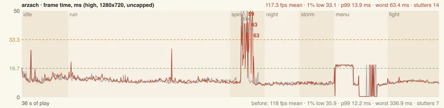
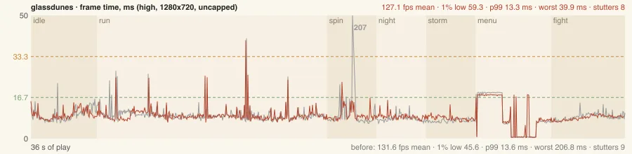
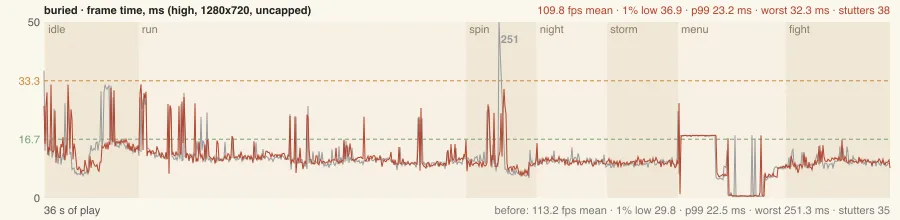
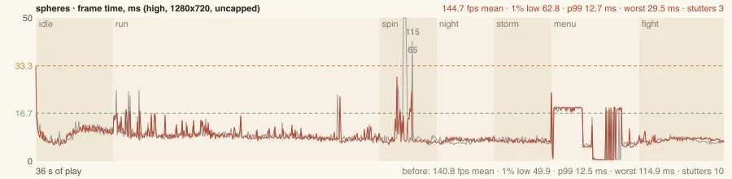
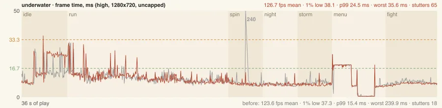

## Findings

### 1. Programs compiled at first sight, mid-play (fixed)

**What a player sees:** turning round near the landing in seven worlds, the game freezes once, for 40 ms to more than
half a second. **Where:** the desert's Wind hall (a wall, 42–58 ms), Vael's fight temple's door and the Bell crossing's
pieces (325–609 ms together), the Underwater City's fight door (172–240 ms), the Glass Dunes' Disc run (205–288 ms), the
Buried Machine's Furnace steps (225–260 ms), the Garden's Sphere court (64–149 ms), the Market's Echo relay (148–162 ms).
`play.mjs --who 1` named each object; every one is part of a trial, a makers' run or a fight temple's door.

**Why:** the load compiles a program for each kind of surface in the scene, then draws the ways through ahead. The trials,
the makers' runs, the arcade's signs and the hosts' posts are built after both. A material first used there, or one
already drawn plainly but now drawn instanced (a run's pieces batched into one draw: a new program), was compiled the
first time it came into view. **Fix:** the load notes each kind it warmed; once everything is built, whatever is of a
kind it did not is compiled and drawn once behind the loading screen (src/warm-shaders.js `lateMeshes`, main.js "late
surfaces"): 59–163 meshes and 0–3 programs a world (programs in 11 of the 13: the worlds whose late pieces the minute
happened not to look at had them waiting too), 15–100 ms more load on this Mac. **After:** no program linked in
play in any of the A/B's 30 "after" runs (one foe's, outside the A/B, is finding 6's). `tests/warm-shaders.test.js`.

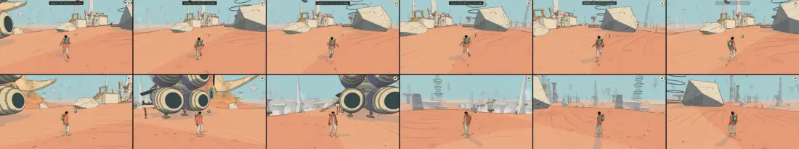
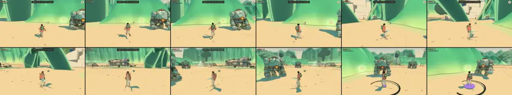

### 2. The scenery's batches sent whole to the GPU again (fixed)

**What a player sees:** a stall in the first second after every load, and again turning round where the level of detail
changes. **Why:** the still meshes are drawn by batches (src/static-batch.js); a mesh's coarser level is copied into its
batch the first time it is drawn. three.js sends a new buffer whole, but keeps the ranges marked while the batch was
built; the next copy merged them all into one range, 0 to the end, and sent the whole batch again. Probed
(`--eval`, every `bufferSubData` over 1 MB), before: 10–158 MB of such re-sends a world in the minute, most in its first
second, the worst frame sending 100 MB (Vael: its shadow batch's 55 MB of positions and 26 MB of indices). **Fix:**
those ranges are dropped once a batch is built or grown (`sent()`); a copy now sends only itself. **After:** no re-send
over 1 MB in any world; the most a frame uploads is 1–4 MB but where a batch grows (finding 4).
`tests/static-batch.test.js`.

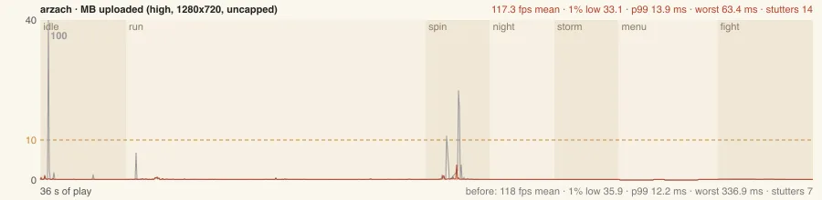
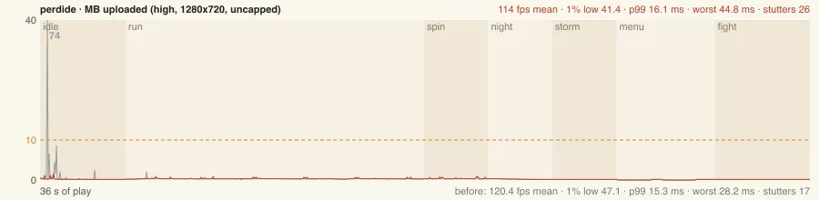

### 3. Vael's turn at its landing is still rough (open)

With the turn driven a fixed 1.5° a frame (so both builds draw the same 240 headings), the freeze is gone (worst frame
535–609 → 188–191 ms) but the turn as a whole is not smooth in either build: 1.5–1.8 s of its frames' time is over
16.7 ms (33–36 frames over 16.7 ms and 14–19 over 50 ms after; 14 and 8–9 before, the freeze among them). Held still at any of twelve headings, it costs 8–10 ms; the same turn in the
Underwater City is 11–25 ms over budget in all after the fix. Ruled out: uploads (steady 0.2 MB a frame), the far shadow map
(redrawn whenever the view leaves what it was culled for, so most frames of a turn; drawn every frame while held still it adds only 2.3 ms), the parked ship (hidden, the turn's slow frames
fall from 11–13 to 4–7 over 50 ms at a load of 10–13: part of it, not all), drawing every mesh once ahead (no reliable change). The frames are
the main thread blocked in WebGL calls (the GPU process behind): the first draws of what comes into view. **Next:** a
Chrome trace of the GPU process through the turn; then whether the first draw of a level of detail or a culled room is
what costs.

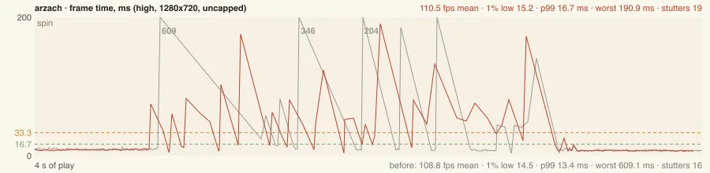

### 4. A batch outgrowing its room (open)

A batch has room for 1.3 × its meshes; when the levels of detail copied in outgrow it, three makes the batch new
buffers and sends them whole. That happens 0–4 times a minute a world: Viridel's view batch of 132 meshes at the same
spot 8.6 s into the run in every run (151 000 → 229 000 vertices, 12.8 MB: 82–164 ms), the desert's (495 000 → 773 000,
31 MB), the Glass Dunes' (27 MB). **Options:** more room for the view batches (memory: every view batch would carry the extra room in each of its
attributes), or grow them behind the loading screen by copying in the levels the first view will ask for. Not done here: it
trades memory on the handhelds.

### 5. The City-Shaft spikes all the time (open)

Its frames are the least even of any world: spikes of 25–50 ms every second or so through the whole minute (1% low
27.6–32.5 fps, p99 28–31 ms on this Mac; a handheld pays four to eight times that). Profiled (`--cpuprof`), the spikes are
CPU: rays through the collision's BVH (`_raycastFirst`, `intersectsNodeBounds`) and a crowd body taken on
(`bodyGeometryFor`, `computeVertexNormals`) — the same "crowd body taken on" cause #468 found on Unity's players. Its
first seconds hold at ~30 fps too. **Next:** cache a taken-on body by build and face (#468's own recommendation), and find
which system casts the rays in those frames.

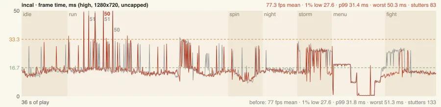

### 6. Smaller ones (open)

- **The first seconds after a load** run at 26–35 ms a frame for 2–4 s in the desert, the Buried Machine, the City-Shaft
  and the Underwater City (the idle phase's 1% low 28–40 fps), in both builds, before settling at 8–13 ms. v1.87's
  cause, the water's bed maps, was fixed (#564; perf-v1.90); this one is not traced yet.
- **A foe's skin not warmed**: in one of eight Viridel runs, a foe that came into the fight compiled two foe-surface
  programs (`FOE_SURFACE` with `FS_MOTT` and `FS_BAND`): a 321 ms frame. The world's warm list (`level.foes.warm`,
  `foes.warmModels`) looks to have missed that skin; which foe it was is not known (it did not come again with `--who`).
- **Home**: a single 150–345 ms CPU frame at a random moment of the run in half the runs of both builds.

## Image quality

### Resolution, reconstruction, filtering

| preset | drawn at | antialiasing | dynamic resolution |
|---|---|---|---|
| High | 1.5 × the window on a 1× screen (1920 × 1080 for 1280 × 720), 1 × on a Retina screen (pixel ratio capped at 2) | FXAA | off |
| Medium | 1 × | FXAA | off |
| Steam Deck (web) | 1 × at 1280 × 800 | FXAA | off (its own choice: it only ever cost sharpness there) |
| Handheld (web) | 0.75 ×, between 0.5 and 0.9 | SMAA (the far ink crawled under FXAA at its pixel size) | on, by frame rate and missed refreshes |
| Xbox (web) | 1 ×, between 0.6 and 1 | FXAA | on |

There is no temporal reconstruction anywhere: no TAA, no upscaler on the web. That is a choice that suits an ink
style (no ghosting, no smear on a moving pen line, every frame is its own drawing), and its cost is what a DF review
would call out first: **sub-pixel detail has nothing to steady it.** A thin bar, a far crease, a pen line on a busy
hull either lands on a pixel or doesn't, frame to frame. High's 1.5 × supersample on a 1× screen is the only thing
holding it there; on a Retina screen and on the handheld presets it is gone. Unity's players add FSR 1 on the Retroid
(a spatial upscale: sharper edges, no stability).

Textures barely matter here: the worlds' surfaces are procedural (materials.js), drawn in screen space or from the
object's own coordinates, and filtered by their own analytic antialiasing (`HATCH_AA`, the thin bars' least width);
only the interiors' painted panels carry an anisotropic filter (4 ×, interior-kit.js). Nothing to fix there.

### Stability in motion: the pan survey

`scripts/motion-check/record.mjs` (the clock stepped by hand, the world frozen, the camera moving a third of a pixel a
frame; flicker: pixels a frame that jumped over 20 levels and came straight back, per 10 000), High, 1728 × 1117 at
2×, every world's survey view, against the v1.90 audit's (2026-10-21, the same command):

| World | pan flicker, v1.90 | v2.28 | drift (slower) v2.28 |
|---|---|---|---|
| The Garden of Spheres | 13.46 | 13.54 | 4.44 |
| Viridel | 12.68 | **16.66** | 3.98 |
| The City-Shaft | 8.81 | 9.04 | 3.17 |
| The Desert | 6.46 | 6.46 | 1.76 |
| The Signal Market | 5.24 | 4.41 | 2.24 |
| Lorn | 3.70 | 3.77 | 2.73 |
| Vael | 3.28 | 3.31 | 0.53 |
| The Buried Machine | 1.55 | 1.24 | 0.39 |
| Home | – | 6.75 | **8.75** |

Nothing moved since v1.90 but Viridel. Its 16.7 is the parked ship: with the caravan (the playable ship of
v1.91–1.92, #599) hidden the same pan gives **12.55**, v1.90's figure. With the ink lines off it gives 3.9: the
crawl is the silhouettes and creases on the hull's panel seams, a 1–2 px detail at that distance, plus the road's
outline seen at a grazing angle and the flower beds (both known since v1.72).

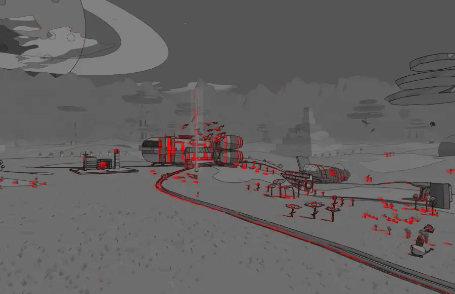

The Garden's 13.5 is its grass tufts' pen lines (known, left in rendering.md "Stable in motion"); the Market's and
Vael's are small props on the skyline:

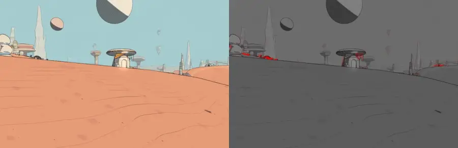
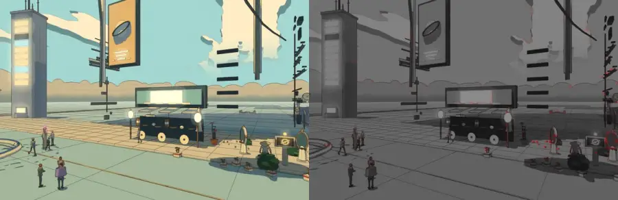
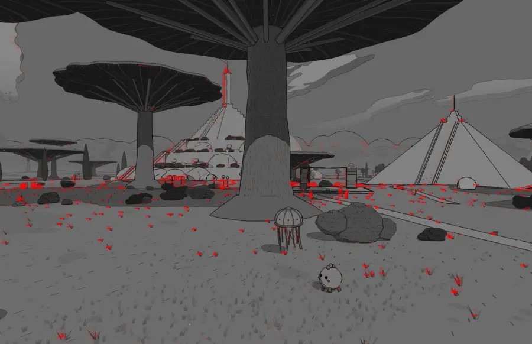

Home's drift (8.75, more than its pan) is new to the survey: Home was not in v1.90's table.

### Levels of detail

The zoom path (the camera carried straight at a wall, 120 frames) is where a level of detail swapping would show as a
one-frame spike in the warped residual. In nine of the eleven worlds surveyed the peak frame is 1.1–4.1 × the path's
mean, the size of the ink's own re-weighting with distance; nothing on their heat maps reads as an object popping. The
two outliers are the path's own: the desert's (9 × at frame 32) and Home's (12.7 × at frame 26, 72 % of the pixels) are
the survey camera passing through a wall in front of its target (the frames before them are a wall's face filling the
screen), not the game. The levels of detail show up instead in the frame times (finding 2, fixed; finding 4, open).

### Shadows

Not re-run in full: the Shadow Room's QC (shadow-qc) was last recorded at v1.90 (48 of 60 spots green; the same
low-sun leaks, the Handheld's balcony and the stair contact reds as v1.87; docs/audits/shadow-v1.90.md). Nothing in
the renderer's shadow code changed since (`git log c5449ab6c..` on shadows.js, materials.js' SHADOW_GLSL and the
cascades: none). Policy check: the near map is drawn every frame on every preset (#492); the far map (still scenery
past 220 m on High) is redrawn every 3rd frame on High, and at once when the sun turns or the view leaves what the map
was culled for (`farDue`). That is #492's
decision as written. The author's rule since (2026-10-19: shadows at full rate on every device, a smaller map rather than
half rate) was recorded against the near map, but reads as covering all of them: worth confirming, not changed here.


## Web against Unity

Unity was **not run for this audit.** The worktree has no Unity Library (a first import is hours of a shared Mac's
CPU), there is no built macOS player on this machine, and no device was free. What follows is the last recorded
evidence, with its dates; nothing here is re-measured.

- **The same game, two renderers.** The Unity players run the same JS (engine/, Puerts' V8) and mirror its scene into
  Unity's own renderer (docs/systems/engine-bridge.md). Both hitches fixed here are the page's own: three's programs and
  the still meshes' batches do not exist in the engines (engine/bridge-gaps.js lists `src/warm-shaders.js` and
  `src/static-batch.js` as web-only). The engines' equivalents are their shader variants' first use (the Deck's and
  Android's shipped pipeline lists) and Unity's own static batching.
- **Their stutters** (docs/systems/performance.md "Stutters (#468)", 2026-10-18, before #564 and v1.90): on the Mac's
  development player, a foe’s spawn (99–102 ms of objects made; fixed in #468), the Map's first open (fixed), a
  shader's first use on Metal (47–183 ms, 6 of 16 runs: the Mac has no pipeline list), a crowd body taken on (33–54 ms).
  On the Retroid, the wait on the present (52 spikes, worst 57 ms), the spawn (155 ms, fixed), capes baked as people
  come in sight (61 ms), a crowd body (73 ms). **The trials' late programs found here have a Unity twin worth checking:**
  engine/trials.js makes the same courses after the world (engine/game.js 965–972); whether their materials' variants
  are in the shipped lists is not known (the lists were traced over worlds, temples and fights, not the trials).
- **Their pictures** (docs/audits/visual-v1.90.md, 2026-10-21): 87 matched High 1280 × 720 pairs, web against the
  Unity editor, judged coherent in structure, palette, framing and shadow direction, not pixel-identical. The open
  differences are in engine-bridge.md's "visual check" table (the lake's ripple strokes, the domes' shadows at dusk,
  a glowing box).
- **Their frame rates** (perf-v1.90, Retroid, Unity, 2026-10-21): 57 views near the 60 Hz cap, the City-Shaft's wide
  view 47.8 fps and the Floating City's start 57.7 the two short of it, with FSR 1 at 0.5–0.67 render scale.

So the comparison DF would draw today: **the web build on a desktop is the sharper and steadier picture (1.5 ×
supersampled, no upscaler), the Unity build on a handheld the steadier frame rate (60 Hz held by dynamic resolution and
FSR, softer)**, and their stutters have different causes. The web's two biggest hitches are fixed here; Unity's open
ones are the present waits on the Retroid and first uses where no pipeline list exists.


## The defects, by priority

| # | Defect | Severity | Where | Status |
|---|---|---|---|---|
| 1 | Programs compiled at first sight (trials, makers' runs, fight doors) | 40–610 ms freeze | 7 of 13 worlds in the minute, 11 with some waiting | **fixed** (`lateMeshes`) |
| 2 | Batches re-sent whole on the first level-of-detail copy | up to 100 MB in a frame, 100–600 ms | every world | **fixed** (`sent()`) |
| 3 | Vael's turn at its landing: 1.5–1.8 s over budget in a 4 s turn | rough: 14–19 frames over 50 ms | Vael | open: trace the GPU process |
| 4 | The City-Shaft's spikes (rays, crowd bodies) | 1% low ~30 fps on an M4 Pro | the City-Shaft | open: #468's body cache |
| 5 | A batch outgrowing its room | 80–230 ms, 0–4 a minute | Viridel, the desert, the Glass Dunes | open: room or pre-growth (memory) |
| 6 | The caravan's hull shimmering | Viridel's pan flicker 12.7 → 16.7 | wherever it is parked in view | open: its seams' line weight by size on screen (ink-lines) |
| 7 | The first 2–4 s after a load at ~30 fps | soft, once a load | four worlds | open |
| 8 | A foe skin not in a world's warm list | 321 ms, rare | Viridel | open: check `level.foes.warm` against the world's roster |
| 9 | Grass tufts' pen lines shimmering | flicker 13.5 | the Garden of Spheres | known since v1.72, left |
| 10 | The far shadow map at a third of the rate on High | none seen | every world | a policy question for the author |

## What was not measured

- No device: the Retroid, the Steam Deck and the Xbox were not used. The device budgets (Retroid ≥ 55 fps median,
  Deck ≥ 40) are not checked here; perf-v1.90's numbers stand.
- No Unity run (above). Whether the trials' late programs have a twin in Unity's first uses is unknown.
- No 60 Hz paced run on a real display: headless Chrome has none. "Frames over 16.7 ms" in an uncapped run is the
  stand-in for a missed refresh.
- Only High at 1280 × 720 for the A/B; the Handheld preset on this Mac was not A/B'd. Its numbers move with the same
  causes (both fixes are preset-independent).
- No new shadow-QC run (no shadow code changed since v1.90), no ink-lines matrix (v1.90's stands), no cold-cache load
  (Chrome's GPU cache was fresh per run, Metal's system cache not salted).

