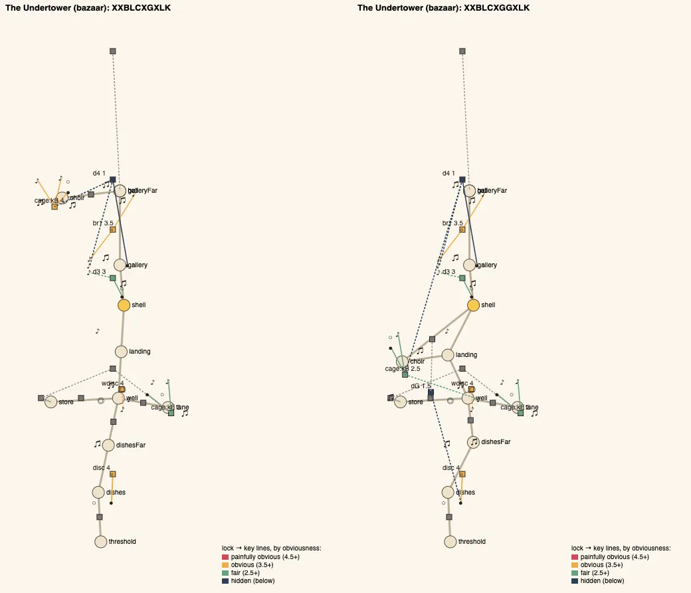
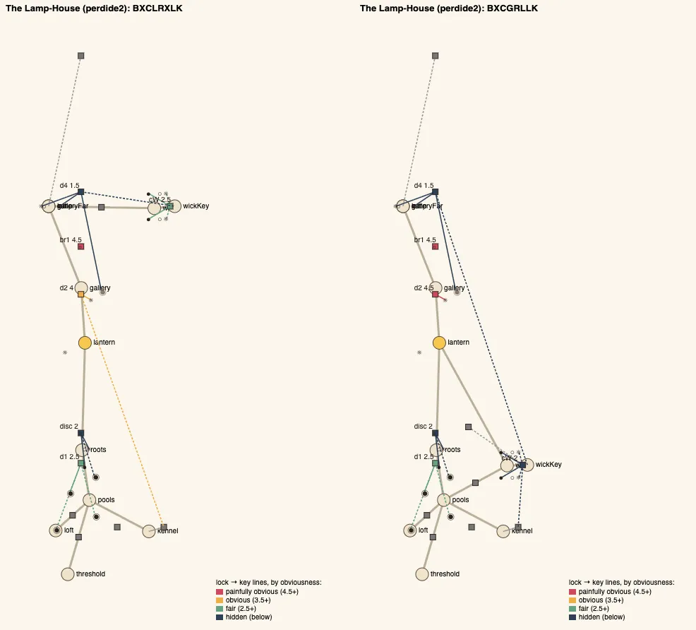
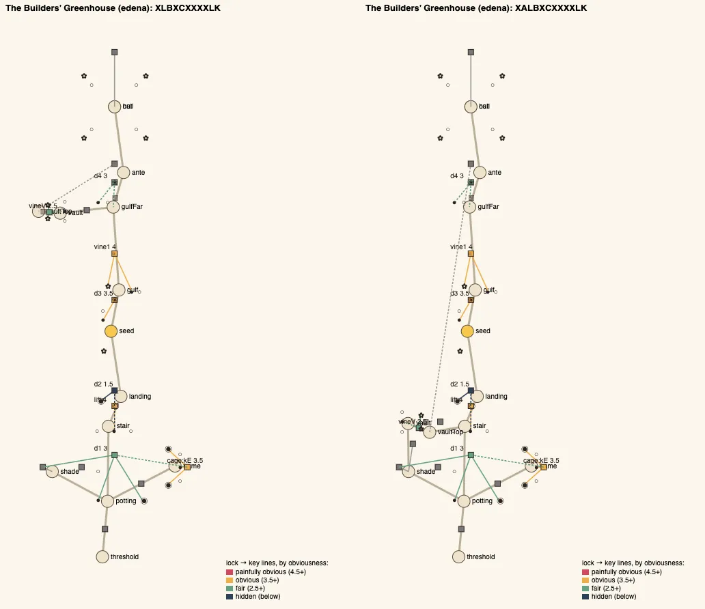

# Temple design audit, v1.60 (2026-10-12)

<!-- audit-scores
overall: 4.29 / 5
label: the average of the fourteen temples' means (4.28 before this batch)
date: 2026-10-12
-->

Round 4 of issue #23 ("a temple you explore, not a corridor of rooms in order"), done with the `temple-design-qc` skill
(`.claude/skills/temple-design-qc/SKILL.md`). Since v1.49 every house scores 5 on structure, so the score no longer says
which houses still walk like a corridor. The audit's own measure does: six houses had no loop at all, and the
[v1.53 report](temple-design-v1.53.md) left two edits for three of them, the Undertower, the Lamp-House and the
Greenhouse. These three still kept their great key in a room off the last puzzle hall (edit 3), and the Undertower and
the Lamp-House still had identity 2 (edit 2). This batch reworks those three.

## The setup

- `node scripts/temple-design/audit.mjs` was run at `18fe8fa6` (origin/main before the batch) and after it, on all
  fourteen temples. Every temple is solved before and after. The other eleven houses are untouched, and their scores did
  not move.
- **The rework, one move in three shapes.** In each house the great key's room goes back into the first half. You see
  it (or its shut door) on the way in, and you work it with the gadget on the way back. A keepers' door out of it closes
  a loop.
  - The Undertower's Choir links its two hubs.
  - The Lamp-House's Wick Room is a wing of its first hall, with a stair up to a keepers' door.
  - The Greenhouse's Seed Vault opens behind its arena and comes out by a keepers' door at the top of its vine.
  - `docs/systems/temples.md`, "Round 4", has the pieces.
- **The tool.** `piecePos` read the Lamp-House's lure pools (`at` as `[x, z]` pairs at one height) as NaN, so the house's
  plan came out blank in every report since v1.49. Fixed, with a test (`tests/temple-design.test.js`). No score depends
  on it.
- **Tests.**
  - Each house's on-foot test (`tests/temples.test.js`) walks the new route: the gate's horn and its cable, the high
    note caught from the walk, the Wick Room's grille and its stair, the vault behind the arena and its keepers' door.
  - Each house's logic test checks the loop's links, that the keepers' doors open only with the gadget, and old saves
    (`migrate.js LAYOUTS`: bazaar v4, perdide2 v3, edena v4).
  - The playthrough plays all three to their guardians. The zfight, climb, contact, collision, camera and room-size
    tests hold at their baselines.
- **Not checked:** how readable the new clues are (the Undertower's gate cable, the dark Wick Room's grille), climbs
  beyond the climb test's probes, and the fights (the guardians are untouched). Nobody has played the new routes by
  hand yet.

## The scores

| Temple | Structure | Teach→test→twist | Combination | Non-obvious | Decoupling | Dungeon item | Guardian exam | Identity | Curve | **Mean** |
|---|---|---|---|---|---|---|---|---|---|---|
| Undertower (bazaar) | 5 | 5 | 5 | 4 → 3 ✎4 | 5 | 5 | 3 | 2 | 4 → 5 | **4.22 → 4.33** |
| Lamp-House (perdide2) | 5 | 5 | 4 | 4 | 5 | 5 | 3 | 2 → 3 | 3 | **4 → 4.11** |
| Builders’ Greenhouse (edena) | 5 | 5 | 5 | 4 | 5 | 5 | 3 | 3 | 3 | **4.22** |
| Hush-House (perdide) | 5 | 5 | 4 | 4 | 5 | 5 | 3 | 3 | 4 | **4.22** |
| Mooring-House (spacecity) | 5 | 5 | 5 | 4 | 5 | 4 | 4 | 3 | 5 | **4.44** |
| Clock-House (garage) | 5 | 5 | 4 | 4 | 4 | 5 | 3 | 3 | 4 | **4.11** |
| Whale-House (underwater) | 5 | 5 | 5 | 4 | 5 | 5 | 4 | 3 | 4 | **4.44** |
| Casting-House (moonfoundry) | 5 | 5 | 5 | 5 | 5 | 5 | 4 | 3 | 4 | **4.56** |
| Footprint (spheres) | 5 | 5 | 5 | 4 | 5 | 5 | 4 | 3 | 3 | **4.33** |
| Warden’s Well (incal) | 5 | 5 | 5 | 4 | 5 | 5 | 4 | 3 | 5 | **4.56** |
| Founders’ Belfry (arzach2) | 5 | 5 | 4 | 4 | 5 | 5 | 3 | 3 | 3 | **4.11** |
| Givers’ House (desert) | 5 | 5 | 4 | 4 | 4 | 5 | 4 | 3 | 3 | **4.11** |
| Aerie (arzach) | 5 | 5 | 5 | 3 | 4 | 4 | 4 | 3 | 5 | **4.22** |
| Engine-House (buried) | 5 | 5 | 5 | 3 | 5 | 5 | 4 | 3 | 4 | **4.33** |

The structure column reads 5 everywhere, before and after. The loops it counts went from 0 to 1 in all three houses
(`metrics.structure.cycles`); six houses had none before this batch, and three still have none.

One move by eye. The Undertower's non-obvious is measured 3, because two steps sit at 1.5 or under. One of them is the
far door (`d4`, 1.0, unchanged since v1.49). The other is the Choir's gate (`dG`, 1.5): its horn is two rooms back, out
of sight, 45 m from the singing ball that gives it its note. The audit can't see the gate's cable. That cable runs in
plain sight from the gate down the well's wall and along the floor to the horn, so the key is findable from the lock.
Moved ✎4, the score it had before.

## Across the temples

- **Loops.** The Undertower, the Lamp-House and the Greenhouse each have one now. That leaves three houses with none:
  the Aerie, the Founders' Belfry and the Warden's Well.
- **The great key.** It no longer sits in a room off the last puzzle hall in any house. Six houses keep it in their
  first half, reached on a loop back: the Hush-House, the Mooring-House, the Clock-House and now these three.
- **Identity.** The Lamp-House rose to 3 (63 % like the Footprint, down from 67 % like the Whale-House). The Undertower is
  still 2 (64 % like the Casting-House, down from 70 %). Its skeleton changed (`XXBLCXGXLK` → `XXBLCXGGXLK`), but a run
  of `X` steps after the chest is still what it shares with the Casting-House. The Greenhouse is 67 % like the
  Casting-House (from 73 %).
- **The curve** rose in the Undertower (4 → 5). There the Choir's gate is reached after the gallery, so the house's two
  hardest steps come last. Elsewhere the curve held.

## Per temple

### The Undertower

*Before (left): the Choir off the gallery's far side, beside the far door. After: the Choir between the two hubs, over the
Cable Store, its door onto the Shell Chamber (`dC`) and its keepers' gate onto the Cable Well (`dG`), the loop
landing → chamber → Choir → landing; the gate's line runs back to the singing ball in the first hall.*

The steps after: the pillars (4), the Tuning Room's key (3), the second disc (4), the passage's door (3), the held pillars
(3.5), the Choir's gate (1.5, by eye fair: its cable), the great key's cage (2.5, was 4: the high note now comes from the
Cable Well's stone below the gate, out of sight of the cage), the far door (1). Mean obviousness 3.21 → 2.81. The gadget's
arc is the same, with one more context: the shell carries a note from the first room to the gate's horn.

### The Lamp-House

*Before: the Wick Room off the gallery's far side. After: the Wick Room a wing of the Hall of Dark Pools beside the Kennel,
the loop pools → Root Stair → chamber ← Wick Room through its keepers' door (`dU`) onto the root-wall's top.*

The Kennel's small key now goes into the Wick Room's grille (`cW`), where it went into the Lamp Passage's door before. So
`d2` is its lamp alone (4.5, painfully obvious), and the grille's step is 2 (was 2.5: a key fetched from another room).
Skeleton `BXCLRXLK` → `BXCGRLLK`. The Wick Room's doubled orb comes after the gallery's single one in the marker's order
(the elements after `d4`), so teach, then twist, holds when the player follows the marker. A player who goes back to the
Wick Room straight from the chest meets the twist first. The audit sorts it after the gallery too: `wickKey` is reached
last.

### The Builders' Greenhouse

*Before: the Seed Vault off the Vine Gulf's far side. After: the vault north off the Shade House, its door the arena's
second way out (`A` in the skeleton), and from the top of its vine a keepers' door (`dV2`) onto the Glass Stair's
root-wall: the loop potting → Shade House → vault → stair → potting.*

Its steps and their obviousness are unchanged (mean 3.13). The vault's own step is still 2.5; it is only met later, from
the other end of the house. The arena now has a second way out, the skeleton's new `A`.

## The ranked edits (what is left of issue #23)

1. **Play the new routes by hand.** Three things nobody has seen in play:
   - whether the Undertower's gate cable reads as a clue, and the walk round the well as a way;
   - whether the dark Wick Room's grille and its keyhole show from the doorway with the lantern;
   - whether the Greenhouse's arena door says enough when it opens.
2. **The three houses with no loop: the Aerie, the Founders' Belfry, the Warden's Well.** The Belfry has one hub
   (`branches` 1) and the Well a single climb hub, so a keepers' door back from their last rooms is the likely move.
3. **Identity 2: the Undertower.** It shares a run of `X` steps after the chest with the Casting-House. A step there that
   is not one more combination would break it, for example a traversal one (the held pillars as `T`).
4. **The guardian exam** (3 in six houses, the Undertower, the Lamp-House and the Greenhouse among them). A second verb in a
   phase is the "Combat telegraphs" batch's work.
5. **Obscure far doors.** The Undertower's `d4` (1.0) and the Lamp-House's `d4` (1.5) combine a key fetched from far with
   their own lamps. Splitting the lamps off onto a door of their own would make each step fair.

## The pictures

The changelog's before/after pictures of every changed room are in `changelog-media/1.60/` (`src/changelog-media.js`):
`under-well`, `under-horn`, `under-chamber`, `under-choir`; `lamp-hall`, `lamp-roots`, `lamp-wick`; `green-shade`,
`green-stair`, `green-vault`. The plans above are the audit's own (`<id>-plan.svg`, rendered in Chrome), before and after
side by side.

## Against the last report

The [v1.53 report](temple-design-v1.53.md) ended at 4.28 over fourteen, and this batch starts there (`18fe8fa6`, the same
scores). It ends at 4.28 measured and 4.29 with the one move by eye. Edit 3 of that report is done, and edit 2 is half
done (the Lamp-House 2 → 3, the Undertower still 2). Edit 1 (play the rooms by hand) and edit 4 (the guardians) stand.
