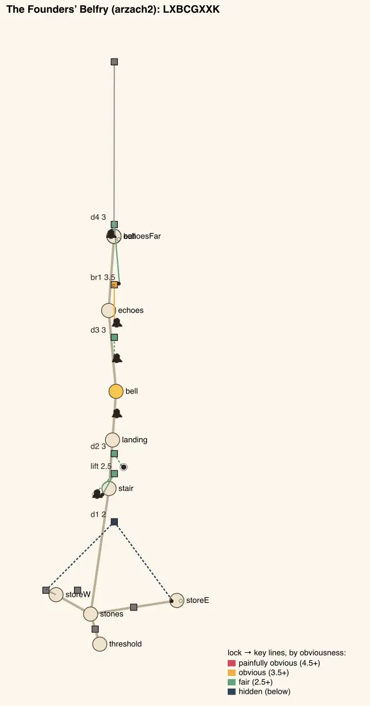
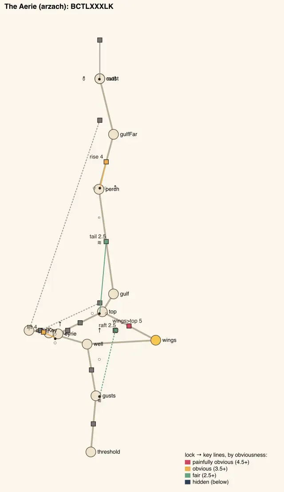
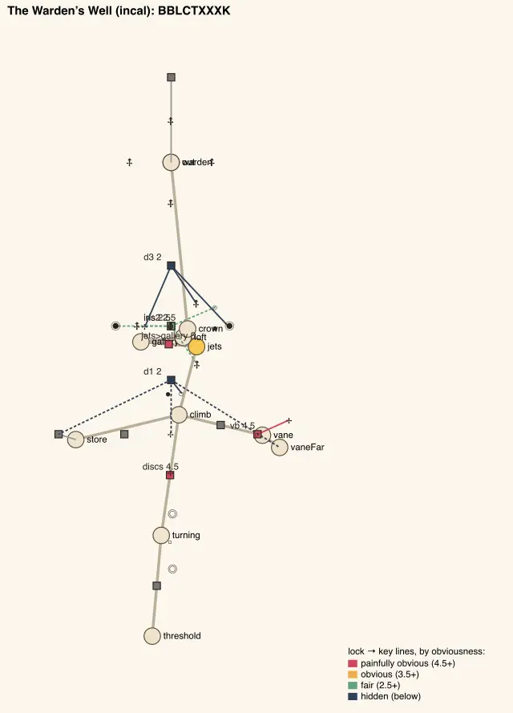
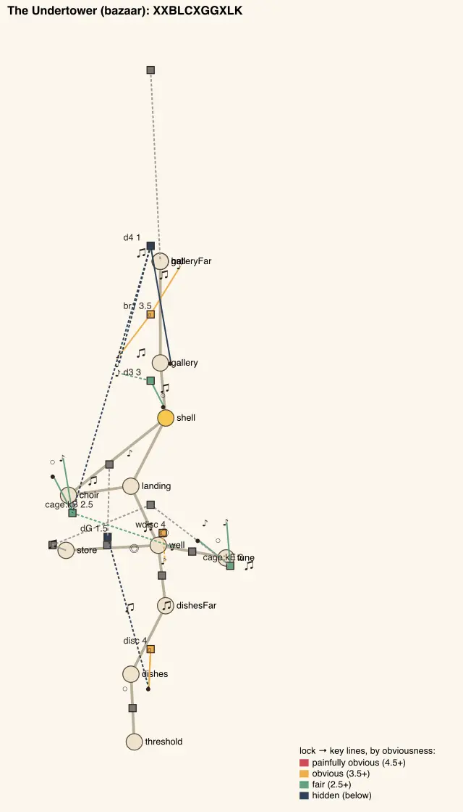

# Temple design audit, v1.66 (2026-10-13)

<!-- audit-scores
overall: 4.34 / 5
label: the average of the fourteen temples' means (v1.60: 4.29)
date: 2026-10-13
-->

A re-run of the `temple-design-qc` skill (`.claude/skills/temple-design-qc/SKILL.md`) on main at v1.66 (issue #226: "run
the new updated audit qc skills to see if we get new findings"). No temple was reworked for this report; the houses
changed under other batches since [v1.60](temple-design-v1.60.md).

**What changed in the skill** since v1.60: the guardians' telegraphs and how rich their fights are now belong to the
`combat-review` skill (no more "Combat telegraphs" batch in TODO.md); temple interiors are this audit's alone (the world
round the door is `level-design-qc`'s); the pictures may be the batch's changelog pictures instead of the report's own.
The rubric, the measures and the anchors are the same, so the scores compare with v1.60 row by row.

## The setup

- `node scripts/temple-design/audit.mjs` at `cfcb5f41` (main, v1.66), all fourteen temples, node only: every temple
  solved, its gadget mid-way.
- **What landed in the temples since v1.60:**
  - six guardians' second phase asks for a second verb before the gadget (`079b8a7b`, combat audit v1.61, #257);
  - nine guardians' quickest move tells for 1.2 s (`1dd7e3bc`, #258);
  - the Rose House's wind replaced by the Givers' watcher, a bronze sentry the guard turns (`e4792144`, `31179ff1`, #245);
  - the Rose House's Cistern-Keeper on its Tripo skin (`5b8ed733`, #267).
- **Pictures:** the plans of the four houses whose problem a plan shows (`<id>-plan.svg`, rendered to WebP with sharp).
  No in-game views this round: the machine was loaded (load average 50-60) with the cinematics pass's Chrome running,
  and the skill allows one headless Chrome at a time. The rooms are unchanged since v1.60's pictures except the Rose
  House's watcher, whose before/after pictures are in `changelog-media/1.65/` (the watcher's line).
- **Not checked:** climbs, how readable a clue is, the fights themselves (combat-review), and the cramped ball rooms the
  author reported in Vael (#275, open), or the keys' sound, chest and counter (#274, open).

## The scores

| Temple | Structure | Teach→test→twist | Combination | Non-obvious | Decoupling | Dungeon item | Guardian exam | Identity | Curve | **Mean** |
|---|---|---|---|---|---|---|---|---|---|---|
| Undertower (bazaar) | 5 | 5 | 5 | 3 ✎4 | 5 | 5 | 3 → 4 | 2 | 5 | **4.33 → 4.44** |
| Lamp-House (perdide2) | 5 | 5 | 4 | 4 | 5 | 5 | 3 → 4 | 3 | 3 | **4.11 → 4.22** |
| Builders’ Greenhouse (edena) | 5 | 5 | 5 | 4 | 5 | 5 | 3 → 4 | 3 | 3 | **4.22 → 4.33** |
| Hush-House (perdide) | 5 | 5 | 4 | 4 | 5 | 5 | 3 → 4 | 3 | 4 | **4.22 → 4.33** |
| Mooring-House (spacecity) | 5 | 5 | 5 | 4 | 5 | 4 | 4 | 3 | 5 | **4.44** |
| Clock-House (garage) | 5 | 5 | 4 | 4 | 4 | 5 | 3 → 4 | 3 | 4 | **4.11 → 4.22** |
| Whale-House (underwater) | 5 | 5 | 5 | 4 | 5 | 5 | 4 | 3 | 4 | **4.44** |
| Casting-House (moonfoundry) | 5 | 5 | 5 | 5 | 5 | 5 | 4 | 3 | 4 | **4.56** |
| Footprint (spheres) | 5 | 5 | 5 | 4 | 5 | 5 | 4 | 3 | 3 | **4.33** |
| Warden’s Well (incal) | 5 | 5 | 5 | 4 | 5 | 5 | 4 | 3 | 5 | **4.56** |
| Founders’ Belfry (arzach2) | 5 | 5 | 4 | 4 | 5 | 5 | 3 → 4 | 3 | 3 | **4.11 → 4.22** |
| Givers’ House (desert) | 5 | 5 | 4 | 4 | 4 | 5 | 4 | 3 | 3 | **4.11** |
| Aerie (arzach) | 5 | 5 | 5 | 3 | 4 | 4 | 4 | 3 | 5 | **4.22** |
| Engine-House (buried) | 5 | 5 | 5 | 3 | 5 | 5 | 4 | 3 | 4 | **4.33** |

One move by eye, the one v1.60 made: the Undertower's non-obvious is measured 3 (two steps at 1.5 or under: the far door
`d4` at 1.0, the Choir's gate `dG` at 1.5), moved ✎4 because the gate's cable runs in plain sight from the gate to its
horn. The audit still can't see the cable.

**Average across the fourteen: 4.34 / 5** (v1.60: 4.29). Every point of the change is the guardian exam: six houses 3 → 4
(the Undertower, the Lamp-House, the Greenhouse, the Hush-House, the Clock-House, the Belfry), because their guardian's
second phase now asks for a second verb (`asked`: dodge, dodge, shot, push, parry, parry). No other score moved.

## Across the temples

- **Skeletons** (B base verb, C the chest, G the gadget alone, X a combination, R a reveal, T a traversal the gadget
  makes, L a lock a key from elsewhere opens, A an arena's way out, K the guardian):

  | Temple | Skeleton | Most alike |
  |---|---|---|
  | Givers’ House | XTBCRXBGXK | Undertower 55 % |
  | Aerie | BCTLXXXLK | Casting-House 67 % |
  | Founders’ Belfry | LXBCGXXK | Casting-House 63 % |
  | Hush-House | BBCXATLXLK | Mooring-House 64 % |
  | Lamp-House | BXCGRLLK | Footprint 63 % |
  | Builders’ Greenhouse | XALBXCXXXXLK | Casting-House 67 % |
  | Whale-House | BXXCLBXXK | Founders’ Belfry 56 % |
  | Warden’s Well | BBLCTXXXK | Clock-House 60 % |
  | Clock-House | BAXLCGXXLK | Aerie 60 % |
  | Engine-House | XBACGXLXLK | Casting-House 70 % |
  | Casting-House | XBCXXXLK | Engine-House 70 % |
  | Footprint | XXCRRLK | Lamp-House 63 % |
  | Mooring-House | BBCGXXLXXLK | Aerie 64 % |
  | Undertower | XXBLCXGGXLK | Casting-House 64 % |

  The skeletons are v1.60's. What repeats is a run of `X` after the chest, ending `LK` or `XK`: the Casting-House is the
  nearest neighbour of five houses.
- **Loops.** Still none in three houses: the Aerie, the Founders' Belfry and the Warden's Well (`structure.cycles` 0).
  They are the only houses whose great key's room is not met again on a way back.
- **The guardian exam** reads 4 in all fourteen. None reaches 5, and the measure says why: every guardian still has 7-9
  attacks with a shape drawn on the ground (`groundTelegraphs`, -0.5), even where the body tells too. Whether those
  ground shapes still read as the tell, or only as a hint under the body's, is the combat review's question, not this one.
- **Obscure steps** (1.5 or under) in ten houses: one each in the Givers' House (`d3`), the Hush-House (`d3`), the
  Lamp-House (`d4`), the Greenhouse (`d2`), the Whale-House (`dH`), the Footprint (`d4`), and at 1.0 the Clock-House's
  cupboard door (`dC`: a sequence, the coil, a volley and a push, its key four rooms away and out of sight) and the
  Casting-House's sand door (`dS`); two in the Undertower (`d4` 1.0, `dG` 1.5).
- **Painfully obvious steps** (4.5 or over): three in the Warden's Well (`discs`, `vb`, the jets' gallery), two each in the
  Givers' House, the Lamp-House (`d2`, `br1`) and the Clock-House.

## Per temple

Only the four whose problem the plan shows. The other ten are as [v1.60](temple-design-v1.60.md) describes them, with
the guardian's second verb added.

### The Founders' Belfry: a corridor after its hub

*The stones hub and its two stores, then one line: stair, landing, the bell's room, the echoes, the far echoes, the
guardian. Every lock past the hub is the next room's door.*

Steps: `d1` 2 (both stores' keys, out of sight), `lift` 2.5, `d2` 3, `d3` 3, `br1` 3.5, `d4` 3. Branches 1, cycles 0.
The bell is taught, tested and twisted, but each time one room further up the line.

### The Aerie: the gusts and the wings, no way back

Steps: `raft` 2.5, the wings to the top 5, `tail` 2.5, `rise` 4, `lift` 4; mean 3.6, the most obvious house. Two wings
off the well, but no keepers' door joins them, so the great key's room is a dead end walked back.

### The Warden's Well: one climb

Steps: `discs` 4.5, `vb` 4.5, `d1` 2, the jets' gallery 5, `iris` 2.5, `iris2` 2.5, `d3` 2. The climb hub is the
house's only branch point; the store and the vane's far room are one-door rooms off it. Its curve is the best of the
fourteen (5): the obvious steps all come first.

### The Undertower: identity 2

Unchanged since v1.60: `XXBLCXGGXLK`, 64 % like the Casting-House, its two obscure doors (`dG` by eye fair, `d4` 1.0).

## The ranked edits

All five are what is left of issue #23 ("Redo the temples with less linear paths", open), where they go; none is new
enough for an issue of its own.

1. **A loop in the three houses with none** (structure, the walk back): the Belfry's echoes and the Aerie's top room
   each get a keepers' door back to their hub, opening from the far side once the gadget is had (`latch`, `oneWay`);
   the Well's crown a drop back to the store. Expected: cycles 0 → 1 in each; no score moves (structure is 5 already),
   but the three stop being the corridors the author asked to lose.
2. **The Belfry's line broken** (identity, decoupling): one of `d3` / `br1` keyed from the far echoes instead of its
   own room, so the climb is walked twice in two states. Expected: identity 3 → 4 if the skeleton stops matching the
   Casting-House's run.
3. **The Undertower's run of X after the chest** (identity 2): the held pillars as a traversal step (`T`), as v1.60
   proposed. Expected: identity 2 → 3, mean 4.44 → 4.56.
4. **The two 1.0 doors** (obscure): the Clock-House's cupboard `dC` drops its volley (or its key comes into sight from
   the escapement's far side); the Casting-House's sand door `dS` gets one of its keys in sight of it. Expected: no step
   under 1.5 there.
5. **The Aerie's obvious start** (non-obvious 3): the wings-to-the-top step (5) wants a catch, a gust that the first
   try meets from the wrong side. Expected: non-obvious 3 → 4.

## Against the last report

[v1.60](temple-design-v1.60.md) ended at 4.29 (4.28 measured). This run starts from v1.66 and reads 4.33 measured, 4.34
with the same move by eye. The rise is v1.60's edit 4 done elsewhere: the combat batch gave six guardians a second verb
(#257). Its edit 1 (play the new routes by hand) is the author's; edits 2, 3 and 5 stand, as above.
