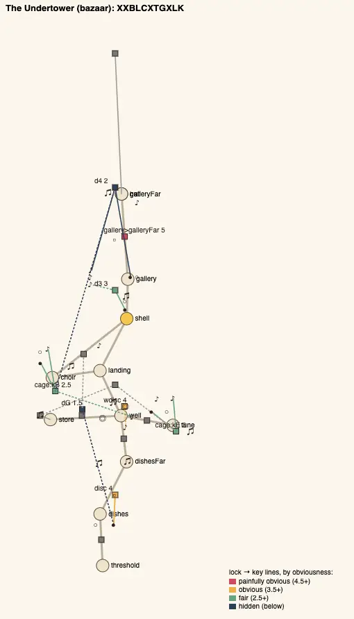
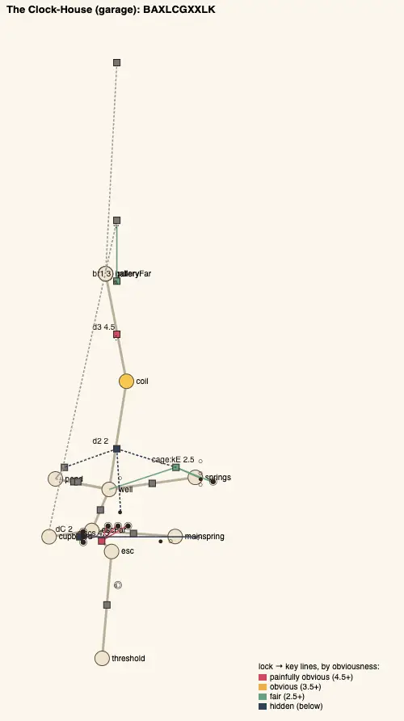
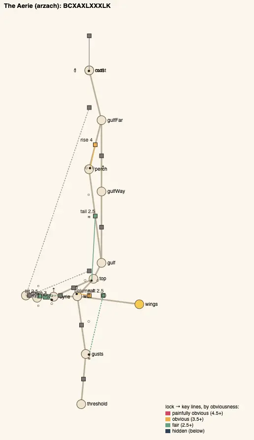
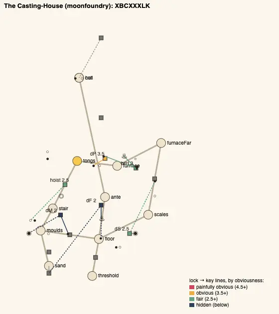

# Temple design audit, v1.74 (2026-10-14)

<!-- audit-scores
overall: 4.34 / 5
label: the average of the fourteen temples' means after issue #23's round 6 (4.32 before it, both with the moves by eye; measured 4.31 → 4.32)
date: 2026-10-14
-->

Two re-runs of the `temple-design-qc` skill for issue #23 ("Redo the temples with less linear paths") in one version.
**Round 5** (below, "Round 5: the loops") gave the three houses the [v1.66 report](temple-design-v1.66.md) still found
without a loop one each. **Round 6** (this section) does the rest of round 5's ranked edits: the Undertower's and the
Clock-House's shapes (identity 2), the two doors that scored 1.0 (obscure), and the Aerie's too-obvious start. Rooms, kits,
guardians and story beats as they were.

## Round 6: the setup

- `node scripts/temple-design/audit.mjs` on `d9799899` (main after round 5, "before") and on this branch ("after"), the
  same script for both (the two fixes below copied into the before tree); every temple solved, its gadget mid-way.
- **Two fixes to the measure**, applied to before and after alike: a sight line from where you face a lock to its key no
  longer counts the key's own piece as what hides it (an eye's shut lids hid the Clock-House Cupboard's twelve o'clock
  eye from under its door; the Greenhouse's vine door and its lift read a point more obvious for it, 4.33 → 4.11, and
  nothing else moved); and the skeleton writes the chest's `C` before the first step that wants the gadget, wherever its
  rooms are (a keepers' door written from its far side came out before the chest). And one piece of the kit is a
  traversal of its own now (`Pillars`, the Undertower's).
- **What landed** (docs/systems/temples.md, "Round 6"):
  - **the Undertower**: the listening pillars. The Gallery of Voices' great horn at the edge (and its twin across) is
    gone, and with it the bridge it held up: each pillar rises for the high note played back near it, a few seconds, and
    waits for whoever stands on it. The note is carried over, played again as you go (a traversal the shell makes). The
    middle egg stands nearest the chasm now, where the far door that wants its note can see it.
  - **the Clock-House**: the Mainspring Room moves from the Clock Gallery's landing to the Escapement's far landing,
    its doorway facing the Cupboard's: the spring that stopped the Cupboard's clock is in sight from its door, a room
    away (it was four). And over the gallery's bridge the great pendulum swings along it, in a beat: cross under it as it
    swings away; met, it knocks you back, unhurt.
  - **the Casting-House**: its keepers' door is written from the side it is opened from (the Weighing Hall: its eye
    over it, its pan on the gallery). Nothing changes in play; the audit had measured it from the floor it is shut from.
  - **the Aerie**: a catch at the start. The well's column lets the new wings go just over the chest's balcony: the
    floor's second vent by the Moult's door breathes half the wind away until its stone is rolled into its throat. And the
    column past the great key's perch comes up the shaft out of the Moult: it blows only once the Moult is won and its
    door open, so the circuit has its order. (The glide from the higher ledge back down onto the perch is no link any
    more: no way back, nothing there; the audit had counted it as the house's most obvious step.)
- **Checked**: every changed route walked on foot with a real `Player` (`tests/temples.test.js`: the pillars carried
  over and back, with a fall without the note, the pendulum met and crossed in its beat, the mainspring seen from the
  Cupboard's door and wound, the Aerie's catch and its stone, the shut Moult's still shaft), every temple played
  through (`tests/temple-playthrough.test.js`), the way back (`tests/way-back.test.js`), the balls' room
  (`tests/ball-room.test.js`), the keys' chests, the z-fights, the old saves (`migrate.js` arzach v3: a save already up
  the well has the floor's stone in its throat). The changed rooms seen in headless Chrome (the pictures below).
- **Not checked**: climbs, how readable a clue is in play, the fights (combat-review). Nobody has played the new routes by
  hand yet.

## Round 6: the scores

| Temple | Structure | Teach→test→twist | Combination | Non-obvious | Decoupling | Dungeon item | Guardian exam | Identity | Curve | **Mean** |
|---|---|---|---|---|---|---|---|---|---|---|
| Undertower (bazaar) | 5 | 5 | 5 | 4 | 5 | 5 | 4 | 2 → 3 | 5 → 4 | **4.44 → 4.44** |
| Lamp-House (perdide2) | 5 | 5 | 4 | 4 | 5 | 5 | 4 | 3 | 3 | **4.22** |
| Builders’ Greenhouse (edena) | 5 | 5 | 5 | 3 | 4 | 5 | 4 | 3 | 3 | **4.11** |
| Hush-House (perdide) | 5 | 5 | 4 | 4 | 5 | 5 | 4 | 3 | 4 | **4.33** |
| Mooring-House (spacecity) | 5 | 5 | 5 | 4 | 5 | 4 | 4 | 3 | 5 | **4.44** |
| Clock-House (garage) | 5 | 5 | 4 | 4 | 4 | 5 | 4 | 2 → 3 | 4 | **4.11 → 4.22** |
| Whale-House (underwater) | 5 | 5 | 5 | 4 | 5 | 5 | 4 | 3 ✎4 | 4 | **4.56** |
| Casting-House (moonfoundry) | 5 | 5 | 5 | 5 → 4 | 5 | 5 | 4 | 3 | 4 | **4.56 → 4.44** |
| Footprint (spheres) | 5 | 5 | 5 | 4 | 5 | 5 | 4 | 3 | 3 | **4.33** |
| Warden’s Well (incal) | 5 | 5 | 5 | 4 | 5 | 5 | 4 | 3 | 5 | **4.56** |
| Founders’ Belfry (arzach2) | 5 | 5 | 4 | 4 | 5 | 5 | 4 | 2 ✎3 | 4 | **4.33** |
| Givers’ House (desert) | 5 | 5 | 4 | 4 | 4 | 5 | 4 | 3 | 3 | **4.11** |
| Aerie (arzach) | 5 | 5 | 5 | 3 → 4 | 4 → 5 | 4 | 4 | 3 | 4 | **4.11 → 4.33** |
| Engine-House (buried) | 5 | 5 | 5 | 3 | 5 | 5 | 4 | 3 | 4 | **4.33** |

Before is main after round 5 measured with this script. The Undertower's non-obvious was 3 measured and 4 by eye there
(two steps at 1.5 or under: its far door at 1.0 and the Choir's gate at 1.5); it is 4 measured now. Moves by eye: the
Belfry's identity ✎3, as round 5 read it (its letters 70 % like the Casting-House's, its ring like no other house); the
Whale-House's ✎4: its own design did not change, its letters are 55 % like the Aerie's new ones (`BXXCLBXXK`,
`BCXAXLXXXLK`), and nothing in play is alike (a hall of horns and the deep note; a stack of winds).

**Average across the fourteen: 4.34 / 5** (4.32 before, both with the moves by eye; measured 4.31 → 4.32). Round 5's
report read 4.34 too, with the old sight lines; the same tree reads 4.32 with the fixed ones (the Greenhouse 4.33 → 4.11).

| Edit | The step | Before | After |
|---|---|---|---|
| The Undertower's shape | the gallery's crossing | `G`, the great horn held: `XXBLCXGGXLK`, 64 % like the Belfry | `T`, the pillars carried, a traversal of its own: `XXBLCXTGXLK`, identity 2 → 3 |
| The Clock-House's shape | the gallery's bridge | one traversal of its own (the escapement's disc) | two (and the pendulum's beat): identity 2 → 3, 64 % like the Aerie |
| A door at 1.0 | the Clock-House's Cupboard `dC` | 1.0: its clock's spring four rooms off, out of sight | 2.0: a room off, in sight |
| A door at 1.0 | the Casting-House's keepers' door `dS` | 1.0: measured from the floor it is shut from | 2.5: from the Weighing Hall |
| A door at 1.0 | the Undertower's far door `d4` | 1.0: the middle egg hidden behind the high one | 2.0: the middle egg in sight |
| The Aerie's start | the wings to the high balcony | 5: the wings alone | 4: the floor vent's stone, then the wings (its mean 3.71 → 3.08) |

No door at 1.0 is left. One step is: the Belfry's great key cage (1.0, below).

## Round 6: per temple

### The Undertower: the listening pillars

The shell's last use before the guardian is now a way of moving: the high egg sung, the note carried out over the chasm
and played again every few metres. It keeps the house's idea (a note travels), and the first step out is a small catch:
played once at the edge, only the nearest pillars rise. The curve reads a point lower (5 → 4): the crossing is one verb
now where the held horn was a timing with a horn a room across, and the measure counts the step simpler.

### The Clock-House: the clock it starts, in sight

The Mainspring Room and the Cupboard face each other across the Escapement's far landing: from the Cupboard's shut door
you look straight into the room of the slack spring and its six eyes (seen on the way in, wound with the coil on the way
back, the loop as before). The gallery's bridge has the house's second clockwork traversal, its great pendulum, swung once
in 6 s along the bridge; it never hurts.

### The Aerie: the catch

The new wings first meet a column that gives out over the balcony, for a visible reason on the floor below (a little
vent breathing by the Moult's door): the house's rule (one wind, out of wherever no stone stops it) caught once more,
right after the chest. The Eyrie's great key comes after the Moult now, its wind coming up the Moult's shaft.
Decoupling 4 → 5.

### The Casting-House

Its keepers' door is met shut from the Pouring Floor and opened from the Weighing Hall: measured from there it is a fair
step (2.5). Its non-obvious reads 4 now: its mean is 2.58, and the rubric's 5 wants no step at 1.5 or under, which
round 5's 5 had (the door at 1.0).

## Round 6: the pictures

The before / after pictures are the batch's changelog pictures, `changelog-media/1.74/` (`src/changelog-media.js`): the
Gallery of Voices from the near landing (`undertower-pillars`) and back across from the far door (`undertower-eggs`); the
Escapement's far landing from the Cupboard's door (`clock-landing`); the Clock Gallery from its near landing
(`clock-pendulum`); the Wind Well's floor by the Moult's door (`aerie-vent`).

## Round 6: the ranked edits

What is left of issue #23 from round 5's list: its edits 1 to 4 are done here; its 5 (play the new routes by hand) is not.

1. **The Founders' Belfry's great key cage** (`cage:kB`, 1.0, the last step at 1.0): it sinks while the founders' bell at
   the stair's foot rings, two rooms off and out of sight from the ledge. Put the bell in sight from the ledge (the
   parapet's gap over the landing), or the cage's own ear on the ledge. Expected: no step under 1.5 in the house.
2. **Play rounds 5 and 6 by hand**: the vent's shaft, the spur's run, the Flue's ride; the pillars carried over, the
   pendulum's beat, the Aerie's catch. Nothing measured can say whether they read.
3. **The Greenhouse's non-obvious** (3 with the fixed sight lines): its lift and its vine door in plain sight of their
   locks; one of them a room away or behind the glass. Expected: 3 → 4.
4. **The Undertower's Choir gate** (`dG`, 1.5): its horn hears the singing ball two rooms and 45 m away; a dish nearer
   it, or the ball's song carried by a dish pair to the walk. Expected: no step at 1.5 there.
5. **The Whale-House's letters** (identity 3 measured, 4 by eye): nothing to change in play; if a later round wants it
   measured, a traversal of its own (its currents).

## Round 5: the loops (earlier the same day)

A re-run of the `temple-design-qc` skill for issue #23's last round ("Redo the temples with less linear paths"): the three
houses the [v1.66 report](temple-design-v1.66.md) still found without a loop, the Aerie, the Founders' Belfry and the
Warden's Well, each given one, each in a shape of its own (neither two wings off a hub nor the great key in a room off the
last hall), with their rooms, kits and guardians as they were. Scored before (origin/main `2aa3f356`) and after (this
batch), node only, all fourteen.

## Round 5: the setup

- `node scripts/temple-design/audit.mjs` on `2aa3f356` and on this branch; every temple solved, its gadget mid-way.
- **What landed** (docs/systems/temples.md, "Round 5"):
  - **the Aerie**: a circuit round the stack. The vent at the Eyrie's gap's foot is the top of a shaft down into the Moult;
    while the Eyrie's one stone sits in its throat the shaft is still and you glide down it into the arena, whose door onto
    the well is shut till it is won; in the other throat the same vent blows you up to the great key.
  - **the Founders' Belfry**: a ring through both halves. A spur of the bridge's stones that the bell alone holds runs to
    the Ringers' Walk, back south outside the house to a ledge high over the Stone Stair's landing; the great key's cage
    there sinks only while the founders' bell at the stair's foot rings (its ball still in its mouth, it hears the whistle
    from the ledge); drop onto the landing and climb the house again to the far door, which takes the key.
  - **the Warden's Well**: two ways up from the gallery, meeting at the crown. The Flue, off the gallery's west wall, its
    little vane's draught up its middle, the great key on a ledge half-way; the high door wants the key and the eye's two
    vanes, so both ways are needed, either first.
- **Checked**: every new route walked on foot with a real `Player` (`tests/temples.test.js`), every temple played through
  for real (`tests/temple-playthrough.test.js`), the way back (`tests/way-back.test.js`), the keys' chests, the pits' dark,
  the z-fights at or under their baselines, the old saves (`migrate.js`: the Belfry v3, the Well v3; the Aerie needs none).
  The new rooms seen in headless Chrome (the pictures below).
- **Not checked**: climbs, how readable a clue is in play, the fights (combat-review). Nobody has played the new routes by
  hand yet.

## Round 5: the scores (first measured with the old sight lines)

| Temple | Structure | Teach→test→twist | Combination | Non-obvious | Decoupling | Dungeon item | Guardian exam | Identity | Curve | **Mean** |
|---|---|---|---|---|---|---|---|---|---|---|
| Undertower (bazaar) | 5 | 5 | 5 | 3 ✎4 | 5 | 5 | 4 | 2 | 5 | **4.44** |
| Lamp-House (perdide2) | 5 | 5 | 4 | 4 | 5 | 5 | 4 | 3 | 3 | **4.22** |
| Builders’ Greenhouse (edena) | 5 | 5 | 5 | 4 | 5 | 5 | 4 | 3 | 3 | **4.33** |
| Hush-House (perdide) | 5 | 5 | 4 | 4 | 5 | 5 | 4 | 3 | 4 | **4.33** |
| Mooring-House (spacecity) | 5 | 5 | 5 | 4 | 5 | 4 | 4 | 3 | 5 | **4.44** |
| Clock-House (garage) | 5 | 5 | 4 | 4 | 4 | 5 | 4 | 3 → 2 | 4 | **4.22 → 4.11** |
| Whale-House (underwater) | 5 | 5 | 5 | 4 | 5 | 5 | 4 | 3 → 4 | 4 | **4.44 → 4.56** |
| Casting-House (moonfoundry) | 5 | 5 | 5 | 5 | 5 | 5 | 4 | 3 | 4 | **4.56** |
| Footprint (spheres) | 5 | 5 | 5 | 4 | 5 | 5 | 4 | 3 | 3 | **4.33** |
| Warden’s Well (incal) | 5 | 5 | 5 | 4 | 5 | 5 | 4 | 3 | 5 | **4.56** |
| Founders’ Belfry (arzach2) | 5 | 5 | 4 | 4 | 5 | 5 | 4 | 3 → 2 ✎3 | 3 → 4 | **4.22 → 4.33** |
| Givers’ House (desert) | 5 | 5 | 4 | 4 | 4 | 5 | 4 | 3 | 3 | **4.11** |
| Aerie (arzach) | 5 | 5 | 4 → 5 | 3 | 4 | 4 | 4 | 3 | 4 | **4.00 → 4.11** |
| Engine-House (buried) | 5 | 5 | 5 | 3 | 5 | 5 | 4 | 3 | 4 | **4.33** |

Moves by eye: the Undertower's non-obvious ✎4, as in v1.60 and v1.66 (its gate's cable in plain sight); the Belfry's
identity ✎3: its skeleton (`LXBCGGXXLK`) reads 70 % like the Casting-House's letters, but no other house is shaped as a
ring back over its own first half from the second, its great key seen at the start and reached from the far end.

**Average across the fourteen: 4.34 / 5** (4.32 before, measured 4.32 → 4.32). The structure score was 5 in all three
houses already; what the batch changes is what the score could not see, the loops:

| Temple | Loops before → after | Skeleton after | Most alike |
|---|---|---|---|
| Aerie | 2 → 3 (before: only the way back round the Gulf, issue #275) | BCTAXLXTXXLK | Clock-House 67 % |
| Founders’ Belfry | 0 → 1 | LXBCGGXXLK | Casting-House 70 % |
| Warden’s Well | 0 → 3 | BBLCTXXXXLK | Mooring-House 73 % |

- **The Aerie** (4.00 → 4.11): the Moult's arena now comes after the wings (`A` after `C`), its key reached by the vent's
  shaft: combination 4 → 5 (the push, the wings and the stone's two states in one step). Non-obvious stays 3: the wings to
  the high balcony (5) is still its most obvious step (v1.66's edit 5, not done here).
- **The Founders' Belfry** (4.22 → 4.22, ✎4.33): the far door's great lock and its cage are two more steps late in the
  house, one a combination (the founders' bell from the first half, its ball still in its mouth, rung from above with the
  whistle: the bell, the push and a timing), so the curve rises (3 → 4). Identity measured 3 → 2 (more `G`s and `X`s in a
  row), moved back by eye.
- **The Warden's Well** (4.56 → 4.56): the flue's two draught steps are combinations (a splash, a timing, the wings); the
  high door's step now holds a key two rooms off (1.5, the house's only step at the warning line: the eye's two vanes and the
  key together).
- **Elsewhere**: the Clock-House's identity 3 → 2 and the Whale-House's 3 → 4 move only because the Aerie's and the Belfry's
  skeletons changed under them (the Clock-House is now 67 % like the Aerie).

## Round 5: per temple

### The Aerie: a circuit round the stack

The well, the raft, the wings, the column, the ledge, the Eyrie, down its vent's shaft into the Moult, out of its door onto
the well's floor, and up again. One stone decides it: in the gap vent's throat (as it starts) the shaft is still, a way
down; in the ledge vent's throat the wind rises out of it, past the great key's perch. The Moult is no longer done on
foot before the wings, and its door from the well is the way out, not in.

### The Founders' Belfry: a ring back over the first half

Stair, landing, bell, porch, echoes, the spur, the Ringers' Walk, the ledge, and down onto the landing: the stair and the
porch walked twice, the second time with the whistle, the bridge held by its ball. The house's idea holds throughout: the
bell holds the spur only while it rings (the ball holds the bridge for good); the founders' bell from the first room, met
again from above, holds the key's cage down.

### The Warden's Well: two ways up

From the gallery: up through the irises to the crown (the eye's two vanes, the little one in the loft), or up the Flue
(its little vane, the key half-way). The high door wants both. Down again is a drop either way, and the draught over the
plinth carries you straight up through the open irises.

## Round 5: the pictures

The before / after pictures are the batch's changelog pictures, `changelog-media/1.74/` (`src/changelog-media.js`): the
Eyrie's gap and the vent's mouth, the Moult's roof, the Hall of Echoes' west wall, the Ringers' Walk and its ledge, the Lamp
Gallery's west doorway, the Flue, the crown's west doorway.

## Round 5: the ranked edits

What is left of issue #23 from the v1.66 list: its edits 1 (a loop in the three houses) and 2 (the Belfry's climb walked
twice in two states) are done here.

1. **The Undertower's run of X after the chest** (identity 2): the held pillars as a traversal step (`T`). Expected:
   identity 2 → 3, mean 4.44 → 4.56.
2. **The Clock-House's identity** (2, 67 % like the Aerie now): its Mainspring Room's six eyes as a timing of their own, or
   its cupboard's great key behind a traversal, so its run `CGXXLK` stops matching. Expected: identity 2 → 3.
3. **The two 1.0 doors** (obscure): the Clock-House's cupboard `dC` and the Casting-House's sand door `dS`, a key in sight of
   each. Expected: no step under 1.5 there.
4. **The Aerie's obvious start** (non-obvious 3): the wings-to-the-top step (5) wants a catch, a gust that the first try
   meets from the wrong side. Expected: non-obvious 3 → 4.
5. **Play the new routes by hand**: the vent's shaft (open the wings in it: the glide hovers against a shaft's wall while
   jump is held, src/player.js), the spur's run, the Flue's ride. Nothing measured can say whether they read.

## Round 5: against the last report

[v1.66](temple-design-v1.66.md) read 4.34 with its moves by eye; main before this batch read 4.32 (the Aerie's combination
and a few others a point lower than v1.66 read them, from changes to the houses since). This batch reads 4.34 again, every house has a
loop now, and no two of the last three share a shape.
