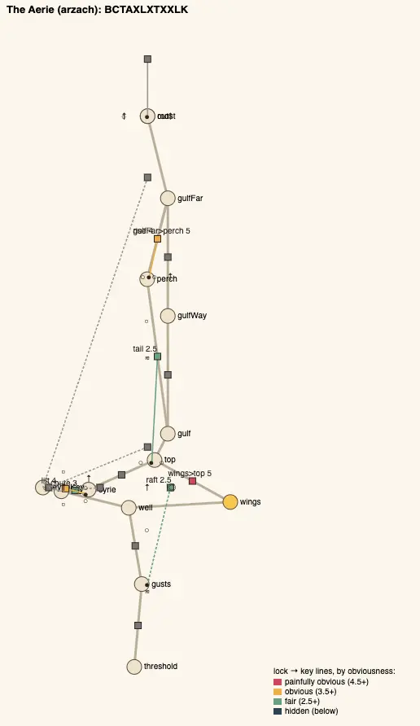
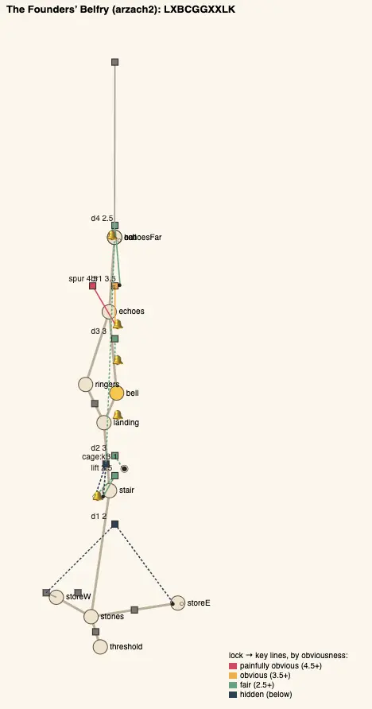
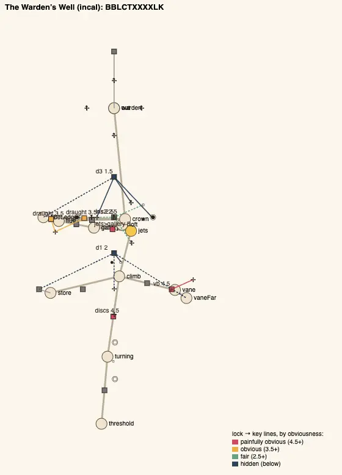

# Temple design audit, v1.74 (2026-10-14)

<!-- audit-scores
overall: 4.34 / 5
label: the average of the fourteen temples' means (v1.66: 4.34; on main before this batch 4.32)
date: 2026-10-14
-->

A re-run of the `temple-design-qc` skill for issue #23's last round ("Redo the temples with less linear paths"): the three
houses the [v1.66 report](temple-design-v1.66.md) still found without a loop, the Aerie, the Founders' Belfry and the
Warden's Well, each given one, each in a shape of its own (neither two wings off a hub nor the great key in a room off the
last hall), with their rooms, kits and guardians as they were. Scored before (origin/main `2aa3f356`) and after (this
batch), node only, all fourteen.

## The setup

- `node scripts/temple-design/audit.mjs` on `2aa3f356` and on this branch; every temple solved, its gadget mid-way.
- **What landed** (docs/systems/temples.md, "Round 5"):
  - **the Aerie**: a circuit round the stack. The vent at the Eyrie's gap's foot is the top of a shaft down into the Moult;
    while the Eyrie's one stone sits in its throat the shaft is still and you glide down it into the arena, whose door onto
    the well is shut till it is won; in the other throat the same vent blows you up to the great key.
  - **the Founders' Belfry**: a ring through both halves. A spur of the bridge's stones that the bell alone holds runs to
    the Ringers' Walk, back south outside the house to a ledge high over the Stone Stair's landing; the great key's cage
    there sinks only while the founders' bell at the stair's foot rings (its ball still in its mouth, it hears the whistle
    from the ledge); drop onto the landing and climb the house again to the far door, which takes the key.
  - **the Warden's Well**: two ways up from the gallery, meeting at the crown. The Flue, off the gallery's west wall, its
    little vane's draught up its middle, the great key on a ledge half-way; the high door wants the key and the eye's two
    vanes, so both ways are needed, either first.
- **Checked**: every new route walked on foot with a real `Player` (`tests/temples.test.js`), every temple played through
  for real (`tests/temple-playthrough.test.js`), the way back (`tests/way-back.test.js`), the keys' chests, the pits' dark,
  the z-fights at or under their baselines, the old saves (`migrate.js`: the Belfry v3, the Well v3; the Aerie needs none).
  The new rooms seen in headless Chrome (the pictures below).
- **Not checked**: climbs, how readable a clue is in play, the fights (combat-review). Nobody has played the new routes by
  hand yet.

## The scores

| Temple | Structure | Teach→test→twist | Combination | Non-obvious | Decoupling | Dungeon item | Guardian exam | Identity | Curve | **Mean** |
|---|---|---|---|---|---|---|---|---|---|---|
| Undertower (bazaar) | 5 | 5 | 5 | 3 ✎4 | 5 | 5 | 4 | 2 | 5 | **4.44** |
| Lamp-House (perdide2) | 5 | 5 | 4 | 4 | 5 | 5 | 4 | 3 | 3 | **4.22** |
| Builders’ Greenhouse (edena) | 5 | 5 | 5 | 4 | 5 | 5 | 4 | 3 | 3 | **4.33** |
| Hush-House (perdide) | 5 | 5 | 4 | 4 | 5 | 5 | 4 | 3 | 4 | **4.33** |
| Mooring-House (spacecity) | 5 | 5 | 5 | 4 | 5 | 4 | 4 | 3 | 5 | **4.44** |
| Clock-House (garage) | 5 | 5 | 4 | 4 | 4 | 5 | 4 | 3 → 2 | 4 | **4.22 → 4.11** |
| Whale-House (underwater) | 5 | 5 | 5 | 4 | 5 | 5 | 4 | 3 → 4 | 4 | **4.44 → 4.56** |
| Casting-House (moonfoundry) | 5 | 5 | 5 | 5 | 5 | 5 | 4 | 3 | 4 | **4.56** |
| Footprint (spheres) | 5 | 5 | 5 | 4 | 5 | 5 | 4 | 3 | 3 | **4.33** |
| Warden’s Well (incal) | 5 | 5 | 5 | 4 | 5 | 5 | 4 | 3 | 5 | **4.56** |
| Founders’ Belfry (arzach2) | 5 | 5 | 4 | 4 | 5 | 5 | 4 | 3 → 2 ✎3 | 3 → 4 | **4.22 → 4.33** |
| Givers’ House (desert) | 5 | 5 | 4 | 4 | 4 | 5 | 4 | 3 | 3 | **4.11** |
| Aerie (arzach) | 5 | 5 | 4 → 5 | 3 | 4 | 4 | 4 | 3 | 4 | **4.00 → 4.11** |
| Engine-House (buried) | 5 | 5 | 5 | 3 | 5 | 5 | 4 | 3 | 4 | **4.33** |

Moves by eye: the Undertower's non-obvious ✎4, as in v1.60 and v1.66 (its gate's cable in plain sight); the Belfry's
identity ✎3: its skeleton (`LXBCGGXXLK`) reads 70 % like the Casting-House's letters, but no other house is shaped as a
ring back over its own first half from the second, its great key seen at the start and reached from the far end.

**Average across the fourteen: 4.34 / 5** (4.32 before, measured 4.32 → 4.32). The structure score was 5 in all three
houses already; what the batch changes is what the score could not see, the loops:

| Temple | Loops before → after | Skeleton after | Most alike |
|---|---|---|---|
| Aerie | 2 → 3 (before: only the way back round the Gulf, issue #275) | BCTAXLXTXXLK | Clock-House 67 % |
| Founders’ Belfry | 0 → 1 | LXBCGGXXLK | Casting-House 70 % |
| Warden’s Well | 0 → 3 | BBLCTXXXXLK | Mooring-House 73 % |

- **The Aerie** (4.00 → 4.11): the Moult's arena now comes after the wings (`A` after `C`), its key reached by the vent's
  shaft: combination 4 → 5 (the push, the wings and the stone's two states in one step). Non-obvious stays 3: the wings to
  the high balcony (5) is still its most obvious step (v1.66's edit 5, not done here).
- **The Founders' Belfry** (4.22 → 4.22, ✎4.33): the far door's great lock and its cage are two more steps late in the
  house, one a combination (the founders' bell from the first half, its ball still in its mouth, rung from above with the
  whistle: the bell, the push and a timing), so the curve rises (3 → 4). Identity measured 3 → 2 (more `G`s and `X`s in a
  row), moved back by eye.
- **The Warden's Well** (4.56 → 4.56): the flue's two draught steps are combinations (a splash, a timing, the wings); the
  high door's step now holds a key two rooms off (1.5, the house's only step at the warning line: the eye's two vanes and the
  key together).
- **Elsewhere**: the Clock-House's identity 3 → 2 and the Whale-House's 3 → 4 move only because the Aerie's and the Belfry's
  skeletons changed under them (the Clock-House is now 67 % like the Aerie).

## Per temple

### The Aerie: a circuit round the stack

The well, the raft, the wings, the column, the ledge, the Eyrie, down its vent's shaft into the Moult, out of its door onto
the well's floor, and up again. One stone decides it: in the gap vent's throat (as it starts) the shaft is still, a way
down; in the ledge vent's throat the wind rises out of it, past the great key's perch. The Moult is no longer done on
foot before the wings, and its door from the well is the way out, not in.

### The Founders' Belfry: a ring back over the first half

Stair, landing, bell, porch, echoes, the spur, the Ringers' Walk, the ledge, and down onto the landing: the stair and the
porch walked twice, the second time with the whistle, the bridge held by its ball. The house's idea holds throughout: the
bell holds the spur only while it rings (the ball holds the bridge for good); the founders' bell from the first room, met
again from above, holds the key's cage down.

### The Warden's Well: two ways up

From the gallery: up through the irises to the crown (the eye's two vanes, the little one in the loft), or up the Flue
(its little vane, the key half-way). The high door wants both. Down again is a drop either way, and the draught over the
plinth carries you straight up through the open irises.

## The pictures

The before / after pictures are the batch's changelog pictures, `changelog-media/1.74/` (`src/changelog-media.js`): the
Eyrie's gap and the vent's mouth, the Moult's roof, the Hall of Echoes' west wall, the Ringers' Walk and its ledge, the Lamp
Gallery's west doorway, the Flue, the crown's west doorway.

## The ranked edits

What is left of issue #23 from the v1.66 list: its edits 1 (a loop in the three houses) and 2 (the Belfry's climb walked
twice in two states) are done here.

1. **The Undertower's run of X after the chest** (identity 2): the held pillars as a traversal step (`T`). Expected:
   identity 2 → 3, mean 4.44 → 4.56.
2. **The Clock-House's identity** (2, 67 % like the Aerie now): its Mainspring Room's six eyes as a timing of their own, or
   its cupboard's great key behind a traversal, so its run `CGXXLK` stops matching. Expected: identity 2 → 3.
3. **The two 1.0 doors** (obscure): the Clock-House's cupboard `dC` and the Casting-House's sand door `dS`, a key in sight of
   each. Expected: no step under 1.5 there.
4. **The Aerie's obvious start** (non-obvious 3): the wings-to-the-top step (5) wants a catch, a gust that the first try
   meets from the wrong side. Expected: non-obvious 3 → 4.
5. **Play the new routes by hand**: the vent's shaft (open the wings in it: the glide hovers against a shaft's wall while
   jump is held, src/player.js), the spur's run, the Flue's ride. Nothing measured can say whether they read.

## Against the last report

[v1.66](temple-design-v1.66.md) read 4.34 with its moves by eye; main before this batch read 4.32 (the Aerie's combination
and a few others a point lower than v1.66 read them, from changes to the houses since). This batch reads 4.34 again, every house has a
loop now, and no two of the last three share a shape.
