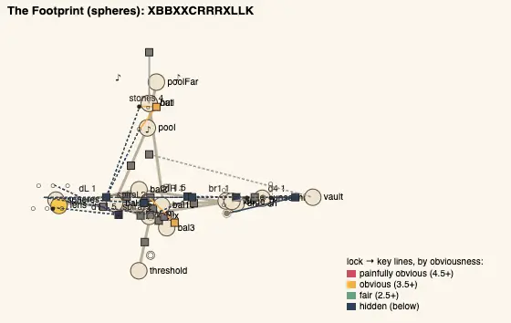

# Temple design audit, v1.85 (2026-10-18)

<!-- audit-scores
overall: 4.4 / 5
label: the average of the fourteen temples' means, with the moves by eye (measured 4.38)
date: 2026-10-18
-->

A re-run of the `temple-design-qc` skill (`.claude/skills/temple-design-qc/SKILL.md`) on main at v1.85 for issue #467,
the full audit again. It follows [v1.74](temple-design-v1.74.md) (4.34, issue #23's round 6). Since then every house was
rebuilt as a shrine of great halls (#336, v1.77–v1.83: rooms of 28 m and more, tall ceilings, big doors, every puzzle in
the middle of its room, never a puzzle and a fight in one room), the gadgets were moved between the houses (v1.80: the
hook to the Belfry, the bubble wand to the Lamp-House, the seeing lens to the Footprint, the sword to the Rose House),
several houses were relaid round a hub (the Engine-House #415, the Footprint's four floors #401, the Undertower as the
journey's exam), each got a house map (v1.82) and a film at its end (#366). No house was changed for this report.

## The setup

- `node scripts/temple-design/audit.mjs` at `8f01feae`: all fourteen built as the game builds them, **every one solved,
  its gadget mid-way** (29–56 % of the steps).
- **The redesign's rules** (`rules.mjs`, docs/design/temple-redesign.md): **0 broken in all fourteen houses** (room
  sizes, ceilings, doors, pieces in the middle, nothing carried through a door, puzzle or fight, the gadget in every room
  after its chest).
- `node scripts/design-qc/capture.mjs` for each house's two most obvious steps, from where you face the lock (one muted
  headless Chrome, port 5344), for six houses (the Givers' House, the Aerie, the Hush-House, the Greenhouse, the
  Footprint, the Mooring-House; the run was cut by a network outage and restarted for the houses with findings). The
  views show plain rooms with their keys in sight; none shows a fault, so none is kept here but the Footprint's plan.
- **Not checked:** climbs (any wall can be climbed), how readable a lamp, a glyph or a mural is in play, and the
  guardians' fights beyond their definitions (the combat review's). Nobody but the author has played the rebuilt houses.

## The scores

| Temple | Structure | Teach→test→twist | Combination | Non-obvious | Decoupling | Dungeon item | Guardian exam | Identity | Curve | **Mean** |
|---|---|---|---|---|---|---|---|---|---|---|
| Undertower (bazaar) | 5 | 5 | 5 | 4 | 5 | 5 | 4 | 3 | 4 | **4.44 → 4.44** |
| Lamp-House (perdide2) | 5 | 5 | 4 → 5 | 4 | 5 | 5 | 4 | 3 → 2 | 3 → 4 | **4.22 → 4.33** |
| Builders’ Greenhouse (edena) | 5 | 5 | 5 | 3 → 4 | 4 → 5 | 5 | 4 | 3 → 2 | 3 → 4 | **4.11 → 4.33** |
| Hush-House (perdide) | 5 | 5 | 4 | 4 | 5 | 5 | 4 | 3 | 4 | **4.33 → 4.33** |
| Mooring-House (spacecity) | 5 | 5 | 5 | 4 → 3 | 5 | 4 → 5 | 4 | 3 | 5 → 3 | **4.44 → 4.22** |
| Clock-House (garage) | 5 | 5 | 4 → 5 | 4 | 4 | 5 | 4 | 3 | 4 | **4.22 → 4.33** |
| Whale-House (underwater) | 5 | 5 | 5 | 4 → 3 | 5 | 5 | 4 | 3 ✎4 | 4 → 5 | **4.56 → 4.56** |
| Casting-House (moonfoundry) | 5 | 5 | 5 | 4 | 5 | 5 | 4 | 3 | 4 → 5 | **4.44 → 4.56** |
| Footprint (spheres) | 5 | 5 | 5 → 4 | 4 → 3 | 5 | 5 | 4 | 3 | 3 → 5 | **4.33 → 4.33** |
| Warden’s Well (incal) | 5 | 5 | 5 | 4 | 5 → 4 | 5 | 4 | 3 | 5 | **4.56 → 4.44** |
| Founders’ Belfry (arzach2) | 5 | 5 | 4 | 4 → 3 | 5 → 4 | 5 | 4 | 2 ✎3 | 4 → 5 | **4.33 → 4.22** |
| Givers’ House (desert) | 5 | 5 | 4 → 5 | 4 → 5 | 4 → 5 | 5 | 4 | 3 | 3 → 4 | **4.11 → 4.56** |
| Aerie (arzach) | 5 | 5 | 5 | 4 | 5 | 4 | 4 | 3 | 4 | **4.33 → 4.33** |
| Engine-House (buried) | 5 | 5 | 5 | 3 → 4 | 5 | 5 | 4 | 3 | 4 → 5 | **4.33 → 4.56** |

Before is v1.74's row after its moves by eye. **Moves by eye,** both kept from v1.74 with their reasons, which still
hold in the rebuilt houses: the Whale-House's identity ✎4 (its letters 62 % like the Warden's Well's, but a hall of
horns and the deep note is like nothing else in play); the Belfry's identity ✎3 (its letters 64 % like the Hush-House's,
its ring of bells like no other house).

**Average across the fourteen: 4.40 / 5** with the moves by eye (v1.74: 4.34); measured 4.38. Six houses rose, three
fell, five held.

## Across the temples

| Temple | Skeleton | Most alike |
|---|---|---|
| Givers’ House | `CXXXLAXGXK` | the Aerie 50 % |
| Aerie | `BBCXAXLXXXLK` | the Hush-House 67 % |
| Founders’ Belfry | `LBBCRXXXLK` | the Hush-House 64 % |
| Hush-House | `BBBCXTXLXLK` | the Aerie 67 % |
| Lamp-House | `BBXCGXXBLLK` | the Engine-House 69 % |
| Builders’ Greenhouse | `XXABLCXRXXXXLK` | the Undertower 69 % |
| Whale-House | `BXXBXCXLXXK` | the Warden's Well 62 % |
| Warden’s Well | `BXLLXCXXXXXLK` | the Greenhouse 64 % |
| Clock-House | `BAXXXXLCRGXXLK` | the Aerie 57 % |
| Engine-House | `XBBXACGXXLXLK` | the Lamp-House 69 % |
| Casting-House | `BBBXBXCXXXBLXLK` | the Mooring-House 71 % |
| Footprint | `XBBXXCRRRXLLK` | the Engine-House 62 % |
| Mooring-House | `XBBBCXXXXXXXXLXLK` | the Casting-House 71 % |
| Undertower | `XXBBLCTXGXXTLXLK` | the Greenhouse 69 % |

What the redesign did to the shape:
- **Every house is a graph now, not a chain:** structure 5 in all fourteen (1 to 7 loops, 2 to 7 hubs), a key fetched
  across rooms in thirteen, a state the house reads in six.
- **The houses converged.** One template, "a few base steps, the chest, a run of combinations, the great key (`L`), the
  guardian", runs through most of them (each house's most alike other reads 50–71 %). The Lamp-House and the Greenhouse fell to identity 2 (69 %), the Casting-House and
  the Mooring-House read 71 % alike. The kit's rooms are bigger and the puzzles better (combination 5 in eleven houses),
  but their order repeats.
- **The guardians all ask for the gadget** with a second verb; every one scores 4, none 5 (no fight asks for the gadget
  *twisted* the way its twist room did). The Hush-House's Mother Snapper has two phases and one ground telegraph,
  the thinnest fight of the fourteen by its definition.

## Per temple: the three that need a look

### The Footprint (spheres): seven obscure steps

*The plan from `scripts/temple-design/audit.mjs`: the four floors overlap from above; the dark dashed lines are the
locks whose keys are out of sight, most of them the murals the lens shows.*

Mean obviousness 1.8, the lowest ever measured (2.5–3.5 is the aim; 1.5 or under is a warning): seven of its ten steps
score 1.5 or less. The seeing lens (`monocle`) reveals the murals that open three of them (`spiral` ×2, `br1`), each
mural 50–93 m and two rooms from its lock, out of sight; the lens-and-push door `dR` and the first balcony door `d1`
(a ball and its plate a room away, out of sight) are 1.0–1.5 too. The measure counts "hidden until revealed" against a
step, and the lens *is* the reveal, so some of this is the gadget's nature; but two rooms and 90 m between a mural and
the bridge it raises is the far end of fair (Bates' proximity dial). #477: play it through and bring the murals within a
room of their locks, or in sight from them.

### The Mooring-House (spacecity): the curve flattened

Curve 5 → 3 (first third 2.44 → last third 3.25) and non-obvious 4 → 3: the north gate `gN` wants a rope and a ball
three rooms away (1.0), and the loft door `d1` a shot two rooms away (1.5). Thirteen steps, ten combinations, but the
tether's nine uses are one context (`MooredRoom`), so the rise is in count, not kind.

### The Lamp-House and the Greenhouse: identity 2

Both 69 % like another house's letters (the Engine-House, the Undertower). The Greenhouse opens `XXAB…` and the Undertower
`XXBB…`; the Lamp-House and the Engine-House both put the chest fourth and the great key last but two. In play the
bubble wand and the seeds are their own; the order is not.

### The rest

- **The Givers' House** rose most (4.11 → 4.56): with the sword as its item, five of six steps combine two verbs, and its
  keys are all out of their locks' rooms or sight (mean 2.25).
- **The Engine-House** (#415): round its Engine Hall, the clutch the house's state; 4.33 → 4.56, its curve 1.58 → 6.08.
- **The Whale-House:** three steps at 1.5 or less (`dH`: two eyes and a ball two rooms off, out of sight, 1.0).
- **The Belfry:** its great key cage still the one step of v1.74 at 1.0; non-obvious 3 (mean 3.31, one step at 4.5).

## The ranked edits

1. **The Footprint's murals within a room of their bridges** (non-obvious 3 → 4, mean 4.33 → 4.44). Play it through
   first: if the lens's reveal is readable from the lock, move the measure (a reveal the gadget makes in sight of its
   lock isn't hidden), not the house. #477.
2. **Break the shared order in the Lamp-House and the Greenhouse** (identity 2 → 3, each 4.33 → 4.44): the Greenhouse's
   first room a seed step (`G`) before any push, so it no longer opens like the Undertower; the Lamp-House's great key
   earlier, before the chest's last room. #477.
3. **The Mooring-House's last third** (curve 3 → 4): a tether use outside the moored rooms (a bridge or a ball's path)
   after the north gate. #477.
4. **The Hush-House's guardian:** a second ground telegraph and a third phase (guardian exam stays 4; for the combat
   review).

## Against the last report

[v1.74](temple-design-v1.74.md) ended at 4.34. Its two open notes, the Belfry's great key cage at 1.0 and the identity
of the houses, are where it left them: the cage unchanged, identity now the weakest criterion (all 2–3 measured). The
redesign (#336) did what it set out to: big rooms and no rule broken, structure 5 everywhere, combinations up. The cost
is sameness of order, and one house (the Footprint) that may now be too hard to read.
