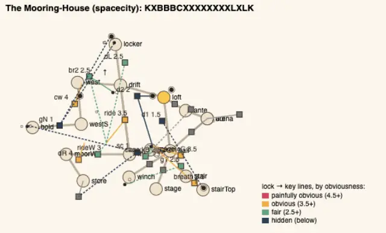

# Temple design audit, v1.87 (2026-10-19)

<!-- audit-scores
overall: 4.4 / 5
label: the average of the fourteen temples' means, with the moves by eye (measured 4.38)
date: 2026-10-19
-->

A re-run of the `temple-design-qc` skill (`.claude/skills/temple-design-qc/SKILL.md`) on main at v1.87 (`f12bba095`) for
issue #556, the design half of the full audit. It follows [v1.85](temple-design-v1.85.md) (4.40) by a day. Since then
#477, v1.85's three edits, landed as three reworks: **the Lamp-House runs in a new order** (the Kennel's keepers and their
small key before the bubble wand, the great key half-way in the Wick Room), **the Builders' Greenhouse is about its bloom
from the first hall** (the bloom on a mound in the great glass hall, the Cold Frame a flower-door, the Seed Chamber's seed
wanting the water up), **the Mooring-House shows its guardian through the first hall's bars** and keeps a spare anchor
over a well in the Anchor Hold. The Footprint's lens steps were made readable in v1.85 (the walker's prints). No house
was changed for this report.

## The setup

- `node scripts/temple-design/audit.mjs` at `f12bba095`: all fourteen built as the game builds them, **every one
  solved**, its gadget mid-way (the Greenhouse's in its first room, its exception in `tests/temples.test.js`
  `GADGET_FIRST`).
- **The redesign's rules** (`rules.mjs`): **0 broken in all fourteen**, as at v1.85.
- `node scripts/design-qc/capture.mjs` for the plans (one muted headless Chrome, port 5592). No in-house views were shot:
  the v1.85 views showed plain rooms with their keys in sight, and the three reworked houses' changelog lines carry their
  own before/after pictures (`src/changelog-media.js`, v1.86).
- **Not checked:** climbs (any wall can be climbed), how readable a lamp, a glyph or a mural is in play, and the guardians'
  fights beyond their definitions (the [combat review](combat-v1.87.md) played them in node). Nobody but the author has
  played the reworked houses.

## The scores

| Temple | Structure | Teach→test→twist | Combination | Non-obvious | Decoupling | Dungeon item | Guardian exam | Identity | Curve | **Mean** |
|---|---|---|---|---|---|---|---|---|---|---|
| Undertower (bazaar) | 5 | 5 | 5 | 4 | 5 | 5 | 4 | 3 | 4 | **4.44 → 4.44** |
| Lamp-House (perdide2) | 5 | 5 | 5 | 4 | 5 | 5 | 4 | 2 → 3 | 4 | **4.33 → 4.44** |
| Builders’ Greenhouse (edena) | 5 | 5 | 5 | 4 | 5 | 5 → 4 | 4 | 2 → 3 | 4 | **4.33 → 4.33** |
| Hush-House (perdide) | 5 | 5 | 4 | 4 | 5 | 5 | 4 | 3 | 4 | **4.33 → 4.33** |
| Mooring-House (spacecity) | 5 | 5 | 5 | 3 | 5 | 5 → 4 | 4 | 3 | 3 → 4 | **4.22 → 4.22** |
| Clock-House (garage) | 5 | 5 | 5 | 4 | 4 | 5 | 4 | 3 | 4 | **4.33 → 4.33** |
| Whale-House (underwater) | 5 | 5 | 5 | 3 | 5 | 5 | 4 | 3 ✎4 | 5 | **4.56 → 4.56** |
| Casting-House (moonfoundry) | 5 | 5 | 5 | 4 | 5 | 5 | 4 | 3 | 5 | **4.56 → 4.56** |
| Footprint (spheres) | 5 | 5 | 4 | 3 | 5 | 5 | 4 | 3 | 5 → 4 | **4.33 → 4.22** |
| Warden’s Well (incal) | 5 | 5 | 5 | 4 | 4 | 5 | 4 | 3 | 5 | **4.44 → 4.44** |
| Founders’ Belfry (arzach2) | 5 | 5 | 4 | 3 | 4 | 5 | 4 | 2 ✎3 | 5 | **4.22 → 4.22** |
| Givers’ House (desert) | 5 | 5 | 5 | 5 | 5 | 5 | 4 | 3 | 4 | **4.56 → 4.56** |
| Aerie (arzach) | 5 | 5 | 5 | 4 | 5 | 4 | 4 | 3 | 4 | **4.33 → 4.33** |
| Engine-House (buried) | 5 | 5 | 5 | 4 | 5 | 5 | 4 | 3 | 5 | **4.56 → 4.56** |

**Moves by eye,** both kept from v1.74 and v1.85 with their reasons, which still hold: the Whale-House's identity ✎4 (its
letters 62 % like the Warden's Well's, but a hall of horns and the deep note is like nothing else in play); the Belfry's
identity ✎3 (64 % like the Hush-House's, its ring of bells like no other house).

**Average across the fourteen: 4.40 / 5** with the moves by eye, measured 4.38: **exactly as at v1.85.** The three reworks
traded points inside their rows rather than adding them.

## What #477 did, house by house

### The Lamp-House: identity 2 → 3, mean 4.33 → 4.44

Skeleton `BBXCGXXBLLK` → `BBXXCGLXBLK`: the great key (`L`) now comes straight after the gadget, half-way, instead of last
but two. Most alike the Engine-House at 69 % → 62 %. Obviousness 3.11 (one step at 1.5: the lamp-glass door `d2`, a
shot and the bubble 110 m and a room from its keys, out of sight). The edit did what it was asked.

### The Builders' Greenhouse: identity 2 → 3, but the dungeon item 5 → 4

Skeleton `XXABLCXRXXXXLK` → `CGXABXXLXXXXLK`: the chest (`C`) and the bloom (`G`) first. Most alike the Undertower at 69 % →
the Givers' House at 57 %. But the item is now found at 0 % of the steps, the "start" end of the dungeon-item anchor, so
that criterion drops a point though the bloom opens eight locks in seven contexts, seven with an older verb. The house is
"about the bloom from there" by the author's choice (`GADGET_FIRST`); the measure reads that as a dungeon with no
build-up to its item. Kept at 4: a first room that teaches the bloom before the chest would be the same house with its
arc back. Not filed.

### The Mooring-House: curve 3 → 4, but the dungeon item 5 → 4

Skeleton `XBBBCXXXXXXXXLXLK` → `KXBBBCXXXXXXXXLXLK`: the guardian seen through the bars first (a preview, scored `K`), the
curve rising 2.85 → 4.35 (curve 4), the chest at 29 % (item 4: earlier than "mid-way"). Non-obvious stays 3 with **three
steps at 1.0–1.5**: the north gate `gN` (a rope and a ball three rooms away, out of sight, 1.0), the perch `sc` (a ball four
rooms and a key two rooms off, 1.0) and the loft door `d1` (a shot two rooms off, 1.5). The tether's ten uses are still
one context (`MooredRoom`, `Switch`, `Ball`, `Key`).

### The Footprint: curve 5 → 4, obviousness 1.8 → 2.55

The v1.85 lens fix (the prints leading to the spiral, the print by the chasm, the first drop by the Hall of Spheres'
door) lifted its mean obviousness from 1.8 to 2.55 (seven steps at 1.5 or less → four). The curve dipped: its first third
is harder now (3.0) against the last (4.58). Still the most obscure house: `dL` (a ball and a plate two rooms off, out of
sight, 1.0), `dR` and `d4` (the lens and a push, 1.0), `dT` (1.5).

## Across the temples

| Temple | Skeleton | Most alike |
|---|---|---|
| Givers’ House | `CXXXLAXGXK` | the Greenhouse 57 % |
| Aerie | `BBCXAXLXXXLK` | the Hush-House 67 % |
| Founders’ Belfry | `LBBCRXXXLK` | the Hush-House 64 % |
| Hush-House | `BBBCXTXLXLK` | the Aerie 67 % |
| Lamp-House | `BBXXCGLXBLK` | the Engine-House 62 % |
| Builders’ Greenhouse | `CGXABXXLXXXXLK` | the Givers' House 57 % |
| Whale-House | `BXXBXCXLXXK` | the Warden's Well 62 % |
| Warden’s Well | `BXLLXCXXXXXLK` | the Aerie 62 % |
| Clock-House | `BAXXXXLCRGXXLK` | the Aerie 57 % |
| Engine-House | `XBBXACGXXLXLK` | the Casting-House 67 % |
| Casting-House | `BBBXBXCXXXBLXLK` | the Hush-House 67 % |
| Footprint | `XBBXXCRRRXLLK` | the Lamp-House 62 % |
| Mooring-House | `KXBBBCXXXXXXXXLXLK` | the Casting-House 67 % |
| Undertower | `XXBBLCTXGXXTLXLK` | the Engine-House 63 % |

- **Sameness eased:** the highest likeness is 67 % (71 % at v1.85), and no house is at identity 2 by measure but the Belfry
  (moved to 3 by eye). Identity is still the weakest criterion, 3 in twelve houses.
- **The guardians all score 4,** as at v1.85: every fight asks for the gadget and a second verb; none asks for it *twisted*
  the way its twist room did. The Hush-House has no fight at all since #409 (the Mother Snapper outwitted by the
  pendulums' sound), so its guardian exam is its puzzle's.
- **Obscure steps:** 14 steps across nine houses score 1.5 or less. The Footprint (4), the Mooring-House (3) and the
  Whale-House (3) hold ten of them.

## The ranked edits

1. **The Mooring-House's three far keys** (non-obvious 3 → 4, mean 4.22 → 4.33): the north gate's rope and ball, the
   perch's ball and the loft's shot target each three or four rooms from their locks and out of sight. Bring one key of
   each within a room, or put the lock in sight of it (a window, a gallery). #561.
2. **The Footprint's last obscure steps** (non-obvious 3 → 4): `dL`'s ball and plate two rooms off; play it through first,
   as v1.85 asked. #561.
3. **A guardian that asks for the twist** (guardian exam 4 → 5 in one house, as a pattern for the rest): no fight asks for
   the gadget the way its twist room used it. A design round, not a fix; noted, not filed.
4. **The Greenhouse's arc** (dungeon item 4 → 5): by the author's choice; not filed.

## Against the last report

[v1.85](temple-design-v1.85.md) ended at 4.40 (measured 4.38). Its three edits (#477) all landed: the Lamp-House and the
Greenhouse are no longer 69 % like another house, the Mooring-House's curve rose, the Footprint's lens became readable.
The average is unchanged because each rework moved a criterion the other way (the Greenhouse's item at the start, the
Mooring-House's chest earlier, the Footprint's first third harder). Every house still solves and breaks no shrine rule.
