# Temple design v1.90

<!-- audit-scores
overall: 4.40 / 5
label: the average of the fourteen temples’ means
date: 2026-10-20
-->

Recommendations only for #598, frozen at **c5449ab6c**. All 14 houses build and solve; **zero shrine-rule violations**. Raw mean 4.39, adjusted 4.40, matching the prior displayed 4.40 (prior raw 4.38). Mooring improves 4.22 → 4.33; Footprint and Belfry remain the lowest adjusted means 4.22. Their lowest criteria are non-obviousness 3 and identity 3; the Belfry’s raw identity 2 is a graph-similarity proxy, not a new visual regression.

Read every house’s logic, main layout, guardian definition and guide dialogue against its plan. Captured two prescribed views per house, plus corrected views for the three lowest houses. Invalid generated camera positions remain labelled in `VISUAL-REVIEW.md`, never used as gameplay defects. Localisation, devices and later #599 changes are excluded.

**Play coverage:** one entry reposition into Footprint with normal previous-world debug inventory; all subsequent movement and aimed tool use through lens acquisition used live controls. Solved d1, stones, kP, dT and dL, acquired the lens through its chest/card, and held T to reveal its mural. No puzzle flags were written. This is a bounded early-path play, **not a complete temple playthrough**. dR, d4, the great key and Echo were not played. Every guardian exam stays at its numeric 4; no subjective guardian uplift is awarded. No audible recognition or fight-quality claim is made.

| Temple | Structure | Teach→test→twist | Combination | Non-obvious | Decoupling | Dungeon item | Guardian exam | Identity | Curve | **Mean** |
|---|---|---|---|---|---|---|---|---|---|---|
| Undertower (bazaar) | 5 | 5 | 5 | 4 | 5 | 5 | 4 | 3 | 4 | **4.44** |
| Lamp-House (perdide2) | 5 | 5 | 5 | 4 | 5 | 5 | 4 | 3 | 4 | **4.44** |
| Builders’ Greenhouse (edena) | 5 | 5 | 5 | 4 | 5 | 4 | 4 | 3 | 4 | **4.33** |
| Hush-House (perdide) | 5 | 5 | 4 | 4 | 5 | 5 | 4 | 3 | 4 | **4.33** |
| Mooring-House (spacecity) | 5 | 5 | 5 | 4 | 5 | 5 ✎4 | 4 | 3 | 3 ✎4 | **4.33** |
| Clock-House (garage) | 5 | 5 | 5 | 4 | 4 | 5 | 4 | 3 | 4 | **4.33** |
| Whale-House (underwater) | 5 | 5 | 5 | 3 | 5 | 5 | 4 | 3 ✎4 | 5 | **4.56** |
| Casting-House (moonfoundry) | 5 | 5 | 5 | 4 | 5 | 5 | 4 | 3 | 5 | **4.56** |
| Footprint (spheres) | 5 | 5 | 4 | 3 | 5 | 5 | 4 | 3 | 4 | **4.22** |
| Warden’s Well (incal) | 5 | 5 | 5 | 4 | 4 | 5 | 4 | 3 | 5 | **4.44** |
| Founders’ Belfry (arzach2) | 5 | 5 | 4 | 3 | 4 | 5 | 4 | 2 ✎3 | 5 | **4.22** |
| Givers’ House (desert) | 5 | 5 | 5 | 5 | 5 | 5 | 4 | 3 | 4 | **4.56** |
| Aerie (arzach) | 5 | 5 | 5 | 4 | 5 | 4 | 4 | 3 | 4 | **4.33** |
| Engine-House (buried) | 5 | 5 | 5 | 4 | 5 | 5 | 4 | 3 | 5 | **4.56** |

## Judgement and previous findings

- **Mooring partly→substantially repaired:** gN ring/ball are local 12.5/15.6 m, sc now has two explicit small-key sockets, and d1’s 61.3 m eye has an aligned geometric sightline. Obscure steps fall 3 → 0. Supplemental views support local relationships, but distant-eye recognition still deserves a newcomer check. Non-obvious 3 → 4 is justified by the structural repair. Retain prior item 5 ✎4 (31% placement) and curve 3 ✎4 (experienced layered route), which cancel in the mean.
- **Footprint partly repaired:** dL is now the Still Pool’s explicit key, rather than a distant ball-condition door. Actual play confirms that route. Three low-scoring dependencies remain (dT 1.5,dR 1,d4 1); performing dT makes its ball-drop cause clear, so do not simplify it solely because the later lock cannot see upstairs. dR/d4 remain open playtest leads.
- **Whale identity 3 ✎4 and Belfry 2 ✎3 retained with current evidence:** sound hall/tide architecture and bell/pole room respectively carry a recognisable spatial identity. These are visual identity adjustments, not guardian claims. No other subjective score move.
- **Greenhouse early bloom remains intentional:** its whole-house use outweighs a generic midpoint prescription. Item 4 is an honest rubric outcome, not an instruction to reverse the author’s choice.
- **Ending panels improved, exams not proven richer:**14 bespoke consequence shots in `src/temples/finale.js:60–137` change punctuation; they do not alone change guardian decisions.

## Five edits/tests to consider, worst first

1. **Footprint dR/d4, helix/lodge/unseen:** play the remaining lens-eye and great-lift chain with a newcomer. If the state is forgotten, keep visible “eye seen / lift up or down / key held” feedback at the relevant doorway. Preserve the multi-room reasoning. Potential non-obvious 3 → 4; not awarded.
2. **Mooring d1, pier→Cord Loft:** check recognition of the 61.3 m eye through the windows; repeat its motif at the lock if needed. Keep the repaired local gN and two-key sc design.
3. **Whale dH/dL:** test its hidden tide/spring causes; show the changed route in the same hall before adding directional text. Potential non-obvious 3 → 4.
4. **Belfry later d4:** if another combination is wanted, reuse hook/push timing in one existing room rather than extending the key chain. Combination 4 → 5 only after a genuinely new decision is playable.
5. **Guidance maintenance:** Vell fan, Petra magnet glove, Fisk/Wim variable capacity. Fix definite instruction mismatches before speculative layout changes; see dialogue report for exact lines.

## Across houses

The common pattern remains a tool chest, repeated tool tests, great key and guardian. Strong returns, reversible states and multiple-verb steps prevent it being a single linear template, but identity remains 3 in most houses. Do not confuse cosmetic recolouring with a different decision sequence. Below are current skeletons and nearest matches; resemblance is an audit prompt, not a demand to invent extra rooms.

| House | Skeleton | Nearest match |
|---|---|---|
| The Rose House | `CXXXLAXGXK` | edena 57% |
| The Aerie | `BBCXAXLXXXLK` | perdide 67% |
| The Founders’ Belfry | `LBBCRXXXLK` | perdide 64% |
| The Hush-House | `BBBCXTXLXLK` | arzach 67% |
| The Lamp-House | `BBXXCGLXBLK` | buried 62% |
| The Builders’ Greenhouse | `CGXABXXLXXXXLK` | desert 57% |
| The Whale-House | `BXXBXCXLXXK` | incal 62% |
| The Warden’s Well | `BXLLXCXXXXXLK` | arzach 62% |
| The Clock-House | `BAXXXXLCRGXXLK` | arzach 57% |
| The Engine-House | `XBBXACGXXLXLK` | moonfoundry 67% |
| The Casting-House | `BBBXBXCXXXBLXLK` | perdide 67% |
| The Footprint | `XBBXLCRRRXLLK` | buried 62% |
| The Mooring-House | `KXBBBCXXXXXXXXLXLK` | moonfoundry 67% |
| The Undertower | `XXBBLCTXGXXTLXLK` | buried 62% |

## Per house: plan, selected step, all lock measures and recommendation

Obviousness 5 means very direct; 1 means remote/hidden. Neither extreme automatically means bad design. Empty/safe first trials can deliberately be direct. The listed reasons are measured; the visual and play qualifications decide how much they support an edit.

### The Undertower — 4.44

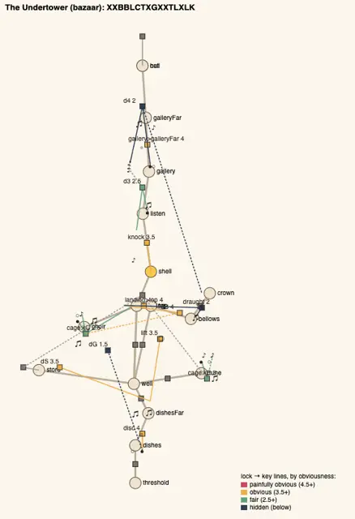

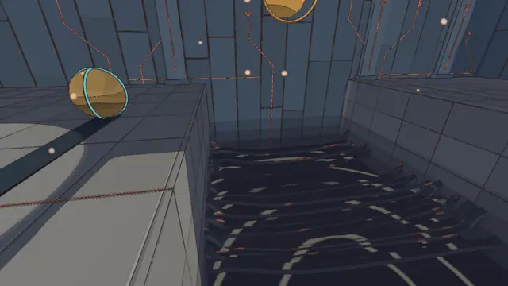

The layered Undertower, return route and recall/dodge relationship give strong structure; the most alike graph is not proof of identical play.

**Gadget arc:** recall, at 31% of the measured route; 7 locks, contexts traversal, switch, EchoEar, Ball, LineRelay, Key, guardian; 4 uses with an older verb. **Guardian link:** gadget:recall, dodge, 3 phases in its definition. Actual full encounter not played; score 4 retained.

| Lock/step | Obviousness (heuristic) | Why |
|---|---|---|
| `disc` (dishes→dishesFar) | 4 | combines push + shot |
| `cage:kE` (tune→tune) | 3 | key out of sight of the lock; combines push + shot |
| `dS` (well→store) | 3.5 | key 1 room away; key over 20 m from the lock |
| `lift` (well→landing) | 3.5 | key 1 room away; key over 20 m from the lock |
| `landing>top` (landing→top) | 4 | combines gadget:hook + gadget:recall |
| `knock` (shell→listen) | 3.5 | key over 20 m from the lock; combines shot + gadget:recall |
| `dG` (landing→choir) | 1.5 | key 2 rooms away; key out of sight of the lock; key over 20 m from the lock |
| `cage:kC` (choir→choir) | 2.5 | key 1 room away; key over 20 m from the lock; combines shot + push + relay + gadget:bomb |
| `d3` (listen→gallery) | 2.5 | key out of sight of the lock; key over 20 m from the lock; combines gadget:recall + push + relay |
| `gallery>galleryFar` (gallery→galleryFar) | 4 | combines gadget:recall + gadget:monocle |
| `dB` (top→bellows) | 4 | key over 20 m from the lock; a key fetched from another room |
| `draught` (bellows→crown) | 2 | key 1 room away; key over 20 m from the lock; combines relay + gadget:recall + gadget:glider; a timing (only while it rings) |
| `d4` (galleryFar→hall) | 2 | key 1 room away; key over 20 m from the lock; a key fetched from another room; combines push + gadget:recall |

**Recommendation:** At dG, audit the recalled-object clue before moving its remote key. Preserve the final gallery return. Expected change: none without a failed newcomer attempt.

Source: `src/temples/bazaar.js:201` (LOGIC ids above; matching layout in the same file). Full measures, rules and lock coordinates: `temple/report.json`.

### The Lamp-House — 4.44

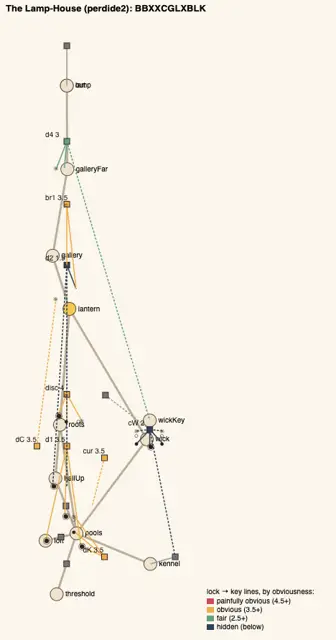

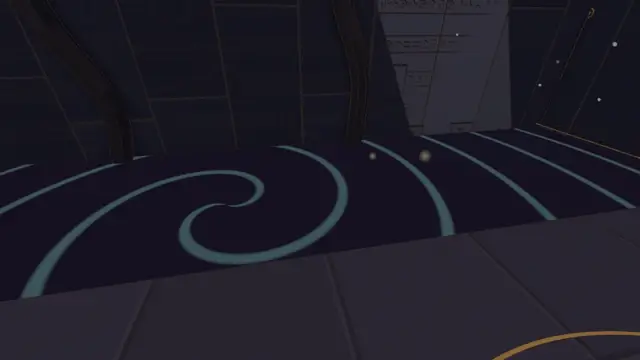

Bubble cur/disc use protects the lamp-worker theme; the initial cur frame is partly occluded and cannot establish first-contact readability.

**Gadget arc:** bubble, at 44% of the measured route; 4 locks, contexts LightEar, Key, Ball, Switch, LampGlass, GreatLamp, PipeLight, guardian; 2 uses with an older verb. **Guardian link:** gadget:bubble, dodge, 3 phases in its definition. Actual full encounter not played; score 4 retained.

| Lock/step | Obviousness (heuristic) | Why |
|---|---|---|
| `cur` (pools→wick) | 3.5 | key out of sight of the lock; key over 20 m from the lock |
| `d1` (pools→roots) | 3.5 | key 1 room away; key over 20 m from the lock |
| `dK` (pools→kennel) | 3.5 | key over 20 m from the lock; combines shot + push |
| `disc` (roots→lantern) | 4 | combines shot + push |
| `dC` (lantern→hallUp) | 3.5 | key out of sight of the lock; key over 20 m from the lock |
| `cW` (wick→wickKey) | 2 | key out of sight of the lock; a key fetched from another room; combines gadget:bubble + push + shot; a timing (only while it rings) |
| `d2` (lantern→gallery) | 1.5 | key 1 room away; key out of sight of the lock; key over 20 m from the lock; combines gadget:bubble + shot + lamp |
| `br1` (gallery→galleryFar) | 3.5 | key 1 room away; key over 20 m from the lock |
| `d4` (galleryFar→lamp) | 3 | a key fetched from another room; combines gadget:bubble + gadget:hook; a timing (only while it rings) |

**Recommendation:** At d2, strengthen the causal lamp/bubble cue if a player cannot connect its remote conditions. Do not add a direct quest arrow to every socket. Expected non-obvious 4 → 5 only after play.

Source: `src/temples/perdide2.js:213` (LOGIC ids above; matching layout in the same file). Full measures, rules and lock coordinates: `temple/report.json`.

### The Builders’ Greenhouse — 4.33

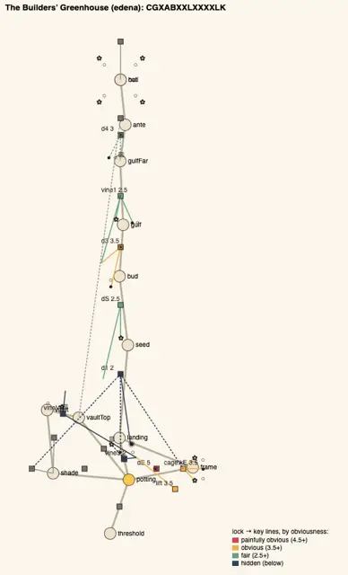

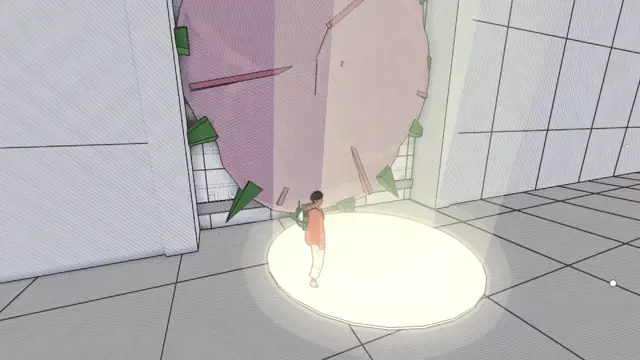

The dE and cage:kE images clearly show the plant/plate teaching space. The early bloom is the author’s intentional whole-house tool.

**Gadget arc:** bloom, at 0% of the measured route; 8 locks, contexts Bud, Seed, Ball, Sluice, Weight, switch, guardian; 7 uses with an older verb. **Guardian link:** gadget:bloom, shot, 3 phases in its definition. Actual full encounter not played; score 4 retained.

| Lock/step | Obviousness (heuristic) | Why |
|---|---|---|
| `dE` (potting→frame) | 5 | Direct visible relationship |
| `cage:kE` (frame→frame) | 3.5 | combines gadget:bloom + push; an order to find |
| `lift` (frame→landing) | 3.5 | key 1 room away; key over 20 m from the lock |
| `vineS` (potting→landing) | 2 | key 1 room away; key out of sight of the lock; combines gadget:bloom + push + sluice |
| `vineV` (vault→vaultTop) | 1 | key 2 rooms away; key over 20 m from the lock; combines gadget:bloom + gadget:hook + carry + sluice + push; 1 thing in the room that are not its key |
| `d1` (landing→seed) | 2 | key out of sight of the lock; key over 20 m from the lock; a key fetched from another room; combines shot + push |
| `dS` (seed→bud) | 2.5 | key 1 room away; key over 20 m from the lock; combines gadget:bloom + sluice + push |
| `d3` (bud→gulf) | 3.5 | key over 20 m from the lock; combines gadget:bloom + push + sluice |
| `vine1` (gulf→gulfFar) | 2.5 | key 1 room away; key over 20 m from the lock; combines gadget:bloom + push + sluice |
| `d4` (gulfFar→ante) | 3 | key out of sight of the lock; combines gadget:bloom + push |

**Recommendation:** Preserve early bloom access; add no mandatory pre-tool wing. If vineV remains confusing in play, make its cause visible through an existing opening. Expected item score stays 4, respecting author intent.

Source: `src/temples/edena.js:112` (LOGIC ids above; matching layout in the same file). Full measures, rules and lock coordinates: `temple/report.json`.

### The Hush-House — 4.33

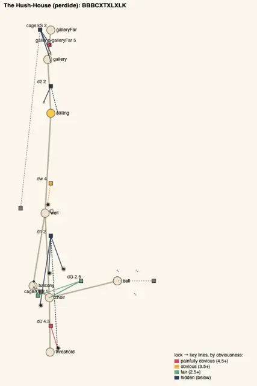

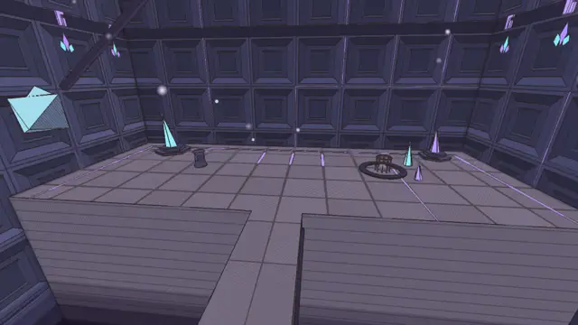

Alternating water levels and counterweights give a coherent reservoir, but the most obvious gallery crossing is intentionally direct.

**Gadget arc:** stun, at 38% of the measured route; 5 locks, contexts Jaw, traversal, Swing, Ball, HushNote, Key, guardian; 4 uses with an older verb. **Guardian link:** gadget:stun, shot, 2 phases in its definition. Actual full encounter not played; score 4 retained.

| Lock/step | Obviousness (heuristic) | Why |
|---|---|---|
| `d0` (threshold→choir) | 4.5 | an order to find |
| `d1` (choir→well) | 2 | key 1 room away; key out of sight of the lock; key over 20 m from the lock; an order to find |
| `dw` (well→stilling) | 4 | key out of sight of the lock |
| `d2` (stilling→gallery) | 2 | key out of sight of the lock; key over 20 m from the lock; combines gadget:stun + sequence; an order to find |
| `gallery>galleryFar` (gallery→galleryFar) | 5 | Direct visible relationship |
| `cage:kS` (galleryFar→galleryFar) | 2 | key 1 room away; key over 20 m from the lock; combines gadget:stun + sequence; an order to find |
| `cage:kB` (balcony→balcony) | 2.5 | key out of sight of the lock; combines gadget:stun + push; a timing (only while it rings) |
| `dG` (choir→hall) | 2.5 | key over 20 m from the lock; a key fetched from another room; combines gadget:stun + sequence; an order to find |

**Recommendation:** At the first gallery crossing, require a learned state choice only if the safe introduction currently fails to teach it; do not complicate d0 just to lower obviousness 5. Expected combination 4 → 5 requires a meaningful later mixed decision.

Source: `src/temples/perdide.js:158` (LOGIC ids above; matching layout in the same file). Full measures, rules and lock coordinates: `temple/report.json`.

### The Mooring-House — 4.33

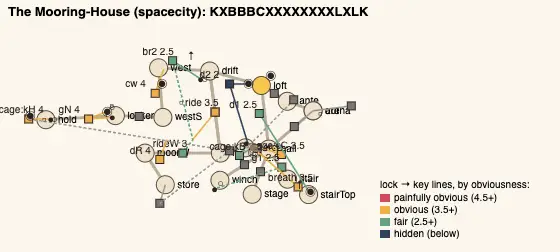

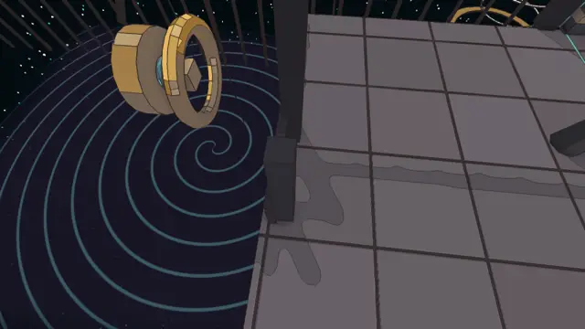

Local gN ball/ring and the explicit two-key sc gate repair the old remote conditions. Supplemental d1 confirms the large machinery room, but recognising a distant eye is less certain than geometric visibility.

**Gadget arc:** tether, at 31% of the measured route; 9 locks, contexts Switch, MooredRoom, Ball, guardian; 9 uses with an older verb. **Guardian link:** gadget:tether, push, 3 phases in its definition. Actual full encounter not played; score 4 retained.

| Lock/step | Obviousness (heuristic) | Why |
|---|---|---|
| `cage:cC` (hall→hall) | 3.5 | key over 20 m from the lock; combines weight + moor |
| `g1` (hall→stair) | 2.5 | key 1 room away; key out of sight of the lock; key over 20 m from the lock |
| `breath` (stair→stairTop) | 3.5 | key 1 room away; key over 20 m from the lock |
| `d1` (hall→loft) | 2.5 | key 2 rooms away; key over 20 m from the lock |
| `d2` (loft→drift) | 2 | key 1 room away; key over 20 m from the lock; combines gadget:tether + moor + push; 1 thing in the room that are not its key |
| `ride` (drift→moor) | 3.5 | key over 20 m from the lock; combines moor + gadget:tether |
| `rideW` (moor→moorW) | 3 | key out of sight of the lock; combines moor + gadget:tether |
| `br2` (drift→west) | 2.5 | key out of sight of the lock; key over 20 m from the lock; combines gadget:tether + push + moor |
| `cw` (west→westS) | 4 | combines moor + gadget:tether |
| `dR` (moorW→store) | 4 | combines moor + gadget:tether |
| `gN` (locker→hold) | 4 | combines gadget:tether + push |
| `cage:kH` (hold→hold) | 4 | combines shot + push + gadget:tether |
| `cage:kB` (perch→perch) | 2.5 | key 1 room away; combines gadget:tether + push + moor; hidden until revealed |

**Recommendation:** Keep gN/sc repairs. Test d1’s 61.3 m eye recognition through its aligned windows; if missed, repeat the same eye motif on the Cord Loft door and pier, preserving distance. Non-obvious improves 3 → 4 now; further uplift needs play.

Source: `src/temples/spacecity.js:222` (LOGIC ids above; matching layout in the same file). Full measures, rules and lock coordinates: `temple/report.json`.

### The Clock-House — 4.33

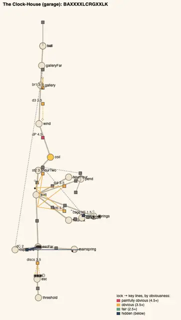

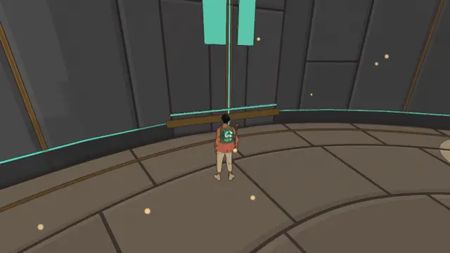

Discs and timing targets read as clockwork. The dP close camera is not evidence of a bad puzzle or missing target.

**Gadget arc:** boomerang, at 56% of the measured route; 4 locks, contexts traversal, Bank, StrikingTrain, Switch, GreatClock, guardian; 2 uses with an older verb. **Guardian link:** gadget:boomerang, shot, parry, 3 phases in its definition. Actual full encounter not played; score 4 retained.

| Lock/step | Obviousness (heuristic) | Why |
|---|---|---|
| `discs` (esc→escFar) | 3.5 | key out of sight of the lock; an order to find |
| `st4` (well→hourFour) | 3.5 | key over 20 m from the lock; combines hour + push |
| `st2` (well→hourTwo) | 3.5 | key over 20 m from the lock; combines hour + push |
| `st6` (well→hourSix) | 3.5 | key over 20 m from the lock; combines hour + push |
| `cage:kE` (strikeLoft→strikeLoft) | 1.5 | key 1 room away; key out of sight of the lock; combines shot + hour + push; an order to find |
| `dP` (coil→wind) | 4.5 | hidden until revealed |
| `d3` (wind→gallery) | 3.5 | key out of sight of the lock; a timing (one breath) |
| `br1` (gallery→galleryFar) | 3.5 | combines gadget:boomerang + sequence + gadget:hook; an order to find |
| `dC` (escFar→cupboard) | 2 | key 1 room away; key over 20 m from the lock; combines sequence + gadget:boomerang + push + hour; an order to find |

**Recommendation:** At cage:kE, review remote-target feedback before adding a shortcut; replace the three-shot claim with capacity-neutral timing instruction. Expected clarity gain; guardian stays 4.

Source: `src/temples/garage.js:205` (LOGIC ids above; matching layout in the same file). Full measures, rules and lock coordinates: `temple/report.json`.

### The Whale-House — 4.56

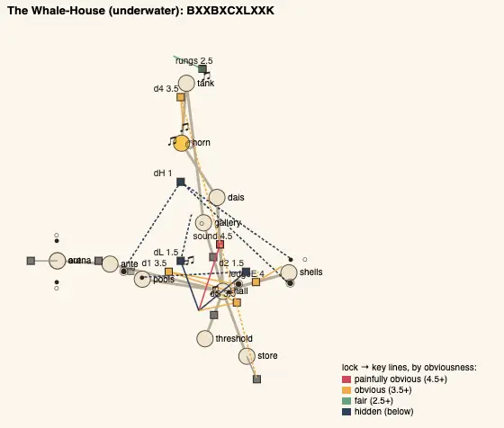

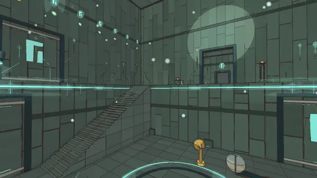

The visible stacked sound hall and water bands support the distinct rising/falling-tide identity. Preserve identity 4 from the prior visual judgement.

**Gadget arc:** springs, at 56% of the measured route; 4 locks, contexts EchoEar, Tide, Key, Weight, guardian; 3 uses with an older verb. **Guardian link:** gadget:springs, push, 3 phases in its definition. Actual full encounter not played; score 4 retained.

| Lock/step | Obviousness (heuristic) | Why |
|---|---|---|
| `ledgeE` (shells→hall) | 4 | key out of sight of the lock |
| `d1` (hall→pools) | 3.5 | key over 20 m from the lock; combines shot + push |
| `d2` (hall→shells) | 1.5 | key 1 room away; key out of sight of the lock; key over 20 m from the lock; combines push + tide |
| `sound` (hall→dais) | 4.5 | key over 20 m from the lock |
| `dH` (dais→horn) | 1 | key 2 rooms away; key out of sight of the lock; key over 20 m from the lock; combines shot + push |
| `dS` (hall→store) | 3.5 | key over 20 m from the lock; combines gadget:springs + tide |
| `d4` (horn→tank) | 3.5 | a key fetched from another room; a timing (only while it rings); 1 thing in the room that are not its key |
| `rungs` (tank→gallery) | 2.5 | key out of sight of the lock; combines gadget:springs + tide + push; a timing (only while it rings) |
| `dL` (hall→ante) | 1.5 | key 1 room away; key out of sight of the lock; key over 20 m from the lock; combines gadget:springs + gadget:hook + carry + tide |

**Recommendation:** Prioritise dH/dL hidden relationships for a later real-input check: show what changed in the same hall when the spring/tide condition is met. Avoid relocating every answer beside its lock. Non-obvious 3 → 4 is a potential, not an awarded score.

Source: `src/temples/underwater.js:181` (LOGIC ids above; matching layout in the same file). Full measures, rules and lock coordinates: `temple/report.json`.

### The Casting-House — 4.56

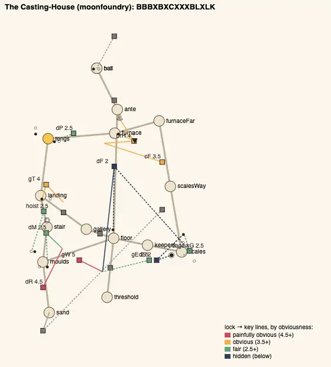

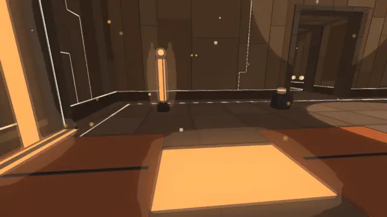

The plainly visible gW tap is a safe first lesson; dR introduces the heavier casting relationship. The industrial sequence has a strong rising curve.

**Gadget arc:** magnet, at 50% of the measured route; 5 locks, contexts Switch, Ball, Brazier, Pour, Weight, Key, guardian; 5 uses with an older verb. **Guardian link:** gadget:magnet, push, shot, 3 phases in its definition. Actual full encounter not played; score 4 retained.

| Lock/step | Obviousness (heuristic) | Why |
|---|---|---|
| `gE` (keepers→floor) | 2.5 | key 1 room away; key out of sight of the lock; key over 20 m from the lock |
| `gW` (floor→moulds) | 5 | Direct visible relationship |
| `dR` (moulds→sand) | 4.5 | key over 20 m from the lock |
| `dM` (moulds→stair) | 2.5 | key out of sight of the lock; key over 20 m from the lock; combines push + pour |
| `hoist` (stair→landing) | 2.5 | key 1 room away; key out of sight of the lock; key over 20 m from the lock |
| `gT` (landing→tongs) | 4 | combines push + pour |
| `dS` (scales→keepers) | 2 | key out of sight of the lock; key over 20 m from the lock; combines shot + push + gadget:magnet; 1 thing in the room that are not its key |
| `dP` (tongs→furnace) | 2.5 | key out of sight of the lock; combines gadget:magnet + push; 2 things in the room that are not its key |
| `brH` (furnace→furnaceFar) | 4 | combines ember + push + pour + gadget:magnet |
| `cF` (furnaceFar→scalesWay) | 3.5 | key 1 room away; key over 20 m from the lock |
| `cage:kG` (scales→scales) | 2.5 | key out of sight of the lock; combines gadget:magnet + push + gadget:hook + carry; 1 thing in the room that are not its key |
| `dF` (floor→ante) | 2 | key out of sight of the lock; key over 20 m from the lock; a key fetched from another room; combines gadget:magnet + push + pour |

**Recommendation:** Keep gW simple. Correct Petra’s magnet-glove reply, then test dS’s remote relationship before expanding it. No geometry edit justified by obviousness 5 alone.

Source: `src/temples/moonfoundry.js:178` (LOGIC ids above; matching layout in the same file). Full measures, rules and lock coordinates: `temple/report.json`.

### The Footprint — 4.22

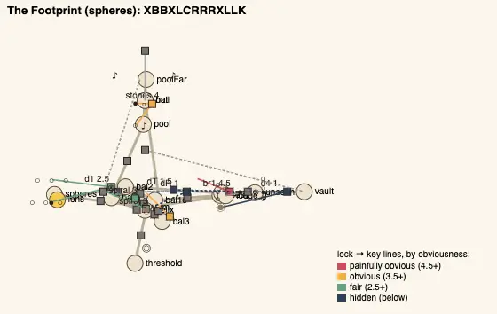

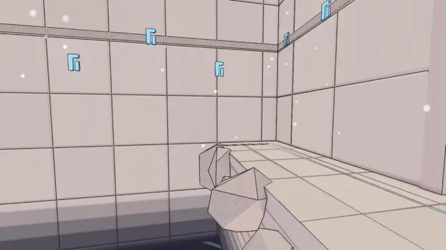

Actual input solved d1, Still Pool/stones/kP, Sounding Toe/dT and dL, then acquired the lens and revealed the teaching mural. The upstairs ball’s drop is understandable while performing it despite dT’s low remote-lock score.

**Gadget arc:** monocle, at 44% of the measured route; 5 locks, contexts traversal, Mural, Switch, GreatLift, Ball, Key, guardian; 2 uses with an older verb. **Guardian link:** gadget:monocle, shot, 3 phases in its definition. Actual full encounter not played; score 4 retained.

| Lock/step | Obviousness (heuristic) | Why |
|---|---|---|
| `d1` (rim→bal1) | 2.5 | key 1 room away; key over 20 m from the lock; combines push + weight |
| `bW` (bal1→bal1e) | 4 | key 1 room away |
| `dT` (bal2→unseen) | 1.5 | key 2 rooms away; key out of sight of the lock; key over 20 m from the lock |
| `stones` (pool→poolFar) | 4 | combines push + weight |
| `spiral` (helix→rim) | 3 | key 1 room away; key over 20 m from the lock; hidden until revealed |
| `spiral` (bal2→helix) | 3 | key out of sight of the lock; key over 20 m from the lock; hidden until revealed |
| `br1` (unseen→unseenFar) | 4.5 | hidden until revealed |
| `dR` (rim→lodge) | 1 | key 1 room away; key out of sight of the lock; key over 20 m from the lock; combines gadget:monocle + push; hidden until revealed |
| `d4` (unseenFar→vault) | 1 | key 3 rooms away; key out of sight of the lock; key over 20 m from the lock; a key fetched from another room; combines gadget:monocle + push + gadget:lens; hidden until revealed |

**Recommendation:** Keep dT and repaired dL. Next play dR then d4; expose persistent feedback for the hidden eye and lift-height state rather than localising all keys. Non-obvious stays 3; no claim that later rooms or Echo were completed.

Source: `src/temples/spheres.js:138` (LOGIC ids above; matching layout in the same file). Full measures, rules and lock coordinates: `temple/report.json`.

### The Warden’s Well — 4.44

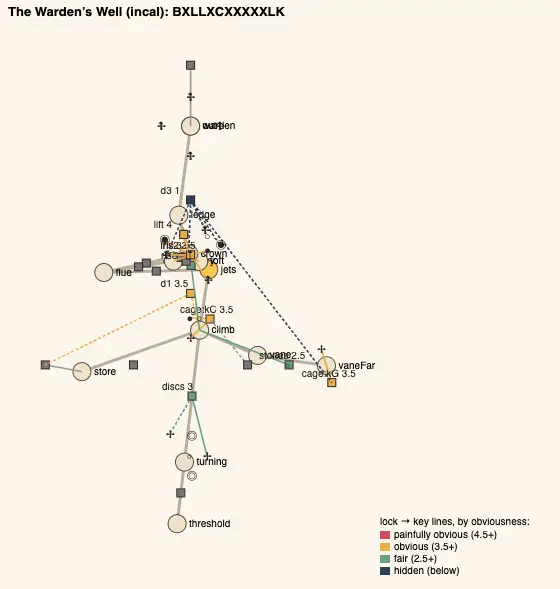

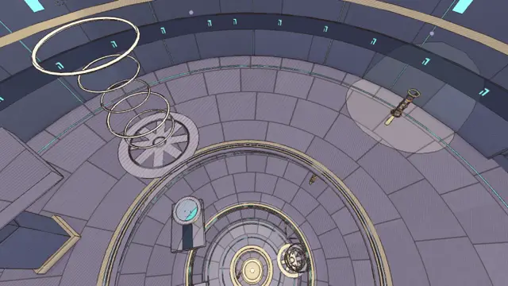

The cage plate and layered lift reveal an inhabited machine; the fan is used across several spatial contexts.

**Gadget arc:** fan, at 40% of the measured route; 6 locks, contexts Vane, Breath, traversal, Switch, Ball, Rim, Key, CrownRing, guardian; 6 uses with an older verb. **Guardian link:** gadget:fan, shot, timed, 3 phases in its definition. Actual full encounter not played; score 4 retained.

| Lock/step | Obviousness (heuristic) | Why |
|---|---|---|
| `discs` (turning→climb) | 3 | key out of sight of the lock; key over 20 m from the lock; a timing (only while it rings) |
| `cage:kC` (climb→climb) | 3.5 | combines push + shot; a timing (only while it rings) |
| `d1` (climb→jets) | 3.5 | key out of sight of the lock; a key fetched from another room |
| `stones` (vane→vaneFar) | 2.5 | key 1 room away; key over 20 m from the lock; combines breath + gadget:bridge |
| `cage:kG` (vaneFar→vaneFar) | 3.5 | combines gadget:fan + breath; a timing (only while it rings) |
| `rise` (jets→gallery) | 2.5 | key 1 room away; key over 20 m from the lock; combines breath + gadget:fan |
| `iris` (gallery→loft) | 3.5 | combines shot + gadget:fan + breath; a timing (only while it rings) |
| `iris2` (loft→crown) | 3.5 | combines push + gadget:fan + breath; a timing (only while it rings) |
| `lift` (crown→ledge) | 4 | combines breath + gadget:fan |
| `d3` (ledge→warden) | 1 | key 1 room away; key out of sight of the lock; key over 20 m from the lock; a key fetched from another room; combines shot + gadget:hook + gadget:fan + breath + push; a timing (only while it rings) |

**Recommendation:** Correct Vell’s obsolete jets promise first. At d3, improve a sustained visual connection between the distant cause and iris if player trials miss it. Do not use a stale tool name as a geometry problem.

Source: `src/temples/incal.js:180` (LOGIC ids above; matching layout in the same file). Full measures, rules and lock coordinates: `temple/report.json`.

### The Founders’ Belfry — 4.22

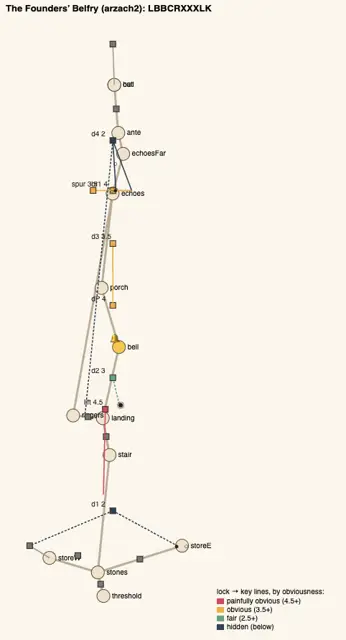

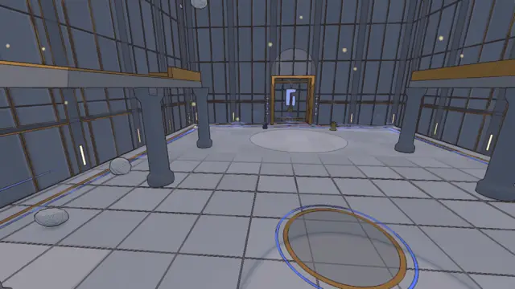

The pole/bell room, suspension and ringed progression support the prior identity 2 → 3 visual adjustment. The bell dP frame is still too close for target readability.

**Gadget arc:** hook, at 38% of the measured route; 5 locks, contexts traversal, FoundersBell, Door, Ball, Key, guardian; 4 uses with an older verb. **Guardian link:** gadget:hook, push, parry, 3 phases in its definition. Actual full encounter not played; score 4 retained.

| Lock/step | Obviousness (heuristic) | Why |
|---|---|---|
| `d1` (stones→stair) | 2 | key 1 room away; key out of sight of the lock; key over 20 m from the lock; a key fetched from another room |
| `lift` (stair→landing) | 4.5 | key over 20 m from the lock |
| `d2` (landing→bell) | 3 | key 1 room away; key out of sight of the lock |
| `dP` (bell→porch) | 4 | hidden until revealed; 1 thing in the room that are not its key |
| `d3` (porch→echoes) | 3.5 | key over 20 m from the lock; combines bell + gadget:hook |
| `br1` (echoes→echoesFar) | 4 | combines bell + gadget:hook + push |
| `spur` (echoes→ringers) | 3.5 | key over 20 m from the lock; combines bell + gadget:hook |
| `d4` (echoesFar→ante) | 2 | key 1 room away; key over 20 m from the lock; a key fetched from another room; combines push + bell + gadget:hook |

**Recommendation:** Avoid a wholesale redesign based on 64% skeleton similarity. If improving combination 4, change one later d4 decision to combine a previously taught hook/push operation rather than adding an arbitrary second lock. Requires a new live acceptance run.

Source: `src/temples/arzach2.js:144` (LOGIC ids above; matching layout in the same file). Full measures, rules and lock coordinates: `temple/report.json`.

### The Rose House — 4.56

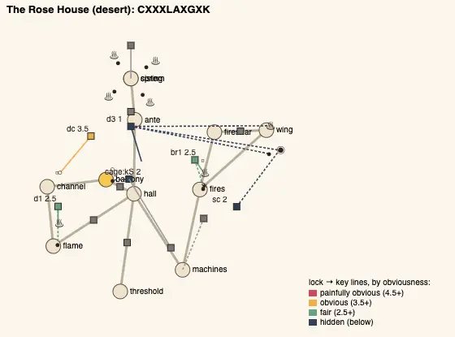

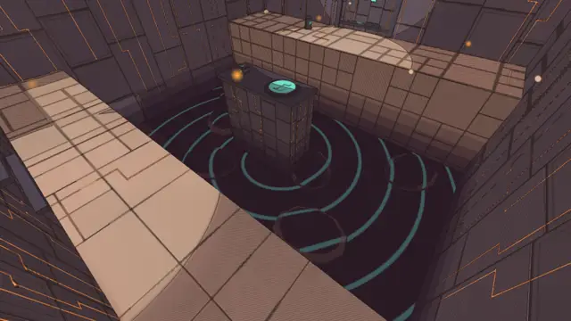

The current name is Rose House; the prior comparison row remains Givers’ House. Fire channels, blade activation and the final cistern maintain a strong causal theme.

**Gadget arc:** sword, at 33% of the measured route; 4 locks, contexts Ball, Brazier, Switch, Sentry, guardian; 3 uses with an older verb. **Guardian link:** gadget:sword, push, shot, 3 phases in its definition. Actual full encounter not played; score 4 retained.

| Lock/step | Obviousness (heuristic) | Why |
|---|---|---|
| `d1` (flame→channel) | 2.5 | key out of sight of the lock; key over 20 m from the lock; combines ember + push |
| `dc` (channel→balcony) | 3.5 | key over 20 m from the lock; combines weight + gadget:doublejump |
| `cage:kS` (hall→hall) | 2 | key 1 room away; key out of sight of the lock; combines gadget:sword + push |
| `br1` (fires→firesFar) | 2.5 | key out of sight of the lock; combines gadget:sword + push; 1 thing in the room that are not its key |
| `sc` (fires→wing) | 2 | key 1 room away; key out of sight of the lock; key over 20 m from the lock; 1 thing in the room that are not its key |
| `d3` (hall→ante) | 1 | key 3 rooms away; key out of sight of the lock; key over 20 m from the lock; combines gadget:shield + gadget:sword + push |

**Recommendation:** At d3, provide visible confirmation of each remote prerequisite already completed, not another fetching step. Keep the opening sword trial legible. Non-obvious 5 is already high; no score chase justified.

Source: `src/temples/desert.js:141` (LOGIC ids above; matching layout in the same file). Full measures, rules and lock coordinates: `temple/report.json`.

### The Aerie — 4.33

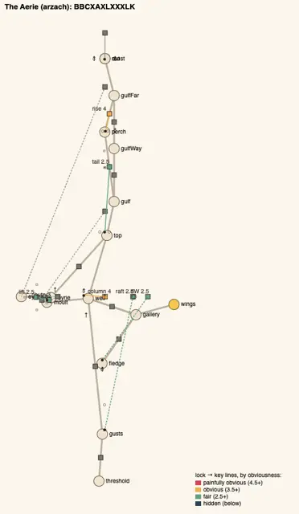

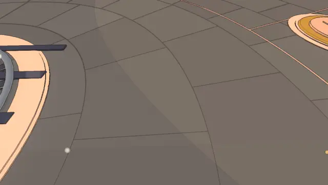

Wind, wings and repeated height changes create a distinct verb sequence. Initial column/rise screenshots are framing-limited.

**Gadget arc:** glider, at 29% of the measured route; 5 locks, contexts Ball, traversal, Door, guardian; 5 uses with an older verb. **Guardian link:** gadget:glider, push, 3 phases in its definition. Actual full encounter not played; score 4 retained.

| Lock/step | Obviousness (heuristic) | Why |
|---|---|---|
| `raft` (well→gallery) | 2.5 | key 1 room away; key out of sight of the lock; key over 20 m from the lock |
| `dW` (gallery→wings) | 2.5 | key 1 room away; key out of sight of the lock; key over 20 m from the lock |
| `column` (well→top) | 4 | combines push + gadget:glider |
| `chute` (eyrie→moult) | 3 | key out of sight of the lock; combines push + gadget:glider |
| `tail` (gulf→perch) | 2.5 | key 1 room away; key over 20 m from the lock; combines push + gadget:glider |
| `rise` (perch→gulfFar) | 4 | combines push + gadget:glider |
| `lift` (eyrie→eyrieKey) | 2.5 | key out of sight of the lock; key over 20 m from the lock; combines push + gadget:glider |

**Recommendation:** Retain the early wings and safe column. Check the top landing through actual flight before changing rise geometry. Dungeon item 4 remains; an authored earlier gift is not automatically a defect.

Source: `src/temples/arzach.js:112` (LOGIC ids above; matching layout in the same file). Full measures, rules and lock coordinates: `temple/report.json`.

### The Engine-House — 4.56

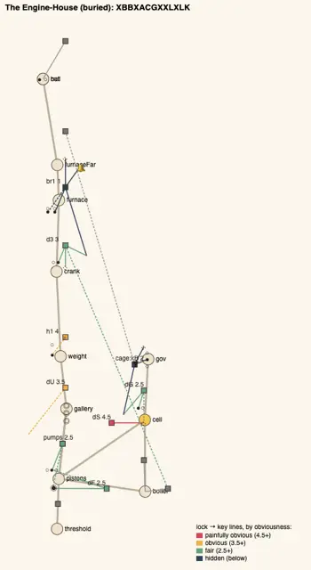

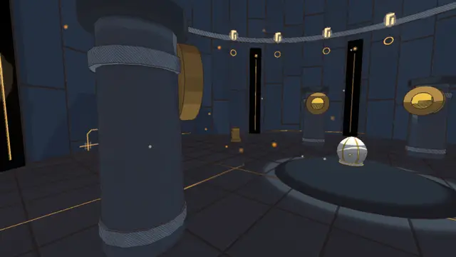

dS’s four-target face is readable and the engine’s multi-stage state gives a strong complexity rise. h1’s cramped image is not a valid cue assessment.

**Gadget arc:** bomb, at 44% of the measured route; 5 locks, contexts Bank, Ball, GreatEngine, Hammer, Key, BellEar, guardian; 4 uses with an older verb. **Guardian link:** gadget:bomb, push, shot, 3 phases in its definition. Actual full encounter not played; score 4 retained.

| Lock/step | Obviousness (heuristic) | Why |
|---|---|---|
| `pumps` (pistons→gallery) | 2.5 | key out of sight of the lock; key over 20 m from the lock; combines shot + push |
| `dU` (gallery→weight) | 3.5 | key out of sight of the lock; key over 20 m from the lock |
| `h1` (weight→crank) | 4 | key out of sight of the lock |
| `dF` (pistons→boiler) | 2.5 | key out of sight of the lock; key over 20 m from the lock; combines shot + push + power |
| `dS` (cell→pistons) | 4.5 | a timing (one breath) |
| `dG` (cell→gov) | 2.5 | key out of sight of the lock; combines gadget:bomb + push + power; a timing (one breath) |
| `cage:kB` (gov→gov) | 2 | key 1 room away; key over 20 m from the lock; combines gadget:bomb + push + power; a timing (one breath) |
| `d3` (crank→furnace) | 3 | a key fetched from another room; combines gadget:bomb + push + power; a timing (one breath) |
| `br1` (furnace→furnaceFar) | 1 | key 1 room away; key out of sight of the lock; key over 20 m from the lock; combines gadget:bomb + push + gadget:hook + power; a timing (one breath) |

**Recommendation:** Replace Fisk’s fixed three-shot premise; at br1 preserve the causal machinery chain but add clear persistent activation feedback if later play finds it opaque. No automatic curve change.

Source: `src/temples/buried.js:114` (LOGIC ids above; matching layout in the same file). Full measures, rules and lock coordinates: `temple/report.json`.

## Evidence and limitations

`play-footprint/final-state.json` records d1/stones/dT/dL open, pool key found and lens owned, dR/d4/dG still closed; `errors.json` is empty. Entry and lens-card/mural images show the actual live path. The first nine command steps are documented in PLAY-FOOTPRINT.md; later command files are retained. No full-completion claim is made. Some prescribed direct-step shots are framing-limited; each is marked in VISUAL-REVIEW.md and no subjective score depends on the invalid frame. A later complete house playthrough is needed before changing guardian scores beyond the definitions.

## Live early-path evidence

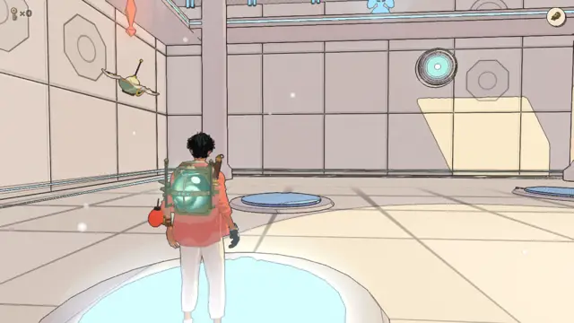

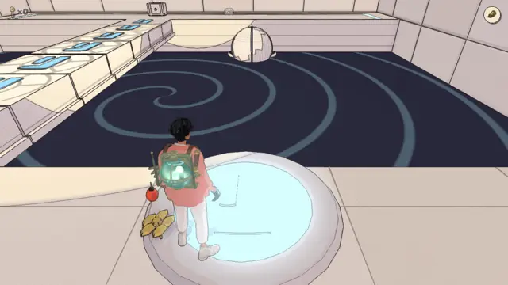

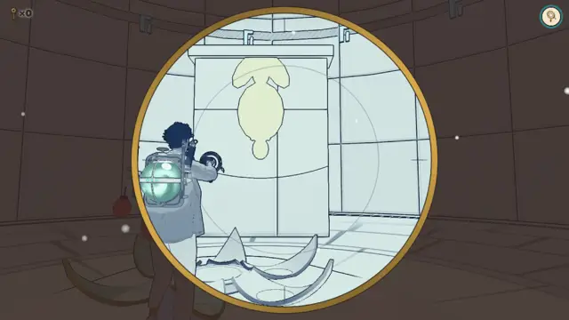

## Preserved audit evidence

Evidence was collected on 2026-10-20 at frozen commit `c5449ab6c`; this final report was consolidated on 2026-10-21 without rerunning the audit. [Evidence inventory and limitations](design-v1.90/README.md) preserve the raw measurements, classified flags, source reading and bounded live-path record. [Prioritized design recommendations](design-v1.90/recommendations.md) separate quality criteria from lock-level obviousness heuristics. Later ship changes and any separately collected device results are outside this report’s scores.
