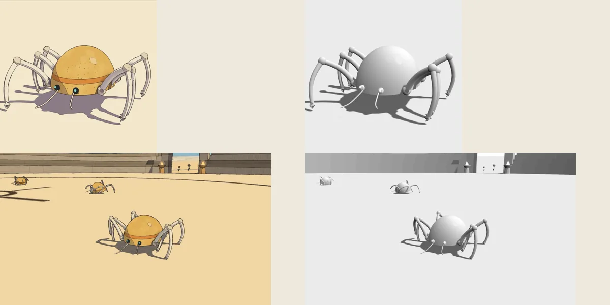
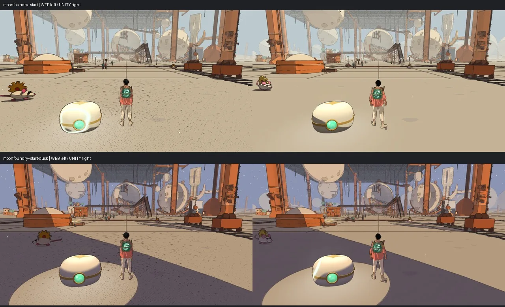

# Visual audit, v1.90

<!-- audit-scores
overall: none
headline: Fourteen-world visual review and 87 native pairs inspected; qualified local rendering differences
label: completed qualitative review; no numeric aggregate rubric
version: 1.90
date: 2026-10-21
-->

**Evidence review complete.** Frozen source `c5449ab6c` (v1.90); later v1.91 ship evidence is excluded. Recommendations only; no findings implemented. Stills completed 14/14 worlds: 226 color pictures and 39 depth pictures, all contact-inspected, zero runtime errors or mute violations. Original probes, corrected pans, zooms, studio, gallery/Arena, temple palette comparisons and temporal ink supplements are captured and inspected. Corrected web parity has 87 valid counterparts. All 87 matched native pairs across 15 worlds are inspected. No numeric overall score is invented from diagnostic flags.

## Setup and limitations

Visible CUA-started console on owned port 5484, one renderer at a time, sandbox progress and pre-import audio-output suppression. Deliberately audible saved preferences must be overridden at audio construction. Initial/final actual mute and gain, loaded settings and errors are recorded per task. Initial Desert smoke accepted with six 1280×720 pictures and constructor/final actual gain 0 despite audible saved preferences. Each world reload rechecks mute/state.

## Findings, lowest criteria first

Stills: 19/226 flat-color warnings, all visually drawn ground-dominated compositions; no crushedblack, blownwhite, magenta or near-depth flags. All 265 PNG files inspected on contact sheets; full-resolution representatives checked across five flagged worlds. No blankframe rendering break. Fire/smoke large pale discs in Desert and cyan walkway effects in Underwater remain comparison candidates, not confirmed defects. Completed probes, motion and native comparisons qualify these still observations below. Detailed clipping attribution is retained in the High probes and Lantern parity because the first still adapter preserved counts but omitted offender names/locations.

## Required coverage

14-world stills;24 motion paths;24 route/preset probe tasks; fresh 87 matched High 1280 × 720 web/Unity editor pairs; all 14 temple reference comparisons.

No single numeric aggregate. Motion heat metrics and clipping/probe flags need image review, not automatic grading.

## Comparison

Latest baseline: `docs/audits/visual-v1.87.md`. Current probe, clipping and temporal tables below compare with the historical pass, with changed scene/sample coverage qualified. No carried-forward score is presented as freshly measured.

## Completed evidence and scope

All prescribed web phases and all 87 matched native pairs have been inspected. Failed or superseded attempts remain excluded and preserved in the ignored evidence bundle. Frozen v1.90 scores are not updated using later v1.91/v1.92 repairs.

## Historical temple-visuals category: all 14 houses covered
Compared the 14 current house captures with documented reference skins and the older v1.32 audit. Current dark slate/circuit houses are deliberate later reference changes, not regressions back to the old shared blue-grey stone. Rose House retains warm violet/amber; Warden slate/cyan; Belfry slate/brass/violet; Engine navy/amber; Footprint cream/cyan; Lamp near-black/gold; Hush indigo/crystal; Aerie slate/warm rings; Clock charcoal/brass/turquoise; Undertower blue-grey/brass; Mooring slate/cyan; Whale sage/cyan; Casting umber/cream/amber. Greenhouse keeps the original white/glass/green/pink scheme: its future manifest explicitly rejects the darker replacement. Do not score against that rejected concept.

Reference pairs in `contacts/temple-reference/` are qualitative palette/identity comparisons; their guardian-room cameras do not match concept compositions. The all-house stills supplement them. Large-scale reference architecture is simplified and wall seams often heavier than delicate concept penwork, but house identities remain distinguishable. No new visual references were generated or selected for this audit. This covers the historical unscored temple-visuals category; it does not establish exact geometric reconstruction.

## Corrected gallery and live Arena comparison

Forty gallery and forty Arena frames were inspected after repairing the first-frame layout and actual debug-uniform setup. Metadata confirms debug 0/5, stable canvas size, desert skitter identity and idle state. Across the sampled idle and ±32° orbit, feet and shadows remain attached without broad moving masks. The studio and Arena use different framing and environment; this is a qualitative lighting/contact comparison, not pixel equivalence. The original blank/wrong-debug attempts remain excluded and preserved.

## Probe checkpoint tables

These are measured flags, not counts of visible defects. The current pass requests four automatic spots and four interiors; v1.87 used two each. Extra flags at additional locations are not release regressions. Missing story people are explicit non-applicable ghost cases. Zero usable surface samples are unsupported measurements, never passing results. The original Qanat High placement skip is retained; its grounded-placement retry returned valid orbit and traveller/Marrow ghost samples, with all 23 debug pictures inspected and no visible halo/moving mask.

| World | Preset | Orbit attempts (count) | Orbit flags / drift | Ghost flags | Seam flags | Placement skips / unsupported orbit |
|---|---|---|---|---|---|---|
| desert | handheld | 9 | — | — | — | ship-ramp-shadow, ship-sand-shadow |
| desert | high | 9 | — | — | — | qanat-tree-stairs, ship-ramp-shadow, ship-sand-shadow |
| arzach | handheld | 4 | — | — | inside-3 (232 px) | — |
| arzach | high | 4 | — | — | inside-3 (210 px) | — |
| perdide | handheld | 5 | — | — | inside-1 (79 px), inside-2 (79 px) | tree-in-water |
| perdide | high | 5 | — | — | inside-1 (79 px), inside-2 (79 px) | tree-in-water |
| edena | handheld | 4 | — | — | — | — |
| edena | high | 4 | — | — | — | — |
| underwater | handheld | 4 | — | — | — | — |
| underwater | high | 4 | — | — | inside-0 (120 px) | — |
| incal | handheld | 4 | — | — | — | — |
| incal | high | 4 | — | — | — | — |
| glassdunes | handheld | 4 | — | — | — | — |
| glassdunes | high | 4 | — | — | — | — |
| buried | handheld | 4 | — | — | — | — |
| buried | high | 4 | — | — | — | — |
| moonfoundry | handheld | 4 | — | — | — | inner-wall-3 |
| moonfoundry | high | 4 | — | — | — | inner-wall-3 |
| spheres | handheld | 4 | — | — | — | — |
| spheres | high | 4 | — | — | — | — |
| spacecity | handheld | 4 | — | — | — | stairs-0 |
| spacecity | high | 4 | — | — | — | stairs-0 |
| bazaar | handheld | 4 | — | — | inside-1 (69 px), inside-2 (119 px) | stairs-0 |
| bazaar | high | 4 | — | — | inside-0 (78 px), inside-1 (73 px), inside-2 (73 px) | stairs-0 |

## Clipping census against v1.87

The whole-world census is heuristic. Intersecting vegetation, elevated temple groups, animated crowd feet and look-at anchors can be intentional. Counts alone are not visible findings; detailed names/coordinates remain in the probe report. The High census is preferred where available; other worlds use the completed stills census. No unsupported count is converted into a defect score.

| World | Previous flags (count) | Current flags (count) |
|---|---|---|
| desert | thing 2, prop 6 | crowd 14, thing 2, prop 6 |
| arzach | npc 1, prop 97 | npc 1, prop 100 |
| perdide | prop 16 | prop 16 |
| edena | thing 1, prop 25 | thing 1, prop 25 |
| underwater | relic 3, box 2, prop 24 | relic 4, prop 35 |
| incal | prop 12 | prop 1 |
| glassdunes | prop 2 | prop 2 |
| buried | thing 1, prop 2 | thing 1, prop 2 |
| moonfoundry | npc 1, relic 1, prop 1 | npc 1, relic 1, prop 1 |
| spheres | prop 10 | prop 10 |
| spacecity | relic 1, prop 1 | crowd 1, relic 1, prop 1 |
| bazaar | prop 2 | box 1, prop 2 |
| home | 0 | 0 |
| lantern | 0 | box 1 |

The older Underwater relic/box flags and later kelp groups are not equivalent object sets. Elevated interior props can appear far above the outdoor terrain while standing on an interior floor. The Arzach NPC flag was already present in v1.87. Follow-up visual attribution is required before recommending a placement change.

## Corrected temporal pan comparison

All 12 corrected pan runs contain nonzero post-warmup samples; the original zero-frame runs remain excluded. Seventy-two spread frames and the four highest-rate heatmaps were inspected. Changes concentrate on thin industrial/architectural lines, vegetation and silhouettes, without broad unstable masks in these sampled views. Optional far-mask sampling was disabled; zero in that channel is not proof of distant stability. Twelve original zoom runs and their 72 spread frames are separately accepted.

| World | v1.87 flicker (pixels / 10000) | Current flicker (pixels / 10000) |
|---|---|---|
| moonfoundry | 16.1 | 16.16 |
| spheres | 13.7 | 13.46 |
| edena | 12.8 | 12.68 |
| incal | 8.5 | 8.81 |
| desert | 6.4 | 6.46 |
| spacecity | 6.3 | 6.14 |
| bazaar | 4.5 | 5.24 |
| perdide | 3.7 | 3.7 |
| arzach | 3.3 | 3.28 |
| buried | 1.5 | 1.55 |
| glassdunes | 1.4 | 1.34 |
| underwater | 0.1 | 0.17 |

The numerical range is similar to the historical pass; changed scene content and this temporal heuristic do not establish a controlled release regression. The matched 640×360 town follow-up independently confirms coarse/dashed thin cables rather than broad masking. No visual recommendations were implemented.

## Matched native parity — 87 of 87 reviewed

All 87 High 1280 × 720 web/Unity Editor pairs across 15 worlds were inspected. Noon/dusk architecture, principal palettes, camera framing and structural shadow directions remain coherent; no confirmed missing fixed architectural assembly or error-colour screen was found. This is qualified static-scene acceptance, not pixel-identical renderer, population or animation equivalence.

The clearest material discrepancy is Moonfoundry's start/start-dusk ground: dense web stippling is largely absent in native at both fixed hours. Native sand contour/hatching is stronger in Arzach, Glass Dunes and Buried. Perdide/Spheres ground vegetation and shoreline detail differ. Compare material inputs, procedural state and sampling before assigning a renderer cause or changing art; these are observed differences, not implemented repairs.

Nearby population differs in Space City, Bazaar and Home. Overnight Train station scenery differs with unsynchronised travel; a dark upper-right transient occluder appears only in the web Underwater wide-dusk frame. Native settles for 1.5 simulated seconds versus web 3.5 wall seconds plus cost sampling. This limits crowd, flower, cloth, particle, caustic and moving-world comparison; it does not prove every absent or present instance is timing alone. These stills do not establish dynamic shimmer, collision or device performance.

Perdide temple0/temple1 use the accepted repaired camera images, excluding the original wall-obscured attempts. The native aggregate contains 74 validated first-run images plus 13 recaptured Home, Lantern and Train images. The first transaction stopped on a legitimate auxiliary portrait PNG; the narrow continuation classifies that side-output separately while retaining strict required-view, raster, mute and isolated-store checks. Both transactions restored all borrowed inputs and generated bundles exactly. The original failure remains retained.

The ignored evidence bundle's `parity/FINAL-87-REVIEW.json` records all 87 inspected rows, accepted source paths and SHA256 hashes; `FINAL-87-REVIEW.md` links the three independent review sets. No numeric visual aggregate is derived from passing image counts.

## Recommendations, evidence strength first

1. Address the visibly alternating cap/plane overlaps identified in the separate surface-overlap report; prioritise normal-route visibility over scanner counts.
2. Compare Moonfoundry's ground material and noise/sampling inputs in the two renderers using a time-locked fixture. The repeated noon/dusk discrepancy is confirmed visually; its cause is unresolved.
3. Refine low-raster thin contour treatment using the ink report's matched temporal evidence, preserving the approved desktop appearance.
4. Diagnose flagged interior seams or census placements only after checking named objects in context. Unsupported samples and additional probe coverage are not new defects by themselves.

These recommendations describe the frozen c5449ab6c baseline. Later release fixes have their own verification ledger and do not rescore this audit.
