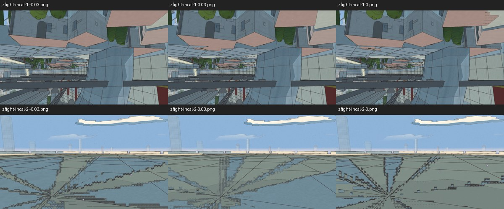
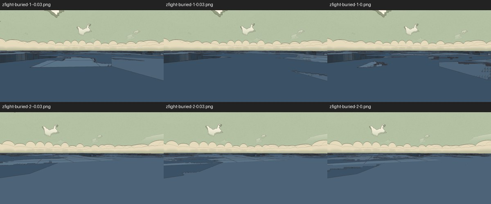
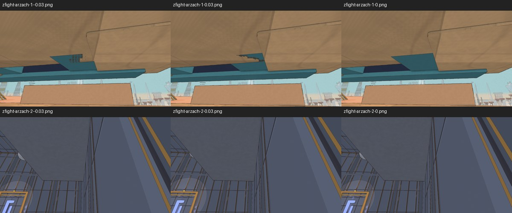
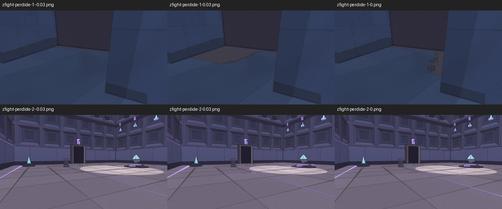

# Z-fighting, v1.90 (2026-10-21)

<!-- audit-scores
overall: none
headline: 6109 geometric sites; 20 targeted sites inspected across 60 camera-nudge pictures; visible alternation remains in several known clusters
version: 1.90
date: 2026-10-21
-->

Frozen source `c5449ab6c` (v1.90). Recommendations only; no findings implemented. The geometric census and targeted web inspection are complete. Four compact publication figures are included (355 KiB total). Later v1.91 ship evidence is excluded.

## Setup

The original Node scanner built all 12 route worlds plus the ship, with named geometry,4mm plane tolerance, 0.05 m² minimum overlap and its standing-point visibility filter. The scan records 6109 sites. The visible CUA-started console on owned port 5484 then captured 20 selected sites across 10 worlds, three camera offsets each (−3 cm, 0, +3 cm), 60 images total. All 60 were inspected in world contact sheets. Initial/final actual mute and master target/gain were true/0/0; all 10 boots had zero runtime errors and sandbox progress.

These are deliberately grazing diagnostic views, including tall city caps that the scanner treats as standable. They establish visible alternation at the selected camera, not frequency on the usual player route. Moving foliage, fish, caustics and birds are not counted as z-fighting. No source was repaired, and no numeric quality score is invented from geometric counts.

## Findings, strongest visible evidence first

| priority | location and evidence | observation | source and recommendation |
|---|---|---|---|
|1|Incal `zfight-incal-2`, lower row of `retained-local-archive:cua-results/contacts/zfight/incal-1.jpg`|Large angular patches switch across the three small camera nudges on the central spire/palace cap.|`src/levels/incal.js:447` and`:453`: cylinder cap and golden palace geometry share a plane. Review cap ownership or bury the hidden cap; first establish how often the roof-level surface appears during normal travel.|
|2|Buried `zfight-buried-1/2`, `retained-local-archive:cua-results/contacts/zfight/buried-1.jpg`|Broad differently colored cap patches change shape between nudges.|`src/levels/buried.js:852` and`:861`: overlapping drawn-city blocks and cylinder tiers. A known layered-city cluster. Prefer removing internal caps or separating planes within the city builder; prioritize player-visible faces over all 1707 geometric sites.|
|3|Arzach `zfight-arzach-1`, upper row of `retained-local-archive:cua-results/contacts/zfight/arzach-1.jpg`|Small jagged teal/stone patches switch at the underside band/terrace join.|`src/temples/portal.js:79/112` against `src/temples/landmarks.js:81/137`. Give one surface ownership of the join, preserving the approved portal silhouette.|
|4|Perdide `zfight-perdide-1`, upper row of `retained-local-archive:cua-results/contacts/zfight/perdide-1.jpg`|A floor-edge patch changes color/coverage with the nudge.|`src/temples/perdide2.js:1041` against landmark drum at `src/temples/landmarks.js:88/199`. Review the exterior drum/cap intersection; the second inspected interior target remains visually stable in these frames.|

The sampled Desert, Edena, Moon Foundry, Space City and Underwater targets do not show obvious alternating surface patches in the inspected three-frame sets. Bazaar's highly grazing second view changes occlusion at an edge; it is insufficient alone to claim a distinct coplanar flicker. These limited negative observations do not clear all floors, moving geometry or every geometric site in those worlds.

## Census against v1.87

| world | v1.87 | v1.90 |
|---|---:|---:|
|Desert|24|24|
|Arzach|3|3|
|Perdide|5|3|
|Edena|5|5|
|Underwater|42|10|
|Incal|4092|4034|
|Glass Dunes|0|0|
|Buried|1707|1707|
|Moon Foundry|238|238|
|Spheres|0|0|
|Space City|12|12|
|Bazaar|73|73|
|Ship|0|0|
|Total|6201|6109|

Counts decreased 92, principally Incal 58 and Underwater 32. The Incal count varies with procedural generation, so this is not a controlled quality-improvement claim. The historical v1.87 report did not inspect the running game; it already identified Incal/Buried city clusters and portal/house intersections as known leftovers. This run adds actual targeted image evidence rather than claiming those clusters are new defects.

## Limits and evidence

Full census and source attribution: `retained-local-archive:zfight/report.json`, per-world JSON and `retained-local-archive:zfight/worst-views.json`. Actual pictures/settings/errors: `retained-local-archive:cua-results/zfight/report.json` and ten contact sheets. Moving-part intersections, instanced props, continuous gameplay, and every rooftop's accessibility were not exhaustively tested by this scanner. Fresh87-view native parity is a separate full-audit gate; it is not presented as a repeat of these60 web nudges. Recommendations remain unimplemented pending the user's review.

## Inspected diagnostic figures

Each row shows the same site at three camera positions, 3 cm apart. These are diagnostic grazing views, not typical-route exposure measurements.

Archive identifiers beginning `retained-local-archive:` name preserved raw evidence in the coordinator’s local validation archive. They are provenance identifiers, not repository-relative paths or public download links. Compact accepted figures are included above.
