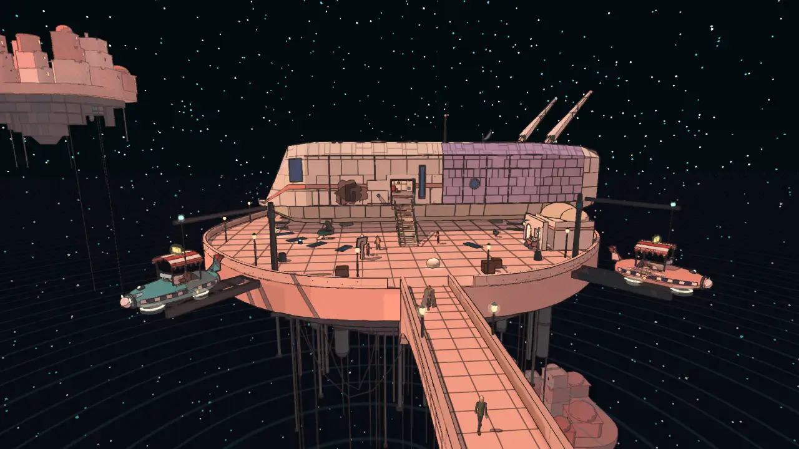

# Space ports in the cities: plan and reference prompts (issue #397, phase 1)

2026-10-17. The author: "Cities should have space ports." Today the ship sets down on a bit of open ground in
each city (`level.shipSite`, or `SITE_OVERRIDES` in `src/ship/sites.js`), and nothing says that a city of a
star-faring people sees ships come and go. This file plans a port for every city: where it goes, what it does
for that city, what it holds, and whether the landing moves. It ends with one Midjourney prompt per city.

**Nothing here is generated or modelled yet.** As CLAUDE.md asks: the author runs these prompts in Midjourney in
his own browser, hearts the sheets he likes, and only the picked designs are modelled. The picks go to a new
`space-ports/<world>/` folder under the references folder (made when the first pick is saved).

**The stand-in.** Until then one city has a modest port made of kit pieces it already has: the City Floating in
Space's Pier (`SC_PORT` in `src/levels/space-city.js`, built by `src/levels/port-pad.js`; docs/systems/worlds.md,
"Space ports, the stand-in"). **It is a stand-in**, to be replaced by the picked design. It shows the gameplay
hook-up the real ports will use: a pad round the ship's site, docks with a craft moored in each, and craft on
loops over the city, all data, nothing solid, the ship landing where it did.



## The rule for every port: the landing does not move

Each city's landing was placed with care: the arrival view out of the ramp (`scripts/arrival-views.mjs`), the
first quest-giver a few steps away (Bastien at the lock, Rosa on the Pier, Halden by the discs, Madame Sel by
the landing), the contact audit over the hull's whole plan (`tests/contact-audit.test.js`) and the sequences'
arrival fixtures. So **in every city the port grows round the ship's present site**: the pad is laid under the
hull, the docks, cranes, staff and cargo stand round it where the ground is free, and the quest-giver stays where
players meet them. What changes for the first walk in is only what you see round the ship: the city's traffic,
a harbourmaster, cargo on its way somewhere. Two cities could later change the arrival itself (the Underwater
City's lock, the City-Shaft's cradle), and both are noted below as options, not as part of this phase.

Sight lines to keep in every port: nothing taller than the ship's hull between the ramp's foot and the city's
landmark in the arrival view (the numbers per city below come from the serendipity map's data,
`src/serendipity-page/collect.js`: distance from the landing, as the crow flies).

## City by city

### The City-Shaft (`incal`)

- **Today**: the ship lands on the east rim (331, 200, −10), the shaft's 274 m-wide void to the west. Corvin
  Sale 47 m, the Warden's Well 69 m, the makers' court 80 m, Lio's dispatch mast 92 m, the cab rank 118 m; the
  Lodestar hangs over the shaft's middle, 274 m off.
- **The port: the Rim Docks.** A run of cantilevered cradles bolted to the rim over the drop, the ship's pad the
  biggest of them; Lio's dispatch mast becomes the port's tower, its lamp signalling the cabs. The city's own
  cabs are the small craft: queued at a stand by the pad, rising out of the shaft on the cab lanes.
- **Holds**: cradles and a gantry crane on rails along the rim, cab stands, a dock warden in the rim's lacquered
  uniform, crates and baskets lowered into the shaft on cables (the ration for the guard starts here).
- **Look**: the rim's rich pastel lacquer and brass over iron, everything hung over the void.
- **Landing**: stays. Keep the view west across the shaft to the Lodestar clear of cranes. Option for later: the
  ship settling into a cradle that swings it in over the rim (a cinematic change, the takeoff too).

### The Signal Market (`bazaar`)

- **Today**: the ship lands south of the market (20, 0, 151); Doss 22 m, Madame Sel "by the landing" 25 m (the
  main quest's first step), the lantern sellers' gallery 69 m, the silent tower 326 m north up the avenue. The
  market already flies cabs up the avenue's middle.
- **The port: the Callsign Apron.** A paved apron at the market's south end under a thicket of antenna masts
  and signs that announce each arrival, the cab stand where the avenue's cabs turn round, stalls selling to
  crews as they step off.
- **Holds**: the apron's painted pad, a mast of call-sign boards (every ship's sign in lights), a callsign clerk
  at a window who logs every ship (the harbourmaster), crates of radios and antenna parts, two parked freighters.
- **Look**: the market's sea-green paving and coral and slate walls; signs everywhere, one board left dark.
- **Landing**: stays. Keep the axis north up the avenue to the silent tower clear; Madame Sel stays at the
  apron's gate.

### The Underwater City (`underwater`)

- **Today**: the ship stands on the Dock's dome (5.4 east of 0, 134); the lock takes it down. Bastien at the lock
  11 m (the main quest's first step), the divers' rack 15 m, the moon pool 20 m, the pod tower's door 49 m.
- **The port: the Dock itself, made a port.** A surface pontoon ring round the dome where ships set down, the
  lock shaft under it; inside, the moon pool where the city's pods and subs come and go.
- **Holds**: the pontoon's pad and bollards, the lock's great doors, pods gliding outside the glass on lanes,
  Bastien as the lockkeeper (he already is), divers' cargo nets and air bells.
- **Look**: coral pinks and sea teals under glass, brass lock gear, the pods round like bathyscaphes.
- **Landing**: stays. Option for later: show the ship going down the lock (the arrival's last shot).

### The City Floating in Space (`spacecity`): the stand-in is here

- **Today**: the ship lands on the Pier, a round dock at the city's south (0, 0, 128). Rosa on the Pier 8 m (the
  main quest's first step), Amaro's Oil-Lamp Shop 20 m, the telescope at the Pier's end 35 m; the bridges north
  to the Gate, the Market and the Mooring-House 295 m off.
- **The port: the Pier port.** The Pier is already the city's landing; the port makes it a harbour of the
  moorers: iron cradles hung off its rim on cables, small lamp-boats moored in them, a harbour lamp-mast, the
  craft of the islands circling slowly between them.
- **Holds**: the pad's ring round the ship, two to four docks, a harbourmaster with a chalk-board log (Rosa
  chalks the bridges; the harbour needs its own), oil casks and lamp crates for the islands, craft on loops.
- **Look**: cream, salmon and coral adobe, dark teal iron (the Balcony's railing), the moorers' cables.
- **Landing**: stays (the stand-in proves it: the docks either side of the bridge, the ring under the hull, the
  ramp's view north and Rosa untouched).

### The Glass Dunes (`glassdunes`)

- **Today**: the ship lands at the valley's south (0, 0, 250); Halden "by the discs" 26 m (the main quest's
  first step), the window in the sand (domes below) 49 m, Marit's Kiln-Stall 79 m, the Clock-House 186 m east.
- **The port: the Float Yard.** The makers' landing discs are already there beside the ship: the port is the
  glassworkers' yard round them, where float-sledges load the glass floats and carriers' craft land.
- **Holds**: the makers' discs as the pad (the one place the makers' ancient high tech belongs in a port here),
  racks of glass floats, the carriers' float-sledges and a skiff with a glass hull, a yard boss with a tally.
- **Look**: sand gold, bottle-green glass in breaking waves, the camps' canvas; the discs pale stone with a line
  of light.
- **Landing**: stays; keep the view east to the Clock-House and its clock.

### The City During the Eclipse (`eclipse`, off the route, in progress)

- **Today**: the ship lands on the esplanade south of the gate (0, 0, 96); Mira 74 m, the Lantern Square past the
  gate, the top of the bowl 214 m.
- **The port: the Lantern Esplanade.** A ceremonial landing terrace: limewashed pylons with lamps lit at noon,
  lamp-bearers who walk a ship in under the black sun, a small craft or two with lantern sails.
- **Holds**: the terrace's pad marked in lamps, pylons and a signal tower with a mirror, a lamp-bearer master,
  baskets for the feast's tables.
- **Look**: limewash white and rose under the corona's light, lamps everywhere, long eclipse shadows.
- **Landing**: stays, the gate on the ramp's axis.

### The Salt Harbour (`saltharbour`, off the route, in progress)

- **Today**: the ship lands on the open salt south of the street (0, 0, 92); Marrow 15 m, Hesper 86 m (she keeps
  the harbour book), the terracotta hull's deck 158 m.
- **The port: the Salt Quay.** A harbour that lost its sea and found ships of another kind: a landing field
  staked out on the salt with the old mooring ropes, a crane made of a ship's mast and boom, the harbour book
  kept at a window in a hull.
- **Holds**: the staked pad and its rope ring, the mast crane, Hesper as the harbourmaster (she already is), sea
  chests and herb crates, a sand-skiff on runners and a small hopper craft.
- **Look**: white salt, terracotta and weathered blue hulls, sailcloth overhead.
- **Landing**: stays; keep the view north up the street to the ship standing on its stern.

### The City Behind the Waterfall (`waterfall`, off the route, in progress)

- **Today**: the ship lands on a stone shelf outside the cavern's east mouth (140, 0, 2); the promenade and its
  balconies over 230 m west, Aldo 233 m.
- **The port: the Falls Ledge.** A carved landing shelf with a docking niche cut into the cliff, spray over it,
  small craft that fly out through the slits in the falls.
- **Holds**: the shelf's pad, a niche with a gantry, a ledge keeper, crates hauled into the cavern on a cable.
- **Look**: wet grey stone, moss, the white falls and the sunlit valley below.
- **Landing**: stays; the cavern's mouth on the ramp's axis.

### The Buried Machine (`buried`)

- **Today**: the ship lands at the stokers' town (−3, 5, 101.5); Jot 26 m, Mott's Tooth-Counter 32 m, Wen by the
  great dome 65 m (the main quest's first step), the great wheel 248 m.
- **The port, if any: a freight stage.** A town of stokers, not a city of travellers: at most a loading stage for
  the oil and the teeth the town trades, an ore hopper on a crane. Lowest priority.
- **Landing**: stays.

## What's shared and what's each city's

Shared (one kit, `src/levels/port-pad.js` grown from the stand-in, every piece data-driven):

- **the pad**: a ring and chevrons round the ship's site, landing lights, a place for a number or a sign;
- **the docking frame**: a cradle, a post with a jib or a gantry, a cable, a lamp;
- **the craft family**: the cab's body as the small craft (re-skinned per city), plus a picked freighter and a skiff;
- **traffic**: loops and lanes over the city as data, craft moored or parked baked into the city's meshes;
- **cargo**: crates, casks, nets, baskets from the kits the cities already have;
- **the harbourmaster's spot**: a person with a log, one or two lines, standing clear of the ramp.

Each city's own: the palette and materials, the pad's surface (painted deck, makers' discs, salt and stakes,
lamps, a pontoon), the frame's build (iron and cable, brass lacquer, ship masts, limewash pylons, carved stone),
the craft's skins and shapes, the staff's costume, the cargo's goods, and the port's sound.

## The prompts

One sheet per city: the port seen from above three-quarter, a close view of the pad with the ship's size shown,
and the small craft. Every prompt asks for the game's look. Run each in Midjourney with `--ar 16:9`; heart the
sheets worth modelling.

### The City-Shaft: the Rim Docks

```
Environment design sheet for a science fiction exploration game: a space port on the rim of a city built down the walls of a vast vertical shaft, rich families on the sunlit rim, the poor in the dark depths, a great lamp hanging over the void. Cantilevered landing cradles of iron and pastel lacquered panels bolted to the rim over the drop, the biggest holding a long boxy starship, a gantry crane on rails along the rim, a slender dispatch mast with a signal lamp, small flying cabs with striped awnings queueing at a stand and rising out of the shaft on lanes, crates lowered on cables, a dock warden in a high collar. Three panels: the port from above three-quarter, the landing cradle close with a person for scale, three small craft side by side. Moebius science-fiction, Franco-Belgian ligne claire, exquisite fine pen contours, sparse delicate hatching only in shadows, luminous flat pastel gouache colours, rose, lavender and pale blue lacquer with brass, rust and soot grey below, restrained cream paper grain, clear readable construction, no lettering --ar 16:9 --no photorealism 3d-render text watermark lettering labels
```

### The Signal Market: the Callsign Apron

```
Environment design sheet for a science fiction exploration game: the space port of a crowded market of a thousand glowing signs where one tall tower is silent. A paved landing apron at the end of the market's avenue under a thicket of antenna masts and stacked sign boards, a long boxy starship parked on a painted pad, a tall board of call signs lit for each arrival with one dark, a clerk's window logging ships, flying cabs turning round at a stand, crates of old radios and antenna parts, stalls selling to crews. Three panels: the apron from above three-quarter with the avenue running off toward the silent tower, the pad close with a person for scale, three small craft and a squat freighter side by side. Moebius science-fiction, Franco-Belgian ligne claire, exquisite fine pen contours, sparse delicate hatching only in shadows, luminous flat pastel gouache colours, sea green paving, coral and slate walls, signs in warm yellow and cyan, restrained cream paper grain, clear readable construction, no lettering --ar 16:9 --no photorealism 3d-render text watermark lettering labels
```

### The Underwater City: the Dock

```
Environment design sheet for a science fiction exploration game: the port of a city of glass domes on the sea floor. A round pontoon ring on the sea's surface round a lock shaft where a long boxy starship sets down and is lowered under the sea, great brass lock doors, below in the glass dome a moon pool where small round submersible pods like bathyscaphes come and go, pods gliding outside the glass on lanes past kelp and a distant whale, divers' racks and cargo nets, a lockkeeper in a heavy coat. Three panels: the pontoon and the lock from above three-quarter, the lock's chamber cut away with the ship inside and a person for scale, three small pods side by side. Moebius science-fiction, Franco-Belgian ligne claire, exquisite fine pen contours, sparse delicate hatching only in shadows, luminous flat pastel gouache colours, coral pink and sea teal, brass, pale green glass, restrained cream paper grain, clear readable construction, no lettering --ar 16:9 --no photorealism 3d-render text watermark lettering labels
```

### The City Floating in Space: the Pier port

```
Environment design sheet for a science fiction exploration game: the port of a city of heaped rounded adobe houses on islands floating in the black of space, joined by pale arched bridges, cables hanging into the void, a great pale planet over the roofs. A round pier island at the city's edge where a long boxy starship lands on a ring of painted marks, iron docking cradles hung off the pier's rim on cables with little lamp-boats moored in them, a harbour lamp-mast, a harbourmaster with a chalk board, oil casks and lamp crates, small craft circling slowly between the islands. Three panels: the pier from above three-quarter with the bridge running off to the city, one docking cradle close with a person for scale, three small craft side by side. Moebius science-fiction, Franco-Belgian ligne claire, exquisite fine pen contours, sparse delicate hatching only in shadows, luminous flat pastel gouache colours, cream, salmon and coral walls, dark teal iron, warm lamp light, black starry space, restrained cream paper grain, clear readable construction, no lettering --ar 16:9 --no photorealism 3d-render text watermark lettering labels
```

### The Glass Dunes: the Float Yard

```
Environment design sheet for a science fiction exploration game: the landing yard of glassworkers' camps in a sand valley walled by giant frozen waves of green glass that broke and never fell. Ancient landing discs of pale smooth stone with a thin line of soft light, made by a vanished high-tech people, a long boxy starship resting on the largest, racks of hand-blown glass floats, float-sledges loading them, a small skiff with a glass hull, canvas shades on poles, a yard boss with a tally board. Three panels: the yard from above three-quarter with a round clock-tower house in the distance, the landing disc close with a person for scale, three small craft and a float-sledge side by side. Moebius science-fiction, Franco-Belgian ligne claire, exquisite fine pen contours, sparse delicate hatching only in shadows, luminous flat pastel gouache colours, sand gold, bottle green glass, ochre canvas, pale stone, restrained cream paper grain, clear readable construction, no lettering --ar 16:9 --no photorealism 3d-render text watermark lettering labels
```

### The City During the Eclipse: the Lantern Esplanade

```
Environment design sheet for a science fiction exploration game: the landing terrace of a city of limewashed houses, domes and round towers on terraces round great stairs, at midday under a total eclipse, the black sun and its corona over the roofs, every lamp lit at noon. A ceremonial esplanade before the city gate where a long boxy starship lands between rows of limewashed pylons topped with lamps, lamp-bearers in long pale robes walking the ship in, a signal tower with a great mirror, a small craft with lantern sails, baskets carried to the feast tables. Three panels: the esplanade from above three-quarter with the gate and the stairs beyond, the landing marks close with a person for scale, two small craft side by side. Moebius science-fiction, Franco-Belgian ligne claire, exquisite fine pen contours, sparse delicate hatching only in shadows, luminous flat pastel gouache colours, limewash white, rose horizon light, warm lamp gold, deep blue shadow, restrained cream paper grain, clear readable construction, no lettering --ar 16:9 --no photorealism 3d-render text watermark lettering labels
```

### The Salt Harbour: the Salt Quay

```
Environment design sheet for a science fiction exploration game: a harbour that lost its sea, huge weathered ships standing on their keels in a vast dry white salt basin, made into apartment buildings. A landing field staked out on the salt with the old mooring ropes, a long boxy starship set down on it, a crane built from a ship's mast and boom, the harbour book kept at a window cut into a hull, sea chests and herb crates, a sand-skiff on runners and a small hopper craft, a harbour mistress in a salt-stained coat. Three panels: the quay from above three-quarter with the street of hulls running off toward a ship standing on its stern, the staked pad close with a person for scale, two small craft side by side. Moebius science-fiction, Franco-Belgian ligne claire, exquisite fine pen contours, sparse delicate hatching only in shadows, luminous flat pastel gouache colours, salt white, terracotta, weathered blue hulls, sailcloth cream, restrained cream paper grain, clear readable construction, no lettering --ar 16:9 --no photorealism 3d-render text watermark lettering labels
```

### The City Behind the Waterfall: the Falls Ledge

```
Environment design sheet for a science fiction exploration game: the landing ledge of a long cavern city hidden behind a curtain of falling water, high over a sunlit valley. A broad carved stone shelf outside the cavern's mouth where a long boxy starship lands, a docking niche cut into the cliff with a small gantry, crates hauled into the cavern on a cable, spray drifting over the ledge, small gliding craft flying out through slits in the falls, a ledge keeper in an oilskin cape. Three panels: the ledge from above three-quarter with the falls and the valley, the niche close with a person for scale, two small craft side by side. Moebius science-fiction, Franco-Belgian ligne claire, exquisite fine pen contours, sparse delicate hatching only in shadows, luminous flat pastel gouache colours, wet grey stone, moss green, white water, sunlit valley gold, restrained cream paper grain, clear readable construction, no lettering --ar 16:9 --no photorealism 3d-render text watermark lettering labels
```

### The Buried Machine: the freight stage (lowest priority)

```
Environment design sheet for a science fiction exploration game: the freight stage of a stokers' town round a vast machine buried in a rust canyon, a great wheel turning one tooth a year. A loading stage of riveted iron beside the town's dome where a long boxy starship lands, an ore hopper on a crane, barrels of oil and crates of iron teeth, a stoker foreman with a whistle, steam from the canyon stacks. Three panels: the stage from above three-quarter, the pad close with a person for scale, a small freighter and a hopper craft side by side. Moebius science-fiction, Franco-Belgian ligne claire, exquisite fine pen contours, sparse delicate hatching only in shadows, luminous flat pastel gouache colours, rust orange, soot grey, oil black, brass, restrained cream paper grain, clear readable construction, no lettering --ar 16:9 --no photorealism 3d-render text watermark lettering labels
```

## After the picks (phase 2)

1. Save the picked sheets to a new `space-ports/<world>/` folder under the references folder, and commit them.
2. Grow `port-pad.js` into the shared kit (the picked craft and frames as pieces) and give each city its `PORT`
   data in its level, in the city's materials.
3. Replace the Pier's stand-in with the picked design; then the City-Shaft, the Signal Market, the Underwater
   City and the Glass Dunes (the route's cities), then the side worlds as they leave WIP.
4. A harbourmaster per port (one or two toned lines, no hand-offs) and the craft's sound.
5. Check each city's arrival view (`scripts/arrival-views.mjs`), the contact audit, the quests' first steps, the
   draw calls, and Unity picture against picture.
