# The engine bridge: the game's JavaScript inside Godot and Unity

The C# port (`unity/Hiraeth`, docs/systems/unity.md) re-implements the game. The bridge goes the
other way: the game's own modules run in the engine's JavaScript VM (GodotJS's V8 in Godot, Puerts'
V8 in Unity), build and move their three.js scene as they do on the web, and the engine only draws
it. One game, drawn by three renderers, never out of step.

## What runs where

| | the web | Godot / Unity through the bridge |
|---|---|---|
| levels, physics, player, camera rig, story, people, quests, saves | `src/` in the page | the same `src/`, bundled (`scripts/engine-bundle.mjs`) into the engine's VM |
| the scene graph and the maths | three.js | three.js (its `Object3D`s, matrices, geometries, materials as data: no `WebGLRenderer`) |
| drawing | `WebGLRenderer`, `materials.js` G-buffer, `post.js` ink | the engine's nodes, fed by the mirror (`engine/mirror.js`); the ink look in the engine's shaders |
| the page (HUD, menus), input, sound, files, storage | the browser | `engine/platform.js` stand-ins, fed by the engine's host (`engine/<engine>/host.js`) |

Per frame: the engine calls the bundle's `frame(dt)`; the game updates; `SceneMirror.sync(scene,
camera)` walks the scene and hands the backend only what changed; the engine draws.

## The seam: the scene mirror

`engine/mirror.js` (engine-agnostic, tested in Node) gives every drawable a small integer id the
first time it is seen, every geometry and material theirs, and calls the backend:

| op | when | payload |
|---|---|---|
| `geometry(gid, g)` | a geometry first seen, or an attribute's `version` moved | three's typed arrays as they are (`position`, `normal`, `uv`, `color`, `skinIndex`, `skinWeight`, `index`) and its groups |
| `material(mid, spec)` | a material first seen | `engine/ink-spec.js`: makeMaterial's options read back from its uniforms, plain numbers and arrays; the frame's shared uniforms left out |
| `create(id, node)` | a drawable first seen | `{ kind: mesh / instanced / skinned / points / line / sprite, gid, mids, name, renderOrder, shadow }` (shadow: the web's caster rules) |
| `transforms(ids, mats, n)` | each frame, once | the world matrices that changed, packed: `n` ids and 16 floats each |
| `visible(id, on)` | an object (or an ancestor) shown or hidden, or out of the scene | |
| `instances(id, count, mats, colors)` | an `InstancedMesh`'s matrices or count changed | three's `instanceMatrix` (16 a instance) and `instanceColor` |
| `geometryOf(id, gid)` | a drawable's geometry swapped or rewritten (cloth, trails) | the geometry's id (sent again first) |
| `instances(id, count, null, null, attrs)` | a mesh on an instanced geometry (kind `instgeo`: the grass) whose attributes moved | each per-instance attribute that moved, with the range rewritten (`updateRanges`) |
| `drawState(id, o)` | each frame an `instgeo` drawable is drawn | the object: the backend reads what moves on it (the grass patch's centre and fades) |
| `materialLive(mid, color, glow)` / `materialFluid(mid, f)` | a material's colour, glow or fluid moved after it was sent | the new values (a flower waking, a lamp lit, the tank's fluid) |
| `bones(id, mats, n, bind, bindInverse)` | each frame a skinned mesh is seen | three's `skeleton.boneMatrices` (bone world × inverse bind) and the mesh's bind matrices (`engine/skin.js` folds them into one matrix a bone) |
| `remove(id)` | out of the scene for `forgetAfter` frames | |
| `camera(c)` | each frame | world matrix, vertical fov, near, far, aspect |
| `frame(f)` | each frame, last | the frame number and counters |

World matrices only: the engine side is flat (one node per drawable under one root), so three's
own hierarchy, `matrixAutoUpdate`, attachments and skeleton maths stay in three. Godot and three
agree on frames (right-handed, y up, cameras down −z): only the winding flips (three's front faces
are counter-clockwise, Godot's clockwise). Unity is left-handed: x is mirrored, as the C# port's
exporter does.

**Materials** cross as data, not shaders: `inkSpec(material)` gives `{ type: 'ink' | 'basic' |
'shader', side, transparent, defines, u: { uColor, uMode, uGlow, uShade, … } }`, and
`engine/ink-params.js` maps it to the engines' ink shader parameters (`color`, `color2`, `mode`,
`strata_size`, `glow`, `shade_lift`, `hatch_k`, …). The engine keeps one ink surface shader and
sets parameters per material, as `export-world.mjs materialOf` does for the C# port. The frame's
look (sun, shadow tint, ink, sky, fog: `sharedUniforms` and post.js's uniforms) is sent once a
frame.

### Godot (GodotJS)

`engine/godot/backend.js` runs in the same VM as the game and calls Godot directly: an
`ArrayMesh` per geometry (one surface per group), a `MeshInstance3D` or `MultiMeshInstance3D` per
drawable, a `ShaderMaterial` on the ink surface (`godot/shaders/ink.gdshaderinc`, in five variants by
side and skinning) per ink material. Bulk data
never goes vertex by vertex through the binding: an `ArrayBuffer` reaches Godot as a
`PackedByteArray` (a copy at memory speed), laid out as `var_to_bytes` writes a packed array
(`[type][count][data]`, `engine/godot/pack.js`), so `bytes_to_var` makes the `PackedVector3Array`,
`PackedInt32Array` or the MultiMesh's `PackedFloat32Array` natively. Transforms are one
`Transform3D` per moved node.

`godot/` is the project: `main.tscn` with one script, `main.js`, which `require`s the bundle
(`godot/js/hiraeth*.js`, built, git-ignored) and forwards `_ready`, `_process` and `_input`.
`godot/shaders/ink_post.gdshader` is the ink composite on a full-screen quad.

### Unity (Puerts)

The same bundle under Puerts' V8, inside the C# port's project (`unity/Hiraeth`) but apart from it:
`Assets/HiraethJS/` (its scene `BridgeDesert.unity`, plain C# in the project's assembly, no
compile-time reference to Puerts: `JsRuntime.cs` finds it by reflection, so the port builds and
runs as before without it). Puerts calls C# by reflection, slower a call than GodotJS, so the JS
backend (`engine/unity/backend.js`) batches: a geometry once (one ArrayBuffer, `pack.js
unityGeometry`), a material once (JSON in the exporter's `materialOf` format, `port-format.js`),
and everything a frame changes in **one command buffer** (`pack.js CommandWriter`: transforms,
visibility, instances, bones, the camera, removals) decoded by `BridgeRenderer.cs`. Unity is
left-handed: the bridge mirrors x on the way, as the port's exporter does (points, matrices as
X · M · X, the winding), so the port's shaders see what they always see.

What it reuses from the port: its **materials** (`WorldLoader.MakeMaterial`, now static so the
bridge calls it), its **Surface shader, G-buffer and ink composite** (the URP renderer feature),
its **look** (`HiraethLook.Load`, fed each frame the game's own preset and palette in world.json's
format: `port-format.js portLook`), its **shadows** (`HiraethShadows`, the mirrored meshes as its
casters). Skinned bodies are Unity `SkinnedMeshRenderer`s whose bone transforms the frame's
buffer sets (each bone's matrix folded with three's bind matrices: `skin.js`); instanced meshes are
drawn on the GPU by the port's `InstMats` (below). Input: the Input System's keys as
`KeyboardEvent.code`s, the first pad in the standard mapping, the mouse (right button).

## The browser APIs the game uses

`engine/platform.js` `installPlatform(host)` puts stand-ins on `globalThis` where the VM has none
(GodotJS's V8 has `setTimeout` and `console` and nothing of the page: no `performance`,
`TextDecoder`, `queueMicrotask`, `URL`, `fetch`). `engine/boot.js` installs them first in every
bundle, before the game's modules load (some touch the page as they load), and routes
`GLTFLoader.load` through the host's files, as `scripts/unity-export/build-world.mjs` does in Node.

| API | used by (modules) | in the engines |
|---|---|---|
| `document`, elements, `innerHTML`, `classList` | the HUD and menus: main.js (57 uses), ui.js, hud.js, quest.js, changelog.js, dev-menu.js, story/ (dialogue, calls, moment, index, the worlds' data), ship/ (cinema, starmap, homecoming), boxes/ (card, effects), temples/runtime.js, npc.js, crowd.js, aliens/alien.js | **shim now** (elements that take every call and draw nothing; `getElementById` keeps one element per id); **bridge later**: a HUD layer (below) |
| `window` events (`keydown`, `keyup`, `mousemove`, `blur`, `beforeunload`) | main.js, player.js (`CameraRig`), ui.js, fluid-tool.js, native-pad.js | **bridge**: the engine dispatches `keydown` / `keyup` with the web's `KeyboardEvent.code` names to the same listeners (`page.dispatch`) |
| `navigator.getGamepads` | controller.js (injectable `pads`), native-pad.js, ship/starmap.js | **bridge**: Gamepad-shaped objects from the engine's joypads (`host.pads()`), standard mapping |
| `localStorage` | save-slots.js, quest.js, changelog.js, audio.js, native-app.js, motion-match.js | **bridge**: the host's storage (Godot: `user://hiraeth-storage.json`; Unity: `persistentDataPath/store.json`, BridgeStore, docs/systems/unity-updates.md) |
| `fetch`, `GLTFLoader` | the characters (`anim/*.glb`), MakeHuman bodies, motion data | **bridge**: `host.readFile(path)` reads `public/` (the repository's, or packed with the game) |
| WebAudio (`AudioContext`, oscillators, filters) | audio.js (89 uses), score*.js, ship/sfx.js, story/arzach2.js | **shim**: `engine/webaudio.js` renders the game's own graph to PCM the engine plays (below, "Sound") |
| `performance.now`, `requestAnimationFrame` | 21 modules / main.js's loop, title.js | **shim**: the host's clock; the engine's frame runs the callbacks (`page.tick`) |
| 2D canvas (`getContext('2d')`, `CanvasTexture`) | ship/art.js, ship/portrait.js, ship/cinema.js, levels/home-drawings.js, levels/arcade.js, interior-kit.js, minigames/kit/marker.js, levels/reference-picker.js | **bridge** (Unity): a canvas element draws into bytes (`engine/raster.js`), its texture's pixels sent to Unity (below, "Canvas textures"); Godot draws none |
| `Worker` | lod.js (simplification off the main thread) | absent: lod.js already falls back to the main thread |
| `matchMedia`, `devicePixelRatio`, `location`, `history`, `URL` | perf.js, ui.js, main.js (`?level=`), reference levels (`new URL(…, import.meta.url)`) | **shim**: no media matches, `location.search` from the host |
| WebAssembly | none (three-mesh-bvh is plain JS) | |

An explicit Unity `-store <file>` is an isolated review store. It reads and writes only that JSON file and its backup; it neither imports nor removes legacy PlayerPrefs values. The ordinary persistent store retains legacy migration. Device reviews must still seed their own mute/settings before startup and leave the author’s default store untouched.

### The platform layer (`src/platform.js`)

One module for what the game's modules reach for on the page, so the same code runs on the web and
in an engine:
- `page`: `byId`, `on` (a window listener; returns its remover), `bodyClass`, `exitPointerLock`,
  `activeElement`; nothing (null, a no-op) without a page;
- `store`: localStorage behind a try (the settings in ui.js, the mute in audio.js, the changelog's
  seen version, motion matching's switch);
- `input.pads()`, `audio.context()`;
- `screen`: **what the HUD shows, as data**, each part null or a plain object, with a `version` that
  moves when a part changes: `cue` (hud.js `Cue`), `toast` (ship/cinema.js as one goes up),
  `prompt` (story/index.js `placePrompt`: the text, the key, where it floats in the world),
  `health` and `stamina` (hud.js `healthHud` / `staminaHud`, the rules main.js draws by, now shared),
  `keys` (hud.js `keysHud`: the key counter while in a temple, `{ small, big }`; issue #274),
  `dialogue` (story/dialogue.js `publish`: name, title, colour, the line, how much is revealed,
  the answers), `choice` (the answer a pad has picked, in an engine), `carry` (src/carry.js: `{ name, how }` while
  something is carried in both hands, issue #337; its pose and the thing itself come through the mirror as the
  traveller's bones and the thing's object, its "pick up" / "put it down" through `prompt`).

The web draws as before (the modules set their part as they draw; `tests/platform.test.js`,
`tests/hud.test.js`); in the engine the page is engine/platform.js's stand-in and the engine draws
from `screen`. Left on the page for now: the star map, the cards, the floating speech balloons, the
scout's line (the menus are the engine's own since October 2026: below).

### The menus (`engine/menus.js`, BridgeMenu.cs; 2026-10-12)

Until then the Unity build started straight into the desert (at the level's spawn: the ship's landing, under its
hull, the camera inside it) with no title, no Start menu and no game menu: the web's are HTML (src/title.js,
ui.js SettingsMenu, game-menu.js), and engine/game.js left them out. Now `EngineMenus` keeps them as plain state,
the same entries in the same order, moved through by the web's own rules, and `view()` is what an engine draws:
- **the title** (before any world is loaded): Continue (the save played last, its world under it) or New game,
  Saves, Settings. Saves: Back, the three slots (X / □ deletes, Keep it / Delete asked), and the folded Debug row
  (issue #227): opened, the slot it writes (A / × goes round: the debug save, Save 1..3) and the route's worlds,
  written by src/debug-save.js `seedDebugSave` (a player's slot that holds a save is asked first). The choice
  makes the slot active and reads the game state again (`game.reload()`: it was read at import, from the slot
  last played), then loads its world: the save's place in it (main.js "continue where you left off"), or the foot
  of the ship's ramp (`ship.arrivalSpot()`, a new save, another world) in the world `-level` names (the desert).
- **the Start menu** (Menu / Esc): Resume, Settings, Controls, Photo mode, What's new, Quit to title on a sidebar (no
  Items, Quests, Map or House map since issue #487: they are the game menu's alone),
  its page beside it (`sideStep`, issue #210: right into the page, left back, up / down round each; a slider's,
  a switch's or a choice's left / right its value; B / ○ in the page back to the sidebar first), the save under
  its heading as the web's ("Save 1 · The Desert · 12 min played", `saveLine`). Settings: music, effects, voices,
  mute, the camera's sensitivity and Y, Reduce motion and Camera shake (src/feel.js through `applyAccess`), the
  controller buttons, Rumble and its strength, hints, Graphics (read by BridgeArgs.Quality at the next start),
  Text size, the plain speech background and Show FPS (issue #346; below, "The title and the settings"); the web's
  Language is left out (no other language for now). Controls: the pad's list (ui.js `controlsList`); its verbs to
  rebind drawn two to a line, each key or button on a cap as the page's rebind grid (BridgeMenu.Pause.cs `PauseRows`,
  issue #264). In Items the thing in hand carries the page's red IN USE pill on its tile's foot.
- **the game menu** (View / Select, J): the five panels (`PANELS`, Quests first), their rows from game-menu.js's
  own builders fed by `game.menuSources()` (src/game-menu-data.js `menuSources` with the engine's parts: the
  journal's record from the save, `engineJournal`; the quests, the charge, the items owned, the boxes; the Map's
  marks from world-map.js `mapMarks`, the ground not drawn), the cursor by `MenuState` / `moveCursor` (a row's
  end rests on the side tab, once more turns), LB / RB turn, A / × a thing's full view (its use: a gun mode),
  a quest tracked, a person's page (← → the next), Travel here.
- **the Wardrobe** (issue #571): the game menu's last panel (src/wardrobe.js, src/game-menu.js `wardrobePanel`): its
  rows and the view's `wardrobe` (the headings, the outfits' and the blades' notes, the turn line); the preview
  follows the cursor (`wardrobeSync`, the host's `preview`, `wear`, `leave`: `menus.wardrobe = game.wardrobe`), the
  right stick turns him (`analog`'s `rx`), and dragging the preview uses the same `Turntable.drag` sensitivity as the web. engine/game.js draws him each frame the page shows (`wardrobeCapture`:
  backend.js `wardrobe` → BridgeHost.Wardrobe → BridgeRunner.Wardrobe, the portraits' camera on layer 29 alone, his
  drawables and the sword held in his fist moved onto it for the moment: `BridgeRenderer.OnLayer`), into one picture
  BridgeMenu.Wardrobe.cs shows in its frame. `-wardrobe -out dir` photographs it (`unity-wardrobe-<name>.png`;
  `-wardrobe-yaw r` holds him at r rad round, as the web's pictures do). Every HIRAETH_FIGHT material is bound a
  `_SkinData` buffer (the blade's an empty one): Metal skips a draw whose buffer is unbound (docs/systems/ui.md).
- **the House map** (issue #405, #487): inside a makers' house the game menu has a panel for it after Map
  (src/game-menu.js `panelsFor`; the house's view taken as the game menu opens, `house()`: engine/game.js
  `houseView`); the Start menu has none since issue #487 (nor Items, Quests or Map: `START_SIDE`). The game view
  carries `house: { key, tabs, i, here, name, house, aspect }`, the floor drawn by src/house-map.js into
  engine/raster.js's PixelCanvas (`houseKey`, `housePicture`) and sent as the Map's ground is (BridgeHost.MapImage);
  ▲ ▼ a floor, LB / RB the panels. BridgeMenu.cs `DrawGame` draws it with `DrawHouse` (the tabs and the picture).
  `-house <id> [-house-room r] [-house-turn rad] -out dir` photographs each floor (`unity-house-<id>-<floor>.png`)
  and then the Start menu (`unity-house-<id>-start.png`).
- **the dev menu** (L3 + R3, F2, `; issue #387): src/dev-menu.js's tabs on the game menu's sheet (panel `'dev'`),
  its world rows carried out by engine/game.js (teleports, god mode, the frame readout, cheats, quest stages, the
  hour); `-devmenu` photographs each tab (docs/systems/dev-tools.md, "The dev menu").
- While one is open engine/game.js holds the world still (the scene still mirrored), the controller in its
  menu context hands its actions to the menu; Esc and J open them from the keyboard. Where you stand is saved
  every 10 s and as the Start menu opens (ui.js `SaveGame`, the save's playtime by `slots.touch`).
- **Another save or world** (Quit to title then another save, Travel here): the engine starts again
  (`BridgeHost.Reboot`, BridgeRunner `RebootNow`: the script's threads stopped and their V8 engines disposed,
  what they handed over forgotten, the scene loaded again, the bridge started on its arguments with the
  script's `boot` choice), as the web opens a fresh page. The same save and world just resume.
- A run with a plan (`-views`, `-talk`, `-walk`, `-tour`, `-idle`, `-play`) goes straight into its world as
  before; `-no-title` does too, and `-arrive` puts a plan's traveller at the ramp. A plan without fixed views
  starts at the level's spawn, as the web's `?level=` does: the ship moves a spawn it covers to the foot of its ramp
  (`Ship.clearSpawn`: the desert's), so none starts under or inside it (tests/bench-start.test.js); `-hull-spawn`
  starts it on the spot under the ramp the plans used until v1.62, to compare with numbers taken there (issue #265,
  performance.md "The bench's desert start").

BridgeMenu.cs lays the state out in the HUD's paper and ink (Ui.cs): the title's name over its entries on the
page; a sheet over the world dimmed for the others, the entry the pad is on in full ink on a cream band with
a red mark and line, the buttons' prompts at the foot. Tests: tests/engine-menus.test.js (the state and its
moves), tests/engine-unity.test.js (the bundle in a bare V8 context: the title, Enter, the world, Esc's Start
menu, J's game menu with the quests and the map's marks).

**The pad's printed letters** (issue #264). Unity's Input System reads a pad by position on the Xbox and a
computer, but on Android as Android reports it, by printed letter (`buttonSouth` is `KEYCODE_BUTTON_A`): on the
Retroid, whose letters are Nintendo-style, that is the right-hand button. The bundle tells src/native-pad.js what
it runs on (`setEnginePad`, from `BridgeHost.Platform()`; the pad's name from `BridgeHost.PadName()` as the
Gamepad's id), and the same rules as the Android app then hold: the controller moves the letters to positions
(`padFaces().byLabel`, so the bottom button jumps), the menus confirm with the printed A (`confirmKey`, and
`menuKeys` for the menus' hints; the view's `keys` for BridgeMenu's tabs and the strip), and every prompt the
bundle sends (the menu's state, the HUD's) is rewritten by `promptText` with `padLabels()`: A B X Y, L1 R1 L2 R2,
Select and Start on Android, Xbox's letters alone on the Xbox, the pad's own family on the Deck's player and a
computer (Steam's pads: Xbox). The Controller buttons setting (`padFaces`: a Retroid set to its own Xbox style)
is on the settings page. Test: tests/engine-menus.test.js "the pad's printed letters".

**The items' pictures and tiles** (issue #264). The web draws an item with its own renderer (src/item-icons.js);
the items page keeps them as public/item-pictures/<id>.webp (scripts/item-pictures.mjs). Unity's
`Texture2D.LoadImage` reads no WebP, so `node scripts/engine-bundle.mjs unity` also writes them as 128 px PNGs into
StreamingAssets/hiraeth-js/item-pictures (`unityPictures`, sharp; not committed, like the bundle), and BridgeMenu
reads each once (`Picture(id)`). The view's cells carry `pic` (the id) and `mark` (the kind's mark, game-menu.js
`KIND_MARK`, where there is no picture). The web's grid fits as many tiles a row as its `--tile` size allows; the
engine's `itemCols` (BridgeMenu's canvas width, `BridgeHost.MenuWidth`: 1280 on 16:9, 960 on the Retroid's 4:3)
regroups itemsPanel's twelve a row into nine or six (`itemGrid`, `itemRows`), the keepsakes from the middle column,
and the slots still to find follow the gear as faint, unnamed tiles that the cursor skips. A tile is the web's
`.slot`: the picture on its paper in an ink frame up to 132 units, the name under it in two lines, the pad's in
gold on its shadow with a red ring; the full view shows the picture large at its top right.

**The title and the settings** (issue #346). The title is the web's: one of its painted worlds (src/title-paint.js:
`chooseShot`, a different shot each opening, never the one shown last, the view's `shot`), the lettered name across the
top and the entries a short column low at the left, placed by the web's own src/title-layout.js on the menus' canvas (the
view's `layout`: logo and menu rectangles, the buttons' height, gap and type). `node scripts/engine-bundle.mjs unity`
makes the pictures once, as the items' (`unityTitle`, sharp, not committed): each shot's vector drawing at 1920 × 1080 with
the cover's cream print multiplied over it (title/<id>.jpg, 90-300 kB each, 2.4 MB in all with the rest), the name as
src/title-logo.js letters it (title/logo.png, 2048 wide), and the Map's marks below. BridgeMenu crops the picture to the
screen's shape (object-fit: cover) and draws the entries as the web's #title buttons (paper, a thin ink line, a vermilion
shadow; the pad's in vermilion; Continue's vermilion edge). The settings the HUD honours go with the screen's state
(engine/unity/game.js `access`: `ts` from src/ui.js TEXT_SIZES, `solid`, `fps`): BridgeHud's conversation, hints, toasts,
prompts and subtitles take their type × ts (the panel in em grows with it); the plain background turns the panel white
with black words and no ruled lines, the hints black and white, as the page's .speech-solid; Show FPS puts the readout
bottom right ("UNITY D3D12 · 60 fps · 16.7 ms (cpu, gpu)"), or BridgeMetrics' own where it measures (always on the
Xbox: its line now shows only with Show FPS on or `-metrics` given). Rumble: the bundle's pad carries a
`vibrationActuator` (src/rumble.js plays its patterns on it) that calls BridgeHost.Rumble, Unity's
`Gamepad.SetMotorSpeeds` for the pulse's length (nothing where Unity's pad has no motors); engine/game.js plays the
web's hurt, potion, landing and knockdown patterns as main.js does. Tests: tests/engine-menus.test.js.

**The title on any screen** (issue #470). The layout is the script's, made for the menus' canvas width
(BridgeHost.MenuWidth, which BridgeMenu sets each frame: 1280 on 16:9, 960 on the Retroid's 4:3). The script sent the
menus' state only when the state changed, so the title's first state, made before BridgeMenu's first frame with the
default 1280 (or with the Retroid's upright panel during a cold start), stayed on screen: on the 4:3 the name sat
160 units right of the middle and ran off the right edge. engine/unity/game.js `showMenu` now sends the state again
whenever the canvas width changes, and BridgeMenu redraws on a change of size (the picture cropped anew). Batch check:
`-title-shots 960x1280,1280x960,1280x720 -title-art H1 -out dir` (BridgeRunner.ScreenAs: the camera drawn into a picture
of that size, the first from before the first frame as a cold start; unity-title-<k>-<w>x<h>.png). Test:
tests/engine-unity.test.js ("the title's logo laid out for the screen").

**The Map** (issue #343). The web's (#244, #272): the whole sheet, no list beside it, as wide as BridgeMenu's room for it
(BridgeHost.MenuMapBox, `mapShape`: src/world-map.js mapAspect, 2.4 on 16:9, 1.7 on the Retroid's 4:3), a cursor
(src/world-map.js MapView) the left stick moves smoothly (the controller's `menuAnalog`, EngineMenus `analog`) and the
D-pad a step, RT / LT zooming round it, A / × twice as close (at the closest the whole map again), B / ○ the whole map
first, then out. The view sends the marks already placed on the sheet (`x`, `y`, the traveller's `deg`), the cursor, the
zoom (`z`, `u0`, `v0`), the name and line of the mark under the cursor (`tip`, also the strip's), the scale for the zoom,
the note; BridgeMenu draws the ground on a plane the view scales and moves (clipped to the sheet), the marks as the web's
own pictures (engine/map-marks.js: MARK_SYM and game-menu.css's colours, made PNGs by the bundle), the ring round the one
under the cursor, the world's name, north, the scale bar, the zoom's triggers. Zoomed in twice or more and at rest 0.4 s,
the part in view is drawn again sharper (`detailWindow`, `MAP.zoomCells`), sent and laid over the whole; BridgeMenu keeps
the last 8 pictures. The ground is drawTerrain's smooth one now: engine/raster.js has `offscreen`, `putImageData` and
`drawImage` (bilinear, weighed by cover), so the grid's colours are spread over the map as the page's canvas does instead
of cell by cell (the blocks seen on the Xbox at 1440p), at MAP.size (640 px) its short side: ~100 ms for a 1508 × 640 map
(a synthetic grid's drawing in Node on the Mac). The engine's map source has the web's quests (kind 'quest'), the people with a word for you left out
of those met, and the note.

**The Map's ground** (issue #264). As on the web (src/world-map.js, main.js `mapSource`), engine/game.js keeps a
`WorldMap` whose rays sample the world's collision straight down (`physics.groundAt`, the open water by
`waters.surfaceAt`), `MAP.budget` ms a frame while the Map is open (the menu told every eighth frame how far, for its
"Drawing the map… n %"); once full, the web's own `drawTerrain` draws it into engine/raster.js's `PixelCanvas`
(512 px: fillRect, the paths' strokes as a coverage mask blended once, strokeRect, '#hex' / 'rgb' / 'rgba'), kept by
its key for the session (the whole map and each zoom). The view's `map.ground` names it; the bundle sends the RGBA
once, before the state that names it (`game.mapPicture(key)`, `BridgeHost.MapImage`), and BridgeMenu makes it a
texture (`SetMap`) under the marks, with the scale bar (`map.scale`). (Since issue #343: at the map's shape and smoothed,
above.) The drawing is one call of ~40-120 ms on the
Mac (the desert's whole map, rays and drawing: 63 ms in the VM), once a map, while the world is paused under the
menu. Tests: tests/engine-raster.test.js, tests/engine-unity.test.js (the bundle's Map: one 512 × 512 picture sent
before it shows). The marks' list beside it is narrow on the Retroid's 4:3: each line is as tall as its words
(BridgeMenu `Fit`, the Map's and the Worlds' rows measured as `Entry` lays them out), where a fixed 36 units let a
long name ("Through the door of the Rose House") run onto the next line's.

**What's new and the Controls page's rebinding** (issue #264). The Start menu's sidebar has What's new after
Controls and Photo mode (the web's order): the newest `NEWS_VERSIONS` (4) versions of src/changelog.js, a
heading each and its lines newest first (`newestFirst`, the tags stripped), up / down through them as the page
scrolls; the rest is on the web's interactive changelog. The Controls page is the web's (src/ui.js `rebindHtml`,
then `controlsList`): the pad's verbs (`REBIND_PAD`) each on its button now, A / × on one waits for the next
button pressed (src/remap.js `capturePad`, which the controller hands the press to before anything else; Menu or
View, Esc on the keyboard, or 8 s leave it: `EngineMenus.tick`), saved with the settings (`pad`, applied by
`applyAccess`: the controller reads through `padMap` while playing and riding, the menus and conversations keep
their own); a verb sharing a button is marked ⚠ with the other's name, a moved one's button in red; Run and Guard
held or toggled (`CONTROL_ROWS`); Reset to defaults; then every control in the buttons now bound (`padRename`,
except the menus' own rows, `PAD_RAW_ROWS`). The keyboard's verbs (`REBIND_KEYS`) are rebound the same way: A / ×
or Enter on one waits for the next key (src/remap.js `captureKey`; Esc, a pad's button or 8 s leave it; the menus'
own keys, `RESERVED_KEYS`, are not taken), clashes marked, their own reset, then the keyboard's list in the keys now
bound. The one in your hands comes first, as on the web (`keysFirst`: the body's `controller` class unset). The keys
themselves go through src/remap.js `keyRouter`, the page's `installKeyRemap` as data: engine/unity/game.js
`keyChanges` turns each new press and release of the held codes into the default codes they send (a moved key, a
toggled run or guard), the key the Controls page waits for to it alone, before the menus or the game see them; a
plan's keys (`game.key`) are the defaults and go straight in. Tests: tests/engine-menus.test.js,
tests/accessibility.test.js (the router).

**The talk gestures** (issues #197, #264): engine/game.js loads public/anim/gestures.glb onto the clip library
(`attachMotion`), so `talkGestures.drive` plays them in conversations as on the web. Their cost in the VM:
docs/systems/characters.md, "What it costs" (~0.02 ms a frame while talking, nothing otherwise); `-js-off gestures`
leaves them out. Since #427's round 4 the people's own walks and the traveller's captured moves load beside them (below,
"Motion matching in the engines").

**Doors, caves and hatches** (issue #264, the first item of the Deck's switch to Unity): engine/game.js walks the
level's `portals` as main.js does (`throughPortals`, after the traveller's update, not at a pinned view): a way that
won't take you yet says its `refuse` once; one walked into flares its light (src/thresholds.js, its veils drawn as
the engine draws every veil) and starts src/passage.js's `Passage`, whose `update` runs before the traveller's, so
`carryAcross` moves him and the camera mid-stride under the paper; `level.update` is handed the passage (the Lab's
lifts use it). No `WarmDraw`: the engine has uploaded every mesh already. The paper is the screen's `passage`
(`{ phase: cover | reveal, secs, light, lightSecs, n }`, cleared once it is done), which `BridgeHud.DrawPassage`
draws as the page's #passage: the sheet sliding in from the left until it covers the screen, on off the right, its
two inked edges, the doorway's warm light under it. So every temple door, interior doorway, cave mouth and hatch
takes you in and back out as on the web. Tests: tests/engine-bridge.test.js ("the engines' ways through": a desert
doorway and back, the Rose House's door and its way out, under the paper). A batch run: `-through <label words or
index>` walks into that way, photographs the sweep, the room, and the way back out
(`scripts/unity-js-run.sh through -through "door of" -out …`).

**The ship and its scenes** (issue #264). When the engine is played (with its menus; never a bench's plan, whose
numbers stay comparable) engine/game.js attaches the ship as main.js does (`ship.attach`, `shipScenes`): its
`input` before the traveller's (the ramp walked into takes you aboard on its autopilot, E aboard is the ship's),
its `update` after the rig (a scene's shot replaces the rig's camera), `hud()` in the cue ("E voicemail", "E galactic
map", "E step outside"), its `busy()` in the world's. So the rooms, the hold and the console are reached: the
voicemail plays a waiting recording (CallDirector) or says "No new messages."; the holo table opens the galactic map,
the menus' own here (below, "The galactic map"); its travel is the ship's own (`ship.travel`: the take-off, then `go(to)`, which the web does with
`location.search`: the engine starts again at that world's landing, `boot.via` 'ship', and plays the arrival,
ArrivalDirector). The ship's cinema (src/ship/cinema.js) has no page here (`cinema.dom` false): what it would draw
is the screen's state as well, `cine` (the letterbox, the eyes' opening, the fade, the red wash, the hint,
hold-to-skip, the HUD hidden but for the cue in a scene you walk through) and `sub` (the speaker's tag and the
line; src/platform.js), and BridgeHud.cs draws them over the HUD as the page's #cine (`DrawCine`). Esc held skips a
scene (it no longer opens the Start menu while one plays), as does B / ○ on the pad; Menu still pauses it.

**The galactic map** (issue #264; engine/starmap.js, BridgeMenu.StarMap.cs). On the web the holo table opens the StarMap
(src/ship/starmap.js), a page of its own: the system round one star, the worlds on their orbits, the way on in gold with
its NEXT pennant, the relay's faint signal, the panel beside it, "Travel to …?" asked first, NO POWER without power, and the
**signature search** (src/story/signature-search.js): a world the route has just opened is not named yet, an uncharted
region is drawn somewhere round it and a scanner swept over the chart warms, quickens and sings nearer it (the pad
rumbling the signature's three pulses); held over it half a second, the planet resolves and is charted (`map.found.<id>`,
the ship's "Signature locked"). Until now the engines opened the game menu's Worlds page instead, which found a world as it
was chosen (engine/chart.js, gone). Now `EngineStarMap` keeps the page's model without its page, from the options the ship
gave its own StarMap in `attach` (`ship.map.o`): the entries (`mapEntries`), the drawing (`chartDrawing`, split out of the
page's `place()` so both draw the same: the orbits and their kind, the moons' orbits, the route's segments, the light's
trace, the way on and its arrowhead, the faint dots, the uncharted regions, the relay's rings, the scanner's start), the
pick as it opens (`firstPick`), the panel's words (`worldTag`, `worldState`, `worldRelay`, `chartSub`), the search's step
each frame (`searchStep`, `cues`, `wander`, the beat's rumble and the light's notes) and the resolve's second. The field is
laid out at the size the page's CSS gives it on the menus' canvas (`chartBox`: 900 × 648 beside a 300 px side at 1280 ×
720, 673 × 648 on the Retroid's 4:3). EngineMenus' mode `starmap` hands it the pad and keys as the page's listeners do: the
D-pad or the arrows a world (by its direction on the chart, as on the page: `chartToward`, issue #371), the left stick (the controller's `menuAnalog`, taken only while there is something to find)
or W A S D held the scanner (`keyUp` lets go), A / × or Enter travel and answer, B / ○ or Esc no, then close; the first
time with a world to find, the ship's SEARCH_LINE. The Worlds page is fast travel again (worlds visited), as on the web.
The view (`kind: 'starmap'`) is the chart in field px; its `cv` moves only when the chart does, so while the scanner moves
BridgeMenu redraws only it, the meter and a resolving planet (`StarScanner`), and runs the page's animations from Unity's
clock (`StarAnimate`: the way on's dashes, the relay's pulse, the scanner's pings). The planets, the star and the
signature's glyph are the page's own SVGs made PNGs by the bundle (`unityStarmap`: StreamingAssets/hiraeth-js/starmap,
not committed); the uncharted regions' static is the page's 9 × 7 pattern baked into one picture of the field. The page
blends in sRGB, the canvas in linear light, where a faint line on the night blue reads much brighter: the chart's faint
alphas go in as a^1.8. `-starmap search,warm,found,system,ask,nopower,home -out dir` photographs each scene
(engine/starmap.js STARMAP_SCENES: aboard in the desert on the debug save, its flags and journal set; `poseStarMap`), in the
editor at 1280 × 720 every frame (`-frames`, the canvases laid out as the shots draw them), to lay beside the web's
StarMap at the same size. Choosing by direction (issue #371): up, down, left or right picks the nearest charted world that
way (`worldToward`: within 55° of it, one well to the side counting its offset twice; else anywhere on that side; nothing
when none lies that way), on the page and in the engines alike; the stick does the same when there is nothing to search
for, and W A S D too. It used to step along the route for any direction. Tests: tests/starmap-navigate.test.js, tests/engine-starmap.test.js, tests/engine-finishable.test.js (Vael found on the chart and
flown to from the holo table). Seen beside the web's: the system, the regions, the scanner, the panel, the question and
NO POWER match; the web shows the signature's mark as an empty key cap (the makers' mark SVG carries `class="glyph"`,
which src/pad-glyphs.js styles as a pad glyph), the engine the mark itself.

**A page load's way, and the end of the road** (issue #264). The night train's bell (src/story/night-train.js) travels by
the page's address; here `travel:page` starts the engine again at the level's arrival from where you were
(`level.arrivals[from]`). `-page overnighttrain:bazaar -out dir` plays it as a player meets it: in the market on the debug
save, the hand-over, the train's porch (`unity-page-before.png`, `unity-page-arrival.png`, where he stands logged against
the arrival). main.js's closing page once every story is told and every small thing kept (src/story/ending.js
`roadDone`, `ROAD`) is said as two lines in the engines (engine/game.js, the journal's `completed` once).

**The rooms side by side** (issue #264). `createGame({ aboard })` starts him in a room of the parked ship as the web's
`?aboard=cockpit|main|cabin|hold` does (main.js; `ship.roomSpot`), and `game.goAboard(room)` moves him there later
('console': at the voicemail behind the console's tail). The bridge's `-aboard cockpit,main,cabin,hold,console -out dir`
photographs each (`unity-aboard-<room>.png`; at the console E is pressed and the message, or "No new messages.",
photographed too), on the debug save emptied and set as the web's `?aboard=` shots boot (past the prologue, the
backpack worn: before #466 it drew whatever save the last run left, and the traveller stood aboard without his
backpack), its ship attached without the menus (`scenes`: the hull hidden from the sun inside, the rooms'
tight camera), to lay beside the web's `?aboard=` shots at 1280 × 720. Making them found the hold half outside the
ship on the web and in the engines alike: `Ship.isInside` turned away points over 20 m from the ship's origin, from
before the rooms were doubled (#338), and the hold reaches 26 m, so its back half had the weather in it and the rig's
wide camera. The cut is now the rooms' own reach (`ROOMS_R2`; tests/ship.test.js).
Beside the web's, the rooms match: the holo table's planet is its own shader (approach.js `planetMaterial`), now the
port's `Hiraeth/Planet` (port-format.js `planet`, as HoloTable.cs draws it); the console's round screen and the wall
pictures are canvas textures, drawn in the VM and sent as textures since "Canvas textures" below (before that the
screen was dark and the pictures plain paper: `document.canvasDrawsNothing`, which src/ship/art.js `hasCanvas()` reads).

**Canvas textures** (issue #264). What the web paints on a 2D canvas for a texture is painted in the VM too: the
engines' page hands out a canvas element whose 2D context draws into RGBA bytes (engine/platform.js `StubCanvas`, over
engine/raster.js `PixelCanvas`, made at its first use). The raster has the calls the game's canvases use: paths filled
(non-zero, each pixel's covered area summed along its row, font-rs's way) and stroked (round ends and joins, a pale line
over itself blended once), arcs, ellipses and curves, the transform and save / restore, dashes, linear and radial
gradients, globalAlpha, `putImageData` / `getImageData` / `drawImage` (another canvas, part of one, itself), and text:
the letters are outlines of open fonts in engine/glyphs.js (scripts/engine-glyphs.mjs writes it once from the TrueType
files Unity 6 carries: Roboto Regular, Bold and Black for the sans faces, Roboto Mono for the monospace ones, Apache
License 2.0), picked by the CSS font's size, weight, style and family, placed by `textAlign` and `textBaseline`, measured
by `measureText`. No shadows, clipping or patterns (none of the game's canvases use them). The Unity backend
(engine/unity/backend.js `_texture`) sends a material's map (makeMaterial's `map`: a canvas's bytes, or a DataTexture's
RGBA such as the Arena floor's markings; never a float or one-channel texture, nor an image the VM cannot decode) before
the material, which names it (`map`); `BridgeHost.Texture` makes it a Texture2D (rows bottom up for three's `flipY`,
sRGB when the texture says so, mipmaps as three's), `BridgeRenderer.UseMap` sets the Surface shader's `_Map` and
`_MapOn` (its uv in the form's interpolator, which a material with a map never uses), and the fragment multiplies the
colour by it as materials.js does. A texture whose version moves (`needsUpdate`) is sent again at the next frame: the
console's screen, drawn at 256 px ten times a second in the engines (src/ship/portrait.js `CallScreen.size`, `fps`;
the web's 384 px at 30), about a millisecond a draw on this Mac. So the ship's screen (standby, NO POWER, the new
message, the reels), its four pictures (the child's drawing, the mother's note, the photo of home, the star chart), the
Arena's and the worlds' arcade signs, the boards of interior-kit.js and the Arcade, and the drawings at Home show as on
the web. Tests: tests/engine-raster.test.js, tests/engine-unity.test.js, tests/engine-ship.test.js.

**The opening** (issue #264). New game on the title starts the desert's prologue, as the web's title does a save that
has not played it (`prologue.done` unset): the ship in orbit (its space copy), the wake, the walk to the console in
your own time, the father's message, the singing light, the landing and the step out (PrologueDirector, the same
code), then the save goes on at the foot of the ramp. The save is not written while a scene plays (the traveller
stands in orbit). Test: tests/engine-ship.test.js (the bundle in a bare V8 context: the opening to the walk, E at the
console, the call, the skip; up the ramp and aboard, the table and the console; the arrival; a plan without them).

**Photo mode** (issue #264): the Start menu's Photo mode (between Controls and What's new, the web's order), View +
D-pad ↑ (the controller's own chord) or P. As main.js's: the camera flown free from where the view was (the left stick,
LB / RB down and up, RT or L3 faster, the right stick turns it; WASD, Q / E, Shift on the keyboard), the HUD gone but for
its keys at the top (screen `photo`, drawn in the cue's strip); the world held still meanwhile, as under a menu (the web
lets it run). A / × (Enter) takes the picture once its keys are off the screen (two frames): `backend.photo(name)`,
BridgeHost.Photo, BridgeRunner.Shot into the app's own folder (`Application.persistentDataPath`/photos: on Android
`Android/data/com.rnaud.hiraeth.unity/files/photos`, not the gallery), and the strip says "Photo saved". B / ○, View,
Menu or Esc leave it. Test: tests/engine-ship.test.js.

**The shops** (issue #264): Anselm's aboard (his upgrades for the fragments you hold, src/fragment-shop.js) and every
keeper's (chimes). The web's ShopPanel (src/shop-panel.js) keeps their logic, the keeper's lines (in their voice) and
the question, over an element that takes every call (`SHOP_EL`); game 'shop:open' (talking to a keeper, "Show me what
you have", or E at their counter) opens it once the conversation has closed, as the menus' 'shop' (`openShop`,
`shopView`): the keeper's name, title and line, the wallet, the wares a list (Anselm's with the items' pictures), the
price or why not; A / × on one asks (or the keeper says why not), A / × on Buy buys, ◀ ▶ between Buy and Not now,
B / ○ out of the question, then out of the shop. BridgeMenu.cs `DrawShop`, the question its `DrawAsk`. `-shop thrum`
(or a keeper's shop id) opens one as soon as the world is ready, to see the sheet on a device. Tests:
tests/engine-menus.test.js, tests/engine-ship.test.js. A new save's slot on the title says it starts with the prologue.

**The fight** (issue #264). When the engine is played (with its menus), or a plan asks (`fight`, the bridge's `-fight`),
engine/game.js makes the fight as main.js does, the one game setup's `wireFight` (below, round 3), in engine/combat.js: `Foes` (src/foes.js: the ink blots in the
wilds, the makers' machines in the temples, the relics' guards; the Enemies setting), the lock-on (Tab, R3: `cycleLock`,
the scout's ping with none in reach), its camera after the rig (`lockFollow`; a guardian framed whole with him,
lock-frame.js `guardianBox`; the boss framing its fight asks for, `rig.boss`; the aim locked on, src/lock-aim.js), the
traveller turned to the foe and strafing (`player.lockOn`, the hop's axis), the hops' perfect dodge and its flurry, the
blows' feel (src/feel.js: a hit-stop and the flurry slow the world, `feelDt`, not the traveller's own step, `selfDt`; the
camera's jolt after the rig), the drops (chimes into the wallet, potions: src/chimes.js, potion-drops.js), the potion
(D-pad ←), the hazards' burns (src/hazards.js), the low-health heartbeat and the knock-out's card (A / ×, Enter, Space or E
gets him up: `player.restart`). The guardians are the temples' own (src/temples/runtime.js, updated by the story): it
adds their lock and its framing, and the drone's hints in their fights (the ping, Q: src/temples/hints.js `openHint`, as
the struggle goes on, a toast here). A bench's plan has none (its numbers stay comparable). What the page draws over the
picture for it is the screen's state, which BridgeHud.cs draws: `health` now with the hearts by their quarters, the
potions, the wallet and the magic bar (src/hud.js healthHud, `heartsSvg`'s heart cut into a sprite), `lock` (the
reticle's four arrows: src/lock-reticle.js keeps what it drew as numbers, its `view`), `warn` (the markers of foes
winding up out of sight: `Foes.warnView`), `edges` (the low-health red, the flurry's lavender, a moth's white flash:
`Foes.blindLevel`) and `restart`. Measured against the web in the desert's temple (scratchpad engine-cam.mjs and
web-cam.mjs: into the Keeper's arena, then locked on): the camera's distance to him, its height and both in view agree
to the centimetre, frame for frame. Not yet: the mastery trials. Test: tests/engine-combat.test.js.

**The Arena's list of foes** (issue #264). The web's FOES list (src/foe-spawner.js `FoeList`, the Arena's
`level.quickMenu`) is a page of its own there; here it is attached to the fight's foes as main.js does (its own K
listener taken off: the engine's `game.key` has K) and its page is the menus' `'foes'` (engine/menus.js `openFoes`,
`foesView`; BridgeMenu.cs `DrawFoes`): FOES, the world filter at the right (LB / RB, its stop's name and which of how
many), the sections' headings with a world's "Waves from here" beside its own, the foes three to a row (their name, what
they are and do under it), "Waves again" and "Clear the field" at the foot, the current choice in gold (`FoeList.isChosen`,
as the page's `sync`). D-pad ↓ (the controller's `call`) or K opens it, the pad goes over its rows as over the page's
buttons (left / right the row before / after, up / down the nearest one above / below), A / × chooses (the FoeList's
own `choose`: a foe practised, a world's waves, a guardian called into its ring), B / ○, K, Menu or View closes it. The
tab on the left edge saying how to open it is the screen's `foeTab` (BridgeHud.cs `DrawFoeTab`). The bridge's
`-foes [world]` photographs the Arena, the list on that world's page, a foe chosen, and the foe come in (a plan with
menus, which writes no save: createGame `saves: false`). Tests: tests/engine-menus.test.js, tests/engine-combat.test.js.

**The guardians' skins.** The Keeper's and the Elder's fitted skins are GLBs whose texture is a JPEG, which no engine VM
decodes: the Keeper was white. Their colours sampled at each vertex (`colors.json` beside each model,
scripts/tripo/sample-colors.mjs, sharp) go on as vertex colours when the loader hands the GLB over
(src/characters/skin-colours.js; engine/game.js sets the engines' way), as the traveller's do (`engineColours`). The
Unity players copy both models and their colours (BridgeBuild.cs); the Elder's skin was not copied before, so a device
fell back to her procedural body.

**A model's own pictures** (issue #537). Every GLB with a picture in its buffer is named in engine/boot.js:
`ENCODED_PICTURES` (kept encoded for Unity to decode: the father's) or `COLOURED_PICTURES` (the coral-shirt traveller's
body, his portrait head, the Keeper, the Elder: drawn by their colours, their picture left out quietly, so the material
has no map). Before, those went to three's own image path, which fails in the VM (no `Blob` to build the picture's URL
from) and logged `THREE.GLTFLoader: Couldn't load texture [object Promise]` (the URL was still the promise) on every
load, which a dev build on the Retroid showed. A model in neither list is left out with an error naming the model and
its picture. Test: tests/engine-gltf-pictures.test.js (every model loaded as the engines load it, and the desert).

**The gadgets and the wallet** (issue #344). The web registers the gadgets as items when main.js imports
src/gadgets/all.js (Vite's `import.meta.glob`); the engine bundle has the same glob (scripts/engine-bundle.mjs, rolldown's
`viteImportGlobPlugin`), and engine/game.js imports it first, so the bundle's ITEMS are the web's (68 slots on the Items
panel, not 58). It makes `Gadgets` as main.js does (after the trials' upgrades, `syncUpgrades`; with the fight's foes, above),
`control` before the traveller moves and `update` after the fluid tool, with the item effects (src/boxes/effects.js: the
bell's note the whistle rings); a gadget found is in hand at once (#330) and `gadgetFoundLine` follows a box's card. The
Items panel gets the wallet (`resources.chimes`), the finder's switch and the gadgets owned and in hand; its A / × on one
is `game.useItem` (main.js onUse). The gadgets' HUD (src/gadgets/hud.js) is the screen's state too: `gadget` (the chip:
its id names its picture, `k` how full its count is), `gadgetWheel`, `reticle` (a world point), `gadgetMarks`; BridgeHud.cs
draws them (`DrawGadget`, `DrawGadgetWheel`, `DrawReticle`, `DrawMarks`) with the items' pictures (BridgeMenu.Picture; the
gadgets' are in public/item-pictures since then, scripts/item-pictures.mjs registers them).
Since v1.86 (issues #511, #524) the wheel holds each glove mode as a slot (`gadgetWheel.slots[i].id` 'gun.push', no
picture by that name, its glyph on `tint`: DrawGadgetWheel lays the disc on that colour, and a ring of more than twelve
is wider, as the web's `.lots`), and while it is open engine/game.js's frame hands the input to `gadgets.wheel()` and
only syncs the scene, as main.js's `wheelFrame`: the world waits (tests/engine-gadgets.test.js). R3 with no foe in
reach turns the camera behind (`rig.recentre`), and D-pad → ('scout') is Plumb, riding too. BridgeHost's `ReadPad`
already sends the whole standard pad (D-pad → is button 15), so nothing changed in C# for the buttons.

**A box's card, and the pad's names in the prompts** (issue #345). A makers' box opening is busy as on the web (the
traveller held, the controller's menu context: A / × on the card goes on, B / ○ skips; Esc, E, Enter, Space on the
keyboard), filmed by the ship's cinema where the ship is attached (its shots, letterbox and hidden HUD). Its card
(src/boxes/card.js) is the screen's `boxCard` (`cardState`: the scene and its skip's button, then the name, its line and
the button to go on), which BridgeHud.cs `DrawBoxCard` lays out as the page's #boxcard, over the letterbox's bottom band.
The prompts' buttons follow what is in hand as the page's do: engine/game.js keeps the web's InputMode (a pad connected or
used is in hand until a key is pressed; Esc does not count, a handheld's back button may send it) and sets the body's
`controller` class, which the cue, the floating prompt, a card's buttons and every `{key:verb}` read; the bundle then prints
them as the pad does (`forPad`). A run with a plan presses keys and reads no pad, so its pictures show the keyboard's E.
Test: tests/engine-gadgets.test.js.

**The take-off's warp** (issue #264). The ship's Warp (src/ship/cinema.js) draws on a page canvas the engines don't
have; starting it also sets the screen's `warp` (the next world's title and an id per take-off), and BridgeHud.cs
`DrawWarp` draws it from there on its own clock, as the page's canvas does: the climbing sky under the paper fading
in, the disc of night ink growing from the middle to the corners in 0.9 s with its inked rim, the 220 streaks in cream,
teal and red rushing out (cut at the rim), the 90 fixed stars, and the title on its paper card. The flight then ends
in a reboot onto the next world (the scene loaded anew): the warp's title is kept in a static, so the new HUD draws it
whole while the world loads (the web's `#loading.space`) and fades it out as the new world's first state comes (the
arrival). `-warp Vael` with `-views … -out …` pictures it over a view without flying. Test: tests/engine-ship.test.js
(the take-off from the holo table: the warp with the destination's name, then `onTravel`).

**Fragments and hazards** (the Unity-default plan's D3, docs/plans/unity-default-portables.md). engine/game.js makes
the fragments of the singing light as main.js does (`createFragments`: their glow among the local lights, their song,
the finder's beep, one taken by walking into it, counted on the Worlds page), so the first brings Anselm and his shop has
something to sell for; and calls `updateHazards` each frame (fire, the cacti's spines, a temple's spike rows, registered
by the levels as they build), not while busy, pinned or in a ship's scene.
Test: tests/engine-ship.test.js (a fragment walked into).

**Graphics: Steam Deck and Auto** (D7). The Graphics setting offers `auto`, `handheld`, `deck`, `low`, `medium` and
`high`. Auto is the device's own preset at each start (BridgeArgs.Quality: Steam Deck on the Linux player, Handheld on
Android, High elsewhere; `SavedQuality` reads it as none), and stays Auto in the settings rather than being replaced by
the preset it resolved to.

**Away** (D8). BridgeRunner's `OnApplicationFocus` / `OnApplicationPause` (the Steam button, its overlay or a suspend
on the Deck, the home button or the screen off on Android) pause Unity's sound at once (`AudioListener.pause`, as the
web's src/audio-guard.js on `hiraeth:pause`) and count the going away (`BridgeHost.AwayCount`); the script, at its
next frame, saves and opens the Start menu, which holds the world, so coming back finds the game paused. The screen is
kept on while the player runs (`Screen.sleepTimeout`). Batch runs never go away. Test: tests/engine-unity.test.js. To
check on the Deck: whether gamescope's Steam button and overlay take Unity's focus.

**The trials and games** (issue #264; `engine/trials.js`). When the engine is played (its menus, or a plan's `-trial` /
`-game`; never a bench's plan), engine/game.js makes what main.js makes for them, from the same modules: the world's
challenges (src/trials/ `createChallenges`: its trial and its makers' runs, their signs, wind columns and courses), the
signs of the games played on their own grounds (a game's `markers`, kit/marker.js), and every sign's host, stood by the
story (kit/hosts.js `queueHost`, `takeHosts`, `story.host`). A trial's Play makes a `MinigameRunner` played here on foot,
as main.js's `open` (Quit leaves you where the run did); a game's Play (`onGame`, the page's `?game=<id>&from=<world>`)
starts the engine again on the game's page: `createGame({ game, from })` builds its level as main.js does
(kit/world.js `levelMetaFor`: its arena under its host's id, or the world it is played in), makes its runner at once, writes
no place to the save, and its Quit (`onLeave`, `?level=<from>`) starts the engine again on that world at the place saved
as you left it. The frame follows main.js's: the runner's `filterInput` before the traveller and the gadget in hand read
the controls (the Sunken Hall takes Space and the pad's jump: B / ○ rolls, no jump, 535f87f9a), a game that drives moves
the traveller and the camera instead of the usual play, a game on foot is updated after the rig (it may take the camera:
the Sunken Hall's isometric one), the gadgets held but in a trial, the runner's pad actions first (Menu pauses a run;
Esc pauses it, J and P do nothing, as the runner's keys on the page).

What the runner shows is data on both sides (src/minigames/kit/runner.js): its HUD the screen's `minigame` part
(`publish`: the clock as seconds and whether it runs, sent on a change and once a second, which BridgeHud.cs counts on
between; the score's box, the lives, the 3-2-1 with an id a numeral, the flashes, the hint row), drawn by BridgeHud.cs
`DrawMinigame` as the page's #minigame (the cue and the floating prompt gone while it runs, as `body.minigame`); its card
(the start card, the pause, the results) its `cardModel` (the kicker, the name, the blurb, the rules, the controls'
rows in the input in hand's names, the options, the score, "New best!", the lines, a prize's html as plain lines, the
best, the buttons by their acts, the keys' hint), which engine/menus.js holds as its `card` mode (`openCard`, kept in
step each frame by engine/trials.js `sync` before the menus hold the world): up and down through the options and the
buttons, left and right an option's value (`stepCardOption`), A / × the button picked, B / ○ the runner's back, Menu its
start, LB / RB its links; Enter its main button, R Retry, Esc back. BridgeMenu.cs `DrawCard` lays it out as the page's
.mg-card .sheet. A plan: `-level desert -trial kit-desert -out dir` (or `-game fight-desert`) photographs the card, the
3-2-1, the run, the pause and the run resumed, on the debug save (it gives the gadgets the run and its prize want).
Tests: tests/engine-trials.test.js.

| the Wind hall's start card | the run: the clock, the gates, the gust's toast under the clock | the Sunken Hall from above |
|---|---|---|
| 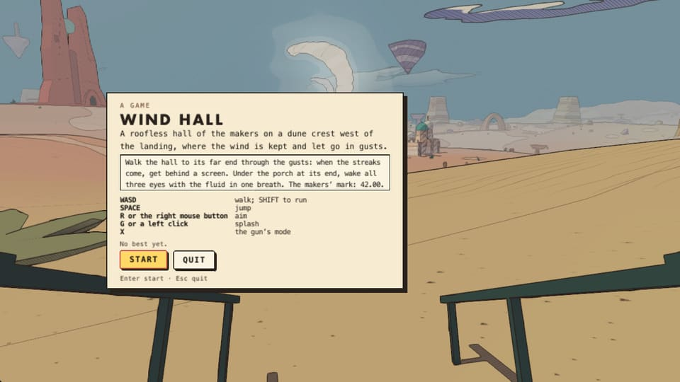 | 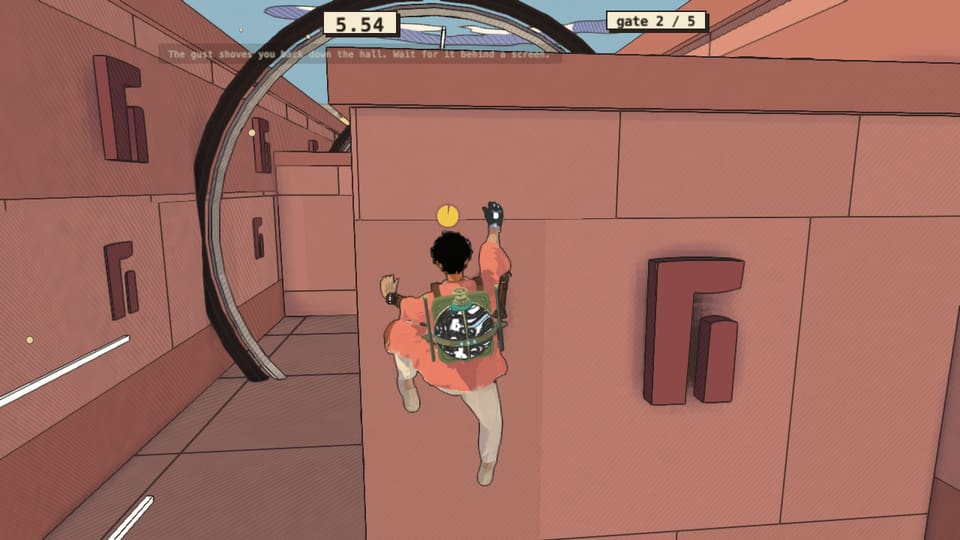 | 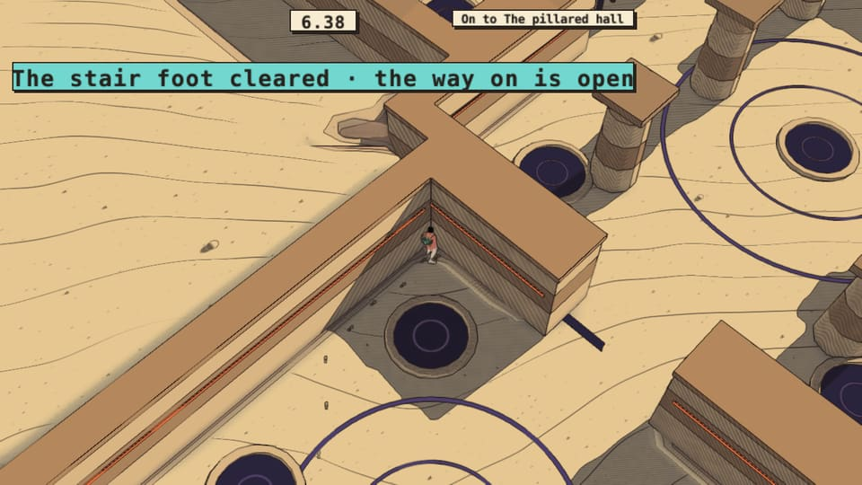 |

(The editor's batch, `BridgeBatch.Run`: its screen is 640 × 480, so its HUD and menus are laid out on a 4:3 canvas, 960
wide, in the 1280 × 720 picture: the Retroid's shape.)

**The words in the world and the speed lines** (issue #264). A game's floating score words ("+10", "+250", "×3",
"spilled"), the speech balloon over someone calling out (the shooting gallery's keeper) and the label over a thing to
pick (the Sunken Hall's upgrades) are DOM on the page (src/minigames/kit/labels.js `WorldLabels`); the same words are the
screen's `words` part (`pops`: each with its id, text, kind, world point and length; `says` and `tags` where they were
last placed), which BridgeHud.cs `DrawWords` draws over the world and under the cards: a pop floats 70 px up from its
point, pops in at 1.35 × and fades over its last 30 % on the HUD's own clock (cream, gold, vermilion or teal letters
stroked in ink, the page's face: Avenir Next), the balloon a cream panel with its ink edge, round corners, hard shadow
and tail, the tag its name in capitals over its words, both held on the screen. The runner's speed lines (`speed` in
the 'minigame' part, kit/runner.js `speedLines`) are drawn as the page's half-size canvas, ink streaks from the edges
toward the middle, anew each frame (`DrawSpeed`). A game that drives goes on under its own start and results cards, as
main.js runs it with no input under them (its pause holds it), and its camera is the first frame's: the start card of
Cistern channels shows the court from above, not the traveller's follow camera. The bridge's `-words` (with `-trial` or
`-game`) puts a fixed set of words round the traveller after the run's picture and photographs them (`unity-words.png`),
the web's side the same words through the page's `WorldLabels`. Tests: tests/minigames-words.test.js,
tests/engine-trials.test.js.

**The bird and the bike in other worlds, Lorn's rain, a refused flight** (issue #264). engine/game.js makes the mounts
main.js makes for worlds without their own: Vael's bird under open sky once she has promised (src/bird.js
`birdAnswers`), else the desert's hoverbike by the ramp in the worlds made for riding (src/bike-worlds.js `bikeComes`),
their calls' sounds (`callKind`: the rider's call on the flute, the pack's pulse) and no call from a room off the map or
from inside the ship (`canSummon`). Its weather is the page's `window.weather`, where Lorn's story reads the rain that
makes the Great Crystal sing, with the web's pace and the desert's calm first arrival. A flight refused for a gadget not
yet had (`travel:refused`) starts the quest that leads to it. The bridge's `-set-flags a,b` sets flags on the debug save
before the world is built (`-level edena -set-flags desert.bike.found -walk 1.5 -out …`: the bike by the ramp, as on
the web). Test: tests/engine-finishable.test.js.

**The games' own panels** (issue #264). Five games draw part of their picture on a canvas or a panel of their own
on the page; each publishes it as a screen part (src/platform.js) that BridgeHud.Games.cs draws with a few uGUI boxes
and one Sketch mesh, laid out as the page's CSS and canvas calls are, never a full-screen raster:
- `drums` (src/minigames/drums.js `drumsPart`): the lanes, the glyphs near (index, time, lane, missed), the approach,
  the beat's and the song's length, the buttons held, each socket's last hit by its id, the sockets' labels, the combo.
  The song's time `t` goes with each send (on a change, else four times a second, `n` counting them) and BridgeHud runs it on
  between at the pace the sends show (the song's clock is the sound's: a batch run's audio runs slow); `DrawDrums`
  draws the ring, its lacing and shadow, the dashed spokes, the sockets, the hits' ink and words, the rolling glyphs,
  the combo and the song's progress.
- `hunt` (sketchhunt.js): the list (title, each subject's name, done, stars, verdict or hint), whether it is dimmed,
  the viewfinder while the sketchbook is up (its readout: the name, the meter's percent, the line under it; the zoom),
  the flash's count and the hint. `DrawHunt`: the paper card, the frame, corners, thirds and middle ring, the readout,
  the flash fading over 0.45 s.
- `fishing` (fishing.js): the journal's rows, the line's meter (its fill, label, the tension's red zone hatched past
  80 %), the pull's arrows, the hint (gold at the strike) and the catch's card. `DrawFishing`.
- `pirates` (pirates.js drawHud, in the half-size canvas' px with its size): the reticle (ring, dot, charge, hit
  marks), the lock, the missile's pip, the captain's bar, the hull's pips and their burst, the hit's flare, and the
  comms line (`DrawPirates`, the flare a radial texture under it). The hint row's missiles are coloured bars in its
  rich text (the runner's `hintNote(html, text)`).
- `visor` (lens-vault-hud.js `visorPart`, CSS px of its W × H; issue #382): the Lens Vault's first-person visor: the
  rim's brackets, the hearts and the ARM / LENS tab, the reticle with the charge's and the reading's rings, the lock, the
  lens's marks and its reading's card, the hurt's flare (`DrawVisor`: the pirates' radial texture tinted teal for the
  lens's wash and red for a hurt). Its arm and bolts are meshes in the world, carried as any.

In an engine the page's canvases for these are not drawn at all (engine/platform.js `hudIsData`, src/platform.js
`page.drawsHud`): the drum circle's full-screen canvas drawn into bytes each frame had left the Unity preview's camp
black from the 3-2-1 on. Text in these panels takes the page's line heights (`CssSet`: CSS lines are 1.35 of their
size, uGUI's one), and a label's words after an arrow go in a label of their own (a space after a glyph from the
fallback font took that font's advance). The bridge's `-run-key KeyR` holds another key than W through a `-game` run,
and `-pose [kind]` calls the game's `session.pose` a moment before the run's picture (the drum circle plays itself on
every beat; a fish on the line, `catch` one landed; two of the hunt's list sketched and the silent tower in the frame;
the pirate captain hails; a number of seconds, `-pose 9`, flies the pirates' run ahead by the pilot), the web's side the same through `window.minigame.session.pose`. `-game "pirates?stage=ice&to=edena"` plays a game's page with its address's words (the pirates' level and destination, issue #555: engine/game.js sets `location.search` while the level builds, as the page's own address). Tests:
tests/engine-games-hud.test.js.

| | Unity + Puerts | web (three.js) |
|---|---|---|
| the drum circle | 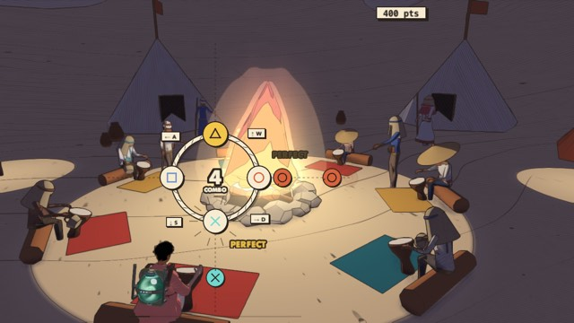 | 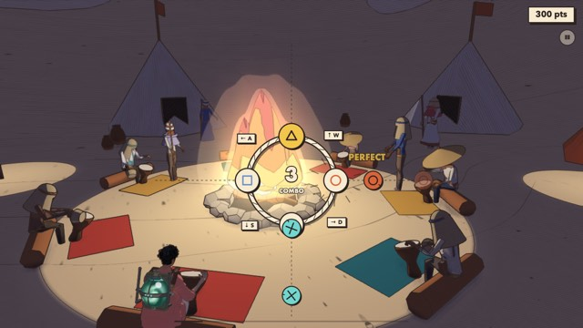 |
| the sketch hunt | 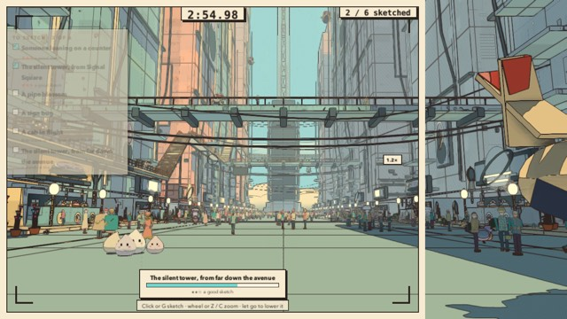 | 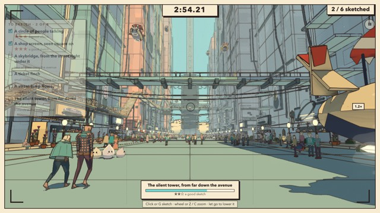 |
| the fishing | 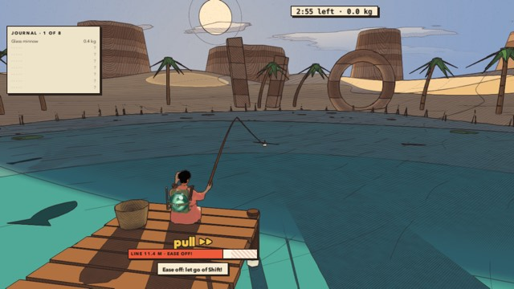 | 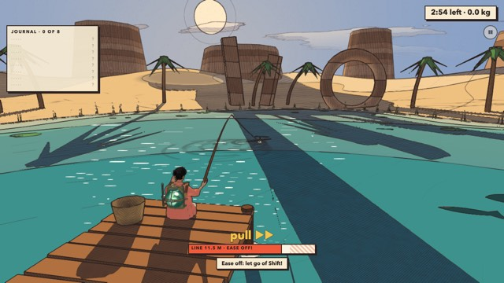 |
| the chime pirates | 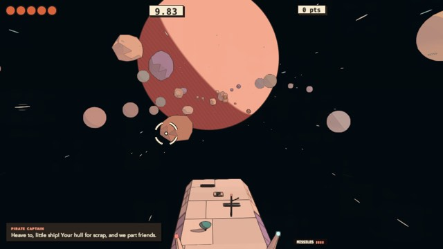 | 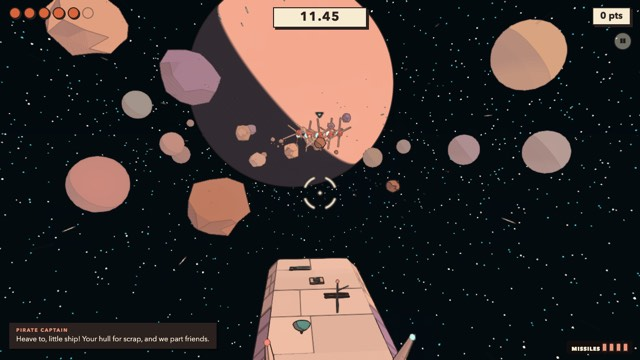 |

(The batch's HUD is laid out on its 4:3 canvas, 960 wide, in the 1280-wide picture: the ring, the readout and the
pirates' reticle sit at its middle, x 480, not the picture's; on a player's own screen the canvas is the screen.)
Not as the web yet: the glyphs the fallback font draws (the arrows of the keys' labels, the pull's ▶▶, the stars) are
smaller than the page's.

Left for later (issue #264): the language setting (on purpose). The recorded music (D15: Unity decoding the MP3s
that engine/webaudio.js refuses) wants a round of its own. The Godot spike's keys are not routed through the
player's keys (it has no menus).

**In Unity** (`BridgeHud.cs`): the bundle sends `screen.state` when its version moves, and the HUD
draws it in uGUI with the C# port's own pieces and layout (Hud.cs, Ui.cs: the paper, the ink, the
fonts, the notebook panel with its name tag and chip, the answers); the conversation itself (who
speaks, the reveal, the answers, what an answer does) is the web's `Dialogue` and `DialogueRunner`,
fed the engine's keys as the page's events (E, Space, 1–9, Escape) and its pad through
`Controller`'s talk context. engine/game.js runs E as main.js does (`storyRt.update` with
`ePressed`, the traveller held while busy, the two-shot through `frameCamera`, the cue by
`cueText`, the toasts queued for their reading time). A batch run: `-talk ama` walks up to someone
and photographs the conversation. The toast, the cue and the floating prompt are the hints' dark strip
(issue #306, `src/hint-look.js` `HINT_ENGINE`: `HintBg`, `HintInk`), the cue at the top centre and the toast under it.

| web (three.js) | Unity + Puerts (the same conversation, the port's uGUI) |
|---|---|
| 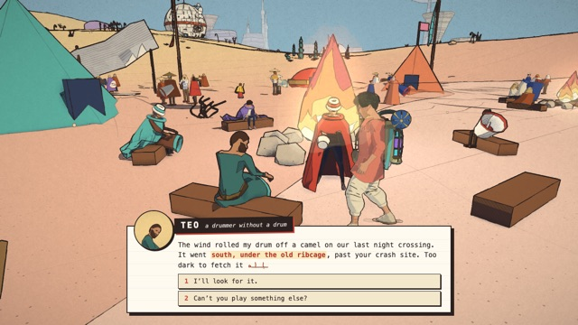 | 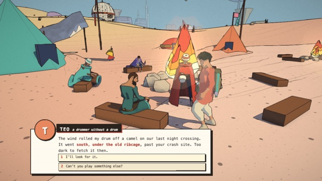 |
| 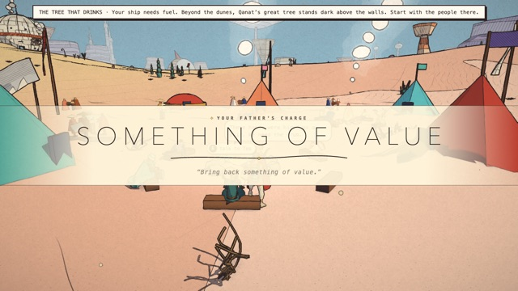 | 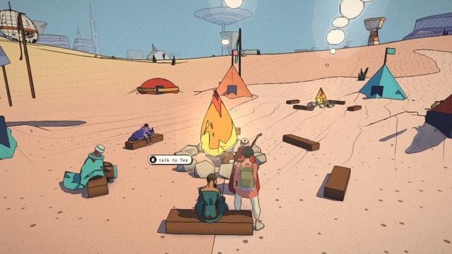 |

(The chip's portrait: "The conversation's portrait" below; their initial on their colour where
there is none.) Two traps met on the way: the canvas has to stay beyond the near plane the game's
camera sets each frame (on it, the HUD was clipped away), and the dynamic font's letters are put
in its texture at once (`Warm`: added one by one, they dropped out of a frame).

## Costs

Measured on the M4 Pro (macOS 26, Godot 4.6.1 + GodotJS 1.1.0 beta 1, V8, Metal Forward+), the
desert, the spike's camera:

- **Bundle**: the spike's modules and three.js, 2.98 MB of CommonJS (the whole game entry, with the
  people, crowd and story: 6.1 MB, 1.5 MB gzipped), built in 0.1–0.6 s.
- **Load**: the desert built by `createDesert` in GodotJS's V8 in 4.3 s (12 s in a Node `vm`
  context, whose globals are slow; the game in Chrome builds it in steps between frames).
- **Upload**: 796 drawables, 794 geometries (1.07 M vertices, 1.01 M triangles, 1 915 surfaces),
  274 materials, 36.9 MB of attributes mirrored in 0.53 s, 0.46 s of it in Godot making meshes.
- **Per frame**: the mirror's walk of the scene and a compare of 16 floats per drawable (the web
  renderer walks it too), then one Godot call per moved drawable. Stage 2 measures it in play.

## Risks

- **GodotJS is in beta** (1.1.0 beta 1 for Godot 4.6.1, April 2026); the editor binary is GodotJS's
  own build of Godot, so the Godot version follows theirs. Its V8 is current; QuickJS (`qjs-ng`)
  builds exist for platforms without a JIT (iOS).
- **Modules**: GodotJS and Puerts load CommonJS; the game is ESM with top-level `await` in main.js.
  The bundle is flat CommonJS (`codeSplitting: false`), so dynamic imports are inlined and no
  module loading happens at run time. A top-level `await` cannot be bundled into CommonJS: the
  entries are functions the engine calls.
- **No workers, no WASM** used by the game; lod.js's worker already falls back.
- **`import * as godot`** of GodotJS's lazy module proxy is empty once bundled (the bundler copies
  its keys): engine code imports the default (`import godot from 'godot'`).
- **Quitting deadlocks on macOS** with a window open (NSApplication's terminate waits on a thread
  V8 holds); batch runs kill the process after the log (`batchExit`).
- **Pictures need a window** on macOS: `--headless` uses the dummy renderer (scripts and tests run
  headless; screenshots open a window for a few seconds, muted, `--audio-driver Dummy`).
- **The ink look is a port to keep in step**: materials.js and post.js are 3 300 lines of GLSL; the
  engines' shaders follow them by hand (as the C# port's HLSL does). Godot's Forward+ gives depth,
  normals and the lit colour to a post pass, not the web's custom G-buffer, so the shade and the
  strokes are drawn in the surface shader's `light()` and the lines in the post pass.
- **Per-call cost** in Puerts (reflection) is higher than GodotJS's: hence the command buffer.
- **No ICU in GodotJS's V8**: a regular expression with `\p{L}` is a syntax error there, and the
  whole bundle fails to load; the bundler lowers them (`lowerUnicodeClasses`, tested). No `Intl`
  either (the game uses none outside a log line).
- **Engine quirks met**: Godot smooths `delta` to the display's refresh (frame times are taken from
  the wall clock), its measured GPU time reads 0 on Metal here; Unity's V8 isolate aborts if
  disposed while the editor exits (the batch run leaves it to the process).

## Running it

```sh
node scripts/engine-bundle.mjs                 # the bundles (godot/js/hiraeth.js, hiraeth-spike.js)
godot/run.sh                                   # play the desert in Godot (WASD, Shift, Space; the right mouse button turns the camera; pads)
godot/run.sh --views=$PWD/scripts/bench/viewpoints.json --out=$PWD/output/engine-bridge/godot   # a PNG a viewpoint
godot/run.sh --bench=6 --views=… --out=…       # frame times a viewpoint, uncapped: <out>/godot-bench.json
godot/run.sh --walk=4 --out=…                  # the traveller walks forward for 4 s, a PNG at the end
godot/run.sh --entry=spike --shot=$PWD/output/engine-bridge/spike.png      # the spike: one frame
node scripts/godot-globals.mjs                 # godot/project.godot's [shader_globals] from engine/ink-params.js
```

`godot/run.sh` rebuilds the bundles and runs the GodotJS editor binary from
`.local-tools/godot/` (`GODOT=` another), muted (`--audio-driver Dummy`), its log in
`output/engine-bridge/godot.log`; `--shadows=0`, `--post=0` and `--only=camps,dunes` narrow a
benchmark. GodotJS's debugger listens on port 6299 (`godot/project.godot`). The web side of the
same viewpoints is the benchmark's own (`scripts/bench/web-bench.mjs --paths 0 --shots dir`).
`tests/engine-bridge.test.js` checks the stand-ins, the mirror's ops (no false moves, no false
uploads), materials read back, the Godot layouts, keys and pads, the skinning, the look's globals
against `project.godot`, the bundle's regular expressions, and the game itself in a bare V8
context (no Node, no page): a world built with its people, the traveller walking on the keys,
the camera following; `tests/engine-unity.test.js` the mirror in x, the geometry and command
layouts the C# side reads, the port's formats, and the Unity bundle against a stand-in of the C#
host.

The Unity side, once:

```sh
scripts/unity-js-setup.sh                      # Puerts 3.0.3 (core + V8) into unity/Hiraeth/Packages/ (not committed)
node scripts/engine-bundle.mjs unity           # the bundle into unity/Hiraeth/Assets/StreamingAssets/hiraeth-js/
scripts/unity-export/unity-batch.sh BridgeBatch.Run -views scripts/bench/viewpoints.json -out $PWD/output/engine-bridge/unity [-bench 6] [-walk 4]
```

(Unity writes Puerts' embedded packages into `Packages/packages-lock.json` on a machine that has
them: leave that change out of commits. The batch run plays `BridgeDesert.unity` in the editor,
muted, and exits; the menu Hiraeth ▸ JS bridge rebuilds the scene.)

`scripts/unity-js-run.sh <name> [BridgeBatch.Run arguments…]` does the two last in one, its log in
`output/engine-bridge/unity-<name>.log`, the lines that say what happened printed. Its arguments:
`-level`, `-views file [-only a,b]`, `-out dir`, `-aboard rooms` (`pictures` among them: each canvas the parked ship draws, close up, `unity-canvas-<n>.png`), `-fight foe,down,guardian` (and `armour`: a plated bell walker, three charged cuts that knock its plates off, then its banded tier, issue #722, `unity-armour-on|off|tier.png`; `mummers`: a mummer king and a mummer standing in the Arena, their humanoid rig said in the log (its clips in, what its state plays, its ms), then each winding up its first blow, issue #724, `unity-mummers-stand|windup.png`, then the mummer's bow volley and the king's horn call, `unity-mummers-volley.png`; `duelists`: a fencer and a shade, `unity-duelists-stand|windup|guard|bash.png` (the last the fencer's shield bash drawn back and the shade guarding); `monsters`: roster v4's hulk and grunt (issue #726), standing, the grunt's club overhead and the hulk's smash, then the grunt's volley and the hulk's stomp, then a banded grunt, `unity-monsters-stand|windup|volley-stomp|tier.png`; `roster4b`: roster v4's prowler and warlord (issue #726), standing, the dart and the glaive sweep, the tail sweep and the charge, the prowler's back-flip halfway and the roar, then both banded, `unity-roster4b-stand|windup|tail-charge|flip-roar|tier.png`; and `site:<id>`: the traveller set down 16 m in front of that encounter site of the level, issue #722, its things and its foes out, `unity-site-<id>.png`; with `-store` a save that holds the sword: a fixed-view run has no fight, so no site foes), `-foes [world]` (with `-level arena`), `-bench secs`, `-split` (the frame's split: the
mirror's profile, the audio, the C# apply), `-walk secs`, `-talk id` (with `-talk-seq N [-talk-every frames]` N
pictures of the first line as it is said; with `-bench secs` the frame measured while they talk, the gestures' own ms
as `split.talkGestures`), `-through way` (a door walked into and back out of), `-play tool,drone`, and
`-probe text [-solo]` (at each shot, the nodes whose name holds the text as Unity has them: mesh,
bounds, materials' culling, shadows, GPU instances; `-solo` draws only those), and `-ending first|final [-ending-every secs]` (a homecoming
played on the debug save with the ship's scenes on, a picture every few seconds, its stage and subtitle logged:
docs/plans/unity-finishable.md). For the visual check (below, "The visual check"): `-fresh` (the debug save and its
journal emptied first, as the web's side-by-sides clear the page's storage), `-no-hud` (the picture alone), a view's
`hour` and `weather` pinned with it, and `-js-off skies` (the sky's own left out of the look: a before on one build).

## The Godot renderer (stage 2)

`engine/game.js` builds the world as `main.js` does at load (the level, physics and water, the
ship at its site, the traveller with his body, clips, gear and cape, the people near the start,
the crowd and its pooled full bodies, the story's people and places, the flora) and plays it a
frame at a time: the keys and pads into `Controller` and `Player.update`, the camera rig, the
crowd and the people, the story's update, the level's own update, the hour's palette. Left out:
the HUD and menus (the page's), conversations, sound, the fluid tool, the drone, weather,
wildlife, the grass blades, the ship's scenes.

**On the Godot side** (`engine/godot/`): the mirror's ops become nodes (`backend.js`); the
skinned bodies are skinned in the ink shader from one **bone atlas** a frame (a float texture,
every skinned mesh a row: `skin.js` folds three's bind matrices into one matrix a bone), so a
crowd costs one texture upload, not one a person; geometry that changes (cloth, trails) is sent
again and swapped in; the shadow casters follow the web's rules (`level.noShadow`, the gear's,
`selfLitSkips`). **Input**: Godot's key events as `KeyboardEvent.code`s (`keys.js`), its joypads
as standard-mapping Gamepads for `controller.js`, the mouse (right button) into `CameraRig.look`.

**The ink look in Godot** (`godot/shaders/`): Godot's Forward+ gives a post pass the depth, the
normals and the lit colour, not the web's G-buffer, so the work is split differently:
- `ink.gdshaderinc` (the surface, five variants by side and skinning): the albedo by mode (plain,
  the terrain's patches and slopes with the desert's regions and sand blobs, the strata bands, the
  people's outfit zones by the rest pose, metal's three tones, vertex and instance colours, grid
  lines as drawn detail); in `light()` the web's light term and two tones (each surface's lift,
  half-tone, bounce and hue) and the pen strokes, ported from `materials.js` (object-space
  triplanar, power-of-two spacing, crossed where darkest, fewer on a lifted shade, faded far
  off). The maths is in the web's display values, then taken to Godot's linear light.
- the albedo's value goes to the post pass in the normal buffer's roughness channel (Godot keeps
  7 bits of it), so colour boundaries are found on the albedo, not on the hatching;
- `ink_post.gdshader`: the lines (`post.js inkLines`: the Laplacian of 1/z, creases, colour and
  shadow boundaries, silhouettes heavier, thinner with distance, wobble, pen pressure, broken
  interior lines), the sky (bands, the flat print sky, the sun's side), fog in flat bands toward
  the haze, aerial perspective;
- the frame's look (post.js's preset and the hour's palette: tints, ink, sky, fog, line
  settings) as Godot **global shader parameters** (`engine/ink-params.js` GLOBALS, declared in
  `project.godot`), set once a frame when they change.

Not ported yet: the sky's dots, clouds and paper, weathering and pen detail on walls, facades,
tiles, leaves and cracks, glyphs, plating, the crevice and spot blacks, crease shading (AO),
water's own look, the faces' ink, glows and bloom, the crowd's GPU animation (its figures stand in
their rest pose past the pooled bodies), the canvas-painted panels.

The same viewpoints (`scripts/bench/viewpoints.json`), the web game in Chrome (left) and the game
in Godot through the bridge (right), 1280 × 720, hour 10:

| web (three.js) | Godot 4.6 + GodotJS (the same JS) |
|---|---|
| 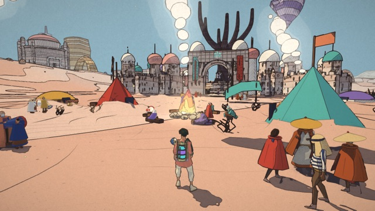 | 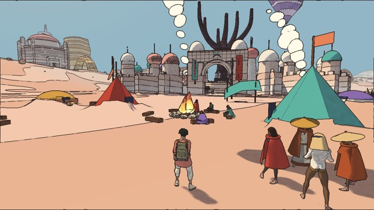 |
| 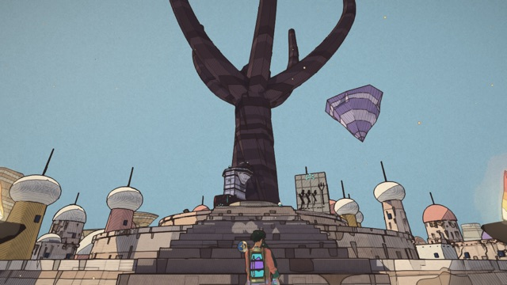 | 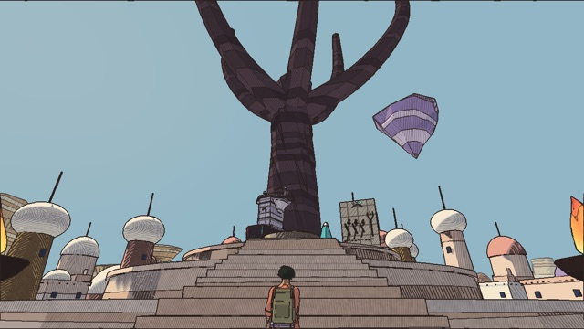 |
| 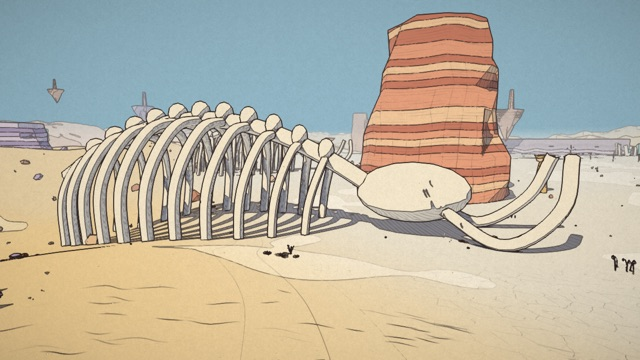 | 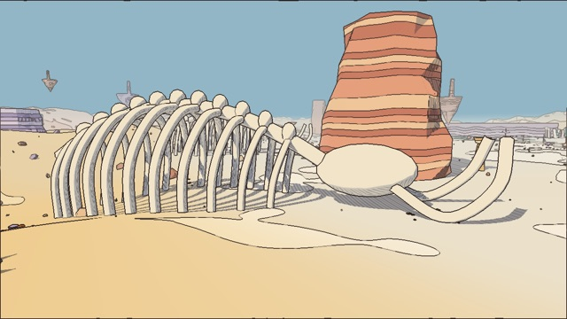 |
| 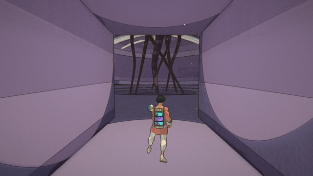 | 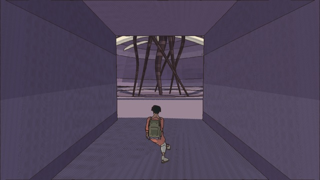 |
| 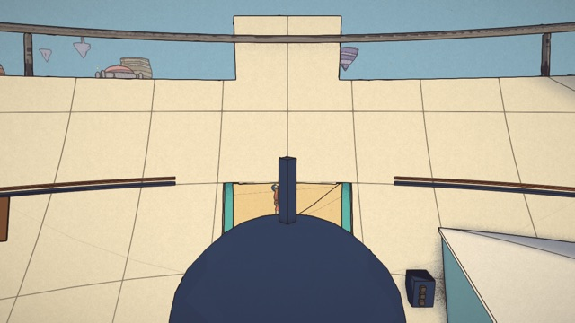 | 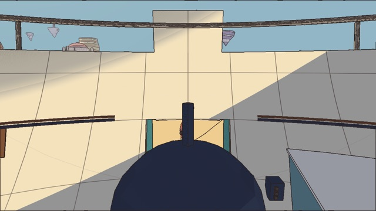 |

(The spawn view stands inside the parked ship: the web hides its hull from the sun when you are
in it, the bridge doesn't run the ship's scenes yet, so the hull's shadow falls on the floor.)
Walking, the camera on the rig (`--walk=4`): 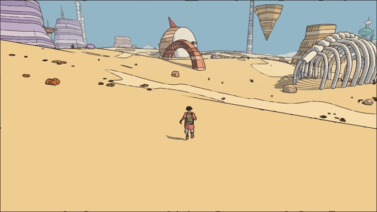

**Frame times, first numbers** (M4 Pro, 1280 × 720, uncapped: no vsync either side; medians in ms;
the web: `web-bench.mjs --preset high`, render scale 1; Godot: `--bench=6`, the wall clock between
frames, Godot's own delta being smoothed to the display). The machine was busy with other work
(load average 30–40 during the Godot runs), so these are an upper bound, to be measured again on a
quiet machine; the run-to-run spread on the Godot side was ±40 %.

| view | web frame | web CPU | Godot frame | Godot: the VM (game + mirror) | Godot: render CPU |
|---|---|---|---|---|---|
| spawn | 7.4 | 7.2 | 15.2 | 9.0 (2.9 + 5.7) | 0.9 |
| qanat-tree | 12.0 | 11.8 | 19.8 | 16.4 (8.9 + 6.7) | 0.7 |
| camps | 10.4 | 10.3 | 24.2 | 19.2 (9.4 + 8.9) | 1.0 |
| dunes | 3.7 | 3.5 | 10.4 | 5.3 (1.2 + 3.8) | 0.6 |
| cave | 3.8 | 3.6 | 18.5 | 8.9 (2.0 + 6.4) | 1.2 |

Where it goes: the VM's share is the game's own update (people, capes, the crowd: the same work
the web does) and the mirror (the scene walk, the moved matrices, the bones, cloth re-sent), and
the rest of a Godot frame is its GPU work (without the sun's shadows or without the ink composite
the dunes drop from 10.4 to 8.4 ms each). Three fixes found by measuring: matrices compared as
the floats they are sent as (a double no float can hold counted as a move: 700 false moves a
frame), interleaved glTF attributes' versions (read off their buffer: every body was sent again
every frame), and the bone atlas (one texture a frame, not one a body). **Load**: the desert is
built in the VM in 1.6–4.5 s (the level 1.3–3.2 s of it) and drawn on the next frame; the web's
first frame comes 3.0 s after navigation.

## The Unity renderer (stage 3)

The same game, the same frames: `engine/unity/game.js` is `engine/game.js` with the Unity backend.
Since the port's look is a complete port of the web's (G-buffer, composite, ripples, dots, paper,
clouds), the bridge's pictures in Unity are closer to the web than Godot's first port.

| web (three.js) | Unity 6.6 + Puerts (the same JS, the port's look) |
|---|---|
|  | 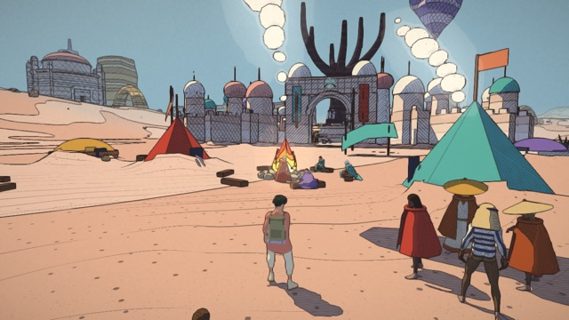 |
|  | 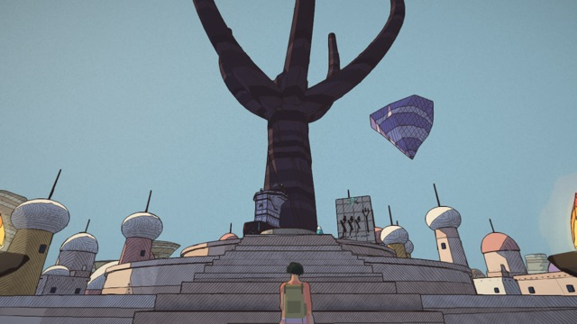 |
|  | 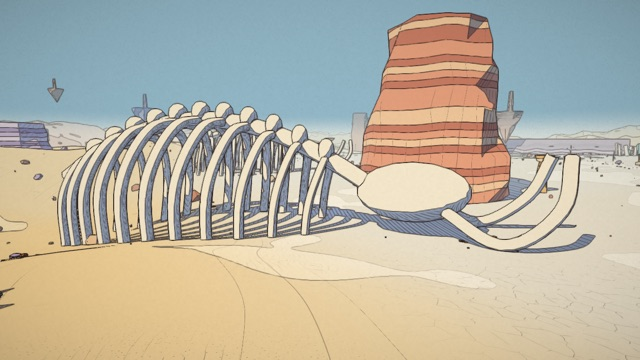 |
|  | 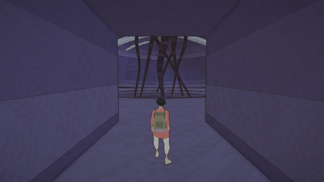 |

Walking (`-walk 4`), the same steps as in Godot: 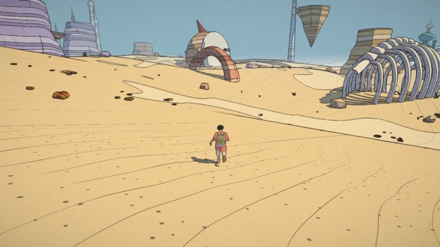

Not drawn yet on this side: points, lines and sprites (motes, the fluid's drops), the canvas
panels, glows and the far crowd's animation (as in Godot); the cave's rounded walls in the web's
shot come from a part of main.js the engine entry doesn't run yet (both engines lack them).

## The three side by side (stage 4)

The same desert, the same viewpoints, at 1280 × 720 on the M4 Pro. **Frame times**: one round of
each side back to back (5 minutes apart), the machine equally busy for all three (load average
12–14: other work was running); medians in ms, uncapped. Unity is the editor in play mode (Mono,
the editor's own overhead), not a player build.

| view | web: frame (CPU) | Godot + GodotJS: frame (the VM) | Unity + Puerts, editor: frame (the VM) |
|---|---|---|---|
| spawn | 10.4 (10.1) | 10.3 (7.3) | 8.4 (6.9) |
| qanat-tree | 17.2 (17.4) | 11.7 (9.9) | 13.4 (11.4) |
| camps | 16.5 (16.7) | 14.6 (12.2) | 21.2 (18.4) |
| dunes | 6.5 (6.3) | 8.5 (4.1) | 6.2 (4.7) |
| cave | 4.9 (4.7) | 8.5 (4.3) | 6.0 (4.6) |

(On a quieter machine earlier the web ran 7.4 / 12.0 / 10.4 / 3.7 / 3.8 ms.) The three are within
the machine's noise of each other. On both engines the frame is the VM's: the game's own update
(people, capes, the crowd: the work the web does too, 1–9 ms) and the mirror (the scene walk, the
moved matrices, the bones, cloth re-sent: 3–10 ms). The engines' own CPU side is small (Godot's
render CPU 0.4–1.2 ms). So the mirror is the first thing to make cheaper (below), and the engines'
GPU headroom is not the limit.

| | web (three.js) | Godot 4.6 + GodotJS (V8) | Unity 6.6 + Puerts (V8) |
|---|---|---|---|
| **fidelity** | the reference | a first port of the look: the light, each surface's shade, the strokes, the lines, sky and fog; no paper, sky dots, weathering, facades, glows | the C# port's complete look (its HLSL port of materials.js and post.js): closest to the web |
| **game logic** | the game | the same JS, unchanged (engine/game.js composes it) | the same JS, unchanged |
| **load** (the desert) | first frame 3.0 s after navigation (9.5 s busy) | built in the VM in 1.6–4.5 s, drawn the next frame | the bundle evaluated in 0.3 s, built in 2.7–4.7 s |
| **what ships** | 12.1 MB fetched (6.4 gzipped), dist 32.5 MB | the engine (release template, V8: macOS 58 MB, Linux 81 MB, Android 94 MB zipped, all ABIs), the bundle 6.1 MB (1.5 gzipped), `public/` (10 MB) | the Unity player, Puerts' V8 (Android arm64 18 MB, Linux 34 MB), the bundle, `public/`; no world export (the C# port's APK is 143 MB with its exports) |
| **updates** | the site, the app's web.json | the bundle is data: it could ride the same over-the-air feed | the same |

What it would take to ship each:
- **Android (the Retroid)**: *Godot*: GodotJS's Android templates (V8 and QuickJS) exist; the ink
  post reads the normal-roughness buffer, which only Forward+ has (Vulkan devices); the Mobile
  renderer would need the lines from depth alone. *Unity*: the port already builds an IL2CPP APK
  (`BenchBuild.Android`); under IL2CPP the methods the JS calls by reflection (`BridgeHost`) need
  to be kept from stripping (link.xml / `[Preserve]`), and Puerts' IL2CPP mode checked; Puerts ships
  arm64 V8.
- **The Deck**: *Godot*: the Linux template (V8). *Unity*: a Linux player with Puerts'
  `libPapiV8.so`. (The web build already runs there in Electron.)
- **Both**: the HUD, menus and conversations (today the page's: a platform layer and an engine UI,
  "The platform layer" above), sound (recorded samples first), the parts of
  main.js the entry doesn't run yet (the fluid tool, the drone, weather, wildlife, the ship's
  scenes).

### Where to go next (a recommendation)

1. **Make the mirror cheap**: skip static subtrees (flag them once, re-check rarely), send cloth as
   positions only (Godot: `RenderingServer.mesh_surface_update_vertex_region`; Unity: `SetVertices`
   on a kept mesh), and on Godot apply the frame's transforms from one packed buffer. It is the
   largest share of the VM's frame on both engines.
2. **Unity + Puerts as the main line**: it already draws the web's look (the port's shaders), and
   the bridge lets the port's C# game logic be retired step by step in favour of the web's own,
   so the port can no longer drift from the web game. Next there: an IL2CPP player, then the APK.
3. **The platform layer in the web game** (page, input, audio modules; main.js split into the loop
   and the web shell), so both engines run the whole loop, conversations and HUD included.
4. **Godot as the light, open alternative**: keep it building and compared; port the rest of the
   look when it matters (paper, dots, weathering, glows), and decide Forward+ (Vulkan) against the
   Mobile renderer for Android.

The choice between 2 and 4 as the long-term engine is the author's: Unity has the finished look
and the existing Android pipeline; Godot is smaller, open, starts fast and its JS binding is
cheaper a call, but its look is a first port and GodotJS is in beta.

## A cheaper sync (Unity + Puerts, next stage 1)

Where the mirror's time went (`-split`: the mirror's own profile, `SceneMirror.profile()`, and the
C# side's, `BridgeHost.ApplyMs`), at the camps on a quiet machine, ms a frame: three's matrices
0.49, the walk 1.9, the bones' encoding 0.75, the call into C# 2.1, all but 0.02 of it the C# apply
(Puerts' marshalling of a 437 KB ArrayBuffer is nothing), the look 0.16. Under them:
- **bones a mesh**: a person is five skinned meshes (body, eyes, brows, hair…) on one skeleton, and
  each sent its bones: 63 skeletons, 102 meshes, ~4 100 bones, each set as a Transform on the main
  thread;
- **cloth sent whole**: every cape's geometry re-encoded and a new Unity mesh made every frame,
  inside the walk;
- **the look parsed every frame**: its JSON changed every frame only by `uTime`;
- the walk itself: a recursive closure, two map lookups and a `for…in` over the attributes for every
  drawable.

What changed:
- **One skeleton, once a frame** (mirror `skeleton(sid, mats, n)`; a skinned mesh's create says its
  skeleton and bind matrix): in Unity the meshes share one set of bone Transforms, the bind matrix as
  their bind pose, and the bones are set by one **Burst job** over a `TransformAccessArray` from the
  frame's floats, copied straight in (`BridgeBones.cs`). (Backends without `skeleton()`, Godot's, get
  `bones()` a mesh as before.)
- **Cloth as points** (mirror `vertices(gid, positions, normals, n)`): when only a geometry's
  positions and normals moved (the same count, the same triangles), they go alone in the frame's
  buffer (op 8) and the C# side updates its meshes in place.
- **The look without the clock** (HiraethLook keeps Unity's own), read every 4th frame.
- **The walk**: an explicit stack, the mirror's node kept on the object, the attribute lists cached
  on the geometry (looked at again every 32 frames; a new index is a new shape at once).

Before and after, the same C# side, back to back on a quiet machine (load ~3), Unity editor play
mode, medians in ms (frame; the mirror's share in brackets), and the web game in Chrome then:

| view | before | after | web |
|---|---|---|---|
| spawn | 5.19 (3.26) | 3.01 (1.45) | 5.4 |
| qanat-tree | 8.16 (3.49) | 5.33 (1.26) | 7.2 |
| camps | 10.62 (5.19) | 6.76 (2.08) | 8.1 |
| dunes | 2.48 (1.40) | 1.19 (0.43) | 2.9 |
| cave | 2.45 (1.40) | 1.18 (0.42) | 2.2 |

The mirror is 2.5–3.3 times cheaper and the frames 35–52 % shorter; the commands a frame at the
camps went from 437 to 317 KB (most of it the bones, 263 KB). What is left at the camps: three's
own matrices 0.50, the walk 0.86, the bones 0.18, the C# apply 0.85; the game's own update 3.4.

## The rest of the picture and the play (Unity + Puerts, next stage 3)

`engine/game.js` now builds and runs what main.js does around the world, in main.js's order: the
flocks, the motes, the footprints, the wildlife, the weather under its shelter (into the look's rain,
storm and haze), the fluid tool (aim R / LT, fire G / RT) and its splats, the drone (Q / View), the
answering plants (reactive-world.js), what burns (flammable.js), the plants in view (`flora.update`
each frame: before, the engines drew only the cells the build left filled), and the sound. Each is
`optional`: a system that cannot start in the VM is said once and left out.

**Sound.** `engine/webaudio.js` is the part of Web Audio the game's synthesis uses (src/audio.js,
score.js, score-voices.js, ship/sfx.js, story/voice.js), in JavaScript: oscillators (and periodic
waves), buffer sources, gains, biquads, stereo panners, a delay, the convolver as a Schroeder room
(four combs, two allpasses, the impulse's length as its decay: a 3 s impulse convolved in JS would cost
more than the game), a peak-follower compressor, an analyser; AudioParams follow the spec's timeline
(set, linear and exponential ramps, setTarget, cancel), a non-finite value is a TypeError as in a
browser. It renders in 128-frame blocks pulled from the destination, each node once a block; a chain
whose sources ended leaves the graph and comes back when something new is connected (the buses). The
game's own `Sound` runs on it unchanged (`createGame({ audio: { sampleRate } })`), started at once.
In Unity `BridgeAudio.cs` holds a ring of float stereo, played by Unity's audio thread from
`OnAudioFilterRead` on a clip-less AudioSource; each frame the script renders what keeps the ring
0.12 s ahead (`host.AudioQueued`, `host.Audio(pcm)`). In batch runs, and with `-mute` on a player's
command line, nothing reaches Unity's audio: the ring is drained on the main thread at the output rate
and its level logged (`Hiraeth bridge: sound {…, "rms": …}`; the desert's start: 0.01–0.04, 1–2
underruns at the load). Its cost in the VM: 0.2–0.6 ms a frame in the macOS player (the music, the
wind, the camps' voices), once the automation a parameter has had folds into one event as it passes (the
game sets its targets every frame: unfolded, thousands piled up and the cost grew to 3 ms). The timers the sound's scheduler wants (`setInterval`) are
`engine/platform.js`'s where the VM has none, run from the frame.

**On the Unity side**, what the port already had, fed from the same objects:

| the web's | Unity through the bridge |
|---|---|
| instanced meshes (the flora's sets, the wildlife's parts, the flocks, the props) | the port's `InstMats` (Surface.shader `HIRAETH_INSTMAT`, its shadows in the cascades): the instances' matrices a GPU buffer, each node its own copy of the material (the buffer is bound on it); a mesh without vertex colours gets white ones (the shader multiplies the instance's tint by them); several groups: baked into one mesh as before. The C# apply went from ~3 ms to 0.2–0.5 at the desert's views once the birds, the motes and the wildlife moved every frame |
| the crowd's GPU figures (crowd-shader.js) | the port's crowd figures (FarCrowd's `HIRAETH_CROWD`), posed in the shader from the same instance data (op 9) |
| the motes (life.js `Points`, drawn by the page from a scene of their own) | added to the mirrored scene; quads turned to the camera each frame, sized as the web's `gl_PointSize`, on the port's `Hiraeth/Mote` |
| the footprints (a decal multiplied into the albedo) | the port's `Puffs` with its `Hiraeth/Print` (op 10: place, turn, size, fade) |
| the fire (story/flames.js) | `Hiraeth/Flame`, its five colours, seed and heat |
| the weather (post.js uRain, uRainNear, uStorm) | the port's globals, as Ambient.cs sets them |
| local lights (main.js updateLights: lamps, fires, eggs, pools, doors; the jet's flame) | the 8 nearest the traveller each frame they change (op 11), into HiraethLook's list |
| shadows (main.js draws every caster double-sided: `shadowOverride`) | casters `TwoSided` |

The cave's rounded walls were none of the geometry (the same mesh, the same checksum), the haze, the
AO or the cast shadows: they are the pools of the cave's **local lights** on its flat walls, which
the look did not carry. Points, lines and sprites: the motes are the game's only points (the ship's
hologram has lines, inside the ship only); there are no sprites.

Side by side (the web left, Unity right; the bench's save and conditions, the same views): the
desert (spawn, camps, cave, dunes), the City-Shaft (incal) and the Signal Market (bazaar), and the
fluid tool's shot and the drone at the start:

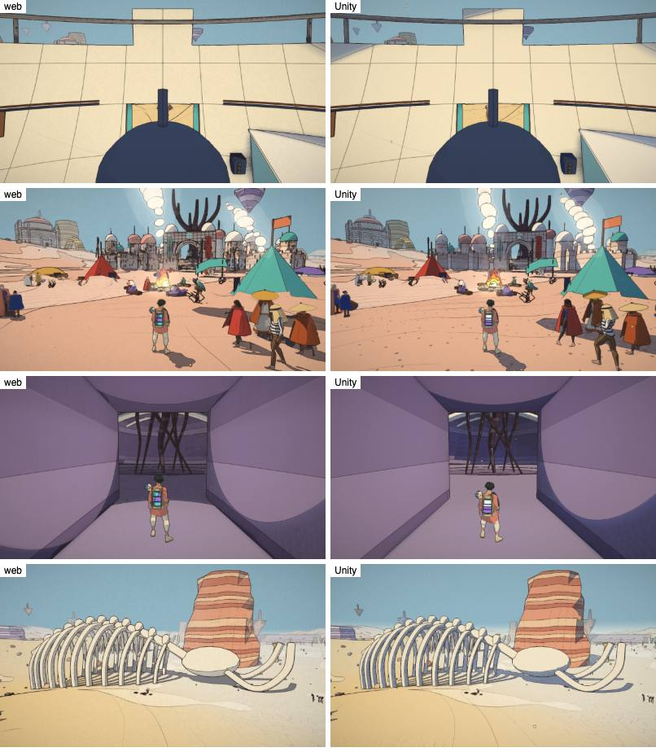
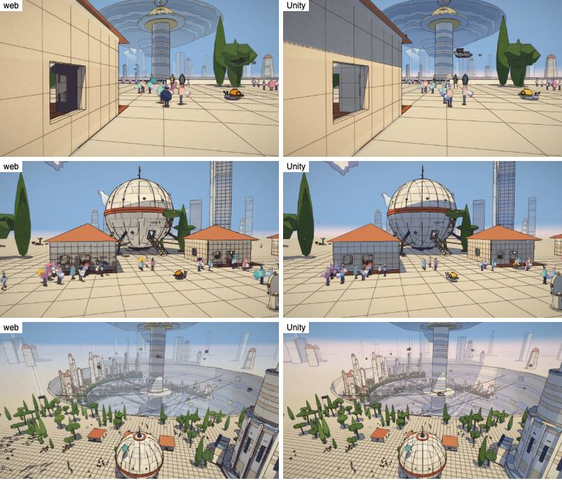
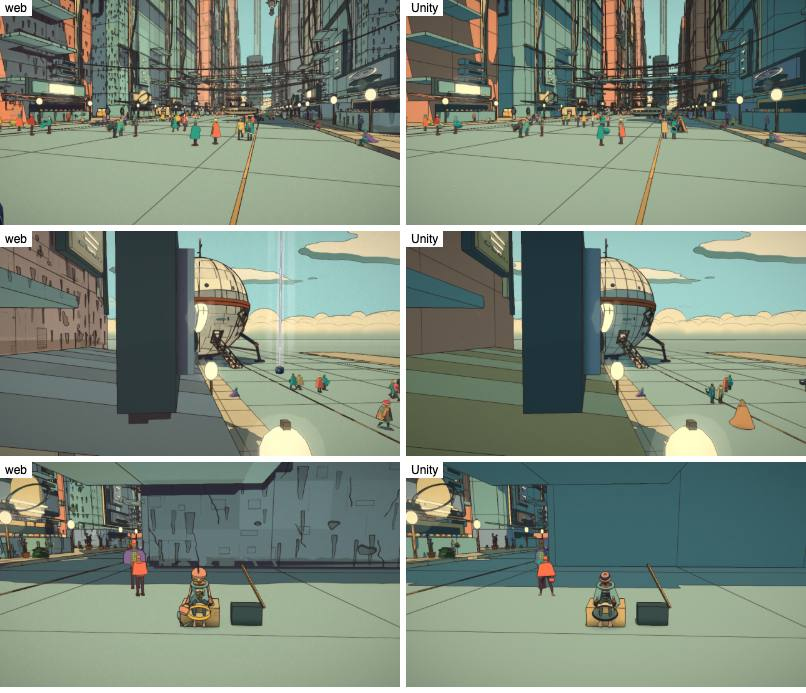
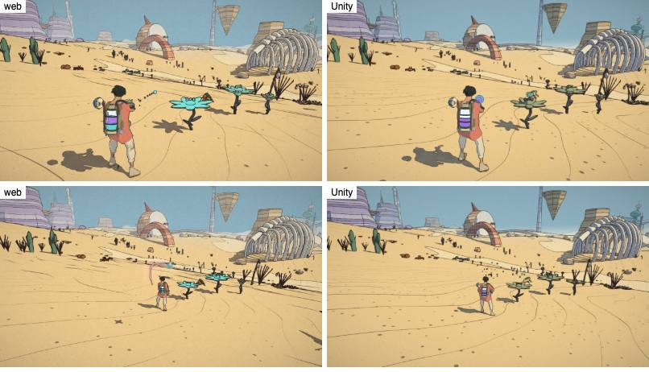

(`scripts/unity-js-run.sh <name> -play tool,drone -out …` plays the second; the views with `-views`.)

(What still differed then, and what closed it: the next section.)

## The web's newer look and the rest of the world (Unity + Puerts, 2026-10-06)

What the side-by-sides above still showed, closed:

- **The port's look brought up to the web's** (`Surface.shader`, `Marks.hlsl`, `Composite.shader`). The port's
  shaders dated from 2026-10-05 morning; materials.js and post.js had moved on. Now ported: weathering
  (`weatherInk`: grime streaks, the small ones soft and faint, chips with their lip's shadow, cracks with a
  shadow side, the dust at a wall's foot in the composite), pen detail at every scale (`detailLod`: built
  seams, joints, vents, plates and bolts; organic grain), colour across a wall (`wallPatch`), plating, the
  house fronts' lit windows at night and cracked corners, the print look's pebbles and stones on the sand
  (ground-ink.js `PEBBLES`), the shadow map's lit fraction steepened (`SHADOW_CUT`), flat facets edge-on to
  the sun shaded whole, big curved forms' terminators; and the G-buffer's newer packing, read by a composite
  that is now post.js's main (each surface's shade: its lift, hue or flat print; spot blacks; cast shadows
  lifted or printed as ink masses, `uInkShadow`; lines by material, `uLineStep`; the face's warm shade;
  banked sand's soft line; haze in layers and fog by height; the lines' noise on the view's direction, from
  the same 128² texels: `HiraethLook.LineNoise`; no paper grain or vignette). The materials carry the new
  options through `port-format.js` (`weather`, `detail`, `patch`, `plates`, `windows`, `drift`, `shade`,
  `spotStep`, `lineStep`) and the look its vectors (`LOOK_VECTORS`: `uSpot`, `uInkShadow`, the haze's). Not
  ported: hatching that follows the form (`S_FORM`: its per-vertex axis isn't uploaded), the makers' boxes'
  own star and ray (`MAKERS_BOX`: the shell is drawn plain), MakeHuman faces' shape keys (`FACE_KEYS`).
- **The light pillar** was the jetpack box's beacon by the ship: engine/game.js now builds the makers' boxes
  (`createBoxes`), their beacons with them.
- **Grass**: `engine/mirror.js` kind `instgeo`, a plain mesh on an `InstancedBufferGeometry` with a count of its
  own (flora-grass.js `Grass`): `create` says its capacity and attributes, `instances(id, count, null, null,
  attrs)` sends them when their versions move, only the range rewritten (`updateRanges`), `drawState(id, o)`
  each frame. In Unity (ops 12, 13) the port's `HIRAETH_GRASS` places the tufts, now with grass-shader.js's
  own fades (thinning by rank, the blend into the ground's tones, the far layer growing in, a few pen-lined
  tufts). `buildGrass` and `grass.update(camera)` are back in engine/game.js, on the bench's preset (High).
- **Wind**: the web's own (`WindStreaks`: the traveller's push, the plants' and blades' `uWind`, sent with the
  look), and its wisps, which on the page are an overlay of their own, as a mesh in the mirrored scene on the
  port's `Hiraeth/Wisp`; their points and alpha go each frame as cloth's do (op 8, `aAlpha`).
- **The answering flowers**: the bridge paused the answering plants (and the animals) at a fixed view, which
  main.js doesn't; and a material's colour and glow changed after it was sent never reached Unity, so a
  waking flower opened but stayed its quiet green. The mirror now sends them live (`materialLive`, op 15,
  to each copy the port drew a material with: lamps, beacons, the temples' lights too), and the traveller's
  fluid on the tank, hose and globs (`materialFluid`, op 16). A view settles 1.5 s of the game's time.
- **People**: the world's MakeHuman bodies, as main.js loads them (`usesMakeHuman`, `loadPeople`).
- **The coral-shirt traveller** (characters/traveller-v1.js): built as main.js builds him; his overshirt's
  cloth steps on the VM's own thread (tripo-cloth.js falls back where there is no `Worker`). His skin's
  texture is a JPEG no engine VM decodes, so its sampled colours (colors.json) go on as vertex colours,
  found by place (the cloth rebuilt the skin and cut the overshirt from it); his parts' linear colours are
  turned to display values in the port's shader (`albedoLinear` → `_ToDisplay`, as tripo-material.js does).
  Not carried: the overshirt's lining colour on its back faces, the trousers' repair band. The glove, the
  fingers (hands.js), the self-driving cabs on their lanes and a seated ride (`-play cab`), seated robes and
  capes all draw.

The same views, the web left, Unity right (after):

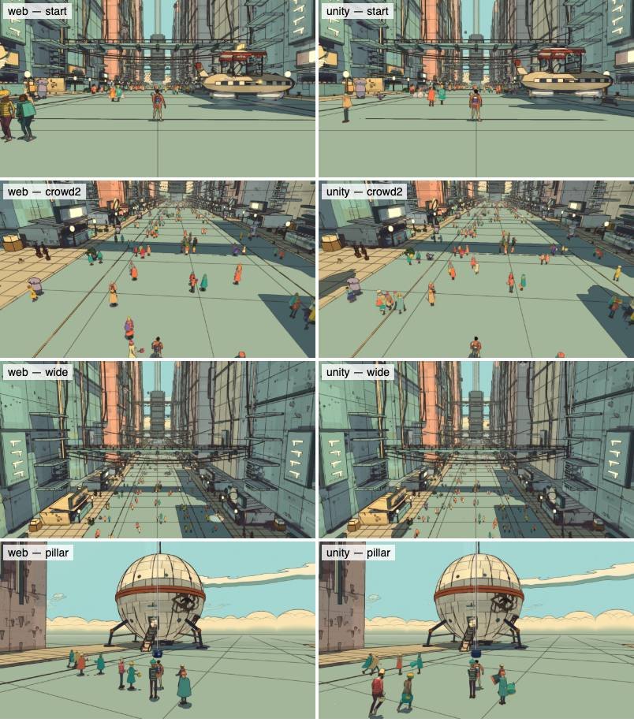
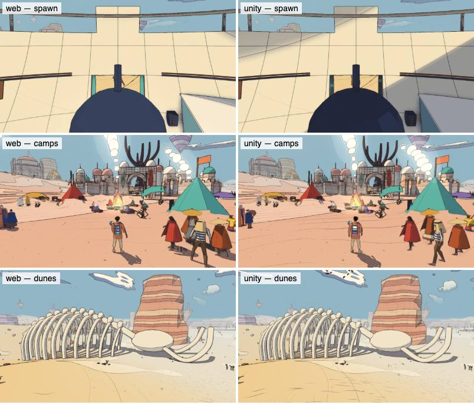
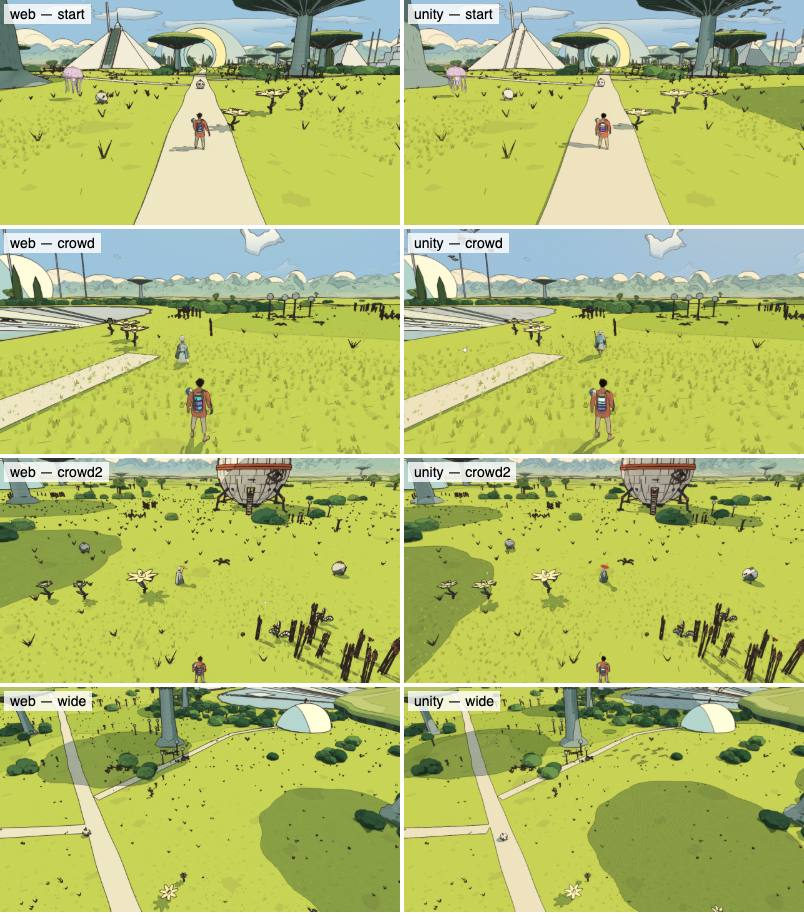
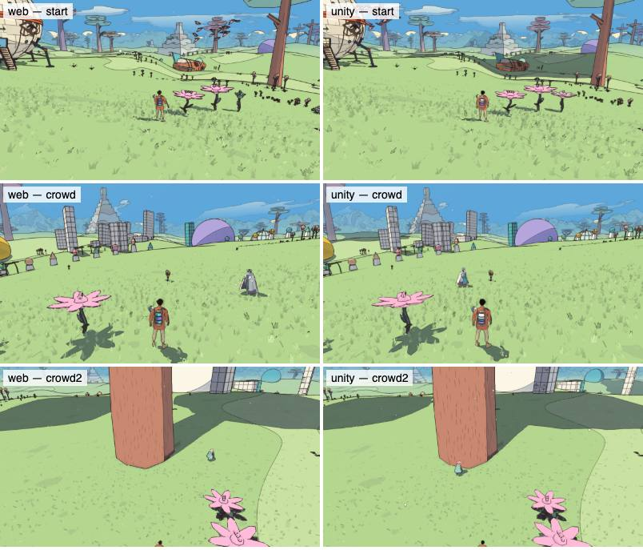
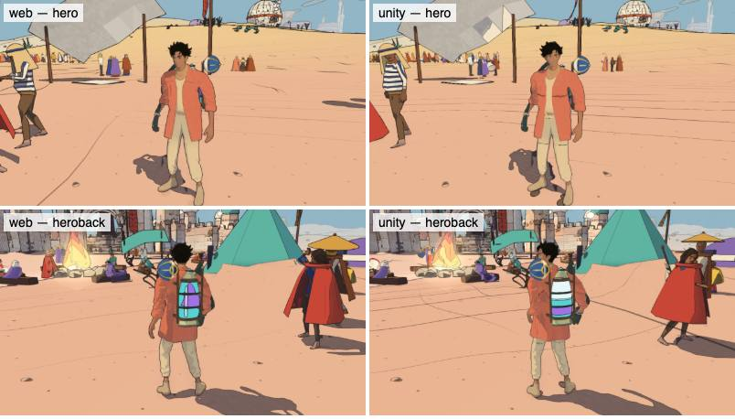

What still differs: which people stand where (another moment of the same code);
cloud shadows (the clock); the portraits in the conversation chip.

(Some people near the camera held their things out sideways: the crowd's GPU figures, whose port, Crowd.hlsl,
still read the costume in the old packing and so showed the wrong pieces, several props at once. Ported again
from crowd-shader.js, 2026-10-07.)

**The overshirt in a Burst job** (2026-10-07). The coral-shirt traveller's cloth was most of the script's
frame (the web steps its cage in a Worker and, since, moves the garment in its vertex shader; the engines' VMs
have no Worker). `src/characters/tripo-cloth.js` takes an engine's offload (`CLOTH_HOST.offload`, set by
engine/game.js from the backend's `clothOffload()`): once, the cage's constants and the garment's flat arrays
(`engine/cloth.js packClothDesc`, `BridgeHost.Cloth`); each frame, the packet the module still works out on the
VM's thread from the bones (the cage's targets, the leg capsules, the bones' matrices with the bind inverse
folded in, the attachment: op 17, ~3 KB). `BridgeCloth.cs` steps the cage (90 Hz Verlet, 18 passes over the
edges and the capsules), places every garment vertex (rigid on the attachment, eased into its skinned place,
plus its cell's displacement, pushed out of the legs) and works out the normals in one Burst job, scheduled
as the packet arrives and completed before the frame is drawn; the garment's meshes take the result (mirrored
in x). `engine/cloth.js clothFrame` is the same steps in JS, which `tests/cloth-offload.test.js` checks against
the module's own path. At the camps (load ~35) the script's update went from 13.6 to 4.8 ms, the frame from
22.9 to 11.1 ms; the dunes from 6.7 to 1.5 and 13.2 to 5.4.

**B3's overshirt in the engines** (2026-10-14). B3's fit (`traveller-b3.js`: `preservePinNormals`,
`detailCollisions: false`) keeps the pinned vertices' own normals (free under 0.4: the detailed mesh's rest
normal turned by its bones, the face normal eased towards it by 1 − smoothstep(free, 0, 0.4)) and pushes no
free vertex out of the legs. The engines made every normal from the faces (1266 of 6448 apart, up to 158°:
blotches over his chest, shoulders and collar in Unity). The description now carries both: an 8th header
word, flags (`CLOTH_PIN_NORMALS` 1, `CLOTH_NO_DETAIL_COLLISIONS` 2), and with the first `map.pin` (4 floats a
mapped vertex: the rest normal and how far to ease, 0 for none) after the index, sent once; the packet (op 17)
is unchanged. `clothFrame` eases the pinned normals after the faces'; `BridgeCloth.cs` does it in `Map`
(`PinNormal`, into `pinNrm` by output vertex) and `Normals` (`EaseNormal`), or at the end of `Step`. A
description without the flags (v1) is as before. `tests/cloth-offload.test.js` checks the module, `clothFrame`
and the description read back through its buffer (`unpackClothDesc`, as the C# reads it) frame by frame.

**The rest of the gaps, closed** (2026-10-07). Hatching that follows the form: the part's axis per vertex
(src/form.js `aFormC`, `aFormA`) rides the geometry (flag 64, TEXCOORD5 and 6) where a material says `S_FORM`,
and Surface.shader builds materials.js's `vForm` from it: caps' strokes radiate, cylinders' wrap, a dark cap's
veins are drawn lighter as branches, a denser hatch (HATCH_DENSE) is closer and heavier. The makers' chests draw
their star and travelling ray (a vertex colour over 1 a light) (`boxMarks`, `boxRay`), inked by their outline only; the ray's clock
goes live (`materialVec`, op 18). A MakeHuman face's shape keys (body.js `keyTexture`) become the mesh's blend
shapes, scaled by its head (`faceKeyDeltas`, `BridgeHost.FaceKeys`: only the vertices a key moves), and each
face's weights go a frame they move (`keyWeights`, op 19). The overshirt's lining colours its back faces
(`_Lining`); the trousers' repaired band is in their vertex colours.

Side by side after all of it (the web left, Unity right, the same views; the editor):

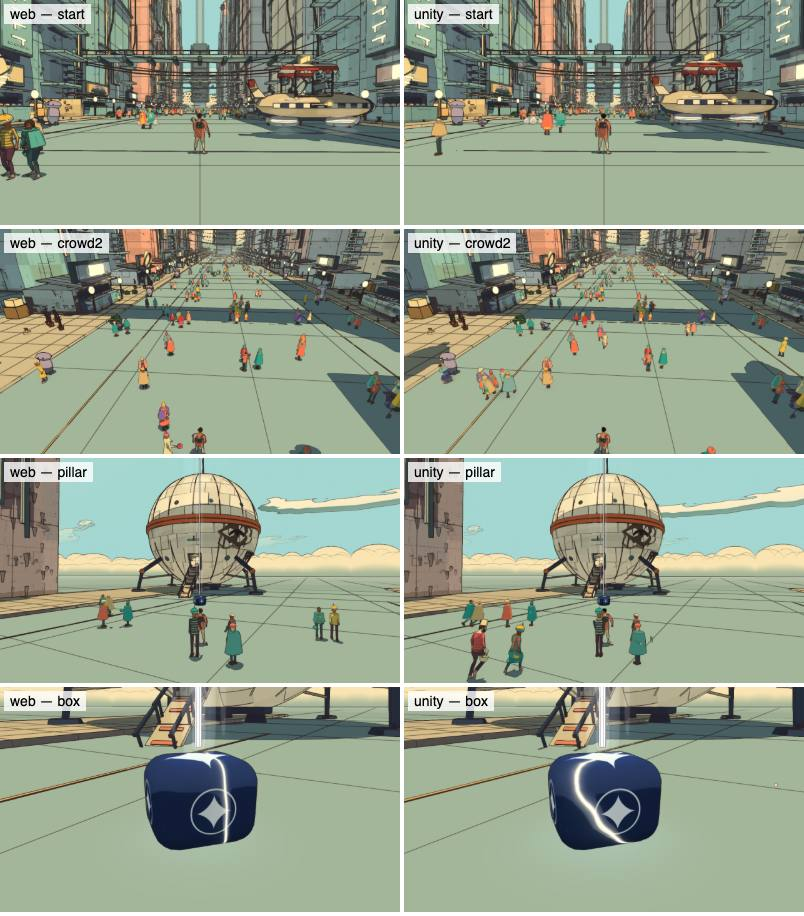
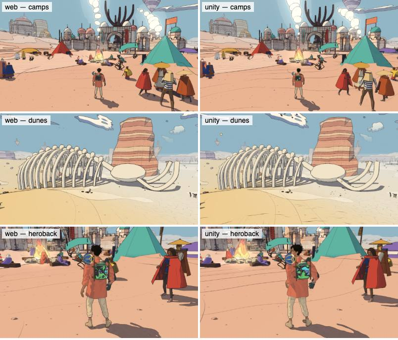
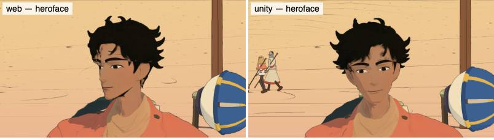
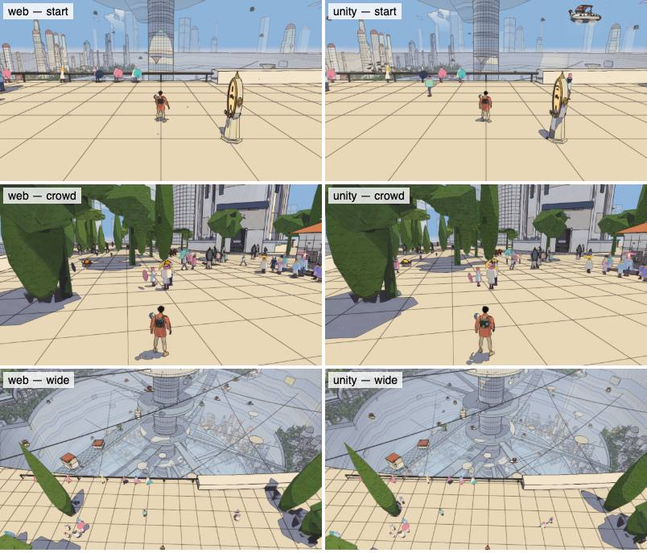
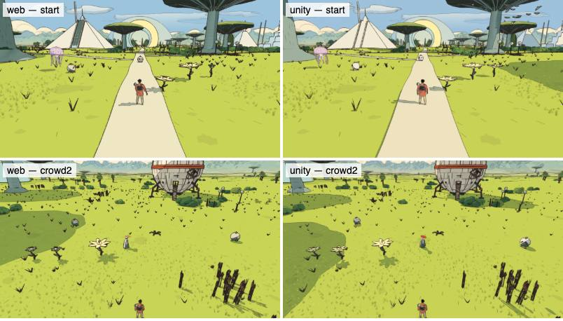

(Once, with the machine's load at 150, the editor's shots after the first came out black; the same run again,
the load at 20, drew every view. `-look` logs the frame's look at each shot.)

**The newer pieces from the web** (2026-10-07). The coral-shirt traveller's drawn face (characters/tripo-face.js:
brows, eyes and mouth drawn in his body's shader, moved by his expression): its GLSL is turned into HLSL by
`scripts/unity-export/tripo-face-hlsl.mjs` (`TripoFace.hlsl`, generated; a test checks it is current) and its four
vectors go live with the boxes' (`LIVE_VECTORS`, op 18). The glass flask (fluid-tool.js buildFlask): its living
fluid (`flaskFluid`, the green base the tones stream through, op 16 carries it), the glass's tint, its pale rim,
its foot and its etched thirds; the fluid's meshes now upload their rest place, which the shader reads its box by.
And a fix found on the way: the bridge sent every figure's rest pose unmirrored where the port's shader expects
it mirrored like the points (the port's own figures keep it so), so faces, sashes and the flask were drawn the
other way round. The Garden's and Lorn II's kits (garden-kit.js, wood-kit.js) need nothing of their own: vertex
colours and a palette, which the port draws.

**What it costs** (before the overshirt's job, above): the VM's update grew with what it now runs. The coral-shirt traveller's overshirt cloth is
the largest share: on the web it steps in a Web Worker, here on the VM's own thread (in Node's `vm` context,
35 of a 49 ms frame at the garage; in Puerts' V8 a few ms). On a busy machine (load 21–27) the editor's frame
at the camps was 22.9 ms (update 13.6, mirror 5.0), the dunes 13.2 (6.7, 2.8), the Garden of Spheres' start
5.8 (3.0, 1.3): to be measured again quietly, and the cloth moved off the script's thread (a C# job over the
same flat arrays tripo-cloth-sim.js steps) before the Retroid's run.

## Players (Unity + Puerts, next stage 4)

`BridgeBuild.cs` builds the bridge's scene alone with the bundle and the characters it loads
(public/anim/*.glb into StreamingAssets/hiraeth-js/public), the bridge's own package name
(`com.rnaud.hiraeth.bridge`):

```sh
node scripts/engine-bundle.mjs unity                              # the bundle first: a build takes StreamingAssets as they are
scripts/unity-export/unity-batch.sh BridgeBuild.Il2cpp            # once: Puerts' IL2CPP glue into Assets/Gen (not committed)
scripts/unity-export/unity-batch.sh BridgeBuild.Mac               # IL2CPP ARM64: Builds/bridge-macOS/Hiraeth JS.app
scripts/unity-export/unity-batch.sh BridgeBuild.Linux             # the Steam Deck's: Linux x86_64, IL2CPP, Vulkan: Builds/bridge-linux/ (docs/systems/unity.md: the sysroot)
scripts/unity-export/unity-batch.sh BridgeBuild.Android           # IL2CPP ARM64, Vulkan only, debug key: Builds/bridge-android/hiraeth-js.apk
scripts/unity-js-player.sh bench -views scripts/bench/viewpoints.json -bench 6 -split -out output/engine-bridge/player-mac
```

The testers' APK (`BridgeBuild.AndroidRelease`: `com.rnaud.hiraeth.unity`, "Hiraeth (Unity)", the release
key, sound on) and the Linux player are built by GitHub Actions and published to the releases
`unity-android` and `unity-linux`; `scripts/unity-android-release.sh` builds and publishes the APK from the
Mac (docs/systems/unity.md, "Building in GitHub Actions").

A player takes its plan from its command line (`BridgeArgs.cs`: the batch run's arguments, a relative
path from the shell's directory) and `-limit secs`; `-mute` keeps it silent (the script passes it).
Under IL2CPP:
- Puerts 3.0.3 wants its IL2CPP glue generated ("Minimal Bridge, Reflection Mode"), and the glue calls
  il2cpp's `Object::Unbox`, which Unity 6.6's il2cpp no longer has: `BridgeBuild.Il2cpp` generates it
  and patches those calls to the object's raw data;
- an IL2CPP player hands a JS value typed `object` over as a ScriptObject, not as an ArrayBuffer: the
  script boxes its buffers (`{ b }`, `BridgeHost.BoxBuffers`) and `JsRuntime.Bytes` reads the buffer out
  as Puerts' ArrayBuffer (`ScriptObject.Get<ArrayBuffer>`). Puerts keeps a handle on each box (and so its buffer)
  until the managed collector lets the ScriptObject go, so a buffer handed over every frame must not be a fresh
  ArrayBuffer: those outlive V8's young generation and pile up for full collections (the Xbox's stall every ~3 s
  at the City-Shaft, performance.md, "The City-Shaft's rim on the Xbox, round three"). The frame's commands go as
  a view of the writer's own buffer (`CommandWriter.takeView`; Puerts copies a view's bytes at the call), the
  sound's PCM as the renderer's view;
- `link.xml` keeps Puerts' assemblies and the bridge whole; StreamingAssets inside an APK are read
  through UnityWebRequest (`StreamingFile`).

What came out (Unity 6000.6.4f1, an M-series Mac):

| player | size | its start |
|---|---|---|
| macOS, IL2CPP ARM64 | 163 MB (V8 56, GameAssembly 42, UnityPlayer 29, data 30) | the bundle running 2.4 s after launch, the world ready 1.7 s later |
| Linux x86_64, Mono (the Deck's then) | 133 MB, 46 MB as a .tar.gz | built, not run then; on the Deck in October 2026 it never started (Puerts: `GetNestedTypes is not a function`): the Deck's is IL2CPP now, 200 MB (docs/systems/performance.md, "The Steam Deck, round 6") |
| Android, IL2CPP ARM64 | 58 MB APK (149 MB unpacked: libil2cpp 55, libunity 30, V8 18, the bundle 6.7) | in an emulator of its own (Android 15, arm64, software GPU): installed in 14 s; the bundle running 5.5 s after launch, the world ready 9.8 s later, the desert drawn |

The macOS player against the web game in Chrome at the same views, back to back (1280 × 720, the
web's High preset at render scale 1; the player's frame is uncapped), medians in ms, the player's
script share in brackets (the game's update, the mirror, the sound); the machine was busy (load
24–40), so these are a comparison, not a benchmark:

| view | the player | web |
|---|---|---|
| spawn | 6.8 (4.2: 1.7, 1.9, 0.4) | 6.4 |
| qanat-tree | 9.4 (7.4: 4.9, 2.0, 0.4) | 7.8 |
| camps | 11.0 (8.4: 5.4, 2.3, 0.6) | 8.5 |
| dunes | 4.1 (2.3: 1.0, 1.0, 0.2) | 3.2 |
| cave | 4.1 (2.3: 1.1, 1.0, 0.3) | 2.7 |

The player is within 6–30 % of the web at the busy views and 1–1.5 ms behind at the quiet ones; the
difference is the game's own update (5.4 ms at the camps in Puerts' V8, the same modules) and the
mirror, which the web does not pay. The C# apply is 0.1–0.3 ms. The Android numbers on a
device wait for the Retroid.

### The players again, and the web against the macOS player (2026-10-07)

With everything above in (the overshirt in its Burst job, the surface marks, grass, wind, people, the boxes),
built again from the same tree (`scripts/unity-export/unity-batch.sh BridgeBuild.Il2cpp`, then `.Mac`,
`.Android`, `BridgeBuild.Linux -mono`): the macOS app 173 MB, the Android APK 73 MB, the Linux player 141 MB.
Not installed anywhere. On a device they are one command each:

```sh
scripts/bench/android-bridge.sh desert -views scripts/bench/viewpoints.json -bench 8 -split   # the Retroid: installs com.rnaud.hiraeth.bridge only, muted
# the Deck: copy unity/Hiraeth/Builds/bridge-linux/ over, then
./hiraeth-js.x86_64 -mute -screen-width 1280 -screen-height 800 -level desert -views viewpoints.json -bench 8 -split -out out
```

(`android-bridge.sh` pushes the views to the app's own folder, starts it with the plan as Unity's `-e unity`
arguments, waits for it to exit and pulls its pictures and `unity-bench.json`; written without a device to run
it on.) The four views of the comparison, each side back to back as the machine went quiet (load 8–10; a
second round at load 8–19 in brackets): the web game in Chrome (High, render scale 1, 1280 × 720, uncapped)
and the macOS player (IL2CPP, uncapped), medians in ms; the player's script in its frame split into the game's
update and the mirror:

| view | web: frame (CPU, GPU) | macOS player: frame | its script (update + mirror) | its GPU |
|---|---|---|---|---|
| the camps | 8.8 (8.6, 3.5) [7.4] | 11.9 [13.5] | 8.7 (5.3 + 2.9) | 5.9 |
| the dunes | 4.0 (3.8, 2.6) [2.9] | 4.7 [7.8] | 2.7 (1.3 + 1.2) | 6.3 |
| the Signal Market's crowd | 4.4 (4.3, 2.8) [6.5] | 6.6 [7.7] | 4.3 (2.9 + 1.1) | 5.4 |
| the City-Shaft, wide | 8.7 (8.4, 5.7) [10.5] | 11.5 [14.1] | 5.6 (2.7 + 2.5) | 12.8 |

The player is 1–3 ms behind the web at every view. Its script costs about what the web's whole frame costs
(the same game update, plus the mirror the web doesn't pay); the overshirt's job adds 0.5–0.8 ms of waiting
on the main thread. Its GPU is now the heavier side: the port's composite took on the web's newer passes
(spot blacks' enclosure, haze, the lines by material), and at the City-Shaft's wide view the frame is the
GPU's (12.8 ms). Next for speed: the mirror's walk (static subtrees skipped), and the composite's passes
compiled in only where a look asks for them, as post.js does (`inkFeatures`).

## Speed: the script on its own thread, still subtrees (Unity + Puerts, 2026-10-07)

Profiled in a development player (`BridgeBuild.Mac -development`, the bench's `-split`: the mirror's parts,
and Unity's own main-thread samplers by name, `BridgeGpuSplit.cs`; this Mac's Metal has no GPU recorders, so
those are CPU times), the player was CPU-bound everywhere but the City-Shaft: at the camps 12.7 ms a frame,
of which the script 8.7 (the game's update 5.4, the mirror 2.8), Unity's culling and render-graph recording
2–3, the overshirt's job waited for 0.65; the GPU 6.9. The script and Unity's drawing ran one after the other
on the main thread. Three changes:

- **The script on a thread of its own, a frame ahead** (BridgeRunner.cs, BridgeHost.cs). While Unity draws
  frame N, the script plays frame N + 1. At the next Update the main thread waits for it, applying what it
  hands over as it comes (every op that touches Unity is queued in order, `BridgeHost.On`; what returns a value
  is asked of the main thread and waited for: a file inside the APK, the save, `Ask`), takes the keys, the pad,
  the mouse and the frame times for the next frame (`Snapshot`), and lets it go. The frame costs the longer of
  the two, not their sum; the picture is one frame behind the script (as the web's is behind its GPU).
  V8 takes its stack limit from the thread that makes the isolate, so the JsEnv is made on the script's thread
  (64 MB of stack); Puerts reads its own scripts from Resources as it starts, which only the main thread may,
  so a loader hands those reads over (`Assets/HiraethJS/Puerts/MainThreadLoader.cs`, an assembly that compiles
  only where Puerts is installed, found by name). On macOS a plain thread ran on the efficiency cores, the
  script ten times slower: it asks for the main thread's class (`pthread_set_qos_class_self_np`,
  USER_INTERACTIVE). `-js-main` (or `"jsMain": true`) runs the script in Update as before. The bench's split
  says how long the main thread waited (`mainWait`) and that the thread ran (`threaded`).
- **Still subtrees frozen** (engine/mirror-freeze.js; **off by default since**: in Puerts' V8 the watches, accessors
  put on objects and vectors and taken off again when they thaw, left those objects slow for every other use, and
  the game's update grew more than the walk shrank: the camps 8.2 ms a frame without, 9.1–9.9 with; `-freeze`
  turns it on). Every 30 frames the mirror looks for the largest
  subtrees whose drawables have not moved for 45 frames (plain groups and meshes: no bones, instances, lines,
  render hooks, face keys or own matrices) and freezes them: the walk takes such a subtree whole (its drawables
  seen, its materials' live colours still looked at) without going in, and three's matrix update stops at its
  root while the root's parent stays where it was. Every object in it is watched, so a change thaws it at once,
  before the next frame's matrices: position and scale (their x, y, z made accessors), rotation and quaternion
  (their change callbacks), `visible`, a child added or removed, the root moved elsewhere, its parent's world
  matrix. A geometry rewritten or swapped, or a render hook set later, has no hook: each frozen subtree is looked
  at for those once every 8 frames. One that thaws soon after freezing waits twice as long each time. At the
  dunes this halved the mirror (2.1 to 0.8 ms in Node's VM, the walk 1.8 to 0.6), at the camps a third.
  tests/mirror-freeze.test.js plays 400 frames of random moves, turns, hides, adds, removes and reparentings
  on two copies of a world and checks the frozen mirror says exactly what a full walk says, every frame.
- **The bones walked only down to what hangs on them** (a prop in a hand), and a geometry's version summed once
  a frame however many drawables share it.
- **The composite's passes compiled in only where a look asks for them**, as post.js's `inkFeatures`: the
  spot blacks, the haze (layers and height fog), the cast and the ink shadows are Composite.shader keywords
  (`HIRAETH_INK_SPOT`, `_HAZE`, `_CAST`, `_SHADOW`) that HiraethLook sets from the look's own values.
- **The G-buffer's normal and distance in half floats**, as the web's (pipeline.js createGBuffer; it was full
  floats): every tap of the composite's edges, pockets and creases reads it.

The four views again, each side back to back as the machine went quiet (load 4–6; the web before and after the
player): the web game in Chrome (High, render scale 1, 1280 × 720, uncapped) and the macOS player (IL2CPP,
uncapped), medians in ms; the player's script on its thread split into the game's update and the mirror, and the
main thread's wait on it:

| view | web: frame (CPU, GPU) | macOS player: frame [other runs] | its script (update + mirror) | main thread waiting | before (stage 2) |
|---|---|---|---|---|---|
| the camps | 7.4–7.5 (7.2, 5.9) | 9.1 [8.4, 8.6] | 9.0 (6.3 + 2.5) | 5.9 | 11.9 |
| the dunes | 3.0 (2.8, 2.5) | 3.1 [3.0, 3.0] | 2.7 (1.6 + 1.0) | 0.7 | 4.7 |
| the Signal Market's crowd | 4.2 (4.1, 3.5) | 4.9 [4.9, 5.4] | 4.8 (3.4 + 1.2) | 2.7 | 6.6 |
| the City-Shaft, wide | 6.8–7.0 (6.6, 6.0) | 6.4 [6.5, 6.5] | 5.6 (3.0 + 2.3) | 0.9 | 11.5 |

The player is 28–44 % faster than before this stage, level with the web at the dunes, ahead of it at the City-Shaft,
and 0.7–1.5 ms behind at the camps and the Market's crowd, where the script's thread is the frame: the game's own
update (the same modules as the web's, 3.4–6.3 ms in Puerts' V8), the mirror (1.2–2.5: three's matrices 0.6–1.0, the
walk 0.5–1.3) and the sound's synthesis (0.2–0.4, which the web leaves to its audio thread). The main thread waits
on it 3–6 ms there. Above the display's rate (the dunes, the City-Shaft) the player's frames come in bursts with a
stall every 5–7 (p95 14–24 ms): the bench's `-split` says those frames waited neither on the script nor on Unity's
CPU (main thread 2–4 ms, render thread under 1), and no GC ran: the window's drawables are released at the
display's refresh, so an uncapped player outrunning it waits there; the web's headless bench presents nothing.
Next for speed: the sound's synthesis off the script's thread, and the mirror's matrices for the people's bones
(three's updateMatrixWorld recomposes every bone every frame, on the web too).

## The towers' own colours, the cliffs' cracks, the web's newest shading (Unity + Puerts, 2026-10-07)

- **Per-vertex material values** (materials.js `S_VMAT`, src/vertex-material.js: the City-Shaft's towers, merged
  into a draw each with their own colours, band size, grid, flatness, object-space point and normal, place and
  turn). The geometry carries them (unityGeometry flag 128: aMatC1–3, aMatS, aObjP, aObjN, aObjM), BridgeRenderer
  puts them in uv1–uv6, and Surface.shader's `HIRAETH_VMAT` variant reads them: its vertex stage takes the object
  frame from them (the camera in each object's own frame, as the web's), and its fragment stage redirects
  `_Color`, `_Color2`, `_Color3`, `_StrataSize`, `_Grid` and `_Flat` to the vertex's values (statics set at its
  start), so every use below reads them unchanged.
- **The cliffs' cracks** (`uCracks`, materials.js faceCracks: the desert's canyon walls and violet cliffs, the
  references' strata): ported as `faceCracks` in HiraethCommon.hlsl, the material's `_Cracks`.
- From main since: **the half-tone kept off faces inside another's cast shadow** (materials.js castBeyond: one
  tap of the middle shadow map 16 m toward the sun; Surface.shader the same on `_MShadowMap1`, built walls only)
  and **the dust band on the sand banked against a weathered wall** (post.js: drift pixels whose probe up the
  screen lands on a weathered wall just behind; Composite.shader the same). The Market's heaps
  and the greeble kit are plain meshes and materials the port already draws.

The rose gorge (its walls' cracks) and the City-Shaft from the rim, the web on the left, Unity on the right:
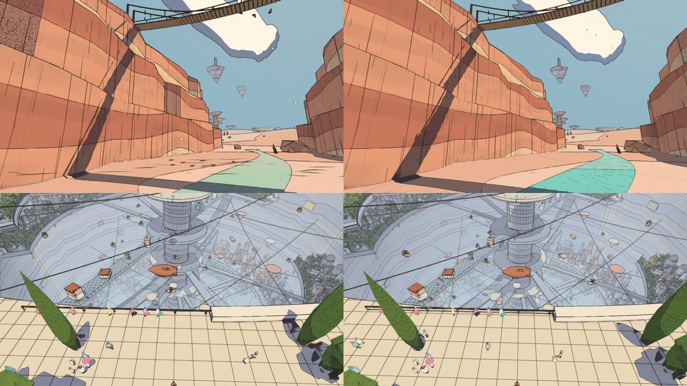

## The conversation's portrait, the traveller's head (Unity + Puerts, 2026-10-07)

- **The chip's portrait.** The web shoots the person you talk to with its own renderer (main.js captureView with
  `keep`: them alone against a flat colour of the world's, drawn at the chip's size and shrunk by halves). The
  bridge's story gets a capture of its own (engine/game.js `portraitCapture`): it names the drawables of the kept
  objects (the mirror's ids) and asks the backend for a portrait (`UnityBackend.portrait`, BridgeHost.Portrait);
  BridgeRunner.Portrait takes every other node out of the picture (`BridgeRenderer.Isolate`), the HUD too, sets the
  backdrop (`_Backdrop`, the composite's sky replaced, as post.js uBackdrop), the rain off and the pixel ratio the
  chip wants (post.js portraitPixelRatio: the lines as thick as at the chip's 84 px), draws a camera of its own
  (`PortraitCamera`: the main one's clear and layers, never enabled) from the web's eye toward its look into a 336 px
  texture with mips (supersampled), and puts everything back. (It drew the main camera a second time until October
  2026: every frame after the first portrait came out black, the world gone but its stars and a few lines, and the
  chip blank; issue #264.) The dialogue
  publishes the portrait with the panel's data (src/story/dialogue.js `portrait`, `backdrop`: an engine's panel
  shows it), and BridgeHud shows it in the chip through a round mask, on its backdrop; their initial on their
  colour where there is none. A batch run with `-out` keeps each as `unity-portrait-<n>.png`.
- **The traveller's head turns** (main's headNod joint: the idle and look clips' head on the rig's head): the
  mirror sends the bones as three has them, so it was already in: in Node's VM the head's joint turns 54° into the
  look clip after a few seconds of idling, and Unity's close-ups catch him looking aside as the web's do.

Teo's portrait, the web's (left) and Unity's (middle), and Rima's (then Ysa) in Unity's panel:
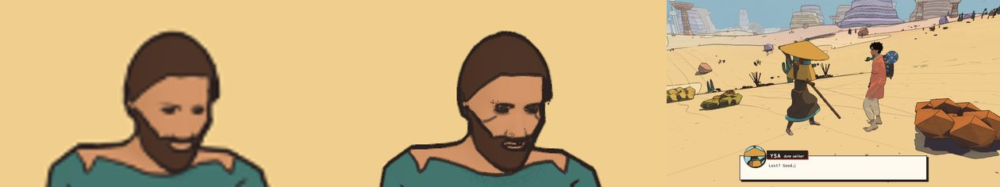

## Faces close up: expressions (Unity + Puerts, 2026-10-07)

A bench view can be aimed at a face and put an expression on it (engine/unity/game.js `aimed`: `npc` an id or
`'traveller'`, `face` at the head bone, `dy` from below, `expression` an expression.js one, set through
Humanoid.setExpression), so the same faces are photographed on both sides (the web's from the bench page, the same
numbers). The MakeHuman faces' shape keys already went live (op 19); their ink did not: the face ink's expression
(`uMood`, `uMood2`: the smile's lines, the brows' creases, the squint) was the one the material was sent with. Both
are live vectors now (engine/mirror.js LIVE_VECTORS, op 18), sent only when they move.

The coral-shirt traveller's drawn face (neutral, happy, sad, surprised) and Teo's MakeHuman face (neutral, happy,
angry, surprised), the web above Unity:
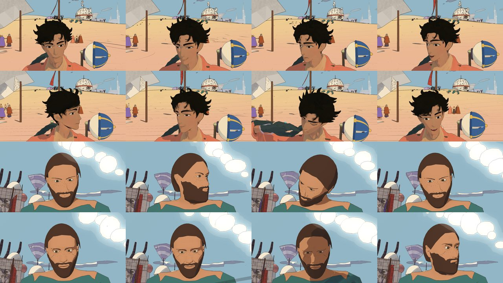

What still differs: the port's face ink draws Teo's forehead and cheek lines heavier than the web's at rest, and
the traveller's hair is spikier; the expressions themselves read the same.

## The script's frame against the web's (Unity + Puerts, 2026-10-07)

Where the script's thread went, read from V8 itself: the player takes `-jsinspect <port>` (Puerts' V8 inspector on
the script's own thread: a CPU profile through the DevTools protocol; scratchpad tools connect, start the
profiler, stop it and keep the `.cpuprofile`), and the bench's `-split` now times the update's parts
(engine/game.js `sections`: the crowd, the people, the story, the traveller, the level, life, flora, wind…). On the
web the same parts, timed in the page round each person's update: at the camps the people took 1.9 ms a frame there
and 3.8 ms in the player; three's matrix updates (the mirror's and the people's own) and the capes' cloth were
the most of it.

- **The people's capes in a Burst job** (src/cape.js `CAPE_HOST`; engine/cape-job.js, BridgeCape.cs). Cape.update
  still works out what its steps need: the collar's pins from where the body was to where it is, the colliders
  likewise, the air, the carry since its last update, the seat's field. With an engine's offload set (engine/game.js
  sets Unity's for every cape made), those go into a packet (op 20) instead of the steps: the integration, the
  constraints, the colliders, the ground or the seat, then the normals, a Burst job a cape, scheduled as the frame's
  commands arrive and done before it is drawn; the cape's Unity mesh takes the points. The script keeps no copy of
  the cloth: it reads the latest points back when it wants them (BridgeHost.CapeState, from its own thread, no wait:
  the drape caught when the wearer has stood still, the bells on the hem, the ease onto the drape when the cape goes
  out of the cloth's range), and a cape it moved itself (reset, baked, eased, hung) sends its points with the next
  packet. engine/cape-job.js is the job in JavaScript, the C# one line for line; tests/cape-job.test.js runs the same
  cape, walking, carried every 3rd frame, seated on a field and spread like wings, through cape.js and through the
  packets: the same to 0.1 mm for 20 frames, the same cloth after (within 2 mm on average: the packets carry floats,
  and the cloth's colliders amplify that). The people's update at the camps went from 3.8 to 1.9 ms a frame, the
  Market crowd's from 2.4 to 1.1.
- **The sound rendered on a thread of its own** (engine/webaudio.js recorded, engine/unity/audio-worker.js;
  BridgeRunner.RunAudio). The script's thread no longer renders: its Web Audio shim, recorded
  (`installAudio({ record: true })`), keeps every node's and param's state as before (what the game reads back:
  values, the clock) but writes down what is done to the graph (nodes made with their params, connections, param
  events, starts and stops, types, buffers and waves once) and, a frame at a time, the blocks to render after
  them, exactly the ones it rendered before (the ring kept AUDIO_AHEAD ahead); a Float64Array of tokens
  (BridgeHost.AudioBatch). A second V8, on Unity's side on a thread of its own with only the shim in it
  (StreamingAssets/hiraeth-js/audio.cjs, `engine-bundle.mjs unity-audio`), makes the same graph from them
  (`AudioReplay`: the same classes) and renders those blocks into the ring Unity plays; the sources that ended go
  back for their onended. The recorded side keeps no graph of its own (only the replay drops what has ended from
  what it fed: kept here as well, nothing could be collected), holds a source with an onended until it ends, and
  tells the replay which nodes the game let go of (WeakRefs swept every 120 frames: a FinalizationRegistry's
  callbacks never ran in Puerts' V8); a 45 s walk ended with 48 nodes in the replay's map, 543 freed.
  tests/webaudio.test.js plays the game's own Sound for 150 frames rendered and recorded-and-replayed: the same
  samples, every one. `-audio-js` renders on the script's thread as before. The sound's share of the script's
  frame went from 0.28 to 0.05 ms at the camps.
- **The mirror's freezing off by default** (above).
- **A material's live vectors** looked up every 64 frames (most materials have none), not each frame.

The four views with all of it, each side back to back at a quiet machine (load 2–4; the web before and after the
player): the web game in Chrome (High, render scale 1, 1280 × 720, uncapped) and the macOS player (IL2CPP,
uncapped), medians in ms:

| view | web: frame (CPU, GPU) | macOS player: frame | its script (update + mirror) | its sound on the script | before this round |
|---|---|---|---|---|---|
| the camps | 7.3–7.5 (7.1, 5.9) | 6.4 | 6.1 (3.5 + 2.3) | 0.05 | 8.2–9.1 |
| the dunes | 2.9 (2.8, 2.5) | 2.8 | 2.4 (1.2 + 1.1) | 0.02 | 3.0–3.1 |
| the Signal Market's crowd | 4.2 (4.0, 3.5) | 3.5 | 3.2 (2.2 + 0.9) | 0.03 | 4.5–4.9 |
| the City-Shaft, wide | 6.8 (6.6, 6.0) | 5.8 | 4.6 (2.5 + 2.1) | 0.04 | 6.4–6.5 |

The player is at or under the web at all four: 12 % faster at the camps, 17 % at the Market's crowd, 15 % at the
City-Shaft, level at the dunes. What is left on the script's thread is three's own: its matrix updates (the
mirror's scene.updateMatrixWorld 0.4–0.8 ms, and the people's own joints updated as they pose, which the web pays
too), the mirror's walk (0.5–1.5) and the game's update. (The p95 above the display's rate is still the window's
present: no frame waited on the script or on Unity's CPU then.)

## The people's posing, cheaper on every side (2026-10-07)

The people's posing stopped recomputing world matrices it had just made (src/world-read.js; performance.md, "The
people posed without recomputing what was current"): the same poses to the float (tests/pose-exact.test.js checked it then; the old path and that test are gone), and
cheaper on the web as well as here. The player's people at the camps went from 1.69 to 1.08 ms a frame, at the
Market's crowd from 1.02 to 0.70; its frames from 6.4 to 5.6 ms and 3.5 to 2.9 (load 5–8). The players were built
again with all of it (macOS 183 MB, the Android APK 76 MB, Linux 150 MB), ready for the Retroid and the Deck
(`scripts/bench/android-bridge.sh`, "The players again" above); none installed.

## On the Retroid (2026-10-07)

The bridge's APK (`com.rnaud.hiraeth.bridge`, its own package beside the web game's `com.rnaud.hiraeth`; built
at 81f0311, 76 MB) on the Retroid Pocket Nova, `scripts/bench/android-bridge.sh desert -views
scripts/bench/viewpoints.json -bench 8 -split`: it started 2.1 s after launch, the bundle (7.2 MB) loaded in
0.2 s, the desert ready 3.5 s later (GeckoView's load of the same world: 9.4 s), with **the script and the
sound each on a thread of their own** (no need for `-js-main` or `-audio-js`); the audio replay's graph stayed
small over six minutes (195 nodes after 600 batches, 53 after 6 000, 1 171 freed). But it never ran the plan:
**the `unity` intent extra did not arrive** (adb's shell split the unquoted arguments, and the player read only
`Environment.GetCommandLineArgs()`, which on Android need not carry it), so it played the desert, with its sound, until the script's 10-minute
limit. Now:

- `android-bridge.sh` passes the extra quoted, stops the player if it has not logged its plan within 20 s,
  and refuses to start on a locked screen (where the player is paused as it starts and never runs);
- `BridgeArgs.CommandLine()` (BridgeRunner's flags read it too) adds the activity's `unity` extra on Android
  (read once, in Start) and logs `the plan from the intent: …`.

Built (`BridgeBuild.Android`, 337 s with a fresh Library) but not yet seen on the device: by the second run the
handheld had locked itself behind its PIN, which only the author can open. The web numbers to compare on the
same views are in performance.md, "The Retroid, round 4" (the desert's views: the camps 56 fps, JS 17.2 ms;
the dunes 60, 11.7; the spawn 59, 13.6).

## On the Retroid, the first run (2026-10-11)

The bridge's APK built from 1606a596 (`BridgeBuild.Android`: IL2CPP ARM64, Vulkan then GLES3), installed as
`com.rnaud.hiraeth.bridge`, and run with `android-bridge.sh desert -views scripts/bench/viewpoints.json -bench 8
-split -metrics` (the on-screen readout on).

**The sound.** The first try read its plan with `-mute`, but Android listed its audio stream as playing. `-mute`
pauses the listener and never starts the bridge's AudioSource, yet Unity's own output stream still runs. Silent or
not, that could not be confirmed, so the script stopped it within 5 s. Two changes since:
- **The bench's player is built with Unity's audio disabled** (`BridgeBuild.UnityAudio`: the project's "Disable Unity
  Audio" set for that build alone, then restored; the testers' APK keeps its sound).
- **`android-bridge.sh` stops a player that sounds:** it needs `-mute` in the plan the player logs, and stops the
  player whenever `dumpsys audio` lists one of its streams as started (checked 4 s in, then every 5 s).

It also read the keyguard from `showingAndNotOccluded`, which stays true on the unlocked Retroid. It reads
`mIsShowing` now. On the second build the package had no audio stream at all; it ran its plan and exited itself.

**The frames** (1280 × 720, the script on its own thread, the sound's renderer on its own at 24 kHz with no output):

| view | frame ms (p95) | fps | script (vm) ms | update / mirror ms | the main thread's wait ms | drawn |
|---|---|---|---|---|---|---|
| spawn | 91.5 (95.3) | 11 | 14.0 | 6.7 / 6.8 | 1.9 | 1287 |
| qanat-tree | 72.6 (75.6) | 14 | 17.6 | 10.0 / 7.3 | 2.0 | 1291 |
| camps | 89.1 (92.7) | 11 | 16.6 | 8.7 / 7.5 | 2.3 | 1286 |
| dunes | 73.4 (76.5) | 14 | 10.3 | 4.8 / 5.3 | 1.5 | 1177 |
| cave | 73.8 (77.5) | 14 | 10.5 | 4.8 / 5.4 | 1.2 | 1165 |

On the same views the web game in GeckoView runs at 50–60 fps (performance.md, "The Retroid, round 5"). The Unity
player is bound by the GPU: 72–91 ms of GPU time a frame against a CPU frame of the same length. Its script and
mirror take 10–18 ms on their own thread, and the main thread waits only 1–2 ms for them. The 1 165–1 291 draws (the
web draws 100–450 on these views) and the full-resolution URP passes are where the time goes. With the script and
the sound off the main thread (#55), the CPU side fits in a 60 Hz frame; the GPU side would need about 5× less.

## The temples' futuristic skins (Unity + Puerts, 2026-10-15, issue #342)

A skinned material's pattern crosses as data: `inkSpec` adds `skin: { body, data }` (src/temples/skins/skin-shader.js),
the port gets `skinPattern` and `skinData` (vec4 slots), and Surface.shader's single `HIRAETH_SKIN` variant draws it with
the generated `SkinPatterns.hlsl`, the web's own GLSL in HLSL. Values that move later go live as op 21 (`materialSkin`).
See docs/systems/temples.md, "Futuristic skins", "In Unity".

## See-through surfaces (Unity + Puerts, 2026-10-13, issue #263)

The web draws a see-through surface (src/veil.js: the City-Shaft's air pillars, Lorn II's mushrooms, the Glass
Dunes' lenses and panes, every shaft of light) in two parts: its rim in the G-buffer (`makeMaterial({ veil })`:
discarded where |n·v| is over the cut) and its body as a wash over the finished picture, from a scene of its own
(`Veils.scene`, drawn by main.js after the composite). The bridge had neither: the rim's material went as a plain
opaque surface (an air pillar a white column), the washes' scene was never mirrored, and a shaft's own meshes
(`MeshBasicMaterial({ visible: false })`, layer 31) went as opaque white cones.

- **The rim**: `port-format.js` sends `veil` (uVeil); `WorldLoader.MakeMaterial` sets `_Veil`; Surface.shader's
  G-buffer pass discards as the web's S_VEIL does, and its depth prepass draws no veiled surface. The cut is only in
  the full variant: `BridgeRenderer.Lean` gives a veiled material the full one, as the glass. (In the lean variants
  first, a discard never taken still cost every lean surface the GPU's early depth test: the rim 44 fps on the Xbox,
  21 ms of GPU against 14.)
- **The wash**: engine/game.js hangs `level.veils.scene` in the mirrored scene (the washes' matrices are world ones)
  and calls `Veils.show()` each frame before the sync (each wash shown while its mesh is, as `Veils.render`). A wash
  material (a shader with `uWash` and `uColor`, transparent, no depth test) goes as `port: 'veil'` (colour, alpha,
  glow, near, side) to **Hiraeth/Veil** (Queue Transparent+30, after the ink composite): the web's wash shader, its
  depth tested by hand against `_GNormalTex.w`, lit and hazed with the look's globals. Its alpha is live: the mirror
  sends a wash's `uWash.x` as op 15's glow (LightShaft.fade), which BridgeRenderer puts in `_WashAlpha`. The washes
  cast no shadow.
- **What three never draws**: `inkSpec` says `visible`; a drawable whose materials are all invisible gets a node with
  no mesh (no geometry sent, nothing drawn, no shadow).
- `-no-veil` (a test) puts it back as before: no cut, no washes. The cost at the rim (Xbox Series X, build 2105,
  1440p, `-vsync 1`, muted, the last 30 s of 170 s, two alternated rounds): 59.63 → 59.70 fps, GPU 14.64 → 14.74 ms
  (the changelog's v1.64 line). tests/unity-veil.test.js.

The blend is Unity's linear one (the camera target encodes sRGB), the web's is in display values: a pale wash over a
dark city reads a little lighter than the web's. Android and the Deck get the same (one shader, one bridge).

**A way through's glow** (src/door-light.js, issue #391) is a wash of its own making too: a shader with `uDoor`,
`uFar` and `uPool`, its parts in the mesh's colours. It goes as `port: 'doorlight'` to **Hiraeth/DoorLight**
(Transparent+30, added to the picture, the depth tested by hand as the veil's), `uDoor` live as `_Door` (LIVE_VECTORS),
its alpha raised to 1.5 as the veil's lights are for the linear blend. rendering.md, "Ways through".

**A deadly drop's dark** (src/pit-void.js, issue #312: every temple pit that puts you back, the Clock-House's, the
Footprint's pools; a world's void under its kill height) is a wash of its own making in the same scene: a shader with
`uInv`, `uMin`/`uMax`, `uLook` and `uRings`, which went to the port's Surface and drew nothing like it. It goes as
`port: 'pitvoid'` (three's world into the box's frame, the box, the dark and the rings' colours, the look) to
**Hiraeth/PitVoid** (Transparent+20, Cull Front: three's BackSide through the mirror's flipped winding): the web's GLSL
worked in three's space (x mirrored back), the scene's depth and normal read from `_GNormalTex`, the rings turned by
`_MTime`. Its alpha is raised (1 − (1 − a)^2.2) so the near-black wash darkens a bright floor as much as the page's
display-value blend does. No shadow; `-no-veil` leaves it out with the washes. tests/engine-unity.test.js.

**The local lights** (op 11) and the look: the bridge sends its look again whenever it moves (every 4th frame at most)
and `HiraethLook.Load` cleared the local lights with it, so the Apply there sent the shader none until the next
Update: the Rose House's flame, fires and cistern without their pools in the batch pictures, and a frame without
pools every so often in play. Load keeps the lights unless a list comes with it (the port's world.json). The
off-screen cull (#262) is unchanged; a shot (`BridgeRunner.Shot`) culls against its own 16:9 picture, not the 4:3
batch window, and logs `lights at <shot>: kept of near` (Rose House: 8/8, 6/8, 7/8, 8/8; desert bench views: spawn
8/8, qanat-tree 7/8, camps 6/8, cave 6/6, dunes 2/3).
## Short recorded effects in Unity

The existing `decodeAudioData` bridge also accepts `sfx/<name>.mp3` and `sfx/<name>.wav`. Unlike long music,
these recordings become ordinary `AudioBuffer` PCM: their playback rate, stereo pan,
filters, loop, gain/mute and `onended` use the same DSP graph and audio-worker protocol
as synthesized effects. The native decoder never creates an effect `AudioSource`.
`BridgeBuild.Common` copies `public/sfx/*.mp3` and `public/sfx/*.wav` into every package through its existing
StreamingAssets route and removes stale packaged effects. There is no effect download
service; a missing or rejected recording leaves the caller's procedural fallback available.

`BridgeMusic` limits decoding to two simultaneous requests, 64 outstanding handles,
2 MiB encoded per file, mono/stereo, 30 seconds and 8 MiB PCM per effect. Completed PCM
awaiting transfer is capped at 16 MiB. Requests time out after 15 seconds and queued
requests after 30 seconds. Duplicate pending paths share one request. `SfxTake` consumes
successes and failures; temporary Unity clips are destroyed after extraction and all
remaining clips/results are released with the host. The sample bank owns the final
JavaScript buffers rather than a second permanent native PCM cache. These limits are
intended for short effects and seamless short loops, not long ambience recordings.

## The recorded music (Unity + Puerts, 2026-10-15, issue #264)

The Web Audio shim can't decode an MP3, so until now Unity played only the procedural score: no world themes, no
title recording, no recorded cues, nothing for Settings > Music plays to decide. Now Unity decodes them and the game's
own graph still decides everything about them.

- **Decoding** (`engine/unity/music.js`, `BridgeMusic.cs`): the shim's `decodeAudioData` has an engine decoder
  (`setAudioDecoder`). The game fetches `music/<file>.mp3` as on the web (`src/soundtracks.js`). engine/platform.js
  remembers which path each fetched ArrayBuffer came from (`fetchedPath`), and the decoder hands that path to Unity
  (`BridgeHost.MusicLoad`). Only `music/` is taken; the effects stay as they were. BridgeMusic loads it with
  `UnityWebRequestMultimedia.GetAudioClip(…, MPEG)` and **streams** it (`DownloadHandlerAudioClip.streamAudio`): each
  voice decodes its part as it plays. Unity counts 0.2 MB for a 205 s theme (`Profiler.GetRuntimeMemorySizeLong`).
  Without streaming Unity decompressed it on load (`compressed` alone isn't kept for a runtime MP3), the whole theme
  as samples (about 40 MB at 16 bits). It works from a folder (the Deck, the
  Xbox, the Mac) and from inside the APK (a `jar:` URL). Once Unity has it (`MusicState`, polled each frame), the promise
  resolves with a **`NativeAudioBuffer`**: its length, rate and channels, and no samples on the script's side.
- **Joined and balanced as on the web**: `prepareSoundtrack` on a native buffer returns `buffer.joined(fade, level)`
  (`nativeSoundtrack`). That is the same 2 s join of the tail into the opening, at the gain the web's measure gives that file.
  The script never holds the samples, so the gains are measured once on the Mac (`scripts/theme-levels.mjs`: afconvert
  decodes, the web's own `prepareSoundtrack` measures) into `src/theme-levels.js`. tests/engine-music.test.js fails if a
  recording has no gain.
- **Played where the graph says**: a buffer source on a native buffer renders nothing in the shim. After every render,
  the context lists each such source (`nativeText()`: its place in its buffer, its loop and join, and **its gain to the
  speakers**). That gain is the product of the gains on every way from it to the destination, at that moment: the
  theme's fades (`musicMomentsUpdate`), the music bus (the music volume, the menu taking the world's music out, a
  bench's swell, a moment's dip), the world bus (the menu's hush), the master (the mute, the away guard), and the file's level. The
  reverb's and delays' sends are left out (the engine plays it dry) and so are the meters. The lowest lowpass on the
  way goes too (under water). Recorded, the replay on Unity's audio thread works it out (the graph is there) and sends it
  with each batch (`BridgeHost.AudioNatives`). Rendered on the script's thread (`-audio-js`), `pumpAudio` sends it.
  A source that isn't looped ends when its recording does, and its `onended` comes back as for any source.
- **On Unity's side**: two AudioSources a source. Looped, each turn's voice plays the clip from its start, faded in over
  the join, and runs on past the turn into the clip's last two seconds, fading out under the next turn's opening. That
  is `prepareSoundtrack`'s crossfade, done as it plays. The place is the shim's, less the ring's lead (`BridgeAudio.Queued`),
  so the music is heard with the rest. A voice more than 0.25 s off is set back. The gain is eased per sample on the
  audio thread (`MusicGain.OnAudioFilterRead`: no steps, no clamp at 1). The lowpass is an `AudioLowPassFilter`. Away
  (`AudioListener.pause`, the D8 pause) silences these sources with everything else. Muted (batch runs, `-mute`)
  nothing plays: the places and gains are worked out all the same, logged every 2 s (`Hiraeth bridge: music now
  [...]`) and summed at the exit (`Hiraeth bridge: music {"clips":…,"peakGain":…}`).
- **The title**: the Unity title now has the web's sound (`makeSound('title', { title: true })`: the procedural
  menu tune, then the title's recording over it once decoded). It fades as a save is chosen and is let go once the
  world is up. The replay starts a fresh graph when a new context's destination arrives.
- **Settings > Music plays** (Always, the default since v1.85, or Moments) is in the engines' settings now (`engine/menus.js`, applied by
  `setMusicMode`). A keepsake brings the theme back as on the web (`gameState.on('keepsake')`).
- **What each player carries** (`BridgeBuild.Music`): the computers' players (the Deck's Linux one, the Mac's) carry
  every theme (106 MB). The APK and the Xbox's carry the ones every device does (`OnDeviceThemes`, the same as
  `src/music-store.js` `ON_DEVICE_THEMES`). Those two download the rest once into `persistentDataPath/public/music`
  (`BridgeMusic.Fetch`, from 8 s after the world is up, one at a time, the world played first; a failure waits two
  minutes; never in batch runs). `PublicRoots` reads that folder too, and the world waiting for its theme looks for it there every 5 s (`themeArrival`, `setThemeWait`), so it fades in as soon as it has arrived (issue #471; before, only from the next world's load).

Memory: only the clips asked for are loaded (the title's, the world's, a cue), streamed, released when the engine
reboots into the next world. Tests: tests/engine-music.test.js (the shim's places and gains, recorded and replayed
alike, the game's Sound under the volumes, the menu, a bench, the mute, the moments and the away, the title),
tests/engine-unity.test.js (the bundle against a stand-in host: the title's and the world's recordings decoded and
faded in, the download list).

Checked (15 October 2026, muted, `-music-check`), in the Unity editor on the Mac and on the Steam Deck (the Linux IL2CPP
player, `scripts/bench/deck-unity.sh`). The Glass Dunes' theme decoded (205 s, 48 kHz) and faded in to 0.158: its level
0.354 × the music bus 0.62 × 0.8 × the master 0.9. At the start the tail and the opening played together. The voices'
own clocks stayed within 0.06 s of the game's places, with no seeks. The title's recording played at 0.145 on the menu
bus, for 15 minutes on the Deck. The Retroid and the Xbox are not checked yet: the bench's APK is built without Unity's
audio, and the testers' APK and the Xbox package come from CI.

## The HUD on the world's points, the round backpack's glass (Unity + Puerts, 2026-10-15, issue #264)

Reported on the AYN Thor's Unity build: the stamina wheel and the floating "A talk to…" tag shook while running,
and the backpack's glass looked nothing like the web's.

- **The shake.** BridgeHud placed a world point (the screen's `stamina.at`, `prompt.at`, the reticle's, the gadget
  marks') by projecting it to a screen point and then into the canvas through `RectTransformUtility`, i.e. through the
  canvas' own transform. A Screen Space - Camera canvas is moved in front of its camera only as it draws, so between
  BridgeRunner's Update (which applies the frame's camera) and the draw it stood where last frame's camera had put
  it, at a plane distance that follows the near plane the game sets each frame; and BridgeHud's Update could also
  run before BridgeRunner's. The wheel and the tag were off their points by the camera's last step, which changes
  with every frame's length: a shake. Now `ToCanvas` goes from `WorldToViewportPoint` straight to canvas units (the
  canvas covers the camera's viewport, as the page's `project(camera)` to `innerWidth`), and the HUD is laid out in
  LateUpdate, after the frame's ops.
- **Measuring it.** `-hud-trace` logs every 2 s how far the wheel's centre and the tag's foot are drawn from where
  their points are drawn (screen px, measured as the camera starts to render, or as the canvases are made ready in a
  batch run whose camera draws only for its pictures) and how much that changes frame to frame; `-hud-old` places
  them as before; `-hud-run secs` is a plan that walks round someone (the tag) then sprints (the wheel). In the
  editor (640 × 480): before, the wheel 6–9 px off, shaking 3–4 px a frame (up to 33), the tag 6–25 px off, shaking
  1.5–5 px (up to 70); after, 0.0 for both.
- **The backpack.** The port still drew the tank as the old green lava-lamp flask (`flaskFluid`); the web's round
  backpack has since become a nebula marched through its glass dome (materials.js `nebula`, `flaskNebula`, the dome
  set by fluid-tool.js `buildFlask`). Figure.hlsl now has the same march, the dome (`uFluidDome`, `uFluidDomeK`)
  goes through port-format.js and `WorldLoader.MakeMaterial` (`_FluidDome`, `_FluidDomeK`), the eye's ray is taken
  into three's object frame through `UNITY_MATRIX_M` with x mirrored on both sides, and Surface.shader keeps the web's
  two rules for it: lit from within (`L ≥ 0.92`) and its glass inked by its outline only.

## The onboarding, the observatory and the sky's own (Unity + Puerts, 2026-10-16, issue #264, D16)

What main.js made and the engines didn't (docs/plans/unity-default-portables.md, D16; the action sounds are the
sound-QC's, apart):

- **The help on the cue**, as main.js `updateHud` stacks it: Plumb's own line first (src/companion.js `Companion`: the
  opening's lines once a save, out of the ship, the first person near, the first chest; the lost watch, its ping toward
  the goal), then what the scout found (Q, D-pad →: `findSummary` of the goal over the step and how far, its distance as it
  is each frame, `FIND.say`; the shrug, a guardian's hint `◇ …` on the cue instead of a toast), then a lesson: the
  desert's first steps (src/first-steps.js: the camera after 6 s without a look, the jump after 25 m without one; any
  look through `rig.look`, the mouse or the stick, counts it as learnt) and the scout's button once after the first
  conversation (src/scout-hint.js). A lesson waits for the notices: `noticeBusy` is the engine's toast queue up or
  waiting. None in a bench's views, a game's page or a fixed view.
- **The scout's goal** is the main.js one: `nextObjective` with the observatory and the story page (it was given
  `story: null`, so a world whose quests were done pointed nowhere but the ship).
- **The sleeping observatory** (src/observatory.js `ObservatoryQuest`, the desert): Naji (npcs[5]), the six ledges'
  fragments, the three lenses turned by E beside each (its interactable, the prompt over the dial) or a glob of the
  fluid, the roof unfolding; its pages said through the story page (`say`), no picture (no `capture` in the engines).
- **The skies**: an eclipse world's sun on its own path and the moon over it (src/eclipse.js `applyEclipse` in
  `updateSky`), a world with moons of its own without ours (`sky.moon: false`), the Lantern's light from the seventh
  world on (src/story/lantern-sky.js, again on each flag that moves it). They reach Unity in the look's `post`
  (LOOK_VECTORS: `uEclipse`, `uCorona`, `uEclipseGlow`, `uEclipseDir`, `uLantern`, and space's `uSpace`, `uSpaceTone`,
  `uSpaceSun`, `uSpaceNight`), which HiraethLook sets as globals in three's space; Composite.shader draws them as
  post.js does, in uniform branches (no new variants: the pipeline lists hold): `drawEclipse` (the black disc, the
  limb, the corona's rays or stipple, the halo bands, the rose band round the horizon, the stars in totality, the
  sun's glow and rays off), `drawLantern` (the inked disc, four needle rays, two gold washes, the dotted ring) and
  `drawSpace` (the nebula's two flat steps, the stars on both caps; the planets lit by the space world's own sun, their
  night side its colour). `-js-off skies` leaves them out (a before on one build). VM: tests/engine-help.test.js.

## The visual check (Unity + Puerts, 2026-10-16, issue #264, D17)

Every world on the web and in Unity from the same fixed views, side by side (docs/plans/unity-default-portables.md
section 4). `scripts/unity-compare/`:

```sh
node scripts/unity-compare/run.mjs [--worlds a,b] [--set lantern] [--skip web,unity] [--notes notes.json]
#   views.mjs → <out>/views.json; design-qc/capture.mjs → <out>/web/; unity.mjs → <out>/unity/<world>/; pair.mjs → <out>/report/
#   (default out: output/unity-compare/<sha>/; PORT for the web's Vite, never 5173; LOCK, MAX_LOAD for a shared Mac)
```

- **The views** (views.mjs): the bench's where a world has them (the start, a crowd, a wide look), else where the game
  puts you, read from the game in the VM; each temple's first room; at noon, the start and the wide one again at dusk
  (18.6 h), the weather clear. 115 views in 22 worlds (the route, the detours, home, the Lantern, the night train);
  `--set lantern` turns Lorn's widest view to the Lantern's light with six worlds done.
- **The same state on both sides**: the web clears the page's storage and sets the bench's flags; Unity's run is
  `-fresh` (the debug save emptied), `-no-hud`, the view's hour and weather pinned, the trials' objects made (the
  web's page makes them). Both at High, 1280 × 720, the web at a fixed render scale (`--fixed-scale`).
- **The numbers** (pair.mjs): SSIM at 256 px, ΔE (Lab) by a 6 × 4 grid (mean and worst cell), the dark share, the Sobel
  edges' F1, and a score (50 (1 − SSIM) + 1.5 ΔE + the dark share's gap) that sorts the report, worst first; each row
  web | Unity | the ΔE heat map, with its note.

**The first sweep** (all 117 views looked at; mean ΔE 3.6 → 1.8, mean SSIM 0.869 → 0.886 over the fixes):

| what | where | verdict |
|---|---|---|
| The sand the old cream (`biomeGround`'s dunes palette by hand, the web's October ochre never ported) | every desert ground | **fixed** (tests/unity-biomes.test.js) |
| The Glass Dunes' glass plain (`DUNE_GLASS` / `DUNE_POOL` never ported): no shapes held inside, no light through, no pools | the Glass Dunes | **fixed**: Surface.shader `_DuneOn`, aGlass in the form's slot |
| The ways' light: not updated in a fixed view, no rays, not added; then too bright over dark walls (added in a linear target) | every temple's first room, doorways | **fixed** (Veil.shader `_WashRays`, `_DstBlend`, alpha^1.5 when added). Left: its rays turn the other way round (uv mirrored with x); the Moon Foundry's pool a little wider |
| The whole land in shade under a low moon: casters past a map's near plane pancaked onto it (the far rim 1.4–1.9 km off) | Viridel at dusk, any low light | **fixed** (`_ShadowPancake` 0; `-shadow-pancake` as before) |
| The eclipse, the Lantern's light, space's nebula | the eclipse city, every sky from the seventh world, the City in Space | **fixed** (D16) |
| A save's own state in Unity's pictures (the desert's tree lit, its beacon), the HUD and a greeting over them, no trials' rings | the check itself | **fixed** in the check (`-fresh`, `-no-hud`, trials) |
| Cloud shadows in different places | everywhere | design: each side's own clock |
| What moves (people, birds, fish, Lou and the dog) | everywhere | design |
| Lorn's houses black on both | Lorn's first rooms | the views: the houses are built on the way in (walk in with `-through`) |
| The lake's ripple strokes denser from high up; the posts' shadows on the water fainter at dusk | Lorn | **open** |
| A bright vertical streak down the middle | the Underwater City's wide views | **fixed** in the check (#565: a chest's beacon the web never built, below) |
| The domes' shadows lighter at dusk | the Underwater City's wide views | **open** |
| The makers' box by the stair glows white (an orange pool on the web) | the eclipse city | **open** |
| A water tower, a signboard and a lamp post on the platform the web lacks | the Overnight Train | **open** (its glowing box: **fixed** in the check, #565) |
| The falling water a flat sheet (falling bands on the web) | the City Behind the Waterfall (WIP) | **fixed** (surfaces C: Fall.hlsl) |
| The traveller lighter at night | the Underwater City at dusk | **open** (small) |
| The seeing lens's overlay (post.js `uLens`) has no Unity side | any world, the lens raised | **open**, found by the uniforms' audit, not in a view |
| One run drew the Signal Market's square all in shade | the market's crowd view | a flake (the shot before the maps were drawn); the run after as the web |
| Every temple's first room 7-15 ΔE darker and greyer (v1.85 audit) | every makers' house, its first room seen through the way in | **fixed** (#502, below) |
| Lorn's lake one flat teal, no pale shallows along the shores | Lorn's wide view | **fixed** (#502: the water's bed map) |
| The room's lamp a size bigger or smaller on each side, the sand by the door lit or not (its flicker, each side's clock) | the Rose House's first room | **fixed** in the check (#264: a fixed view holds a house's lights, `HouseAir.still`) |
| The wall pipes dashed glowing orange on the web, plain thin brown lines in Unity | the Rose House's first room | **fixed** (#538: the composite's ink lines by size, below) |
| A pale see-through panel under the top ring a dark slab in Unity | the City-Shaft, under its top ring's banners | **fixed** (#538: a banner, black once it waved, below) |

Run it again on every Unity release, before the Deck's and the Retroid's defaults move to it.

**A temple's first room and Lorn's lake (#502, 2026-10-18).** Re-measured on main after #469: the rooms still 10-15 ΔE
dark, the lake 5.7. With every wash off (`-no-veil`; on the web `level.veils.render` emptied) the two sides' rooms were the
same to a level: the whole difference was the way in's light (src/door-light.js), which the views see the room through.
Two causes:
- **The light's add.** The web adds a light to the page's sRGB values (three's AdditiveBlending); Unity added it in its
  linear target with its alpha brought down (a^1.5, tuned for black walls), a third to a half of the web's lift over a
  room's mid-tone walls. Now `LightAdd.hlsl` matches the web's add over every base in two blends, an affine map of the
  linear value fitted to it (`L' = A + M L`: the first blend `DstColor One` with M − 1, the shader's SRPDefaultUnlit
  pass, which URP draws before its UniversalForward one; then `One One` with A): within 1-8 of 255 rms for the door's
  middle, its pool and a way's rays, against 4-30 before (tests/unity-light-add.test.js). Hiraeth/DoorLight always,
  Hiraeth/Veil for a light's wash alone (`SetShaderPassEnabled`; a wash laid over draws once, as #420 left it).
  Cost: one more draw of each way's light on screen, the same few ALU; its pipeline states are new (the PSO lists
  recorded before it miss them until traced again).
- **The web's own side.** `scripts/design-qc/capture.mjs` pinned its eye in `updateMatrixWorld` only, so what the
  frame's updates measured from the camera was the follow camera's: a way's light fades as the eye comes within 4.5 m
  (DOOR_LIGHT.near), and the web's rooms took it at 5.9 m (no fade) where the view's eye is 3 m off (the engines'
  fixed views use the pinned eye). The capture now puts the pinned eye back after the rig moves it.
The lake: the engines never baked the water's bed map (main.js does it through `waters.update`), and its half floats
could not cross the bridge, so every body was the fallback depth, one flat tone. Now engine/game.js bakes it a few rows a
frame (`bakeStep`, half the budget on a handheld; a fixed view all at once), and the mirror sends it as RGBA bytes
(engine/water-bed.js: the depth under the surface on a square-root scale over 16 m, 2-6 cm a step at the bands) with
`_BedBox` and `_BedRef` (z 1: the bytes) live; Surface.shader `waterDepth` reads it back in two ALU ops
(tests/unity-water-bed.test.js).

| view | before (main, the old web capture) | before (the web's eye fixed) | after |
|---|---|---|---|
| Viridel's first room | 15.0 | 9.8 | 0.7 |
| the City-Shaft's | 14.0 | 7.7 | 2.4 |
| the Underwater City's | 13.7 | 7.5 | 2.9 |
| the Buried Machine's | 10.7 | 2.3 | 2.1 |
| the Rose House's | 11.4 | 10.1 | 6.4 (its lamp's flicker: the floor's pool a size either side) |
| Lorn's wide view | 5.7 | 5.9 | 0.9 |

(ΔE (Lab) mean of the 6 × 4 grid, High, 1280 × 720, noon.)

**The Underwater City's streak (#565, 2026-10-20).** The bright white streak down the middle of its wide views (ΔE 17.8 in
the worst cell at dusk) was no fault of the drawing: it was a makers' chest's beacon (src/boxes/model.js `buildBeacon`, a
glowing column 36 m tall over a chest you must find), 8 m in front of the view's eye, on a chest the web never built: the
double jump's fallback chest by the ship (src/boxes/placements.js `FALLBACKS`). Both sides start from the bench's save
(`prologue.done`, `item.backpack`, `items.v`); the page reads it from its storage, and src/game-state.js migrates a save
with no `save.migrated`, so a save that never emptied its tank gets the lift valve's double jump (src/save-migrate.js step
8). The engines put the same flags straight into their state (engine/game.js `createGame({ flags })`), unmigrated: no double
jump, so a second fallback chest beside the gun's, and its beacon. They now boot the flags as the page does
(src/save-migrate.js `bootFlags`; tests/unity-bench-save.test.js: the two sides' bench saves, booted, the same; the same
fallback chests in each world; in the VM's wide view, the gun's beacon alone in the frame). Only the engines' fixed views and
`-play` runs take `flags`: a player's save always loads through the migration, so no player saw it. The same chest stood in
other views: the Overnight Train's glowing box on the platform, a far beacon in Lorn's and Edena's start.

| view (Unity against the web, High, 1280 × 720) | ΔE mean | ΔE worst cell | SSIM |
|---|---|---|---|
| the Underwater City, wide, dusk | 4.1 → 1.7 | 17.7 → 6.7 | 0.857 → 0.920 |
| the Underwater City, wide, noon | 3.0 → 1.4 | 11.1 → 5.2 | 0.878 → 0.929 |
| the Overnight Train, start, dusk | 1.9 → 1.2 | 9.9 → 5.6 | 0.862 → 0.881 |
| the Overnight Train, start | 2.1 → 1.9 | 10.7 → 10.8 | 0.833 → 0.846 |
| Lorn, start, dusk | 1.9 → 1.5 | 8.7 → 8.7 | 0.848 → 0.858 |
| Lorn, start | 1.2 → 1.0 | 4.4 → 3.9 | 0.865 → 0.864 |

(The other 23 views of those five worlds within 0.1 ΔE and 0.01 SSIM, the run's own noise.)

**The night's landings, checked in Unity (#556, 2026-10-20).** Eleven changes landed on 19-20 October without a Unity run.
Two additions to the check carry what they changed: `views.mjs --set changes` (the `CHANGES` table: views aimed from the game's
own data in the VM, each world booted with the flags the views need, here the Rose House's keeper calmed and the roots drunk),
and a view's `npc` on the web's side too (scripts/design-qc/capture.mjs, the eye aimed at that person where they stand, as
engine/unity/game.js `aimed` does: Marrow walks a loop by the camps, so a fixed eye missed him on both sides). Five new
sequences: the chime pirates' four places and Anselm's arrival (above). The standard views (87 now that the side worlds are
discarded): mean ΔE 0.9, nothing from the night among the worst.

| change | where (Unity against the web, High, 1280 × 720) | ΔE mean / worst cell | SSIM | verdict |
|---|---|---|---|---|
| #553 water in its beds, down the Rose House's steps | the steps from beside, from the foot; a field's channel; the lagoons | 1.4 / 5.6, 0.5 / 1.6, 0.7 / 2.1, 0.4 / 1.2 | 0.95, 0.97, 0.96, 0.93 | same |
| #552 straps | Marrow (`npc`), Ferro | 0.4 / 1.6, 3.3 / 17.4 | 0.93, 0.80 | same (Ferro turns between the shots) |
| #550 fragments on cairns, Anselm's arrival | Lorn's cairn, the Signal Market's plinth; `thrum-arrival` | 0.6 / 1.8, 0.3 / 2.9 | 0.92, 0.98; beats 0.87-0.97 | same |
| #555 the pirates' four places | `game-pirates-*` | | 0.75-0.87 | **fixed**: the place's name in the monospace |
| #561 Mooring-House, the mast, the Glass Dunes' posts | the great door, the west door; the roots to the mast; the posts | 0.5 / 6.0, 0.3 / 1.4, 0.4 / 2.5, 0.2 / 0.7 | 0.96, 0.98, 0.94, 0.94 | same |
| #564 the bed maps' budget | the lagoons, every standard desert and Lorn view | ≤ 1.0 | ≥ 0.86 | same |
| #551, #557, #559 | `talk`, `hold`, `plumb-talk`, `box`, `fight-temple`, `game-rings`; the engines' tests | | 0.51-0.97 | same (streams: one beat's hop, timing) |

The fix: the Unity HUD set a minigame's flashes (the pirates' place names, "Finish!", "+3 s"), the gadget marks' numbers and
the chimes' count in `Ui.Mono`, the monospace the page dropped in #423; now the page's face (BridgeHud.cs; tests/typefaces.test.js
holds the JS bridge's HUD to it). The pirates' sequences wait on the game (the 3-2-1 at its 1), not the clock: on the way
somewhere the run starts as the page opens, a second or two before the web's runner does.

**The trails, the box card, the hints and the shadows (#568, #569, 2026-10-20).** From #556's check:
- **The ribbon** (#568): every Trail (Plumb's, the hoverbike's and the skiff's, the fluid's wakes) is `MODE_RIBBON` (5) on
  the web, which Surface.shader had no branch for: drawn white. Now a uniform branch, not a keyword (the PSO lists untouched):
  the five bands along `I_FOLD.x` (Figure.hlsl `ribbonAlbedo`, the fluid's tones under `_Fluid`), the tail dithered out by
  `I_FOLD.y` (`ribbonBayer4`, the page's bayer4). The fold goes with the bind (engine/unity/backend.js: a ribbon's node packs
  it as a fluid trail's, one vertex layout for both; the trail's aFold moves every frame, so its geometry was already sent
  whole each frame). The discard is in the full variant only: BridgeRenderer.Lean gives a ribbon none of the lean ones
  ("ribbon"), and the prepass writes no depth for it. plumb-talk's `bark`: SSIM with the web 0.69 → 0.82, ΔE 2.6 → 0.9.
- **The box card** (#569): the name as written (no capitals), on the page's lines (44ch: 0.53 of the body's size, not 0.62),
  the four-pointed star (a Sketch, the page's clip-path) before its first line; Continue and Skip as written. `box`'s `card`
  0.86 → 0.92. **The pirates' hints**: the controls' row and the game's line (missiles, gun, boost) in two boxes, 8 px apart,
  as the page's `.mg-hints`. The page's pause button (top right) was not drawn then: Unity's HUD took no pointer (now it
  does: "The pointer on the HUD" below, issue #570).
- **Shadows** (#569): `mSampleShadow` is the page's tent (4 or 9 bilinear taps weighted to a 3- or 5-texel tent sliding with
  the point; a box of taps on a fixed grid before), and the near map's bias and offset are shadows.js `NEAR_CASCADE` (1 and
  1.6 texels; Unity kept 2.3 and 3.2 from before the web's shadow QC). Home's wide view at dusk: ΔE 2.9 / 16.8 → 1.3 / 6.7,
  SSIM 0.81 → 0.88. Left: Home's round stepping stones still cast next to nothing at dusk, and the Overnight Train's platform
  wall's shadow is longer than the web's (its steps rounded now, not gone): another cause than the filter and the bias (below: where the cascades stand).
- Not Unity's: the lit disc round Lorn's fragment cairn is the fragment's own light breathing (src/fragments.js: its reach
  2.6 ± 0.4 m), each side shot at its own clock's phase.
- **Where the cascades stand** (#569, the rest): the bridge placed its three maps round the camera everywhere but the Xbox
  (BridgeRunner: `-shadow-traveller` to ask for the traveller), the web round the traveller (main.js `c.place(player.pos)`).
  A view whose eye stands off from him (a wide look, a fixed view, the follow camera's few metres) moved the fine map's
  24 m off what it shades round him, so a spot read one map in Unity and another on the web. That was all three of the
  shadows left from above, found by evaluating the web's own lookup at the spot (the shadow QC's `ProbeEval`): Home's
  stepping stones (6 cm tall) fell to the near map, whose normal offset (1.6 texels, 17 cm, almost all of it up for a
  low sun) lifts the ground's lookup over their tops: no shadow; the Overnight Train's platform wall fell to the far map
  (1.1 m texels: the long, stepped edge); and the Signal Market console's screen panel, 13.7 m from the traveller in
  `ferro`, read the fine map in Unity (the eye 11 m off it: the panel's 0.7 m shadow down the face) and the near one on
  the web, whose 17 cm offset steps past the panel's 4–16 cm stand-off. Which is right is the web's rule, now both
  sides': with the traveller within the fine map's reach of the console both draw the panel's shadow (the web's own
  lookup there: fine map, lit fraction 0 from 0.7 m under the panel up to it, RT0's light term 0.38); further off neither
  does. Now the cascades go round the traveller on every build (the brush op's `_Brush`; `-shadow-camera` as before),
  the same maps, sizes and rates: cost-neutral by construction (not measured on a device). High, 1280 × 720, ΔE mean /
  worst cell, SSIM: `home--wide-dusk` 1.4 / 6.3 → 0.3 / 0.9, 0.878 → 0.944; `overnighttrain--wide-dusk` 1.9 / 23.1 →
  0.2 / 1.1, 0.911 → 0.941; `bazaar--ferro` (the `changes` set) 1.7 / 6.7 → 0.6 / 3.3, 0.857 → 0.876; the console with the
  traveller 8 m off 0.7 / 4.7 → 0.6 / 4.7, 0.928 → 0.936 (both drew it). `tests/unity-shadow-parity.test.js`.

## The opening, beat by beat (Unity + Puerts, 2026-10-16, issue #394)

"Unity: opening cinematic on android seems a bit bugged out, father's hologram is not working, there is no button
prompt on the voicemail machine, etc." The prologue compared with the web at seventeen beats (engine/opening-beats.js:
a stage of src/ship/prologue.js and how far into it), a new save on each side, the web in headless Chrome
(`?level=desert&prologue=1`) and Unity's batch run (`-opening`, the debug save emptied; at `console` the traveller is put
at the cockpit's point and E pressed). Since #429 this is the `opening` sequence of the sequences harness (below:
`node scripts/unity-compare/sequences.mjs all opening`). What differed, all fixed:

| Beat | Unity before | Cause, fix |
|---|---|---|
| wake | black for the whole wake | the cine's `lids` drew the bars shut whatever the eyes' opening (the page's inline heights win over its `.lids` class). The scene's state says `eyes` while `eyelids(k)` drives them (src/ship/cinema.js), and BridgeHud lets the lid set the bars over the shut lids until `releaseLids` |
| walk, console | no E over the voicemail's button | the screen's prompt was there (#350) but BridgeHud drew it only with the HUD on; a scene walked through (`cine.walk`) draws it now. And as the page: the button alone (a glyph) unless hints are full (`prompt.words`, src/hint-level.js), where Unity always wrote "E voicemail" |
| call, pause | no father over the dash | the hologram (src/ship/hologram.js) is a scene of its own the page draws over its finished picture (`HOLO.render`), which the mirror never walked. engine/game.js hangs `HOLO.scene` in the mirrored scene (as the veils'); its figures' materials go as port `'holo'` to **Hiraeth/HoloFigure** (the page's fragment: kinds, two tones, edge, scanlines, flicker, the bust's grains, the slices torn sideways, the mouth; over the finished picture at Transparent+40, premultiplied, tested by hand against `_GNormalTex.w`), what moves in three live vectors (`uHoloA` rising, torn, mouth, seed; `uHoloB` the span and the cut; `uHoloC` the feet and 1 / scale: LIVE_VECTORS, `_HoloA..C`). The beam, cone, rings and motes draw nothing on the page (three's AdditiveBlending of an alpha of 0), so they go as port `'hidden'`: no mesh |
| call | (and the father's own picture) | his generated body (public/characters/father-v1) carries a JPEG the VM cannot decode: for the models `ENCODED_PICTURES` names, engine/boot.js `engineImages` keeps a glTF's image encoded on a Texture (`userData.encoded`), the backend sends it as `BridgeHost.TextureImage` and Unity decodes it (`BridgeRenderer.TextureImage`, rows put top first, then as a canvas's). The guardians keep their vertex colours (src/characters/skin-colours.js) |
| settle | no "✦ BRING BACK SOMETHING OF VALUE" | src/story/charge.js `showChargeCard` lettered it in the page only; it is the screen's `charge` part too (`{ id, mark, text, ms }`), BridgeHud `DrawCharge` letters it on its paper band, the capitals closing up, the ink line and its gold dot |
| every beat with him | the sword's hilt on his back from the first step | engine/game.js never set `tool.swordOn` / `shieldOn` (main.js `armTool`): unset is armed, so the sword hung there (and cut) before the Rose House gave it. Set from the items each frame, as the page |

Left as they are: the HUD's
mono type against the page's; his hair darker close up (the ink's spot blacks, not the opening's). A slice of the
hologram torn sideways in one picture is the page's own spike of glitch, at random. Tests: tests/engine-hologram.test.js
(the eyes, no sword, the prompt in the walk, the figures as `'holo'` with his encoded picture, the beam hidden, the live
vectors), tests/charge.test.js (the card as the screen's).

## Loud gaps (2026-10-16, issue #428)

#394's misses (an overlay scene, page HTML, a shader with no port, a function only main.js had) went unnoticed because
the bridge fell back silently. Now everything the web game uses that the bridge might not carry is named in
**engine/bridge-gaps.js**, each entry `handled` (where), `web-only` (why) or `gap` (its issue, how visible), and
**tests/bridge-gaps.test.js** (node, no Unity, so it runs in GitHub's Tests) fails on anything new, on a listed thing
gone, and on a counted file with a site more or fewer. scripts/bridge-gaps.mjs gathers five kinds:

- **materials**, by running the engines' bundle (engine/game.js) in node in every world, the opening and every
  minigame (about a minute), each material put through the port's own `portMaterial` with its uniforms and defines
  watched: a shader with no port of its own (`shader:<its uniforms>`), one of three's lit materials (`three:<type>`),
  and makeMaterial's defines and uniforms the port never reads (`define:…`, `uniform:…`: Unity never gets them); and since
  #538 a surface whose shader text was rewritten after makeMaterial, or at compile (`patch:…`, src/materials.js
  surfacePatches: a pattern in no define or uniform, as landmark-materials.js stone() was).
  port-format.js no longer falls back in silence either: such a material is kept in `unmapped` and said once
  (`[bridge gap] no port for …`), in the Unity player's log too.
- **shaders**: each file's `ShaderMaterial`s, `onBeforeCompile`s and lit materials, counted.
- **passes**: a scene of its own, another `renderer.render`, an object's own `render(renderer)` (the hologram's was one).
- **dom**: each file's page elements (createElement but canvases, innerHTML, getElementById…), counted; and a screen
  part (src/platform.js `screen.set`) that no Bridge*.cs reads. A `handled` entry names its parts, checked against the C#.
- **host**: main.js's imports from src/ that nothing in engine/ imports, and its own functions engine/ never names
  (engine/game.js's habit of "as main.js armTool" counts): #427's list for one shared host.

Dev pages and tools (their own HTML pages, the dev menu, overlays) are left out by path (`DEV_PAGES`). A gap fixed: take
its entry out or mark it handled. Something new: add it with its status. Either way `node scripts/bridge-gaps.mjs`
rewrites **docs/systems/bridge-gaps.md** (the test checks it is current), `node scripts/bridge-gaps.mjs --check` lists
what is out of step without the test (`--static` skips the worlds' run). The first run's gaps (66 entries: 25 materials, 5 shader sites, 1 pass, 6 page elements, 29 of the host's; the foes'
surfaces, the wall's see-through hole, the blade, the waterfalls, the speech balloons, the kit's colours, the jump's
shadow, the breath meter…) are the to-do of #429, #430 and #427; "to check" marks a gap read from the code, not yet
seen in a Unity picture.

## The page's own HTML as screen parts (2026-10-16, issue #430)

The pieces the page drew only as its own HTML now set a screen part (src/platform.js `screen`) where they build their
DOM, and BridgeHud.Parts.cs / BridgeMenu.cs draw them in the game's paper, ink and fonts:

- `balloons`: the speech balloons over people. src/balloon-part.js `pickBalloon` (the nearest who talks; none over a
  ship's scene, a shop or a box's card; a greeting waits for the notices, a shout doesn't) and `publishBalloons` are
  main.js's and engine/game.js's alike; each person's `placeBalloon` (npc.js, aliens/alien.js, crowd.js's shouts) sets
  its `balloonUp` ({ text, at, lift, kind }). DrawBalloons places it as the page's `.balloon`: 22 px left of the point,
  12 px over it, kept on the screen (a crowd's shout not), the tail at its foot, *highlights* in red.
- `objective`: the homecoming's card (cinema.objective: { text, id, secs }); without a page it shows at once.
- `cargo`, `endCard`: the homecoming's cargo check (homecoming.js `cargoState`: the hold's things, their kind's tag,
  the button and its key) and the true ending's card (its title, line, and the shared makers' mark's contours,
  `markContours`, filled in C#: never redrawn). Without a page the cargo panel now waits for Enter, E or A as the
  page's does (it went on by itself after 3.4 s); the card is drawn, no longer said as a subtitle. The credits are
  still said as subtitles (the gap left in engine/bridge-gaps.js).
- `breath`: the breath meter ({ n, full }); src/water.js `breathShown` is the rule for both hosts, and engine/game.js
  now keeps a BreathMeter (data only).
- `level`: the brass level ({ roll, dy }, the floor line's turn and rise), from src/boxes/effects.js.
- The Arcade's board: a menus page (engine/menus.js `openArcade`, `arcadeView`; BridgeMenu.cs DrawArcade, the foes'
  rows with each game's dot), opened by the board's E, Tab or D-pad down; a game chosen goes to its page (`onGame`).
  Its words are the page's (arcade-board.js `ARCADE_BOARD`).

**When a part shows** is one table, src/hud-shows.js `HUD_HIDES` (talking, bars, hudOff, minigame; onFoot keeps the
stamina in a game played on foot). engine/unity/game.js sends `hudShows(state)` with the state as `shows`, and
BridgeHud's `On(part)` / `Part(part)` ask it: its own conditions (`free`, `hud`) are gone. tests/hud-shows.test.js
holds the page's CSS rules (`body.talking #prompt`, `body.cine-on #gadget-chip`, `body.minigame #cue`…) to the table.
What changed in Unity with it: the toast and the health show in a conversation and with a scene's HUD off, as the
page's; the cue hides under a letterbox you don't walk through.
Since #501 a scene that holds the screen (`sceneHolds`: its letterbox up or the HUD off, not walked through) quiets the
hearts and the key count on every host, whichever scene it is (the ship's, a moment, a makers' box): only the ship's
own (`ship.playing`) did, so the City-Shaft's bridge pen box, opened hurt after its fight, showed them. The health is in
`HUD_HIDES.hudOff` with it; tests/box-hud.test.js plays every box's scene and holds both quiet, hurt.

**Pictures**: `-ui balloons,objective,level,cargo,endcard` (with `-level`, and `-frames 1280x720` so the canvas is laid
out at the picture's size, not the batch editor's 4:3 window) puts each piece up through engine/ui-poses.js `uiPose`
and photographs it (unity-ui-<piece>.png), on the debug save past the prologue; the web's side runs the same
`uiPose` in the page. Tests: tests/engine-ui-parts.test.js, tests/engine-finishable.test.js (the cargo answered,
the end card's part), tests/hud-shows.test.js.

## Sequences (2026-10-16, issue #429)

The still views (scripts/unity-compare, 117 of them) never saw a cinematic, a menu, a fight, a temple or a minigame:
#394 found the opening wrong in five ways no still showed. **engine/sequences.js** plays the same sequences on every
side and compares them beat by beat.

- **A sequence** is a setup (a world; the cinematics review's save and staging for a catalog entry, src/cinematics-page;
  the prologue; a debug save; a game's page) and its beats. A beat: `act(G)` (a dev jump on the game's own objects:
  the traveller set down, a foe spawned, a temple's switch lit, a page of the Start menu opened), `keys` tapped,
  `until(G)` waited for (a cinematic's own clock, a box's phase, a ship's step, a dialogue open; `timeout`, then the
  beat is recorded `late`), `wait` more seconds of the game's time, then recorded: a picture, and `probe(G)`.
  `SequenceRun` is the one runner; each side gives it its clock and presses its keys. `G` is the game as a sequence sees
  it, the same names on both sides: `webGame(window)` (the page's globals, its Start menu and game menu) and
  `engineGame(game, menus)` (engine/game.js, engine/menus.js); `engineKey` routes a key as the Unity host routes the
  player's.
- **The sequences** (48): the opening (#394's seventeen beats), every world's filmed moment (17, the catalog's "World
  moments"), a makers' box, the ship's arrival (by step) and takeoff, the Underwater City's sea port (`sea-port`: the
  landing on its deck, the lock, the ramp, the ride down the lift's shaft to the Dock; issue #572), the Start menu and the game menu's pages (Items, Map, Quests,
  Settings), the Start menu's other entries (`start-pages`: Controls with its rebinding, What's new, Photo mode in and
  out; issue #264), the House map (the game menu's panel inside the Buried's makers' house, issue #405, #487; the game
  menu's beats carry its tabs as `side`), a fight in the Arena (a blot spawned, lock-on, a cut, a hit, its
  death, its chimes), a makers' temple (the Buried's: in at the door, a switch, a small key, the great key and the
  guardian's door), a fight temple's first wave (the Sunken Hall), two minigames (the rings, the ski: card, count, run,
  pause), the chime pirates' four places (`game-pirates-<stage>`, on the way to Edena, no card: the 3-2-1 at its 1 with the
  place's name up, then the run; issues #555, #556), Anselm's arrival on the first fragment (`thrum-arrival`: the tick,
  his run in, the two of them, his talk; #550), a conversation with choices (Teo: two pages, his answers, the first chosen); the grass parting and a splat in
  the Garden (`grass-splats`, #264); the bird whistled down beside you in the Garden of Spheres (its "ride the bird"
  prompt) and a splat put down before you in the desert, at 0.08, 0.3 and 1 s (issue #459).
- **The state stream**: `probe(G)` at each beat, as data: the screen's parts (src/platform.js `screen`, and what the page
  draws of the fight in its own HTML: the lock, the warnings, the knock-out card, the foes' tab) and what each says; the
  menu open, its page, its sidebar and rows; what plays (the prologue's stage, a moment, a ship's step, a box's phase);
  the drawables in the camera's view within 120 m by the port's kind of their material (on the web the scenes the page
  draws over its picture too: the veils, the wind, the motes, a house's air, the hologram); the camera and the
  traveller. Left out as timing alone: the toast (the page clears it as it fades, the engines keep it for its secs), a
  region's name, the stamina wheel; the motes and wisps (one cloud each that follows the camera).
  `compareStreams` gives each difference a key (`part-:sub` on the web only, `part+:charge` in the engines only,
  `part~:prompt` saying something else, `menu.rows`, `playing`, `obj-:pitvoid`, `cam`, `late`…).
- **In CI** (no Unity, no Chrome): the web's stream is recorded on the Mac into **tests/sequences-web.json**;
  **tests/sequences-opening / -moments / -play.test.js** (three files, so the shards run them side by side, about a
  minute each) play every sequence in the engines' bundle in node (engine/sequence-run.mjs: a fresh VM a sequence, a
  fixed 1/30 s step, the menus the Unity host makes, the VM's `Math.random` seeded, `SEED`, so what a world draws at
  random is one run every time: issue #454, a fight temple's wave drawn so that a foe winds up in the last beat failed
  about one run in 25, by chance, not by load; and a scene's waits on the game's clock, never the wall's: the
  prologue's landing lines waited on the charge card by `performance.now` and `setTimeout`, so in the VM, which runs
  ahead of the wall, they came seconds of the game later, and on a slow runner over Plumb's first word, issue #539:
  `Cinema.after(secs, fn)` is the game-clock timer) and fail on a difference not named in **engine/bridge-gaps.js
  `STREAM_DIFFS`** (gap + issue, web-only + why, handled + where), and on an entry that matches nothing any more.
  When the web changes on purpose (a line, a page's rows), record its stream again:
  `node scripts/unity-compare/sequences.mjs web <ids>` then `node scripts/unity-compare/sequences.mjs record`.
- **Pictures** (on this Mac): `node scripts/unity-compare/sequences.mjs` runs everything: the web in muted headless
  Chrome on its own Vite (PORT, default 5429; the game held still while each picture is taken, the page's CSS
  animations run on the game's clock), the engines' stream in
  node, Unity's batch run a sequence at a time (`scripts/unity-js-run.sh seq-<id> -sequence <id> -out <dir>`: the debug
  save seeded as the sequence says; each beat's picture and its probe as a `[unity] seq <id> <beat> {…}` line) under
  `.local-tools/handoff/unity-build.lock` (held by another as a file or a directory: waited for), resting while the
  load is over 25; Unity's camera drawn into a screen of the web's size all along (`-screen 1280x720`, BridgeRunner
  `ScreenAs`: without it the menus were laid out for the editor's 4:3 batch window, 960 units, and photographed in the
  left of a 1280 picture, six Items tiles a row where a 16:9 screen has nine; issue #264). `SIZE=960x720` runs both
  sides on the Retroid's 4:3 (the page that size, Unity's `-screen`); then a sheet a sequence
  (`sheets/<id>.jpg`, web left, Unity right, each beat's SSIM and its unlisted differences), `overview.jpg` (a row a
  sequence) and `report.md` (SSIM per beat, the three streams against each other). Out: `output/sequences/<sha>/`.
  `web`, `engine`, `unity`, `sheet` and `record` run one step; a list of ids runs those sequences only. The whole run
  takes about 40 minutes (Unity about 25 s a sequence, the opening 90 s).
- **Scheduling it**: it needs this Mac (Chrome on its GPU, the Unity editor), so not GitHub. Nightly, a crontab line
  or a launchd agent that brings the checkout up to date and runs
  `node scripts/unity-compare/sequences.mjs > output/sequences/last.log 2>&1` (it waits for the Unity lock if someone
  holds it), e.g. `17 3 * * *`; then look at `overview.jpg` and `report.md`, and comment what is new on #264.

## The sequences' first gaps closed (2026-10-17, issue #264)

What #429's sheets showed, fixed in the bridge and checked picture against picture (before and after sheets on #264):

- **A pixel that is not a number** in the glow buffer blacked out the whole picture (the Signal Market's broadcast from
  its white signs on, glow 0.8): Bloom.shader's Extract leaves such a pixel out, as WebGL's blending clamps it away.
- **The Map's ground**: engine/game.js mapSource puts what is in a shop's or a temple's room at its door, as main.js
  `mapAt`. The rooms, built far from the ground, framed the map kilometres wide and lifted its rays over the ground.
- **A foe's flash**: the mirror called an object's `onBeforeRender` and never its `onAfterRender`, so a struck foe's
  flash (foe-react.js installFlash) was laid on again every frame and never given back: the foe went white and glowing
  for good. engine/mirror.js now calls the after-hook once the material's values are read.
- **The traveller's colours** (engine/traveller-paint.js): the portrait head's paint as the page's shader leaves it
  (`portraitPaint`: the generator's black hatch under the chin and the baked shading to one flat skin, the hair one ink,
  the eyes, brows, nose and lips kept), the old collar under his neck in skin (`b3NeckSkin`), and the overshirt's
  vertices the cloth made where it cut it (no place in the skin's colours) given their neighbours' colour instead of
  black (`fillUnfound`: the dark band round his waist).
- **Walls**: Marks.hlsl `weatherInk` is the web's hairline cracks (the grime streaks and chips it still had drew dark
  drips down Vael's walls), kept off a facade's windows (the web's table of the pieces fixed on a wall,
  src/wall-openings.js, doesn't cross yet); `glyphCarve` the web's carved inscriptions (src/glyphs.js), not the old
  drawn glyphs that vanished from afar.
- **The shaders' clock** is the game's (`BridgeHost.Clock`, HiraethLook.GameClock: the web's uTime) instead of Unity's
  Time.time, so the clouds' shadows drift where the page's do.
- **The HUD**: the key counter is the page's key glyph and ×N (BridgeHud.cs KeyGlyph), the 3-2-1 its page size.
- **Not the bridge's**: the take-off's warp looked half drawn in Unity because the page's picture was ahead: headless
  Chrome draws slowly, the game's time ran at a fraction of the wall's and the page's CSS fades ran on the wall's.
  sequences.mjs now runs the page's animations on the game's clock. A flying game's lens: the engines widened it with
  the speed as the games ask (rings.js, ski.js setFov); the page's ship set the fov back every frame
  (src/ship/ship.js applyCamera now leaves the lens alone when it isn't filming), so the web now widens too.

Left (engine/bridge-gaps.js PICTURE_DIFFS): the blade's fluid surface, the chimes' crystals and their shade, the
far cloud's shadow in Edena, the barks (#430), the lit stone's flame in `desert.lit`. In the batch run's pictures the
HUD is laid out on a 960 × 720 canvas (the editor's screen) while the camera draws 1280 × 720: the cinematic bars
cover three quarters of the width and the HUD's middle is left of the picture's. The players lay it out on their own
screen; the batch run's pictures only.
## The author's Unity play-through (2026-10-17, issues #420–#425)

- **The hoverbike** (#421, "the quest doesn't start and the hoverbike is missing altogether"). main.js runs the items'
  migration (src/boxes/index.js `migrateSave`) as the page starts, so a new save has `items.v` before its prologue;
  engine/game.js never did. A Unity save then ended the prologue with no `items.v`, and src/story/desert-bike.js
  `migrateBike` took it for a save from before the items and gave it the bike: awake by the level's spawn, nothing under
  the tarp, no errand. createGame now runs `migrateSave` where main.js does (after a run's own flags), and `migrateSave`
  knows such a save (migrateBike's `desert.bike.v` without its `items.v`, which a page always writes first): no legacy
  backpack, and a bike "found" whose tarp was never pulled back goes back under it. The sequence `hoverbike` (a new save,
  the traveller by the bike, E) compares it with the web.
- **The loading screen** (#424). The page's `#loading` (the paper, the pen turning in its two dashed rings, the line under
  it) had no Unity side: the screen stayed black while the script built the world. BridgeHud.Loading.cs draws it from
  the HUD's first frame until BridgeRunner.Booted (the world built and its first frame played), then fades it as the
  page's `.done` (0.8 s); its line is main.js's stages, which engine/game.js says through `onStage` ("sketching <the
  world>…", "inking the collisions…", "waking the people…", "mixing the inks…") and engine/unity/game.js hands to
  `BridgeHost.LoadStage`. A flight's arrival keeps the warp (carried over the reboot, the page's `#loading.space`).
  `-loading-shot <file>` photographs it at "waking the people…"; `-no-loading` leaves it out (the before).
- **The buttons' prompts** (#422, "the button prompts default to the long version instead of just the button"). The
  floating prompt's words already followed the hints (#394: the button alone unless hints are full), but Unity still drew
  that button on the hints' dark strip, cream on black, and the cue's button ("E voicemail", "E step outside") as plain
  letters. Now BridgeHud.Glyph.cs draws the page's `.key`: with no words (`.glyph`) the round ink button alone with its
  cream ring and soft shadow at 0.8, no strip; with words, the cream badge on the strip before them. The cue sends its
  button apart from its words (src/hud.js Cue: `key`, `rest`, by src/prompt-keys.js `leadKey`), so the engines need not
  parse the line. Tests: tests/hud.test.js.
- **The menus' design** (#423, "the menus look very different than the web, less design on them"). The Start menu is
  the page's `.fullmenu` now (BridgeMenu.Pause.cs): the whole screen, the yellow side with its ink edge and inner shade,
  PAUSED in the title face (Ui.Heavy) cream in an ink outline on a hard shadow, the save and the world under it, the
  entries as paper buttons in a 2.5 px ink line on a 4 px shadow (the pad's red and lifted, the page shown with a red
  edge), and the page on ruled cream: its title in spaced capitals, a row a setting with a dashed line under it, its
  control at the right in 46 % of the width (a choice a boxed value, a slider a red line and dot, a switch a square, red
  and ticked when on: engine/menus.js now sends a setting's `kind`), the pad's row tinted yellow. The game menu
  (BridgeMenu.Chrome.cs) is the page's `#journal`: the warm desk, the panels' tabs over the sheet (the open one a gold
  card lettered in the title face, the others pills), the panels either side as tabs at the sheet's edges with their
  buttons, the sheet in a thick ink line on a hard shadow, ruled faintly, the quests as the page's `.qcard`s (white, the
  kind's colour down the left, NEXT in red before the step), the strip under the sheet; rows are drawn whole only
  (MapRoom follows the new sheet: tests/world-map.test.js). The menus and the HUD (hints, prompts, the conversation) are
  in the page's face, `--face` (Avenir Next, Futura, Roboto: Ui.Sans, the OS's own as the page's is), not the monospaced
  one. Left as they were: the title (already the web's), the shop, a game's cards, the star map.
- **The menus left after #423** (#264). The shop (BridgeMenu.Shop.cs) is the page's `#shop` sheet: the keeper's name and
  what they are, their line in a bubble with its tail, the wallet and the way out boxed at the right, the wares as the
  page's cards in its grid (three a row, Anselm's four: engine/menus.js `shopCols`, the pad moving through them as the
  page's grid), each its picture (the wares' flask, heart and cell and the chime and fragment icons are the page's SVGs
  made PNGs by `scripts/engine-bundle.mjs` unityPictures, `ware-<kind>`, `shop-chime`, `shop-fragment`), name, effect,
  stock, price and flag, the pad's lifted on a red edge, the greyed ones paler; asked, the question at the sheet's foot
  with its key caps. The Arcade's board (BridgeMenu.Arcade.cs) is the page's: THE ARCADE over THE GAMES, the ×, the games
  as inked cards three a row with their colour's dot, name, line and best, the pad's gold, the grid scrolled in its
  window. A game's cards are in the page's face with the rules in a dashed box (`Sketch`), and under its pause the
  game's clock and score stay up as on the page (src/minigames/kit/runner.js: the `minigame` part's `on`). The Settings page has the
  page's groups (Screen and text, Camera and motion, Controls, Sound, Game: heading rows the pad passes over,
  `settingRows`), its order and its words, with the alien voices, Run and Guard, the enemies, the drone's hints and,
  once they apply, the jets' and the pirates' pitch; the language is left out (no localisation). The true ending's
  credits roll up the screen as the screen's `credits` part (src/ship/homecoming.js `Credits`, `creditsPart`;
  BridgeHud.Credits.cs), the page's paper column, not lines said as subtitles. Pictures: `-ui shop,shopask,credits`
  (engine/ui-poses.js; the page's side through the same poses). A game played on foot (a fight temple) now runs under
  its start card as on the page, its camera with it. The page's debug save now owns the gadgets the boxes give
  (src/boot.js loads the gadgets before seeding it): the Items pages of both match.
- **What a player's screen shows** (#420/#425). A shot (`-out`, a sequence's beats) draws the camera again into a
  texture, the right way up, as the editor does: what draws over the composite into the back buffer is not in it. On
  the Deck, gamescope photographs the screen itself: the player run in its headless backend as scripts/bench/deck-unity.sh
  does, and beside it `GAMESCOPE_WAYLAND_DISPLAY=gamescope-<n> gamescopectl screenshot <file>.png` every half second;
  each beat's texture picture laid beside the screen's nearest (17 October: `-sequence pits`, `skull-cave`, `temple` with
  the release's player, the two within 0.03 to 4.8 of 255, and the web's).
- **The knock-out card's dim** (#449). The page dims the world under "You were knocked out" (#restart: rgba(43, 33, 31,
  0.6), faded in over 0.9 s, the card a sixth of the way down with its gold button); BridgeHud drew the card alone,
  centred. DrawRestart now lays the dim under the card (0.78 in Unity's linear target, which darkens the Arena's sand as
  much as the page's 0.6: 127 against 122 of 255), places the card as the page's and draws its gold button. Checked with
  `-level arena -fight foe,down` against the page knocked out in the Arena.
- **The pits' dark through walls, the shafts cut up** (#425, and #420's "weird artifacts on the god rays"). Everything
  drawn over the finished picture tests its depth by hand against the G-buffer at its own pixel (`_GNormalTex.Load(i.cs.xy)`:
  Hiraeth/Veil, PitVoid, DoorLight, Mote, Wisp, HoloFigure). In a player the ink composite writes straight into the back
  buffer (HiraethFeature `ToScreen`, the composite's `_TargetFlip`), and what follows it draws there too, the other way up
  from the G-buffer's texture: each of them read the depth of the pixel mirrored top to bottom, so a pit's dark showed
  where the ceiling far off was behind a wall, and a shaft of light was cut where the floor near by was over it. The
  editor and every picture the batch runs take draw into a texture, the right way up, so no check saw it. The composite
  now sets `_GFlip` (1 when the target is the back buffer) and the six read the G-buffer through `GAt`, its row from the
  bottom then. Not seen on a device yet: the sequences `pits` (the Rose House's Great Hall turned toward its pits, the
  channel's lip) and `skull-cave` compare it with the web in the editor, where both ways look the same.
- **The void's dark over a picture's ground** (#575). A picture drawn into a texture at a render scale under 1 (a shot,
  photo mode, the bench's views, the portraits and the wardrobe on the Retroid and the Xbox) is drawn by URP straight
  into that texture, at its size: URP makes no smaller copy of its own for a camera with a target texture
  (UniversalRenderer `requiresBlitForOffscreenCamera` leaves the render scale out), while our G-buffer is at the render
  scale. The six above read the G-buffer at the picture's pixel, past its width and height nothing, inside it the scene
  from elsewhere: the world's deadly void (PitVoid, under a floating world's kill height) laid its dark over all the
  ground outside the bottom-left rectangle the G-buffer covered, its height where the horizon fell in the G-buffer. The
  screen was even (its colour target is at the render scale). They now read it through `GAt.hlsl`, the pixel scaled by
  `_GPixelScale` (the G-buffer's size over the target's, set by the composite from `GetRenderTargetInfo` of the camera's
  colour): 1 when the G-buffer and target have the same dimensions. `tests/unity-gat.test.js` checks the coordinate mapping for reduced-resolution targets.
- **The shafts of light** (#420). Besides the flip above, a shaft's wash (alpha 0.12 and 0.14 a layer, both faces of two
  cones) came out far whiter than the web's: three blends it in display values, Unity in its linear target, where a pale
  wash over a dark wall is much lighter (the "blend is Unity's linear one" note above). Veil.shader now raises a laid-over
  wash's alpha to 1.15, as a light's is raised to 1.5: in the `skull-cave` sequence's two beats, three regions over the
  shafts come within 1-6 of 255 of the web's (13-20 lighter before; 1.3 left them 8-12 darker).

## One host (2026-10-17, issue #427)

src/main.js (about 2,850 lines) and engine/game.js (about 1,700) each built the game's systems and joined them by
hand, and drifted: armTool and the kit's colours were the page's alone, so Unity hung the sword on him from the opening
on (#394); the fires that burn, a world's void, the errands, the faces of whoever talks were never made in the engines
at all (#428's host list). **src/host/game-host.js** is the one game setup both call: a group a function (`wireKit`,
`wireDangers`, …), made where the page made it, each returning what the frame calls. A host keeps only its own layer.

Read side by side, the two hosts hold three kinds of thing:

| | what | where it goes |
|---|---|---|
| **the game** | the systems and how they are joined: the mount and the whistle, the traveller's hurts and drinks, the tool and the kit, the fires and the void, the people (crowd, aliens, errands, faces, the hum), the story, relics, shops, the observatory, the scout, Plumb and the first lessons, the boxes, items' effects, fragments, benches, gadgets and their upgrades, the foes, chimes, potions, the flurry and the lock-on, what burns and the chemistry, the weather and the wind on him, the sky (hour, eclipse, the Lantern), the ship and its departure (the ambush), the ways through (passage, thresholds, door walk), the Map's and the game menu's sources, the saves, the frame's order | src/host/ (shared), a group at a time |
| **the page's** | the WebGL renderer (G-buffer, shadow cascades, the ink and bloom passes, SMAA, shader warm-up), loading in slices, culling and levels of detail, the quality's adapting, the DOM HUD (hearts, stamina, keys, the restart panel, toasts), the menus' HTML, the keyboard, mouse and touch listeners, lil-gui and the dev tools, item icons and portraits it renders, photo capture, the browser's loop (requestAnimationFrame, the pacer), the address (`?level`, `?items`, `?aboard`), the Android app's shell | src/main.js |
| **the bridge's** | the scene mirror and its backend, the screen parts published for BridgeHud, engine/menus.js and the star map's state, keys and pads arriving by `game.key`, the VM's stand-ins (engineJournal, the silent sound, the vertex colours for JPEGs no VM decodes), the preset by `-quality`, a plan's options (a pinned view, a bench's flags, `-fight`), the engine's own portraits, photos and Map pictures | engine/game.js |

The rule for a group: what both hosts did the same, or the page did and the engines should, moves into a function of
game-host.js taking the systems it joins; what differs by host comes in as an option (`armed` for a fight's bench,
`onArm` for the page's touch buttons, `say` for how a host shows a line). scripts/bridge-gaps.mjs reports a group both
hosts import as `shared:<group>` (listed `handled` in engine/bridge-gaps.js), and one only main.js calls as a host gap,
so a group can't fall out of one host unnoticed. tests/game-host.test.js holds each group to what it does, and runs
the engines' build of the game to see it there. Moved so far:

- `wireKit`: the sword and the shield only once found (armTool), the kit's colours on him and in the Items panel's
  Colours row (engine/game.js gives the menus the row's data; drawing and cycling it in BridgeMenu is #430's).
- `wireDangers`: every fire drawn burns while you stand in it (fireHazard, registered once a game: the next world's
  lets the last one's go), with the hazards the levels register; a world's deadly void under its kill height
  (worldVoid, a wash in level.veils, Hiraeth/PitVoid in Unity). The engines registered no fire's and drew no void.
- `wirePeople`: the errands (src/quest.js Errands, kept in the journal: engineJournal has the same fields; the game
  menu's Quests panel gets the errands' list, the Worlds page the worlds told), the hum when words on the screen speak
  of it (the page's cinema's toasts and subtitles, the engines' toasts, a conversation's lines, a balloon), and the
  face of whoever talks near you (src/talk-face.js). The engines had none of the three.
- `wireChemistry`: fire spreads on the wind, creatures flee it, foes catch it (src/chemistry.js), on the traveller's
  wind; the engines' brambles burnt alone. (With it, engine/game.js's wildlife keeps off the ship as the page's does,
  issue #246's `keepOff`.)
- `wireMount`, `wireVehicles` (both hosts had their own copy): the bird's promise and the hoverbike as the world's mount,
  set before the traveller is made; once he is, the bike parked by the ramp where the bird is the mount (Viridel,
  #376), every hover vehicle skimming the water (the waters' floor), and no calls into the rooms off the map nor from
  inside the ship (`canSummon`; the page culls by the rooms it returns), and E boarding the nearest vehicle with its
  prompt floating by it ("ride the bird", "get in the cab": the interactable `vehicle`, `boardPrompt`). The engines had
  no parked bike, their bikes and skiffs sank into water, and they boarded without a prompt (issue #459: the page alone
  registered it).
- `wireLessons` (both hosts had their own copy): what the save's events say and start: a gadget found and its line
  after its box's card, a keepsake's recorded theme, the trials' upgrades to the gadgets' tuning, Plumb's clock and
  notes.
- `wireShip`: the ship's place (level.ship at its ramp's foot) for the quests that say "return to the ship", the
  scout and the Map's "Your ship" mark; the engines' Map had no ship (#429's menus sequence).

Round 2 (the mechanical groups):

- `wireCamera`, `wireHero`, `heroCutFrame`: the camera's view of the world with the cabs as drawn and the lens kept
  out of them (src/carriers.js; the engines' camera went through them), the traveller's own surfaces marked his with
  the gear hung on him later (keepHero), and the lens inside him cutting him out of the view (the shared uHeroCut,
  set in the engines too; Unity draws the cut once its port reads it, #264).
- `cameraFollow`: the follow shot each frame: a ride's own (the bike's, the bird's), behind the jets' nose and tipped with
  it, the wide arm (gliding, the jets by speed, climbing, swimming), low when knocked down, rising in a hop. The
  engines followed his heading alone.
- `wireBenches`: the benches to sit on (src/benches.js), once the rig is made; each frame the host calls their update after
  the story took E, their inputFor as the traveller's input and their frameCamera after the rig. The engines had none
  (the seated HUD's fade is the page's body class; BridgeHud's own is #430's).
- `wireTrails`: the hover vehicles' two trails in the fluid's tones, behind whichever one you ride. None in the engines;
  Unity draws their ribbon as its Surface's plain mode until the port has MODE_RIBBON (#264). The brush trail (the
  grass parting along his recent path) stays the page's: the bridge's brush op carries one point, so it is #264's.
- `wireOpenings`, `wireEdge`: the walls' openings kept clear of their cracks (src/wall-openings.js, once the world is
  built; the engines reset its table before each world, and Unity reads uOpenings once its port has it, #264), and
  leaning on the world's edge: the wind streaming in round you and the edge's ink (src/edge.js EdgeInk, on the wind's
  material: Hiraeth/Wisp in Unity). The engines had neither; the openings cost the City-Shaft's build nothing measurable.
- `wireSky`: the world's style preset (presetInto: the world's own touches on its default one) and its planets
  (planetsInto), and a level's zones each frame: the Hangar's styles, the Lab's biome rooms with their own look,
  planets and hour, never carried into the next. The engines kept the level's first preset and planets (fullLook now
  sends the zone's).
- `wirePotion`, `wireNudges`: the potion's warm glow as the hearts come back and its lesson once a hurt leaves him
  short; a world's own ping (`game.emit('scout:ping')`: the City-Shaft's jets, the way up), a nudge at hints that
  nudge and not over a notice, one that waits for the notices and the talk (issue #349). The engines heard no
  'scout:ping'.
- `fragmentsLine`: the Start menu's line of the fragments of the singing light (found and to spend; never how many there are, issue #519): the page
  wraps it in its span, engine/unity/game.js adds it to the save's line. (The scout's rough distance was an import
  main.js never used; the hints' quietOr is the Android pad scheme's notice, the page's.)

Round 2 checked in Unity (batch run against the base's bundle and the web's pictures of the same views): the bench on
the dunes over Qanat (none before) and the Lab's Lorn II room (the hub's sky before, its own dusk and moon after); the
pairs are v1.84's in the changelog.

Round 3, the fight (issue #435): what main.js and engine/combat.js each wired is four groups.
- `wireHealth`: the hearts, the magic bar, the potions and the wallet (healthHud), shown while fighting (`foes.fighting`;
  the engines showed them on a lock or a foe within 12 m), after a hurt, a drink or a chime, the wallet's count ticking up
  (walletTick; the engines' jumped). The page draws its #health from it, the engines publish it.
- `hurtReactions`: the Player's onHurt, onDrink, onKnockdown and onRestart: the thud under a hit (src/ship/sfx.js rumble,
  heavier by the hearts it cost) and its cry, the pad's rumble, the screen's jolt for a foe's blow, the potion's lesson;
  a knockdown's heavier thud; the fade up again after a knock-out (the ship's cinema). The engines had no thud and no fade.
- `wireFight`: the foes and their drops (chimes, potions), the lock-on with its lesson and the flick to the next foe, its
  camera (lockFollow, a guardian's box, the boss framing, the locked aim), the perfect dodge's flurry, the potion, the
  low-health cue and the knock-out's card (`card(dt, paused)` → its text on a change). engine/combat.js keeps the
  engines' layer: the reticle, the warnings, the edges and the card as the screen's parts. The engines' combat ran the
  hazards too, so fire and spines bit twice a frame there: they bite in wireDangers alone now.
- `wireAmbush`: the chime-pirates on the first flight to a world never visited: the page's ship departure and its game
  page's transit; in the engines the ship's `go` asks for the pirates' page (`onGame`), engine/trials.js gives its runner
  the ways out, the trip's marks and the chimes won, and engine/unity/game.js carries `to` through the reboot and lands
  at the world by ship after it (readHref's `to`, `via`).
Also: the engines' trials pass `kick` to the runs (the fight temples' and the games' jolts were lost), and R3 / L3 hop the
Lab's rooms there as on the page. The fight temples' rules (the roll on B, the quick cut, the kills' marks, #442) are the
runner's own (src/fight-temples/session.js), the same in both. Checked in Unity (batch, muted, 1280 × 720, High) against
the web's same steps: the Arena's lock, cut, low hearts and knock-out (`-level arena -fight foe,down`) and the Sunken
Hall's run posed (`-game fight-desert -pose 4`). Left: the page dims the world behind the knock-out's card, BridgeHud
draws the card alone.

Round 4 (#427): what was still the page's alone, or never drawn in Unity.
- `toolGauge`: the fluid tool's HUD. src/ui.js ToolHud keeps its state as data (`state`: aiming, the mode and its name,
  waiting, locked, empty, the mode's flash, the tank's "empty" notice, a hit counted), and toolGauge publishes it each frame
  as the screen's `tool`, with `at` (left of his shoulders, as the camera sees them) when not aiming. The page places its
  #tool there (main.js placeToolGauge, its DOM alone); Unity had no crosshair at all, no mode name and no "empty":
  BridgeHud.Tool.cs draws them as index.html's #tool (the ring, its cream halo, the ticks, the mode's dot; red, smaller
  and turned 45° on a lock, faint when empty or recharging, larger for the push; a hit's kick, an empty shot's shake; the
  mode's name in its colour, its pop and fade on a switch). src/hud-shows.js hides it as the page does (talking, the
  letterbox, a run not on foot).
- The magic bar: healthHud's state carries its fill and look (`magicFill`, `magicShort`, src/hud.js magicHud), which main.js
  now draws from; BridgeHud DrawHealth draws the page's ticks between units, the fill's ink edge, its colour (#3fae9a), and
  short of a shot the paler fill under the hatching. (Unity had a plain bar of another teal.)
- `wireJumpShade`: the patch of shade under a jump (src/jump-shadow.js), made in both hosts; Unity draws it with
  Hiraeth/JumpShade (port-format.js `jumpshade`): one plain shader, no keywords, one variant everywhere, the light term
  under it taken away and the colour by `_Dark` as the page's multiply, by `_Ink` in its ring of `_Ring` (issue #666: the
  ring from the mesh's own x and z, its cut rim from the mirrored geometry). Its (layout, material) pair is noted by
  BridgePrewarm with the world (it is mirrored hidden), so a launch after the first has its pipeline made at the load.
- The Arcade's links go through the shared arcadeLinks in both hosts (engine/trials.js as main.js); "Back to the Arcade"
  (`?level=arcade&back=<id>`) lost its `back` through Unity's reboot and landed at the way in: engine/unity/game.js carries
  it, createGame({ back }) gives the level its address, and you stand in front of the game's sign as on the page.
- The ambush's `to` (#435) was checked through the reboot: playGame carries it into the boot, begin into launch, launch into
  createGame's `to` (tests/engine-trials.test.js readHref).
- Diffing the hosts' setups once more (the `new X(` and the frame's updates in main.js against engine/ and game-host.js)
  found nothing else the game does that the engines don't: the rest is the page's (its passes, culling, DOM, dev tools).
Checked in Unity (batch, muted, 1280 × 720, High) against the web's same poses (engine/ui-poses.js `-ui magic,magicshort,
magicfull,magicempty,mode,aim,jump`).

**The hearts and the potion** (#461). BridgeHud DrawHealth drew a part-filled heart as a radial fill and the potion as a
red rounded blob. Now each heart is the page's heartsSvg in layers made from its paths (BridgeHud `Heart(kind)`): its
shadow, the cream, the red whole or cut to its quarters (QUAD's order), the quarter lines on a part-filled one, the
glint, the ink outline; the last one low is #e8643c and pulses (hpulse, 1.14 over 0.8 s). The flask is the page's own
SVG (src/hud.js `POTION_SVG`, the same markup as index.html's, tests/hud.test.js) made a PNG by scripts/engine-bundle.mjs
(`hud-potion`, and `hud-potion-ink` for its drop shadow) in item-pictures; the count beside it in the page's heavy face,
faded to 0.4 with none. The row is as tall as the flask (1.15 hh), so the magic bar sits under it as on the page.
Pictures: `-ui hearts0,hearts1,hearts2,hearts3,hearts4,heartslow,potions,potionsnone` (the last heart empty to full,
three quarters of one heart left, two potions, none).

**Motion matching in the engines** (#427 round 4). The page loads the people's walks (walks.glb) and the traveller's captured
moves (moves.glb: his jumps, idles, starts and stops, `locoMoves`, on by default) for every player, and the matching
database (locomotion.glb) only when matching is switched on (the dev menu, `?mm=1`: no player has it). The engines loaded
neither. Measured on the Steam Deck (the Linux player, the Deck's preset, the desert's spawn, gamescope headless 1280 × 800,
two runs each, interleaved; `-js-off moves` and `-js-on matching` on one bundle):

| | load to the first frame (ms) | peak RSS (MB) | frame (ms) | the traveller's update (ms) |
|---|---|---|---|---|
| neither (before) | 6 656 / 6 665 | 1 575 / 1 588 | 13.74 / 13.75 | 1.88 / 1.88 |
| walks and moves | 6 735 / 6 769 | 1 594 / 1 603 | 13.44 / 13.69 | 1.85 / 1.85 |
| and the matching database | 7 061 / 7 102 | 1 610 / 1 613 | 13.77 | 1.96 |

The walks and moves cost ~90 ms of load and ~17 MB and nothing a frame, for what every web player sees: they load in the
engines now, as main.js loads them (engine/game.js; `-js-off moves` leaves them out). The database would cost ~330 ms more
of every load and ~13 MB for something no player sees on the web either: it stays out unless matching is switched on
(matchingSetting, the dev menu's, or `-js-on matching`), as on the page.

Checked in Unity (the editor's batch run, `-fresh -no-hud`, against main's bundle for the before and the web's
pictures of the same views): the kit's colours at the desert's ramp foot (`-set-flags` now takes `key=value`:
`kit.colour.sword=ember`) and the Underside's void past its edge; the pairs are v1.83's in the changelog.

## Surfaces B (Unity + Puerts, 2026-10-18, issue #264)

Seven of the surfaces the port did not draw, each checked against the web from the same views (scripts/unity-compare
unity.mjs and design-qc/capture.mjs, and the sequence `grass-splats`). None adds a shader variant: each is a uniform
branch, a value in the material, or the CPU's.

- **Reflections in still water** (materials.js MIRROR, the Garden's lake): `_MirrorOn` moves each vertex to where its
  image is seen (`mirrorWorld` in Surface.shader's vertex stage, the web's arithmetic), and `waterLook`'s printed shape
  keeps it inside the lake's ellipse, broken by the shimmer's gaps (discards in the water path, `_Mirror`, `_MirrorLake`).
  A printed shape on the water (waterPrint) is no body of water: drawn with the rest, writing its depth (WorldLoader), so
  the nearer image covers the farther. Before, the reflections were drawn where the things themselves stand (the garden
  the lake remembers stood on the far shore).
- **Lorn's veins** (water-shader.js WATER_VEINS): `waterVeins` in the water path (`_VeinOn`), its map sent when
  lorn-veins.js binds it (engine/mirror.js watches `uVeinMap`; backend.js `materialTexture`, BridgeHost.MaterialTexture
  names it `_VeinMap` on the material), its box live (`uVeinBox` in LIVE_VECTORS). Their glow is the water's emit.
- **The Signal Market's night screens** (NIGHT_PAINT): aNight rides in the form's slot (pack.js, as the dunes' aGlass),
  `_NightOn` mixes it in by `_Night` and glows by its alpha; such a material never takes the slim variant (it has no form
  interpolator).
- **The Buried Machine's moving parts** (breathe-shader.js): each instance's aBreathe goes with its matrices (op 3, flag
  2) and BridgeRenderer.Breathe moves it in its own frame a frame, on the material's clock (`uBreathe` live, `_Breathe`):
  a slide, a gear's turn, a puff; past the preset's distance held at its clock, as the web's. A few hundred matrices in the
  canyon; no shader work.
- **The splats' growth** (splat-decal.js): aSplat in the form's slot, its inner tone the axis, its phase the uv's x
  (pack.js; only the drawn range: the corners past it are splats gone), `_SplatOn` cuts the blob and drops grown by its
  age on the splats' clock (`uSplatTime`, sent live as a vector). Its discard puts it on the full variant (BridgeRenderer.Lean
  "splat"), as the glass's.
- **The grass parting along his path** (brush.js): engine/game.js keeps a BrushTrail as main.js does and sends its 14
  samples and their circle as op 28 (`_BrushTrail`, `_BrushBound`); the grass blades lean by `brushLean`
  (HiraethCommon.hlsl) as grass-shader.js does. The port's own worlds (no trail) keep their feet-only brush. The bridge's
  instanced plants still have no sway of their own (the `uSwayPlant` gap).
- **Viridel's far tower under a cloud**: not a surface. engine/game.js never took the world's `cloudShadows`
  (main.js does): most worlds have none, and Unity drew drifting cloud shadows in all of them (Lorn's marsh all in shade).

Left then: the water's passes, done in surfaces C (below).

## Surfaces C: the water (Unity + Puerts, 2026-10-18, issues #264, #458)

- **The waterfalls' falling water** (src/waterfall-shader.js FALL): `Fall.hlsl` is the web's `fallLook` line for line
  (the columns of four tones fixed across the sheet, their breaks streaming down, the pen streaks in their lanes, the
  slits, the glassy lip, the billowing mist; tests/unity-surfaces-c.test.js holds its numbers to the web's). port-format.js
  sends `fallOn`, `fallA`, `fallB`; the sheet's uv in metres rides in the form's slot (as a picture's), the sheet is its own
  light (`L` 1) and its streaks are drawn detail. Its slits discard, so a fall goes on the full variant
  (BridgeRenderer.Lean "fall", RareCount) and the depth prepass leaves it out, as a splat's or a reflection's: no lean
  prepass carries a discard. A uniform branch, no new variant. `-no-fall` draws them flat again (a before).
- **The pass over the page** (src/water.js WaterPass): engine/game.js now keeps the camera off the water's surface as
  main.js does (`keepCamera`, which also notes whether the camera is under water or sees water) and sends
  `waterOver()` (water.js `Waters.overState`: under -1 nothing, 0 the sun's sparkle, 1 under water with `underLook`'s
  numbers: the surface, tint, deep, the banded fog, a sea's 25 shafts round the camera, their slant from the sun, the
  caustics) through backend.js `water` when it changes (`BridgeHost.Water`, BridgeRunner.Water: globals `_WO*`). The
  same call muffles the sound under water, which the engines never did. `HiraethFeature.CompositePass` then draws
  `Hidden/Hiraeth/WaterOver` after the composite, before FXAA / SMAA, only on those frames (`WaterOverMode`): a copy of the
  page with the web's layers over it in display values (the page holds linear ones, so a blend in the target would have
  thickened the haze), reading `_GNormal` and `_GAlbedo`'s light. Into the anti-aliasing's source, or straight into the
  camera's target the other way up when none follows. `-no-water-over` leaves it out.
- **The sun's sparkle**: Surface.shader's `waterLook` marks its glints in the normal's length (water-shader.js
  WATER_MARK: 1.012, plus 0.05 a glint) as the web's water does, and the pass paints them white where the water is lit.
  Gated as the web's: the sun up, the material's sparkle on, and not on a preset with low detail or the light post
  (`waterShared.uWaterLite`, now set by engine/game.js from the preset, sent as `lite`: `_WaterLite`): so the Retroid's
  Handheld draws neither the glints nor the pass above water. Under water the pass runs on every preset, as the web's
  (the Underwater City's halls under their glass included: a sea's look holds behind glass, `sea.glass`).
- Variants: one new shader of one variant (WaterOver, in the builds' always-included list and Batch.RuntimeShaders);
  no Surface keyword. A new APK's pipeline list (BridgePso) has not been traced with it, so the first frame under water
  may compile its pipeline once.

Pictures: the web and Unity from the same views (scripts/unity-compare: the City Behind the Waterfall's curtain, its deep
fall and under its pool; the Underwater City; the mangrove's water from above for the sparkle), the before with
`-no-water-over -no-fall`; in the changelog (v1.84). The mean RGB gap to the web's picture fell in every view where the
pass or a fall shows (under the pool 58 → 7, the Underwater City's wide view 12.8 → 8.3, the curtain 11.9 → 8.5) and
held in the rest.

**A broken full-screen shader keeps an old picture** (issue #464). Those batch runs' first views seemed to come out with
the follow camera, not the pin, and four throwaway views were put first. The camera was never wrong (`-look` logs it at
each shot: the view's eye, from the first view on). WaterOver.shader had failed to compile on Metal (`line` is an HLSL
keyword), and its pass drew nothing into `_HiraethPageWater`, a pooled render-graph texture written whole with nothing
loaded, so every picture with water in view kept the first one's: the spawn's, from the follow camera. The fix of the
shader made the throwaway views unneeded. Now `HiraethFeature.Usable` makes no material of a full-screen shader that is
unsupported or, in the editor, has a compile error (`ShaderUtil.ShaderHasError`). That pass is left out and said once,
and `scripts/unity-compare/unity.mjs` prints the shader errors with each world. With the error put back, every view
draws its own picture, without the water's pass.

## Parity bits: the bird's prompt, the letterbox, a splat (2026-10-18, issue #459)

- **"ride the bird"**: the vehicle's interactable (E boards the nearest vehicle, its prompt by it: "ride the bird", "get
  in the cab", a bike "(it needs power)") was registered by main.js alone, so the engines boarded without a prompt. It is
  `wireVehicles`'s now (src/host/game-host.js, `boardPrompt`; the items passed for the pack). Sequence `bird`.
- **The letterbox**: BridgeHud's bars went down at an even pace in 0.6 s; the page's #cine .bar takes 1.1 s on
  cubic-bezier(.6, 0, .3, 1), from wherever it was. `CssEase` is that curve (tests/unity-letterbox.test.js holds it to
  the page's CSS): 0.6 s into Viridel's terraces moment the bar is 59 px of 720 in Unity, 62 on the web (79 before).
  The height was always the page's 11 %: what looked narrower was the batch's pictures, the HUD laid out for the editor's
  4:3 window while the shot is 1280 × 720, so the bars, subtitles and skip stopped at three quarters of the width.
  BridgeRunner.Shot now lays the HUD out for the picture's size (`BridgeHud.Relayout`, in the editor only) and back.
- **A splat a beat late**: not the bridge's batching, the draw range or the clock (the splat's geometry and its clock
  reach Unity in the frame it is made: engine-side traces). The splats lie exactly on the surface they hit, and the web
  pulls them in front of it with three's polygon offset (-2, -4), which never reached Unity: the ground hid them, whole
  or in part, as the depth test fell frame by frame (`grass-splats`: slivers at 0.08 s and 1.08 s). ink-spec.js reads
  the offset, port-format.js sends it with the splats' material (the ground's other decals: next point, #463),
  WorldLoader sets `_OffsetFactor`,
  `_OffsetUnits` and Surface.shader's G-buffer pass draws with `Offset [_OffsetFactor], [_OffsetUnits]` (0 for every
  other material). A splat's very middle no longer takes atan2(0, 0) (NaN on Metal; the black pictures seen then were
  something else: "A black picture" below). And the traveller's cloth is `noSplat`: the engines' overshirt, offloaded to
  BridgeCloth, is a plain mesh there, and its 3 600 triangles once filled a splat's gather by his feet so that the
  ground was left out of it.
- **The ground's other decals** (issue #463): three pulls these in front of the ground with a polygon offset too:
  sand banked against things (sand-drifts.js, -1/-2), the salt pan and the tide lines (desert-water.js, -1/-2), the sand
  river (desert-dunes.js, -1/-2), the basin's shore (desert-vistas.js, -2/-4), the crash's scorch and scrapes
  (ship/crash.js, -2/-6), a guardian's shade (temples/boss.js, -2/-4) and Nima's pool (levels/incal.js, -1/-2). In Unity
  only the splats had theirs; the sequence `decals` (the desert, each decal from its edge nearest the start) showed the
  sand river's ribbon broken into jagged pieces with the sand through it, the scrapes' far ends cut, the rest close.
  port-format.js now sends every one of them as one shared state, `DECAL_OFFSET` (-1, -2): weaker than the splats'
  (-2, -4), so a splat landing on a decal is drawn over it as on the web; the scorch at -1/-2 shows no shards in
  Unity's float depth. So the whole game has two offset states besides none, each a raster state (one pipeline more
  per variant that draws it): BridgePrewarm's state key now names the offset, so the decals' pairs are warmed apart
  from the plain ones (docs/systems/performance.md, "The decals' offset states"). The footprints (Print.shader,
  -2/-2) and the jump's shade (JumpShade.shader, -3/-3) have their own; the chimes' shade has no port yet.
  tests/unity-decals.test.js lists the materials with an offset in src/, so a new one is noticed.

## A black picture: the renderer made again (2026-10-18, issue #462)

Now and then a batch run went black from its second picture on, the HUD and the motes still drawn (grass-splats from its
`walk` beat, the desert's `splat`); a rerun was fine. Not a NaN: each black run's log has URP's renderer made again during
the first picture ("GPU Resident Drawer disposed / created", which no good run has). URP does that by disposing the old
renderer, whose features are the same objects, then calling `Create` for the new one. HiraethFeature's `Dispose`
destroyed its materials, but a material destroyed in play is still there until the frame's end, so `Create` kept it; from
the next frame `compositeMaterial` was gone and `AddRenderPasses` added no passes at all (no G-buffer, no composite).
`Dispose` now lets the references go and `AddRenderPasses` makes the composite again if it is missing.
`-renderer-rebuild` (the bridge) marks the renderer dirty once, after the first picture: before the fix every picture
after it was black, after it none (grass-splats). The pictures of the fix: issue #462.

The NaN guards, checked on the way (a NaN pixel was the first suspect):

- **One NaN pixel no longer reaches the glow** (Bloom.shader's Extract, the only gather of the scene; the blurs and the
  composite read nothing else wide): a pixel is taken only if `|c|` is under 65000 by its bits
  (`(asuint(c) & 0x7fffffff) < 0x477de800`), which no NaN or infinity is and no fast-maths compiler can fold, where it had
  `c == c`. Without any guard one NaN pixel blacks a block of the glow's size (~60 px), never the whole picture. The
  composite, FXAA and the upscaler write 8-bit targets (HDR off), where a NaN is written as 0: a black pixel, as WebGL's.
- **Where the Surface shader made one**: `atan2(0, 0)` (0 / 0 under Metal's fast maths) at the centre of any pattern,
  now 0 for every file included after HiraethCommon.hlsl (`hiraethAtan2`, a macro: the skins' rings, the veins, the
  people's pleats, a splat's middle); a normal of no length (a mesh's zero normal, a facet's derivatives gone to 0) by
  `SafeNormalize` (the G-buffer's normal, the facet normals, the strokes' triplanar weights and their sums, the
  instanced meshes' normals); a plant flat in one axis (`sign(det)` 0 in floraPlace). Checked and left: the local
  lights' `dl / d` (0 only on the light's exact point), `pow(x, 2.0)` of negatives in Figure.hlsl and Crowd.hlsl (the
  compiler makes them x · x), the glass's and the veil's cuts (a NaN there decides a discard, it writes nothing).
- `-surface-debug -1` writes a NaN (made at run time, so no compiler folds it) in the colour and normal of one pixel in
  each 64 × 64, each a glowing one; `-2` also in its glow flag. The picture stays whole, a dot at each.
## The fight's surfaces, the see-through wall, the lamps' colour (2026-10-17, issue #264)

The next of the surfaces Unity drew plain (engine/bridge-gaps.js), the most seen first: every fight's foes, blade and
chimes, a fight temple's walls, the lamp-lit rooms.

- **One variant for the fight's surfaces: `HIRAETH_FIGHT`** (Surface.shader, a keyword group of its own). The web's GLSL is
  turned into HLSL by generators, as the skins' and the drawn face's are, and tests/engine-unity.test.js holds each file to
  what its generator makes of the current GLSL:
  - **the foes' painted surfaces** (src/foe-surface.js → `FoeSurface.hlsl`, scripts/unity-export/foe-hlsl.mjs): each
    `#ifdef FS_*` a branch on the material's `_FoeBits`, its uniforms packed as vec4 slots (engine/foe-pack.js
    `FOE_LAYOUT`, port-format.js `foeBits`, `foeData`) in the material's `_SkinData` buffer (the temple skins', never both
    on one material); a brute's cracks opening as it is hurt (`uFsCracksO`) are packed again by engine/mirror.js and sent
    as the skins' live data (op 21);
  - **the fluid sword's blade and the guard's shield** (src/blade-shader.js → `BladeSurface.hlsl`, blade-hlsl.mjs: the GLSL
    preprocessed once for the blade and once for the shield, both kept, `_BladeOn` 1 or 2): the currents, ripples, motes,
    the meniscus's cut, the bow along the swing and a ring's bulge in the vertices, the light, and the outline-only soft
    ink. `uBlade`, `uBladeB`, `uBladeC` move every swing: LIVE_VECTORS. Its across and along, `aFold`, now cross with the
    bind (pack.js flag 256, uv1), which a figure's folds read too;
  - **the chimes' crystal** (src/crystal-shader.js → `CrystalSurface.hlsl`, crystal-hlsl.mjs, `_CrystalOn`): `aCrystal`
    rides in the form's slot (as the dunes' `aGlass`), its seven vectors in `_SkinData` (`CRYSTAL_LAYOUT`), each piece's
    beat from its instance's place in the fold's slot. The field is GPU instances, so `HIRAETH_FIGHT` combines with
    `HIRAETH_INSTMAT` (and a foe's repeated parts keep their instances); a copy gets its own buffer
    (`WorldLoader.CopySkinData`). Left: each piece's tier glow (`aChimeGlow`, an instance attribute) does not cross, and
    the crystal is not yet seen in a Unity picture (the `fight` beat's balls are the blot's ink drops, now glossy; the
    `foes` sequence's felled crab is still falling apart when its picture is taken). Their shade (chimes.js
    `blobMaterial`) has no port yet.
- **What it costs.** The variant is lean, as a skin's (no full-variant rare paths, ground or water): WorldLoader gives it
  only to a foe or crystal with none of those, and to the blade (its fluid is its own). BridgeRenderer.Lean leaves it
  alone, and BridgeShaderStrip drops every combination but `HIRAETH_FIGHT` alone or with `HIRAETH_INSTMAT`, prepass or
  not: four programs more on every platform, none of the lean, slim or plain ones touched. The foes, the blade and the
  chimes cover a few thousand pixels of a frame; nothing else changes program.
- **A fight temple's wall opening round him** (materials.js `SEE_HOLE`): `_SeeOn`, the point and radius `_See` and the
  wall's share `_SeeK` (a number: LIVE_VECTORS now carry a number as a vector's x), cut beside the glass's (`GLASSK`), with
  `SEE_LOOK`'s foot and wobble. So on the Retroid such a wall takes the glass's lean variant (`HIRAETH_LEAN_GLASS`, round
  11; `RareCount` counts the two cuts as one), elsewhere the full one, and the prepass leaves it out only while its hole
  is open. `-no-foe-pattern`, `-no-blade-look`: the plain looks again, a before on one build.
- **A lamp's pool in its own colour** (`LAMP_TINT`): `_LampTint` per material and the global `_LampsOn` (HiraethLook,
  `uLampsOn`), mixed after the local lights as the web does: a few ALU on every surface, no branch.
- **A sequence for the foes** (engine/sequences.js `foes`): a crab, a lizard, a centipede, a brute and a moth, one at a
  time, close, in the Arena, then a crab felled out of his reach; its stream is recorded (tests/sequences-web.json) and
  the engines' matches it.
- **Checked** picture against picture (the editor's batch, muted, High; the web in muted headless Chrome): `foes` (the
  crab's star spots and mottling, the lizard's bands, the centipede's rivets, the brute's crack net and glowing veins:
  as the web's, the small spots' pen lines heavier in the editor's 640 × 480 screen), `fight` (the blade's water and
  edge, smeared through a cut as on the page), `fight-temple` (the front wall's hole round him), the City
  During the Eclipse at dusk (the lamp boxes' pools amber, not white: also the "glowing box" of the first sweep). The
  befores are the same build with `-no-foe-pattern`, `-no-blade-look`, `-no-see-hole`, `-no-lamp-tint`. Not measured
  on the Retroid: no device in this brief; the new programs are drawn only by the foes, the blade, the chimes and a
  fight temple's walls (the last on the glass's lean variant there).

## Surfaces D (Unity + Puerts, 2026-10-18, issue #264)

The "barely seen" gaps of docs/systems/bridge-gaps.md, each looked at against the web from the same views (the traveller's
face aimed at with `aimed`'s views and capture.mjs `act`, the ship's rooms from `-aboard`, the lab's metals, the sequences
`talk`, `fight`, `fight-temple`). `-js-off surfd` leaves the round out, for its before pictures. No shader variant is added:
each is a uniform branch, a value in the material or a live vector.

- **The traveller's face** (src/characters/portrait-head.js, the playable traveller's head): his blink, smile, brows,
  brow tilt and open jaw are three's morph targets, which never crossed, so his face stood still in Unity. backend.js
  `morphKeys` / `morphKeyDeltas` send them as the mesh's blend shapes (BridgeRenderer.FaceKeys, as the MakeHuman faces'
  key texture), and the mirror sends a mesh's `morphTargetInfluences` as its keys' weights (op 19). What the page then
  draws over them, the closed lid's one line at a full blink and the mouth's dark opening as he speaks, is
  PortraitFace.hlsl (`_TripoFace` 2: the full variant's face path, so no new Lean case), in the head's fit (engine/game.js
  gives the material `userData.portraitFace`: offset, scale, the mouth's height), its `uHeadSpeech` and `uPortraitBlink`
  live (LIVE_VECTORS). Left: the head's pen lines and hair strokes (two PNG masks the engines' VM does not read) and the
  nose's side line by the view.
- **His eyes at the texture's detail** (issue #473). The page paints his eyes and brows from the head's 2048 px JPEG
  (wearPortraitHeadFace's `uMap`); Unity had them from his vertex colours (engine/traveller-paint.js), about eleven
  vertices across an eye and two or three across an iris, so they read blurred and low resolution next to the web's.
  `node scripts/tripo/bake-eye-paint.mjs` front-projects the JPEG once into the head's fit over PORTRAIT_EYE_PAINT's box
  (both eyes, their lash lines and the brows: 544 × 214 px, the JPEG's own density there, ~1 150 px a fit unit; the hair's
  share in alpha), `eye-paint.png` beside the head (the players carry it: BridgeBuild). engine/game.js reads it encoded
  (boot.js `encodedPicture`, kept in engine/encoded-textures.js by its name: the material's userData holds the name, a
  string, as three copies userData through JSON in a clone), the backend names it `_EyePaint` on the head's material after it (`materialTexture`,
  decoded by Unity: BridgeHost.TextureImage, trilinear, anisotropy 4, mips) with its box (`_PhEyeBox`), and
  PortraitFace.hlsl `portraitEyePaint` reads it by the bind position (which rides the vertices as the page's UV does: the
  blink's blend shapes carry the lids' paint) and works it as the page's shader works `uMap` there: the iris moved with his
  look (`uHeadEye`, live as `_PhEye`), the warm blotches and baked marks to the one skin, the far tone
  (PORTRAIT_EYES_FAR), the hair inked. Cost: one RGBA32 texture, 455 KB (606 KB with its mips), and two samples a pixel on his
  face. `-js-off eyepaint` draws the before. tests/unity-eye-paint.test.js.
  People's eyes (Figure.hlsl `eyeIris`, `eyeball`) had kept an older port of eyes.js: a soft rim, a bigger pupil, the
  catchlight only from 7 px, the lid at rest a third of the way down (0.18) and no lash line. They are the web's now
  (the pen circle at 0.8, the pupil 0.4, the catchlight from 3 to 5.5 px, the lid at 0.42, the lash line heavier toward
  the outer corner); the same test holds them to the web's numbers.
- **face.js's portrait face** (uPortrait, uExpression, uGaze, uIris, uHeadBall): no material in the game is made with it;
  web only. People's eyes are Figure.hlsl's, their iris colour the eye's uColor2.
- **A room always in shade** (uHatchPx, the ship's rooms): the least spacing of its strokes, `_SurfD.x`, the floor of
  Surface.shader's `hsp`. Before, the main room's floor and walls were a grey blur of strokes.
- **The plants' own lean** (uSwayPlant): the bridge's instanced plants leaned from his feet alone, every plant the same;
  floraPlace now leans each by the web's brushLean along the trail (op 28) and its own height and kind (`_SurfD.y`, `.z`:
  a large plant parts only its low leaves), as materials.js SWAY.
- **The traveller cut while the lens is in him** (uCutMe × the shared uHeroCut, #324): HiraethLook sets `_HeroCut` from the
  look's shared numbers, `_CutMe` is live, and the G-buffer pass's vertex entry puts his vertices past the clip volume
  (the prepass too); the ShadowCaster is untouched, so his shadow stays. Not in a picture: a pinned view turns the cut off.
- **White lines** (uLineWhite: the shade, a struck foe's first frames): the sign bit of the albedo's alpha as on the page;
  Composite.shader's `lightOf` and 1b read it and draw the line in the paper's white (INK_WHITE).
- **A mover** (uMover: a foe, the drone): +64 in the G-buffer's hatch.a (`_SurfD.w`); Composite's crease shading sees past
  another mover's taps as the page's notStanding, and the lines' taps take the 64 off first.
- **Brushed metal** (METAL_BRUSHED): already the web's, Surface.shader reading `_Metal.y`; the lab's steel, brushed steel and
  chrome side by side match. Marked handled.
- **The crowd's shadow casters** (crowd.js crowdDepthMaterial, no colour written): ink-spec.js carries `colorWrite`, and
  such a shader is the port's `hidden` (nothing drawn; Unity's crowd casts its shadows from its tiers).

Left of the round, "as time allows" (done in the next, "Surfaces E" below): the City-Shaft banners' glyph cells per vertex (S_VGLYPH), a lighter line from afar
(LINE_FAR), a temple landmark's shell pattern (uShellCenter), the fires' far depth (uFarNear / uFarScale).

Pictures: the changelog's v1.84 line ("the traveller's face moves as on the web"), unity-face-open, unity-face-smile,
unity-ship-hatch, unity-brushed.

## Surfaces E, the chimes' shade, a moment's hearts (Unity + Puerts, 2026-10-19, issue #264)

The next parity round (engine/bridge-gaps.js), the most seen first, each looked at web against Unity from the same views
(scripts/unity-compare unity.mjs and design-qc/capture.mjs; the sequences `foes` and `moment-perdide.crystal`). The befores
are main's build (5791a036b) on the same views. tests/unity-surfaces-e.test.js, unity-chime-shade.test.js, foes-held.test.js.

- **A lighter line from afar** (materials.js LINE_FAR, flora.js FAR_LINE: Viridel's meadow flowers): `_LineFar` (step, from,
  to, on). Surface.shader's vertex stage flags a whole plant at once by the web's hash of where it stands (its instance's
  place, `_Mats` / `_Flora`, or its object's), at its own distance between from and to; the flag rides the tint's red (+4,
  taken off in frag), so no interpolator more; frag takes the far step for `albedoLight.a`. Before, every far flower was
  a black blot of ink; now pale as on the web (Viridel's start: SSIM 0.907 → 0.918, the crowd's 0.947 → 0.957). This is
  also the far hairline #504's Garden tufts were waiting on.
- **Thin bars** (src/thin.js, S_THIN: the City in Space's cables and vines, the Moon Foundry's crane struts): aThin rides
  in the form's slot (pack.js, backend.js), `_ThinPx` the least width; the vertex is pushed out from its axis point by the
  web's arithmetic, a perspective view only (a shadow map's ortho camera draws it as it is). Before, the cables under the
  platforms broke into dashes; now whole lines (the City in Space's wide view: SSIM 0.896 → 0.935, worst cell ΔE 3.8 → 1.7).
- **Static batches** (Android) bake points into the world and leave an object's frame behind: a mesh whose vertex stage
  reads it (a far line, thin bars) is never batched (`BridgeRenderer.NeedsOrigin`).
- **A landmark's shell** (landmark-materials.js nacre, uShellCenter: the Whale-House's nautilus): `_ShellCenter`, the web's
  log-spiral sutures and chambers in frag (a uniform branch; such a material never takes HIRAETH_PLAIN). Before a bare
  shell, now its spiral (SSIM 0.89 → 0.948).
- **The banners' glyph cells per vertex** (S_VGLYPH, life.js BannerSet): `_VGlyph`; in HIRAETH_VMAT the glyphs' cell is
  each banner's own grid (`vmGlyphs`), not the first banner's. Not in a picture yet: the views tried under the top ring
  found its hanging moss, not a banner.
- **The smoke column's far depth** (story/flames.js SmokeColumn uFarNear, uFarScale): port-format.js `farDepth` → the
  Surface's `_FarDepth`, which the port's own column already used: the desert's plume is fogged as on the web.
- **The chimes' shade** (chimes.js blobMaterial): port `chimeshade` → **Hiraeth/ChimeShade**, the page's G-buffer decal
  (the albedo blended toward its violet by its strength, the instance's in its tint's red; the light term, normals and
  marks kept; faded out by uFar; Offset -3, -3), on the GPU instances. No discard (a pixel outside the disc blends by 0),
  no depth or shadow pass. Before, a white disc under each crystal (a Surface); now the violet patch. The `foes` sequence
  has a beat `chimes-rest`, the crystals at rest; seen in Unity, the crystals are the page's (CrystalSurface.hlsl).
- **The hearts over Lorn's crystal moment** were not the bridge's: Foes.update held still (`paused`: a scene, a
  conversation, a menu) kept `fighting` at its last value, so a toad that was chasing as the moment began kept the hearts
  and the wallet up for the whole of it. In the batch run the world plays a few seconds longer before the staging, and
  the toad had woken. Held, nothing fights you now (src/foes.js), on the page and in the engines: in Unity's run the hearts
  are gone from the moment's second beat on (its first, 0.6 s in, still shows them fading: wireHealth's 3 s). Left: the toad
  and a walker are in Unity's shot of the cave and not in the page's (engine/bridge-gaps.js PICTURE_DIFFS).
- **The Rose House's gold prism** was sand banked by the door at the edge of the room lamp's pool, and the lamp flickers
  (src/temples/air.js lightPulse, ±12 % of its reach): each side's picture caught it at its own phase, the pool a size
  bigger or smaller and the sand in it or not. A fixed view now holds a house's lights at their reach as built
  (`HouseAir.still`: engine/game.js `pin`, design-qc/capture.mjs): the room's pair SSIM 0.858 → 0.919, worst cell ΔE 6.3 → 2.3.
- **The room's motes** show in Unity (the house's air, Hiraeth/Mote): two layers, the embers' glow and the rose sand, as
  on the web; each side's own drift.

Cost on the Retroid (not measured: no device in this round). No variant is added to the Surface: the far line and thin
bars are a uniform branch in the vertex stage (a few ALU on a vertex of such a material, nothing elsewhere), the shell a
uniform branch in frag behind WALLK (not in the plain variant), the banners one select in HIRAETH_VMAT's frag. Two
programs more in all, Hiraeth/ChimeShade with and without the instances, drawn only where chimes lie (a disc a crystal,
a few hundred pixels); their pipeline states are new (the PSO lists recorded before miss them until traced again). A
mesh with a far line or thin bars is drawn on its own rather than in a static batch: a few draws more in Viridel's meadow
(its flowers are GPU instances already) and the City in Space's and the Moon Foundry's rigging.

## Lit lines, the banners, the landmarks' stone (Unity + Puerts, 2026-10-19, issue #538)

What the #264 round left, each looked at web against Unity from the same views (scripts/unity-compare unity.mjs and
design-qc/capture.mjs: the Rose House's first room, its red tower from the dunes, the City-Shaft's top-ring banners from
afar and from 12 m), the befores main with the #264 round (5570377f2). tests/unity-ink-size.test.js,
unity-banners-vmat.test.js, unity-landmark-stone.test.js.

- **The Rose House's circuits** (thin brown lines in Unity, glowing orange on the web) were not the skin: the G-buffers
  matched to a level (`-debug-view 2` and 5 against the page's `params.debug`). The Unity composite never had the web's
  *ink lines by the size of what they draw* (post.js INK_SIZE, v1.34, "1a"): on a sliver, a pixel that differs from both
  its neighbours across (a lit line two pixels wide, a stem, a far petal), the pen line keeps off and its colour shows;
  beside a depth edge whose shape in front is a kernel or three thick, the line is lighter; a kernel under a render pixel
  carries its coverage. Unity inked the circuit's own pixels and left one lit pixel of three. Composite.shader now keeps
  each kernel's `gSliver` as the web does and runs 1a with INK_SIZE's numbers (the room: SSIM 0.929 → 0.963), its
  circuits dashed and glowing as on the web. Not ported: INK_SIZE's `frameK`
  (lines thinned under 900 CSS px tall): at 1280 × 720 it gained nothing (the twelve views of Viridel and the desert, mean
  SSIM 0.9208 before, 0.9228 with it, 0.9238 without) and would thin every line on the handhelds.
- **The City-Shaft's "see-through panel"** was one of its banners (life.js BannerSet: one merged mesh, each banner's colour
  and glyph cells per vertex, S_VMAT and S_VGLYPH). A banner that waves moves its object-space points too (aObjP, aObjN),
  so the bridge sent the whole geometry again, and `geometryOf` made the variant without the vertex material: every
  banner's colour 0, a dark slab. The node keeps its `vmat` now; and op 8 (vertices) carries a vertex-material mesh's
  object frames (flag 8, BridgeRenderer's uv4 and uv5, `BridgeHost.VertexFrames`), so a waving banner sends its points,
  normals and frames (12 floats a vertex, 2310 vertices in the City-Shaft) instead of the whole geometry a frame; a player
  without `VertexFrames` takes the whole geometry, as before. The banner from 12 m: SSIM 0.870 → 0.921, mean ΔE 5.0 → 3.2;
  the top ring from afar 0.940 → 0.960. This is also the S_VGLYPH banners' first picture: their glyphs are the web's.
- **The landmarks' cut stone** (landmark-materials.js stone(): the Rose House's red tower, the towers' cream, ochre, slate)
  splices its pattern into makeMaterial's shader text with no uniform, so the gaps list never saw it, and Unity drew the
  bare colour. ink-spec.js reads its course, width and wear from `userData.landmarkStone` (`spec.stone`), port-format.js
  sends `stone` → `_Stone`, and Surface.shader draws the web's staggered joints, a tone a block, the grain and worn veins,
  its joints in the pen's detail: a uniform branch behind WALLK, kept off the plain variant (BridgeRenderer.Lean). The tower
  from the dunes: SSIM 0.954 → 0.957 (fine detail at 256 px; the blocks are plain in the pictures).
- **So a patch can't hide again**: src/materials.js `surfacePatches(m)` says when a surface's shader text is no longer
  makeMaterial's own ('fragment', 'vertex': rewritten after it was made; 'compile': an onBeforeCompile of its own), and
  ink-spec.js puts it in the spec as `patched` with the marks the patch left in its userData. scripts/bridge-gaps.mjs notes
  each as `patch:<kind>:<marks>`, so an unlisted one fails tests/bridge-gaps.test.js; a patch with no mark is `?`, which no
  entry lists. The first run's eight (the skins, the shell, the stone, the smoke's far depth, the splats, the generated
  characters' ink) are listed with where Unity draws them; the splats and the characters' ink got their marks
  (`userData.splat`, `tripoInk`).
- **Lorn's cave** (moment-perdide.crystal): the toad and the walker are not the wilds' pack (the staging begins a few frames
  after the world; packRest still 8 s). They are the guards of the relic 2.6 m from where the staging puts him
  (foes.perdide.r0), risen in the staging's two frames: the page and the bundle in node read that spot as tame (a person
  within the wilds' distance), Unity's run as wild; not the people's LOD (`-js-off people` the same). Left in PICTURE_DIFFS.
- Seen on the way and left: the City-Shaft's tiled walls a pale blue on the web, grey-green in Unity.

Cost on the Retroid (not measured: no device in this round). No variant or pipeline state is added to the Surface (the
stone a uniform branch behind WALLK: a few ALU and two value noises on a landmark's pixels, nothing elsewhere). The
composite's program changes (its pipeline states are new: the PSO lists recorded before miss it until traced again): every
pixel's two kernels keep their sliver numbers (a few min / max), an inked pixel does 1a's ~20 ALU, and a silhouette's far
side two more depth taps. The City-Shaft's waving banners cost less to send than before (their points, normals and frames,
not the whole geometry a frame), and draw their colours.

## The author's Unity notes of 18 October

- **The buttons' glyphs in the menus** (#517, "I don't see actual button icons, just the name of the button"). The page puts a
  pad button inside the menus' buttons (src/pad-glyphs.js `.glyph`: an ink key, round for A B X Y, a rounded square for the
  others, the letter in the pad's own colour, Xbox's green A and red B); Unity wrote "LB/RB turn · A choose · B close" as
  words at the foot. Every menu view now carries `glyphs`, the page's own labels for the pad in hand (engine/menus.js
  `glyphLabels`: src/pad-glyphs.js `padGlyphs` from native-pad.js `padLabels`, so the Retroid's handheld names, L1 / R1,
  Select / Start, as in the Android app) and `hints`, the prompt line in parts (`hintParts`: each segment's buttons by role
  and its words). BridgeMenu.Glyphs.cs draws the page's glyph (`PutGlyph`: its size from the words', `--glyph-min` 1.6 % of
  the height, the face buttons 1.7 em round): the confirm one inside the title's entry the pad is on (no line under the
  title, as the page's), Back's in Resume and in the saves' Back, the confirm one in the Start menu's entry the pad is on,
  LB / RB in the game menu's side tabs, the way out (B ✕) at its top right, the strip's and a thing's use, the House map's
  floor tabs, the shop's buttons; the line at the foot as glyphs and words. A script without them keeps the words (an
  older bundle over the air). No picture to load: the glyphs are uGUI shapes and the type the menus already use.
  Test: tests/engine-menus.test.js ("the buttons as the page's glyphs").
- **The makers' mark in a line** (#513, "the symbol for the makers doesn't match the one we have in the game"). A line's
  `{glyph}` is the shared open-corner mark on the page (src/story/dialogue.js MOTIFS: its SVG at 1.6 em, teal); Ui.Rich wrote
  "⁖⌒", a sign of Unity's own. The dialogue part (and a balloon's) now carries `mark`, the shared mark's contours
  (src/makers-mark/shape.js `markShape`, the end card's too) whenever its words show it; BridgeHud.Mark.cs leaves a gap in the
  words where `{glyph}` stands (two letters drawn clear, about the page's width), finds where the label's layout put it (a
  TextGenerator with the label's own settings, once per text and width), and fills the mark there from the contours
  (MarkTexture, made once), 1.05 em tall in the page's teal: the conversation's words, its answers and the balloons. Sequence
  `mark` (Bako's line about it in the desert). Test: tests/platform.test.js ("the makers' mark in a line").
- **The loading screen from the title** (#510, "Unity is lacking a loading screen, from the main menu at least"). #424's
  screen covered the engine's start, but the title's choice builds the world in one long script frame after the title's
  own: Unity's main thread waited it out on the title (3.3 s in the editor, frozen) and the world popped up. engine/unity/game.js
  `launch` now says a played world is loading (`BridgeHost.Loading(true)`, until its first frame: from the title's choice, a
  reboot or a start alike); BridgeRunner does not wait on a frame while it is (`Await` yields, Update's path for the boot), so
  Unity draws on, and the Xbox's pipelines go on warming beside the build (#443, BridgePso.Tick each frame); BridgeHud.Loading
  puts the page's #loading up at once over the title (its own canvas over the menus'), the build's lines under the pen, and
  fades it as before once the world has played its first frame. BridgeMusic.Fetch read `Application.isBatchMode` on the
  script's thread, which the editor refuses (the batch run's world never started from the title): read from the command line
  now. `-title-go frames [-loading-shot file] -out dir` waits on the title, chooses the debug save's desert as its Debug row
  does and photographs the load (unity-title-go-*.png). Test: tests/engine-unity.test.js (the bundle: Loading on after the
  title's choice, before the build's first line, off after the world's first frame).
- **A conversation's answers** (#526): the page marks each answer (src/story/dialogue.js `choiceHtml`) with the keyboard's
  number, a › on a touch screen, and with a pad the confirm button's `.key` badge on the answer it would pick (› on the
  others); Unity wrote the number always. The screen's `dialogue` now carries `answerKey: { kind, key }` (prompt-keys.js
  `inputKind`, native-pad.js `confirmKey` in Xbox / PlayStation form, printed for the pad in hand by engine/unity/game.js
  `forPad`), published again when the hands change; BridgeHud's `DrawTalk` draws the badge (the cue's `MakeBadge`, without
  its ring) or the mark. Test: tests/dialogue-answer-key.test.js.
- **The loading screen's bar and why line** (#527, after the page's #506). Under the line, as the page's `.bar` and
  `.why` (src/load-page.js): engine/game.js `onLoad({ line, why, p })` at its stages and steps, which engine/unity/game.js
  hands to `BridgeHost.LoadProgress(p, why)` (the furthest kept, emptied as a load begins); once the world is built the
  bar goes to the page's "surfaces" step (Unity's first frame, its pipelines), and full as that frame plays, while the
  screen fades. BridgeHud.Loading draws the red fill in its ink frame (183 × 10, eased as the page's 0.4 s transition,
  never past where the load is) and the why line, 0.72 opaque, the pen, line, bar and why line centred together as the
  page's grid. `-loading-shot-at sketching,inking,waking,mixing` photographs each of those stages (`<file>-<stage>.png`).
  Test: tests/engine-unity.test.js (the progress sent after the screen went up, never back, full before it fades).

## The hold, Anselm's shop and the opening, web against Unity (2026-10-19, issue #264)

The ship's interior (#195/#234), the talk gestures (#197) and the opening on a new save were already in the engines
(above: "The ship and its scenes", "The opening"; characters.md for the gestures); this round checks them picture
against picture. A sequence `hold` (engine/sequences.js; tests/sequences-ship.test.js): Arzach's debug save (the
desert's fragments found, so Anselm is met and aboard), walked into the ramp from 4 m out, up it on the ship's autopilot
and in, before Anselm by the crates, his talk paged to its answers, "Show me what you have", his shop. The probe reads
an open shop on both sides as a menu (`shopView`: kind 'shop', its id, its wares by name; the page's ShopPanel is now
on `window` as `shopPanel`). All eight beats match the web's stream in node and in Unity, and the pictures match (SSIM
0.81–0.96) but at the shop, whose sheet the menus draw (BridgeMenu's, not this round's) over a hold the web's camera
frames differently (0.29). Anselm gestures as he talks on both sides (a different clip each, as picked at random).

The opening's last beat found a bug of every host: the ship's autopilot counted its 30 s safety net a sixtieth of a
second a call, so above 60 frames a second it gave up early: at the Unity editor's ~300 the traveller stopped at the
foot of the ramp after the step out, the camera in its railing, where the web walks him on to the desert's first view
(and on a 120 Hz screen it had 15 s). It now counts the game's seconds in `Ship.update` (`AUTO_GIVE_UP`;
tests/ship.test.js).

**What it costs** (the engines' bundle in node, Arzach at the ramp's foot, four runs): the gestures are 29 clips on
the library (64 against 35), no measurable heap (98.3–98.5 MB with, 98.2–98.4 without) nor load time (3.3–4.3 s
either way, the machine's noise), 229 KB in the build; ~0.02 ms a frame while talking (characters.md). The ship
attached adds Anselm (32 meshes, 4 drawn at once by his level of detail) and his jar (6 brass pieces and a splinter for
each fragment brought, up to 24): ~34 draws while the camera is within the rooms' 48 m, and since this round the jar
hides with the rooms beyond it (it was drawn through the hull from anywhere the ship was in view: m.indoor); its
scenes' state (the cinema, the star map's options, the hologram's two meshes) is a few hundred KB. On the Retroid
(world creation 1.2–2.1× the Mac's: performance.md, round 6) that is no measurable load and a few draws near the ship;
not measured on the device this round.

## The menus' and the hold's last differences (2026-10-19, issue #264)

The `menus`, `start-pages` and `hold` sequences again, web against Unity (muted headless Chrome; Unity's editor batch
run, `-screen 1280x720`; and `SIZE=960x720` for the Retroid's 4:3), and what was still different:

- **The shop beat's camera** was the harness's, not the game's: once the batch run drew a 1280 × 720 screen
  (`-screen`, above) the hold behind Anselm's sheet is framed as on the web. What was left was the sheet: the page lays
  `#shop` over the world under a 42 % veil of ink (BridgeMenu.Shop.cs left the room lit), its ware names, prices and
  wallet in the face at weight 800 (`Ui.SansHeavy`: Avenir Next Heavy, Roboto Black or Segoe UI Black where the system
  has one; else the face in bold, set a little wider, so "Light-tempered / edge" wraps as on the page), and a flag that
  does not fit beside its price wraps inside its box ("Not enough / fragments"), the foot as tall as it. SSIM 0.41 → see
  the round's sheets.
- **The conversation's panel** keeps the page's room (src/story/dialogue.js `publish`: `ghost`, the node's longest
  page, and `ahead`, the answers still to come, as the page's `.dlg-ghost` and `.dlg-choices.waiting`): BridgeHud's
  panel is as tall from the first page as when its answers come, where it grew under them.
- **The sequences' Start menu** is made with the save line, the world and the version as the game's
  (engine/unity/game.js `saveLine`, `where`, shared by both), so its pictures say "Debug save · The Signal Market · …"
  under PAUSED as the web's.
- **The Start menu as the page's** (BridgeMenu.Pause.cs): the fragments on a line of their own in teal (`.where
  .frag`), "Your progress is saved as you play." at the side's foot (`saved`), the version beside SETTINGS (`page.tag`,
  the h1's span), the Controls page titled CONTROLS with its rebinding's own heading under it ("Your keys (keyboard)":
  `page.sub`, the page's h2; it was the title) and its note upright and faint as the page's `p.keys`.
- **What's new**, chosen, is the page's changelog panel over the world (`view.news`, DrawNews: WHAT'S NEW and its
  version, each version's heading, date and rule, its lines bulleted, See what changed and Close at the foot), no
  sidebar, and B / ○ closes it back to the game as the page's Close. Shown from the sidebar (the pad on its entry) it
  stays a page beside it. The stream's `menu.side` difference at `start-pages.news` is gone with it.
- **The Quests panel** draws the page's two columns (BridgeMenu.Chrome.cs DrawQuests): the cards one under another,
  each as tall as its words, with its goal in italics (`goal`, the page's `.goal`: it showed what kind of quest it was,
  which is the strip's) and its mark (the charge's ✦, an errand's ✉, the main story's ◆, another's ◇); and the ended in
  their own column under DONE, a line each 30 high on a dashed rule, "and n more" after the done and after the failed
  (`view.done`). They were cells of the cards' rows, so the first ended lines stood a card's height apart.
- **The game menu's strip** says only the name, what it is and what A / × does, as the page's (its description under
  them was Unity's alone).
- **Items** fits as many tiles a row as the page's grid does (engine/menus.js `itemColsFor`: auto-fill of the page's
  `--tile` in the sheet's room): eight on 1280 × 720 (Unity had nine), seven on 960 × 720 (six), the tiles no bigger
  than the page's; GEAR spaced over "62 of 66", the chimes at the right.
- **The Map**: the world's name in the page's spaced capitals (`.gm-mapname`), and its note says the fragments found
  here once the first is found, as main.js `mapSource` (engine/game.js now too: "✧ Fragments of the singing light
  found here: n").

Left as they are: the page's developer entry (Debug: worlds) and its Language row (no localisation), and the page's
keyboard glyphs where Unity shows the pad's (the input in hand).

## The Map's sheet and the photo beat (2026-10-19, issue #264)

The last two of the round above:

- **The game menu's frame where the page's is.** Unity's own frame put the sheet 70 units down and left 112 under it
  for the strip and a line of the buttons' prompts, so the Map's sheet was shorter than the page's (its ground placed
  and scaled otherwise: SSIM 0.19 at 1280 × 720). `BridgeMenu.JournalAt(W, H)` (BridgeMenu.Chrome.cs) is the page's
  `#journal` (src/game-menu.css) worked out for the screen: its padding (2.2vh, 2.4vw, 2.4vh), the tabs' row as tall as
  the open tab (4.2vh lettered, 1vh above and under) with the pills in its middle and 1vw apart, the gap (1.6vh), the
  strip (`.gm-info`, 7vh, 3.8vw in from the frame), the side tabs (0.7vw a side round the name, 52 % of the stage up to
  300) and the sheet between them, and its body (3 px in, 2.4vh and 2.2vw of padding): the Map is drawn in that body,
  and its shape asked of it less the 10 px shadow (`MapRoom`, as the page's `mapBoxAspect`), the ground and the marks
  inside the sheet's 2.5 line (the page's padding box). The close button is at the frame's padding, 5.4vh tall. The
  game menu has no line of prompts under its strip any more, as the page's (its buttons are on its side tabs, its
  close, the zoom and the strip). tests/engine-menus.test.js reads `JournalAt` as JavaScript and holds it to the page's
  boxes at 1280 × 720 and 960 × 720. Someone with a quest for you (`giver`, engine/map-marks.js) is the page's ◉ as
  Chrome draws it: a thin inked ring round a large gold dot, in its gold ring.
  The Map beat: SSIM 0.19 → 0.68 at 1280 × 720, 0.17 → 0.64 at 960 × 720; Quests 0.52 → 0.85 and Items 0.33 → 0.46
  with the same frame.
- **The photo beat** (`start-pages`): the engines' setPhoto refuses photo mode without a host that can save a picture
  (`backend.photo`), and the node runner's backend left it out, so node stayed in play while Unity went into photo
  mode. On the web photo mode was on but not in the screen's state (main.js drew `#photo` alone) and the gadget's chip
  stayed in the corner of every picture: the page's `body.photo #gadget-chip` rule was never used, as nothing set
  `body.photo`. Now the node runner's backend has a `photo` (it does nothing), main.js `setPhoto` sets `body.photo` and
  the screen's `photo` part (its keys' line), and photo mode is a state of src/hud-shows.js (`HUD_HIDES.photo`: the
  gadget's chip, wheel, reticle and marks, the page's `body.photo` rules). The three streams agree at the beat; the
  web's stream recorded again.

## The pointer on the HUD: the minigames' pause (2026-10-20, issue #570)

The page's minigames have a round ❚❚ button at the top right, under the score (minigames.css `#minigame .mg-pause`:
right 16 px, top 64 px, 2.6 em of `--type-s`, cream at 0.75 in a 2 px ink ring, the whole at 0.6 and at 1 under the
mouse), hidden while a pad is in hand (`body.controller`); clicked, it pauses. Unity's HUD took no pointer, so it had
none. Now:

- **The rule and the press, shared** (`src/hud-buttons.js`): `hudButtons(screen.state, { kind, ts, under })` is the
  screen's `buttons` part, `[{ id, right, top, size }]` in the HUD's px (none without a run, none with a pad in hand,
  sized by the Text size setting, `under` while a menu or the run's card is over it); `hitHudButton(buttons, x, y, W)` is
  a round hit test on a screen W wide; `pressHudButton('pause', { trials })` is the runner's `padAction('start')`, so a
  click pauses exactly as Start / Menu does, and does nothing with a card up (engine/trials.js turns the pad down then).
  engine/game.js publishes the part each frame (`inputFrame`) and takes a press with `game.pointer({ kind, x, y, w,
  button })`: what is in hand follows it first as the page's pointerdown (src/input-mode.js; a touch counts as `keys`,
  the engines having no touch layout), then a main press on a button as published (so a press where a hidden button
  was only brings it back, as on the page) does what it does. Anywhere else nothing is taken: the right button still
  turns the camera (BridgeHost.ReadMouseLook) and the pads are read as before.
- **Unity** (`BridgeHud.Pointer.cs`): each frame the Input System's `Touchscreen.current` (its primary touch) and
  `Mouse.current` (the left button, and the right one for what is in hand only), pressed this frame, are placed on the
  HUD's canvas as the canvas covers the camera's view (the world points' `ToCanvas` the other way) and queued in
  `BridgeHost.PointerPress`; `Snapshot` takes them with the frame's keys and pad, the script reads them in `readInput`
  (`BridgeHost.Pointer`: "kind,x,y,w,button;…", `parsePresses`). A finger's press and the mouse's in one frame are one.
  `DrawButtons` draws the part as the page's: the disc (its radius half its size), the two bars as Chrome draws ❚❚
  (0.31 em wide, 0.68 em tall, 0.15 em apart), 0.6, and 1 while the mouse is over it and nothing covers it.
- **A batch run's press** (`-pointer mouse | touch` with `-trial` / `-game`): instead of Esc, a pad of the Input
  System's own is added and its View pressed (the button goes), then the mouse or the touch screen of its own presses
  where the button was drawn (it comes back, nothing paused), then on it (paused); `[unity] run: …` lines say what is in
  hand, the part and whether the run is paused, pictures `unity-pointer-pad`, `unity-pointer-shown`, `unity-pause`. While
  a plan with `-pointer` runs, Unity's pad and presses are read (a plan's input is otherwise its own). In the editor's
  batch the devices are let through without a game view's focus (`editorInputBehaviorInPlayMode`).
  `scripts/unity-js-run.sh pause -screen 1280x720 -level desert -game "pirates?stage=ice&to=edena" -pointer mouse -out dir`.

The chime pirates (ice, on the way to Edena), the top right, against the web's at the same moment of its run: the
corner's SSIM 0.49 → 0.53 and edges' F1 0.32 → 0.43 (the planets behind differ between the two runs); the pause card
after the click as Menu's. The page's other pointer-only pieces are the touch layout's (`#touch`, `#gear`, the potion's
button, the sketch hunt's ✎), shown only with `body.touch`, which the engines never set: with no touch layout in Unity
they are left out, and a touch counts as the screen in hand (on a handheld, the pad stays in hand: below). The menus and
the runs' cards take the pointer since issue #574 (below). Tests: tests/hud-buttons.test.js.

## The pointer on the menus and the runs' cards (2026-10-20, issue #574)

The web's menus are pages of buttons a click or a tap acts on; Unity's (BridgeMenu*.cs) read the pad and the keys only, so
after the minigames' pause button was clicked, Resume needed a pad. Now the mouse and the fingers act on every menu as the
page's click does, through the pad's own actions, so the rule is the script's for both:

- **The targets** (engine/menus.js): every view names what a click can act on, `pt` on its elements: the title's entries
  `row:i`, a setting `set:i` (its place among the settings, the headings passed over) and its slider's track `slide:i`
  (`ptSlide`), the Updates page's buttons `upd:i`, the Start menu's sidebar `side:i` and the Controls page's rows `page:i`,
  the game menu's cells `cell:r,c` (their place in the panel's rows: the empty item slots between take none), the dev
  menu's `dev:i`, the Arena's and the Arcade's `item:i`, a run's card's options `opt:<id>` and buttons `act:<act>`, a shop's
  wares `ware:i`, the galactic map's worlds `star:i` (engine/starmap.js). The frames' own: the close buttons `close`, the
  journal's tabs `tab:i` and side tabs `go:-1` / `go:1` (the Arena's filter's ends too, the House map's LB / RB), a
  question's answers `ask:0` / `ask:1` (the galactic map's `ask:yes` / `ask:no`, its Travel `star:go`), the full view's
  `full:-1` / `full:1` / `full:use`, a person's `person:-1` / `person:1`, a floor `floor:i`, the Map's sheet `map` and its
  zoom `zoom:1` / `zoom:-1`.
- **What they do** (`EngineMenus.pointer({ how, pt, x, y, d })`): `press` (a click or a tap let go where it was pressed)
  puts the cursor there and does A / ×, as the page's click (src/title.js, src/ui.js, src/minigames/kit/runner.js,
  src/shop-panel.js, src/foe-spawner.js, src/levels/arcade-board.js, src/dev-menu.js, src/ship/starmap.js); on the game
  menu's cells and the galactic map's worlds a tap picks first and a tap on the one picked acts (src/game-menu.js click,
  starmap.js); a page's entry on the Start menu's sidebar shows its page, the focus left on the entry (the page's
  `data-a="page"`). `hover` (the mouse, never a finger) puts the cursor there, as the page's mouse picks a journal cell,
  a world on the galactic map, and its buttons' `:hover` looks as their focus (a save, a ware, a foe, a game); where the
  page's `:hover` is a look of its own (a run's card's buttons: minigames.css `.sheet button:hover`, the title's entries:
  menus.css `.main-menu button:hover`, the Start menu's sidebar: `.menu-nav button:hover`) the cursor stays and BridgeMenu
  draws that look (`HoverOn`); where it has none (the settings' rows) nothing. A slider pressed takes the value under it and follows a drag, in its steps
  (`slideTo`). The Map as the page's: the mouse moves its cursor (`point`), a drag moves it (`drag`), the wheel zooms round
  the mouse (`zoom`). A question holds the screen: the rows under it take nothing. The view says `pointer` while the
  pointer moved the cursor last (a pad's or a key's action clears it).
- **Unity** (`BridgeMenu.Pointer.cs`): each drawing puts its targets down as it draws them (`Hit`, `HitPart` for a part of
  a box: a slider's track as tall as its row, the full view's ◀ ▶ halves), on top in the order drawn (a clip for the
  Arcade's scrolled grid); each frame a menu is up the Input System's primary touch and mouse are placed on them
  (`RectTransformUtility` with the menus' camera, so a scaled card counts) and what they did goes to the script as
  `BridgeHost.MenuEvent` → `BridgeHost.MenuPointer` ("how|target|x|y|d;…", taken with the frame's input) →
  engine/unity/game.js `readMenuPointer` (the title's too, before a world). A press moved more than 12 px is a drag: on a
  list a finger scrolls it, on the Map it moves the map, on a slider its value. The wheel over a list scrolls it 40 px a
  notch. `Scroll` (one for every list) keeps the cursor's row in the middle as before, and while the view says the pointer
  moved the cursor last, keeps the list where the pointer left it (hover would otherwise scroll the list under the mouse
  and pick the next row). The HUD's own presses (what is in hand, the minigames' pause) are BridgeHud's, read as before.
- **A tap on a handheld** (src/input-mode.js `touchKeepsPad`, engine/game.js: a build whose pad layout is the handheld's,
  native-pad.js `padLayout() === 'android'`): the Retroid's screen tapped with its pad in hand leaves the pad in hand, so
  the prompts keep the handheld's names; the tap is kept as `touched`, `pointerKind` 'touch', which brings the minigames'
  pause button back for the finger (`hudButtons`) until the pad is used again. A mouse there, and a click or a touch on a
  computer, are the keyboard and mouse in hand as before. `-pad-layout android` gives the editor's batch the handheld's.
- **The pause's hint row** (src/minigames/kit/runner.js `publish`): paused, the run's controls and its line (the pirates'
  missiles, gun and boost) stay as they were, as the page's stay under its card (its loop held); Unity hid them, the row
  being published `off` under the pause. The pirates' comms line was there already, its few seconds running out before
  #570's Unity picture was taken.
- **The full view's Back** (BridgeMenu.cs DrawFull): the page's `.fback` pill at the top (B / Esc's glyph and BACK), which
  Unity's full view lacked; a click on it goes back (`full:back`).
- **A batch run** (`-pointer mouse | touch` with `-trial` / `-game`, after #570's pause by the button): with the mouse it
  is moved over Retry (`over:menu:act:retry`, picture `unity-pointer-hover`), then Resume is clicked or tapped
  (`menu:act:resume`, `unity-resumed`), the run paused again by the button and Retry pressed (`unity-retried`); the
  `[unity] run: …` lines say the runner's phase and the menu. `BridgeHud.SimPointer` takes `menu:<target>` (where it was
  last drawn, `BridgeMenu.ScreenOf`) and `over:` (moved there, not pressed).
  `scripts/unity-js-run.sh p574 -screen 1280x720 -level desert -game "pirates?stage=ice&to=edena" -run-secs 1 -pointer mouse -out dir`.
  `-menu-pointer mouse | touch` (in a world, no save written): the Start menu, the mouse over Settings, Controls pressed,
  Resume; the game menu, its Items tab, the second tile picked and pressed (its full view), Back, the Wardrobe (its line
  a target: the mouse over it), the close button; the
  `[unity] menu: …` lines say where each left the menus, pictures `unity-menu-<name>.png` (`menuOpen`, `menuLog` steps).

Not yet: the Wardrobe's drag to turn him (its lines take the pointer: BridgeMenu.Wardrobe.cs, one `Hit` after its
`Entry`); the galactic map's scanner by the pointer (the page's pointermove follows it); the What's new panel's See what
changed. Tests: tests/menu-pointer.test.js.

## The v2 traveller (Unity + Puerts, 2026-10-20, issue #493)

The Blender rebuild (docs/systems/characters.md, "The traveller in Blender") drawn by Unity as the page draws it.

- **Which traveller.** engine/game.js builds him through the page's own `loadTraveller` / `createTraveller`
  (characters/traveller.js: v2's models fetched beside B3's, `dressTravellerV2` as he is made), asked
  `createGame({ traveller: { on, outfit } })` (the bridge's `-traveller v2|b3 -outfit <id>`, BridgeArgs), else the game's
  own switch as the device keeps it (`travellerSetting.get('')`, no address): when the page's default turns to v2, the
  engines follow with no flag. A v2 that fails to load leaves him B3. The outfit is the one chosen in the Wardrobe (issue
  #571, `chosenOutfit`) unless the host names one, main.js's rule, and the Wardrobe dresses him (its `dress`:
  player.character.v2), so its outfits work in Unity once he is v2.
- **His files.** `node scripts/engine-bundle.mjs unity` writes what the web build ships (scripts/traveller-v2-ship.mjs
  `shippedFiles`: the outfits' list, the base GLB without its head and hair, each outfit's GLB and manifest, 17.9 MB) into
  StreamingAssets/hiraeth-js/public/data/characters/traveller-v2/, the path the game fetches (`unityTravellerV2`;
  BridgeBuild.TravellerV2 says it is there). BridgeHost.ReadPublic reads `data/` from the repository beside public/ too
  (the editor's runs), as engine/vm-run.mjs does in node. The Unity workflows build again when his models change. A
  player older than this one, given the script over the air, has no files: he stays B3 in it.
- **His atlas.** Each GLB's one JPEG atlas goes encoded for Unity to decode (engine/boot.js ENCODED_PICTURES), its albedo
  turned to display values as the page's ink material does (engine/game.js `engineV2`: `albedoLinear` → port-format
  `toDisplay`). A material cloned with its map (makeReviewInkMaterial) used to turn the encoded bytes into an object of a
  million keys through three's JSON copy of userData: `keepEncoded` keeps them out of it and carries them by reference
  to every clone. Unity lets the decoded picture's CPU copy go once it is uploaded (BridgeRenderer.Texture's flag 16: the
  4096 × 2048 atlas kept 32 MB there).
- **The thigh-lift keys** (`thighLift_l` / `_r`) are three morph targets on the joined clothes: the mirror sends them as
  blend shapes (backend.js `morphKeyDeltas`, now with their normals: the count's top bit set, each vertex's normal offset
  after its position's) and their weights each frame they move (op 19), set by ThighLift in the mesh's onBeforeRender,
  which the mirror calls.
- **Web only:** the shirt's cloth (src/characters/traveller-v2-cloth.js). In Unity the engine takes B3's cloth
  (`CLOTH_HOST.offload`, Burst), so v2's shirt is left skinned, its keys driven; B3's overshirt flew there. The skirt's
  swing (the salt pilgrim) is the clothes' own bones, mirrored as any skinned mesh's (not checked in a picture yet). His
  far levels are the page's (the engines build none, for B3 either).
- **A held gait for the side-by-sides** (engine/gait-hold.js): a view's `gait: { gait, phase }` holds his Animator in one
  loop at one phase, whatever each side's clock does (engine/game.js pin; the web's capture imports the same file
  through its dev server). `views.mjs --set traveller`: at the desert's start, standing, at a jog and a sprint (phase 0.6:
  both thighs forward, the keys on), from behind, and a film's shot (low, 28°); `run.mjs --traveller v2[:outfit]` puts
  him on both sides (the page's `?traveller=`, the bridge's `-traveller`).

Web against Unity (High, 1280 × 720; the whole frame, then a 400 × 636 crop round him: ΔE mean / worst cell, SSIM):

| view | B3 frame | v2 frame | v2 crop | B3 crop | pearl diver crop |
|---|---|---|---|---|---|
| standing | 0.8 / 3.9, 0.874 | 0.8 / 3.8, 0.881 | 1.08 / 3.3, 0.774 | 0.97 / 3.5, 0.780 | 1.22 / 4.6, 0.786 |
| jog (held) | 0.3 / 1.3, 0.938 | 0.4 / 1.9, 0.929 | 0.79 / 6.8, 0.837 | 0.60 / 2.7, 0.845 | 0.53 / 2.3, 0.833 |
| sprint (held) | 1.1 / 5.1, 0.853 | 1.1 / 5.6, 0.869 | 1.79 / 6.9, 0.723 | 1.71 / 7.1, 0.715 | 1.70 / 6.7, 0.725 |
| from behind | 0.3 / 2.2, 0.899 | 0.4 / 2.0, 0.899 | 1.12 / 4.7, 0.724 | 1.17 / 4.4, 0.727 | 1.43 / 4.2, 0.725 |
| film's shot | 2.5 / 13.9, 0.820 | 2.3 / 15.0, 0.833 | 2.55 / 9.4, 0.747 | 2.37 / 9.4, 0.743 | 2.45 / 8.8, 0.756 |

Again after main's one cull mode (#536) and the Wardrobe (#571), v2's crop: 0.70–1.13 / 2.1–6.2, SSIM 0.77–0.85; the pearl
diver worn from the Wardrobe's flag (`-set-flags wardrobe.outfit=pearl-diver`, no `-outfit`): 0.67–1.25 / 2.3–5.4,
0.77–0.87. v2 sits as close to the web as B3 does: the same gaps are the port's (lines thinner on his clothes and arms, fewer
creases drawn inside them, the portrait head's hair). The jog's worst cell is the web's shirt hanging as cloth by his hip.
Web | Unity, standing, jog, the film's shot, the pearl diver at a sprint:
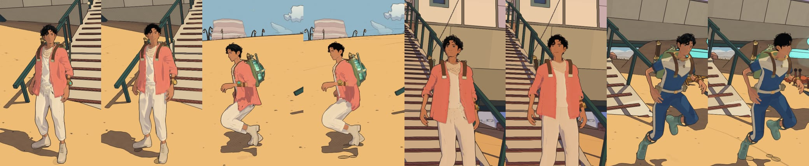

**What he costs in Unity** (the editor's batch, the desert's start, every pass a frame, 2 s each: BridgeRunner.RenderStats,
which reads the editor's own UnityStats where the profiler's counters stay 0, and now counts draw calls): v2 against
B3, +82–87 k triangles a frame over 10–14 M (all passes, every camera), the draws within the views' own noise (+24, +52,
−20, +126 of 2.5–8 k). His own, as the mirror makes them (one renderer a drawable, a draw a submesh a pass): 32 drawables
and 57 draws a pass against B3's 34 and 59, 111.6 k triangles against 103.3 k (his body and clothes 52.9 k in two
skinned meshes against B3's body, trousers and overshirt, 43.4 k in three; the portrait head 49.6 k in both); his shadow
casters 51 draws and 109.6 k triangles against 52 and 92.0 k (B3's overshirt cast through a shadow mesh of its own, not counted here). The pearl
diver 107.2 k, the salt pilgrim 111.0 k. `tests/unity-traveller-v2.test.js`.

## The sea from below (2026-10-20, issue #577)

In the Underwater City, looking up at the sea's surface from under the water (round the sea port's shaft, issue #572),
Unity drew it much paler than the web, crossed by streaks, where the web draws a deep even blue. Two of
water-shader.js `waterLook`'s terms the port's `waterLook` (Surface.shader) had left out:

- **The underside's colour.** Seen from behind (`!front`), the web lifts the shallows' tone toward the water's own
  `below` (`uWaterBelow`: the sea's `['#8fd0e4', 0.22]`, underwater-kit.js `seaSurface`); Unity always lifted it 0.45 of
  the way to near white (the web's default for a water with no `below`). `uWaterBelow` already crossed the bridge (port-format.js
  sends every `uWater…` uniform); WorldLoader.MakeMaterial now sets it as `_WaterBelow` (in the material's buffer,
  defaulting to the web's default) and the underside reads it.
- **The crests' fade** (`WATER_INK`): the web draws the wave crests only in the patches the wind ruffles (`paws`,
  `calm` of them between) and fades them out by 0.06–0.2 m a pixel; Unity drew every crest at full strength to the
  horizon, on both sides of the water: the streaks from below, and fine lines over the far sea from the deck (and over
  any wide water seen far off). Now the same numbers, before the underside returns. With them, the handheld's one scale
  of waves and no caustics (`_WaterLite`), as the web's `uWaterLite`.

The web's water rings (`uWaterRings`: round a splash) are still not in the port. Checked with the visual check's tools
on views of the sea (scripts/unity-compare unity.mjs and design-qc/capture.mjs: under the deck, the underside far from
the shaft and straight up, the deck from over the sea and from its rail, the Dock, the Whale Gallery, mid-shaft),
before (origin/main at 525324ffb) and after. tests/unity-sea-underside.test.js.

## Status

- **Stage 1, the spike**: the desert, built by `createDesert` inside GodotJS, mirrored to Godot
  nodes and drawn through a first ink port, saved as a PNG:
  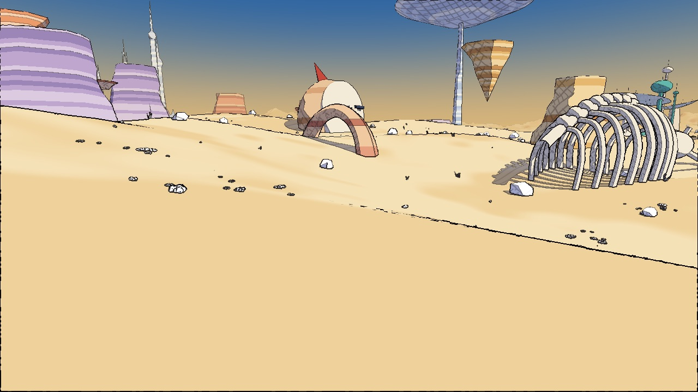
- **Stage 2, the Godot renderer**: the desert played in Godot through the bridge (above).
- **Stage 3, the Unity renderer**: the desert played in Unity through Puerts, drawn by the port's
  own ink look (above).
- **Stage 4, the comparison**: above.
- **Unity, stage 1 (a cheaper sync)**: above.
- **Unity, stage 2 (the platform layer, the HUD and conversations in uGUI)**: above.
- **Unity, stage 3 (the rest of the picture and the play: sound, life, weather, the tool and the
  drone, lights, motes, prints)**: above.
- **Unity, stage 4 (players: macOS, Linux, Android)**: above.
- **Unity, the web's newer look and the rest of the world** (the surface marks, the boxes, grass, wind, the
  answering flowers, MakeHuman people, the coral-shirt traveller, the cabs): above.
- **Unity, at or under the web** (the capes' cloth in Burst jobs, the sound on its own thread, the freezing
  off): above.
- **Unity, speed and the last of the look** (the script on its own thread, still subtrees frozen, the composite's
  passes by the look; the towers' per-vertex materials, the cliffs' cracks, the newest shading; the chip's portrait;
  faces close up): above.

### Remaining pointer controls (issue #574)

The Wardrobe frame is a drag target, separate from its scrollable outfit list. The galactic chart follows mouse movement and held touch, retaining the web’s first-hover and deliberate-sweep guard: merely opening the chart or tapping a hidden world does not discover it. Its normalized field coordinates scale with the native canvas.

What’s new’s **See what changed** opens the published interactive changelog in the system browser after an explicit click or tap. Unity does not embed the HTML page; returning from the browser resumes the existing menu. Batch review logs the URL without launching a browser. `-menu-pointer mouse|touch` drives the real Input System devices through preview dragging and the link; combine `-starmap search` for scanner dragging.

For device input verification, `-menu-pointer device-wardrobe`, `device-news`, or `device-scanner -starmap search` waits on the requested screen without injecting the tested drag or link press. These review plans disable gameplay save writes; the device check still backs up and restores the current store files.


### Galactic map viewport changes

The native map checks the current logical canvas before drawing, updating or reading a pointer.
A changed size rebuilds its chart and native cache version, preserves the scanner’s normalized
position and remaps a resolving world. Layout changes clear sweep/dwell qualification; they do not
count as searching. A fresh deliberate sweep and dwell can still chart a world after resizing.
The private `device-*` menu review plans drain physical pointer input during their hold instead of
waiting for a synthetic pointer step. This fixture correction is separate from normal gameplay input.


### Father hologram in installed players (#658)

The father's existing generated model is loaded from
`public/characters/father-v1/model.glb`. `BridgeBuild.Common` includes that exact
file in `StreamingAssets/hiraeth-js/public/characters/father-v1/` for every native
player. Its texture and rig are embedded in the GLB; no new character or hologram
behaviour is introduced. Repository-backed editor reviews can find a source asset
that an installed player lacks. Validate the built package inventory, deny repository
fallback in native review, and repeat cold starts through the prologue. These editor
checks simulate packaged lookup; they are not installed-app evidence. Confirm the
installed device separately when available, following manual-unlock and private-save
review rules.

Unity player API and script minimum are both 5 for this repair. Players at API 4
can run the JavaScript but do not carry this model; the script-only OTA archive
excludes `public/` and cannot supply it. The raised minimum makes those players
request a player update before accepting the new script. Android uses the existing
APK update path, and supported Deck launchers use the existing player updater.
Installing the replacement player preserves the existing application identity and
save location. The web/Capacitor native API is unchanged.
