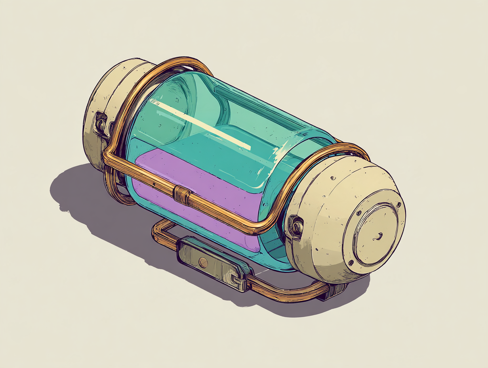

# Approved Makers’ battery reference — issue #728

The author selected this original Midjourney design on 2026-10-28 after reviewing back-worn and hip-worn options, then testing simpler variants. Their final instruction was: “the one we had earlier was the best one, let's go with that”. This is the third image (zero-based index 2) in job `de9db4aa-c35e-403f-952b-809076f4117c`, hearted in Midjourney. The later simplified batches are exploratory and do not replace it.

- [Issue #728](https://github.com/rnaud/hiraeth/issues/728)
- [Selected Midjourney image](https://www.midjourney.com/jobs/de9db4aa-c35e-403f-952b-809076f4117c?index=2)
- Original downloaded PNG: `approved-reference.png` (1232 × 928). Source, exact prompt, generation parameters, and SHA-256 are recorded in `manifest.json`.

## Agreed direction

- Replace the magic-backpack design with a **Makers’ battery worn at the hip**; the hip-lantern direction was explicitly preferred.
- **No tether, hose, cable, or cord** to the hand, wrist, or elsewhere. Retain this constraint when adapting the reference.
- Follow this selected image: a broad turquoise glass cylinder, visible lavender fluid, rounded cream ceramic endcaps, restrained brass rails/rims, and a compact mounting fitting.
- Preserve its Moebius / ligne claire character: fine dark ink contours, flat pastel colour, sparse hatching, and readable shapes. Do not substitute the photographic capsule renders or the earlier ornate lamp designs.
- The author considered simpler alternatives, then returned to this original. Do not continue simplifying it by default.

## Handoff to Claude

This commit records reference approval only. No model, gameplay, inventory naming, effects, animation, or Unity changes have been made. The existing issue owner can pick up implementation separately.

The image is an isolated object study, shown lying diagonally; it is not a verified worn view, orthographic sheet, or in-game screenshot. Hip placement and no tether are approved requirements, but exact body scale, docking orientation, articulation/clearance, hidden construction, and power-transfer behaviour are not specified by this picture. Do not treat dimensions mentioned in exploratory prompts as approved measurements.

Existing gameplay documentation still describes the current backpack. The implementation should reconcile that behaviour and the agreed visual direction rather than silently discarding abilities. Follow normal project requirements for tests, Unity parity, and an implemented-result changelog with actual running-game pictures when that work is done. This reference-only commit does not claim implementation or close the issue.
