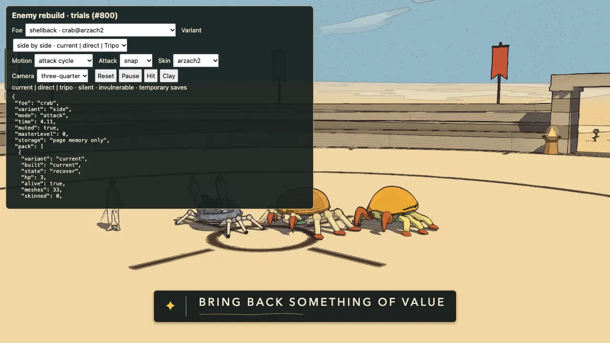
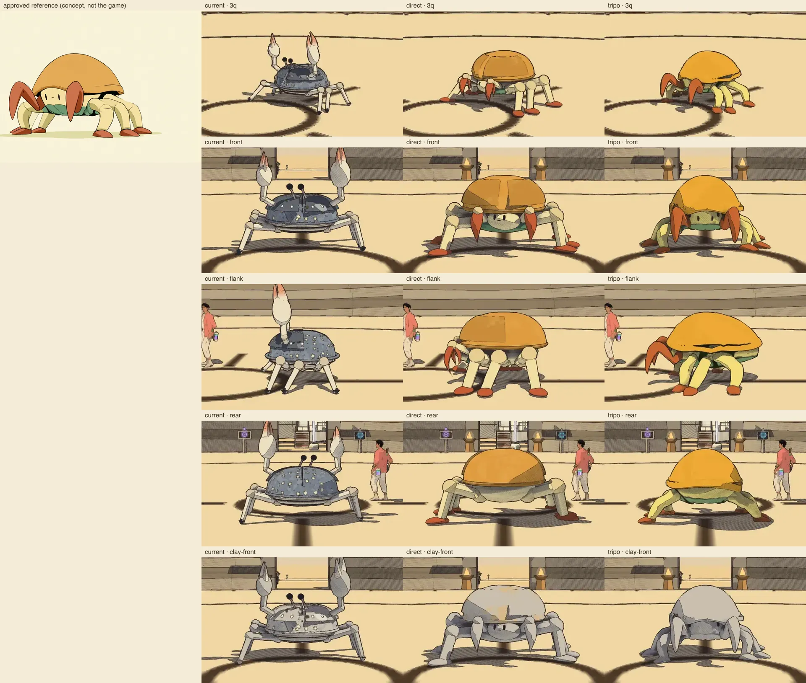
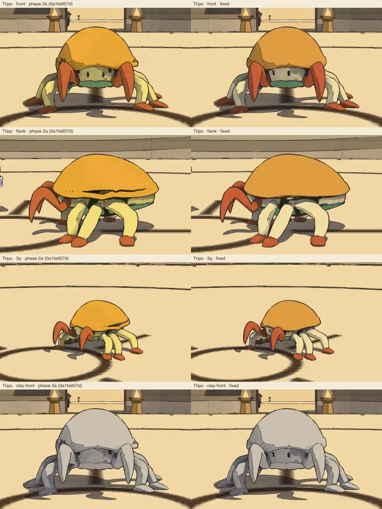
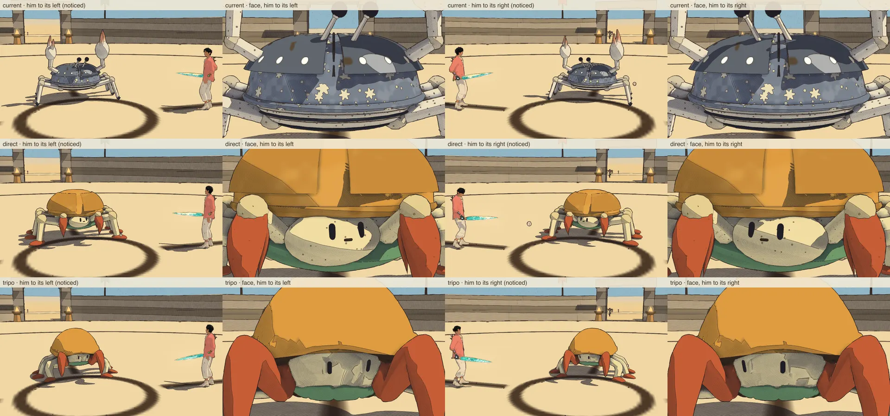
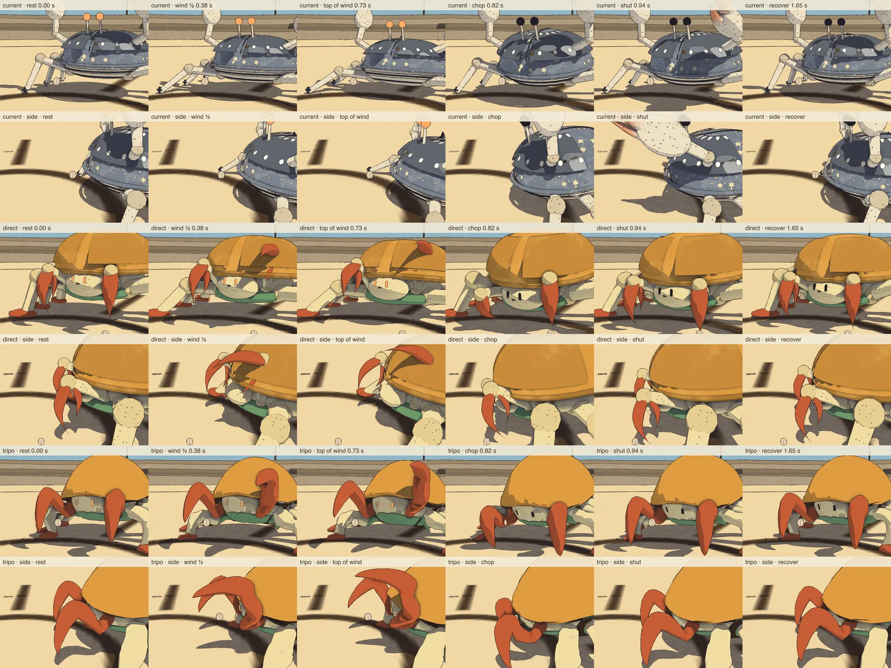
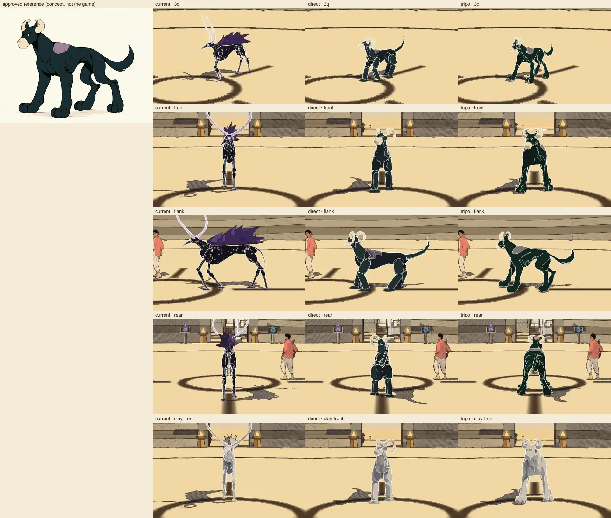
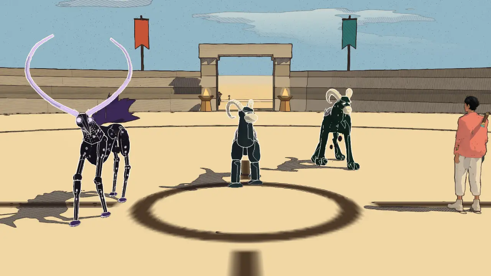

# Enemy rebuild trials (#800 phase 2)

The four trial foes, each as **current** (today's body), **direct** (built in game code) and **Tripo** (generated, then
put on the game's own rig family), compared in the real Arena with the game's renderer, light and ink. Phase 1's
pictures (`../baseline/`) are the current column. Nothing here is in the game's roster: the variants stand in for an
archetype's builder only in this page and these scripts (`src/enemies/plans/index.js` `TRIAL_BUILDERS`, empty in
the game). Web only: nothing the Unity build loads.

## The trial page

`PORT=5486 node references/enemy-redesign-2026-10-30/trials/serve.mjs`, then open
`/references/enemy-redesign-2026-10-30/trials/arena.html` (its own Vite, never 5173). Query: `foe=crab|hound|brute|mummer`,
`variant=current|direct|tripo|side`, `mode=idle|walk|turn|attack|hurt|death|fight`, `cam=q|side|front|rear|close|player`,
`quality=high|handheld`, `ui=0` (pictures). The page is muted when the Sound is built (`characterReview`, `hiraeth.muted`,
every volume 0; checked before anything plays), the traveller cannot be hurt, saves stay in the page's memory.
**Side by side** puts current, direct and Tripo 3 m apart on one clip clock (the same state at the same moment).
The panel picks the attack, the skin, the camera, and toggles a clay view (textures and colours off: baked light shows).
The shellback and the hound have direct and Tripo bodies; the wood cutter and mummer show current only until theirs land.

## The scripts

| Script | What |
|---|---|
| `variants.js` | `use(kind, variant)`, `preload()`, `inventory(group)`; the page, the capture and the bench all switch through it |
| `../baseline/baseline-shots.mjs --variant v [--extra]` | phase 1's capture, the same spot, camera, light and eight-frame strips; `--extra` front, flank, rear and clay stills; `side` the row of three |
| `../../../scripts/enemy-roster/bench.mjs --variant v` | the Arena bench with the pack built in that variant |
| `bench-trial.mjs`, `bench-table.mjs` | 1 and 6 of each variant and an empty control, High and Handheld, two rounds reversed; the table |
| `motion-audit.mjs` | `scripts/motion-audit`'s straight walk of each variant, full and half pace, in node |
| `sheet.mjs` | the stills at an equal size beside the approved reference |
| `page-shot.mjs` | a picture and the report of the trial page (a check that it loads, builds every variant and stays muted) |
| `shellback-tripo/generate.mjs` | the Tripo generation (API, the key from `.env` unprinted); the untouched export and the task record go to `../shellback/tripo/` |
| `shellback-tripo/prepare.mjs` | that export into the trial asset: the game's frame and size, the 12k LOD, the dome cut along its lip, the texture repainted flat by part, vertex colours, the landmarks |
| `shellback-tripo/model.js` | the Tripo body on the crab's rig (the custom skin: legs, claws with their inner finger, the face that turns to you) |
| `shellback-tripo/closeups.mjs` | the gaze picture (the traveller to its left, then its right) and the snap close-up (in front and side on), a row a variant |
| `gaze-shot.mjs` | the row of three idle and watching, the traveller to one side: a picture and each body's head/eye yaw toward him (gaze.js) |
| `hound-tripo/generate.mjs [--rig]` | the hound's Tripo generation, then Tripo's free rig check and its quadruped rig; exports and record to `../hound/tripo/` |
| `hound-tripo/prepare.mjs` | the rigged export into the trial asset: frame and size, flat texture, vertex colours, Tripo's weights gathered onto the game's bones, the 12k LOD, landmarks from the rig's joints |
| `hound-tripo/model.js`, `node-source.mjs` | the Tripo hound on the quadruped plan (bend-plane leg bones, its head the gaze's bone); the asset in node |

## Shellback (`crab`), phase 2a and its fixes

The author picked Tripo for the shellback (2026-10-30), with four fixes first: the dark seam at the dome's lip, the
inner pincer finger as its own bone, the leftover leg shading, and its look at the traveller ([the fixes](#the-tripo-fixes)).
Every picture and number in this section is of the fixed body, re-shot after them; phase 2a's are in git (`0a1fa957d`)
and in the before/after pictures.

Reference: `../shellback/e8102be7-014a-4a03-8150-394a7f722fec-2.png` (approved). Home skin arzach2. All pictures in
`shellback/`, captured 2026-10-30 on this branch, muted headless Chrome on this Mac (Apple M-series, Metal), High
preset, 1280×720, 10:00, clear; looked at one by one.

Strips (eight frames, game time in the labels): `crab-<variant>-<idle|walk|turn|attack|hurt|death>.webp`, the row of
three on one clock in `crab-side-*.webp`; stills `crab[-<variant>]-still-<3q|front|flank|rear|clay|clay-front>.webp`
(current: `crab-still-*`). The current strips are phase 1's (`../baseline/crab-*.webp`; re-captured here to check the
switch: mean difference 1.0/255 on the idle strip, WebP noise).

### What each is

- **Direct** (`src/enemies/plans/shellback.js`): an ochre lathe dome with a darker lip, a pale face peering out under
  it (two slit eyes in their own material, a short mouth), a fat green collar roll, six thick cream legs with round
  knees on broad red slipper feet, two big red pincers hanging in front, a hinged finger behind each blade. Every limb,
  the face and the collar one skinned mesh on the kit's joints (`skinBy`, colours as vertex tints); the dome, two scutes
  and the eyes their own. On the walker plan as today; the same snap/spin/burrow poses, guard tuck, flip, crack (the
  dome comes off) and death. The home skin wears the reference's colours; the six other skins keep their world's palette
  on the new body (the author may want them recoloured to the reference too); their props merged a material.
- **Tripo** (task `5f2aa15f-678e-4969-b6d9-39852b47c598`, image to model, H3.1, `texture_version` v3.5 with
  `delight: true` = Remove Lighting, PBR off, 30k face target; 28,432 triangles, 2048² JPEG; untouched in
  `../shellback/tripo/model.glb`). `prepare.mjs`: scaled to the direct body's 1.55 m crown, 12,000 triangles
  (meshoptimizer, zone borders and UV seams kept), the dome cut along its lip (12,592 triangles after the cut), a 1024²
  texture repainted in five flat colours (the reference's, the direct body's home skin's), COLOR_0 from it, landmarks
  measured from the mesh (the leg columns, the claws' geodesic bands, the lip's curve, the painted eyes). `model.js`:
  the kit's walker legs fitted to those landmarks (measured thigh and shin lengths), a custom skin, no humanoid
  skeleton: thigh, shin and foot bones framed in each leg's bend plane (`SkinLegs`, the Keeper's route), the collar and
  belly on the body, a face bone the gaze turns, each claw a shoulder, a blade and an inner finger; every vertex
  weighted to its nearest part and blended over 5 cm at the joints. The dome its own mesh in one flat colour (it
  cracks off), the two scutes copied off its front, two slit eyes on the face bone where the painted ones were. Other
  skins: the mesh's colour roles recoloured from the skin's palette (vertex colours).

### The Tripo fixes

1. **The dark seam at the dome's lip: cut by geometry.** Phase 2a took the dome's triangles by colour (ochre over the
   hips + 10 cm), so the cut ran ragged half way down the dome, the strip under it skinned to the thighs; from the side
   it showed as a jagged dark band (its lit and shadowed halves apart, and an ink line along it). Now `prepare.mjs`
   finds the lip itself: the dome's outermost point in each of 48 azimuths, a closed curve through them (a Fourier
   series of order 3, the stray points of a claw's root dropped), and the cut 2.5 cm under it. Every triangle across
   the curve is split exactly on it (323 edges), and what lies over it and joins the crown is the dome, its triangles
   first in the index (`landmarks.domeTriangles`, the curve in `landmarks.lip`). The dome is drawn in one flat colour;
   nothing under the lip is ochre (its underside dark, the face and back cream). Test: every dome vertex over the cut,
   its open edge on the cut within 1 mm. The flank still: no seam.
2. **The inner pincer finger: its own bone.** Walked out from where it joins the body (geodesic bands over the claw's
   red surface), each Tripo claw is a ball against the face's side, an inner finger rising from it to a knuckle at the
   top of the arch, and the blade hanging from the knuckle in front; the jaw is the gap under the arch. Phase 2a had
   the arm's pivot in the arch and the finger and ball left on the body, so the snap stretched the claw. Now the
   shoulder's pivot is where the ball joins the body, and the blade and the finger are each a bone hinged at the
   knuckle (`landmarks.claws`; a claw's bones take only red vertices). The snap opens the jaw at the top of the wind
   (the blade forward, the finger back: 0.59 → 0.96 m tip to finger, against the direct body's 0.20 → 0.54) and slams
   it shut in the chop (0.36 m), as the direct and current crabs do; at idle it twitches. Test: opens over 1.3×, shuts
   under 0.6× of open, the finger carries red vertices only.
3. **Leftover leg shading: out of the colours.** The k-means' nine colours were two ochres, two creams, a yellow-green
   and a darker ochre at the borders besides the five roles. `prepare.mjs` now gives each cluster its role by hue and
   repaints the texture by part, one flat colour a role, the reference's own (the direct body's home skin's: ochre
   `#df9f45`, cream `#f1e2ae`, red `#c75f3a`, green `#6f9d72`, dark `#3a2c22`); the texels between the UV islands are
   filled from their nearest island, so no other colour bleeds in at the smaller mips. Test: COLOR_0 holds exactly the
   five colours. The paler cream (Tripo's was a saturated `#f4e183`) is what took the yellow-green out of the legs'
   shade: the patches still on the legs and the dome's shaded side in the stills are the game's own light and shadow
   (they are in the clay view too, as on the direct body), not the colours.
4. **Its look at the traveller (the author's).** The painted eyes are painted out of the texture (prepare.mjs measures
   them first: two slits 3 × 9 cm at x ±0.14 m); two slit eyes of their size stand in their place, a little proud of
   the face along its normal, on a face bone. The face's vertices (an ellipsoid between the claws, eased out to its
   edge) ride that bone, which `src/enemies/gaze.js` turns toward the traveller (`turn`, 0.3 rad either way, as the
   direct body turns its face 0.45), and the eyes slide on it the rest of the way (`slide`, 3.5 cm). The crab plan has
   no head and the game's crab no body twist, so nothing else follows. The direct body already looked: its face group
   turns, the eyes fixed on it (checked here: ±0.45 rad). Between him 3.4 m to its left and to its right the eyes
   move 0.17 m on the direct body, 0.22 m on the Tripo one (the face ±0.3 rad, the eyes at their 0.7 reach). Test: for
   both, the face turns his way and the eyes go his way.

Phase 2a's Tripo body in the same frames (`closeups.mjs` run on `0a1fa957d`'s asset and model):
`shellback/crab-gaze-phase2a.webp`, `shellback/crab-snap-phase2a.webp` (the whole pincer swings, the seam shows side
on). The trial page after the fixes, side by side in the snap: `shellback/trial-page.webp`. The current
crab's raised claw leaves the snap's frame (it is a metre taller): its strips show it.

### Comparison

| Measure | Current | Direct | Tripo |
|---|---|---|---|
| Fidelity to the reference | slate dome on thin pointed legs, claws held high, eye stalks: not the reference | the reference's parts and colours; dome a little low and round, pincers slimmer, legs faceted (7-sided kit cylinders) | the closest silhouette: the half-egg dome, the face and collar under the lip, plump legs and slippers, the curved pincers; dome longer than the reference (Tripo's reading) |
| At combat distance (14 m, ink) | reads as a crab | reads: ochre dome on red feet | reads: ochre dome on red feet, cream legs, the dome's edge one clean line |
| Baked light (clay, unlit) | – | none (procedural) | none left in the colours (five flat ones, phase 2a's yellow-green and dark rim gone); clean geometry; the patches in the stills are the game's light and shadow, in the clay view too |
| Drawn meshes · triangles (one body, one pass) | 33 (67 built, batched) · 8,480 | 5 · 7,544 | 5 · 12,945 |
| Materials · texture memory | 8 · 0 | 4 · 0 | 3 · 5.33 MB (1024² RGBA8 + mips; the PNG is 20 KB of five colours) |
| Shipped bytes (raw · gzip) | `walker.js` 18.6 · 7.1 KB | `shellback.js` 19.4 · 7.5 KB | `tripo-lod.glb` 481 · 296 KB + `model.js` 23.6 · 8.8 KB + landmarks 3.6 KB (source export 1.39 MB) |
| Draws over the empty Arena, High, 1 · 6 | +99 · +594 | **+15 · +90** | **+15 · +90** |
| Triangles all passes, High, 1 · 6 | +25.5k · +152.8k | +23.0k · +135.9k | +38.8k · +233.1k |
| Draws, Handheld, 1 · 6 | +66 · +396 | +10 · +60 | +10 · +60 |
| Triangles all passes, Handheld, 1 · 6 | +17.1k · +102.0k | +15.2k · +90.6k | +26.1k · +155.5k |
| CPU ms, High, 1 · 6 | +0.35 · +1.00 | +0.25 · +0.80 | +0.55 · +1.00 |
| CPU ms, Handheld, 1 · 6 | +0.35 · +1.25 | +0.25 · +0.65 | +0.35 · +0.70 |
| GPU ms | not separable from the empty Arena at this load (deltas of either sign up to 3 ms, as in phase 1): no GPU claim | | |
| Walk (foot joints), full · half pace: slide m/m, worst | 0 · 0, 0 | 0 · 0, 0 | 0.012 · 0.018, 3 cm |
| Reach / lift (share of leg), cadence Hz, full pace | 0.21 / 0.23, 2.6 | 0.21 / 0.22, 2.5 | 0.18 / 0.22, 3.75 |
| Gait | alternating tripods [0,2,4] [1,3,5] | the same | the same; its legs 0.89 m (the mesh's) against 1.32 m, so quicker steps |
| Deformation | rigid parts | rigid parts in one skin (no stretch) | weights normalised, bind round trip < 0.1 mm, a shin bent alone moves only its leg (tests); the dome cut on its lip, no seam; the knees fold smoothly; the claw's blade and finger bend at the knuckle, its ball at the body |
| Snap (wind, strike, recover) | the near claw opens and draws back, snaps | the near pincer rears up and forward, finger open, then chops down shut (jaw 0.20 → 0.54 → 0.18 m) | the near pincer rears up and forward, the jaw open (blade forward, inner finger back), then chops down shut (0.59 → 0.96 → 0.36 m) |
| Looks at him (gaze) | its eye stalks lean to him | its face turns, ±0.45 rad, the eyes on it | its face turns, ±0.3 rad, and the eyes slide on it 3.5 cm (the painted ones painted out) |
| Hurt, death, lying body | as #797 | the same recipe: rings off the dome, then down on its belly, the pincers forward, dust | the same |
| Kept (both) | id `crab`, def and attacks, windows, guard, shell, sounds (`walker`/`shell`), deaths, size floor, ARMOUR plates, gaze, tells | ✓ | ✓ |
| Time (agent) | – | about 1 h (model 35 min, look fixes 25 min) | about 1.3 h (generation 1.5 min wall; prepare and inspection 25 min; rig and skin 35 min; fixes 15 min), then the four fixes about 1.5 h (the mesh's claws and lip measured 30 min, cut and repaint 25 min, bones and gaze 20 min, re-shoot and review 25 min) |
| Tripo credits | – | – | **30** (balance 1,825 → 1,795; no rig credits: the rig is the game's; the fixes no new generation) |

(Bench, re-run after the fixes: 28 runs, two rounds reversed, load 13.1–33.1 (other agents on the machine; each run
started under 25), `shellback/bench.jsonl`; the empty Arena itself draws 74 on High now against phase 2a's 87, so
compare the deltas. Walk: `motion-audit.mjs`, unchanged by the fixes. The audit's
own "lowest point" measure reads the direct body's flat red soles as sliding, 0.06–0.09 m/m: a flat sole has no
single lowest vertex and it hops heel to toe; its foot joints do not slide. The Tripo skin's bones sit outside the
kit's chains, so only its foot joints are measured.)

### Recommendation

**After the fixes (the author's pick, Tripo):** the four are done and the Tripo body keeps everything else it had
(the same mesh, legs, gait and cost: the cut adds 592 triangles, the colours and bones none). Its dome reads as one
clean shell from every side, its legs in the reference's flat cream, its jaw opens and shuts in the snap, and it looks
at the traveller with its face and eyes. Ready for the author to look at side by side again on the trial page
(`variant=side`); landing it in the game (the crab's builder, its six world skins, Unity) is the next step's.

Phase 2a's recommendation, as written then: **Tripo for the look, direct for the pipeline, one call for the author.** Side by side the Tripo body is the closer
picture of the approved shellback: its dome, face, collar, legs and pincers have the reference's soft, plump shapes;
the direct one has the right parts and colours but reads stiffer (faceted legs, slimmer pincers, a lower dome). On
cost both cut the crab's draws by 85 % (+15 against +99 a body on High; six: +90 against +594), which is what this
foe needed whatever won; Tripo carries 64 % more triangles, a 5.3 MB texture and 300 KB gzipped, and walks on shorter
legs (quicker steps, a slight 1–2 cm/m foot drift from the ankle frame). It has no moving pincer finger, a dark seam
where the dome is cut, and the other six world skins are recoloured from vertex colours rather than painted.

My recommendation: **take the Tripo shellback**, with three cleanups before it lands: close the dome seam (cut the dome
along the lip, not by colour), split the pincer's inner finger off as its own bone, and bake the leg shading out of the
flat palette (one cream, one shade). The direct body stays as the fallback and as the template for the other 25
foes, which the brief already builds direct.

### Not done

- The combat review's `defend.mjs` / `dodge.mjs` and the sound QC renders on the new bodies (their attacks, windows and
  sound keys are the crab's own, unchanged; the poses that carry the contact were checked in the strips and tests).
- Unity: neither body is wired there; the trial is web only. The Tripo asset carries COLOR_0 for the engines' VMs.
- After the fixes, still off on the Tripo body: the game's shadow map draws a jagged edge across the dome's shaded
  flank and the legs (both trial bodies, the clay view too: the shadows', not the mesh's); the face sits in the dome's
  shadow, so it reads grey where the reference's is lit; the face turns only 0.3 rad (its border is eased over 10 cm
  of the fused mesh, the claws' balls beside it: more would stretch it). The texture is flat now and could be 512²
  (1.3 MB, not 5.3); the six other world skins wear their role colours, the dome flat, no props.
- The other three trial foes (phase 2b and on). The mummer's T-pose was picked by the author on main (`0c2c1b7bc`,
  `../keep-mummer/tpose/`), so its Tripo trial can go ahead.

## Broad-pawed hound (`hound`), phase 2b

Reference: `../hound/5d7b275f-a6fd-4e34-a0fe-7c6d4ebc850a-1.png` (approved). Home skin eclipse. All pictures in
`hound/`, captured 2026-10-30 on this branch, muted headless Chrome on this Mac (Apple M-series, Metal), High preset,
1280×720, 10:00, clear; looked at one by one. The same page, capture, strips, stills, walk audit and bench as the
shellback; added for this foe: the pounce in the walk audit and `gaze-shot.mjs` (the author's rule, every Tripo body
looks at the traveller).

Strips: `hound-<variant>-<idle|walk|turn|attack|hurt|death>.webp` (the attack is the pounce), the row of three in
`hound-side-*.webp`; stills `hound[-<variant>]-still-<3q|front|flank|rear|clay|clay-front>.webp`; the gaze
`gaze-front.webp`; the page `trial-page.webp`. The current strips re-captured here match phase 1's
(`../baseline/hound-*.webp`, mean difference 1.3/255 idle, 1.1/255 walk: WebP noise). In the row's hurt strip only the
nearest body phases (the other two stand further from the traveller when the blow lands); each variant's own hurt strip
shows its phase into the pool and its rising again.

### What each is

- **Direct** (`src/enemies/plans/broad-hound.js`): a long deep-chested teal-black body (a lofted trunk, the withers
  high, the waist tucked, broad haunches), a mauve saddle lying on the withers, four thick legs (one long capsule a
  segment, the kit's cylinders taken off) on big round paws with three toes, a long four-jointed tail, a lofted neck, a
  head with pointed ears, a cream capsule muzzle over a hinged jaw, two pale slit eyes in their own material and two
  cream ram's horns curling round beside the head. No mane. On the quadruped plan as today; its shadow form kept (the
  pool with the head and horns rising out of it, lying in wait, stepping behind you, phased). The pounce: crouch, head
  and horns down, then the coil (rump up, tail stiff and quivering, jaw open in a snarl, a shiver) and the leap; the
  bite opens the jaw; the rake lowers the horns to one side. Two skinned meshes (dark, light) and the eyes: 3 draws
  standing. The other skins keep their world's palette on the new body (ink, antler colour for horns and muzzle,
  smoke for the saddle) and their props (drips, a halo, gold glints, a tangle of wire horns, thicker bleached horns).
- **Tripo** (task `09f5de9e-79ff-4d16-ab12-be8784944eb4`, image to model, H3.1, texture v3.5 with `delight: true` =
  Remove Lighting, PBR off, 30k face target; 28,584 triangles, 2048² JPEG; then Tripo's free rig check, `quadruped`, and
  its quadruped rig, task `66154a67-3bdc-426a-88ff-f1dc00b93ee9`; both untouched in `../hound/tripo/`). Tripo's rig is
  not used as a skeleton (54 joints, the left hind leg twice over, stray tail branches, unnamed joints), but its
  **weights are**: `prepare.mjs` gathers each Tripo joint onto the game bone along the same stretch (body, neck, head,
  four tail joints, each leg's thigh, shin and foot) and the landmarks are the rig's own joints. Scaled to the direct
  body's 1.69 m (horns' top), a 1024² texture flattened to seven colours (median, k-means), COLOR_0, 12,000 triangles
  (meshoptimizer; the weights ride on the kept vertices). `model.js`: the kit's quadruped legs fitted to those joints,
  bend-plane leg bones (`SkinLegs`, the shellback's route), the head's bone the gaze's own node, so the head turns to
  the traveller, with two slit eyes of their own on it over the painted ones; the same shadow form, pounce, coil and
  rake as the direct (the jaw is fused: the bite and snarl nod the head). One skinned mesh and the eyes: 2 draws
  standing. Other skins: the coat's shades, the saddle and the cream recoloured from the skin's palette (vertex colours);
  no halo, glints or drips props on it.

### Comparison

| Measure | Current | Direct | Tripo |
|---|---|---|---|
| Fidelity to the reference | a black stick-legged deer under a spiky violet mane, long antlers: not the reference | the reference's parts and colours (horns, cream muzzle, saddle, big paws, tail); legs and paws read as stacked capsules (boots more than paws), the muzzle a little like a bobbin, the tail a straight stick rising | the closest: the long body, muscled thick legs, big toed paws, the sickle tail, the saddle, the horn crescents and the muzzle; horns smaller than the reference, the head a little narrow |
| At combat distance (14 m, ink) | antlers and mane | a dark hound with pale horns and muzzle; reads a little toy-like | a dark hound on big paws, pale crescents at its head; reads as the drawing |
| Baked light (clay, unlit) | – | none (procedural) | clean; the flattened colours keep the coat's five greens (a little shading in the muscle folds), no hatching printed |
| Drawn meshes · triangles (one body, one pass, standing) | 22 · 4,738 | 3 · 10,084 | 2 · 12,224 |
| Materials · texture memory | 6 · 0 | 3 · 0 | 2 · 5.33 MB (1024² RGBA8 + mips) |
| Shipped bytes (raw · gzip) | `quadruped.js` 28.8 · 9.8 KB (with the lizard) | `broad-hound.js` 20.1 · 7.6 KB | `tripo-lod.glb` 645 · 370 KB + `model.js` 15.5 · 6.2 KB + landmarks 2.3 KB (source exports 1.23 + 1.41 MB) |
| Draws over the empty Arena, High, 1 · 6 | +18 · +93 | **+14 · +69** | **+14 · +69** |
| Triangles all passes, High, 1 · 6 | +7.3k · +22.8k | +10.0k · +37.2k | +9.6k · +37.6k |
| Draws, Handheld, 1 · 6 | +14 · +68 | +10 · +50 | +10 · +50 |
| Triangles all passes, Handheld, 1 · 6 | +3.7k · +15.9k | +5.3k · +25.2k | +7.0k · +26.2k |
| CPU ms, High, 1 · 6 | +0.10 · +0.05 | +0.70 · +0.40 | +0.05 · +0.40 |
| CPU ms, Handheld, 1 · 6 | +0.13 · +0.47 | −0.03 · +0.32 | −0.03 · +0.27 |
| GPU ms | not separable from the empty Arena at this load (deltas of either sign up to 2.7 ms): no GPU claim | | |
| Walk (foot joints), full · half pace: slide m/m, worst | 0.007 · 0.006, 2 cm | 0.009 · 0.012, 2 cm | 0.010 · 0.025, 3 cm |
| Reach / lift (share of leg), cadence Hz, full pace | 0.28 / 0.20, 3.75 | 0.28 / 0.20, 5.0 | 0.25 / 0.20, 5.9 |
| Gait | diagonal pairs [0,3] [1,2] | the same; legs 0.85 m against 1.25 m, so quicker steps | the same; legs 0.77 m (the mesh's) |
| Pounce (node, standing, 60 fps): planted-foot slip, bracing steps, crouch dip, leap rise, head forward | 0, 4, 0.42 m, 1.03 m, 0.36 m | 0, 4, 0.33 m, 1.01 m, 0.41 m | 0, 4, 0.31 m, 1.00 m, 0.30 m |
| Looks at the traveller (gaze.js, him 1–1.5 rad to its side) | head turns, yaw 0.55 (its reach) | head turns, yaw 0.55, the eyes ride on it (test both sides) | head turns, yaw 0.31–0.55, the eyes its own parts on the head's gaze bone (test both sides) |
| Deformation | rigid parts | rigid parts in two skins (no stretch) | Tripo's weights: normalised, bind round trip < 0.1 mm, a shin bent alone moves only its leg (tests); the shoulders and hams bend smoothly in the walk and leap; the left hind leg's two Tripo chains merged onto one bone |
| Hurt, death, lying body | phase into the ink pool; legs fold, ink puff | the same recipe and pool (the body hidden under it) | the same |
| Kept (both) | id `hound`, def and attacks (pounce with its coil cue, step behind, bite, rake below two thirds), windows, reach, `phase`, sounds (`quadruped`/`smoke`), death recipe, lying body, size floor, white contour on dark worlds, drips | ✓ | ✓ |
| Time (agent) | – | about 1.2 h (model 40 min, look fixes 30 min) | about 1.3 h (generation 1 min and rig 1 min wall; prepare and weight mapping 30 min; model 30 min; fixes 15 min) |
| Tripo credits | – | – | **55** (generation 30, rig check 0, quadruped rig 25) |

(Bench: 31 runs, two rounds reversed, load 12.6–35 (other agents' runs; waited over 25), `hound/bench.jsonl`; at the
bench's distance the hounds run as shadows part of the time (`phase`), so its triangles are less than a standing body's.
Walk and pounce: `motion-audit.mjs hound@eclipse`. The direct row re-benched after a fix: its skinned meshes hang on
the root and were drawn squashed under the pool while it was a shadow.)

### Recommendation

**Tripo.** Side by side the Tripo hound is the reference: its long muscled body, thick legs, big toed paws, sickle
tail and saddle are the drawing's, where the direct one has the right parts but reads as a toy of stacked capsules.
Tripo's own quadruped rig was worth its 25 credits for its weights (smooth shoulders and hams, which the direct's rigid
parts and the shellback's nearest-part weights do not give) but not for its skeleton, which is untidy; the game's bones
carry the weights. Costs are even: both draw +14 a body on High against today's +18 (six: +69 against +93) and
about +10k triangles over all passes; Tripo carries a 5.3 MB texture and 370 KB gzipped. Both look at the traveller.

Cleanups before it lands: larger horns (Tripo shrank them; scale the horn vertices about their root), the halo,
glints and drips props for the Garden of Spheres' and the Mangrove's skins, a little more leg (its 0.77 m legs step at
5.9 Hz at full chase), and its world skins checked in pictures (built and tested in node only). The direct body stays
as the fallback.

### Not done

- The combat review's `defend.mjs` / `dodge.mjs` and the sound QC renders on the new bodies (attacks, windows and sound
  keys are the hound's own, unchanged; the pounce, coil and rake poses were checked in the strips and tests).
- Unity: neither body is wired there; the trial is web only. The Tripo asset carries COLOR_0 for the engines' VMs.
- Pictures of the other three skins (mangrove, spheres, bazaar): built and tested in node only.
